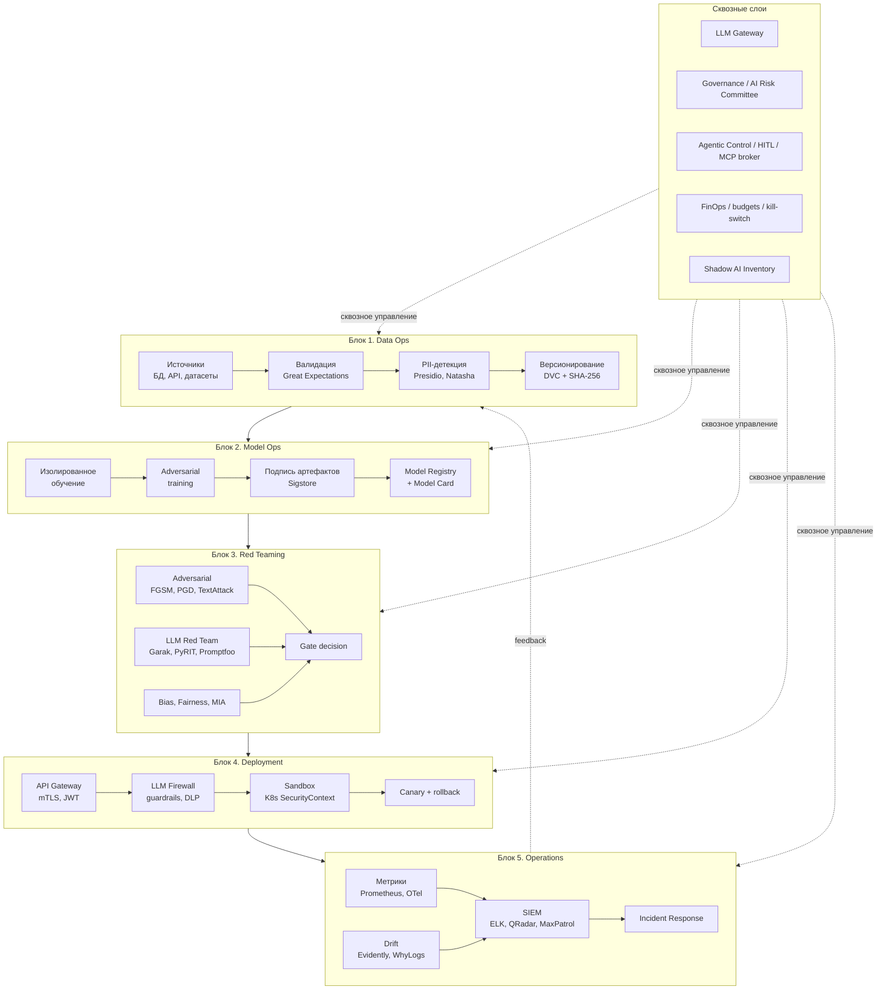
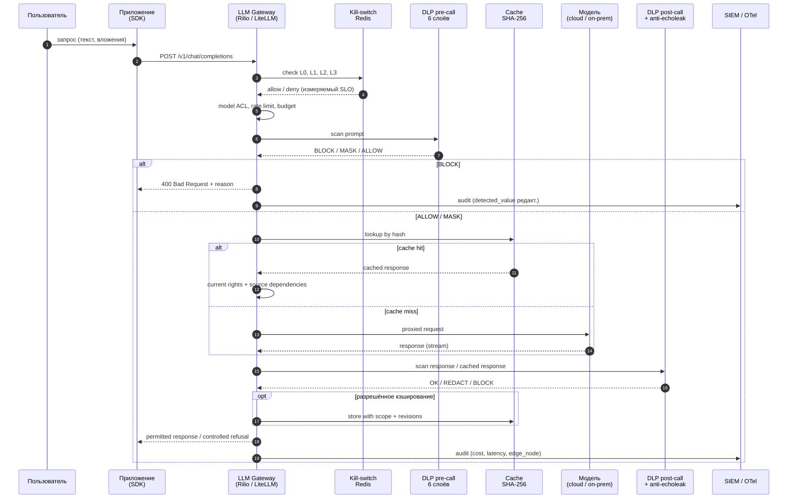
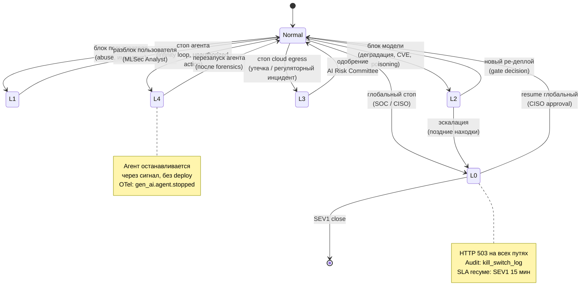
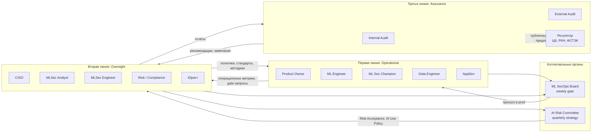
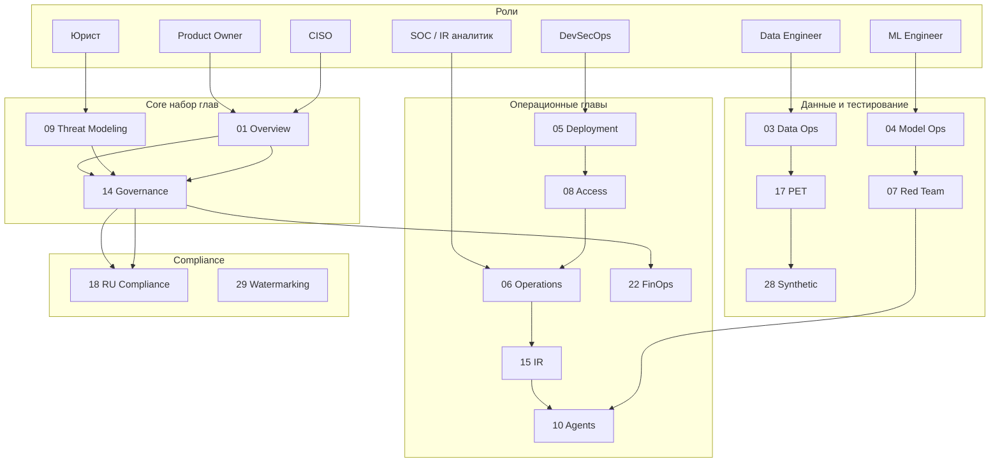

<a id="rekomendazii-ib-obzor-i-arhitektura-ml-secops"></a>

# Рекомендации ИБ: Обзор и Архитектура ML SecOps

> Версия: 2.1 · Обновлено: 2026-05-29 · Теги: архитектура, lifecycle, security-by-design, tiering, maturity, governance, agentic, gateway · Tier: 1-4
>
> Дополнено: 2026-11-13 — границы управления/модельного решения/исполнения, доказательства lifecycle и отдельная оценка customer utility; актуализированы подтверждённые источники и ограничения.
>
> **TL;DR**. Сквозная карта MLSec-программы для российской организации 2025-2026 гг.: пятиблочная архитектура жизненного цикла ML расширена сквозными слоями (LLM Gateway, Agentic-контур, Governance, FinOps), закрыта Three Lines of Defense, снабжена KPI/KRI, увязана с OWASP LLM Top 10 2025, OWASP Agentic Top 10 (ASI01-ASI10), NIST AI 600-1 (GenAI Profile), MITRE ATLAS (snapshot v2026.10), EU AI Act, 152/187/242-ФЗ и Приказами ФСТЭК 117/21/31/239.

<a id="soderjanie"></a>

## Содержание

1. [Ландшафт MLSec 2025-2026](#1-landsaft-mlsec-2025-2026)
2. [Что такое ML SecOps и чем отличается от DevSecOps](#2-cto-takoe-ml-secops-i-cem-otlicaetsa-ot-devsecops)
3. [Архитектура ML SecOps: пять блоков + сквозные слои](#3-arhitektura-ml-secops-pat_-blokov-skvoznye-sloi)
4. [Пять блоков жизненного цикла](#4-pat_-blokov-jiznennogo-zikla)
5. [Сквозные слои: LLM Gateway, Agentic, Governance, FinOps, Shadow AI](#5-skvoznye-sloi-llm-gateway-agentic-governance-finops-shadow-ai)
6. [Threat modeling: STRIDE-AI, MITRE ATLAS, MAESTRO, LINDDUN](#6-threat-modeling-stride-ai-mitre-atlas-maestro-linddun)
7. [Фреймворки и стандарты](#7-frejmvorki-i-standarty)
8. [Обязательные контроли по блокам](#8-obazatel_nye-kontroli-po-blokam)
9. [Модель зрелости MLSec 0-4](#9-model_-zrelosti-mlsec-0-4)
10. [KPI и KRI для MLSec-программы](#10-kpi-i-kri-dla-mlsec-programmy)
11. [Организационная структура: Three Lines of Defense и RACI](#11-organizazionnaa-struktura-three-lines-of-defense-i-raci)
12. [Интеграция с корпоративной ИБ](#12-integrazia-s-korporativnoj-ib)
13. [Карта соответствия регуляторике](#13-karta-sootvetstvia-regulatorike)
14. [Roadmap 90/180/365](#14-roadmap-90180365)
15. [Чеклисты готовности](#15-ceklisty-gotovnosti)
16. [Типичные ошибки внедрения](#16-tipicnye-osibki-vnedrenia)
17. [Связи с другими главами](#17-svazi-s-drugimi-glavami)
18. [С чего начать по вашей роли](#18-s-cego-nacat_-po-vasej-roli)
19. [Приложение A. Шаблон MLSec-политики верхнего уровня](#prilojenie-a-sablon-mlsec-politiki-verhnego-urovna)
20. [Приложение B. Референс-стек MLSec для РФ (2026)](#prilojenie-b-referens-stek-mlsec-dla-rf-2026)

---

<a id="1-landsaft-mlsec-2025-2026"></a>

## 1. Ландшафт MLSec 2025-2026

За 2024-2026 гг. позиционирование MLSec сместилось с «редкой экзотической дисциплины» на «обязательный слой корпоративной ИБ»: в организациях используются как обычные inference API, так и агентские сценарии с tools и memory. Частоты внедрения без определённой выборки и первичного исследования здесь не оцениваются. Одновременно произошёл сдвиг в угрозах: prompt injection, экстракция системных промптов, агентские misrouting и утечки через MCP вышли из академических статей в повседневные инциденты.

<a id="11-klucevye-sdvigi-za-2024-2026"></a>

### 1.1. Ключевые сдвиги за 2024-2026

**Регуляторный слой.** EU AI Act действует с августа 2024: запреты (ст. 5) применяются с февраля 2025, обязательства для провайдеров GPAI с августа 2025 (GPAI Code of Practice опубликован 10.07.2025, добровольный; к нему присоединился ряд крупных провайдеров), после вступления Digital Omnibus on AI 27.07.2026 требования к high-risk Annex III применяются с 02.12.2027, а к Annex I — с 02.08.2028; Art. 50 применяется с 02.08.2026. В РФ продолжает развиваться регулирование ИИ: Национальная стратегия развития ИИ (Указ № 490) обновлена в 2024, экспериментальный правовой режим по 258-ФЗ активно применяется, 716-П Банка России устанавливает требования к системе управления операционным риском в кредитных организациях и банковских группах, а не отдельный универсальный стандарт MRM для всех компаний, ФСТЭК и ФСБ готовят методические рекомендации по защите ИИ-систем для КИИ. В США нельзя считать январский AI Diffusion Rule 2025 действующим без оговорок: [BIS объявил отзыв и неприменение правила в мае 2025](https://www.bis.gov/press-release/department-commerce-rescinds-biden-era-artificial-intelligence-diffusion-rule-strengthens-chip-related); актуальные экспортные ограничения нужно проверять отдельно. Принят ряд штатных законов (Colorado AI Act, Illinois HB3773), на федеральном уровне Executive Order 14179 (январь 2025) отменил предыдущий EO 14110, NIST продолжает публикации серии AI 100/600.

**Стандарты и фреймворки.** Матрицы этой главы используют OWASP LLM Top 10 2025 (LLM01-LLM10); уже опубликована [редакция 2026](https://genai.owasp.org/resource/owasp-genai-llm-top-10-2026/), перенос покрытия на неё требует отдельной проверки; OWASP Agentic AI Security Project выпустил издание 2026 Top 10 for Agentic Applications (ASI01-ASI10) для автономных систем; [MITRE ATLAS v2026.10 от 28.10.2026](https://github.com/mitre-atlas/atlas-data/releases/tag/v2026.10) закреплён как snapshot каталога; data format 6.1.0 — версия формата, не версия покрытия контролями. Идентификаторы и применимость угроз сверяются по этому snapshot и [главе 23](23-mitre-atlas-ru.md); NIST AI 600-1 (GenAI Profile) вышел в июле 2024, ISO/IEC 42001:2023 (AIMS) получил промышленное применение, ISO/IEC 23894:2023 обновил руководство по управлению рисками, CSA опубликовала MAESTRO (Multi-Agent Environment Security, Threats, Risks and Outcomes) для мультиагентных сценариев. CycloneDX ML-BOM (актуальная версия спецификации 1.7), Sigstore/cosign стали стандартом подписи контейнеров и моделей.

**Угрозы.** Массово фиксируются: prompt injection через внешние документы и веб-контент (indirect PI), атаки на цепочку поставок моделей (backdoor в open-weight, slopsquatting типосквоттинг галлюцинаций), атаки на MCP-серверы (tool poisoning, описанные Invariant Labs в 2025), атаки на правила для код-ассистентов (Rules File Backdoor, Pillar Security, публикация 18 марта 2025), инциденты с production БД у агентов (кейс Replit Agent, июль 2025). DLP для LLM (анти-эхолик, анти-регургитация, защита system prompt) стал отдельной категорией решений.

**Экосистема инструментов.** В 2025-2026 сформировались три слоя контроля: LLM Gateway (Portkey, LiteLLM, Rilio, корпоративные форки) как единая точка прохода всех AI-запросов; guardrails-библиотеки (NeMo Guardrails, Guardrails AI, LlamaFirewall, Invariant; LLM-Guard, популярный в 2024–2025, в 2026 году заархивирован); red teaming для LLM (Garak, PyRIT от Microsoft, Promptfoo, коммерческие HiddenLayer и Bosch AIShield; Counterfit от Microsoft заархивирован в 2025 году). На стороне LLMOps закрепились MLflow Model Registry, Weights & Biases, Vertex AI Model Garden, в РФ: OpenData Hub, Cotype Server, GigaChain, YandexML.

**Агентский слой.** Появление Model Context Protocol (MCP, Anthropic, ноябрь 2024), A2A (Google, 2025) и аналогов превратило LLM-агентов из тонкого клиента над API в распределённые системы, где LLM принимает решения о вызове внешних инструментов. Это изменило профиль рисков: классическая модель «inference как API» недостаточна, агент одновременно является потребителем данных, клиентом внешних сервисов и источником действий, и Lethal Trifecta (untrusted input × чувствительные данные × внешнее действие) становится центральным шаблоном атаки.

**FinOps как ИБ.** Token flood и Denial-of-Wallet (см. [главу 22](22-finops-ai.md)) стали полноценным классом security-инцидентов: стоимость одного неконтролируемого бага в агенте измеряется миллионами рублей за сутки, бюджетные пороги интегрируются в kill-switch и SIEM.

<a id="klucevye-ai-inzidenty-i-sdvigi-spravocnik"></a>

#### Ключевые AI-инциденты и сдвиги — справочник

```widget:flashcards
{
  "id": "ch01-incidents",
  "title": "Инциденты, которые задали повестку 2024–2026",
  "description": "Сценарии угроз и ориентиры для контроля. Неподтверждённые частоты, суммы ущерба и детали инцидентов не используются как отраслевой benchmark.",
  "shuffle": false,
  "cards": [
    {
      "tag": "supply chain · 2024",
      "front": "Slopsquatting в pip / npm",
      "subFront": "Hallucinated package names",
      "back": "LLM-ассистенты массово предлагают import’ы несуществующих пакетов. Атакующие регистрируют эти имена с malware. Частота регистрации здесь не измеряется; сгенерированное имя не является доказательством существования или доверия к пакету.\n\nКонтроль: corporate PyPI с allowlist, pip-audit на каждый PR, ML-BOM с SHA-зависимостями."
    },
    {
      "tag": "MCP · 2025",
      "front": "Tool Poisoning",
      "subFront": "Invariant Labs, публикация 1 апреля 2025",
      "back": "Атакующие публикуют MCP-сервер с легитимной описательной частью, но скрытые инструкции в `description` поля tool заставляют LLM отдавать секреты или выполнять побочные действия.\n\nКонтроль: MCP broker с криптопиннингом бандлов, ручное ревью описаний tools, allowlist origin.\n\nИсточник: Invariant Labs, 01.04.2025 — исследовательская демонстрация tool-description poisoning. Это дата публикации, не установленная здесь дата первого exploit; анонимный учебный сценарий не является подтверждённым production-инцидентом."
    , "href": "https://invariantlabs.ai/blog/mcp-security-notification"},
    {
      "tag": "agent · 2025",
      "front": "Replit Agent дропнул прод-БД",
      "subFront": "Июль 2025",
      "back": "Публичный кейс Replit Agent, июль 2025, иллюстрирует риск агента с доступом к production state. Конкретная SQL-команда, основание действия и длительность простоя здесь не подтверждены и не используются как факты.\n\nКонтроль: независимая авторизация write-операций, separation dev/prod credentials, preview/approval и проверенный recovery-процесс."
    },
    {
      "tag": "code assistant · 2025",
      "front": "Rules File Backdoor",
      "subFront": "Rules files · публикация 18.03.2025",
      "back": "Pillar Security, публикация 18 марта 2025: PoC rules-file backdoor в исследованных Copilot/Cursor workflows. Недоверенная инструкция может повлиять на генерацию, если агент загружает файл как доверенное правило. Сам fork/clone не выполняет backdoor автоматически.\n\nCLAUDE.md — аналогичный канал риска конфигурации; это не утверждение, что он входил в исходный vendor PoC.\n\nКонтроль: review rules как код, provenance и точной версии, ограничение agent/tool permissions и проверка сгенерированных изменений."
    , "href": "https://www.pillar.security/blog/new-vulnerability-in-github-copilot-and-cursor-how-hackers-can-weaponize-code-agents"},
    {
      "tag": "EU AI Act · применимость",
      "front": "EU AI Act",
      "subFront": "Роль, категория и переходные положения",
      "back": "Регламент применяется поэтапно; кодекс GPAI — добровольный инструмент, не замена обязанностей. По Regulation 2026/1744 Chapter III Sections 1–3, кроме Art. 6(5), применяются к Annex III с 02.12.2027, к соответствующим Annex I системам с 02.08.2028.\n\nКонтроль: Legal фиксирует роль, Art. 2 / intended use / Art. 6; внутренний Tier ведётся отдельно. DPIA проверяется по GDPR Art. 35 и условиям обработки; FRIA — по actor/use/exceptions Art. 27, не автоматически для любого high-risk. Сохранить решение и evidence до применимого запуска."
    },
    {
      "tag": "регулятор РФ · 2026",
      "front": "716-П Банка России + 152-ФЗ",
      "subFront": "Операционный риск и применимость норм",
      "back": "716-П относится к системе управления операционным риском кредитной организации / банковской группы. Внутренние Tier, MRM, периодичность валидации и комитеты нельзя автоматически приписывать всему финсектору как прямые требования 716-П.\n\nКонтроль: карта применимости по виду организации и конкретным пунктам акта, владелец модели и проверяемый внутренний процесс. Сроки уведомлений определяются отдельно по объекту и типу события; см. главу 18."
    },
    {
      "tag": "ATLAS · 2026",
      "front": "MITRE ATLAS v2026.10",
      "subFront": "Snapshot каталога от 28.10.2026, format 6.1.0",
      "back": "Каталог включает RAG и агентные векторы: AML.T0070 — RAG Poisoning, AML.T0080 — AI Agent Context Poisoning, AML.T0081 — Modify AI Agent Configuration. Применимость определяется системой, а не диапазоном соседних номеров.\n\nКонтроль: связать выбранный ID с asset, attack path, executor/data policy и negative test. Обзор и версии — глава 23; количество записей не является coverage."
    },
    {
      "tag": "FinOps · 2024–25",
      "front": "Denial-of-Wallet",
      "subFront": "Класс инцидентов",
      "back": "Атакующий через token-flood / recursive RAG / ratelimit-bypass запускает миллионы запросов к платной модели — итоговая стоимость зависит от тарифов, concurrency, tools и времени обнаружения; универсальная сумма ущерба не приводится.\n\nКонтроль: per-user RPM, max-tokens, semantic cache, hard budget cap с kill-switch L0 (немедленная остановка через Redis-флаг, обходит deploy)."
    }
  ]
}
```

<a id="12-cto-eto-menaet-dla-slujby-ib"></a>

### 1.2. Что это меняет для службы ИБ

Классический периметровый стек не исчерпывает LLM-специфику: помимо сетевого контроля нужны проверки полномочий, контекста и действий. Видимость JSON payload зависит от конкретного proxy / DLP deployment, а не от формата JSON самого по себе. Три следствия:

1. **LLM Gateway централизует модельный трафик.** Он помогает применять auth, DLP, аудит, limits и routing; полномочия инструментов, доступ к данным и прямые network paths дополнительно контролируются в соответствующих сервисах. Сам факт наличия gateway не закрывает эти границы.
2. **Agentic-контур требует отдельной модели угроз.** Human-in-the-loop для необратимых действий (запись, оплата, удаление) становится архитектурным инвариантом, а не рекомендацией.
3. **Security Operations должны уметь работать с ML-сигналами.** Дрифт модели, срабатывания guardrails, аномальные последовательности промптов, скачки стоимости, шторм вызовов tool в MCP поступают в SIEM как отдельные источники событий и требуют обновления runbook-ов.

---

<a id="2-cto-takoe-ml-secops-i-cem-otlicaetsa-ot-devsecops"></a>

## 2. Что такое ML SecOps и чем отличается от DevSecOps

MLSec (ML SecOps) строит практики информационной безопасности вокруг жизненного цикла ML-моделей: сбор данных, подготовка, обучение, валидация, развёртывание, эксплуатация, декомиссия. Базовый тезис: помимо классических угроз (уязвимости кода, инфраструктуры, зависимостей) ML-системы подвержены специфическим атакам через данные (poisoning, скрытые триггеры), через логику модели (adversarial, evasion, jailbreak), через конфиденциальность обучающих данных (membership inference, model inversion, extraction), через цепочку поставок ML-артефактов (backdoor в open-weight, tampered adapters) и, для LLM, через интерфейс общения с пользователем (prompt injection прямой и косвенный).

<a id="21-sekzionirovanie-devsecops-vs-mlsecops"></a>

### 2.1. Секционирование: DevSecOps vs MLSecOps

| Ось | DevSecOps | MLSecOps | Новое в MLSec |
|---|---|---|---|
| **Объект защиты** | Код, конфигурации, инфраструктура | Код, данные, модель, артефакты обучения, промпты, контекст | Данные и модель как изменяемые артефакты с собственной провенансом |
| **SAST/DAST** | Bandit, Semgrep, ZAP | Bandit, Semgrep + ART, Garak, Promptfoo | Adversarial testing, prompt injection scan |
| **SBOM** | CycloneDX, SPDX | CycloneDX ML-BOM 1.6 + Model Cards + Data Cards | Маркировка данных и моделей в BOM |
| **Зависимости** | CVE в пакетах | CVE в пакетах + безопасность open-weight моделей, adapters, datasets | Подпись моделей (Sigstore Model Transparency) |
| **Supply chain** | npm/PyPI attack | npm/PyPI + Hugging Face, ONNX Hub, torrents с весами | Slopsquatting, backdoor в open-weight, trojaned adapters |
| **DLP** | Сеть, endpoint | Сеть + endpoint + LLM Gateway (prompt/response scan) | Анти-регургитация, маскирование PII в запросах |
| **Gate decision** | CI проходит/падает | CI + adversarial suite + bias/fairness + Model Card + DPIA | Формализованный ML SecOps Board |
| **Incident Response** | CVE, утечка, ransomware | + poisoning, extraction, jailbreak, MIA, prompt injection кампания, agentic breach | IR playbook для ML-инцидентов |
| **Runtime** | Falco, CrowdStrike | + guardrails, анти-эхолик, kill-switch L0-L4 | Пятиуровневый kill-switch |
| **Governance** | OWASP SAMM, BSIMM | + NIST AI RMF, ISO 42001, EU AI Act, AI Use Policy | AI Risk Committee |
| **Privacy** | GDPR, 152-ФЗ | + machine unlearning, DP, federated learning, TEE | Privacy Enhancing Technologies |
| **Аудируемость** | Логи приложения, CI | + прослеживаемость от датасета до ответа конкретному пользователю | Data lineage end-to-end |

<a id="22-tri-paradigmy-ml-secops"></a>

### 2.2. Три парадигмы ML SecOps

1. **Secure by Design**. Безопасность закладывается на этапе проектирования архитектуры: threat modeling (STRIDE-AI, MAESTRO, LINDDUN, MITRE ATLAS), классификация данных, определение Tier модели, выбор архитектурного шаблона (RAG vs fine-tune vs hybrid), определение trust boundaries.
2. **Secure by Default**. Безопасные конфигурации по умолчанию: отсутствие секретов в коде и образах, минимальные привилегии, отказы по умолчанию в guardrails, блок вместо allow-listing, audit-on by default, HITL для необратимых операций.
3. **Secure by Deployment**. Безопасность при развёртывании и эксплуатации: canary, rollback, мониторинг дрифта, SIEM-интеграция, периодические security reviews, continuous red teaming, Model Card и DPIA в актуальном состоянии.

К этим трём парадигмам в 2025-2026 добавился четвёртый слой **Secure by Observation**: телеметрический контур с versioned schema и минимизацией payload. OpenTelemetry помогает связывать события, но не гарантирует полноту записи и не является прямым требованием именно такой схемы в EU AI Act или 152-ФЗ; применимость норм определяется отдельно.

<a id="23-kontrol_nyj-vopros"></a>

### 2.3. Контрольный вопрос

```widget:quiz
{"id": "ch01-q1", "question": "Классический DevSecOps стек (Bandit + SAST + SCA + container scan) достаточен для ML-системы, если к нему добавить pip-audit и Trivy. Верно?", "options": ["Да: ML-код это обычный Python, и инструменты DevSecOps полностью покрывают угрозы", "Нет: помимо кода и зависимостей нужно закрывать данные (poisoning), модель (adversarial/extraction), промпты (injection) и подпись артефактов (ML-BOM, Sigstore)", "Нет, но только потому что DevSecOps не умеет сканировать Jupyter-ноутбуки", "Да, при условии что в compose добавлен gateway перед моделью"], "answer": 1, "explanation": "MLSec расширяет DevSecOps по шести осям: объект защиты (+данные и модель), SAST (+adversarial), SBOM (+ML-BOM), supply chain (+open-weight, adapters, datasets), DLP (+LLM gateway и анти-эхолик), governance (+AI Risk Committee, Tiering, DPIA). Gateway и Jupyter это частности."}
```

---


<a id="3-arhitektura-ml-secops-pat_-blokov-skvoznye-sloi"></a>

## 3. Архитектура ML SecOps: пять блоков + сквозные слои

<a id="31-karta-potokov-i-kontrolej"></a>

### 3.1. Карта потоков и контролей



<a id="31a-jivaa-karta-potoka-artefaktov"></a>

### 3.1a. Живая карта потока артефактов

Ниже схема одного прохода артефакта через пять блоков и сквозные слои. Жёлтые точки обозначают места проверки; анимация не подтверждает enforcement. Для каждого gate нужны scope, owner, policy revision и evidence положительного/отрицательного прохода.

<figure class="animated-lifecycle" role="img" aria-label="Анимированная схема потока ML-артефакта через пять блоков жизненного цикла">
<svg viewBox="0 0 880 295" xmlns="http://www.w3.org/2000/svg" xmlns:xlink="http://www.w3.org/1999/xlink" style="width:100%;height:auto;display:block">
  <defs>
    <path id="lc-seg-a" d="M 50 130 L 200 130" fill="none"/>
    <path id="lc-seg-b" d="M 200 130 L 370 130" fill="none"/>
    <path id="lc-seg-c" d="M 370 130 L 540 130" fill="none"/>
    <path id="lc-seg-d" d="M 540 130 L 710 130" fill="none"/>
    <path id="lc-seg-e" d="M 710 130 L 830 130" fill="none"/>
    <style>
      .lc-block { fill: var(--bg-2, #141414); stroke: var(--stroke-2, #2b2b2b); stroke-width: 1; }
      .lc-label { fill: var(--fg-0, #e5e5e5); font: 600 12px "JetBrains Mono", ui-monospace, monospace; text-anchor: middle; }
      .lc-sub   { fill: var(--fg-2, #808080); font: 500 10px "JetBrains Mono", ui-monospace, monospace; text-anchor: middle; }
      .lc-cross { fill: var(--bg-2, #141414); stroke: var(--stroke-1, #222); stroke-width: 1; stroke-dasharray: 4 3; }
      .lc-gate  { fill: var(--accent, #e8b931); stroke: var(--fg-0, #e5e5e5); stroke-width: 1.2; }
      .lc-edge  { stroke: var(--fg-2, #808080); stroke-width: 1.4; fill: none; }
      .lc-pulse { fill: var(--accent, #e8b931); opacity: 0.9; }
    </style>
  </defs>
  <rect class="lc-cross" x="30" y="30" width="700" height="32" rx="4" />
  <text class="lc-sub" x="380" y="50" style="font-size:11px">Сквозной: LLM Gateway · Governance · Agentic Control · FinOps · Shadow AI Inventory</text>
  <rect class="lc-cross" x="30" y="184" width="700" height="32" rx="4" />
  <text class="lc-sub" x="380" y="204" style="font-size:11px">Сквозной: Three Lines of Defense · AI Risk Committee · ML SecOps Board · Audit · IR</text>
  <path class="lc-edge" d="M 50 130 L 830 130" />
  <circle class="lc-pulse" r="4" cx="0" cy="0"><animateMotion dur="6s" begin="0s" repeatCount="indefinite"><mpath xlink:href="#lc-seg-a"/></animateMotion></circle>
  <circle class="lc-pulse" r="4" cx="0" cy="0"><animateMotion dur="6s" begin="1s" repeatCount="indefinite"><mpath xlink:href="#lc-seg-b"/></animateMotion></circle>
  <circle class="lc-pulse" r="4" cx="0" cy="0"><animateMotion dur="6s" begin="2s" repeatCount="indefinite"><mpath xlink:href="#lc-seg-c"/></animateMotion></circle>
  <circle class="lc-pulse" r="4" cx="0" cy="0"><animateMotion dur="6s" begin="3s" repeatCount="indefinite"><mpath xlink:href="#lc-seg-d"/></animateMotion></circle>
  <circle class="lc-pulse" r="4" cx="0" cy="0"><animateMotion dur="6s" begin="4s" repeatCount="indefinite"><mpath xlink:href="#lc-seg-e"/></animateMotion></circle>
  <rect class="lc-block" x="30" y="96" width="120" height="68" rx="6" />
  <text class="lc-label" x="90" y="125">Данные</text>
  <text class="lc-sub"   x="90" y="144">Presidio · DVC</text>
  <rect class="lc-block" x="175" y="96" width="120" height="68" rx="6" />
  <text class="lc-label" x="235" y="125">Модель</text>
  <text class="lc-sub"   x="235" y="144">Sigstore · SBOM</text>
  <rect class="lc-block" x="320" y="96" width="120" height="68" rx="6" />
  <text class="lc-label" x="380" y="125">Red Team</text>
  <text class="lc-sub"   x="380" y="144">Garak · PyRIT</text>
  <rect class="lc-block" x="465" y="96" width="120" height="68" rx="6" />
  <text class="lc-label" x="525" y="125">Deploy</text>
  <text class="lc-sub"   x="525" y="144">Gateway · Guardrails</text>
  <rect class="lc-block" x="610" y="96" width="120" height="68" rx="6" />
  <text class="lc-label" x="670" y="125">Operations</text>
  <text class="lc-sub"   x="670" y="144">OTel · SIEM · Drift</text>
  <circle class="lc-gate" cx="162" cy="130" r="4"><animate attributeName="opacity" values="0.3;0.9;0.3" dur="2.2s" begin="0s" repeatCount="indefinite"/></circle>
  <circle class="lc-gate" cx="307" cy="130" r="4"><animate attributeName="opacity" values="0.3;0.9;0.3" dur="2.2s" begin="0.4s" repeatCount="indefinite"/></circle>
  <circle class="lc-gate" cx="452" cy="130" r="4"><animate attributeName="opacity" values="0.3;0.9;0.3" dur="2.2s" begin="0.8s" repeatCount="indefinite"/></circle>
  <circle class="lc-gate" cx="597" cy="130" r="4"><animate attributeName="opacity" values="0.3;0.9;0.3" dur="2.2s" begin="1.2s" repeatCount="indefinite"/></circle>
  <path class="lc-edge" d="M 670 216 C 670 272, 90 272, 90 216" stroke-dasharray="3 3" />
  <text class="lc-sub" x="380" y="282">feedback: drift · инциденты · retrain</text>
</svg>
<figcaption>Жёлтые точки: gate-чекпоинты (data quality, signed artifacts, red team pass, policy ACL). Пунктирная обратная связь: инциденты и дрифт запускают переобучение и обновление threat model.</figcaption>
</figure>

<span id="32-pocemu-imenno-pat_-blokov-i-cetyre-skvoznyh-sloa"></span>

<a id="32-pocemu-imenno-pat_-blokov-i-pat_-skvoznyh-sloev"></a>

### 3.2. Почему именно пять блоков и пять сквозных слоёв

Пятиблочная декомпозиция отражает реальный порядок создания и жизни ML-артефакта: данные, модель, валидация, развёртывание, эксплуатация. Каждый блок имеет отдельного владельца, собственные метрики качества и конкретные контроли ИБ. Сквозные слои пересекают все пять блоков и отвечают на вопросы, которые невозможно закрыть внутри одного блока:

- **LLM Gateway**: единая точка аутентификации, DLP, аудита, маршрутизации, rate limit, kill-switch. Покрывает блоки 4 и 5, но настройки и политики определяются в 1-3.
- **Governance**: ответственность, классификация Tier, AI Use Policy, DPIA, Model Risk Management. Покрывает все блоки.
- **Agentic control**: HITL, MCP broker, sandbox для инструментов, kill-switch L4. Физически живёт в блоках 4 и 5, но проектируется в 2 и 3.
- **FinOps**: cost attribution, budgets, Denial-of-Wallet monitoring, token flood detection. Встроен в блок 5, интегрирован с kill-switch.
- **Shadow AI**: инвентарь, обнаружение, провижн-процесс. Сквозной: обнаруживается в блоке 5, исправляется через блоки 1-4.

Это функциональные блоки контроля, а не номера этапов проекта. В главах 02–06 используется другая ось: Stage 0 System Design → Data → Model → Deployment → Operations. Red Teaming и валидация проверяют несколько этапов; проектирование задаёт границы до начала работы с данными. Нумерацию блока нельзя подставлять вместо Stage в release manifest или ответственности команды.

<a id="kuda-otnesti-vas-risk-navigator-po-blokam"></a>

#### Куда отнести ваш риск — навигатор по блокам

```widget:decision-tree
{
  "id": "ch01-risk-block",
  "title": "В каком блоке жизненного цикла лежит ваш риск?",
  "start": "q1",
  "nodes": {
    "q1": {
      "type": "question",
      "text": "Опишите, на что направлен риск, который вы анализируете.",
      "sub": "Идите по самому близкому варианту. Это поможет выбрать правильный набор контролей и владельца.",
      "choices": [
        { "label": "Утечка / искажение / отравление обучающих данных", "next": "leaf-b1" },
        { "label": "Бэкдор / эвазия / extraction обученной модели", "next": "leaf-b2" },
        { "label": "Прохождение модели через гейт качества и безопасности (red team / bias)", "next": "leaf-b3" },
        { "label": "Атака на endpoint в проде: prompt injection / DLP / DDoS", "next": "leaf-b4" },
        { "label": "Дрифт, аномалии, инциденты в эксплуатации", "next": "leaf-b5" },
        { "label": "Регуляторный / governance вопрос (DPIA, Tier, MRM)", "next": "leaf-cross" }
      ]
    },
    "leaf-b1": {
      "type": "leaf",
      "tone": "info",
      "title": "Блок 1. Data Engineering",
      "summary": "Риск в данных: poisoning, утечка PII, нарушение классификации (K0–K4). Владелец: Data Engineering, со-владельцы Юрист + SecOps.",
      "details": [
        "Контроли: Presidio/Natasha для PII, Great Expectations для схем, DVC + SHA-256 для версионирования",
        "Сквозные слои: Governance (классификация), FinOps (стоимость датасетов)"
      ],
      "links": [
        { "label": "Глава 03. Data Operations", "href": "/ch/03-stage1-data-operations" },
        { "label": "Глава 17. PET", "href": "/ch/17-privacy-enhancing-tech" }
      ]
    },
    "leaf-b2": {
      "type": "leaf",
      "tone": "info",
      "title": "Блок 2. Model Development",
      "summary": "Риск в обучении и модели: backdoor через скомпрометированный pickle, adversarial vulnerability, supply chain (open-weight). Владелец: ML Engineers, со-владельцы MLOps + DevSecOps.",
      "details": [
        "Контроли: Sigstore Model Transparency, ART/TextAttack для adversarial training, изоляция обучения",
        "Сквозные слои: Governance (Model Card), FinOps (compute budget)"
      ],
      "links": [
        { "label": "Глава 04. Model Operations", "href": "/ch/04-stage2-model-operations" },
        { "label": "Глава 19. Training Infra", "href": "/ch/19-training-infrastructure" }
      ]
    },
    "leaf-b3": {
      "type": "leaf",
      "tone": "info",
      "title": "Блок 3. Red Team & Validation",
      "summary": "Риск проходит через гейт: bias, fairness, robustness, прайвиси-атаки. Владелец: QA + MLSec Analyst, gate-decision у ML SecOps Board.",
      "details": [
        "Контроли: Garak / PyRIT / Promptfoo для LLM red team, ART для классических CV/NLP, Membership Inference тестирование",
        "Сквозные слои: Governance (gate-критерии), Agentic (red team agent-loop)"
      ],
      "links": [
        { "label": "Глава 07. Red Teaming", "href": "/ch/07-red-teaming-testing-methods" },
        { "label": "Глава 23. MITRE ATLAS", "href": "/ch/23-mitre-atlas-ru" }
      ]
    },
    "leaf-b4": {
      "type": "leaf",
      "tone": "warn",
      "title": "Блок 4. Deployment",
      "summary": "Риск на проде: prompt injection, DLP-эхолик, DDoS / Denial-of-Wallet, кражa system prompt. Владелец: MLOps + DevSecOps, со-владельцы SecOps + Application Team.",
      "details": [
        "Контроли: LLM Gateway (Rilio/LiteLLM), guardrails (NeMo Guardrails / LlamaFirewall), kill-switch L0–L4, mTLS",
        "Сквозные слои: LLM Gateway (центральный), Agentic Control (для агентов), FinOps (Denial-of-Wallet)"
      ],
      "links": [
        { "label": "Глава 05. Deployment", "href": "/ch/05-stage3-model-deployment" },
        { "label": "Глава 12. Detection & Protection", "href": "/ch/12-detection-protection-cicd-llm" }
      ]
    },
    "leaf-b5": {
      "type": "leaf",
      "tone": "warn",
      "title": "Блок 5. Operations",
      "summary": "Риск в эксплуатации: дрифт, инциденты, аномалии в логах guardrails, скачки cost, шторм tool-calls. Владелец: MLOps SRE + SecOps + MLSec Analyst, дежурство у SOC.",
      "details": [
        "Контроли: Evidently/WhyLogs (дрифт), OTel GenAI traces, runbook L1/L2/L3, IR playbook",
        "Сквозные слои: Governance (KRI/KPI), FinOps (бюджет), Shadow AI (обнаружение)"
      ],
      "links": [
        { "label": "Глава 06. Operations Platform", "href": "/ch/06-stage4-operations-platform" },
        { "label": "Глава 15. Incident Response", "href": "/ch/15-ai-incident-response" }
      ]
    },
    "leaf-cross": {
      "type": "leaf",
      "tone": "info",
      "title": "Сквозной слой: Governance",
      "summary": "Регуляторные / governance риски пересекают все 5 блоков. Tier модели, privacy/impact assessment, AI Use Policy и внутренний MRM — сквозная подсистема; применимость 716-П проверяется отдельно по виду организации.",
      "details": [
        "Контроли: AI Risk Committee, Three Lines of Defense, Model Card, AI inventory, DPIA",
        "Связки: блок 2 (создание Model Card) → блок 3 (gate decision) → блок 4 (deployment Tier) → блок 5 (KRI мониторинг)"
      ],
      "links": [
        { "label": "Глава 14. Model Risk Governance", "href": "/ch/14-model-risk-governance" },
        { "label": "Глава 18. Российский compliance", "href": "/ch/18-ru-compliance-deep" }
      ]
    }
  }
}
```

<a id="33-skvoznye-prinzipy"></a>

### 3.3. Сквозные принципы

Через все пять блоков и сквозные слои проходят фундаментальные принципы:

- **Неизменяемость артефактов**: датасеты и модели хешируются (SHA-256) и подписываются (Sigstore/cosign, GPG) при создании, любая мутация создаёт новую версию.
- **Минимальные привилегии (PoLP)**: для каждого компонента пайплайна (DAG-runner, training job, inference pod, agent tool) отдельная сервисная учётка с минимальным набором прав.
- **Управление секретами**: HashiCorp Vault, Mozilla SOPS, cloud-native KMS; ни одного секрета в коде, образах, переменных окружения, prompt-шаблонах.
- **Shift-left security**: проверки запускаются на максимально раннем этапе (pre-commit, PR-time, CI gate до сборки артефакта).
- **Проверяемая аудируемость**: попытка, policy decision и outcome связываются с release/trace IDs. Пробелы sampling, потери exporter и недоступность внешних receipts учитываются явно; metadata не заменяются безусловным логированием всего содержимого.
- **Fail-closed для критичных путей**: отказ обязательного контроля блокирует запрос/действие независимо от cloud/on-prem. Исключение имеет ограниченный scope, срок и владельца Risk Acceptance, а не выводится из места размещения модели.
- **Human-in-the-loop для необратимых действий**: запись в системы учёта, платежи, отправка писем, удаление, изменение прав доступа требуют явного подтверждения человеком.

---


<a id="34-graniza-sistemy-upravlenie-resenie-modeli-i-ispolnenie"></a>

### 3.4. Граница системы: управление, решение модели и исполнение

**Требование:** защищается система, которая читает данные, выбирает маршрут и совершает действия, а не только LLM endpoint. В границу включаются приложение, identity provider, retrieval, memory, tools, очереди, provider fallback, batch jobs, кэши, ключи и операторы. Компонент вне схемы, но с доступом к тем же данным или credentials, остаётся частью поверхности атаки.

[OWASP Securing Agentic Applications V2 (10.11.2026)](https://genai.owasp.org/resource/securing-agentic-applications-v2/) охватывает secure architectures, identity/access, runtime protection, supply chain и assurance для single/multi-agent систем. Следующее разделение контуров — рабочая декомпозиция этой методики, не обязательная терминология OWASP.

| Контур | Назначение | Что не должно происходить |
|---|---|---|
| **Control plane: управление** | Версии policy, реестры моделей/tools, доверенные identity, маршруты, release / revoke / stop, budgets и назначения владельцев | Агент не меняет собственный allowlist, approval scope или ключи verifier |
| **Decision plane: решение модели** | Inference, retrieval-informed reasoning, выбор предлагаемого tool-call / ответа | Текст из документа, memory или LLM-output не становится разрешением на действие |
| **Execution / data plane: исполнение** | Чтение разрешённых данных, вызов конкретного инструмента, запись и выдача ответа | Executor не принимает `tenant_id`, credentials или расширение прав от модели без независимой проверки |
| **Evidence: наблюдение и проверка** | Связывание policy decision, попытки, фактического результата и версии release | Запись «модель решила вызвать tool» не выдаётся за подтверждённое выполнение |

Здесь **decision plane** означает модельное планирование / inference. Это не Policy Decision Point: решение авторизации принимает доверенный policy service / проверяемая логика, а executor применяет его к конкретному субъекту, ресурсу и аргументам. В [NIST SP 800-207](https://csrc.nist.gov/pubs/sp/800/207/final) Zero Trust не предполагает доверия только по сетевому расположению; тот же принцип нужен для «внутреннего» документа, tool server и модели on-prem.

**Проверяемые границы:**

1. User/session identity создаёт доверенный вход приложения; роли и tenant не выводятся из промпта. Delegation к подагенту сужает scope и срок, а не передаёт все права родителя.
2. Control plane публикует versioned policy. Runtime подтверждает принятую версию; недоступность policy store не разрешает использовать бесконечно старые grants.
3. Decision plane предлагает действие. Executor проверяет текущие права, schema, destination / egress, бюджет и нужное подтверждение, включая повторную проверку после ожидания в очереди.
4. Подтверждение связывается с конкретным действием и аргументами. Изменение получателя, resource ID, суммы или объёма данных требует нового решения; prompt-текст «approved by admin» не является approval record.
5. Фактическое исполнение возвращает outcome / receipt. Timeout не равен «операция не выполнялась»; перед retry нужны idempotency / reconciliation, иначе платёж, запись или отправка могут повториться.
6. Stop / revoke применяется к активным цепочкам, retry и очередям. Флаг в Redis или обновлённый YAML без проверки исполнителей не подтверждает остановку внешних эффектов.

**Негативные проверки:** injected документ просит изменить allowlist; подагент запрашивает более широкий токен; утверждённый tool-call меняет аргументы; истёк grant в очереди; provider fallback получает запрещённый класс данных. Во всех случаях проверяется поведение executor и состояние внешней системы, а не только отказ LLM в тексте.

Внутренние классы K0-K4 и Tier 1-4 описывают разные оси: чувствительность данных и критичность системы. Они не заменяют категории ПДн, УЗ ИСПДн, категорию значимости КИИ или специальный режим гостайны. В этой методике K4 — гостайна вне общего AI-контура; наличие КИИ не делает любую запись K4. Матрица классов и допусков — [глава 02](02-stage0-ml-system-design.md), правовая карта обработки — [глава 18](18-ru-compliance-deep.md).

<a id="35-ot-configured-k-verified-i-operated-odin-release-raznye-dokazatel_stva"></a>

### 3.5. От configured к verified и operated: один release, разные доказательства

**Требование:** состояние исходников, результат теста, подписанный кандидат и работающая система обозначаются отдельно. Успешный build или HTTP200 не означает, что production исполняет нужную policy, сохраняет isolation и выполняет задачу пользователя.

| Состояние | Достаточное evidence для этого состояния | Что остаётся непроверенным |
|---|---|---|
| **Спроектировано** | System boundary, permitted uses, threat model, owners, критерии приёмки | Реализация и исполнение |
| **Configured** | Candidate manifests: data/model bundle, policy, tools, dependencies и target topology с revisions | Контроли могут существовать только в конфигурации |
| **Verified** | Воспроизводимые positive/negative/failure tests этой комбинации в указанной среде | Другой deployment, workload или provider не наследует результат автоматически |
| **Released** | Подписанный digest кандидата, release decision и допустимый scope / exceptions | Кандидат ещё может не быть запущен |
| **Running** | Runtime readback: active image/model/policy revisions, identity, route и health | Краткий smoke не подтверждает длительную надёжность |
| **Operated** | Наблюдаемость, owner/on-call, workload SLO, stop/recovery drills, обработка изменений | Полезность для конкретного заказчика требует своей оценки |

Связь глав задаёт handoff-артефакты, а не список закупленных инструментов:

| Этап | Артефакт на выходе | Проверка на следующей границе |
|---|---|---|
| [03. Data Operations](03-stage1-data-operations.md) | Допущенный dataset release, permitted-use decision, preprocessing/split manifest, tombstone checkpoint | Training не берёт quarantine, изменённый или revoked snapshot |
| [04. Model Operations](04-stage2-model-operations.md) | Bundle base/adapter/tokenizer/runtime, attestation и независимый evaluation report | Проверяется digest всей комбинации, не только имя модели |
| [05. Serving](05-stage3-model-deployment.md) | Deployment plan и ожидаемые active revisions | Health, identity, policy enforcement, cache/streaming/fallback под целевой нагрузкой |
| [06. Operations](06-stage4-operations-platform.md) | Runtime readback, traces/metrics, SLO и drift signals | Обнаруживается расхождение running state с разрешённым release |
| [14. Governance](14-model-risk-governance.md) | Release decision с владельцем риска и сроком пересмотра | Неизвестное evidence не превращается в pass; исключения имеют scope / срок |
| [15. IR](15-ai-incident-response.md) | Containment и recovery evidence, причины отзыва | Старый «зелёный» release не возвращается без актуальной проверки |
| [22. Budgets](22-finops-ai.md) | Лимиты run/team, reservation/reconciliation и cost attribution | Retry, batch и подагенты не обходят общий бюджет |
| [31–36. Agents](31-ai-agents-overview.md) | Agent overlay: инструменты, delegation, memory, approvals и runtime states | Уточняет базовые требования, не создаёт параллельное право допуска |

**Release record** (рекомендуемая схема, не команда deployment):

```yaml
release_evidence:
  candidate_digest: "<bundle-sha256>"
  data_release: "<approved-dataset-release-id>"
  model_bundle: "<base-adapter-tokenizer-manifest-digest>"
  policy_revision: "<policy-digest>"
  tool_registry_revision: "<registry-digest>"
  target_environment: "<environment-id>"
  verification_report: "<report-digest-and-scope>"
  release_decision: "<decision-record>"
  observed_runtime:
    deployment_revision: "<active-revision>"
    policy_revision: "<observed-policy-digest>"
    observed_at: "<timestamp>"
  operations_owner: "<on-call-role>"
  revocation_status_ref: "<control-plane-record>"
```

Evidence хранит метаданные и ограниченные ссылки, а не полный corpus, credentials или весь chain-of-thought. При изменении model/provider, tokenizer, policy, retrieval scope, tool description или route фиксируется impact и нужный объём повторной проверки. Изменение одной строки capability может быть существеннее смены build number.

[NIST SP 2400-102 E2026, Initial Public Draft от 09.11.2026](https://csrc.nist.gov/pubs/sp/2400-102/e2026/ipd) расширяет taxonomy/терминологию AML с акцентом на агентные системы. На 13.11.2026 это **проект для комментариев, не final и не обязательная норма**. Он полезен для уточнения attacker capabilities / lifecycle stage в threat model; существующие final AI 100-2 и AI RMF не заменяются проектом автоматически.

**Приёмка handoff:** на одном trace/candidate проследить источник→dataset release→model bundle→release decision→active runtime→tool receipt. Затем повторить с revoked data release, несовпавшей policy revision и отказом audit/exporter. Ожидаемое поведение при каждом отказе определяется заранее; отсутствие записи из-за sampling нельзя автоматически трактовать как отсутствие действия.

<a id="36-cetyre-rezul_tata-ozenki-transport-correctness-operations-i-utility"></a>

### 3.6. Четыре результата оценки: transport, correctness, operations и utility

Один процент «готовности» скрывает разные причины успеха и отказа. Для владельца системы нужны четыре независимых результата, включая ограничения выборки и scope:

| Результат | Что измеряем | Что нельзя заключить |
|---|---|---|
| **Transport / protocol** | Ответы API, формат, latency, delivery и завершение stream | HTTP200 не доказывает правильность ответа или допустимость действия |
| **Content / action correctness** | Решение задачи, поддержанные цитаты, корректность аргументов и policy compliance на тестовых сценариях | Одна clean accuracy не подтверждает безопасность tools / данных |
| **Operational non-regression** | Ошибки, p95/p99, очередь, отмена, tenant isolation, recovery и расход ресурсов | Зелёный функциональный тест не исключает деградацию под нагрузкой |
| **Economic / customer utility** | Успешные бизнес-задачи, время пользователя, ручные исправления и полная стоимость результата | Токены дешевле или быстрее генерация не означают выгоду заказчика |

**Методика сравнения candidate и baseline:**

1. До эксперимента согласовать целевую пользовательскую задачу, правила успеха, запрещённые действия, population / workload и критерий минимально полезного эффекта.
2. Зафиксировать baseline и candidate revisions; контролировать различия контекста, retrieval, tools и policy. Результаты на разных задачах / тарифах не складывать как улучшение одной модели.
3. Измерять стоимость **успешной принятой задачи**, включая неуспешные попытки, retries, tools, infra, scanners и human review. Указать период, валюту / тарифные допущения и полноту cost telemetry; неизвестная стоимость не считается нулевой.
4. Раздельно показать sample sizes, uncertainty и важные сегменты: tenant, язык, сложность, класс данных. Рост aggregate может скрыть ухудшение для критичной группы.
5. Если quality / safety / operations не проходят обязательный gate, положительная экономия не компенсирует нарушение. Если customer utility не подтверждена, результат называется технически проверенным экспериментом в данном scope, а не успешным продуктовым внедрением.

**Пример решения:** candidate возвращает валидный JSON и экономит tokens, но пользователь чаще исправляет итог и дольше завершает задачу. Transport pass и техническая экономия сохраняются в отчёте; customer benefit не подтверждён, поэтому массовое расширение использования требует доработки / нового эксперимента. Подтверждение заказчика и разрешение на публикацию остаются отдельными событиями.

**Evidence для review:** task protocol и dataset revision, интервалы сравнения, независимые четыре строки результата, стоимость исправлений, known unknowns и решение владельца. Количество DLP-слоёв, процент заполненных чекбоксов и уровень L2 в модели зрелости не пересчитываются в вероятность отсутствия инцидента или процент юридического соответствия.

Границы, примеры handoff и методика этого раздела дополнены 13.11.2026. Они связывают главы справочника и требуют проверки на конкретной архитектуре; наличие раздела в документации не означает, что какой-либо deployment уже прошёл эти проверки.

<a id="4-pat_-blokov-jiznennogo-zikla"></a>

## 4. Пять блоков жизненного цикла

<a id="41-blok-1-upravlenie-dannymi-data-engineering"></a>

### 4.1. Блок 1. Управление данными (Data Engineering)

**Вход**: сырые данные из корпоративных БД, ETL, внешних API, публичных датасетов.
**Выход**: допущенный dataset release с provenance, разрешённым scope, preprocessing/split manifest, privacy-review и текущим revocation status; ненайденная PII не является доказательством обезличивания.
**Ответственные**: Data Engineering (владелец), Data Governance (политики), SecOps (контроль), Юрист (приватность).

Ключевые контроли: инвентарь источников и разрешённых целей использования, классификация данных (K0-K4 по внутренней policy; КИИ — отдельный признак объекта, не синоним гостайны), аутентификация источников (TLS/VPN/mTLS), предвалидация схем (Great Expectations), обнаружение и обработка PII (Presidio с явно настроенным языком и custom recognizers; маскирование не доказывает анонимность), сканирование на poisoning (статистический анализ, outlier detection, ART), версионирование (DVC, lakeFS) с отдельным проверяемым SHA-256 manifest, отслеживание data lineage (OpenLineage, Marquez). Подробно: см. [главу 03](03-stage1-data-operations.md).

<a id="42-blok-2-razrabotka-i-obucenie-modelej-model-development-amp-training"></a>

### 4.2. Блок 2. Разработка и обучение моделей (Model Development & Training)

**Вход**: датасет из блока 1, код обучения, конфигурация гиперпараметров, базовый образ.
**Выход**: проверяемый bundle модели/base/adapters/tokenizer + Model Card + provenance/attestation + независимый evaluation report, привязанный к digest этой комбинации.
**Ответственные**: ML Engineers (владелец), MLOps (инфраструктура), DevSecOps (CI/CD), SecOps (код-ревью).

Ключевые контроли: инициализация изолированного окружения (контейнер/VM с верифицированными базовыми образами, подписанными Sigstore), управление зависимостями (pip-audit, Safety, Snyk, corporate PyPI с allowlist), статический анализ кода (Bandit, Semgrep на предмет eval(), pickle.load(), path traversal, subprocess без санитайзинга), SAST для Jupyter notebooks (nbqa), обучение в песочнице с контролем ресурсов (Kubernetes Pod Security, SecurityContext runAsNonRoot), adversarial training для критичных моделей (ART, TextAttack), регистрация в реестре с хешированием, подписью (Sigstore Model Transparency, cosign) и Model Card. Подробно: см. [главу 04](04-stage2-model-operations.md) и [главу 19](19-training-infrastructure.md).

<a id="43-blok-3-testirovanie-validazia-i-red-teaming"></a>

### 4.3. Блок 3. Тестирование, валидация и Red Teaming

**Вход**: модель из блока 2, тест-суиты, adversarial-наборы.
**Выход**: отчёт о прохождении/непрохождении gate + Model Card дополнение.
**Ответственные**: QA + MLSec Analyst (владельцы), ML Engineers (разработка тестов), ML SecOps Board (gate decision).

Ключевые контроли: функциональное тестирование (unit/integration, edge cases, slicing), bias и fairness (statistical parity, equal opportunity, disparate impact, Fairlearn, AI Fairness 360), adversarial-тестирование (FGSM, PGD, C&W, TextAttack), red teaming для LLM (Garak, PyRIT, Promptfoo, HiddenLayer AIShield, ручные сценарии jailbreak), тесты на утечку данных (membership inference через ART, model extraction через запросы-клоны), автоматизированный gate decision в CI/CD (без прохождения gate артефакт не промоутится), документирование всех результатов в Model Card. Подробно: см. [главу 07](07-red-teaming-testing-methods.md) и [главу 23](23-mitre-atlas-ru.md).

<a id="44-blok-4-razvertyvanie-i-infrastruktura"></a>

### 4.4. Блок 4. Развёртывание и инфраструктура

**Вход**: верифицированная модель из блока 3, сертификаты, секреты, конфигурация окружения.
**Выход**: active runtime с проверенными identity, routing, policy revision и isolation; readback сопоставляется с разрешённым release, а не только с HTTP health.
**Ответственные**: MLOps + DevSecOps (владельцы), SecOps (периметр), Application Team (интеграция).

Ключевые контроли: аутентификация всех API (JWT, mTLS, OIDC через Keycloak/Auth0), валидация входных данных (Pydantic, JSON Schema), контейнерная изоляция (Kubernetes SecurityContext runAsNonRoot, readOnlyRootFilesystem, seccomp, AppArmor), NetworkPolicy (ограничение egress в том числе LLM-провайдерам, allowlist), сканирование образов (Trivy, Anchore, Grype), guardrails и DLP для LLM (NeMo Guardrails, LLM-Guard, собственный anti-echoleak), canary-релизы с автоматическим rollback (Argo Rollouts, Flagger), фильтрация PII в ответах, kill-switch L0-L4, secrets через Vault. Подробно: см. [главу 05](05-stage3-model-deployment.md).

<a id="45-blok-5-monitoring-audit-i-obratnaa-svaz_"></a>

### 4.5. Блок 5. Мониторинг, аудит и обратная связь

**Вход**: телеметрия инференса, логи gateway, события SIEM, метрики модели.
**Выход**: алерты, отчёты, тикеты IR, обновления в блоки 1-4.
**Ответственные**: MLOps (SRE-часть), SecOps (ИБ-часть), MLSec Analyst (ML-специфика), SOC (дежурство).

Ключевые контроли: метрики производительности (Prometheus, Grafana, latency, error rate, saturation), метрики качества и дрифта (Evidently AI, WhyLogs, Alibi Detect, data/concept drift), OpenTelemetry GenAI (gen_ai.system, gen_ai.request.model, gen_ai.usage.*, gen_ai.tool.*), централизованное логирование (ELK, Loki, корпоративный SIEM MaxPatrol/QRadar/Splunk), IDS-подобные детекторы ML-аномалий (паттерны fuzzing, systematic probing, shaped queries), единый дашборд MLSecOps, runbook-и для L1/L2/L3, Incident Response playbook-и с пятью tabletop-сценариями. Подробно: см. [главу 06](06-stage4-operations-platform.md) и [главу 15](15-ai-incident-response.md).

---

<a id="5-skvoznye-sloi-llm-gateway-agentic-governance-finops-shadow-ai"></a>

## 5. Сквозные слои: LLM Gateway, Agentic, Governance, FinOps, Shadow AI

<a id="51-llm-gateway-kak-zentral_nyj-arhitekturnyj-pattern"></a>

### 5.1. LLM Gateway как центральный архитектурный паттерн

LLM Gateway (Portkey, LiteLLM, корпоративные форки, Rilio) выступает единой точкой входа для всех LLM-запросов из корпоративной среды. Роль ИБ: Gateway превращает россыпь точечных интеграций в управляемую поверхность. Обязательные функции:

1. **Аутентификация и авторизация**. mTLS/JWT, проверка прав на конкретную модель, per-user и per-team квоты.
2. **DLP пре-call**. Regex + Presidio + LLM-classifier + corporate patterns; отказ критичного контроля закрывает соответствующий маршрут. Локальность модели сама по себе не разрешает fail-open.
3. **Маршрутизация**. Политики «data class K3+ → только on-prem», «задача с PII → только модели из реестра разрешённых».
4. **Кэш**. Exact/semantic cache с scope/revision прав, tenant, policy/model/corpus revisions и зависимостями ответа. Cache hit не обходит актуальную авторизацию и output controls.
5. **Rate limit и budgets**. Per-user RPM, per-team monthly spend, anomaly detection на скачки.
6. **Post-call DLP**. Анти-эхолик (ответ не должен содержать PII из системного промпта или истории), анти-регургитация (ответ не должен содержать дословно фрагменты обучающих данных из реестра).
7. **Audit log**. Достаточные metadata для расследования, минимизация содержимого и ограниченные ссылки на payload при необходимости; хранение полного prompt/response не является обязательным default.
8. **Kill-switch L0-L4**. Моментальная остановка без деплоя.

<a id="polnyj-put_-zaprosa-cerez-gateway-odin-cat-vyzov"></a>

#### Полный путь запроса через gateway (один чат-вызов)



Бюджет pre-call проверок определяется SLO задачи и измеряется отдельно от inference. Нельзя вывести p95 из количества слоёв или суммы средних latency: важны concurrency, очереди, объём текста, timeout и место исполнения. Async-запуск не гарантирует CPU-параллелизм детекторов.

<a id="kal_kulator-budjeta-zaderjki-gateway"></a>

#### Калькулятор бюджета задержки gateway

```widget:threshold-slider
{
  "id": "ch01-gw-latency",
  "title": "Сколько слоёв DLP вы можете себе позволить?",
  "description": "Учебная модель overhead, не результат измерений Rilio / VM 4 vCPU. Формулы показывают бюджетирование; число детекторов не задаёт процент покрытия OWASP и не прогнозирует p95 конкретного deployment.",
  "min": 1,
  "max": 8,
  "step": 1,
  "default": 4,
  "unit": " слоёв",
  "axisLabel": "Параллельных детекторов в pre-call DLP",
  "tracks": [
    {
      "label": "Условный overhead pre-call (мс)",
      "compute": "8 + 6 * Math.sqrt(x)",
      "format": "fixed1",
      "tone": "warn",
      "hint": "Иллюстративная формула. Реальные latency/timeout/CPU измеряются под целевой нагрузкой."
    },
    {
      "label": "Остаток условного gateway-бюджета (из 60 мс)",
      "compute": "60 - (8 + 6 * Math.sqrt(x))",
      "format": "fixed1",
      "tone": "info",
      "hint": "Это не бюджет model inference и не универсальный UX-limit. Конкретный SLO задаётся по пользовательской задаче."
    }
  ],
  "regions": [
    {
      "from": 1,
      "to": 2,
      "label": "Меньше детекторов: проверить gaps по угрозам",
      "tone": "err"
    },
    {
      "from": 3,
      "to": 4,
      "label": "Оценить независимость сигналов и false positives",
      "tone": "warn"
    },
    {
      "from": 5,
      "to": 6,
      "label": "Сопоставить стоимость, latency и measured detection",
      "tone": "ok"
    },
    {
      "from": 7,
      "to": 8,
      "label": "Больше детекторов не означает отсутствие обходов",
      "tone": "info"
    }
  ]
}
```

<a id="sest_-sloev-dlp-v-pre-kole-interaktiv"></a>

#### Шесть слоёв DLP в пре-коле, интерактив

Учебная анимация показывает план проверок: Play и Step подсвечивают заранее заданные этапы и сигналы. Здесь не исполняются DLP-scanners и не измеряется latency; схема не подтверждает recall, отсутствие утечек или безопасность отправки текста провайдеру.

```widget:dlp-layers
```

> [!tip]
> Для критичных controls применяется **fail-closed**: при отказе критичного контроля запрос блокируется или переводится только на заранее разрешённый ограниченный маршрут. **Fail-open** не выводится из on-prem: допустимость исключения, данные и действия фиксируются в Risk Acceptance; одного логирования недостаточно.

Референсная архитектура и конкретные реализации: [глава 08](08-access-secrets-management.md), [глава 12](12-detection-protection-cicd-llm.md), [глава 10](10-llm-agent-protection.md). Пример российского решения: Rilio (см. [13. Внедренческий плейбук](13-implementation-ru-playbook.md), раздел про LLM Gateway).

<a id="52-agentic-kontur"></a>

### 5.2. Agentic-контур

Агент (LLM + tool use + цикл планирования) требует отдельной архитектуры защиты: классическая модель «запрос-ответ» недостаточна, потому что агент одновременно потребитель данных, клиент внешних сервисов и источник действий. Базовый набор контролей:

- **HITL для необратимых операций**. Платежи, отправка писем, удаление, изменение прав доступа, выполнение кода вне sandbox, commit/push в репозиторий требуют явного подтверждения.
- **Sandbox для инструментов**. Каждый tool исполняется в ограниченном контексте (devcontainer, ephemeral VM, gVisor, Firecracker, Kata): cap-drop, seccomp, NetworkPolicy, read-only filesystem для не-writable tools.
- **MCP broker** (см. [главу 10](10-llm-agent-protection.md)). Централизованный прокси к MCP-серверам с подписью бандлов, криптопиннингом, аудитом вызовов, политиками «tool A доступен только для role X».
- **Trust boundary для источников данных**. Untrusted (user input, web, email, RAG над публичным контентом) vs trusted (внутренние системы). Пересечение trust boundary инструментом, имеющим доступ к чувствительным данным или внешним действиям, образует Lethal Trifecta и требует отдельного одобрения.
- **Kill-switch L4** (agent-level). Моментальная остановка конкретного агента через сигнал, а не через redeploy.
- **Ограничение числа шагов и бюджета tokens**. Бесконечный цикл планирования это инцидент.
- **Наблюдаемость цепочек**. OTel traces связывают prompt, planning, tool calls, tool results, final response в единый trace с trace_id, который попадает в SIEM.

<a id="lethal-trifecta-tri-okrujnosti-kotorye-nel_za-zamykat_"></a>

#### Lethal Trifecta: три окружности, которые нельзя замыкать

Термин Саймона Уиллисона (2025): сочетание (1) недоверенного входа, (2) чувствительных данных и (3) внешнего действия создаёт опасный attack path. Это не условие автоматического успеха любой injection; независимые executor/data controls могут блокировать последствия. Архитектурное правило: разрывать минимум одну окружность из трёх в любой точке цепочки.

<figure class="lethal-trifecta" role="img" aria-label="Диаграмма трёх пересекающихся окружностей Lethal Trifecta">
<svg viewBox="0 0 520 340" xmlns="http://www.w3.org/2000/svg" style="width:100%;max-width:520px;height:auto;display:block;margin:0 auto">
  <style>
    .lt-ring { fill: var(--bg-2, #141414); stroke: var(--fg-2, #808080); stroke-width: 1.4; fill-opacity: 0.55; }
    .lt-label { fill: var(--fg-0, #e5e5e5); font: 600 13px "JetBrains Mono", ui-monospace, monospace; text-anchor: middle; }
    .lt-sub   { fill: var(--fg-2, #808080); font: 500 10px "JetBrains Mono", ui-monospace, monospace; text-anchor: middle; }
    .lt-danger { fill: var(--accent, #e8b931); font: 800 14px "JetBrains Mono", ui-monospace, monospace; text-anchor: middle; opacity: 0.9; }
    @keyframes lt-danger-pulse { 0%,100% { opacity: .35 } 50% { opacity: .95 } }
    .lt-danger { animation: lt-danger-pulse 2s ease-in-out infinite; }
    @media (prefers-reduced-motion: reduce) { .lt-danger { animation: none; } }
  </style>
  <circle class="lt-ring" cx="190" cy="150" r="110" />
  <circle class="lt-ring" cx="330" cy="150" r="110" />
  <circle class="lt-ring" cx="260" cy="240" r="110" />
  <text class="lt-label" x="120" y="90">Untrusted input</text>
  <text class="lt-sub" x="120" y="108">user · web · email · RAG</text>
  <text class="lt-label" x="400" y="90">Private data</text>
  <text class="lt-sub" x="400" y="108">PII · secrets · IP</text>
  <text class="lt-label" x="260" y="310">External action</text>
  <text class="lt-sub" x="260" y="328">email · payment · SQL · API</text>
  <text class="lt-danger" x="260" y="190">LETHAL</text>
  <text class="lt-danger" x="260" y="210">TRIFECTA</text>
</svg>
<figcaption>Центральная область это одновременно «доверяем вводу», «имеем чувствительные данные» и «можем совершить действие». Контроль: HITL, разделение контекстов, capability dropping.</figcaption>
</figure>

**Как разрывать окружности на практике:**

| Разрыв | Техника | Пример применения |
|---|---|---|
| Untrusted input | content firewall, sanitization, strong prompt separation, tool-use ACL | Content из web/email проходит через отдельный LLM-суммаризатор, который не имеет доступа к инструментам |
| Private data | capability-scoped tokens, per-tenant RAG, derived artifacts | Агент получает результат SQL, а не credentials; RAG отдаёт chunks только текущего пользователя |
| External action | HITL, two-man rule, dry-run, transactional rollback | Платежи и SQL на write требуют подтверждения человеком; emails ставятся в очередь на ревью |

<a id="szenarij-ataki-na-agenta-posagovo"></a>

#### Сценарий атаки на агента, пошагово

```widget:attack-stepper
{
  "steps": [
    {
      "phase": "Задача",
      "technique": "Постановка задачи пользователем",
      "attacker": "В учебном сценарии пользователь просит резюме страницы и отправку в свой Slack-канал. Допущены чтение страницы через http_fetch и slack_send в личный канал; используются синтетические данные, реальных вызовов в виджете нет.",
      "defender": "Задать identity, допустимые источники, получателя и разрешённый эффект. Чтение внешней страницы не разрешает передавать ей закрытый контекст."
    },
    {
      "phase": "Ловушка",
      "technique": "Indirect prompt injection в web-контенте",
      "tactic": "OWASP LLM01",
      "attacker": "На странице размещена недоверенная инструкция о поиске тестового секрета и его передаче наружу. Она попадёт в контекст только если фактический parser/OCR/metadata pipeline извлечёт этот текст.",
      "defender": "Ограничить данные суммаризатора и обозначить происхождение содержимого. Его результат остаётся недоверенными данными; отсутствие tools у суммаризатора не доказывает безопасность следующих шагов."
    },
    {
      "phase": "Исполнение",
      "technique": "Агент следует инъекции",
      "tactic": "ATLAS AML.T0051",
      "attacker": "В условном уязвимом варианте модель принимает содержимое страницы за управляющую инструкцию и предлагает действие вне задачи пользователя. Успех не следует из одного наличия строки инъекции.",
      "defender": "Исполнитель отдельно проверяет текущие grants, объект, аргументы и назначение данных. Planner/executor separation не заменяет эту проверку."
    },
    {
      "phase": "Эксфильтрация",
      "technique": "HTTP-вызов на attacker-домен",
      "tactic": "ATLAS AML.T0086 — Exfiltration via AI Agent Tool Invocation",
      "attacker": "Если исполнитель допускает неподтверждённый получатель, тестовый секрет может уйти через http_fetch. Само предложение или лог запроса не доказывает передачу: нужен receipt контролируемого приёмника.",
      "defender": "Проверить адрес, допустимый ресурс и данные до вызова; доменный allowlist и DLP — дополнительные меры. Негативный тест запрещённой отправки и положительный тест разрешённого резюме должны проходить независимо."
    },
    {
      "phase": "Контроль",
      "technique": "HITL и аудит",
      "attacker": "Далее проверяют фактический эффект и scope инцидента, а не объявляют утечку или её отсутствие по одному ответу модели.",
      "defender": "Approval связывается с конкретными реквизитами и сроком; после изменения аргументов нужен новый допуск. Проверить revoke/stop, in-flight задачи и независимый readback; сохранять минимизированное evidence."
    }
  ]
}
```

Разбор атак и митигаций: [глава 10](10-llm-agent-protection.md), OWASP Top 10 for Agentic Applications (ASI01-ASI10, издание 2026, релиз 09.12.2025).

<a id="53-governance-i-model_-upravlenia"></a>

### 5.3. Governance и модель управления

Governance закрывает организационный слой: кто владелец модели, кто принимает риск, как классифицируется Tier, какие требования по сопроводительной документации.

- **Три линии защиты**. Первая: владельцы продуктов и разработчики (встроенный контроль). Вторая: ИБ, Risk, Compliance (надзор, политики, gate). Третья: внутренний и внешний аудит (независимая оценка).
- **AI Risk Committee**. Периодический орган с участием CISO, CTO, CDO, CRO, Юрист, представителей бизнес-подразделений. Повестка: одобрение моделей для промоушена в Tier 1, утверждение Risk Acceptance, пересмотр AI Use Policy.
- **Tiering Tier 1-4**. Tier 1: критичные для бизнеса, обрабатывают K3-K4 данные, принимают решения с автоматическим эффектом; Tier 4: вспомогательные, обрабатывают публичные данные, человек всегда в петле. Объём требований масштабируется от Tier 4 (минимум) к Tier 1 (максимум).
- **AI-BOM**. Полный CycloneDX ML-BOM для каждой модели: данные, веса, dataset-hash, dependencies, adapters, embeddings, prompts. Обновляется при каждом релизе, подписывается Sigstore.
- **AI Use Policy**. Документ верхнего уровня: что можно, что нельзя, какие инструменты, какие данные, какие классы. Покрывает и разработчиков (код-ассистенты), и функциональных пользователей (бот-помощники).
- **Model Risk Management** как корпоративная система контроля моделей; применимость актов Банка России и зарубежных надзорных документов проверяется по виду организации и предмету нормы. Инвентарь моделей, оценка риска, плановая переаттестация, дебиасинг, мониторинг деградации.

Подробно: [глава 14](14-model-risk-governance.md).

<a id="54-finops-kak-sloj-ib"></a>

### 5.4. FinOps как слой ИБ

Token flood, Denial-of-Wallet, slopsquatting-расходы и инциденты с агентами, расходующими бюджет на API цикличными вызовами, превратили финансовый контроль в security-дисциплину.

- **Cost attribution** на уровне user/team/model/use-case. Бюджеты и пороги алертинга.
- **Anomaly detection** на скачки стоимости: резкий рост RPM, расхождение между историческим паттерном и текущим потреблением, расхождение input/output tokens (индикатор регургитации).
- **Kill-switch по бюджету**. При превышении месячного бюджета команды инференс блокируется на уровне gateway до ручного разморозки.
- **FinOps-инцидент** в SIEM. «Стоимость запроса X вышла за Y σ» это полноценный IoC, эквивалент аномального трафика.

Подробно: [глава 22](22-finops-ai.md).

<a id="55-shadow-ai-inventarizazia-i-provijn"></a>

### 5.5. Shadow AI: инвентаризация и провижн

Использование внешних LLM (ChatGPT, Claude, Gemini, Copilot в персональных аккаунтах) сотрудниками без санкции ИБ это самый массовый и наиболее токсичный класс утечек 2024-2026. Подход ИБ: не запрет, а замещение.

- **Обнаружение**. DLP на периметре (SNI-детекция, TLS fingerprinting openai.com/anthropic.com/x.ai/*.bing.com/copilot.microsoft.com и т. п.), EDR-сигнатуры на клиенты (Claude Desktop, Copilot, Cursor, VSCode-плагины), opsec-мониторинг расширений Chrome.
- **Классификация**. Санкционированные (в реестре, утверждены AI Risk Committee) vs теневые (не в реестре).
- **Замещение**. Корпоративный tenant (Azure OpenAI, Amazon Bedrock, Yandex Cloud ML, Сбер GigaChat B2B) с доступом через LLM Gateway вместо публичных сервисов. SSO, DLP, аудит, лимиты.
- **Процесс провижна**. Запрос → Risk Assessment → одобрение AI Risk Committee → включение в реестр → доступ через gateway.

Подробно: [глава 21](21-people-process.md), [глава 20](20-code-assistants-security.md).

---


<a id="6-threat-modeling-stride-ai-mitre-atlas-maestro-linddun"></a>

## 6. Threat modeling: STRIDE-AI, MITRE ATLAS, MAESTRO, LINDDUN

<a id="61-kogda-provoditsa-threat-model"></a>

### 6.1. Когда проводится threat model

- При создании нового ML-проекта или новой модели (обязательно, до старта разработки).
- При существенном изменении архитектуры существующей системы (обязательно).
- При изменении источников данных, модели данных, целевой функции (рекомендуется).
- Периодически (ежегодно) для всех продакшен-моделей Tier 1-2 (обязательно).
- После каждого инцидента SEV1-SEV2 (обязательно, с пересмотром threat model).

<a id="62-metodologii"></a>

### 6.2. Методологии

| Методология | Когда применять | Вход | Выход |
|---|---|---|---|
| **STRIDE-AI** | Всегда, базовый минимум | DFD пайплайна, trust boundaries | Матрица угроз STRIDE на каждый компонент |
| **MITRE ATLAS v2026.10** | Всегда для ML-систем | Архитектура, поверхность атак | Список применимых AML.TA / AML.T IDs по snapshot и границе системы |
| **MAESTRO** (CSA) | Для мультиагентных систем | Состав агентов, протоколы взаимодействия | Матрица рисков в многоагентной среде |
| **LINDDUN** | Для систем с ПДн и приватностью | Типы данных, потоки | Матрица privacy threats |
| **DREAD** | Для приоритизации | Список угроз | Scoring по Damage/Reproducibility/Exploitability/Affected/Discoverability |
| **OWASP LLM Top 10 2025** | Для любых LLM-приложений | Архитектура LLM-системы | Маппинг на LLM01-LLM10 |
| **OWASP Agentic Top 10** | Для агентских систем | Состав агента, инструменты | Маппинг на ASI01-ASI10 |

STRIDE-AI это расширение классического STRIDE для ML: data poisoning как Tampering, membership inference как Information Disclosure, adversarial evasion как Spoofing модели, model extraction как Information Disclosure через запросы, jailbreak как Elevation of Privilege над guardrails. MITRE ATLAS закрывает тактический слой (kill chain), LINDDUN добавляет приватный разрез (Linkability, Identifiability, Non-repudiation, Detectability, Disclosure, Unawareness, Non-compliance), MAESTRO добавляет слой мультиагентного взаимодействия (trust propagation, impersonation между агентами, сговор, каскадные отказы).

<a id="63-sablon-threat-model-dla-ml-proekta"></a>

### 6.3. Шаблон threat model для ML-проекта

Каждый threat model должен содержать:

1. **Описание системы**: назначение, тип (классификация, генерация, рекомендации, агент), архитектура (DFD), источники данных, способ развёртывания, целевая аудитория, Tier.
2. **Перечень активов**: обучающие данные, модельные артефакты (веса, конфиги, adapters), API endpoints, MCP-серверы и инструменты, инфраструктура (GPU-кластер, serving), секреты.
3. **Trust boundaries**: внешние данные vs внутренние, пользовательский ввод vs системные данные, публичный API vs внутренний, trusted tools vs untrusted, cloud egress vs on-prem.
4. **Матрица угроз**: для каждого актива и потока угрозы по STRIDE-AI, MITRE ATLAS, LINDDUN, OWASP LLM/Agentic с DREAD-скорингом.
5. **Контроли и митигации**: для каждой угрозы конкретный контроль из каталога (ссылка на раздел 8 этого документа или на главу с детальным описанием).
6. **Остаточные риски**: принятые риски с обоснованием, датой пересмотра, ответственным.
7. **Согласование**: подписи ML Tech Lead, MLSec Analyst, Product Owner, Юрист (если в scope ПДн).

Подробно и с шаблонами: [глава 09](09-threat-modeling.md).

<a id="64-kontrol_nyj-vopros-vybor-metodologii"></a>

### 6.4. Контрольный вопрос: выбор методологии

```widget:quiz
{"id": "ch01-q2", "question": "Мультиагентный ассистент использует общую память, tools и approval для платежей. Как расширить анализ угроз?", "options": ["Выбрать ATLAS и считать все остальные риски закрытыми", "Выбрать MAESTRO и считать access control проверенным", "Совместить подходящие перспективы: потоки и границы доверия, техники атак, межагентное управление и приватность; проверить их на сценариях системы", "Ограничиться двумя списками OWASP без анализа полномочий и эффектов"], "answer": 2, "explanation": "STRIDE, ATLAS, MAESTRO и LINDDUN могут дополнять друг друга. Их количество не доказывает достаточность: нужны конкретные данные, доверенные исполнители, делегирование, разрешённые действия и проверяемые негативные сценарии."}
```

---

<a id="7-frejmvorki-i-standarty"></a>

## 7. Фреймворки и стандарты

<a id="71-mirovye"></a>

### 7.1. Мировые

| Фреймворк | Назначение | Версия 2026 | Применение |
|---|---|---|---|
| **NIST AI RMF (AI 100-1)** | Управление рисками AI | 1.0 (2023) | Govern/Map/Measure/Manage как базовая структура MLSec-программы |
| **NIST AI 600-1 (GenAI Profile)** | Профиль для GenAI | 1.0 (июль 2024) | 12 специфических рисков GenAI (CBRN, confabulation, harmful bias, data privacy и др.) |
| **NIST AI 100-2 (Adversarial ML Taxonomy)** | Таксономия атак | AI 100-2e2025 (final) | Справочник для threat modeling; не заменён автоматически новым draft |
| **NIST SP 2400-102 E2026** | AML taxonomy с агентным фокусом | Initial Public Draft 09.11.2026 | Проект для review, не final / не обязательная норма; см. §3.5 |
| **OWASP Securing Agentic Applications V2** | Builder/defender guidance | 10.11.2026 | Architecture, runtime, identity/access и assurance; см. §3.4 |
| **OWASP Top 10 for LLM Applications** | Риски LLM | Опубликована 2026; матрицы ниже пока 2025 | Не считать старый маппинг проверенным покрытием редакции 2026 |
| **OWASP Top 10 for Agentic Applications** | Риски агентских систем | издание 2026 (релиз 09.12.2025) | Десять рисков автономных агентов (ASI01-ASI10) |
| **OWASP ML Top 10** | Риски классических ML | 2023 | Для CV/табличных/временных моделей |
| **OWASP AI Security and Privacy Guide** | Общее руководство | 2025 | Privacy + security по lifecycle |
| **MITRE ATLAS** | База знаний атак | v2026.10; format 6.1.0 | 16 тактик, 129 parent-техник, 92 подтехники, 44 митигации; это объекты каталога, не security coverage |
| **MAESTRO (CSA)** | Мультиагенты | 2025 | Risk assessment для мультиагентных сред |
| **ISO/IEC 42001:2023** | AIMS | 2023 | Система менеджмента ИИ |
| **ISO/IEC 23894:2023** | Risk management AI | 2023 | Дополнение к ISO 42001 |
| **ISO/IEC 27001/27002** | ISMS | 2022/2024 | Базовая ИБ, обязательная основа |
| **ISO/IEC 5338:2023** | AI lifecycle | 2023 | Процессы жизненного цикла AI |
| **EU AI Act** | Регулирование ИИ в ЕС | Регламент 2024/1689 | Классификация рисков, обязательства для GPAI и высокорисковых |
| **CISA Secure by Design** | Безопасность by-design | 2024-2025 | Применима к AI-продуктам |
| **NIST SP 800-218A (SSDF for GenAI)** | SSDF с учётом GenAI | 2024 | Secure Software Development для AI-компонентов |

<a id="72-rossijskie"></a>

### 7.2. Российские

| Документ | Назначение | Применение |
|---|---|---|
| **152-ФЗ** | ПДн | Уровни защищённости УЗ1-УЗ4 |
| **187-ФЗ** | КИИ | Категорирование, требования ФСТЭК |
| **242-ФЗ** | Локализация ПДн РФ | Ограничения на cloud-LLM |
| **258-ФЗ** | ЭПР | Экспериментальные правовые режимы (рамочный закон от 31.07.2020) |
| **Приказы ФСТЭК 117 (ранее 17) / 21 / 31 / 239** | Меры защиты ГИС / ПДн / АСУ / КИИ | Маппинг MLSec-контролей |
| **716-П Банка России** | Требования к системе управления операционным риском в кредитной организации и банковской группе | Проверить применимость конкретных пунктов; не универсальная AI/MRM-норма для всего финсектора |
| **ГОСТ Р 59276-2020** | Доверие к ИИ | Принципы, рекомендации |
| **ГОСТ Р 71476-2024** | Концепции и терминология ИИ (модифицированный по отношению к ISO/IEC 22989:2022) | Терминология, не требования AIMS / не сертификация безопасности; AIMS рассматривается отдельно в ISO/IEC 42001 |
| **Указ № 490 (2019, обновление 2024)** | Нацстратегия ИИ | Рамочный документ |
| **Указ № 250 (2022)** | Меры по обеспечению ИБ | Ответственное за ИБ в организации |
| **Методические рекомендации ФСТЭК по защите ИИ** | Проект 2025-2026 | Отслеживать финальную версию |

Предмет ГОСТ Р 71476-2024 подтверждён [официальной карточкой Росстандарта](https://protect.gost.ru/gost/details/5718a44b-69aa-4491-b85f-1e08596edeb2): концепции и терминология ИИ. Требования к AIMS задаёт отдельный [ISO/IEC 42001:2023](https://www.iso.org/standard/42001). Проверено 13.11.2026. Подробная правовая карта: [глава 18](18-ru-compliance-deep.md).

<a id="73-rabocaa-karta-arhitektury-i-standartov"></a>

### <span id="73-sootvetstvie-arhitektury-pati-blokov-standartam" aria-hidden="true"></span>7.3. Рабочая карта архитектуры и стандартов

Это тематическая навигация для проектирования, не подтверждение соответствия и не нормативный crosswalk. OWASP здесь привязан к редакции 2025; новую редакцию нельзя считать покрытой переименованием колонки. ISO-темы сверяются с применимым текстом стандарта при аудите; непроверенные номера подпунктов не используются как доказательство.

| Блок MLSec | NIST AI RMF | ISO 42001 | EU AI Act | OWASP LLM 2025 |
|---|---|---|---|---|
| Блок 1. Data Ops | Map 2.3, 3.1; Measure 2.1 | Планирование, риски и данные AI-систем | ст. 10 | LLM03, LLM06 |
| Блок 2. Model Ops | Map 3.2, 4.1; Manage 1.1 | Операционное управление AI lifecycle | ст. 11, 15 | LLM04, LLM05 |
| Блок 3. Red Teaming | Measure 2.3, 2.4, 3.2 | Оценка результативности, внутренний аудит | ст. 9, 15 | LLM01, LLM07 |
| Блок 4. Deployment | Manage 2.1-2.3 | Операционное управление | ст. 13, 14, 16 | LLM01, LLM02, LLM08 |
| Блок 5. Operations | Measure 2.1-2.7; Manage 3.1-3.2 | Оценка результативности, review и улучшение | ст. 12, 15, 17 | LLM09, LLM10 |
| Сквозной: Governance | Govern 1.1-6.1 | Лидерство, роли, ресурсы, документирование | ст. 9, 11, 17 | |
| Сквозной: Gateway | Measure 2.5; Manage 2.2 | Операционное управление | ст. 13, 14 | LLM01, LLM02 |
| Сквозной: Agentic | Manage 2.3 | Операционное управление, impact assessment | ст. 14 (human oversight) | OWASP Agentic Top 10 |

---

<a id="8-obazatel_nye-kontroli-po-blokam"></a>

## 8. Обязательные контроли по блокам

Контроли сгруппированы по пяти блокам + сквозным слоям. Колонка «Обязательность» — рекомендуемая внутренняя policy для Tier 1; допустимые изменения для Tier 2-4 определяются AI Use Policy и assessment. Tier не отменяет применимые правовые требования.

<a id="81-blok-1-upravlenie-dannymi"></a>

### 8.1. Блок 1. Управление данными

| Контроль | Категория | Обязательность | Инструмент |
|---|---|---|---|
| Классификация данных K0-K4 | Governance | Обязательный | Ручная классификация + автоматическая валидация |
| PII/PHI-сканирование | Privacy | Обязательный | Presidio, Natasha, DeepPavlov NER |
| Анонимизация/псевдонимизация перед обучением | Privacy | Обязательный | Presidio, ARX, k-anonymity |
| Версионирование + отдельный SHA-256 manifest | Integrity | Обязательный | DVC / lakeFS и проверка release manifest |
| Шифрование at rest и in transit | Confidentiality | Обязательный | AES-256, TLS 1.3, ГОСТ 34.10/34.12 для KIIS |
| Data quality gates | Quality | Обязательный | Great Expectations, Soda |
| Сканирование на data poisoning | Adversarial | Обязательный для Tier 1 | ART, статистический анализ |
| Реестр источников данных | Governance | Обязательный | OpenMetadata, Marquez, DataHub |
| Контроль целостности внешних данных | Supply Chain | Обязательный | Верификация хешей, подписей |
| Data lineage end-to-end | Traceability | Обязательный для Tier 1-2 | OpenLineage, Marquez |
| DPIA для ПДн в scope | Compliance | Обязательный | Шаблон + утверждение Юрист |

<a id="82-blok-2-razrabotka-i-obucenie"></a>

### 8.2. Блок 2. Разработка и обучение

| Контроль | Категория | Обязательность | Инструмент |
|---|---|---|---|
| Изолированное окружение обучения | Isolation | Обязательный | Docker/Podman + K8s Pod Security |
| Сканирование зависимостей | Supply Chain | Обязательный | pip-audit, Safety, Snyk, OSV-Scanner |
| SAST для ML-кода | Code Security | Обязательный | Bandit, Semgrep, CodeQL |
| SAST для Jupyter | Code Security | Обязательный | nbqa + Bandit |
| Блокировка неверифицированных пакетов | Supply Chain | Обязательный | Приватный PyPI, allowlist, Nexus/Artifactory |
| Model Provenance | Traceability | Обязательный | MLflow, W&B, Model Card |
| Цифровая подпись артефактов | Integrity | Обязательный для Tier 1 | Sigstore/cosign, GPG, Sigstore Model Transparency |
| SBOM для ML-артефактов | Supply Chain | Обязательный | CycloneDX ML-BOM 1.6 |
| Adversarial training | Robustness | Обязательный для Tier 1 | ART, TextAttack |
| Запрет root в обучающих окружениях | Privilege | Обязательный | K8s SecurityContext runAsNonRoot |
| Верификация pre-trained моделей | Supply Chain | Обязательный | Хеш + подпись + reputation check |
| SafeTensors вместо pickle | Integrity | Обязательный | Конверсия Hugging Face моделей в SafeTensors |

<a id="83-blok-3-testirovanie-i-red-teaming"></a>

### 8.3. Блок 3. Тестирование и Red Teaming

| Контроль | Категория | Обязательность | Инструмент |
|---|---|---|---|
| Функциональное тестирование | Quality | Обязательный | pytest + стандартные ML-тесты |
| Adversarial testing | Adversarial | Обязательный | ART, TextAttack, Foolbox |
| Bias / Fairness | Ethics/Compliance | Обязательный для моделей о людях | Fairlearn, AI Fairness 360, Aequitas |
| Red Teaming для LLM | LLM Security | Обязательный | Garak, PyRIT, Promptfoo; коммерческие — HiddenLayer, Bosch AIShield |
| Membership Inference тесты | Privacy | Обязательный для Tier 1 | ART MembershipInference |
| Model Extraction тесты | IP Protection | Обязательный для Tier 1 | ART ModelExtraction, кастомные |
| Prompt Injection тесты | LLM Security | Обязательный | Garak, Promptfoo, корп. suite |
| Gate decision в CI | Governance | Обязательный | GitHub Actions/GitLab CI + ML SecOps Board |
| Тесты на регургитацию | Privacy | Обязательный для моделей с open weights | Кастомный suite проверки на выход обучающих данных |
| Документирование в Model Card | Governance | Обязательный | Шаблон Model Card |

<a id="84-blok-4-razvertyvanie-i-infrastruktura"></a>

### 8.4. Блок 4. Развёртывание и инфраструктура

| Контроль | Категория | Обязательность | Инструмент |
|---|---|---|---|
| Аутентификация API (JWT/mTLS) | Access Control | Обязательный | API Gateway, Keycloak, Istio, Envoy |
| Валидация входных данных | Input Security | Обязательный | Pydantic, JSON Schema |
| Контейнерная изоляция | Isolation | Обязательный | K8s SecurityContext, seccomp, AppArmor |
| NetworkPolicy + egress allowlist | Network Security | Обязательный | K8s NetworkPolicy, Calico, Cilium |
| Сканирование образов | Supply Chain | Обязательный | Trivy, Anchore, Grype |
| Блокировка при CRITICAL CVE | Supply Chain | Обязательный | CI gate |
| Guardrails для LLM | LLM Security | Обязательный | NeMo Guardrails, Guardrails AI, LlamaFirewall |
| Фильтрация PII в ответах | Privacy | Обязательный | Presidio, Natasha, кастомные |
| Анти-эхолик | LLM Security | Обязательный | Кастомный фильтр на совпадения с system prompt и историей |
| Canary-релизы | Availability | Обязательный для Tier 1 | Argo Rollouts, Flagger |
| Rollback-процедура | Resilience | Обязательный | Документирована + протестирована |
| Секреты через Vault | Secrets | Обязательный | HashiCorp Vault, Mozilla SOPS |
| Kill-switch L0-L4 | Resilience | Обязательный | Встроен в gateway, сквозной |
| Rate limiting | Availability | Обязательный | Gateway, per-user/team/model |
| HITL для необратимых действий (агенты) | Integrity | Обязательный | Agent framework + approval queue |

<a id="kill-switch-l0-l4-sostoania-i-perehody"></a>

#### Kill-switch L0-L4: состояния и переходы

Ниже концептуальная схема пяти scope остановки. Redis/PostgreSQL — вариант реализации, не доказательство sub-ms enforcement. Уровни могут действовать одновременно; stop проверяется в исполнителях, очередях и retry. Закрытие incident ticket само по себе не отменяет блокировку.



**Триггеры автоматического включения (без ручного действия):**

| Уровень | Автотриггер | Условие |
|---|---|---|
| L0 | SIEM-правило критического уровня | >50 PII-утечек в ответах / час от любой модели |
| L1 | Abuse detection | > 10 срабатываний guardrail от одного user за 5 мин |
| L2 | Drift alarm + MIA-тест | Drift > Nσ AND membership inference тест не проходит |
| L3 | Data residency alarm | Cloud-запрос с K3+ данными при политике on-prem only |
| L4 | Budget / loop | Агент: >50 шагов OR >20% месячного бюджета за час |

Обязательный SOC-drill: ежеквартально активировать L2 в staging, замерять p95 времени разморозки. Цель для L2: < 30 минут, для L0: < 15 минут.

<a id="85-blok-5-monitoring-i-reagirovanie"></a>

### 8.5. Блок 5. Мониторинг и реагирование

| Контроль | Категория | Обязательность | Инструмент |
|---|---|---|---|
| Метрики производительности | Performance | Обязательный | Prometheus + Grafana |
| Дрифт данных и модели | Quality | Обязательный | Evidently AI, WhyLogs, Alibi Detect |
| OpenTelemetry GenAI | Observability | Обязательный | OTel SDK + collector |
| Централизованное логирование | Audit | Обязательный | ELK, Loki, SIEM-интеграция |
| IDS-подобные детекторы ML-аномалий | Threat Detection | Обязательный | Кастомные SIEM-правила, ML-детекторы |
| Алертинг на SLA/SLO | Availability | Обязательный | Alertmanager, PagerDuty, Opsgenie |
| MLSecOps-дашборд | Visibility | Обязательный | Grafana / кастомный |
| IR-playbook для ML | Resilience | Обязательный | См. главу 15 |
| SOC-runbook для ML-инцидентов | Resilience | Обязательный | Обучение L1/L2, эскалационная матрица |
| Периодический аудит | Compliance | Обязательный (ежеквартально) | Ручной review + OPA автоматизация |
| FinOps-мониторинг | FinOps/Security | Обязательный | Stacklet, CloudHealth, корпоративный |
| Cost anomaly alert | FinOps/Security | Обязательный | Пороги + анализ отклонений |

---

<a id="9-model_-zrelosti-mlsec-0-4"></a>

## 9. Модель зрелости MLSec 0-4

| Измерение | L0 Ad Hoc | L1 Initial | L2 Managed | L3 Optimized | L4 Leading |
|---|---|---|---|---|---|
| **Данные** | Нет классификации, PII не сканируется | Базовая классификация, PII для критичных | Полное PII-сканирование, data quality gates, poisoning scan | Data lineage end-to-end, federated learning для sensitive | Гомоморфное шифрование, PET для Tier 1 |
| **Разработка** | Нет dependency/SAST, обучение без изоляции | pip-audit, Bandit в CI, контейнеры | Model Provenance, adversarial training, подпись | SBOM ML-BOM, Sigstore Model Transparency | Formal verification, confidential computing |
| **Тестирование** | Только функциональное | Базовый adversarial, gate decision определён | Autom. adversarial + bias/fairness + LLM red team | Continuous Red Teaming, MIA/extraction для Tier 1 | Adaptive Red Teaming с генерацией атак |
| **Развёртывание** | Базовая auth, нет sandboxing | JWT + sandbox + image scan | mTLS + NetworkPolicy + guardrails + canary | Zero-trust, runtime protection | TEE для Tier 1 |
| **Мониторинг** | Только infra-метрики | Метрики модели + базовые алерты | Drift detection + IDS-ML-сигналы + SIEM | Predictive monitoring + ML anomaly detection | AI-driven SOC для ML |
| **Gateway** | Отсутствует, интеграции точечные | Один-два use-case за gateway | Все LLM-вызовы за gateway, DLP pre-call | Semantic cache, smart routing, kill-switch | Multi-region, HA, автоматическая failover стратегия |
| **Agentic** | Нет агентов или без контроля | HITL для критичных | MCP broker, sandbox, audit | Continuous agentic red teaming | MAESTRO-совместимое управление |
| **Governance** | Ролей нет | ML Security Champion в командах | MLSec Analyst + ML SecOps Board | Three Lines of Defense, AI Risk Committee | Center of Excellence + внешний аудит |
| **Compliance** | Ad hoc | Базовый маппинг | Формальные DPIA, маппинг на ФСТЭК/GDPR | Автоматизация compliance (OPA) | Сертификация ISO 42001, участие в стандартах |
| **FinOps** | Нет контроля стоимости | Общий бюджет | Per-team/user, алерты на скачки | Cost anomaly ML-based | Proactive optimization + security integration |
| **Shadow AI** | Неизвестен | Обнаружение DLP | Реестр + замещение через gateway | Continuous discovery + autom. block | Полная видимость + proactive education |
| **Остаточный риск** | Не определяется одним уровнем | По сценарию | По сценарию | По сценарию | По сценарию |
| **Охват Tier 1** | Измерить по реестру | Измерить | Измерить | Измерить | Измерить; отдельно проверить актуальность evidence |

Эта модель — самооценка, не опубликованный рейтинг организаций. Срок перехода и штат определяются по исходным gaps, количеству систем и критичности. Наличие PET/TEE или отдельного инструмента не повышает зрелость автоматически без доказательства нужного свойства. Подробный self-assessment: [MATURITY-ASSESSMENT](MATURITY-ASSESSMENT.md), [глава 13](13-implementation-ru-playbook.md).

<a id="ucebnyj-kal_kulator-resursov-programmy"></a>

#### <span id="kal_kulator-real_naa-stoimost_-pod_ema-zrelosti" aria-hidden="true"></span>Учебный калькулятор ресурсов программы

```widget:threshold-slider
{
  "id": "ch01-maturity-cost",
  "title": "Сколько стоит и сколько занимает рост зрелости",
  "description": "Учебный сценарий ресурсов программы; коэффициенты заданы автором, не медианы банков/ритейла. Сроки и FTE планируются по inventory и gaps; зрелость не задаёт долю защищённых моделей автоматически.",
  "min": 0,
  "max": 4,
  "step": 1,
  "default": 2,
  "unit": "L",
  "axisLabel": "Целевой уровень зрелости",
  "tracks": [
    {
      "label": "Срок программы (мес)",
      "compute": "x === 0 ? 0 : Math.round(2 + 3 * Math.pow(x, 1.6))",
      "format": "fixed1",
      "tone": "warn",
      "hint": "Условная зависимость для обсуждения плана; не штатный норматив или прогноз сроков конкретной организации."
    },
    {
      "label": "FTE команды MLSec",
      "compute": "x * 1.5 + 0.5",
      "format": "fixed1",
      "tone": "info",
      "hint": "Условная зависимость для обсуждения плана; не штатный норматив или прогноз сроков конкретной организации."
    }
  ],
  "regions": [
    {
      "from": 0,
      "to": 0,
      "label": "L0 Ad Hoc — пример этапа, оценить по собственной evidence",
      "tone": "err"
    },
    {
      "from": 1,
      "to": 1,
      "label": "L1 Initial — пример этапа, оценить по собственной evidence",
      "tone": "warn"
    },
    {
      "from": 2,
      "to": 2,
      "label": "L2 Managed — пример этапа, оценить по собственной evidence",
      "tone": "info"
    },
    {
      "from": 3,
      "to": 3,
      "label": "L3 Optimized — пример этапа, оценить по собственной evidence",
      "tone": "ok"
    },
    {
      "from": 4,
      "to": 4,
      "label": "L4 Leading — пример этапа, оценить по собственной evidence",
      "tone": "ok"
    }
  ]
}
```

---

<a id="10-kpi-i-kri-dla-mlsec-programmy"></a>

## 10. KPI и KRI для MLSec-программы

KPI отражают измеряемый охват и процессы; KRI дают сигналы для расследования, не доказательство атаки. Числовые цели/триггеры ниже — примеры внутренней policy, согласуемые по baseline, нагрузке и цене ошибок. Они не являются нормативами или процентом защищённости. Отдельные результаты transport/correctness/operations/customer utility — в §3.6.

<a id="101-kpi-kvartal_nye"></a>

### 10.1. KPI (квартальные)

| KPI | Формула | Целевое значение L2 | Источник |
|---|---|---|---|
| Покрытие threat model | (Модели с актуальным TM) / (Все модели в продуктиве) | > 80% | Реестр AI-систем |
| Покрытие Model Card | (Модели с Model Card) / (Все модели) | 100% для Tier 1-2 | Model Registry |
| Время до gate | Median(PR merge to gate pass) | < 4 часа | CI/CD метрики |
| Прохождение gate с первой попытки | Passes / Total | > 70% | CI/CD метрики |
| Регулярность adversarial suite | Запусков в неделю | Ежедневно для Tier 1 | CI |
| Coverage red teaming для LLM | (LLM с red team suite) / (Все LLM) | 100% для Tier 1 | Реестр |
| Доля санкционированных наблюдаемых вызовов | Санкционированные / наблюдаемые вызовы в заданном scope; blind spots отдельно | > 95% в scope | Gateway + DLP; неизвестный трафик не считается учтённым |
| Gateway adoption | Gateway requests / независимо учтённые AI requests в заданном scope | 100% в scope | Gateway + network monitoring; указать непокрытые устройства/маршруты |
| Покрытие требуемых assessments | Завершённые / требуемые по применимому режиму assessments | 100% | Правовая карта: DPIA по GDPR и оценка вреда по РФ не взаимозаменяемы |
| Обучение AI Literacy | % сотрудников в scope прошли курс | > 90% | LMS |
| SBOM для ML-артефактов | % артефактов с ML-BOM | 100% для Tier 1-2 | Registry |

<a id="102-kri-ejednevnyenedel_nye"></a>

### 10.2. KRI (ежедневные/недельные)

| KRI | Триггер | Действие |
|---|---|---|
| Срабатываний guardrails / час | Рост > 3σ от базового | Расследование, возможный block |
| Отклонений DLP / час | Рост > 3σ | Расследование, уведомление пользователей |
| Drift-score модели | Выход за threshold | Gate для дообучения, возможный rollback |
| Cost per model | Рост > 50% WoW | FinOps-инцидент, проверка на DoW |
| Количество anonymous-клиентов | Рост / появление | Review, возможный block по fingerprint |
| Отказов gateway / час | Рост > 5x от базового | SRE + ИБ: DoS или атака на gateway |
| Количество PII-совпадений в DLP | Рост > 2σ | Утечка? Проверка процессов |
| Нарушения проверяемого MCP trust contract | > 0 ошибок identity / integrity / policy в выбранной схеме | Проверить источник и причину; универсальной обязанности подписывать каждый MCP-вызов здесь не предполагается |
| Tokens per session | Аномально высокое | Возможный prompt injection loop |
| Количество HITL-отклонений | Рост | Возможная атака / манипуляция агента |
| Длина цепочки агента (steps) | > 50 | Infinity loop / prompt injection |
| CVSS CRITICAL в ML-зависимостях | > 0 не патченных > 48 ч | Инцидент supply chain |

KPI докладываются AI Risk Committee ежеквартально, KRI мониторятся SOC в реальном времени и эскалируются по классификации SEV1-SEV4.

---

<a id="11-organizazionnaa-struktura-three-lines-of-defense-i-raci"></a>

## 11. Организационная структура: Three Lines of Defense и RACI

<a id="111-tri-linii-zasity"></a>

### 11.1. Три линии защиты

**Первая линия (operational)**: владельцы продуктов, ML Engineers, MLOps, Application Team, разработчики. Реализуют встроенный контроль: threat model, code review, adversarial tests, model cards. Ответственны за безопасность по умолчанию в своих продуктах.

**Вторая линия (oversight)**: ИБ (CISO + MLSec Analyst + MLSec Engineer + ML Security Champions), Risk Management, Compliance, Юрист. Определяют политики, проводят gate reviews, надзирают за исполнением, ведут AI-BOM и реестр моделей. Не являются владельцами моделей, но накладывают требования.

**Третья линия (assurance)**: внутренний аудит и внешний аудит. Независимая оценка эффективности первой и второй линий. Рекомендуется ежегодный аудит MLSec-программы для Tier 1 моделей. Привлекается при подготовке сертификации ISO 42001.



**Антипаттерн**: вторая линия делает работу первой (пишет adversarial-тесты вместо команды). Это превращает ИБ в узкое место и снимает с продуктовой команды ответственность. Правильный шаблон: первая линия пишет тесты, MLSec Engineer предоставляет инфраструктуру и шаблоны, MLSec Analyst делает ревью.

<a id="112-klucevye-roli"></a>

### 11.2. Ключевые роли

| Роль | Описание | Подчинение | Кол-во (L2) |
|---|---|---|---|
| **CISO** | Стратегическая ответственность за MLSec-программу | CEO | 1 |
| **ML Security Champion** | Представитель ИБ в ML-команде, первичный security review, консультации. Совмещение с ML-инженером | ML Team Lead (функц.), CISO (метод.) | 1 на команду |
| **MLSec Analyst** | Специалист ИБ со знанием ML: adversarial testing, Red Teaming, IR для ML, SIEM-правила, gate decision | CISO | 1-2 на организацию |
| **MLSec Engineer** | Автоматизация MLSec-контролей в CI/CD, поддержка MLSec-тулинга | CISO / DevSecOps Lead | 1-2 |
| **ML SecOps Board** | Коллегиальный орган gate decision. Представитель ИБ + ML Tech Lead + Product Owner + Data Governance Officer + Юрист | CISO + CTO | Собирается еженедельно |
| **AI Risk Committee** | Стратегический орган: AI Use Policy, одобрение Tier 1, Risk Acceptance | CEO + CISO + CRO + CTO + CDO | Ежеквартально |
| **Юрист (Data Protection Officer)** | Compliance по ПДн, DPIA, 152-ФЗ, GDPR | Legal / CEO | 1 (может совмещать с общим Юрист) |
| **SOC L1-L3** | Дежурная обработка инцидентов, эскалация ML-специфики | SOC Manager | По штату SOC |
| **FinOps Lead** | Unit economics, budgets, anomaly detection, DoW monitoring | CFO / CTO | 1 |

<a id="113-raci-po-klucevym-prozessam"></a>

### 11.3. RACI по ключевым процессам

| Процесс | ML Eng | ML Sec Champ | MLSec Analyst | MLSec Engineer | SOC | CISO | Юрист | ML SecOps Board | AI Risk Committee |
|---|---|---|---|---|---|---|---|---|---|
| Threat modeling нового проекта | R | R | C | I | I | I | C | A | I |
| Data classification | R | C | I | I | I | I | R | I | I |
| Adversarial testing в CI | R | C | C | R | I | I | I | A | I |
| Gate decision Tier 1 | R | C | C | I | I | C | C | A/R | I |
| Одобрение новой модели Tier 1 в prod | C | C | C | I | I | C | C | R | A |
| Инцидент SEV1 ML | C | C | R | C | R | A | I | I | I |
| Обновление AI Use Policy | C | C | C | C | I | R | C | C | A |
| Периодический аудит | I | I | R | C | I | A | C | C | C |
| DPIA для ПДн | C | C | C | I | I | C | R | C | A |
| FinOps budget approval | C | C | I | I | I | C | I | C | A |
| Shadow AI provision request | C | C | R | C | I | A | C | C | C |

R = Responsible, A = Accountable, C = Consulted, I = Informed. Единственный A на строку; несколько R допустимы.

---

<a id="12-integrazia-s-korporativnoj-ib"></a>

## 12. Интеграция с корпоративной ИБ

<a id="121-siem-istocniki-sobytij-i-pravila-korrelazii"></a>

### 12.1. SIEM: источники событий и правила корреляции

**Обязательные источники для SIEM:**

| Источник | Типы событий | Формат | Приоритет |
|---|---|---|---|
| LLM Gateway | Auth, rate limit, блокировки, DLP pre/post, kill-switch | JSON + OTel | Критический |
| Model Serving (KServe/vLLM/TGI) | Инференс-запросы, ошибки, latency | OTel + Filebeat | Высокий |
| Guardrails (NeMo, LlamaFirewall, Invariant) | Срабатывания, заблокированные запросы/ответы | JSON | Критический |
| MCP Broker | Tool calls, отказы, необычные последовательности | JSON | Критический |
| Agent Framework | Шаги, HITL approvals/denials, завершения | JSON | Высокий |
| ML Pipeline (MLflow, Airflow, Flyte) | Запуски, регистрация моделей, gate decisions | Webhook | Средний |
| Kubernetes (ML namespace) | Falco аномалии, NetworkPolicy violations, pod events | Falco + K8s events | Высокий |
| HashiCorp Vault | Access to ML secrets | Audit log | Высокий |
| FinOps | Стоимость/токены по user/team/model, anomaly | JSON | Высокий |
| DLP на периметре | Shadow AI обнаружение | SNI logs | Высокий |

**Ключевые правила корреляции (SOC use cases):**

1. **ML Model Probing**: > 100 запросов с вариациями от одного источника за 10 минут → alert + throttle.
2. **Adversarial Input**: guardrails > 5 срабатываний от одного клиента за 1 час → alert + временная блокировка.
3. **Data Exfiltration via Model**: membership inference паттерн (систематический перебор с бинарным ответом) → alert + block.
4. **Unauthorized Model Access**: попытка доступа к model registry без авторизации → alert + инцидент.
5. **Pipeline Tampering**: изменение конфига обучения или датасета без CI/CD → критический alert.
6. **Drift + Anomaly Correlation**: резкий дрифт + аномальный паттерн запросов → расследование на poisoning.
7. **Token Flood / DoW**: стоимость > Nσ в минуту от одного user/team → FinOps-инцидент + rate limit.
8. **Agent Infinity Loop**: > 50 шагов в одной цепочке агента → kill-switch L4 + расследование.
9. **MCP Tool Poisoning**: вызов нового/неподписанного инструмента в MCP → block + критический alert.
10. **Anti-Echoleak**: ответ модели содержит фрагмент system prompt или истории другого пользователя → критический alert + инцидент.

<a id="122-soc-klassifikazia-i-runbook"></a>

### 12.2. SOC: классификация и runbook

ML-инциденты включаются в общую таксономию SOC с выделенной категорией «AI/ML Security Incident». Для L1-L2 SOC разработаны runbook-и по типам:

- adversarial attack (evasion in production)
- data poisoning (обнаружен в staging/prod pipeline)
- model theft / extraction (подозрение)
- prompt injection campaign (скоординированные jailbreak-попытки)
- agentic breach (агент выполнил несанкционированное действие)
- MCP tool compromise (неподписанный/изменённый инструмент)
- Shadow AI leak (PII в публичный LLM)
- Token flood / DoW (аномальная стоимость)

Эскалационная цепочка: L1 (SOC общий) → L2 (MLSec Analyst) → L3 (ML SecOps Board / CISO).

<a id="123-incident-response-klassifikazia"></a>

### 12.3. Incident Response: классификация

| Severity | Описание | SLA реагирования | Пример |
|---|---|---|---|
| **SEV1 Critical** | Компрометация продовой модели, утечка данных через модель, production DB altered агентом | 15 минут | Успешная model extraction, массовая утечка PII в ответах, production DROP TABLE от агента |
| **SEV2 High** | Активная adversarial-атака, poisoning в пайплайне, MCP compromise | 1 час | Целенаправленная jailbreak-кампания, обнаружен poisoned dataset в staging, tool в MCP изменён |
| **SEV3 Medium** | Аномальный дрифт, подозрительные паттерны, DoW-инцидент | 4 часа | Необъяснимый дрифт метрик, fuzzing в логах, всплеск стоимости |
| **SEV4 Low** | CVE в зависимости ML, мисконфиг, обнаружение Shadow AI инстанса | 24 часа | CVE в transformers, отсутствие NetworkPolicy, сотрудник пользуется личным ChatGPT |

Обязательные шаги IR для ML (подробно в [главе 15](15-ai-incident-response.md)):

1. **Containment**: rollback модели, изоляция пайплайна, kill-switch, блокировка IP/клиентов/агентов.
2. **Eradication**: удаление скомпрометированных артефактов (данные, модели, образы), ротация секретов.
3. **Recovery**: переобучение на верифицированных данных (при poisoning), деплой через полный CI/CD с прохождением всех gates.
4. **Lessons Learned**: обновление threat model, SIEM-правил, adversarial suite, IoC для ML-атак.

<a id="124-dlp-tri-sloa"></a>

### 12.4. DLP: три слоя

1. **Сетевой DLP**: SNI / TLS fingerprinting на периметре для обнаружения Shadow AI (openai.com, anthropic.com, gemini, copilot.microsoft.com, x.ai и т. п.).
2. **Endpoint DLP**: EDR-сигнатуры на клиенты Claude Desktop, Copilot, Cursor, VSCode-плагины; скрипты-агенты, сканирующие `.aiignore` и `.cursorignore`.
3. **LLM Gateway DLP**: pre-call и post-call сканирование запросов и ответов. Regex + Presidio + LLM-classifier + corporate patterns. Отказ критичного контроля блокирует маршрут; исключения имеют документированный scope и срок.

Подробно: [глава 20](20-code-assistants-security.md) (DLP для кода), [глава 12](12-detection-protection-cicd-llm.md) (DLP в CI/CD).

---

<a id="13-karta-sootvetstvia-regulatorike"></a>

## 13. Карта соответствия регуляторике

<a id="131-eu-ai-act-poetapnoe-primenenie"></a>

### 13.1. EU AI Act (поэтапное применение)

Календарь проверен 13.11.2026 по [календарю Еврокомиссии](https://digital-strategy.ec.europa.eu/en/policies/regulatory-framework-ai). Обновлены сроки high-risk после Omnibus; это не означает повторную проверку всех нормативных утверждений главы.

| Требование | Реализация в MLSec | Статья | Срок |
|---|---|---|---|
| Запреты (социальный скоринг, манипуляция и т. п.) | Политика запрещённых use-case, включение в AI Use Policy | ст. 5 | Февраль 2025 |
| Обязательства для GPAI | Model Card + датасет-summary + copyright policy + оценка systemic risk | ст. 53-55 (Chapter V) | Август 2025 (применение обязательств) + Август 2026 (enforcement Комиссии) |
| Высокорисковые ИИ (HR, кредит, education и др.) | Полный комплект: Risk Management, Data Governance, Tech Documentation, Logging, Human Oversight, Accuracy/Robustness/Cybersecurity | ст. 9-15, 17 | 2 декабря 2027 (Annex III); 2 августа 2028 (Annex I) |
| Прозрачность для пользователей | UI-уведомление о взаимодействии с AI, watermarking сгенерированного контента | ст. 50 | Август 2026 |
| Управление рисками | STRIDE-AI + MITRE ATLAS + MAESTRO + DREAD | ст. 9 | По классификации |
| Data Governance | Блок 1 MLSec-архитектуры | ст. 10 | По классификации |
| Техдокументация | Model Card + Provenance + результаты тестов + DPIA | ст. 11 | По классификации |
| Logging | Блок 5 MLSec + OTel GenAI + SIEM retention | ст. 12 | По классификации |
| Transparency | Пользовательское уведомление + documentation | ст. 13 | По классификации |
| Human Oversight | HITL + gate decision + manual approval в CI/CD | ст. 14 | По классификации |
| Accuracy, Robustness, Cybersecurity | Adversarial + drift + все контроли инфраструктуры | ст. 15 | По классификации |

<a id="132-152-fz-i-prikaz-fstek-21"></a>

### 13.2. 152-ФЗ и Приказ ФСТЭК 21

| Требование | Реализация |
|---|---|
| Правовое основание обработки ПДн | Документирование в реестре использования ПДн для ML |
| Уведомление Роскомнадзора | Проверить обязанность уведомления, исключения и необходимость изменения сведений при изменении цели/условий обработки; не каждая ML-модель требует отдельного уведомления |
| Конфиденциальность | Шифрование, контроль доступа, аудит, DLP |
| Обязанности оператора (18.1) | Определить применимые организационные меры, документы, ответственных и контроль обработки |
| Безопасность обработки (19) | Выбрать меры по угрозам и применимому режиму ИСПДн; требования к оценке соответствия средств проверяются отдельно, а не выводятся из наличия ML |
| Прекращение обработки / уничтожение (21) | Проверить основание, сроки и затронутые копии/производные; lineage и tombstones помогают контролю. Unlearning не является универсально предписанным способом или гарантией удаления из весов; см. главу 03 |
| УЗ ИСПДн и состав мер | Уровень определяется по ПП РФ 1119, меры — с учётом Приказа ФСТЭК 21 и применимых требований; K0-K4 не заменяют УЗ |

<a id="133-187-fz-kii-i-prikaz-fstek-239"></a>

### 13.3. 187-ФЗ КИИ и Приказ ФСТЭК 239

| Требование | Реализация |
|---|---|
| Категорирование объектов КИИ с ML-компонентами | Определить объект и его функции/границы; модель не получает категорию автоматически как отдельный артефакт |
| Меры для значимых объектов КИИ | Приказ ФСТЭК 239 применяется в своём scope; определить категорию и применимые меры, включая влияние ML-компонентов |
| Уведомление в ГосСОПКА | Подключение SIEM-правил MLSec к процессу уведомлений |
| Требования к средствам защиты | Проверить конкретный режим, угрозы и требования к оценке соответствия; наличие модели или данных КИИ само по себе не сертифицирует модель и не задаёт универсальный набор СЗИ |
| Защита от компьютерных атак | MITRE ATLAS как дополнительная таксономия |

<a id="134-operazionnyj-risk-i-vnutrennij-model-risk-management"></a>

### <span id="134-716-p-bank-rossii-i-model-risk-management" aria-hidden="true"></span>13.4. Операционный риск и внутренний Model Risk Management

716-П не следует цитировать как источник универсальной Tier 1-4 модели, ежегодной аттестации всех LLM или общего MRM-положения. Таблица ниже — рекомендуемые внутренние контроли. Нормативная применимость и конкретные требования к организации проверяются по [главе 18](18-ru-compliance-deep.md) и [разъяснениям Банка России](https://cbr.ru/faq_ufr/dbrnfaq/doc/forPrint/?id=1824).

| Внутренний контроль | Реализация |
|---|---|
| Инвентарь моделей | Полный реестр AI-систем с Tier, владельцем, датой валидации |
| Методика оценки риска | Классификация Tier 1-4 + DREAD + качество данных |
| Переаттестация | Ежегодная для Tier 1, при значимых изменениях |
| Мониторинг деградации | Блок 5: drift, privacy indicators, performance |
| Документирование | Model Card + методики валидации + результаты бэк-тестинга |

<a id="135-nist-ai-rmf-govern-map-measure-manage"></a>

### 13.5. NIST AI RMF (Govern / Map / Measure / Manage)

| Функция NIST | Реализация в архитектуре |
|---|---|
| **Govern** (1.1-6.1) | AI Risk Committee + Three Lines + AI Use Policy + ML SecOps Board + gate decision |
| **Map** (1.1-5.2) | Threat modeling + классификация Tier + контекст и назначение системы + заинтересованные стороны |
| **Measure** (1.1-4.2) | Блок 3 (adversarial + bias + MIA) + Блок 5 (drift + metrics + KRI) |
| **Manage** (1.1-4.3) | Блок 4 + Блок 5 + IR + rollback + kill-switch + governance reviews |

Подробно: [глава 14](14-model-risk-governance.md), [глава 18](18-ru-compliance-deep.md).

<a id="regulatornye-orientiry-spravocnik"></a>

#### Регуляторные ориентиры — справочник

```widget:flashcards
{
  "id": "ch01-regulators",
  "title": "Регуляторные ориентиры: scope и evidence",
  "description": "Карта тем для проверки применимости. Внутренние Tier и периодичности не заменяют условия нормы; правовой контекст подробно разбирается в главе 18.",
  "shuffle": false,
  "cards": [
    {
      "tag": "EU · обязательно для GPAI",
      "front": "EU AI Act",
      "subFront": "Регламент (ЕС) 2024/1689",
      "back": "Рисковый подход:\n• Запрещённые практики (ст. 5) — с 02.02.2025\n• GPAI с системным риском (>10²⁵ FLOPs) — обязательства с 02.08.2025\n• High-risk системы (Annex III) — с 02.12.2027 (Omnibus действует с 27.07.2026)\n\nКлючевые артефакты: Risk Management System (ст. 9), Data Governance (ст. 10), Technical Documentation (Annex IV), FRIA для public bodies.\n\nШтрафы: до 35M€ или 7% global turnover."
    },
    {
      "tag": "РФ · ПДн",
      "front": "152-ФЗ + Приказ ФСТЭК № 21",
      "subFront": "Защита персональных данных",
      "back": "Для обработки ПДн определить цели, основания, категории данных/субъектов, угрозы и применимый уровень защищённости ИСПДн. Класс K3 и Tier 1 — внутренние метки, не формула юридического режима.\n\nКонтроль: минимизация, доступ, защита, сроки хранения, права субъекта и процедуры инцидентов. Маскирование не доказывает обезличивание; DPIA GDPR и российская оценка вреда не взаимозаменяемы. Применимость и сроки — глава 18."
    },
    {
      "tag": "РФ · КИИ",
      "front": "187-ФЗ + Приказ ФСТЭК № 239",
      "subFront": "Безопасность критической инфраструктуры",
      "back": "Для КИИ установить субъекта, границы объекта, значимость и применимые меры. Инцидент и атака — разные основания, сроки сообщения зависят от типа события/объекта; универсальное правило «всегда 3 ч» не применяется.\n\nКонтроль: маршрутизация в НКЦКИ/ГосСОПКА и, где требуется, Банк России по актуальному порядку; см. главу 18. Категория КИИ не тождественна классу данных K4."
    },
    {
      "tag": "РФ · финсектор",
      "front": "716-П ЦБ РФ",
      "subFront": "Система управления операционным риском",
      "back": "Положение относится к кредитным организациям / банковским группам с условиями применимости конкретных пунктов. Это не универсальный закон об AI, Tier 1–4, ежегодной валидации всех моделей или MRC для всех банков/страховых.\n\nВнутренний MRM может включать inventory, independent validation и monitoring; обязательность проверять по точной норме. См. главу 18 и применимые разъяснения ЦБ."
    },
    {
      "tag": "США · добровольно, но де-факто",
      "front": "NIST AI RMF 1.0 + GenAI Profile",
      "subFront": "AI 100-1 (2023) + AI 600-1 (2024)",
      "back": "Четыре функции: Govern, Map, Measure, Manage. GenAI Profile (AI 600-1, июль 2024) добавил 12 рисков, специфичных для генеративных систем (CBRN, deepfakes, environmental impact, harmful bias).\n\nКорпоративная ценность:\n• Общий язык с американскими партнёрами\n• Маппинг на ISO/IEC 42001:2023 (AIMS)\n• Базис для внутренней AI-policy и совета по AI рискам"
    },
    {
      "tag": "industry · добровольно",
      "front": "ISO/IEC 42001:2023",
      "subFront": "AI Management System (AIMS)",
      "back": "Стандарт менеджмент-системы для AI, аналог ISO 27001 для информационной безопасности. Сертифицируется внешним аудитором.\n\nЯдро: AI policy, AI Impact Assessment, операционный контроль (Annex A), continuous improvement.\n\nДля MLSec — отличная рамка для построения governance-слоя; маппится на NIST AI RMF и EU AI Act."
    }
  ]
}
```

---

<a id="14-roadmap-90180365"></a>

## 14. Roadmap 90/180/365

Roadmap построен так, чтобы каждая следующая фаза опиралась на инвариант предыдущей. Пропуск фазы 0-90 (нет инвентаря и gateway) обесценивает все последующие контроли: красные команды сканируют системы, о которых вы не знаете, а DPIA проводится задним числом.

```mermaid
gantt
    title MLSec Roadmap 0-365 дней (целевая зрелость L2)
    dateFormat  X
    axisFormat  %s д
    section Фаза 0-90 (Фундамент)
    Инвентарь ML/AI-систем           :milestone, m1, 0, 0
    Tier + Data Classification        :a1, 0, 30d
    LLM Gateway развёрнут             :a2, 15, 45d
    Kill-switch L0/L2                 :a3, 30, 20d
    SIEM интеграция (5 правил)        :a4, 45, 30d
    AI Use Policy v1                  :a5, 60, 15d
    Shadow AI assessment              :a6, 30, 60d
    section Фаза 90-180 (Систематизация)
    ML SecOps Board запущен           :b1, 90, 15d
    Threat model Tier 1-2             :b2, 90, 60d
    Adversarial suite в CI            :b3, 100, 40d
    Guardrails + DLP pre/post         :b4, 120, 40d
    Drift detection Tier 1-2          :b5, 130, 30d
    IR playbook + tabletop            :b6, 140, 25d
    DPIA для ML с ПДн                 :b7, 100, 80d
    section Фаза 180-365 (Зрелость L2)
    AI Risk Committee operational     :c1, 180, 30d
    Continuous Red Teaming            :c2, 180, 60d
    Sigstore подпись Tier 1           :c3, 210, 40d
    Agentic HITL + MCP broker         :c4, 220, 60d
    FinOps kill-switch                :c5, 240, 45d
    OPA compliance automation         :c6, 270, 50d
    Внешний аудит / ISO 42001 prep    :c7, 310, 55d
```



<a id="141-0-90-dnej-fundament"></a>

### 14.1. 0-90 дней (фундамент)

**Цель**: получить видимость и закрыть критичные точки Tier 1.

- [ ] Инвентарь всех ML/AI-систем в продуктиве (реестр).
- [ ] Классификация по Tier 1-4 и K0-K4.
- [ ] Назначение владельцев и ML Security Champions.
- [ ] Развёртывание LLM Gateway как обязательной точки прохода.
- [ ] Подключение gateway и model serving к SIEM (минимум 5 базовых правил).
- [ ] Kill-switch L0 (глобальный) и L2 (model-level) внедрены.
- [ ] PII-сканирование внедрено для данных Tier 1.
- [ ] Первичный Shadow AI assessment (DLP на периметре).
- [ ] AI Use Policy v1 утверждена и разослана.
- [ ] Обучение L1 SOC: базовый ML-threat awareness (4 часа).
- [ ] Прочитаны Model Card для Tier 1; DPIA запущены.
- [ ] Выбран и обкатан корпоративный LLM-провайдер (on-prem или sanctioned cloud).

**Бюджет**: 0.5-1.5 FTE MLSec Analyst, 0.5 FTE MLSec Engineer, внешний консалтинг по необходимости. Железо: 1 inference-узел + 1 gateway + интеграция с существующим SIEM.

<a id="142-90-180-dnej-sistematizazia"></a>

### 14.2. 90-180 дней (систематизация)

**Цель**: перевести процессы из ручных в автоматизированные, охватить Tier 2.

- [ ] ML SecOps Board сформирован, регламент утверждён, проводит gate reviews.
- [ ] Threat model для всех Tier 1-2 моделей (STRIDE-AI + ATLAS).
- [ ] Adversarial testing suite в CI/CD (minimum: FGSM/PGD + prompt injection для LLM).
- [ ] SAST + dependency scan в CI/CD.
- [ ] Guardrails для LLM внедрены, fail-closed для cloud.
- [ ] DLP pre-call + post-call в gateway.
- [ ] Drift detection для Tier 1-2.
- [ ] IR playbook для ML + 2 tabletop-сценария отыграны с SOC.
- [ ] Обучение L2 SOC по ML-инцидентам (16 часов).
- [ ] Shadow AI inventory завершён, запущен процесс замещения.
- [ ] Начаты DPIA для всех ML с ПДн.
- [ ] Model Card для 100% Tier 1-2.
- [ ] SBOM ML-BOM для Tier 1.
- [ ] Red Teaming для всех LLM Tier 1 (Garak/PyRIT/Promptfoo).

<a id="143-180-365-dnej-zrelost_-i-zelevoj-uroven_"></a>

### 14.3. 180-365 дней (зрелость и целевой уровень)

**Цель**: выйти на L2 зрелости, заложить основу для L3.

- [ ] AI Risk Committee проводит ежеквартальные встречи, фиксирует протоколы.
- [ ] Continuous Red Teaming для Tier 1 (еженедельные запуски).
- [ ] Автоматизация compliance (OPA-политики + отчётность по NIST/ISO/ФСТЭК).
- [ ] Sigstore/cosign подпись моделей обязательна для Tier 1.
- [ ] Agentic-контур: HITL + MCP broker + audit для всех агентов.
- [ ] FinOps-программа: budgets + anomaly + kill-switch по бюджету.
- [ ] Формализованный processing pipeline для Shadow AI provision.
- [ ] Внешний аудит MLSec-программы (подготовка к ISO 42001 или эквивалент).
- [ ] KPI и KRI дашборд MLSec развёрнут и рассматривается AI Risk Committee.
- [ ] Обучение AI Literacy для всех ролей в scope > 90%.
- [ ] Integration test bias/fairness для моделей о людях.
- [ ] Membership Inference и Model Extraction suites для Tier 1 публичных моделей.
- [ ] Bug Bounty для AI запущен (или проведена первая закрытая сессия с исследователями).

Подробнее с KPI и метриками: [глава 13](13-implementation-ru-playbook.md).

---

<a id="15-ceklisty-gotovnosti"></a>

## 15. Чеклисты готовности

<a id="151-ceklist-po-blokam"></a>

### 15.1. Чеклист по блокам

**Блок 1. Управление данными**

| # | Контроль | Статус |
|---|---|---|
| 1.1 | Реестр источников данных для ML | [ ] |
| 1.2 | Классификация K0-K4 проведена | [ ] |
| 1.3 | PII-сканирование автоматическое | [ ] |
| 1.4 | Анонимизация/псевдонимизация | [ ] |
| 1.5 | Версионирование DVC + отдельный SHA-256 manifest | [ ] |
| 1.6 | Шифрование at rest + in transit | [ ] |
| 1.7 | Great Expectations data quality gates | [ ] |
| 1.8 | Процедура сканирования на poisoning | [ ] |
| 1.9 | Контроль целостности внешних данных | [ ] |
| 1.10 | Data lineage end-to-end | [ ] |
| 1.11 | Процедура реагирования на PII-утечку | [ ] |
| 1.12 | DPIA для ПДн в scope | [ ] |

**Блок 2. Разработка и обучение**

| # | Контроль | Статус |
|---|---|---|
| 2.1 | Изолированные обучающие окружения | [ ] |
| 2.2 | Верифицированные базовые образы в приватном registry | [ ] |
| 2.3 | pip-audit / Safety в CI | [ ] |
| 2.4 | Приватный PyPI / allowlist | [ ] |
| 2.5 | Bandit + Semgrep в CI | [ ] |
| 2.6 | nbqa для Jupyter в CI | [ ] |
| 2.7 | Model Provenance (MLflow) | [ ] |
| 2.8 | Model Card обязательна | [ ] |
| 2.9 | Sigstore/cosign подпись | [ ] |
| 2.10 | SBOM ML-BOM 1.6 | [ ] |
| 2.11 | SafeTensors вместо pickle | [ ] |
| 2.12 | Верификация pre-trained моделей | [ ] |
| 2.13 | runAsNonRoot в обучающих окружениях | [ ] |
| 2.14 | Vault для секретов обучения | [ ] |

**Блок 3. Тестирование и Red Teaming**

| # | Контроль | Статус |
|---|---|---|
| 3.1 | Функциональные тесты в CI | [ ] |
| 3.2 | Adversarial testing (FGSM/PGD/TextAttack) | [ ] |
| 3.3 | Bias/Fairness QA | [ ] |
| 3.4 | Gate decision формализован | [ ] |
| 3.5 | ML SecOps Board сформирован | [ ] |
| 3.6 | Red Teaming для LLM (Garak/PyRIT/Promptfoo) | [ ] |
| 3.7 | Membership Inference tests | [ ] |
| 3.8 | Model Extraction tests | [ ] |
| 3.9 | Prompt Injection suite | [ ] |
| 3.10 | Регургитационные тесты | [ ] |
| 3.11 | Документирование в Model Card | [ ] |
| 3.12 | Пересмотр threshold'ов gate ежеквартально | [ ] |

**Блок 4. Развёртывание**

| # | Контроль | Статус |
|---|---|---|
| 4.1 | JWT/mTLS на всех ML API | [ ] |
| 4.2 | Pydantic/JSON Schema валидация | [ ] |
| 4.3 | runAsNonRoot + seccomp + AppArmor | [ ] |
| 4.4 | NetworkPolicy + egress allowlist | [ ] |
| 4.5 | Trivy/Anchore сканирование образов | [ ] |
| 4.6 | Блокировка при CRITICAL CVE | [ ] |
| 4.7 | LLM guardrails (NeMo/LlamaFirewall/Invariant) | [ ] |
| 4.8 | Анти-эхолик в post-DLP | [ ] |
| 4.9 | Фильтрация PII в ответах | [ ] |
| 4.10 | Canary-релизы | [ ] |
| 4.11 | Rollback-процедура протестирована | [ ] |
| 4.12 | Vault для runtime-секретов | [ ] |
| 4.13 | Rate limiting per user/team | [ ] |
| 4.14 | Kill-switch L0-L4 | [ ] |
| 4.15 | HITL для необратимых (агенты) | [ ] |
| 4.16 | MCP broker для tool use | [ ] |

**Блок 5. Мониторинг и IR**

| # | Контроль | Статус |
|---|---|---|
| 5.1 | Prometheus + Grafana ML-метрики | [ ] |
| 5.2 | OpenTelemetry GenAI | [ ] |
| 5.3 | Drift detection (Evidently/WhyLogs) | [ ] |
| 5.4 | Централизованные логи + SIEM | [ ] |
| 5.5 | SIEM-правила MLSec (10+ базовых) | [ ] |
| 5.6 | SLA/SLO alerts | [ ] |
| 5.7 | IDS-ML-сигналы | [ ] |
| 5.8 | Runbook для SOC по ML-инцидентам | [ ] |
| 5.9 | Классификация SEV1-SEV4 согласована | [ ] |
| 5.10 | MLSecOps-дашборд | [ ] |
| 5.11 | Ежеквартальный аудит | [ ] |
| 5.12 | FinOps: budgets + anomaly | [ ] |
| 5.13 | IR playbook для ML + tabletop | [ ] |

<a id="152-ceklist-organizazionnoj-gotovnosti"></a>

### 15.2. Чеклист организационной готовности

| # | Контроль | Статус |
|---|---|---|
| O.1 | ML Security Champions назначены | [ ] |
| O.2 | MLSec Analyst нанят/назначен | [ ] |
| O.3 | MLSec Engineer нанят/назначен | [ ] |
| O.4 | ML SecOps Board функционирует | [ ] |
| O.5 | AI Risk Committee функционирует | [ ] |
| O.6 | Threat model для всех моделей в prod | [ ] |
| O.7 | AI Use Policy утверждена | [ ] |
| O.8 | IR-процедура для ML разработана | [ ] |
| O.9 | SOC обучен по ML-угрозам | [ ] |
| O.10 | Маппинг на ФСТЭК/GDPR/152-ФЗ/716-П | [ ] |
| O.11 | DPIA для ML с ПДн | [ ] |
| O.12 | KPI/KRI дашборд | [ ] |
| O.13 | AI Literacy обучение > 90% | [ ] |
| O.14 | Three Lines of Defense внедрены | [ ] |
| O.15 | Shadow AI процесс провижна | [ ] |
| O.16 | Bug Bounty для AI рассмотрен/запущен | [ ] |

---

<a id="16-tipicnye-osibki-vnedrenia"></a>

## 16. Типичные ошибки внедрения

Наблюдаемые практики в российских (и не только) организациях 2024-2026 гг., которые превращают MLSec-программу в бумажный театр:

1. **Gateway-обход**. Команды подключают LLM напрямую, минуя gateway. Митигация: egress-allowlist на уровне сети, блокировка прямых вызовов LLM-провайдеров, единственный путь только через gateway.
2. **Guardrails только на вход, не на выход**. Блокируется запрос, но не проверяется ответ. Митигация: post-call DLP + анти-эхолик + анти-регургитация обязательны.
3. **HITL только на словах**. Агент «подтверждает» у LLM-судьи вместо человека. Митигация: HITL означает реального человека с явным действием, классификатор это не HITL.
4. **Классификация ради классификации**. Tier присвоен, но не влияет на контроли. Митигация: каждое правило политики явно ссылается на Tier, автоматическая проверка в CI.
5. **Shadow AI игнорируется**. ИБ «запрещает» ChatGPT, сотрудники всё равно пользуются. Митигация: замещение корпоративным tenant через gateway, а не запрет.
6. **SAST без ML-специфики**. Bandit выявляет ряд опасных pickle-вызовов, но не доказывает безопасность самих весов, custom loaders и контекста исполнения notebook. Митигация: nbqa + кастомные правила Semgrep под ML-паттерны.
7. **Нет SBOM для моделей**. Зависимости в requirements.txt есть, а что за модель, какой датасет, какие adapters: неизвестно. Митигация: CycloneDX ML-BOM 1.6 обязателен.
8. **Pickle-модели в проде**. Загрузка pickle это выполнение произвольного кода. Митигация: SafeTensors, подпись Sigstore, сканирование weights.
9. **Fail-open для cloud по умолчанию**. При ошибке guardrail запрос проходит, вместо того чтобы упасть. Митигация: fail-closed для критичных путей независимо от cloud/on-prem; отдельное исключение требует scope, владельца и срока.
10. **Adversarial-suite не запускается**. Набор тестов есть, но только в релиз-ветке раз в квартал. Митигация: continuous red teaming, в PR-time для Tier 1.
11. **Threat model один раз на запуск**. Не обновляется при изменении источников данных, новых агентских инструментах. Митигация: обязательный review при значимых изменениях.
12. **Gate как формальность**. ML SecOps Board одобряет всё, gate proceed-by-default. Митигация: явные pass/fail критерии, метрика «прохождение gate с первой попытки» публикуется.
13. **Kill-switch не тестируется**. Декларирован, никогда не нажимался. Митигация: ежеквартальный tabletop с реальным активированием L2/L3 в staging.
14. **Model Card заброшена**. Заполнена один раз, потом не обновляется. Митигация: обязательное обновление при любом новом деплое; автоматическая генерация частей из MLflow.
15. **Log retention недостаточен для IR**. Логи gateway за 7 дней, но инцидент обнаружен через 3 недели. Митигация: ретенция привязана к классу данных, минимум 90 дней для Tier 1-2.
16. **SIEM-правила только на infra**. MLSpec правил нет. Митигация: минимум 10 базовых правил из раздела 12.1.
17. **Нет DLP для кода**. Код-ассистенты отсылают `.env` в LLM. Митигация: `.aiignore`, pre-flight scan, политика для кода (см. [главу 20](20-code-assistants-security.md)).
18. **MCP без подписи**. Инструменты устанавливаются `npm install` без проверки. Митигация: MCP broker с криптопиннингом, подпись бандлов.
19. **Agent без лимита шагов**. Агент уходит в бесконечный цикл, жжёт бюджет. Митигация: max_steps + max_tokens per run + budget kill-switch.
20. **DPIA проводится «задним числом»**. Модель уже в продуктиве, DPIA пишется под угрозой проверки. Митигация: DPIA блокирующий gate перед продуктивом для ПДн.
21. **Нет ML-следа в IR**. IR-команда не знает, что делать с poisoning-инцидентом. Митигация: runbook + минимум 2 tabletop в год.
22. **FinOps отделён от ИБ**. Token flood это «проблема финансов», а не ИБ. Митигация: DoW-инцидент это SEV2+ в SIEM.
23. **Ответственность размыта**. «За безопасность отвечает ИБ», но ИБ не владеет моделями. Митигация: Three Lines of Defense, RACI в явном виде.
24. **Compliance как документооборот**. Бумажная DPIA без последствий в архитектуре. Митигация: каждая строка compliance должна ссылаться на конкретный контроль или процесс.
25. **AI Literacy только для ИБ**. Разработчики и бизнес не обучены. Митигация: обучение по ролям (CISO, ML-engineer, DevOps, Developer, Product, FinOps), см. [главу 21](21-people-process.md).

---


<a id="17-svazi-s-drugimi-glavami"></a>

## 17. Связи с другими главами

| Аспект главы 01 | Deep-dive глава |
|---|---|
| Блок 1: Data Operations | [03. Data Operations](03-stage1-data-operations.md) |
| Блок 2: Model Operations | [04. Model Operations](04-stage2-model-operations.md), [19. Training Infrastructure](19-training-infrastructure.md) |
| Блок 3: Red Teaming | [07. Red Teaming](07-red-teaming-testing-methods.md), [23. MITRE ATLAS RU](23-mitre-atlas-ru.md) |
| Блок 4: Deployment | [05. Deployment](05-stage3-model-deployment.md) |
| Блок 5: Operations | [06. Operations](06-stage4-operations-platform.md), [15. AI IR](15-ai-incident-response.md) |
| Gateway и агентский контур | [10. LLM Agents](10-llm-agent-protection.md), [11. Chatbots](11-chatbot-conversational-security.md), [12. CI/CD LLM](12-detection-protection-cicd-llm.md) |
| Governance, Tiering, AI-BOM | [14. Model Risk Governance](14-model-risk-governance.md) |
| Threat modeling | [09. Threat Modeling](09-threat-modeling.md) |
| Доступ и секреты | [08. Access & Secrets](08-access-secrets-management.md) |
| Privacy Enhancing Tech | [17. PET](17-privacy-enhancing-tech.md) |
| RAG, мультимодальные, fine-tuning атаки | [16. ML Attacks](16-ml-attacks-rag-multimodal.md) |
| Регуляторика РФ | [18. RU Compliance Deep](18-ru-compliance-deep.md) |
| Внедренческий playbook | [13. RU Implementation Playbook](13-implementation-ru-playbook.md) |
| Люди и процесс, AI Literacy, Bug Bounty | [21. People & Process](21-people-process.md) |
| FinOps и Denial-of-Wallet | [22. FinOps AI](22-finops-ai.md) |
| Код-ассистенты | [20. Code Assistants](20-code-assistants-security.md) |

---

<a id="18-s-cego-nacat_-po-vasej-roli"></a>

## 18. С чего начать по вашей роли

Ниже семь ролей, каждая с действиями в трёх горизонтах: **Day 1** (первый день с документацией), **Week 1** (первая неделя), **Month 1** (первый месяц). Если вы в двух ролях одновременно (частый случай в малых организациях), берите объединение планов, не пытайтесь совместить во времени. Каждое действие это проверяемый артефакт, а не «ознакомиться».

<a id="181-karta-rolej-glav-kuda-idti-dal_se"></a>

### 18.1. Карта ролей × глав (куда идти дальше)



<a id="182-ciso-chief-information-security-officer"></a>

### 18.2. CISO (Chief Information Security Officer)

**Задача**: запустить MLSec-программу, получить видимость Tier 1 систем, обеспечить управляемую ответственность.

| Горизонт | Действие | Артефакт |
|---|---|---|
| **Day 1** | Собрать список всех ML/AI-систем, которые уже в эксплуатации (включая Shadow AI) | Черновик реестра AI-систем |
| **Day 1** | Назначить ответственного MLSec Analyst (или выделить 0.5 FTE на первое время) | Приказ / RACI-ячейка |
| **Week 1** | Согласовать Tier-матрицу с бизнесом, фиксировать Tier 1 модели | Tier-матрица v1 |
| **Week 1** | Провести аудит LLM-трафика на периметре (SNI, TLS fingerprinting) | Отчёт Shadow AI, top-10 сервисов |
| **Week 1** | Обсудить на ИТ-комитете требование «все LLM-запросы через gateway» | Протокол, дата целевого state |
| **Month 1** | Утвердить AI Use Policy v1 (см. Приложение A) | Подписанный документ |
| **Month 1** | Создать ML SecOps Board с еженедельным расписанием и опубликованными gate-критериями | Устав Board + gate-матрица |
| **Month 1** | Запустить AI Risk Committee с квартальным графиком встреч | Расписание + повестка первой встречи |
| **Month 1** | Зафиксировать KPI MLSec-программы (раздел 10.1), минимум 5 метрик в дашборде | Дашборд Grafana / Looker |

Первая глава после 01: [14 Governance](14-model-risk-governance.md), затем [18 RU Compliance](18-ru-compliance-deep.md).

<a id="183-ml-engineer-ml-tech-lead"></a>

### 18.3. ML Engineer / ML Tech Lead

**Задача**: встроить безопасность в пайплайн обучения и релиза модели без потери скорости.

| Горизонт | Действие | Артефакт |
|---|---|---|
| **Day 1** | Прочитать раздел 2 (DevSecOps vs MLSec), раздел 4 (5 блоков), Model Card своей Tier 1 модели | Заполненные gaps в Model Card |
| **Day 1** | Запустить `pip-audit` и `safety` на requirements проекта, зафиксировать HIGH/CRITICAL | Список CVE + план фикса |
| **Week 1** | Добавить в CI `bandit + semgrep + nbqa` (для ноутбуков) | CI job + первый прогон |
| **Week 1** | Перевести загрузку моделей с `pickle` на SafeTensors, где возможно | PR + тесты |
| **Week 1** | Провести первый adversarial-прогон (Garak/Promptfoo для LLM, ART/TextAttack для CV) | Отчёт + issue-трекер дефектов |
| **Month 1** | Подписать артефакты через Sigstore/cosign, сохранить подпись в Model Registry | Подписанная версия в MLflow |
| **Month 1** | Сгенерировать CycloneDX ML-BOM 1.6, загрузить в корпоративный каталог | ML-BOM.json |
| **Month 1** | Написать threat model (STRIDE-AI + MITRE ATLAS) совместно с MLSec Analyst | TM документ + подписи |

Следующая глава: [04 Model Operations](04-stage2-model-operations.md), затем [07 Red Teaming](07-red-teaming-testing-methods.md).

<a id="184-devsecops-engineer"></a>

### 18.4. DevSecOps Engineer

**Задача**: превратить MLSec-контроли в повторяемый CI/CD конвейер, которым команды не могут обойти.

| Горизонт | Действие | Артефакт |
|---|---|---|
| **Day 1** | Разобрать раздел 8.4 (контроли деплоя), провести self-assessment на своих пайплайнах | Gap-список |
| **Day 1** | Подключить Trivy / Anchore к image registry с блокировкой CRITICAL CVE | CI gate |
| **Week 1** | Ввести egress-allowlist в NetworkPolicy: блокировка прямых вызовов OpenAI/Anthropic/etc, allow только gateway | NetworkPolicy yaml |
| **Week 1** | Настроить Vault интеграцию для ML-секретов (runtime + training), убрать ENV VARS | PR + rotation-процедура |
| **Week 1** | Ввести mTLS между gateway, inference, MCP broker | mTLS конфиг + тесты |
| **Month 1** | Canary + auto-rollback (Argo Rollouts / Flagger) для Tier 1 моделей | Rollout yaml + runbook |
| **Month 1** | Автоматизировать kill-switch L0-L4 через CI/CD (terraform/helm-чарты с feature-flag), tabletop L2 в staging | Terraform module + drill-отчёт |
| **Month 1** | Подключить OTel GenAI к корпоративному APM/SIEM (минимум `gen_ai.*` span attributes) | OTel collector config |

Следующая глава: [05 Deployment](05-stage3-model-deployment.md), затем [08 Access & Secrets](08-access-secrets-management.md), [12 CI/CD LLM](12-detection-protection-cicd-llm.md).

<a id="185-data-engineer-data-governance-officer"></a>

### 18.5. Data Engineer / Data Governance Officer

**Задача**: закрыть Блок 1 (данные) сквозной классификацией, PII-сканированием и версионированием.

| Горизонт | Действие | Артефакт |
|---|---|---|
| **Day 1** | Перечислить все датасеты, используемые Tier 1 моделями, проставить класс K0-K4 | Реестр датасетов + класс |
| **Day 1** | Запустить Presidio + Natasha на свежие дампы, оценить покрытие PII | Отчёт + ложные срабатывания |
| **Week 1** | Включить DVC / lakeFS для версионирования датасетов и отдельный проверяемый SHA-256 manifest | Миграция одного pipeline |
| **Week 1** | Настроить Great Expectations (schema + freshness + volume + nulls + distribution drift) | Suite + alerting |
| **Week 1** | Зафиксировать data lineage через OpenLineage / Marquez | Первый граф lineage |
| **Month 1** | Запустить процедуру обнаружения poisoning (outlier detection + ART) для Tier 1 | Cron-job + SIEM-алерты |
| **Month 1** | Провести DPIA совместно с Юрист для датасетов с ПДн | Подписанный DPIA |
| **Month 1** | Ввести процедуру обновления датасетов с data review board | Регламент + первое заседание |

Следующая глава: [03 Data Operations](03-stage1-data-operations.md), затем [17 PET](17-privacy-enhancing-tech.md), [28 Synthetic Data](28-synthetic-data-security.md).

<a id="186-urist"></a>

### 18.6. Юрист

**Задача**: поставить AI-обработки под закон (152-ФЗ, EU AI Act, 716-П) и обеспечить доказуемость.

| Горизонт | Действие | Артефакт |
|---|---|---|
| **Day 1** | Идентифицировать все AI-обработки с ПДн, сверить с реестром 152-ФЗ | Дополнение реестра |
| **Day 1** | Оценить применимость EU AI Act (юрисдикция, классификация high-risk) | Decision matrix |
| **Week 1** | Создать шаблон DPIA для ML-обработок (адаптация общего шаблона) | Шаблон + пример |
| **Week 1** | Проверить соответствие ст. 13 EU AI Act (transparency) в пользовательском UX | Аудит UI текстов |
| **Week 1** | Сверить retention логов gateway с классом данных (минимум 90 дней для K3+) | Политика retention |
| **Month 1** | Провести DPIA для 100% Tier 1 моделей с ПДн | Подписанные DPIA |
| **Month 1** | Подготовить маппинг MLSec-контролей на Приказ ФСТЭК 21 (по УЗ 1-4) | Матрица соответствия |
| **Month 1** | Обучить 2-3 «AI literacy lead» из бизнеса (для дальнейшего каскадного обучения) | Прошедшие обучение + план каскада |

Следующая глава: [09 Threat Modeling](09-threat-modeling.md), затем [14 Governance](14-model-risk-governance.md), [18 RU Compliance](18-ru-compliance-deep.md).

<a id="187-product-owner-business-lead-ai-produkta"></a>

### 18.7. Product Owner / Business Lead AI-продукта

**Задача**: встроить MLSec в определение «готового» продукта, не потеряв time-to-market.

| Горизонт | Действие | Артефакт |
|---|---|---|
| **Day 1** | Определить Tier модели совместно с ИБ и бизнесом, зафиксировать последствия класса | Tier + применимые контроли |
| **Day 1** | Включить в Definition of Done: Model Card, threat model, adversarial-прогон | Обновлённый DoD |
| **Week 1** | Составить список use-case с Lethal Trifecta (необратимые действия), пометить как HITL-обязательные | Список use-case + mermaid flow |
| **Week 1** | Согласовать с ИБ SLA по DLP-срабатываниям и процедуру разбора | SLA-документ |
| **Week 1** | Обсудить FinOps: месячный бюджет на модель, alert-пороги | Бюджет в Grafana-панели |
| **Month 1** | Провести tabletop «что если модель начнёт галлюцинировать в Q1 отчёте» с командой | Протокол + action items |
| **Month 1** | Обеспечить обучение команды по AI Use Policy (включая собственное) | Checklist прохождения |
| **Month 1** | Ввести KPI «% запросов, покрытых observability (OTel + SIEM)» в квартальный review | Метрика в дашборде |

Следующая глава: [14 Governance](14-model-risk-governance.md), затем [22 FinOps](22-finops-ai.md), [21 People & Process](21-people-process.md).

<a id="188-soc-analitik-ir-injener"></a>

### 18.8. SOC аналитик / IR-инженер

**Задача**: научиться видеть ML-инциденты в потоке событий и реагировать по runbook-у за SLA.

| Горизонт | Действие | Артефакт |
|---|---|---|
| **Day 1** | Пройти базовый курс ML-threat awareness (4 часа): LLM01-LLM10, MITRE ATLAS с актуальными AML.TA / AML.T IDs | Сертификат / отметка |
| **Day 1** | Получить доступ к логам LLM Gateway, ознакомиться со схемой событий | Запрос доступа закрыт |
| **Week 1** | Подключить 10 базовых SIEM-правил из раздела 12.1 (ML Probing, Adversarial Input и т.д.) | Rules deployed + first alerts |
| **Week 1** | Освоить классификацию SEV1-SEV4 для ML и цепочку эскалации L1 -> L2 (MLSec Analyst) -> L3 | Flowchart на стене |
| **Week 1** | Выполнить один «fire drill» по SEV2 сценарию (prompt injection campaign) | Протокол + lessons learned |
| **Month 1** | Пополнить runbook по 8 типам ML-инцидентов (adversarial, poisoning, extraction, prompt injection, agentic breach, MCP compromise, shadow AI leak, DoW) | 8 runbooks |
| **Month 1** | Настроить Falco-правила для ML-подов (execve suspicious, network anomaly, eval() usage) | Falco rules + test |
| **Month 1** | Провести полноценный tabletop SEV1 (утечка PII через модель) с командой и CISO | Отчёт + IR timeline |

Следующая глава: [15 AI Incident Response](15-ai-incident-response.md), затем [06 Operations](06-stage4-operations-platform.md), [10 LLM Agents](10-llm-agent-protection.md).

<a id="189-obsij-semidnevnyj-na-bording-dla-novoj-roli"></a>

### 18.9. Общий семидневный на-бординг для новой роли

Если вы только получили задачу «отвечать за MLSec», вот минимальная программа первой недели вне зависимости от должности:

| День | Фокус | Результат |
|---|---|---|
| 1 | Инвентарь AI-систем + доступ к логам gateway | Список, доступ |
| 2 | Прочитать главы 01 и 09 (Threat Modeling), набросать threat model для одной Tier 1 системы | Черновик TM |
| 3 | Провести adversarial-прогон на одной модели (Garak или ART), разобрать top-5 находок | Отчёт + issue |
| 4 | Пройти «путь запроса» через gateway вручную (curl с DLP-триггерами) | Протокол прохода |
| 5 | Собрать встречу с CISO и ML Lead, согласовать roadmap первых 90 дней | Подписанный roadmap |
| 6-7 | Настроить свою метрику в дашборде (одна ключевая для роли) | Живой дашборд |

> [!tip]
> Если нет бюджета на выделенную ставку MLSec Analyst, рассмотрите ротацию: ML-инженер на 3 месяца уходит в роль MLSec Champion с формальными KPI (threat model, adversarial CI, Model Card для своей команды). Это даёт и ИБ-культуру в командах, и удерживает людей через вертикальный рост.

<a id="1810-kontrol_nyj-vopros-vybor-pervogo-saga"></a>

### 18.10. Контрольный вопрос: выбор первого шага

```widget:quiz
{"id": "ch01-q3", "question": "Вы CISO средней компании (500 FTE, 3 ML-продукта в prod, нет MLSec-аналитика). С чего правильнее начать в первую неделю?", "options": ["Купить коммерческий ML-firewall и запустить пилот с вендором", "Провести внешний red team с Garak и PyRIT по всем моделям", "Составить инвентарь AI-систем, назначить владельцев, провести аудит Shadow AI, утвердить AI Use Policy v1", "Сертифицировать организацию по ISO 42001"], "answer": 2, "explanation": "Инвентарь и владельцы позволяют выбрать конкретный пилот и риски. План сертификации зависит от scope и фактических пробелов; универсального срока 12–24 месяца из размера компании не следует. Срочное сдерживание уже обнаруженного инцидента выполняется параллельно."}
```

---

<a id="prilojenie-a-sablon-mlsec-politiki-verhnego-urovna"></a>

## Приложение A. Шаблон MLSec-политики верхнего уровня

Шаблон для быстрого старта в организации без существующих AI-политик. Подлежит адаптации под регуляторный контекст и Tier-модель.

```markdown
# AI/ML Security Policy. v1.0

## 1. Цели и область применения

1.1. Настоящая политика определяет требования к информационной безопасности
ML/AI-систем организации на всех этапах жизненного цикла.

1.2. Политика распространяется на все ML/AI-системы организации вне зависимости
от способа развёртывания (on-prem, cloud, hybrid) и формы использования (внутренний
инструмент, клиентский сервис, agent, код-ассистент).

1.3. Политика увязана с: ISO/IEC 27001, ISO/IEC 42001, NIST AI RMF, OWASP LLM Top 10,
152-ФЗ, 187-ФЗ, Приказами ФСТЭК 117/21/31/239, требованиями Банка России 716-П
(для финсектора).

## 2. Классификация

2.1. Все AI-системы классифицируются по Tier 1-4 (Tier 1 - критичные для бизнеса,
Tier 4 - вспомогательные).

2.2. Все данные классифицируются по K0-K4 (K0 - публичные, K1 - внутренние,
K2 - конфиденциальная информация / коммерческая тайна, K3 - ПДн / банковская / медицинская тайна,
K4 - гостайна вне общего AI-контура). Это внутренняя классификация; КИИ, УЗ ИСПДн
и категории ПДн определяются отдельно по применимым нормам.

2.3. Матрица применимости контролей по Tier×K публикуется отдельным документом.

## 3. Ответственность

3.1. CISO - accountable за MLSec-программу.
3.2. AI Risk Committee - стратегические решения (квартальные встречи).
3.3. ML SecOps Board - gate decisions (еженедельные встречи).
3.4. Владельцы моделей - operational responsibility за свои модели.
3.5. Three Lines of Defense применяется.

## 4. Обязательные контроли (сводка)

4.1. Все AI-запросы проходят через корпоративный LLM Gateway.
4.2. Для всех моделей ведётся Model Card + provenance + SBOM ML-BOM.
4.3. Для всех ML с ПДн проводится DPIA до промоутинга в prod.
4.4. Adversarial + Red Teaming suite для LLM запускаются в CI.
4.5. HITL обязателен для всех необратимых действий агентов.
4.6. Kill-switch L0-L4 поддерживается и тестируется ежеквартально.
4.7. Shadow AI замещается корпоративным tenant через gateway.
4.8. Все ML-события логируются с OTel GenAI и передаются в SIEM.

## 5. Запрещённые use-case (EU AI Act ст. 5 + внутренний список)

5.1. Социальный скоринг людей.
5.2. Манипулятивные практики.
5.3. Эксплуатация уязвимостей (возраст, инвалидность).
5.4. Массовое biometric-категорирование.
5.5. [Внутренние ограничения организации.]

## 6. AI Literacy

6.1. Обязательное обучение по ролям для всех сотрудников в scope.
6.2. Ежегодная пересертификация.

## 7. Incident Response

7.1. AI-инциденты классифицируются по SEV1-SEV4.
7.2. SLA реагирования: SEV1 - 15 мин, SEV2 - 1 час, SEV3 - 4 часа, SEV4 - 24 часа.
7.3. Runbook-и поддерживаются актуальными, tabletop не реже 2 раз в год.

## 8. Regulatory Compliance

8.1. 152-ФЗ: DPIA + Реестр обработки + права субъекта.
8.2. 187-ФЗ: при включении ML в ОКИИ - полный комплект ФСТЭК 239.
8.3. 716-П: проверить применимые требования к управлению операционным риском
кредитной организации / банковской группы; внутренний MRM не приписывать
универсальной нормативной обязанности всех финансовых организаций.
8.4. EU AI Act: для систем, применимых в ЕС-юрисдикции.

## 9. Пересмотр политики

Политика пересматривается ежегодно и при значимых изменениях регулирования или
архитектуры AI-систем организации.

Утверждено: CEO, CISO, CTO, Юрист.
Дата: [YYYY-MM-DD].
Версия: 1.0.
```

---

<a id="prilojenie-b-referens-stek-mlsec-dla-rf-2026"></a>

## Приложение B. Референс-стек MLSec для РФ (2026)

Кандидаты для пятиблочной архитектуры и сквозных слоёв, а не проверенный совместимый или сертифицированный комплект. Перечень требует проверки поддерживаемых версий, лицензий, интеграций и конкретных регуляторных требований (КИИ/ГИС/финсектор); строки не подтверждают актуальную доступность или пригодность каждого продукта.

| Слой | OSS | Российские варианты для проверки применимости |
|---|---|---|
| LLM Gateway | LiteLLM, Portkey | Rilio (пример отечественной разработки), корпоративные форки |
| Data Quality | Great Expectations, Soda | GreatExpectations RU-патчи, собственные adapters |
| PII / NER | Presidio, spaCy | Natasha, DeepPavlov NER, Pullenti |
| Версионирование данных | DVC, lakeFS | DVC + GitVerse/GitFlic |
| Model Registry | MLflow, W&B | MLflow + корпоративный деплой, Yandex DataSphere |
| SAST | Bandit, Semgrep, CodeQL | PT Application Inspector, Svace, Solar appScreener |
| Dependency scan | pip-audit, Safety, Snyk, OSV-Scanner | PT AI, Solar inCode |
| Image scan | Trivy, Anchore, Grype | Kaspersky Container Security, PT Container Security |
| Secret management | HashiCorp Vault, SOPS | InfoTeCS, КриптоПро DSS, ViPNet |
| Adversarial | ART, TextAttack, Foolbox | Собственные suite + ART |
| LLM Red Team | Garak, PyRIT, Promptfoo | Корп. suite на базе Garak + локализованные jailbreak |
| Guardrails | NeMo Guardrails, Guardrails AI, LlamaFirewall, Invariant | Локализованные правила, собственные классификаторы |
| Bias/Fairness | Fairlearn, AI Fairness 360, Aequitas | Совмещение с OSS |
| Runtime monitoring | Falco, Tetragon | Kaspersky Endpoint Security, PT ISIM |
| SIEM | ELK, Wazuh, Graylog | MaxPatrol SIEM, KUMA, R-Vision, Ankey SIEM |
| Drift detection | Evidently AI, WhyLogs, Alibi Detect | Совмещение с OSS |
| OTel GenAI | OpenTelemetry SDK + collector | OpenTelemetry |
| BI/Dashboard | Grafana, Kibana | Grafana (OSS), LuxBI |
| Crypto | OpenSSL, AGE | КриптоПро CSP, VipNet, МагПро, Аладдин Р.Д. |
| Sandbox/Orchestration | Kubernetes, gVisor, Firecracker, Kata | Deckhouse, Flant K8s, TIONIX Cloud Platform |
| CycloneDX ML-BOM | cyclonedx-python | cyclonedx-python |
| Sigstore | cosign, Sigstore Model Transparency | cosign + локализованный KMS |
| LLM-провайдеры | Llama, Mistral, Qwen, Gemma (семейства; версию фиксировать в inventory) | GigaChat Ultra (Сбер; открытые веса 3.5 Ultra — июль 2026), YandexGPT 5.1 Pro, Cotype (МТС AI), T-Lite/T-Pro, Vikhr (проверено 16.11.2026) |
| Code assistants | Claude Code, Cursor, Continue, Aider | GigaCode, YandexGPT Coder, Cotype |

Важно: перед выбором компонентов для КИИ/ГИС/финсектора проверить наличие в Реестре отечественного ПО, сертификатов ФСТЭК, ФСБ, совместимости с сертифицированными СКЗИ (ГОСТ 34.10/34.12), наличие российской вендорской поддержки. Подробные матрицы и процедура закупок: [глава 13](13-implementation-ru-playbook.md), [глава 18](18-ru-compliance-deep.md).

---

*Конец главы 01.*

---

[↑ Индекс](00-INDEX.md) · [02. Этап 0. ML System Design →](02-stage0-ml-system-design.md)
