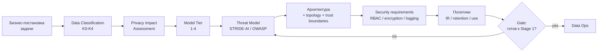
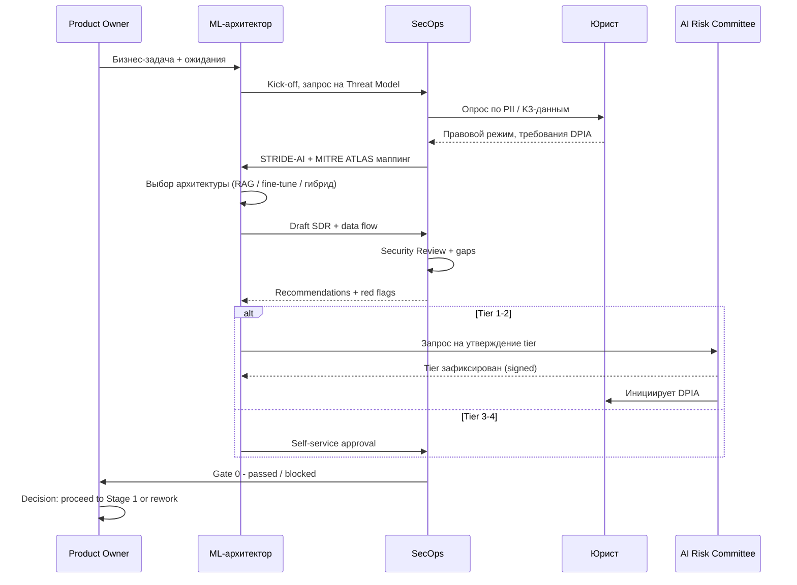
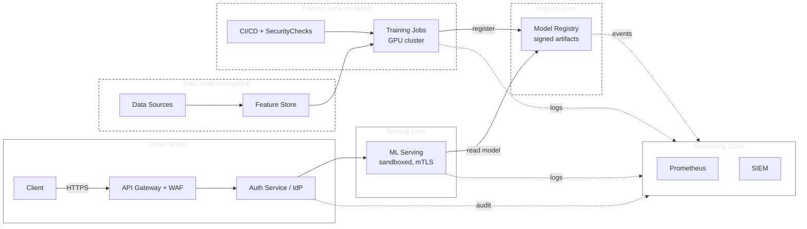
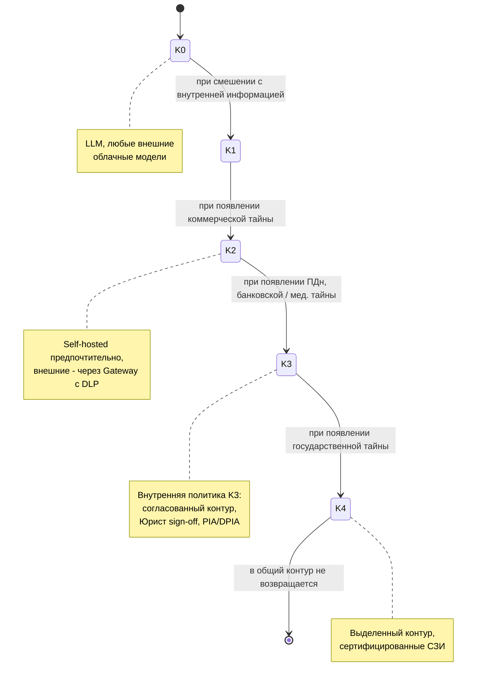
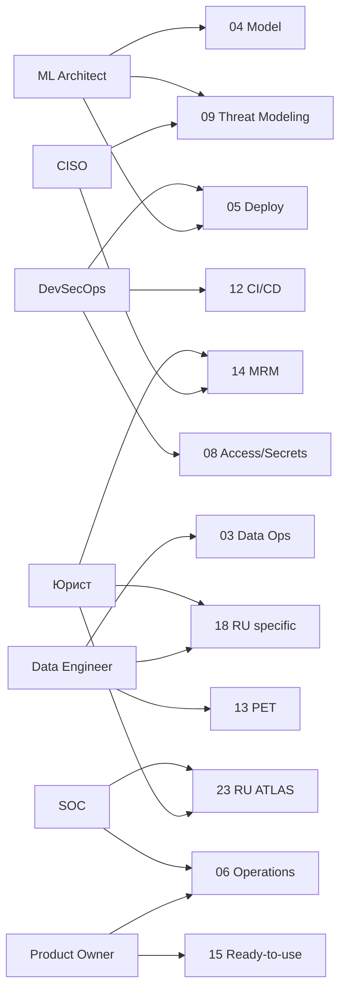

<a id="rekomendazii-ib-etap-0-proektirovanie-ml-sistemy"></a>

# Рекомендации ИБ: Этап 0 - Проектирование ML-системы

> Версия: 2.1 · Обновлено: 2026-05-29 · Теги: system design, PIA, data classification, threat modeling, STRIDE-AI, MITRE ATLAS · Tier: 1-4
>
> **TL;DR**. Проектирование ML-системы с требованиями ИБ: Data Classification K0-K4, Privacy Impact Assessment, Tiering (Tier 1-4), Threat Model (STRIDE-AI + MITRE ATLAS) на входе в разработку. На этапе 0 фиксируются допустимые данные, действия, границы доверия и поведение при отказах. Ошибку в этих границах приходится устранять сразу в архитектуре, процедурах и интеграциях; универсальная численная оценка стоимости такой переделки здесь не установлена.

**Тематическое дополнение от 13.11.2026**: контракт возможностей AI-системы, проектирование ограниченного режима и проверяемая приёмка (§3.9-3.11). Внутренние классы данных и Tier не являются автоматическим определением уровня защищённости ИСПДн или юридической применимости нормы.

**Навигация по главе:**

- Разделы 1-3: архитектурный фундамент и требования ИБ
- Раздел 4: шаблон Security Design Review (SDR)
- Разделы 5-6: чек-лист и типичные ошибки
- Раздел 7 (новый): интерактивные сценарии проектных атак
- Разделы 9-10: российская специфика, tier, PET, K0-K4
- Раздел 11 (новый): **"С чего начать по вашей роли"** - 7 ролей × Day 1 / Week 1 / Month 1

<a id="1-kratkoe-soderjanie-etapa"></a>

## 1. Краткое содержание этапа

<a id="posledovatel_nost_-proektnyh-artefaktov"></a>

### Последовательность проектных артефактов



<a id="kto-s-kem-kogda-dialog-proektnogo-kontura"></a>

### Кто-с-кем-когда: диалог проектного контура



Диаграмма показывает, что на этапе 0 нет одного «главного» документа - есть последовательность согласованных решений между бизнесом, инженерами, ИБ и регуляторной функцией. Пропустить любую стрелку нельзя: отсутствие Юрист на ранних шагах почти гарантированно приводит к переделке датасета после начала обучения.

<a id="jivaa-karta-puti-artefakta-ot-biznes-zadaci-do-gate-0"></a>

### Живая карта пути артефакта от бизнес-задачи до Gate 0

<div class="lifecycle-map" role="img" aria-label="Анимированный путь артефакта через этап 0: бизнес, данные, тиер, угрозы, архитектура, requirements, gate">
<svg viewBox="0 0 900 260" xmlns="http://www.w3.org/2000/svg" xmlns:xlink="http://www.w3.org/1999/xlink" style="width:100%;max-width:900px;height:auto;display:block;margin:0 auto;">
  <defs>
    <path id="s0-path" d="M 60 130 L 200 130 L 340 130 L 480 130 L 620 130 L 760 130 L 840 130" fill="none"/>
    <style>
      .s0-stroke { stroke: var(--stroke-1, #6b7280); stroke-width: 1.5; fill: none; }
      .s0-fill   { fill: var(--bg-1, #111827); stroke: var(--stroke-1, #6b7280); stroke-width: 1.2; }
      .s0-text   { fill: var(--fg-0, #e5e7eb); font-family: ui-sans-serif, system-ui, sans-serif; font-size: 12px; }
      .s0-muted  { fill: var(--fg-2, #9ca3af); font-size: 10px; }
      .s0-pulse  { fill: var(--accent, #22d3ee); }
    </style>
  </defs>
  <g><text x="20" y="40" class="s0-muted">сверху: независимое 2LoD / AI Risk Committee (для Tier 1-2)</text><line x1="20" y1="50" x2="840" y2="50" class="s0-stroke" stroke-dasharray="3,4"/><text x="20" y="215" class="s0-muted">снизу: обратная связь от SecOps / Юрист (любой этап → пересмотр tier и threat model)</text><line x1="20" y1="205" x2="840" y2="205" class="s0-stroke" stroke-dasharray="3,4"/></g>
  <use href="#s0-path" class="s0-stroke"/>
  <circle r="6" class="s0-pulse" cx="0" cy="0" opacity="0"><animateMotion dur="9s" repeatCount="indefinite" rotate="0"><mpath xlink:href="#s0-path"/></animateMotion><animate attributeName="opacity" values="0;1;1;0" keyTimes="0;0.1;0.9;1" dur="9s" repeatCount="indefinite"/></circle>
  <g><rect x="20"  y="100" width="80" height="60" rx="6" class="s0-fill"/><text x="60"  y="124" text-anchor="middle" class="s0-text">Бизнес-</text><text x="60"  y="140" text-anchor="middle" class="s0-text">постановка</text><text x="60"  y="156" text-anchor="middle" class="s0-muted">день 1</text></g>
  <g><rect x="160" y="100" width="80" height="60" rx="6" class="s0-fill"/><text x="200" y="124" text-anchor="middle" class="s0-text">Data</text><text x="200" y="140" text-anchor="middle" class="s0-text">K0-K4 + PIA</text><text x="200" y="156" text-anchor="middle" class="s0-muted">дни 2-4</text></g>
  <g><rect x="300" y="100" width="80" height="60" rx="6" class="s0-fill"/><text x="340" y="124" text-anchor="middle" class="s0-text">Tier</text><text x="340" y="140" text-anchor="middle" class="s0-text">1-4</text><text x="340" y="156" text-anchor="middle" class="s0-muted">день 5</text></g>
  <g><rect x="440" y="100" width="80" height="60" rx="6" class="s0-fill"/><text x="480" y="124" text-anchor="middle" class="s0-text">Threat</text><text x="480" y="140" text-anchor="middle" class="s0-text">Model</text><text x="480" y="156" text-anchor="middle" class="s0-muted">дни 6-10</text></g>
  <g><rect x="580" y="100" width="80" height="60" rx="6" class="s0-fill"/><text x="620" y="124" text-anchor="middle" class="s0-text">Архитектура</text><text x="620" y="140" text-anchor="middle" class="s0-text">+ Requirements</text><text x="620" y="156" text-anchor="middle" class="s0-muted">дни 11-18</text></g>
  <g><rect x="720" y="100" width="80" height="60" rx="6" class="s0-fill"/><text x="760" y="124" text-anchor="middle" class="s0-text">SDR +</text><text x="760" y="140" text-anchor="middle" class="s0-text">Gates</text><text x="760" y="156" text-anchor="middle" class="s0-muted">дни 19-20</text></g>
  <g><circle cx="840" cy="130" r="14" fill="none" class="s0-stroke"/><text x="840" y="135" text-anchor="middle" class="s0-text">→ S1</text><animate attributeName="opacity" values="0.35;1;0.35" dur="2.4s" repeatCount="indefinite"/></g>
</svg>
</div>

Этап 0 (ML System Design) является фундаментальным для обеспечения безопасности всего жизненного цикла ML-системы. На данном этапе закладываются архитектурные решения, определяются требования безопасности и формируются политики, которые будут действовать на протяжении всех последующих этапов - от сбора данных до вывода модели из эксплуатации.

**Ключевые направления работы на этапе проектирования:**

- **Моделирование угроз и оценка рисков.** Определение специфических угроз для выбранного типа модели. Каждый тип модели имеет характерный профиль уязвимостей: LLM подвержены prompt injection и jailbreak-атакам, CNN уязвимы к adversarial examples и backdoor-атакам через отравление обучающих данных, рекомендательные системы - к data poisoning и model inversion.

- **Анализ и классификация данных.** Систематическая оценка данных, используемых для обучения и инференса: выявление персональных данных (PII/PD), определение требований к шифрованию (at rest, in transit), обеспечение целостности датасетов, определение политик хранения и удаления.

- **Формирование требований безопасности и политик.** Определение политик управления доступом (RBAC/ABAC), требований к шифрованию, стратегии мониторинга и логирования, процедур реагирования на инциденты (Incident Response), связанных с ML-компонентами.

- **Архитектура и выбор технологий.** Проектирование архитектуры с учётом принципов изоляции (network segmentation, container isolation), безопасности цепочки поставок (supply chain security), управления секретами (HashiCorp Vault), версионирования экспериментов и моделей (MLflow).

- **Интеграция с CI/CD и MLOps.** Встраивание проверок безопасности в пайплайны непрерывной интеграции и доставки: IaC-сканирование (Checkov), защита веток репозитория (protected branches), использование MLflow Tracking и Model Registry для обеспечения прослеживаемости.

- **Распределение ролей и ответственности.** Чёткое определение зон ответственности между ML-архитекторами, DevOps/MLOps-инженерами, SecOps, Product Owner и Compliance-специалистами.

**Почему этот этап критически важен для ИБ:** ошибки, допущенные на этапе проектирования, многократно усиливаются на последующих этапах. Стоимость исправления уязвимости, заложенной в архитектуру, на порядки превышает стоимость её предотвращения на этапе дизайна. По аналогии с классической разработкой ПО, принцип «shift left» в ML-безопасности означает перенос максимального объёма проверок и решений на самый ранний этап.

---

<a id="2-verifikazia-faktov-i-instrumentov"></a>

## 2. Верификация фактов и инструментов

В данном разделе приведена верификация инструментов и методологий с точки зрения их актуальности и корректности применения.

<a id="21-checkov-iac-scanning"></a>

### 2.1. Checkov (IaC Scanning)

| Параметр | Значение |
|---|---|
| Статус | Актуален, активно развивается |
| Лицензия | Apache License 2.0 |
| Встроенные политики | Сотни встроенных проверок для Terraform, CloudFormation, Kubernetes, Helm, ARM templates, Serverless framework; точный набор зависит от версии (на 16.11.2026 — checkov 3.4.5) |
| Поддерживаемые платформы | AWS, Azure, GCP, Kubernetes, Docker, GitHub Actions |
| Применимость к ML | Подходит для сканирования IaC-конфигураций ML-инфраструктуры (кластеры GPU, хранилища данных, сетевые политики) |
| Рекомендация ИБ | Рекомендован к использованию. Следует дополнить кастомными политиками, специфичными для ML-инфраструктуры (например, проверка конфигурации GPU-инстансов, настроек объектного хранилища для датасетов) |

<a id="22-metodologii-modelirovania-ugroz"></a>

### 2.2. Методологии моделирования угроз

| Методология | Верификация |
|---|---|
| **STRIDE** | Корректная и широко применяемая методология для моделирования угроз. Для ML-систем рекомендуется расширенный вариант STRIDE-AI, учитывающий специфику ML (model evasion, data poisoning, model stealing) |
| **MITRE ATLAS** | Актуальная база знаний по тактикам и техникам атак на ML-системы, обновляется примерно ежемесячно; корпус закреплён на снимке [v2026.10](https://github.com/mitre-atlas/atlas-data/releases) (атаки на LLM, агентов и генеративные модели). Рекомендуется использовать совместно с MITRE ATT&CK для полноты покрытия; подробно — [глава 23](23-mitre-atlas-ru.md) |
| **PASTA** | Process for Attack Simulation and Threat Analysis - применима для ML-систем, особенно на этапе оценки бизнес-рисков |
| **Attack Trees** | Классическая методология, эффективна для визуализации сценариев атак на ML-пайплайны |

<a id="23-mlflow"></a>

### 2.3. MLflow

| Параметр | Значение |
|---|---|
| Статус | Актуален, ветка 3.x (на 16.11.2026 — 3.18.0) |
| Компоненты | Tracking, Projects, Models, Model Registry |
| Применимость к ИБ | MLflow Tracking обеспечивает прослеживаемость экспериментов; Model Registry — контроль версий моделей через aliases (например, `@champion`) и теги версий. Стадии Staging/Production/Archived [объявлены устаревшими с MLflow 2.9](https://mlflow.org/docs/latest/ml/model-registry/workflow/) и не должны быть основой нового процесса допуска |
| Рекомендация ИБ | Рекомендован к использованию с обязательной настройкой аутентификации (встроенная basic auth или прокси с корпоративным IdP), шифрования хранилища артефактов и ограничением прав на смену alias, через который модель попадает в production |
| Важные замечания | По умолчанию MLflow Tracking Server не требует аутентификации - это необходимо исправить при развёртывании. Рекомендуется использовать MLflow за reverse proxy с TLS |

<a id="24-microsoft-ai-security-risk-assessment"></a>

### 2.4. Microsoft AI Security Risk Assessment

| Параметр | Значение |
|---|---|
| Статус | Публичный [репозиторий](https://github.com/Azure/AI-Security-Risk-Assessment) последний раз обновлялся в апреле 2024 года (проверено 16.11.2026); использовать как опросник-основу, сверяя с актуальными NIST AI RMF и MITRE ATLAS |
| Назначение | Фреймворк для оценки рисков безопасности AI/ML-систем |
| Применимость | Рекомендуется использовать как дополнительный инструмент оценки рисков наряду с MITRE ATLAS. Полезен для структурирования диалога между командами ИБ и ML |

<a id="25-dopolnitel_nye-instrumenty"></a>

### 2.5. Дополнительные инструменты

| Инструмент | Верификация и рекомендация |
|---|---|
| **pip-audit** | Актуален, поддерживается Python Packaging Authority (PyPA). Проверяет зависимости Python по базе OSV. Рекомендован для ML-проектов на Python |
| **Safety** | Актуален (Safety CLI 3.x). Проверяет Python-зависимости по базе Safety DB; CLI 3 при первом запуске требует входа или регистрации в Safety ([README](https://github.com/pyupio/safety)). Дополняет pip-audit, а не заменяет его |
| **HashiCorp Vault** | Актуален. Рекомендован для управления секретами в ML-пайплайнах (API-ключи к данным, креды к Model Registry, токены облачных провайдеров). Поддерживает динамические секреты, что критично для короткоживущих ML-задач |
| **Prometheus + Grafana** | Актуальный стек мониторинга. Для ML рекомендуется дополнить метриками специфичными для моделей (drift detection, prediction latency, confidence distribution) |
| **ELK Stack** | Актуален (Elasticsearch, Logstash, Kibana). Подходит для централизованного логирования ML-пайплайнов. Рекомендуется настроить индексы и дашборды, специфичные для ML-событий |

---


<a id="3-rekomendazii-ib"></a>

## 3. Рекомендации ИБ

<a id="31-obazatel_noe-provedenie-threat-modeling-pered-nacalom-lubogo-ml-proekta"></a>

### 3.1. Обязательное проведение Threat Modeling перед началом любого ML-проекта

**Требование:** ни один ML-проект не должен переходить к этапу сбора данных без проведённого и задокументированного моделирования угроз.

**Рекомендуемые методологии:**

1. **STRIDE-AI** - расширенная версия STRIDE, адаптированная для ML-систем:
   - **S**poofing - подмена источника данных, имперсонация модели, подмена идентичности пользователя в мультитенантных ML-сервисах
   - **T**ampering - отравление обучающих данных (data poisoning), модификация весов модели, backdoor-инъекции в предобученные модели
   - **R**epudiation - невозможность подтвердить, какая версия модели дала конкретный результат, отсутствие аудитного следа для предсказаний
   - **I**nformation Disclosure - model inversion (восстановление обучающих данных из модели), membership inference (определение принадлежности данных обучающей выборке), утечка параметров модели
   - **D**enial of Service - adversarial inputs, вызывающие чрезмерное потребление ресурсов; sponge examples; исчерпание GPU
   - **E**levation of Privilege - prompt injection в LLM для обхода ограничений, выход из sandbox-окружения, эскалация прав через ML-сервис

2. **PASTA** (Process for Attack Simulation and Threat Analysis) - семиэтапный процесс, особенно полезен для оценки бизнес-влияния ML-угроз:
   - Этап 1: Определение целей (бизнес-задача ML-системы)
   - Этап 2: Определение технического скоупа (ML-пайплайн, serving infrastructure)
   - Этап 3: Декомпозиция приложения (data flow diagram ML-системы)
   - Этап 4: Анализ угроз (с использованием MITRE ATLAS)
   - Этап 5: Анализ уязвимостей (специфичных для ML)
   - Этап 6: Моделирование атак (Attack Trees)
   - Этап 7: Анализ рисков и контрмер

3. **Attack Trees** - графическое представление сценариев атак. Для ML-систем рекомендуется строить отдельные деревья для:
   - Атак на обучающие данные
   - Атак на модель (evasion, extraction, inversion)
   - Атак на инфраструктуру serving
   - Атак на ML-пайплайн (supply chain)

**Маппинг типов моделей на угрозы:**

| Тип модели | Приоритетные угрозы | Рекомендуемые контрмеры |
|---|---|---|
| LLM (Large Language Models) | Prompt injection (direct/indirect), jailbreak, data extraction, excessive agency | Input/output filtering, guardrails, sandboxing, ограничение контекста, red-teaming |
| CNN / Computer Vision | Adversarial examples, backdoor attacks, model stealing | Adversarial training, input preprocessing, model watermarking, ensemble methods |
| Рекомендательные системы | Data poisoning, shilling attacks, profile injection | Anomaly detection на входных данных, robust aggregation, rate limiting |
| Табличные модели (GBM, RF) | Data poisoning, model extraction через API | Differential privacy, ограничение API (query rate, confidence scores), input validation |
| Генеративные модели (Diffusion, GAN) | Generazione вредоносного контента, deepfakes, training data extraction | Content filtering, watermarking сгенерированного контента, NSFW-детекция |

<a id="32-formalizovannaa-klassifikazia-dannyh"></a>

### 3.2. Формализованная классификация данных

**Требование:** все данные, используемые в ML-проекте, должны быть классифицированы до начала работы с ними.

**Уровни классификации:**

| Уровень | Описание | Примеры в контексте ML | Требования к защите |
|---|---|---|---|
| **Public** | Общедоступные данные | Открытые датасеты (ImageNet, Common Crawl), публичные модели | Контроль целостности (хеш-суммы), проверка лицензий |
| **Internal** | Внутренние данные организации | Внутренние метрики моделей, логи экспериментов, конфигурации пайплайнов | Аутентификация, сегментация сети, логирование доступа |
| **Confidential** | Конфиденциальные данные | Обучающие данные с коммерческой тайной, веса проприетарных моделей, гиперпараметры production-моделей | Шифрование at rest и in transit, RBAC, аудит доступа, DLP |
| **Restricted** | Данные с максимальным уровнем защиты | PII/персональные данные в обучающих выборках, медицинские данные (HIPAA), финансовые данные (PCI DSS) | Шифрование с управлением ключами (KMS), data masking, anonymization/pseudonymization, строгий RBAC, полный аудит, согласие субъектов данных (GDPR), минимизация данных |

**Процесс классификации:**

1. Инвентаризация всех источников данных для ML-проекта
2. Определение типов данных в каждом источнике (автоматизированное сканирование + ручная верификация)
3. Присвоение уровня классификации каждому источнику (по наивысшему уровню содержащихся данных)
4. Документирование в реестре данных (Data Inventory)
5. Определение правил обработки для каждого уровня
6. Регулярный пересмотр классификации (не реже 1 раза в 6 месяцев или при изменении состава данных)

**Инструменты для автоматической классификации:**
- Microsoft Presidio - обнаружение PII в текстовых данных (открытый исходный код)
- AWS Macie - классификация данных в S3 (для облачных ML-проектов)
- Google Cloud DLP - обнаружение и маскирование чувствительных данных
- Собственные правила сканирования на основе регулярных выражений для domain-specific данных

<a id="opredelite-klass-dannyh-vasego-proekta"></a>

#### Определите класс данных вашего проекта

```widget:decision-tree
{
  "id": "ch02-data-class",
  "title": "Какой класс данных у датасета (Public / Internal / Confidential / Restricted)",
  "start": "q1",
  "nodes": {
    "q1": {
      "type": "question",
      "text": "Какие сущности встречаются в датасете?",
      "sub": "Идите по «худшему» варианту, который точно есть в данных. Если хоть один файл содержит более чувствительный элемент — весь датасет относится к этому классу.",
      "choices": [
        { "label": "Прямые идентификаторы физлица (ФИО, телефон, e-mail, паспорт, СНИЛС)", "next": "leaf-restricted-pii" },
        { "label": "Косвенные / квази-идентификаторы (геолокация, ID устройства, IP-адрес, поведенческие следы)", "next": "q2-quasi" },
        { "label": "Коммерческая тайна / биржевые данные / клиентский портфель", "next": "leaf-confidential-commercial" },
        { "label": "Внутренние метрики, логи экспериментов, конфигурации", "next": "leaf-internal" },
        { "label": "Открытые / публичные датасеты", "next": "q2-public" }
      ]
    },
    "q2-quasi": {
      "type": "question",
      "text": "Возможна ли деанонимизация по комбинации квази-идентификаторов?",
      "sub": "Оценка зависит от доступных дополнительных данных и модели нарушителя. k-anonymity и l-diversity сами по себе не доказывают невозможность реидентификации.",
      "choices": [
        {
          "label": "Да или мы не проверяли — риск реидентификации существует",
          "next": "leaf-restricted-pii"
        },
        {
          "label": "Есть отдельная оценка реидентификации и решение владельца о классификации результата",
          "next": "leaf-confidential-commercial"
        }
      ]
    },
    "q2-public": {
      "type": "question",
      "text": "Лицензия и происхождение проверены?",
      "choices": [
        { "label": "Да: лицензия совместима, провайдер проверен, есть SHA-сумма", "next": "leaf-public" },
        { "label": "Нет — публичный, но непроверенный (HF, GitHub)", "hint": "Возможна supply-chain атака", "next": "leaf-public-untrusted" }
      ]
    },
    "leaf-restricted-pii": {
      "type": "leaf",
      "tone": "err",
      "title": "Кандидат на класс Restricted по внутренней политике",
      "summary": "Согласуйте классификацию с владельцем данных и юристом. Минимизация, разрешённое основание обработки, доступ, шифрование и аудит проектируются совместно. Класс не равен автоматически УЗ-1; namespace сам по себе не доказывает изоляцию.",
      "details": [
        "Определить применимость 152-ФЗ, требования к ИСПДн и процесс уведомлений с конкретным основанием",
        "Для КИИ отдельно определить объект, обязанность, действующий акт и срок уведомления",
        "Определить необходимость PIA/DPIA и Tier по своей методике до начала обработки",
        "Проверить выбранные меры на данных проекта; сканер PII и DP не заменяют правовую оценку"
      ],
      "links": [
        { "label": "Глава 17. PET (DP, k-anonymity, FL)", "href": "/ch/17-privacy-enhancing-tech" },
        { "label": "Глава 18. Российский compliance", "href": "/ch/18-ru-compliance-deep" }
      ]
    },
    "leaf-confidential-commercial": {
      "type": "leaf",
      "tone": "warn",
      "title": "Защищённый набор: подтвердить класс и разрешённое использование",
      "summary": "Коммерческая тайна и результат privacy-review — разные основания классификации. Зафиксируйте принятый класс, права на использование, круг получателей и меры защиты; вывод об отсутствии ПДн не делает данные автоматически коммерческой тайной.",
      "details": [
        "Шифрование и доступ выбираются по режиму набора и модели угроз",
        "Временные workload credentials и актуальные object ACL для аналитиков и jobs",
        "Минимизированный журнал решений о доступе с обоснованной retention",
        "Разрешённые источники и маршруты проверяются отдельно от наличия сканера PII"
      ],
      "links": [
        { "label": "Глава 03. Data Operations", "href": "/ch/03-stage1-data-operations" },
        { "label": "Глава 08. Access & Secrets", "href": "/ch/08-access-secrets-management" }
      ]
    },
    "leaf-internal": {
      "type": "leaf",
      "tone": "info",
      "title": "Класс: Internal",
      "summary": "Стандартная корпоративная защита: аутентификация, сегментация сети, логирование. Подходит для метрик экспериментов, MLflow runs, конфигураций гиперпараметров без секретов.",
      "details": [
        "Подходящий уровень для большинства логов и telemetry",
        "Не размещайте здесь PII/секреты — даже временно",
        "При попадании секрета запустить triage: severity выбирается по экспозиции, действующим полномочиям и последствиям, а не автоматически S2"
      ]
    },
    "leaf-public": {
      "type": "leaf",
      "tone": "ok",
      "title": "Класс: Public (проверенный)",
      "summary": "Публичная доступность не означает разрешение на любую обработку. Кроме лицензии и целостности проверьте наличие ПДн, ограничения использования, происхождение и пригодность для цели обучения.",
      "details": [
        "SHA-256 датасета фиксируется в DVC / Git LFS",
        "Лицензия в SPDX-формате попадает в ML-BOM",
        "Публичный ≠ безопасный: проверьте на data poisoning через outlier detection (ART)"
      ]
    },
    "leaf-public-untrusted": {
      "type": "leaf",
      "tone": "warn",
      "title": "Публичный источник, доверие не установлено — quarantine до проверки",
      "summary": "Не используйте публичный датасет / модель из неподтверждённого источника, пока не проведены: проверка SHA, scan на backdoor, sandbox-обучение, проверка Sigstore-подписи (если есть).",
      "details": [
        "Slopsquatting: имена несуществующих пакетов, генерируемые LLM, теперь регистрируются атакующими",
        "HF / Civitai / GitHub — площадки с supply-chain рисками",
        "Минимум: pickle-сканирование, scan на тип файла, Sigstore-keyless если автор подписал"
      ],
      "links": [
        { "label": "Глава 04. Model Operations (подпись)", "href": "/ch/04-stage2-model-operations" }
      ]
    }
  }
}
```

<a id="33-security-requirements-checklist-dla-kajdogo-ml-proekta"></a>

### 3.3. Security Requirements Checklist для каждого ML-проекта

Каждый ML-проект обязан пройти через формализованный набор требований безопасности. Ниже представлен минимальный набор требований, который должен быть выполнен до перехода к следующему этапу.

**Категория: Управление доступом**

- [ ] Определена модель управления доступом (RBAC/ABAC) для всех компонентов ML-системы
- [ ] Настроен принцип наименьших привилегий (Least Privilege) для всех сервисных аккаунтов
- [ ] Определены роли и их разрешения: Data Scientist, ML Engineer, MLOps, Reviewer, Admin
- [ ] Настроена интеграция с корпоративным IdP (LDAP/AD/SAML/OIDC)
- [ ] Определена процедура ротации сервисных учётных записей и API-ключей
- [ ] Реализован break-glass процесс для экстренного доступа

**Категория: Защита данных**

- [ ] Проведена классификация всех данных проекта (раздел 3.2)
- [ ] Настроено шифрование at rest для хранилищ данных и артефактов модели
- [ ] Настроено шифрование in transit (TLS 1.2+) для всех коммуникаций
- [ ] Определены политики хранения и удаления данных (retention policies)
- [ ] При наличии PII: реализованы механизмы анонимизации/псевдонимизации
- [ ] Обеспечена целостность датасетов (хеш-суммы, подписи)
- [ ] Настроено резервное копирование критичных данных и моделей

**Категория: Безопасность инфраструктуры**

- [ ] ML-инфраструктура изолирована от общей сети (network segmentation)
- [ ] Контейнеры запускаются с минимальными привилегиями (non-root, read-only filesystem)
- [ ] Настроены сетевые политики (Network Policies в Kubernetes)
- [ ] Реализовано управление секретами через Vault или аналог (не hardcoded)
- [ ] Проведено IaC-сканирование (Checkov) и устранены все critical/high findings

**Категория: Мониторинг и логирование**

- [ ] Настроено логирование всех обращений к данным и модели
- [ ] Логи отправляются в корпоративный SIEM
- [ ] Определены алерты для аномального поведения (необычные паттерны доступа, всплески запросов)
- [ ] Настроен мониторинг метрик модели (drift, performance degradation)
- [ ] Обеспечена неизменяемость логов (append-only, защита от подделки)

**Категория: Incident Response**

- [ ] Определён план реагирования на инциденты, связанные с ML-компонентами
- [ ] Назначены ответственные (incident commander, technical lead, communications)
- [ ] Определены критерии эскалации для ML-специфичных инцидентов (model compromise, data breach, adversarial attack)
- [ ] Описаны процедуры rollback модели к предыдущей безопасной версии
- [ ] Проведено табличное учение (tabletop exercise) по ML-инцидент-сценарию

<a id="34-obazatel_nye-security-gates-na-etape-proektirovania"></a>

### 3.4. Обязательные Security Gates на этапе проектирования

Security Gates - это контрольные точки, которые должны быть пройдены до перехода к следующему этапу. Непрохождение gate блокирует переход.

На этапе 0 утверждается **проект мер** и план их проверки. Чек-лист архитектуры, результат IaC-сканера и согласованный документ не доказывают работу сетевой изоляции или отзыва доступа в runtime. Прототип с ограниченными данными и production-допуск имеют разные условия; отложенный пункт не снимает блокировку промышленной эксплуатации, если это обязательный защитный контроль.

**Gate 0.1: Threat Model Review**

- Входные данные: документ Threat Model
- Проверяющие: SecOps + ML-архитектор
- Критерии прохождения:
  - Все компоненты ML-системы учтены в модели угроз
  - Для каждой угрозы определена контрмера
  - Остаточные риски документированы и приняты владельцем (risk acceptance)
  - Использована актуальная база MITRE ATLAS

**Gate 0.2: Data Classification Approval**

- Входные данные: Data Inventory с классификацией
- Проверяющие: SecOps + Data Owner + Compliance (при наличии PII)
- Критерии прохождения:
  - Все источники данных инвентаризированы
  - Классификация присвоена и задокументирована
  - Требования к защите определены для каждого уровня
  - При наличии Restricted данных - получено одобрение Юрист

**Gate 0.3: Architecture Security Review**

- Входные данные: Architecture Design Document, Security Design Review (раздел 4)
- Проверяющие: SecOps + ML-архитектор + DevOps
- Критерии прохождения:
  - Архитектура соответствует принципам Zero Trust
  - Выбор технологий обоснован и проверен на известные уязвимости
  - IaC прошёл сканирование Checkov с нулевым количеством critical findings
  - Управление секретами реализовано через Vault
  - Сетевая изоляция спроектирована

**Gate 0.4: Security Requirements Sign-Off**

- Входные данные: заполненный Security Requirements Checklist (раздел 3.3)
- Проверяющие: SecOps lead + Product Owner
- Критерии прохождения:
  - Все обязательные требования выполнены или имеется план устранения с конкретными сроками
  - Исключения задокументированы и одобрены CISO/SecOps lead

<a id="cetyre-gate-kriteria-stage-0-spravocnik"></a>

#### Четыре Gate-критерия Stage 0 — справочник

```widget:flashcards
{
  "id": "ch02-gates",
  "title": "Gate 0.1–0.4: что проверяется и кем",
  "description": "Раскройте запись — внутри: входные артефакты, проверяющие роли, конкретные критерии прохождения и типичные failure modes. Используйте перед каждым Stage-0 review, чтобы синхронизировать ожидания.",
  "shuffle": false,
  "cards": [
    {
      "tag": "Gate 0.1",
      "front": "Threat Model Approval",
      "subFront": "Перед началом разработки",
      "back": "Входные артефакты:\n• Threat Model Document\n• DFD (Level 0/1)\n• Перечень угроз с категориями (STRIDE-AI)\n\nПроверяющие: SecOps + ML-архитектор + Compliance (при PII).\n\nКритерии:\n• Все компоненты ML-системы покрыты DFD\n• Угрозы STRIDE + ML-специфика (poisoning, evasion, extraction)\n• Каждой угрозе сопоставлены контроли\n• Согласован риск-реестр\n\nFailure modes: «закрыли позже» = security debt, который дорого обходится в Stage 4."
    },
    {
      "tag": "Gate 0.2",
      "front": "Data Classification",
      "subFront": "До начала работы с данными",
      "back": "Входные артефакты:\n• Data inventory и карта операций / получателей\n• Внутренняя классификация\n• Основания обработки и решение о применимости оценки воздействия\n\nПроверяющие: Data Owner + SecOps + Legal при соответствующем режиме.\n\nКритерии: источники и доступ инвентаризированы; данные связаны с целью и основанием; определены меры, owner и evidence допуска. Restricted / PII сами по себе не устанавливают DPIA: по GDPR проверить Art. 35, по РФ — конкретные обязанности оператора и оценку вреда.\n\nFailure mode: ярлык или подпись без проверки фактического data-flow."
    },
    {
      "tag": "Gate 0.3",
      "front": "Architecture Security Review",
      "subFront": "До коммита первой строчки IaC",
      "back": "Входные артефакты:\n• Architecture Design Document\n• Security Design Review\n• IaC-проекты\n\nПроверяющие: SecOps + ML-архитектор + DevOps.\n\nКритерии:\n• Соответствие Zero Trust\n• Выбор технологий обоснован, без known CVEs\n• Checkov с 0 critical findings\n• Vault для секретов\n• Сетевая изоляция (NetworkPolicy)\n\nFailure modes: монолит без сегментации, hardcoded секреты, ssl_verify=False для удобства."
    },
    {
      "tag": "Gate 0.4",
      "front": "Security Requirements Sign-Off",
      "subFront": "Финальный гейт перед Stage 1",
      "back": "Входные артефакты:\n• Заполненный Security Requirements Checklist (§3.3)\n• Action items по предыдущим Gates\n• Risk Acceptance, если есть отклонения\n\nПроверяющие: SecOps lead + Product Owner.\n\nКритерии:\n• Все обязательные требования выполнены\n• План устранения для отложенных пунктов с дедлайнами\n• Исключения одобрены CISO\n\nFailure modes: формальное «прошёл», но action items без owner и дедлайна — закрывайте на этом гейте."
    }
  ]
}
```

<a id="35-rekomendazii-po-vyboru-arhitektury-s-ucetom-zero-trust"></a>

### 3.5. Рекомендации по выбору архитектуры с учётом Zero Trust

Принцип Zero Trust применяется ко всем компонентам ML-системы: «Never trust, always verify».

**Ключевые принципы Zero Trust для ML-систем:**

1. **Верификация каждого запроса.** Каждый вызов модели (inference request) должен быть аутентифицирован и авторизован. Даже внутренние микросервисы должны использовать mutual TLS (mTLS) или service mesh (Istio/Linkerd) для взаимной аутентификации.

2. **Принцип наименьших привилегий.** ML-пайплайн training job получает доступ только к тем данным, которые необходимы для конкретного эксперимента. Serving endpoint не имеет доступа к обучающим данным. Model Registry доступен на запись только из CI/CD пайплайна, а на чтение - только для авторизованных serving-сервисов.

3. **Микросегментация.** Разделение ML-инфраструктуры на зоны:
   - **Data Zone** - хранилища обучающих данных, feature store
   - **Training Zone** - вычислительные ресурсы для обучения (GPU-кластеры)
   - **Registry Zone** - Model Registry, Artifact Store
   - **Serving Zone** - inference endpoints, API gateway
   - **Monitoring Zone** - мониторинг, логирование, алертинг

   Между зонами - строго определённые сетевые политики, разрешающие только необходимые коммуникации.

4. **Непрерывная верификация.** Постоянная проверка состояния модели в production: контроль drift, аномалий в предсказаниях, необычных паттернов использования. Любое отклонение от baseline может свидетельствовать о компрометации.

5. **Assume Breach.** Проектировать систему исходя из предположения, что один из компонентов уже скомпрометирован. Это означает:
   - Blast radius ограничен за счёт сегментации
   - Возможность быстрого отключения отдельного компонента (kill switch для модели)
   - Независимая верификация результатов критичных моделей

**Рекомендуемый архитектурный паттерн (зоны и trust boundaries):**



Trust boundaries (пунктиром) выделяют зоны с повышенными требованиями: Data, Training и Registry. Между ними - только explicit allowlist, по принципу Zero Trust. Serving не читает из Data напрямую; training не ходит в Serving напрямую. Все межзонные потоки идут через аудируемые каналы с логированием в SIEM.

<a id="36-supply-chain-security"></a>

### 3.6. Supply Chain Security

Безопасность цепочки поставок - критически важный аспект для ML-систем, где зависимости включают не только программные библиотеки, но и предобученные модели, датасеты и специализированные фреймворки.

**Рекомендации:**

1. **Software Bill of Materials (SBOM).**
   - Генерировать SBOM для каждого ML-проекта в формате SPDX или CycloneDX
   - Включать в SBOM не только программные зависимости, но и:
     - Предобученные модели (источник, версия, хеш)
     - Датасеты (источник, версия, хеш, лицензия)
     - ML-фреймворки и их версии
   - Инструменты: Syft (Anchore), Trivy, CycloneDX CLI
   - SBOM должен обновляться при каждом изменении зависимостей и храниться как артефакт в CI/CD

2. **Подпись артефактов.**
   - Все артефакты ML-пайплайна должны быть подписаны:
     - Docker-образы - Cosign (Sigstore)
     - Модели - GPG-подпись или Sigstore для ML-артефактов
     - Датасеты - хеш-суммы (SHA-256) + подпись
   - Верификация подписей обязательна перед использованием артефакта

3. **Проверка зависимостей.**
   - Регулярное сканирование Python-зависимостей: `pip-audit` + `safety scan` (легаси `safety check` deprecated в Safety CLI v3, 2024).
   - Сканирование Docker-образов: Trivy, Grype
   - Использование lock-файлов (pip-tools, Poetry) для фиксации версий
   - Pinning зависимостей с указанием хешей (`pip install --require-hashes`)
   - Мониторинг уязвимостей в используемых ML-фреймворках (PyTorch, TensorFlow, HuggingFace)

4. **Безопасность предобученных моделей.**
   - Проверка источника предобученных моделей (только доверенные реестры: HuggingFace с верифицированных организаций, TF Hub, PyTorch Hub)
   - Сканирование моделей на вредоносные вставки (pickle deserialization attacks - picklescan)
   - Верификация хеш-сумм при загрузке моделей
   - Предпочтение безопасных форматов (safetensors вместо pickle)

5. **Защита ML-пайплайна.**
   - Protected branches в репозитории (обязательный code review для изменений в ML-коде)
   - Signed commits для участников ML-команды
   - Использование проверенных base images для ML-контейнеров
   - Запрет на установку пакетов из недоверенных PyPI-индексов

<a id="supply-chain-tipicnye-vektory-atak-na-ml"></a>

#### Supply chain — типичные векторы атак на ML

```widget:flashcards
{
  "id": "ch02-supply-chain",
  "title": "8 векторов supply-chain атак на ML",
  "description": "Каждая запись — реальный паттерн атаки 2024–2026. Внутри: как работает, чем отличается от классики DevSecOps, какой контроль закрывает на этапе System Design.",
  "shuffle": false,
  "cards": [
    {
      "tag": "пакеты · 2024–25",
      "front": "Slopsquatting",
      "subFront": "Hallucinated package names",
      "back": "LLM-ассистент в IDE предлагает import’ы несуществующих пакетов. Атакующий регистрирует эти имена с malware. Lasso (28.03.2024) показала повторяемость hallucinated names и загрузки пустого пакета, зарегистрированного исследователем. Это не оценка доли имён, уже зарегистрированных атакующими с malware.\n\nКонтроль: corporate PyPI с allowlist, pip-audit на каждый PR, --require-hashes, hashed lockfile."
    , "href": "https://www.lasso.security/blog/ai-package-hallucinations"},
    {
      "tag": "модели · 2023–24",
      "front": "Pickle RCE в HF checkpoint",
      "subFront": "PyTorch / Joblib deserialisation",
      "back": "Небезопасный pickle-loader, например явно разрешённый `weights_only=False`, может выполнить код из __reduce__ при загрузке внешнего checkpoint. Это не описание любого современного `torch.load()`: с PyTorch 2.6 без явного pickle_module используется weights_only=True. Restricted loader тоже требует patched runtime и проверки применимых advisories.\n\nКонтроль: приёмка bundle до первого load по главе 04 §4.4; предпочтение safetensors; проверенный scope статического сканера; без permissive fallback / автоматического safe_globals. Для допустимого legacy checkpoint — явный weights_only=True в изолированной среде без secrets и лишних прав."
    },
    {
      "tag": "registry · 2024",
      "front": "Hub Org Takeover",
      "subFront": "Перехват старого аккаунта",
      "back": "Атакующий регистрирует освобождённый аккаунт на HuggingFace / GitHub, под которым выходили популярные модели. Существующие импорты по имени организации начинают тянуть отравленные веса.\n\nКонтроль: ML-BOM с привязкой к SHA модели (а не к имени), Sigstore-keyless с проверкой identity, model registry с pin-by-digest."
    },
    {
      "tag": "MCP · 2025",
      "front": "Tool Poisoning в MCP",
      "subFront": "Invariant Labs, публикация 1 апреля 2025",
      "back": "MCP-сервер публикует tool с легитимным `name`, но `description` содержит скрытые инструкции, влияющие на поведение LLM-клиента.\n\nКонтроль: MCP broker с allowlist origin, ручное ревью `description` перед публикацией, криптопиннинг бандла.\n\nИсточник: Invariant Labs, 01.04.2025 — исследовательская демонстрация tool-description poisoning. Это дата публикации, не установленная здесь дата первого exploit; анонимный учебный сценарий не является подтверждённым production-инцидентом."
    , "href": "https://invariantlabs.ai/blog/mcp-security-notification"},
    {
      "tag": "rules · 2025",
      "front": "Rules File Backdoor",
      "subFront": "Rules files · публикация 18.03.2025",
      "back": "Pillar Security, публикация 18 марта 2025: PoC rules-file backdoor в исследованных Copilot/Cursor workflows. Недоверенная инструкция может повлиять на генерацию, если агент загружает файл как доверенное правило. Сам fork/clone не выполняет backdoor автоматически.\n\nCLAUDE.md — аналогичный канал риска конфигурации; это не утверждение, что он входил в исходный vendor PoC.\n\nКонтроль: review rules как код, provenance и точной версии, ограничение agent/tool permissions и проверка сгенерированных изменений."
    , "href": "https://www.pillar.security/blog/new-vulnerability-in-github-copilot-and-cursor-how-hackers-can-weaponize-code-agents"},
    {
      "tag": "адаптеры · 2024",
      "front": "Malicious LoRA / adapter",
      "subFront": "Низкая стоимость атаки",
      "back": "LoRA / adapters публикуются массово (HF, Civitai). Атакующий выкладывает «улучшающий» adapter с backdoor-триггером, который активируется на специфический prompt и вытаскивает данные из user prompt’а.\n\nКонтроль: scan на trigger-паттерны до merge, обязательный red team на каждый внешний adapter, allowlist source-org."
    },
    {
      "tag": "образы · ongoing",
      "front": "Untrusted base image",
      "subFront": "Базовые контейнеры с уязвимостями",
      "back": "ML-образы часто наследуют от `python:3.x-slim` или `nvidia/cuda` без подписи и без CVE-сканирования. Уязвимость в OpenSSL → RCE в inference pod’е.\n\nКонтроль: distroless / chainguard images, Trivy/Grype в CI, signed base images через Sigstore, kubernetes admission policy на проверку signature."
    },
    {
      "tag": "ML-BOM · 2026",
      "front": "ML-BOM gap",
      "subFront": "CycloneDX 1.6+ (текущая 1.7), Sigstore Model Transparency",
      "back": "ML-BOM связывает модель с dataset hashes/licences, pretrained weights, adapters и training configuration.\n\nКонтроль: валидируемый CycloneDX BOM (1.6+; версию схемы фиксировать) с component.type=machine-learning-model, modelCard и связанными data/components/dependencies по схеме. Раздела ml-component в ней нет.\n\nBOM — gate-артефакт Stage 0/2; подпись и policy verification связывают его с точным digest модели. Transparency inclusion подтверждает запись, а не безопасность содержимого."
    , "href": "https://cyclonedx.org/docs/1.6/json/"}
  ]
}
```

<a id="37-integrazia-s-korporativnym-siem-s-pervogo-dna"></a>

### 3.7. Интеграция с корпоративным SIEM с первого дня

**Требование:** интеграция с SIEM должна быть спроектирована и реализована на этапе проектирования, а не после развёртывания в production.

**Какие события ML-системы должны отправляться в SIEM:**

| Категория | Примеры событий | Приоритет |
|---|---|---|
| Аутентификация и авторизация | Логин/логаут пользователей, неудачные попытки аутентификации, изменения прав доступа, обращения к Model Registry | Высокий |
| Доступ к данным | Чтение/запись обучающих данных, экспорт данных, массовое скачивание | Высокий |
| Операции с моделями | Регистрация новой модели, продвижение модели в Production, удаление модели, rollback | Высокий |
| Inference-события | Аномальные паттерны запросов (spike, необычные inputs), ошибки модели, таймауты | Средний |
| Пайплайн-события | Запуск/завершение training job, изменения конфигурации пайплайна, модификация IaC | Средний |
| Инфраструктурные события | Масштабирование ресурсов, изменения сетевых политик, запуск/остановка контейнеров | Средний |

**Рекомендуемые правила корреляции в SIEM для ML:**

- Множественные неудачные inference-запросы с одного источника (возможная adversarial attack)
- Необычный объём запросов к модели (possible model extraction)
- Доступ к обучающим данным вне рабочего времени
- Изменения в Model Registry без соответствующего CI/CD пайплайна
- Одновременное обращение к нескольким моделям с одного сервисного аккаунта

**Формат логов:** рекомендуется использовать структурированный JSON-формат с обязательными полями:

```json
{
  "timestamp": "ISO-8601",
  "event_type": "ml.model.inference | ml.data.access | ml.pipeline.run | ...",
  "actor": "user_id | service_account",
  "resource": "model_name:version | dataset:version",
  "action": "read | write | predict | register | promote",
  "result": "success | failure",
  "source_ip": "...",
  "metadata": {
    "model_version": "...",
    "input_hash": "...",
    "confidence_score": "...",
    "request_id": "..."
  }
}
```

<a id="38-rekomendazii-po-dokumentazii"></a>

### 3.8. Рекомендации по документации

На этапе проектирования должны быть созданы и утверждены следующие документы:

**1. Security Design Review (SDR)** - основной документ, описывающий архитектуру безопасности ML-системы. Подробный шаблон приведён в разделе 4.

**2. Threat Model Document** - документ моделирования угроз:
- Описание системы и её компонентов (Data Flow Diagram)
- Границы доверия (Trust Boundaries)
- Перечень идентифицированных угроз (по STRIDE-AI и MITRE ATLAS)
- Оценка рисков для каждой угрозы (вероятность x ущерб)
- Контрмеры для каждой угрозы
- Остаточные риски и решения по их принятию
- Дата пересмотра (не реже 1 раза в 6 месяцев)

**3. Data Classification Report** - отчёт о классификации данных:
- Реестр источников данных
- Классификация каждого источника
- Требования к защите
- Политики хранения и удаления
- Результаты PII-сканирования

**4. Security Requirements Specification** - спецификация требований безопасности:
- Заполненный чек-лист из раздела 3.3
- Обоснование для каждого исключения
- Сроки реализации отложенных требований

**5. Incident Response Playbook (ML-specific)** - плейбук реагирования на ML-инциденты:
- Сценарии: model compromise, data poisoning, adversarial attack, model theft, PII leak через модель
- Процедуры для каждого сценария
- Контактные данные ответственных
- Процедура rollback модели

---


<a id="39-kontrakt-vozmojnostej-cto-sisteme-razreseno-sdelat_"></a>

### 3.9. Контракт возможностей: что системе разрешено сделать

**Проблема**: проект описан как «помощник сотрудника», но один и тот же интерфейс может готовить черновик, читать клиентскую базу или отправлять сообщение от имени компании. Название модели и наличие фильтра не определяют допустимый результат.

В SDR фиксируется **контракт сценария**: цель, разрешённые источники, допустимые эффекты и способ остановки. Он связывает бизнес-задачу с будущими проверками, а не заменяет policy в Gateway или executor.

| Поле контракта | Что определить до реализации | Проверяемый результат |
|---|---|---|
| Назначение | Для кого и какое решение готовится | Критерий принятой задачи, включая ошибочный и неполный результат |
| Данные | Источники, tenant, класс, сроки хранения, разрешённые получатели | Карта движения данных через модель, retrieval, tools, логи и cache |
| Полномочия | От чьего имени и над какими объектами выполняется действие | Серверная авторизация, независимая от текста запроса и ответа LLM |
| Эффекты | Черновик, чтение, изменение, отправка, публикация | Отдельное правило для каждого внешнего эффекта, включая чтение с передачей данных |
| Ограничения | Число шагов, срок запуска, бюджет, допустимые назначения | Общий предел с учётом дочерних задач и повторов |
| Человек | Что показывается перед подтверждением и кому | Подтверждение связано с ресурсом и аргументами; изменение требует нового решения |
| Остановка | Кто блокирует новые вызовы и проверяет уже принятые | Список внешних job и процедура сверки исходов |

Пример для ассистента поддержки. Это **внутренняя проектная запись**, не готовая схема конфигурации продукта:

```yaml
use_case: support-case-summary
owner_role: support-product-owner
accepted_result: draft-reviewed-by-support-agent
data_scope:
  case_id_source: authenticated-server-context
  retrieval: current-user-authorized-case-documents
  external_recipients: none
allowed_effects:
  - read-authorized-case
  - create-private-draft
prohibited_effects:
  - send-customer-message
  - change-account-permissions
  - export-other-customer-records
degraded_modes:
  retrieval_unavailable: show-evidence-unavailable
  model_unavailable: keep-human-workflow
  policy_unavailable: deny-new-protected-operations
acceptance_evidence:
  - wrong-tenant-case-denied
  - document-instruction-cannot-enable-send
  - expired-authorization-not-reused
```

`accepted_result` проверяется владельцем процесса. Технический ответ 200 или корректный JSON не доказывает, что подготовлен верный черновик. При расширении до отправки сообщений пересматриваются контракт, полномочия, подтверждение и сценарии испытаний; добавление одного tool меняет границу риска.

**Основа**: контекст и критерии оценки в [NIST AI RMF Playbook](https://www.nist.gov/itl/ai-risk-management-framework/nist-ai-rmf-playbook), выбор необходимой автономности в [NCSC Managing the cyber risk of agentic AI](https://www.ncsc.gov.uk/blogs/managing-the-cyber-risk-of-agentic-ai). Проверено 13.11.2026. Формат записи и условия примера - рекомендуемая реализация процесса проектирования, а не обязательная схема NIST или NCSC.

<a id="310-ogranicennyj-rejim-proektiruem-otkaz-kajdogo-kontrola"></a>

### 3.10. Ограниченный режим: проектируем отказ каждого контроля

**Требование ИБ**: для каждой внешней зависимости указывается, какие действия остаются разрешены при её отказе. Формулировки «fail-closed везде» и «продолжать ради доступности» без границы операции недостаточны.

| Отказ | Решение на уровне проекта | Что запрещено считать безопасным fallback |
|---|---|---|
| Policy / identity service недоступен | Отказать в новых защищённых операциях; отдельно определить допустимость ранее разрешённого локального действия | Принять `tenant_id` или роль из текста промпта |
| Нет подтверждения человека | Сохранить черновик с ограниченным доступом, показать причину ожидания | Отправить автоматически после timeout или ответа другого агента |
| DLP не завершил проверку | Не передавать непроверенные данные в защищаемый канал; сохранить доступность ручного процесса | Отправить во внешний API с отметкой «scan pending» |
| Основная модель недоступна | Выбрать только заранее допущенный маршрут с тем же классом данных | Отправить в любой доступный provider под личным ключом |
| Нет записи об исходе tool-call | Сверить внешнее состояние по идентификатору операции | Считать timeout доказательством отсутствия изменения |
| Audit storage деградировал | Применить заранее определённое правило для каждой операции и защищённый буфер с пределом | Бесконечный локальный лог с raw prompts или молчаливый пропуск обязательных событий |

Для safety-critical процесса владелец отдельно определяет безопасное состояние и ручной обходной процесс: запрет новой автоматической операции не должен сам по себе создавать неконтролируемый физический или бизнес-ущерб. Такой обход не выдаёт агенту дополнительные полномочия.

**Негативная приёмка проекта**:

- [ ] Отключение policy service не переключает систему на общий сервисный аккаунт.
- [ ] Отказ корпоративного provider не отправляет данные в недопущенный регион или модель.
- [ ] После истечения approval действие остаётся неподтверждённым, включая дочерние очереди.
- [ ] Ошибка аудита видна оператору; для обязательных событий проверены блокировка или допустимая буферизация.
- [ ] Для каждого ограниченного режима назначены владелец, условие выхода и проверка восстановления.

Методика ограничений опирается на [Guidelines for secure AI system development](https://www.ncsc.gov.uk/collection/guidelines-secure-ai-system-development) и [NCSC agentic AI guidance](https://www.ncsc.gov.uk/blogs/managing-the-cyber-risk-of-agentic-ai), проверено 13.11.2026. Таблица задаёт проектные решения, которые ещё требуется реализовать и испытать.

<a id="311-priemka-dizajna-i-priemka-realizazii"></a>

### 3.11. Приёмка дизайна и приёмка реализации

**Gate 0** отвечает на вопрос «знаем ли мы, что требуется проверить?». Перед production требуется отдельный ответ «реализованные контроли выдержали проверки на допустимом стенде?».

| Утверждение SDR | Подтверждение на этапе 0 | Подтверждение перед эксплуатацией |
|---|---|---|
| Tenant изолированы | Выбран механизм, определены все каналы доступа | Cross-tenant тест query, cache, export, logs и backup restore |
| Модель выполняет только разрешённые действия | Описаны контракты tools и граница executor | Реальный отказ executor на подмену ресурса и недопущенный эффект |
| Доступ отзывается | Заданы токены, производные credentials и целевое окно отзыва | Замер отказа для нового вызова, активной сессии и queued task |
| Можно восстановить сервис | Определены состав релиза и совместимость состояния | Проверенный rollback с моделью, prompt, tools, policy и корпусом |
| Данные не уходят через telemetry | Описаны поля и получатели журналов | Проверка span/log/export на синтетические чувствительные данные |

Неизвестный результат помечается как непроверенный, а не как «контроль предусмотрен». Состав release evidence разобран в [главе 14](14-model-risk-governance.md), негативные AI-eval в [главе 12](12-detection-protection-cicd-llm.md), проверка остановки агента в [главе 35](35-ai-agents-incident-playbook.md).

<a id="4-sablon-security-design-review"></a>

## 4. Шаблон Security Design Review

Ниже представлен шаблон документа Security Design Review для ML-проекта. Данный шаблон заполняется совместно ML-архитектором и SecOps-инженером на этапе проектирования.

---

<a id="security-design-review-ml-project"></a>

### SECURITY DESIGN REVIEW - ML PROJECT

**Метаданные документа**

| Поле | Значение |
|---|---|
| Название проекта | [Название ML-проекта] |
| Владелец проекта (Product Owner) | [ФИО, подразделение] |
| ML-архитектор | [ФИО] |
| SecOps-ревьюер | [ФИО] |
| Дата создания | [ГГГГ-ММ-ДД] |
| Дата последнего обновления | [ГГГГ-ММ-ДД] |
| Версия документа | [X.Y] |
| Статус | [Draft / Under Review / Approved / Requires Update] |
| Следующий плановый пересмотр | [ГГГГ-ММ-ДД] |

---

**Раздел 1: Описание проекта**

1.1. Бизнес-задача и цель ML-системы:
> [Описание задачи, которую решает ML-система, бизнес-контекст]

1.2. Тип модели / подход:
> [LLM, CNN, GBM, Ensemble, Reinforcement Learning и т.д.]

1.3. Критичность системы (BIA):
> [Critical / High / Medium / Low - с обоснованием]

1.4. Предполагаемые пользователи:
> [Внутренние пользователи, внешние клиенты, другие системы через API]

1.5. Ожидаемая нагрузка:
> [RPS, объём данных, частота переобучения]

---

**Раздел 2: Архитектура**

2.1. Высокоуровневая архитектурная схема:
> [Ссылка на диаграмму или встроенная схема]

2.2. Компоненты системы:

| Компонент | Технология | Расположение | Уровень доверия |
|---|---|---|---|
| Data Storage | [S3 / PostgreSQL / ...] | [Cloud / On-prem] | [Trusted / Semi-trusted / Untrusted] |
| Training Pipeline | [Kubeflow / Airflow / ...] | [Cloud / On-prem] | [...] |
| Model Registry | [MLflow / ...] | [...] | [...] |
| Serving | [TorchServe / TFServing / ...] | [...] | [...] |
| API Gateway | [Kong / Nginx / ...] | [...] | [...] |
| Monitoring | [Prometheus / Grafana / ...] | [...] | [...] |

2.3. Data Flow Diagram (DFD):
> [Ссылка на DFD или встроенная схема - показать потоки данных с обозначением trust boundaries]

2.4. Сетевая архитектура:
> [Описание сегментации, VPC, подсети, firewall rules]

---

**Раздел 3: Классификация данных**

3.1. Источники данных:

| Источник | Тип данных | Классификация | Содержит PII | Объём | Политика хранения |
|---|---|---|---|---|---|
| [Название] | [Табличные / Текст / Изображения / ...] | [Public / Internal / Confidential / Restricted] | [Да / Нет] | [GB/TB] | [X месяцев / лет] |

3.2. Обучающие данные:
> [Описание, источник, объём, наличие PII, лицензия]

3.3. Inference-данные:
> [Описание входных данных при инференсе, наличие PII]

3.4. Выходные данные модели:
> [Описание выходов, могут ли содержать чувствительную информацию]

---

**Раздел 4: Моделирование угроз**

4.1. Ссылка на Threat Model Document: [URL / путь к файлу]

4.2. Основные идентифицированные угрозы:

| ID | Угроза | Категория (STRIDE) | MITRE ATLAS ID | Вероятность | Ущерб | Риск | Контрмера | Статус |
|---|---|---|---|---|---|---|---|---|
| T-001 | [Описание] | [S/T/R/I/D/E] | [AML.Txxxx] | [H/M/L] | [H/M/L] | [H/M/L] | [Описание контрмеры] | [Реализовано / Запланировано / Принятый риск] |

4.3. Остаточные риски:

| ID | Описание | Обоснование принятия | Утвердил | Дата |
|---|---|---|---|---|
| R-001 | [...] | [...] | [ФИО, роль] | [ГГГГ-ММ-ДД] |

---

**Раздел 5: Требования безопасности**

5.1. Управление доступом:

| Роль | Компонент | Разрешения | Обоснование |
|---|---|---|---|
| Data Scientist | Training Zone, Data Zone (read) | Запуск экспериментов, чтение данных | Необходимо для разработки модели |
| ML Engineer | Training Zone, Registry Zone | Запуск пайплайнов, регистрация моделей | Необходимо для MLOps |
| SecOps | Monitoring Zone, все зоны (read) | Мониторинг, аудит, чтение логов | Обеспечение безопасности |
| Serving Service Account | Registry Zone (read), Serving Zone | Загрузка модели, обработка запросов | Inference |

5.2. Шифрование:

| Данные/канал | Тип шифрования | Алгоритм | Управление ключами |
|---|---|---|---|
| Данные at rest | [AES-256-GCM / ...] | [...] | [Vault / KMS / ...] |
| Данные in transit | [TLS 1.3 / mTLS / ...] | [...] | [...] |
| Модели at rest | [...] | [...] | [...] |
| Секреты | [...] | [...] | [Vault] |

5.3. Мониторинг и логирование:
> [Описание стратегии мониторинга, перечень логируемых событий, интеграция с SIEM]

5.4. Incident Response:
> [Ссылка на IR Playbook, контакты, SLA]

---

**Раздел 6: Supply Chain Security**

6.1. SBOM: [Ссылка на SBOM-артефакт]

6.2. Зависимости:

| Зависимость | Версия | Лицензия | Известные CVE | Статус |
|---|---|---|---|---|
| [pytorch] | [2.x.x] | [BSD] | [Нет / CVE-XXXX] | [OK / Требует обновления] |

6.3. Предобученные модели:

| Модель | Источник | Формат | Хеш | Сканирование (picklescan) |
|---|---|---|---|---|
| [...] | [HuggingFace / ...] | [safetensors / pickle / ...] | [SHA-256: ...] | [Пройдено / ...] |

6.4. Подпись артефактов:
> [Описание процесса подписи и верификации]

---

**Раздел 7: Compliance**

7.1. Применимые регуляторные требования:
> [GDPR, 152-ФЗ, PCI DSS, HIPAA, EU AI Act, отраслевые стандарты]

7.2. Меры соответствия:

| Требование | Мера | Статус |
|---|---|---|
| [...] | [...] | [Реализовано / В процессе / Запланировано] |

---

**Раздел 8: Решения и подписи**

| Роль | ФИО | Решение | Комментарий | Дата |
|---|---|---|---|---|
| SecOps Lead | [...] | [Approved / Approved with conditions / Rejected] | [...] | [...] |
| ML-архитектор | [...] | [Approved / ...] | [...] | [...] |
| Product Owner | [...] | [Approved / ...] | [...] | [...] |
| Compliance (если применимо) | [...] | [Approved / ...] | [...] | [...] |

---

<a id="5-cek-list-etapa-0"></a>

## 5. Чек-лист этапа 0

Таблица критериев готовности для перехода к этапу 1 (Data Collection & Labeling).

| # | Критерий | Обязательность | Ответственный | Статус | Комментарий |
|---|---|---|---|---|---|
| 1 | Threat Model Document создан и утверждён SecOps | Обязательно | ML-архитектор + SecOps | [ ] | Включает STRIDE-AI анализ и маппинг на MITRE ATLAS |
| 2 | Классификация данных проведена, Data Inventory заполнен | Обязательно | Data Owner + SecOps | [ ] | Все источники данных инвентаризированы |
| 3 | Security Design Review заполнен и прошёл ревью | Обязательно | ML-архитектор + SecOps | [ ] | По шаблону из раздела 4 |
| 4 | Security Requirements Checklist заполнен | Обязательно | SecOps | [ ] | Все critical/high требования выполнены |
| 5 | SBOM сгенерирован для проекта | Обязательно | DevOps/MLOps | [ ] | Формат SPDX или CycloneDX |
| 6 | IaC прошёл сканирование Checkov (0 critical findings) | Обязательно | DevOps | [ ] | Результаты сканирования сохранены |
| 7 | Зависимости проверены (pip-audit, safety) | Обязательно | DevOps/MLOps | [ ] | 0 high/critical уязвимостей |
| 8 | Управление секретами настроено (Vault) | Обязательно | DevOps + SecOps | [ ] | Нет hardcoded секретов в коде и конфигах |
| 9 | Интеграция с SIEM спроектирована | Обязательно | SecOps + DevOps | [ ] | Определены источники логов и правила корреляции |
| 10 | RBAC определён для всех компонентов | Обязательно | SecOps + ML-архитектор | [ ] | Принцип наименьших привилегий |
| 11 | Шифрование at rest и in transit настроено | Обязательно | DevOps + SecOps | [ ] | TLS 1.2+, AES-256 |
| 12 | Incident Response Playbook для ML создан | Обязательно | SecOps | [ ] | Включает сценарии ML-специфичных инцидентов |
| 13 | Protected branches и code review настроены | Обязательно | DevOps | [ ] | Минимум 1 reviewer, включая SecOps для security-критичного кода |
| 14 | Сетевая сегментация спроектирована | Обязательно | DevOps + SecOps | [ ] | Зоны изолированы по принципу Zero Trust |
| 15 | Compliance-требования определены | Рекомендуется | Compliance + SecOps | [ ] | GDPR, 152-ФЗ, PCI DSS по применимости |
| 16 | Microsoft AI Security Risk Assessment проведён | Рекомендуется | SecOps | [ ] | Дополнительная оценка рисков |
| 17 | Pre-trained модели проверены (picklescan, safetensors) | Обязательно (при использовании) | ML-инженер + SecOps | [ ] | Хеш-суммы верифицированы |
| 18 | Архитектура прошла ревью на соответствие Zero Trust | Рекомендуется | SecOps + ML-архитектор | [ ] | Микросегментация, mTLS, least privilege |
| 19 | Подпись артефактов (Cosign/Sigstore) настроена | Рекомендуется | DevOps | [ ] | Docker images, модели |
| 20 | Табличное учение (tabletop exercise) проведено | Рекомендуется | SecOps | [ ] | Хотя бы 1 ML-сценарий отработан |

**Критерии перехода к этапу 1:**
- Все пункты с обязательностью «Обязательно» выполнены
- Все Security Gates (раздел 3.4) пройдены
- Security Design Review утверждён SecOps Lead
- Нет открытых critical/high findings без плана устранения

---

<a id="6-tipicnye-osibki"></a>

## 6. Типичные ошибки

<a id="osibka-1-otsutstvie-threat-modeling-my-potom-dobavim-bezopasnost_"></a>

### Ошибка 1: Отсутствие Threat Modeling («Мы потом добавим безопасность»)

**Описание:** команда начинает разработку ML-системы без моделирования угроз, планируя добавить меры безопасности позже - на этапе развёртывания или после первого инцидента.

**Последствия:**
- Архитектурные решения принимаются без учёта безопасности, и их изменение на поздних этапах требует существенной переработки
- Уязвимости закладываются в фундамент системы (например, отсутствие изоляции между training и serving)
- Стоимость исправления возрастает в 10-100 раз по сравнению с этапом проектирования

**Как избежать:** внедрить Gate 0.1 (Threat Model Review) как обязательный этап перед началом любой разработки. Выделить фиксированное время (1-3 дня) на threat modeling для каждого нового ML-проекта.

---

<a id="osibka-2-ignorirovanie-ml-spezificnyh-ugroz"></a>

### Ошибка 2: Игнорирование ML-специфичных угроз

**Описание:** команда использует стандартный подход к ИБ (защита периметра, WAF, антивирус), не учитывая специфические для ML-систем вектора атак: adversarial examples, data poisoning, model extraction, prompt injection.

**Последствия:**
- Классические средства защиты не обнаруживают ML-специфичные атаки
- Adversarial inputs проходят через WAF, так как они выглядят как обычные запросы
- Data poisoning остаётся незамеченным, так как нет мониторинга качества данных

**Как избежать:** использовать MITRE ATLAS как обязательный источник угроз при моделировании. Включить ML-специфичные сценарии в Incident Response Playbook. Обеспечить подготовку SecOps-специалистов по ML-безопасности.

---

<a id="osibka-3-otsutstvie-klassifikazii-dannyh"></a>

### Ошибка 3: Отсутствие классификации данных

**Описание:** данные обрабатываются без формальной классификации. Обучающие данные, содержащие PII, обрабатываются с тем же уровнем защиты, что и публичные датасеты.

**Последствия:**
- Утечка персональных данных через модель (membership inference, model inversion)
- Нарушение регуляторных требований (GDPR, 152-ФЗ)
- Невозможность ответить на запросы субъектов данных (right to be forgotten) - данные уже интегрированы в модель

**Как избежать:** провести классификацию до начала работы с данными. Использовать автоматизированные инструменты PII-сканирования (Presidio, Macie), проверяя пропуски на своей выборке. Во внутренней политике для Restricted определить, допустимы ли обучение, минимизация, обезличивание или псевдонимизация. Псевдонимизация сама по себе не прекращает режим ПДн и не заменяет основание обработки.

---

<a id="osibka-4-hardcoded-sekrety-i-credentials"></a>

### Ошибка 4: Hardcoded секреты и credentials

**Описание:** API-ключи к хранилищам данных, токены доступа к Model Registry, credentials к базам данных хранятся в коде, конфигурационных файлах или переменных окружения без шифрования.

**Последствия:**
- Утечка секретов при компрометации репозитория или CI/CD пайплайна
- Невозможность ротации секретов без переразвёртывания
- Нарушение принципа наименьших привилегий (один набор credentials используется для всех операций)

**Как избежать:** внедрить HashiCorp Vault или аналог с первого дня. Использовать динамические секреты для short-lived задач (training jobs). Настроить pre-commit hooks для обнаружения секретов в коде (gitleaks, truffleHog). Провести сканирование истории репозитория на наличие ранее закоммиченных секретов.

---

<a id="osibka-5-otsutstvie-supply-chain-security"></a>

### Ошибка 5: Отсутствие Supply Chain Security

**Описание:** ML-проект использует десятки зависимостей (PyTorch, TensorFlow, HuggingFace Transformers, scikit-learn и их транзитивные зависимости) без проверки на уязвимости. Предобученные модели скачиваются без верификации.

**Последствия:**
- Уязвимые зависимости становятся точкой входа для атакующего
- Вредоносный код в предобученной модели (pickle deserialization attack) может скомпрометировать всю инфраструктуру
- Typosquatting-атаки через PyPI (подмена популярных ML-пакетов)

**Как избежать:** генерировать SBOM, регулярно запускать pip-audit и safety, использовать lock-файлы, сканировать предобученные модели (picklescan), предпочитать формат safetensors. Настроить автоматические проверки в CI/CD.

---

<a id="osibka-6-monolitnaa-arhitektura-bez-segmentazii"></a>

### Ошибка 6: Монолитная архитектура без сегментации

**Описание:** все компоненты ML-системы (хранение данных, обучение, serving, мониторинг) работают в одной сети без сегментации. Training job имеет доступ к production serving, serving endpoint имеет доступ к обучающим данным.

**Последствия:**
- Компрометация одного компонента приводит к компрометации всей системы (lateral movement)
- Невозможность локализовать инцидент
- Нарушение принципа наименьших привилегий

**Как избежать:** проектировать архитектуру с микросегментацией (раздел 3.5). Использовать отдельные сервисные аккаунты для каждого компонента. Настроить Network Policies в Kubernetes. Реализовать mTLS между сервисами.

---

<a id="osibka-7-otsutstvie-logirovania-i-monitoringa-ml-operazij"></a>

### Ошибка 7: Отсутствие логирования и мониторинга ML-операций

**Описание:** логирование ограничивается стандартными application logs. Не логируются: обращения к модели, регистрация новых версий, изменения в пайплайне, доступ к обучающим данным.

**Последствия:**
- Невозможность обнаружить атаку (model extraction через множественные API-запросы, gradual data poisoning)
- Невозможность провести расследование инцидента (нет данных о том, кто и когда менял модель)
- Нарушение compliance-требований (отсутствие audit trail)

**Как избежать:** определить полный перечень логируемых событий на этапе проектирования (раздел 3.7). Интегрировать с SIEM с первого дня. Настроить правила корреляции для ML-специфичных атак. Обеспечить неизменяемость логов.

---

<a id="osibka-8-ne-opredeleny-prozedury-incident-response-dla-ml"></a>

### Ошибка 8: Не определены процедуры Incident Response для ML

**Описание:** используются общие процедуры реагирования на инциденты, не учитывающие специфику ML-систем. Не определено: как откатить скомпрометированную модель, как обнаружить отравление данных, как реагировать на adversarial атаку.

**Последствия:**
- Замедленная реакция на ML-инциденты из-за отсутствия playbook
- Неправильные действия при реагировании (например, удаление данных вместо их сохранения для расследования)
- Невозможность быстро откатить модель к безопасной версии

**Как избежать:** разработать ML-specific Incident Response Playbook на этапе проектирования. Провести хотя бы одно табличное учение (tabletop exercise) до выхода в production. Обеспечить возможность быстрого rollback модели через Model Registry.

---

<a id="osibka-9-otsutstvie-formal_nogo-security-review"></a>

### Ошибка 9: Отсутствие формального Security Review

**Описание:** ML-проект запускается без формального security review. Решения об архитектуре принимаются только ML-командой без участия SecOps.

**Последствия:**
- Выбор небезопасных технологий и конфигураций
- Непонимание ML-командой требований безопасности
- Обнаружение критичных проблем на поздних этапах

**Как избежать:** внедрить обязательный Security Design Review (раздел 4) для каждого ML-проекта. Включить SecOps-инженера в команду проекта с этапа проектирования. Использовать Security Gates для контроля перехода между этапами.

---

<a id="osibka-10-ignorirovanie-voprosov-compliance"></a>

### Ошибка 10: Игнорирование вопросов Compliance

**Описание:** вопросы соответствия регуляторным требованиям откладываются на этап развёртывания. Модель обучается на данных без анализа правовых оснований их обработки.

**Последствия:**
- Невозможность использовать обученную модель из-за регуляторных ограничений
- Штрафы за нарушение GDPR, 152-ФЗ, отраслевых стандартов
- Необходимость переобучения модели на новых данных (потеря времени и ресурсов)

**Как избежать:** привлекать Compliance-специалиста или Юрист на этапе проектирования. Проводить Privacy Impact Assessment (PIA) / Data Protection Impact Assessment (DPIA) до начала работы с данными. Документировать правовые основания обработки данных.

---

> **Примечание:** данный документ подлежит регулярному пересмотру (не реже 1 раза в 6 месяцев) и обновлению при изменении ландшафта угроз, появлении новых инструментов или изменении регуляторных требований.

---

<a id="7-interaktivnye-szenarii-proektnyh-atak"></a>

## 7. Интерактивные сценарии проектных атак

Раздел собирает пошаговые сценарии, которые часто пропускают на этапе дизайна. Каждый сценарий - это «что бывает, если Threat Model вас не заставили нарисовать до первого коммита».

<a id="71-supply-chain-vredonosnaa-predobucennaa-model_"></a>

### 7.1. Supply chain: вредоносная предобученная модель

```widget:attack-stepper
{
  "title": "Атака через pickle-десериализацию предобученной модели (HuggingFace Hub)",
  "steps": [
    {
      "label": "Шаг 1. Выбор базовой модели",
      "text": "ML-команда на этапе дизайна выбирает опенсорс-модель для fine-tune. Тим-лид указывает в SDR только название организации и версию, без хеша и без требования формата safetensors."
    },
    {
      "label": "Шаг 2. Атакующий публикует ловушку",
      "text": "Учебная предпосылка: выбран небезопасный pickle-loader, например обычная десериализация или явно разрешённый weights_only=False. Побочный код в таком артефакте может исполниться при загрузке. Это не описание любого современного torch.load по умолчанию."
    },
    {
      "label": "Шаг 3. Data Scientist скачивает модель",
      "text": "Если pipeline действительно использует этот небезопасный путь, код получает права training-job и доступные ему credentials/данные. Для AutoModel.from_pretrained проверяются версия, формат, custom code и loader-конфигурация; отсутствие scanner само по себе не устанавливает RCE."
    },
    {
      "label": "Шаг 4. Эксфильтрация весов и данных",
      "text": "Дальнейшие запись в registry и передача данных возможны только при соответствующих grants и достижимом получателе. Разрешённый proxy или registry-домен не делают все его paths доверенными; эффект проверяется отдельным receipt."
    },
    {
      "label": "Шаг 5. Контроль: что должно было быть на этапе 0",
      "text": "Закрепить источник/commit/digest и допустимый loader; сканировать до загрузки в изолированном runtime. Предпочтение safetensors уменьшает поверхность pickle, но не доказывает отсутствие backdoor или опасного сопутствующего кода. Проверить права registry/storage, egress и отрицательный fixture без исполнения вредоносного payload."
    }
  ]
}
```

<a id="72-proektnaa-osibka-rag-bez-izolazii-klassov"></a>

### 7.2. Проектная ошибка: RAG без изоляции классов

```widget:attack-stepper
{
  "title": "RAG-корпус смешивает K1 и K3 - эскалация на всю систему",
  "steps": [
    {"label": "Шаг 1. Пилот без Юрист", "text": "Product Owner хочет быстро собрать RAG-бота для юристов. На этапе дизайна компания пропускает Юрист: 'корпус - это внутренние документы, ничего страшного'. Классификация K0-K4 не проводится."},
    {"label": "Шаг 2. Индексация смешанного корпуса", "text": "В один векторный индекс попадают: публичные шаблоны договоров (K0), внутренние регламенты (K1), ПДн сотрудников в HR-документах (K3). Всё в одном namespace."},
    {"label": "Шаг 3. Inference через внешний cloud LLM", "text": "Для скорости подключили публичную модель через API. Retrieved-чанки с ПДн уходят провайдеру без проверки основания, получателей, копий и географии обработки. Юрист отдельно оценивает ст. 12 152-ФЗ: уведомление и условия трансграничной передачи; ст. 18(5): требования к перечисленным операциям при сборе ПДн граждан РФ. Отсутствие согласия не является универсальным описанием нарушения, а наличие согласия не отменяет остальные обязанности."},
    {"label": "Шаг 4. Утечка через model response", "text": "Пользователь задаёт невинный вопрос, retrieval вытаскивает чанк с ФИО и зарплатой. Модель уверенно её возвращает. Факт обнаруживается через 3 недели при внутреннем аудите."},
    {"label": "Шаг 5. Контроль: что должно было быть на этапе 0", "text": "(1) Класс, основание и разрешённое использование каждого источника до ingest. (2) Tenant/object ACL и проверка отозванных документов во всех путях retrieval/cache. (3) Согласованный маршрут обработки K3 по внутренней политике и применимому правовому режиму. (4) Review получателей и копий у провайдера. (5) PII-сканирование с оценкой пропусков; негативный тест выдачи зарплаты без полномочий. Раздельные индексы и self-hosted сами по себе не закрывают эти проверки."}
  ]
}
```

<a id="73-proverka-ponimania"></a>

### 7.3. Проверка понимания

```widget:quiz
{"id": "ch02-q1", "question": "На этапе дизайна вы выбираете между публичным cloud LLM и self-hosted для RAG по внутренним договорам. По AI Use Policy эти документы относятся к K2. Какой минимальный контроль обязателен?", "options": ["Никакой - K2 разрешено для публичных провайдеров при наличии NDA", "Gateway с DLP + предпочтение self-hosted + запись в AI-BOM", "Полный запрет на любые LLM для K2-данных", "Только письменное согласие CISO"], "answer": 1}
```

```widget:quiz
{"id": "ch02-q2", "question": "Команда решила не проводить Threat Model, потому что 'это MVP и бюджет жёсткий'. Как поступить SecOps?", "options": ["Согласиться - MVP не требует полного SDR", "Заблокировать Gate 0.1 и зафиксировать риск в реестре; разрешить lightweight-TM (half-day STRIDE-AI) как компромисс", "Сделать Threat Model самостоятельно без команды", "Переложить на Compliance"], "answer": 1}
```

```widget:quiz
{"id": "ch02-q3", "question": "Для обучения смешали K1 и K3-данные. Как определить допустимость выпуска весов?", "options": ["Усреднить класс по числу записей", "Сохранить ограничения исходных данных и отдельно оценить веса: права использования, риск раскрытия, условия выпуска и получателей", "После обучения данные исчезают, поэтому веса автоматически K0", "Любая доля K3 навсегда делает все веса K3 независимо от механизма и результатов оценки"], "answer": 1, "explanation": "Классификация защищает входные данные и процесс обучения. Для весов нужен отдельный release review, включая применимость ограничений источника, memorization/extraction tests и границы возможных гарантий. Отсутствие найденной утечки не доказывает её невозможность; внутренний класс не заменяет юридическую квалификацию."}
```

---

<a id="8-rassirenia-etapa-system-design"></a>

## <span id="9-rassirenia-etapa-system-design" aria-hidden="true"></span>8. Расширения этапа System Design

Этап 0 - это место, где закладываются не только технические решения, но и весь управленческий и правовой контур будущей системы. Ниже - три слоя, которые обязаны появиться в артефактах System Design наряду с архитектурной диаграммой.

<a id="81-naznacenie-tier-modeli-i-mrm-dokumentazia"></a>

### <span id="91-naznacenie-tier-modeli-i-mrm-dokumentazia" aria-hidden="true"></span>8.1. Назначение tier модели и MRM-документация

Во время System Design каждая ML-система получает tier (Tier 1-4) в соответствии с моделью Model Risk Management из главы 14. Tier - это не метка в Jira, а формальное решение с подписью владельца бизнеса, ML-руководителя, ИБ и compliance.

Критерии определения tier на этапе дизайна (качественные характеристики; числовые пороги - пример и подлежат калибровке под бизнес):

| Критерий | Tier 1 | Tier 2 | Tier 3 | Tier 4 |
|---|---|---|---|---|
| Класс решения | Регулируемое решение о клиенте (кредит, тариф, отказ в услуге) | Существенное решение (рекомендация, скоринг внутренних процессов) | Автоматизация (классификация, маршрутизация) | Исследование, прототип |
| Обрабатываемые данные | ПДн в масштабе, банковская тайна, медицинская информация | Внутренние данные о клиентах без K3 | Операционные данные | Публичные или синтетические |
| Доступ | Публичный API, массовый внешний клиент | Ограниченный внешний доступ | Внутренний | Закрытый |
| Объём вызовов | Высокий (массовая нагрузка) | Средний | Низкий | Эпизодически |
| Обратимость решения | Необратимое / трудно обратимое | Обратимое с потерями | Легко обратимое | Без последствий |

Минимальный пакет артефактов, который выпускается с System Design для Tier 1-2, помимо стандартной документации этапа:

- Классификация модели по tier с обоснованием
- Предварительная оценка модели риска (MRM Pre-Assessment): бизнес-риски, риски качества, риски безопасности, риски приватности, риски комплаенса
- План валидации 2LoD для Tier 1-2: кто проводит независимую валидацию, какие тесты, какой порог прохождения
- Черновик записи в AI-BOM (CycloneDX ML-BOM): состав, зависимости, датасет-план, план обучения
- Применимая классификация по AI Use Policy: какие классы данных (K0-K4) и какие инструменты будут использоваться

Подробно с шаблонами и примерами - в главе 14.

<a id="kal_kulator-cto-menaetsa-pri-roste-tier-modeli"></a>

#### Калькулятор: что меняется при росте Tier модели

```widget:threshold-slider
{
  "id": "ch02-tier-cost",
  "title": "Tier модели → требования и затраты",
  "description": "Учебный пример внутренней политики: Tier меняет число групп артефактов и плановую периодичность review. Значения не являются отраслевыми медианами, нормативными сроками или процентами соответствия. Реальные требования определяются по сценарию и применимым нормам.",
  "min": 1,
  "max": 4,
  "step": 1,
  "default": 3,
  "unit": " Tier",
  "axisLabel": "Tier модели (1 — самый высокий риск)",
  "tracks": [
    { "label": "Группы артефактов по учебной политике (шт)", "compute": "10 - 2 * x", "format": "fixed1", "tone": "info", "hint": "Условные 8/6/4/2 группы. Состав и применимость DPIA/FRIA определяются отдельно; отметка о наличии не доказывает качество артефакта." },
    { "label": "Плановый review по учебной политике (мес)", "compute": "x === 1 ? 6 : 12", "format": "fixed1", "tone": "info", "hint": "Условные 6 месяцев для Tier-1 и 12 для остальных. Изменение данных, tools или прав может потребовать внепланового review до этой даты." }
  ],
  "regions": [
    { "from": 1, "to": 1, "label": "Tier 1 в примере: расширенное внутреннее рассмотрение; правовая применимость проверяется отдельно", "tone": "warn" },
    { "from": 2, "to": 2, "label": "Tier 2 в примере: дополнительные артефакты по внутреннему риску", "tone": "info" },
    { "from": 3, "to": 3, "label": "Tier 3 в примере: базовый набор не отменяет требований к данным и безопасности", "tone": "info" },
    { "from": 4, "to": 4, "label": "Tier 4 в примере: прототип с ограниченным scope; research не означает автоматическое освобождение от закона", "tone": "info" }
  ]
}
```

<a id="82-vybor-pet-kak-arhitekturnoe-resenie"></a>

### <span id="92-vybor-pet-kak-arhitekturnoe-resenie" aria-hidden="true"></span>8.2. Выбор PET как архитектурное решение

Выбор Privacy Enhancing Technologies закладывается именно на этапе System Design, потому что PET влияют на архитектуру фундаментально - от выбора фреймворка обучения до формата хранения весов и до выбора поставщика GPU.

Матрица селекции PET на этапе дизайна:

| Сценарий | Рекомендуемый PET | Альтернатива | Влияние на архитектуру |
|---|---|---|---|
| Обучение на ПДн клиентов с необходимостью публикации модели | Differential Privacy (Opacus для PyTorch / TF Privacy) | Псевдонимизация + access control | Снижение качества модели, необходимость тюнинга epsilon-delta |
| Совместное обучение с партнёром без обмена сырыми данными | Federated Learning (Flower, NVFlare) | Data Clean Room с SMPC | Изменение архитектуры: координатор + клиенты, защищённая агрегация |
| Inference над ПДн у недоверенного провайдера / edge | TEE (SGX/TDX при доступности) | Локальный self-hosted inference | Требование к железу, к CSP, attested bootstrap |
| Совместная аналитика нескольких банков | Data Clean Room + SMPC (MP-SPDZ, Crypten) | Централизованная обработка у регулятора | Отдельный организационный контур, независимый оператор clean room |
| Inference без раскрытия входов облачному провайдеру | Homomorphic Encryption (OpenFHE, SEAL, TenSEAL, Zama Concrete) | Локальный inference или TEE | Высокая нагрузка, ограничение по моделям и размерам запросов |

Российский контекст PET при выборе:

- Intel SGX/TDX и AMD SEV-SNP доступны у ряда вендоров, но предмет санкционного регулирования. На этапе дизайна нужно зафиксировать, у какого поставщика серверов и с какой долгосрочной поддержкой будут PET-инстансы
- ГОСТ-крипто в границах PET-вычислений обычно не реализуется напрямую внутри TEE/HE-библиотек. Совместимость достигается через «сэндвич»: данные под ГОСТ на границах и под стандартными PET-алгоритмами внутри
- Federated Learning подходит для межорганизационных сценариев в банковском консорциуме или в медицинском объединении - но требует согласования с регулятором и проработки модели-владельца агрегированной модели

Подробно с кодом, моделями угроз и ограничениями гарантий - в [главе 17](17-privacy-enhancing-tech.md).

<a id="83-klassifikazia-dannyh-i-pravovoj-rejim"></a>

### <span id="93-klassifikazia-dannyh-i-pravovoj-rejim" aria-hidden="true"></span>8.3. Классификация данных и правовой режим

Раздел 1 и раздел 4 этого документа описывают классификацию данных по общим категориям (PII/PHI/общие). В российской компании классификация должна быть расширена до привязки к конкретным правовым режимам.

Расширенная классификация (вариант AI Use Policy):

| Класс | Описание | Правовой режим | Допустимые инструменты |
|---|---|---|---|
| K0 | Публичная информация | Проверяются лицензии, права и наличие ПДн; открытость не отменяет ограничений | Допущенные инструменты по цели обработки |
| K1 | Внутренняя общая информация | Корпоративная тайна | Только через корпоративный LLM Gateway, разрешены внешние облачные провайдеры через прокси с DLP |
| K2 | Конфиденциальная информация, коммерческая тайна | 98-ФЗ о коммерческой тайне | Через Gateway с DLP, предпочтительно self-hosted модели |
| K3 | ПДн, банковская тайна, медицинская тайна | 152-ФЗ, 395-1-ФЗ (банковская тайна), 323-ФЗ (мед), 716-П, 850-П (ранее 787-П) | Только self-hosted с инференсом в РФ, inference-логи в защищённом контуре, обязательное согласование с Юрист |
| K4 | Сведения, составляющие государственную тайну | 5485-1-ФЗ о гостайне | Выделенный изолированный контур с сертифицированными средствами, вне общей архитектуры |

Ограничения инструментов в таблице - пример внутренней AI Use Policy, которая может быть строже закона. Она не определяет УЗ ИСПДн, категорию КИИ или юридическую допустимость конкретного провайдера. Для смешанных данных определяется политика всего потока; перенос этих ограничений на веса модели после обучения требует отдельной оценки риска раскрытия, а не автоматического вывода из исходного класса.

**Правило эскалации класса (K-высший):**



На этапе System Design для каждого источника и входа модели укажите класс и разрешённые операции. Если в одном inference-окне смешаны разные классы, защищайте весь поток по самому строгому из применимых режимов: это внутренняя консервативная политика для фактически передаваемых данных. Для весов обученной модели автоматическое наследование или снятие класса не подходит. До отдельного решения о выпуске сохраняются ограничения процесса; review весов учитывает права на источники, условия использования, возможное запоминание/извлечение и получателей. Проверенные атаки дают ограниченное эмпирическое свидетельство, а формальная DP-гарантия требует корректного механизма и учёта раскрытий.

**Типовые ошибки эскалации на этапе дизайна:**

- **Смешение K1 и K3 в RAG-корпусе.** Общий индекс содержит защищённые сведения и требует соответствующего контроля доступа. Векторизация не обезличивает данные автоматически, а отдельная коллекция без текущего ACL не предотвращает выдачу чужого чанка. Проверьте retrieval, reranker, кэш, цитаты и внешнего получателя на отрицательных случаях.
- **K2 промпт + K0 ответ.** Системный промпт может содержать коммерческую тайну (инструкции, ценовые коэффициенты). Если он передаётся во внешний cloud LLM, система фактически работает с K2, а не K0.
- **Логи inference как K3.** Даже если вход классифицирован как K2, логи полного промпта нередко содержат ПДн пользователя и автоматически эскалируются до K3 со всеми требованиями защиты.

Правовые проверки System Design для K3:

- Определение необходимости PIA/DPIA по применимому режиму и внутренней политике до начала обработки. Сам класс K3 не создаёт универсальную обязанность DPIA по 152-ФЗ
- Определение уровня защищённости ПДн (УЗ1-УЗ4 по ПП 1119)
- Проверка ст. 18(5) 152-ФЗ: гражданство субъекта, этап сбора и перечисленные в норме операции, базы данных и применимые исключения. Термин «резидент» не заменяет «гражданин РФ»
- Проверка совместимости с 152-ФЗ ст. 12 (трансграничная передача - при использовании внешних облачных моделей)
- Для субъекта КИИ — определение объектов и применимости категорирования по 187-ФЗ; необходимые сведения и процедуры взаимодействия с ФСТЭК фиксируются отдельно

Основания и применимость норм — в [главе 18](18-ru-compliance-deep.md); PIA — в [шаблоне оценки воздействия](templates/PIA-TEMPLATE.md). Внутренние K-классы не заменяют правовую квалификацию.

<a id="kakoj-pravovoj-rejim-u-vasego-dataseta-navigator"></a>

#### Какой правовой режим у вашего датасета — навигатор

```widget:decision-tree
{
  "id": "ch02-legal-regime",
  "title": "Что проверить для определения правового режима данных",
  "start": "q1",
  "nodes": {
    "q1": {
      "type": "question",
      "text": "Содержит ли датасет персональные данные (ПДн)?",
      "sub": "Проверяется связь с прямо или косвенно определяемым человеком. Этот маршрут помогает собрать вопросы, но не вычисляет УЗ и не выдаёт допуск. ПДн, КИИ, коммерческая тайна и трансграничная передача могут применяться одновременно: оставшиеся режимы проверяются параллельно, даже если ветка уже закончилась.",
      "choices": [
        { "label": "Да, есть ПДн (даже одно поле)", "next": "q2-pdn-scope" },
        { "label": "Выполнена проверка: в результате нет относящихся к человеку данных", "next": "q2-no-pdn" }
      ]
    },
    "q2-pdn-scope": {
      "type": "question",
      "text": "Какие особенности обработки нужно разобрать?",
      "sub": "Для УЗ учитываются категории ПДн, тип актуальных угроз, количество субъектов и отношение субъектов к оператору. Один ответ ниже не определяет итоговый уровень.",
      "choices": [
        { "label": "Возможны специальные категории или данные для биометрической идентификации", "next": "leaf-uz1" },
        { "label": ">100 000 субъектов — массовая обработка", "next": "leaf-uz1-mass" },
        { "label": "Иные ПДн: требуется определить состав и маршруты передачи", "next": "q3-cross-border" },
        { "label": "Только общедоступные ПДн (опубликованные самим субъектом)", "next": "leaf-uz4" }
      ]
    },
    "q2-no-pdn": {
      "type": "question",
      "text": "Объект КИИ или коммерческая тайна?",
      "choices": [
        { "label": "Установлена или проверяется применимость 187-ФЗ к объекту", "next": "leaf-kii" },
        { "label": "Коммерческая тайна / банковская тайна / КТР", "next": "leaf-commercial-secret" },
        { "label": "Ни то, ни другое — только обезличенные / публичные данные", "next": "leaf-public-data" }
      ]
    },
    "q3-cross-border": {
      "type": "question",
      "text": "Будет ли трансграничная передача (например, использование cloud-LLM с инференсом за пределами РФ)?",
      "sub": "Проверяются роли получателей, страны, основание обработки, применимость ст.12, ограничения РКН и локализация. Уведомление и согласие не являются универсальным разрешением на любой маршрут.",
      "choices": [
        { "label": "Да — данные уйдут в OpenAI / Anthropic / Vertex AI", "next": "leaf-cross-border" },
        { "label": "Планируется обработка в РФ; проверить все storage, telemetry и support-маршруты", "next": "leaf-uz3" }
      ]
    },
    "leaf-uz1": {
      "type": "leaf",
      "tone": "err",
      "title": "Определить категории ПДн, угрозы и требуемый УЗ",
      "summary": "Специальные категории и биометрия не означают автоматически УЗ-1. Для биометрических ПДн имеет значение использование для установления личности. Решение по УЗ принимается по совокупности условий ПП 1119.",
      "details": [
        "Зафиксировать цель, основание обработки и необходимость отдельной PIA/DPIA по применимому режиму",
        "Определить актуальные угрозы, УЗ и применимый состав мер защиты",
        "Применимость правил биометрии и ЕБС рассматривается отдельно; любое фото не приравнивается к идентификации через ЕБС",
        "Уведомление РКН о начале обработки (если ещё не уведомлены)"
      ],
      "links": [
        { "label": "Глава 17. PET", "href": "/ch/17-privacy-enhancing-tech" },
        { "label": "Глава 18. Российский compliance", "href": "/ch/18-ru-compliance-deep" }
      ]
    },
    "leaf-uz1-mass": {
      "type": "leaf",
      "tone": "err",
      "title": "Масштаб обработки - один из факторов выбора УЗ",
      "summary": "Количество субъектов учитывается вместе с категорией ПДн, типом актуальных угроз и другими условиями ПП 1119. Из одного порога численности нельзя вывести УЗ-2.",
      "details": [
        "Документировать состав, цели, субъектов и риски обработки",
        "Определить УЗ и меры защиты по применимым условиям, а не одному числовому порогу",
        "Реестр операторов в РКН должен быть актуален",
        "Минимизация: на System Design ответьте — нужны ли вам все эти ПДн для обучения?"
      ]
    },
    "leaf-uz3": {
      "type": "leaf",
      "tone": "warn",
      "title": "Подтвердить локальный контур и требования защиты",
      "summary": "Размещение inference в РФ само по себе не доказывает соблюдение 152-ФЗ или конкретный УЗ. Проверяются базы, резервные копии, журналы, техническая поддержка и поручение обработки.",
      "details": [
        "Зафиксировать требуемый УЗ и применимые меры защиты",
        "Проверить допустимость использования модели и всех дополнительных сервисов",
        "Условия облачного провайдера и поручение обработки оценить до загрузки данных"
      ]
    },
    "leaf-uz4": {
      "type": "leaf",
      "tone": "info",
      "title": "Публичная публикация не снимает режим ПДн",
      "summary": "Открытый профиль или пост не доказывает, что данные можно обрабатывать для любой цели, и не определяет автоматически УЗ-4. Правовой режим распространения и основания последующей обработки проверяются отдельно.",
      "details": [
        "Базовая защита (RBAC, логи доступа)",
        "Проверить обязанность уведомления РКН и применимые исключения",
        "Минимизировать данные; оценить риск реидентификации и допустимость целей обучения"
      ]
    },
    "leaf-cross-border": {
      "type": "leaf",
      "tone": "err",
      "title": "Отдельный review трансграничного маршрута",
      "summary": "Проверить ст.12, роли и страны получателей, основание обработки, обязанность уведомления и возможные ограничения. Состав актуального перечня стран и условия передачи фиксируются на дату решения.",
      "details": [
        "Маскирование и псевдонимизация не доказывают прекращение режима ПДн; оценить остаточную связь с человеком",
        "Архитектурное решение: on-prem LLM или privacy-preserving inference (FHE, MPC) для критичных данных",
        "При недопустимости маршрута выбрать отдельно согласованный локальный процесс; Tier не заменяет разрешение на обработку"
      ],
      "links": [
        { "label": "Глава 18. RU compliance", "href": "/ch/18-ru-compliance-deep" }
      ]
    },
    "leaf-kii": {
      "type": "leaf",
      "tone": "err",
      "title": "КИИ + 187-ФЗ + Приказ ФСТЭК № 239",
      "summary": "Установить статус субъекта и объекта, выполнить предусмотренную оценку категорирования и определить применимые требования. Отрасль организации не означает автоматически значимый объект или категорию1-3.",
      "details": [
        "Для информирования НКЦКИ определить действующий акт, основание, срок и канал по конкретному объекту",
        "Требования к оценке соответствия установить для конкретной системы и применимого режима",
        "ML-supply chain должен соответствовать требованиям доверия (доверенные компоненты)"
      ],
      "links": [
        { "label": "Глава 18. RU compliance", "href": "/ch/18-ru-compliance-deep" }
      ]
    },
    "leaf-commercial-secret": {
      "type": "leaf",
      "tone": "warn",
      "title": "Уточнить вид тайны и применимый правовой режим",
      "summary": "Коммерческая, банковская и иные виды охраняемой тайны имеют разные основания и условия. Режим коммерческой тайны по 98-ФЗ не распространяется автоматически на каждый из этих случаев; зафиксируйте применимый режим отдельно.",
      "details": [
        "Подтвердить основание обработки, цель обучения, круг получателей и условия передачи; одно NDA не устанавливает все режимы тайны",
        "До cloud-LLM проверить допустимость конкретного маршрута, договорные условия, telemetry/support и технические ограничения; при отказе выбрать отдельно согласованный процесс"
      ]
    },
    "leaf-public-data": {
      "type": "leaf",
      "tone": "ok",
      "title": "Проверить оставшиеся ограничения использования",
      "summary": "Синтетические, агрегированные и публичные данные требуют проверки происхождения, прав, связи с субъектами и цели использования. Эти названия не доказывают отсутствие ПДн или иных ограничений.",
      "details": [
        "Проверьте лицензию датасетов (некоторые open датасеты запрещают коммерческое использование)",
        "Документируйте provenance в ML-BOM",
        "Risk: poisoning публичных датасетов — outlier scan через ART перед обучением"
      ]
    }
  }
}
```

<a id="84-vyhod-system-design-i-gate-v-sleduusij-etap"></a>

### <span id="94-vyhod-system-design-i-gate-v-sleduusij-etap" aria-hidden="true"></span>8.4. Выход System Design и gate в следующий этап

Переход с этапа 0 на этап 1 (Data Operations) возможен только при наличии следующих артефактов:

- Архитектурная диаграмма с trust boundaries
- Threat model (STRIDE-AI + MITRE ATLAS) с перечнем угроз и контролей
- Tier модели с обоснованием
- Запись в AI-BOM (черновик, будет дополняться на этапах 1-4)
- Классификация данных по K0-K4 для каждого источника и входа
- Выбор PET для Tier 1 с обоснованием
- Перечень регуляторных требований (152-ФЗ / 187-ФЗ / ЦБ / иные)
- План DPIA для K3-систем
- Подписи: Tech Lead, Data Owner, Security, Compliance, Юрист

Отсутствие любого из этих артефактов - блокер для перехода на этап 1.

---

<a id="9-s-cego-nacat_-po-vasej-roli"></a>

## <span id="11-s-cego-nacat_-po-vasej-roli" aria-hidden="true"></span>9. С чего начать по вашей роли

Этап System Design - это командный этап. Ниже даны практические маршруты для 7 основных ролей на форматах Day 1 / Week 1 / Month 1. Каждый маршрут привязан к артефактам этой главы и к разделам других глав.

<a id="91-ciso-head-of-security"></a>

### <span id="111-ciso-head-of-security" aria-hidden="true"></span>9.1. CISO / Head of Security

| Горизонт | Что делать | Результат |
|---|---|---|
| **Day 1** | Назначить владельца процесса System Design Review в ИБ. Убедиться, что у роли есть мандат блокировать запуск проектов без SDR. | Приказ / карта процессов обновлена. |
| **Week 1** | Согласовать с CTO и Head of ML единый пайплайн gate'ов (разделы 3.4 и 9.4). Определить перечень Tier 1-2 систем, требующих обязательного ревью AI Risk Committee. | Регламент gate'ов, список Tier 1-2 систем. |
| **Month 1** | Запустить трекинг метрик: % проектов с пройденным Gate 0, среднее время прохождения, доля систем с Threat Model в актуальной версии. | Дашборд AI security posture, первый отчёт в Совет директоров. |

**Артефакты:** Security Requirements Checklist (3.3), список Gate'ов (3.4), форма SDR (раздел 4).

**Куда читать далее:** гл. 14 (Model Risk Management), гл. 09 (Threat Modeling), гл. 08 (Access/Secrets).

<a id="92-ml-arhitektor-ml-lead"></a>

### <span id="112-ml-arhitektor-ml-lead" aria-hidden="true"></span>9.2. ML-архитектор / ML Lead

| Горизонт | Что делать | Результат |
|---|---|---|
| **Day 1** | Открыть шаблон SDR (раздел 4) и заполнить метаданные + раздел 1 (описание проекта) для текущего ML-проекта. Инициировать Threat Model session с SecOps. | Draft SDR v0.1, slot в календаре на 1-2 дня threat modeling. |
| **Week 1** | Совместно с SecOps провести STRIDE-AI + MITRE ATLAS маппинг. Нарисовать Data Flow Diagram с trust boundaries (раздел 3.5). Оценить tier (раздел 9.1). | Threat Model v1.0, DFD, предварительный tier. |
| **Month 1** | Пройти все Gate'ы 0.1-0.4. Зафиксировать архитектурные решения по PET (9.2) и классификации данных (9.3). Подать SDR на ревью. | Approved SDR, готовность перейти на этап 1. |

**Артефакты:** SDR (раздел 4), Threat Model Document (3.8), AI-BOM черновик (9.1).

**Куда читать далее:** гл. 04 (Model training), гл. 05 (Deployment), гл. 09 (Threat Modeling).

<a id="93-devsecops-platform-engineer"></a>

### <span id="113-devsecops-platform-engineer" aria-hidden="true"></span>9.3. DevSecOps / Platform Engineer

| Горизонт | Что делать | Результат |
|---|---|---|
| **Day 1** | Проверить, что IaC-репозитории ML-инфраструктуры в CI имеют Checkov/Trivy. Настроить pre-commit hooks для detect-secrets / gitleaks. | Gitleaks / detect-secrets запускается в CI на каждый PR. |
| **Week 1** | Спроектировать сетевую сегментацию по зонам (Data / Training / Registry / Serving / Monitoring) - раздел 3.5. Подготовить baseline Network Policies для Kubernetes. | YAML-манифесты Network Policies, VPC / subnet topology. |
| **Month 1** | Внедрить SBOM-генерацию (Syft / Trivy) как шаг CI. Интегрировать Vault для секретов. Настроить Cosign / Sigstore для подписи Docker-образов. | SBOM генерируется на каждый build, Vault-provider работает, подписи верифицируются в Admission Controller. |

**Артефакты:** IaC-модули с Network Policies, SBOM-артефакты в CI, Cosign-ключи и политики.

**Куда читать далее:** гл. 12 (CI/CD), гл. 08 (Access/Secrets), гл. 05 (Deployment).

<a id="94-data-engineer"></a>

### <span id="114-data-engineer" aria-hidden="true"></span>9.4. Data Engineer

| Горизонт | Что делать | Результат |
|---|---|---|
| **Day 1** | Составить карту источников данных для проекта. Отметить для каждого: владелец, объём, наличие PII, лицензия. | Черновик Data Inventory. |
| **Week 1** | Запустить PII-сканирование по всем источникам (Presidio / Macie / GCP DLP). Согласовать с Юрист классификацию K0-K4 (раздел 9.3). | Data Classification Report v1, перечень K3-источников. |
| **Month 1** | Реализовать маркировку / партиционирование данных по классу. Настроить шифрование at rest и in transit. Подготовить retention-политики. | Encrypted storage, хэши целостности, запись retention в SDR раздел 5.2. |

**Артефакты:** Data Inventory, Data Classification Report, retention-политики.

**Куда читать далее:** гл. 03 (Data Operations), гл. [17](17-privacy-enhancing-tech.md) (PET), гл. 18 (Российская специфика).

<a id="95-urist"></a>

### <span id="115-urist" aria-hidden="true"></span>9.5. Юрист

| Горизонт | Что делать | Результат |
|---|---|---|
| **Day 1** | Получить от PO описание бизнес-задачи и планируемых источников данных. Оценить применимость 152-ФЗ / 187-ФЗ / отраслевых требований. | Опросный лист по регуляторике, зафиксированные применимые режимы. |
| **Week 1** | Определить необходимость PIA/DPIA по применимому режиму и внутренней K-политике. Проверить ст. 18(5), основания обработки (ст. 6) и трансграничную передачу (ст. 12) 152-ФЗ для фактического dataflow. | Заключение о применимости, PIA/DPIA при необходимости, sign-off по конкретной конфигурации. |
| **Month 1** | Сопровождать AI Risk Committee для Tier 1-2. Внедрить процедуру пересмотра классификации при изменении состава данных (не реже 1 раза в 6 месяцев). | Участие в gate'ах 0.2-0.4, календарь пересмотра. |

**Артефакты:** DPIA / PIA, применимые регуляторные карты, AI Use Policy (K-классификация).

**Куда читать далее:** гл. 14 (MRM), гл. 18 (Российская специфика), гл. 23 (Russian MITRE ATLAS).

<a id="96-product-owner-product-manager"></a>

### <span id="116-product-owner-product-manager" aria-hidden="true"></span>9.6. Product Owner / Product Manager

| Горизонт | Что делать | Результат |
|---|---|---|
| **Day 1** | Написать бизнес-постановку задачи: цель, KPI, ожидаемые пользователи, критичность (BIA). Пригласить ML, ИБ, Юрист на kick-off. | Brief для SDR раздел 1. |
| **Week 1** | Согласовать tier (раздел 9.1). Понять, какие gate'ы потребуются, и заложить их в дорожную карту. | Согласованный tier, сроки gate-прохождений в плане. |
| **Month 1** | Получить approved SDR, запуск этапа 1. Настроить процесс update'ов SDR при изменении требований. | Approved SDR, change-log процесс. |

**Артефакты:** Business brief, roadmap с gate milestones, approved SDR.

**Куда читать далее:** гл. 06 (Operations), гл. 15 (Ready-to-use), гл. 11 (Chatbots) / [13 §12](13-implementation-ru-playbook.md) и [отраслевые сценарии](industries/README.md) по применимости.

<a id="97-soc-detection-engineer"></a>

### <span id="117-soc-detection-engineer" aria-hidden="true"></span>9.7. SOC / Detection Engineer

| Горизонт | Что делать | Получить |
|---|---|---|
| **Day 1** | Получить от команды перечень событий для SIEM (раздел 3.7). Проверить, что формат логов согласован с корпоративной схемой. | Log schema, план источников. |
| **Week 1** | Подготовить 5-7 базовых правил корреляции для ML (model extraction через RPM, доступ к train data в нерабочее время, spike запросов, изменения в Model Registry без CI). | Sigma / SPL / KUMA-правила. |
| **Month 1** | Настроить дашборды ML-специфичных инцидентов. Провести tabletop exercise по одному ML-сценарию (например, подмена модели в Registry). | Дашборды, lessons learned после tabletop. |

**Артефакты:** Sigma/SPL правила, дашборды, tabletop report.

**Куда читать далее:** гл. 06 (Operations), гл. 23 (Russian MITRE ATLAS), `siem-rules/` в корне репозитория.

<a id="98-svaz_-roli-i-glavy-knigi"></a>

### <span id="118-svaz_-roli-i-glavy-knigi" aria-hidden="true"></span>9.8. Связь роли и главы книги



<a id="99-7-dnevnyj-obsij-onbording-v-etap-system-design"></a>

### <span id="119-7-dnevnyj-obsij-onbording-v-etap-system-design" aria-hidden="true"></span>9.9. 7-дневный общий онбординг в этап System Design

| День | Задача | Участники | Артефакт |
|---|---|---|---|
| 1 | Business brief + kick-off | PO, ML, SecOps, Юрист | Draft SDR раздел 1 |
| 2 | Инвентаризация данных | DE, PO, Юрист | Data Inventory v0.1 |
| 3 | PII-сканирование + классификация K0-K4 | DE, Юрист | Data Classification Report |
| 4 | Tier assessment | ML, SecOps, PO | Tier decision с подписями |
| 5 | Threat Model session (STRIDE-AI + ATLAS) | ML, SecOps, SOC | Threat Model v1 |
| 6 | Архитектура + trust boundaries + PET | ML, DSO, SecOps | Draft SDR разделы 2-3 |
| 7 | Gates 0.1-0.4 прохождение, финальные подписи | Все | Approved SDR |

<a id="910-proverka-po-rolam"></a>

### <span id="1110-proverka-po-rolam" aria-hidden="true"></span>9.10. Проверка по ролям

```widget:quiz
{"id": "ch02-q4", "question": "Вы - CISO компании, которая начинает первый Tier 1 ML-проект. Ваш первый приоритет на Day 1?", "options": ["Закупить дорогое DLP-решение", "Назначить владельца SDR-процесса в ИБ с мандатом блокировать запуск проектов без одобренного SDR", "Провести обучение всей ML-команды по MITRE ATLAS", "Написать политику ИИ верхнего уровня"], "answer": 1}
```

```widget:quiz
{"id": "ch02-q5", "question": "В приведённой референсной архитектуре Training Zone изолирована от serving, а продвижение выполняется через approved registry. Какую прямую связь следует отклонить?", "options": ["Registry Zone", "Data Zone", "Serving Zone", "Monitoring Zone"], "answer": 2, "explanation": "В этой схеме Serving Zone не обращается прямо к Training Zone: используется одобренный артефакт из registry. Это правило выбранной архитектуры, а не универсальное свойство любой сети; необходимые исключения требуют отдельного review и минимального scope."}
```

---

[← 01. Обзор и архитектура MLSec](01-overview-architecture.md) · [↑ Индекс](00-INDEX.md) · [03. Этап 1. Data Operations →](03-stage1-data-operations.md)
