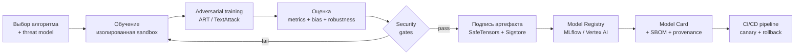
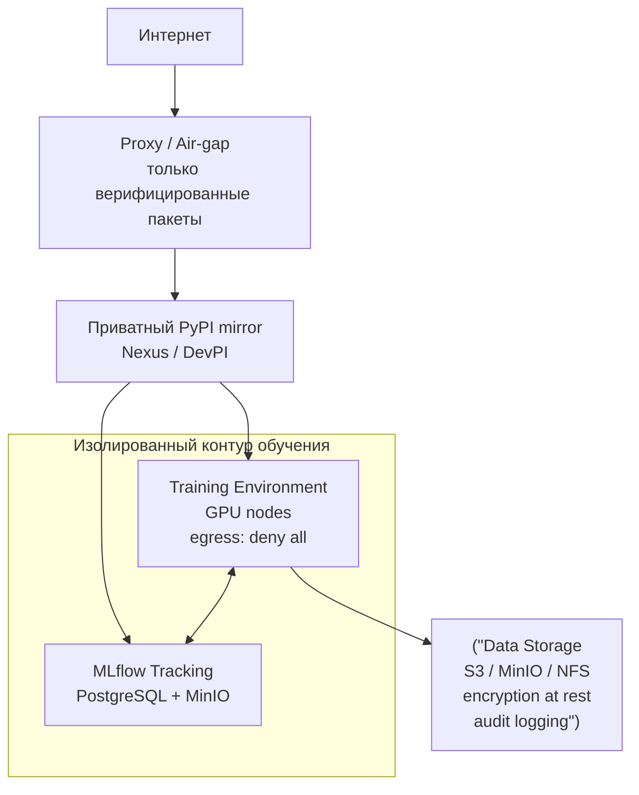
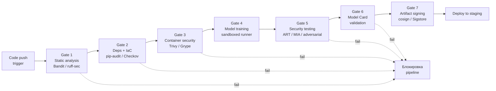

<a id="rekomendazii-ib-etap-2-operazii-s-modelami-model-operations"></a>

# Рекомендации ИБ: Этап 2 - Операции с моделями (Model Operations)

> Версия: 2.1 · Обновлено: 2026-05-29 · Теги: MLflow, Bandit, pip-audit, ART, SafeTensors, supply chain, adversarial training · Tier: 1-4
>
> Дополнено: 2026-11-13 — приёмка weights/adapters, проверка attestation и evaluation contamination; ограничения сериализации и privacy-gates уточнены.
>
> **TL;DR**. Безопасное обучение и хранение моделей: реестр MLflow, подпись артефактов, SafeTensors вместо pickle, adversarial testing (ART, CleverHans), ModelScan/picklescan для входных чекпоинтов. Этап 2 включает первичную приёмку; проверка допуска и целостности повторяется при promotion и загрузке в serving.

**Навигация:** Разделы 1-3 - архитектура, требования · Раздел 4 - CI/CD gates · Раздел 5 - Model Security Card · Разделы 6-7 - чек-лист, ошибки · Раздел 8 (новый) - интерактивные сценарии supply chain атак · Раздел 10 (новый) - **"С чего начать по вашей роли"** (7 ролей × Day 1 / Week 1 / Month 1).

<a id="1-kratkoe-soderjanie-etapa"></a>

## 1. Краткое содержание этапа

<a id="bezopasnyj-zikl-model-operations"></a>

### Безопасный цикл Model Operations



Этап 2 охватывает полный цикл работы с моделью: от выбора алгоритма до регистрации готового артефакта в Model Registry. На этом этапе модель проходит через следующие фазы:

| Фаза | Описание | Ключевые риски ИБ |
|------|----------|-------------------|
| **Выбор алгоритма** | Определение архитектуры модели с учётом требований бизнеса и безопасности | Model inversion, скрытое поведение (backdoor), утечка градиентов при federated learning |
| **Обучение** | Тренировка модели на подготовленных данных, включая adversarial training и RLHF | Poisoning через adversarial-примеры, утечка данных из train в validation, подмена гиперпараметров |
| **Оценка** | Функциональное и security-тестирование, трекинг экспериментов | Пропуск уязвимых версий в production, недостаточное покрытие adversarial-тестами |
| **Регистрация** | Версионирование и документирование модели в Model Registry | Отсутствие provenance, неподписанные артефакты, вредоносный код в сериализованных моделях |
| **CI/CD** | Автоматизация pipeline с обязательными security gates | Обход gates, недостаточная изоляция среды, избыточные привилегии сервис-аккаунтов |

**Принцип этапа:** модель не продвигается в staging или production без прохождения всех security gates. Безопасность является обязательным критерием качества наравне с метриками точности.

---

<a id="2-verifikazia-instrumentov"></a>

## 2. Верификация инструментов

Ниже приведены кандидаты для Model Operations. При выборе конкретной версии проверить лицензию и зависимости, условия self-hosted исполнения и egress, активность поддержки и применимые advisories. Каталог не подтверждает полную верификацию или допуск всех инструментов: выполненные проверки обозначаются с датой, версией, scope и evidence; перед применением требуется приёмка целевого окружения.

<a id="21-art-adversarial-robustness-toolbox"></a>

### 2.1. ART (Adversarial Robustness Toolbox)

| Параметр | Значение |
|----------|----------|
| **Разработчик** | IBM Research |
| **Лицензия** | Apache 2.0 |
| **Репозиторий** | [github.com/Trusted-AI/adversarial-robustness-toolbox](https://github.com/Trusted-AI/adversarial-robustness-toolbox) |
| **Поддерживаемые фреймворки** | TensorFlow, Keras, PyTorch, scikit-learn, XGBoost, LightGBM и др.; поддержку конкретной версии фреймворка сверять с релизом ART (Apache MXNet заархивирован в 2023 году) |
| **Типы атак** | Evasion (FGSM, PGD, C&W, DeepFool), Poisoning, Extraction, Inference |
| **Self-hosted** | Да, Python-пакет, не требует внешних зависимостей |

**Назначение в контексте этапа:** генерация adversarial-примеров для тестирования устойчивости модели, проведение membership inference атак, adversarial training.

**Рекомендация ИБ:** использовать ART как основной инструмент adversarial-тестирования. Минимальный набор проверок: FGSM (epsilon=0.1, 0.2, 0.3), PGD (iterations=40), Membership Inference. Для NLP-моделей дополнительно использовать TextAttack.

<a id="22-mlflow"></a>

### 2.2. MLflow

| Параметр | Значение |
|----------|----------|
| **Разработчик** | Databricks / LF AI & Data Foundation |
| **Лицензия** | Apache 2.0 |
| **Компоненты** | Tracking, Projects, Models, Model Registry |
| **Self-hosted** | Да, поддерживает PostgreSQL/MySQL + S3/MinIO/NFS для артефактов |

**Назначение в контексте этапа:** трекинг экспериментов (параметры, метрики, артефакты), версионирование моделей, управление lifecycle (Staging -> Production -> Archived).

**Рекомендация ИБ:**
- Развернуть MLflow Tracking Server в изолированном контуре с аутентификацией.
- Настроить RBAC: ML-инженеры - запись экспериментов, SecOps - управление тегами безопасности, Compliance - только чтение.
- Хранилище артефактов (S3/MinIO) должно иметь шифрование at-rest и версионирование объектов.
- Все переходы между стадиями (None -> Staging -> Production) должны требовать approval от SecOps.

<a id="23-bandit"></a>

### 2.3. Bandit

| Параметр | Значение |
|----------|----------|
| **Лицензия** | Apache 2.0 |
| **Тип** | SAST (Static Application Security Testing) для Python |
| **Репозиторий** | [github.com/PyCQA/bandit](https://github.com/PyCQA/bandit) |
| **Покрытие** | Обнаружение небезопасных вызовов (pickle.load, eval, exec, subprocess), hardcoded credentials, слабые хэши |

**Назначение в контексте этапа:** статический анализ Python-кода обучения и инференса на предмет уязвимостей.

**Рекомендация ИБ:** запускать Bandit на каждый коммит в CI/CD. Обязательные проверки:
- `B301` (pickle) - критически важно для ML, где pickle используется повсеместно;
- `B602`, `B603` (subprocess) - предотвращение command injection;
- `B105`, `B106`, `B107` (hardcoded passwords) - ключи API, токены MLflow.
- Настроить severity threshold: `bandit -r . -ll` (medium и выше блокируют pipeline).

<a id="24-pip-audit"></a>

### 2.4. pip-audit

| Параметр | Значение |
|----------|----------|
| **Разработчик** | Trail of Bits (при поддержке PyPA) |
| **Лицензия** | Apache 2.0 |
| **Тип** | SCA (Software Composition Analysis) |
| **Источники данных** | PyPI Advisory Database, OSV (Open Source Vulnerability) |

**Назначение в контексте этапа:** проверка зависимостей Python-проекта на известные уязвимости (CVE).

**Рекомендация ИБ:**
- Запускать `pip-audit` на каждый коммит и перед каждым обучением.
- `pip-audit` сам возвращает ненулевой exit code при найденных известных уязвимостях; `--strict` дополнительно останавливает аудит при ошибке сбора зависимостей, а `--desc` включает описания. Это не фильтр HIGH/CRITICAL: политику severity / exceptions реализовать отдельно. См. [pip-audit CLI](https://github.com/pypa/pip-audit), сверено 13.11.2026.
- Интегрировать с `requirements.txt` и `pyproject.toml`.
- Периодический (еженедельный) audit уже задеплоенных зависимостей.

<a id="25-trivy"></a>

### 2.5. Trivy

| Параметр | Значение |
|----------|----------|
| **Разработчик** | Aqua Security |
| **Лицензия** | Apache 2.0 |
| **Язык** | Go |
| **Возможности** | Сканирование Docker-образов, файловых систем, Kubernetes, IaC (Terraform, Dockerfile) |

**Назначение в контексте этапа:** сканирование Docker-образов обучения и инференса на CVE, misconfiguration.

**Рекомендация ИБ:**
- Сканировать все базовые образы (nvidia/cuda, python, pytorch) перед использованием.
- Настроить severity threshold: `trivy image --severity HIGH,CRITICAL --exit-code 1`.
- Использовать `--ignore-unfixed` только в обоснованных случаях с документированным risk acceptance.
- Вести приватный реестр верифицированных базовых образов.

<a id="26-grype-i-syft-ranee-anchore-engine"></a>

### 2.6. Grype и Syft (ранее Anchore Engine)

| Параметр | Значение |
|----------|----------|
| **Разработчик** | Anchore, Inc. |
| **Лицензия** | Apache 2.0 |
| **Репозитории** | [anchore/grype](https://github.com/anchore/grype) (сканер уязвимостей), [anchore/syft](https://github.com/anchore/syft) (SBOM) |
| **Возможности** | Анализ содержимого образов и файловых систем, SBOM в форматах CycloneDX / SPDX, сопоставление с базами уязвимостей |

[Anchore Engine](https://github.com/anchore/anchore-engine) заархивирован в январе 2023 года; его open-source функции перешли в Grype и Syft, policy enforcement — в коммерческий Anchore Enterprise. Для нового внедрения Anchore Engine не выбирать.

**Назначение в контексте этапа:** дополняет Trivy независимым сканером и генерацией SBOM.

**Рекомендация ИБ:**
- Генерировать SBOM всех ML-образов через Syft (CycloneDX), сканировать образ и SBOM через Grype.
- Политики образов (запрет тегов `latest`, обязательный HEALTHCHECK, запрет root-пользователя) проверять admission-контролем (Kyverno / OPA Gatekeeper) или в CI; open-source Grype не применяет policy bundles Anchore Enterprise.
- Интегрировать с Model Registry: SBOM привязывается к версии модели.

<a id="27-checkov"></a>

### 2.7. Checkov

| Параметр | Значение |
|----------|----------|
| **Разработчик** | Prisma Cloud (Palo Alto Networks) |
| **Лицензия** | Apache 2.0 |
| **Тип** | SAST/SCA для IaC |
| **Покрытие** | Terraform, Kubernetes manifests, Dockerfile, Helm, CloudFormation |

**Назначение в контексте этапа:** проверка конфигураций инфраструктуры обучения (Kubernetes, Terraform) на соответствие best practices безопасности.

<a id="28-openai-evals"></a>

### 2.8. OpenAI Evals

| Параметр | Значение |
|----------|----------|
| **Разработчик** | OpenAI |
| **Лицензия** | Apache 2.0 (по состоянию на момент публикации - проверять актуальную лицензию) |
| **Назначение** | Фреймворк оценки LLM по параметрам: точность, токсичность, утечка данных, следование инструкциям |

**Рекомендация ИБ:** применять для LLM-моделей как дополнительный gate: проверка на jailbreak-устойчивость, токсичность выходных данных, утечку PII из обучающего набора.

<a id="29-trl-transformer-reinforcement-learning"></a>

### 2.9. TRL (Transformer Reinforcement Learning)

| Параметр | Значение |
|----------|----------|
| **Разработчик** | Hugging Face |
| **Лицензия** | Apache 2.0 |
| **Методы** | PPO, DPO, ORPO, KTO |
| **Назначение** | RLHF для дообучения LLM с учётом предпочтений и безопасности |

**Рекомендация ИБ:** при использовании RLHF обязательно включать в reward model штраф за генерацию PII, токсичного контента и конфиденциальных данных. Датасет для reward model должен проходить те же проверки, что и основной обучающий набор (см. Этап 1).

---

<a id="3-rekomendazii-ib"></a>

## 3. Рекомендации ИБ

<a id="31-obazatel_nyj-adversarial-testing-pered-promotion"></a>

### 3.1. Обязательный adversarial testing перед promotion

**Требование:** ни одна модель не может быть переведена из стадии `None` в `Staging` или из `Staging` в `Production` без прохождения adversarial-тестирования.

**Минимальный набор тестов:**

| Тип модели | Обязательные тесты | Инструмент |
|------------|---------------------|------------|
| CV (классификация изображений) | FGSM (eps=0.1, 0.2, 0.3), PGD (iter=40, eps=0.3), C&W (L2) | ART |
| NLP (классификация текста) | TextBugger, DeepWordBug, TextFooler | TextAttack + ART |
| Табличные данные | HopSkipJump, ZOO | ART |
| LLM (генеративные) | Jailbreak prompts, prompt injection, PII extraction | OpenAI Evals, Garak |

**Критерий прохождения:**
- Порог и perturbation budget определяются ML-инженерами и SecOps до теста для конкретного проекта. Числа ε и 0.85 в примере ниже — учебная конфигурация, не универсальная мера робастности; зафиксировать norm, clip range, preprocessing и threat model.
- Если порог превышен - модель блокируется и возвращается на adversarial training.

**Пример интеграции в pipeline:**

```python
from art.attacks.evasion import FastGradientMethod, ProjectedGradientDescent
from art.estimators.classification import PyTorchClassifier

# Оборачиваем модель для ART
classifier = PyTorchClassifier(
    model=model,
    loss=loss_fn,
    optimizer=optimizer,
    input_shape=(3, 224, 224),
    nb_classes=10,
    clip_values=(0.0, 1.0),  # Example assumes inputs in this range.
)

# FGSM
fgsm = FastGradientMethod(estimator=classifier, eps=0.2)
x_adv_fgsm = fgsm.generate(x=x_test)
acc_fgsm = evaluate(classifier, x_adv_fgsm, y_test)

# PGD
pgd = ProjectedGradientDescent(estimator=classifier, eps=0.3, max_iter=40)
x_adv_pgd = pgd.generate(x=x_test)
acc_pgd = evaluate(classifier, x_adv_pgd, y_test)

# Gate criterion: never use assert for a mandatory release decision.
import math
import os
import re

MIN_CLEAN_ACCURACY = 0.70  # Illustrative policy; approve before evaluation.
MAX_RELATIVE_DROP = 0.15   # Illustrative policy, not an industry benchmark.
for name, value in {
    "clean_accuracy": clean_accuracy,
    "acc_fgsm": acc_fgsm,
    "acc_pgd": acc_pgd,
}.items():
    if isinstance(value, bool) or not isinstance(value, (int, float)):
        raise SystemExit(f"Missing/invalid metric type: {name}")
    if not math.isfinite(value) or not 0.0 <= value <= 1.0:
        raise SystemExit(f"Missing/non-finite/out-of-range metric: {name}")
if clean_accuracy < MIN_CLEAN_ACCURACY:
    raise SystemExit("Clean accuracy fails the approved baseline gate")
threshold = (1.0 - MAX_RELATIVE_DROP) * clean_accuracy
if acc_fgsm < threshold or acc_pgd < threshold:
    raise SystemExit("Adversarial accuracy fails the approved relative-drop gate")

# These bindings come from the tested artifact and protected release policy.
subject = os.environ.get("TESTED_BUNDLE_SHA256", "")
expected_subject = os.environ.get("APPROVED_BUNDLE_SHA256", "")
if not re.fullmatch(r"[0-9a-f]{64}", subject) or subject != expected_subject:
    raise SystemExit("Missing/mismatched tested bundle digest")
mlflow.log_param("security.test_subject_sha256", subject)
mlflow.log_metric("adversarial_acc_fgsm", acc_fgsm)
mlflow.log_metric("adversarial_acc_pgd", acc_pgd)
mlflow.set_tag("security.adversarial_test", "passed")
```

`evaluate` возвращает конечную Python float-метрику; numpy scalar приводится к float только в проверенной реализации evaluator, а missing / NaN / неизвестный label encoding не заменяются нулём. Clean metric, adversarial inputs и labels относятся к одному независимому eval split; label shape / диапазон проверяет evaluator. Порог 0.70 и допустимое относительное падение 15% — учебные inputs, согласуемые до теста. Digest вычисляется по фактически тестируемой bundle, ожидаемый digest поступает из защищённой policy; MLflow tag сам по себе не является разрешением promotion.

**Негативные проверки:** metrics 0 при хорошем clean, clean 0, NaN, missing metric, несовпавший / отсутствующий digest и запуск Python с `-O` должны завершаться ошибкой без `passed` tag. Positive case с finite metrics выше обеих границ и совпавшим subject проходит. [Python reference](https://docs.python.org/3.12/reference/simple_stmts.html#the-assert-statement) подтверждает удаление `assert` при оптимизации; проверено 13.11.2026.

<a id="kakie-adversarial-ataki-testirovat_-vasu-model_"></a>

#### Какие adversarial-атаки тестировать вашу модель

```widget:decision-tree
{
  "id": "ch04-adv-attacks",
  "title": "Подбор adversarial-test suite под тип модели",
  "start": "q1",
  "nodes": {
    "q1": {
      "type": "question",
      "text": "Какой тип модели вы выводите в production?",
      "sub": "От типа модели зависит набор атак, инструменты и метрики прохождения. Tier-1 модели — расширенный набор; для прототипов — минимум.",
      "choices": [
        { "label": "CV: классификация / детекция / сегментация изображений", "next": "q2-cv" },
        { "label": "NLP: классификация / NER / sentiment текста", "next": "leaf-nlp" },
        { "label": "Табличные данные: скоринг / классификация / регрессия", "next": "leaf-tabular" },
        { "label": "LLM: генеративная (chat / code / RAG)", "next": "q2-llm" },
        { "label": "Multimodal: VLM / audio + text / vision-LLM", "next": "leaf-multimodal" }
      ]
    },
    "q2-cv": {
      "type": "question",
      "text": "Доступны ли атакующему точные веса и вычисление градиентов целевой модели?",
      "sub": "Знание архитектуры при неизвестных весах — ограниченное знание, а не полный white-box. Зафиксируйте также API outputs, preprocessing, query budget и возможность transfer-атак.",
      "choices": [
        {
          "label": "Да — доступны веса/градиенты целевой модели",
          "next": "leaf-cv-whitebox"
        },
        {
          "label": "Нет — API или только частичное знание архитектуры",
          "next": "leaf-cv-blackbox"
        }
      ]
    },
    "q2-llm": {
      "type": "question",
      "text": "Какой основной риск для бизнеса?",
      "choices": [
        { "label": "Jailbreak / обход системного промпта (репутационный + compliance)", "next": "leaf-llm-jailbreak" },
        { "label": "Утечка training data / system prompt (приватность)", "next": "leaf-llm-leak" },
        { "label": "Prompt injection через RAG / tool calls (агентские риски)", "next": "leaf-llm-injection" }
      ]
    },
    "leaf-cv-whitebox": {
      "type": "leaf",
      "tone": "warn",
      "title": "White-box CV: расширенный suite",
      "summary": "Gradient-based suite при фиксированных норме, масштабе входа и бюджете: FGSM, PGD, C&W, AutoAttack. Robust accuracy по атакам — эмпирическая оценка; отдельный сертификат действует только в заявленной области.",
      "details": [
        "Выбрать ε, норму и область признаков до прогона; число 0.03 без масштаба входа неоднозначно",
        "PGD: фиксировать restarts, iterations, step size и проверки gradient masking",
        "AutoAttack объединяет несколько атак, включая Square Attack; это не доказательство «true robustness» против всех атак",
        "Для randomized smoothing сообщать certified radius/accuracy, confidence и abstentions по выбранному σ; сертификат L2 не покрывает произвольные физические воздействия"
      ],
      "links": [
        {
          "label": "Глава 07. Red Teaming methods",
          "href": "/ch/07-red-teaming-testing-methods"
        },
        {
          "label": "AutoAttack: состав и границы оценки",
          "href": "https://github.com/fra31/auto-attack"
        },
        {
          "label": "Randomized smoothing: исходная гарантия",
          "href": "https://arxiv.org/abs/1902.02918"
        }
      ]
    },
    "leaf-cv-blackbox": {
      "type": "leaf",
      "tone": "info",
      "title": "Black-box CV: query-efficient атаки",
      "summary": "Запросные и transfer-атаки при точно заданном доступе и лимите. Бюджет выбирается по угрозе и допустимой нагрузке, а не по универсальному диапазону.",
      "details": [
        "HopSkipJump / Boundary Attack — при подходящем интерфейсе ответов",
        "Square Attack — black-box компонент, также входящий в AutoAttack; превосходство над ансамблем не гарантируется",
        "Сравнивать атаки на одинаковом наборе, preprocessing, норме и бюджете",
        "Лимиты и anomaly detection проверять также на распределённых аккаунтах и легитимной нагрузке"
      ]
    },
    "leaf-nlp": {
      "type": "leaf",
      "tone": "info",
      "title": "NLP-классификация: текстовые adversarial-атаки",
      "summary": "Текст — дискретный, поэтому gradient-based атаки не работают напрямую. Используйте character-level и synonym-based атаки.",
      "details": [
        "TextAttack: выбрать recipe, язык, преобразования и constraints, совместимые с моделью",
        "Задавать бюджет изменённых токенов и отдельно проверять сохранение смысла и допустимость атаки",
        "Не переносить англоязычные словари/рецепты на русский без проверки; языковая поддержка зависит от конкретного компонента",
        "Augmentation и holdout adversarial evaluation разделять"
      ]
    },
    "leaf-tabular": {
      "type": "leaf",
      "tone": "info",
      "title": "Табличные модели: HopSkipJump + ZOO",
      "summary": "Часто игнорируется, но table-данные тоже подвержены evasion (особенно при integer/categorical constraints). Тестируйте на реалистичных perturbation-бюджетах.",
      "details": [
        "ART HopSkipJump для black-box scenario",
        "Constraint-aware perturbations: численные поля — Δ ≤ 5%, категориальные — флипы только в feasible category",
        "Особенно важно для скоринга: атака может стоить копейки в реальном мире (изменить декларируемую сумму на $100 — обойти fraud detection)"
      ]
    },
    "leaf-multimodal": {
      "type": "leaf",
      "tone": "err",
      "title": "VLM / multimodal: расширенная поверхность атаки",
      "summary": "Multimodal модели уязвимы к adversarial perturbation в любой из модальностей + к cross-modal injection (изображение с скрытыми инструкциями).",
      "details": [
        "Visual injection действует через фактически извлечённый текст или изображение",
        "Adversarial patch может вызывать evasion без backdoor в обучении; проверять эти механизмы отдельно",
        "Audio: различать изменение распознаваемой команды, replay и synthetic voice spoofing",
        "Оценивать весь parser/OCR/preprocessing pipeline и адаптивную атаку, а не обещать защиту от одной перекодировки"
      ],
      "links": [
        { "label": "Глава 26. Multimodal CV security", "href": "/ch/26-multimodal-cv-security" },
        { "label": "Глава 27. Voice AI security", "href": "/ch/27-voice-ai-security" }
      ]
    },
    "leaf-llm-jailbreak": {
      "type": "leaf",
      "tone": "err",
      "title": "LLM jailbreak: garak + PyRIT + Promptfoo",
      "summary": "Тестируйте против известных техник + custom-набор под ваш системный промпт. Для Tier-1 — continuous red teaming, не одноразовая проверка.",
      "details": [
        "Garak (NVIDIA): probes для DAN, leetspeak, multi-turn jailbreak; 50+ детекторов",
        "PyRIT (Microsoft): orchestrators для adversarial conversations, multi-turn",
        "Promptfoo: regression тестинг — фиксированный набор jailbreak-промптов в CI",
        "2025 техники: Crescendo (multi-turn gradual), Skeleton Key, Policy Puppetry"
      ],
      "links": [
        { "label": "Глава 11. Чат-боты", "href": "/ch/11-chatbot-conversational-security" }
      ]
    },
    "leaf-llm-leak": {
      "type": "leaf",
      "tone": "warn",
      "title": "LLM data leak: extraction tests",
      "summary": "Тестируйте на восстановление training data и system prompt. Метрики — exact match рейт при probing.",
      "details": [
        "Training Data Extraction: probing с префиксами из подозреваемых документов",
        "System Prompt Leak: классические «repeat above», role-confusion атаки",
        "Membership Inference (MIA): для PII-чувствительных моделей с ART MIA tests",
        "Защита: anti-echoleak filter, output DLP, периодический re-test после fine-tune"
      ],
      "links": [
        { "label": "§3.2 Membership Inference (ниже)", "href": "#32-membership-inference-testirovanie-kak-gate-criterion" }
      ]
    },
    "leaf-llm-injection": {
      "type": "leaf",
      "tone": "err",
      "title": "Indirect prompt injection: RAG + agent test",
      "summary": "Самый сложный класс — атака приходит из доверенного RAG-источника или web-страницы, прочитанной агентом.",
      "details": [
        "Тестируйте инъекции в RAG-источниках, web-pages, email-сниппетах, изображениях с OCR-текстом",
        "Reviewed custom fixture: poisoned документ → retrieval → попытка инструкции; проверить разрешённую задачу и запрещённый эффект. Для garak фиксировать реальные probes установленного registry: модуля rag-injection в 0.17.1 нет",
        "Метрика: % успешных инъекций до output guardrails / после",
        "Защита на pipeline: pre-retrieval ACL, untrusted-маркер в context window, dual-LLM pattern"
      ],
      "links": [
        { "label": "Глава 10. Agent protection", "href": "/ch/10-llm-agent-protection" },
        { "label": "Глава 16. RAG / Multimodal", "href": "/ch/16-ml-attacks-rag-multimodal" }
      ]
    }
  }
}
```

<a id="32-membership-inference-testirovanie-kak-gate-criterion"></a>

### 3.2. Membership Inference тестирование как gate criterion

**Проблема:** модель может «запоминать» обучающие примеры, что приводит к утечке конфиденциальных данных через API инференса. Атакующий, отправляя запросы к модели, может определить, использовалась ли конкретная запись в обучении.

**Требование:** перед promotion в Staging проводить Membership Inference Attack (MIA) с использованием ART.

**Порядок проведения:**

```python
import os
import math
import numpy as np
from sklearn.metrics import roc_auc_score, roc_curve
from art.attacks.inference.membership_inference import MembershipInferenceBlackBox

def checked_probability(value, name):
    if (type(value) not in (int, float) or not math.isfinite(value)
            or not 0 <= value <= 1):
        raise ValueError(f"Invalid probability/policy value: {name}")
    return float(value)


def approved_auc_limit(environ):
    raw = environ.get("POLICY_MIA_AUC_MAX")
    if not isinstance(raw, str) or not raw.strip():
        raise ValueError("Missing approved MIA AUC limit")
    try:
        value = float(raw)
    except ValueError:
        raise ValueError("Malformed approved MIA AUC limit") from None
    return checked_probability(value, "POLICY_MIA_AUC_MAX")


# Validate protected policy before fitting the attack or logging results.
auc_max = approved_auc_limit(os.environ)

# Inputs are prepared by the evaluation pipeline, with disjoint subject groups.
# member_*: target-model training records; nonmember_*: records never used by target.
# The attack-fit and attack-eval partitions must be independent.
if set(member_fit_group_ids) & set(member_eval_group_ids):
    raise ValueError("member attack-fit/eval overlap")
if set(nonmember_fit_group_ids) & set(nonmember_eval_group_ids):
    raise ValueError("nonmember attack-fit/eval overlap")

attack = MembershipInferenceBlackBox(estimator=classifier, attack_model_type="rf")
attack.fit(
    x=x_member_fit, y=y_member_fit,
    test_x=x_nonmember_fit, test_y=y_nonmember_fit,
)

def member_score(x, y):
    probabilities = np.asarray(attack.infer(x, y, probabilities=True))
    # ART built-in RF returns one column: P(member), not [P(0), P(1)].
    if probabilities.shape != (len(x), 1):
        raise ValueError("Expected a single P(member) column from the pinned ART version")
    scores = probabilities[:, 0]
    if not np.isfinite(scores).all() or np.any((scores < 0) | (scores > 1)):
        raise ValueError("Invalid membership probabilities")
    return scores

scores = np.concatenate([
    member_score(x_member_eval, y_member_eval),
    member_score(x_nonmember_eval, y_nonmember_eval),
])
labels = np.concatenate([
    np.ones(len(x_member_eval)), np.zeros(len(x_nonmember_eval)),
])
auc = checked_probability(float(roc_auc_score(labels, scores)), "measured AUC")
fpr, tpr, _ = roc_curve(labels, scores)
tpr_at_fpr_001 = checked_probability(float(np.max(tpr[fpr <= 0.01])), "measured TPR")

# A completed finite measurement must satisfy the prevalidated policy.
if auc > auc_max:
    raise RuntimeError(f"MIA AUC {auc:.4f} exceeds approved threshold {auc_max}")
mlflow.log_metric("membership_inference_auc", auc)
mlflow.log_metric("membership_inference_tpr_at_fpr_001", tpr_at_fpr_001)
```


**Пороговое значение:** задаётся в защищённой policy до запуска и проходит явную finite-проверку диапазона `[0,1]`. Missing, NaN, ±Inf, malformed и выход за диапазон дают ошибку до fit; measured AUC/TPR также проверяются до logging. Новые проверки policy/метрик проверены отдельно от прежнего ART smoke-test, без повторного обучения. Число 0.65 в старых CI-примерах этой главы — условный порог конкретного проекта, а не универсальный стандарт privacy. Precision и AUC не взаимозаменяемы. Фрагмент выполнен на ART 1.20.1 с синтетическим sklearn-классификатором (13.11.2026): положительный проход, отказ по policy и отказ при пересечении групп; MLflow logging в smoke-test заменён локальным stub. API ART `infer(probabilities=True)` сверён по [официальной документации](https://adversarial-robustness-toolbox.readthedocs.io/en/main/modules/attacks/inference/membership_inference.html) 13.11.2026; sample sizes, confidence intervals и TPR при низком FPR фиксируются в report. Положительный сигнал требует review; прохождение одного теста не доказывает приватность. При превышении согласованного порога:
1. Применить регуляризацию (dropout, L2, label smoothing).
2. Уменьшить количество эпох обучения.
3. Применить дифференциальную приватность (см. п. 3.9).
4. Повторить тестирование.

<a id="kal_kulator-trade-off-differential-privacy-vs-mia-auc"></a>

#### Калькулятор: trade-off Differential Privacy vs MIA AUC

```widget:threshold-slider
{
  "id": "ch04-dp-mia",
  "title": "DP-budget ε против Membership Inference и качества модели",
  "description": "Учебные кривые, не результаты CIFAR-10 / Abadi и не измеренный прогноз MIA. Механизм DP оценивается по ε, δ, единице приватности и композиции; ползунок не вычисляет юридическое соответствие.",
  "min": 0.1,
  "max": 20,
  "step": 0.1,
  "default": 3,
  "unit": " ε",
  "axisLabel": "Privacy budget ε (меньше — строже при тех же δ и соседстве)",
  "tracks": [
    {
      "label": "Условная MIA AUC в симуляции",
      "compute": "0.5 + 0.18 * (1 - Math.exp(-x/4))",
      "format": "fixed2",
      "tone": "warn",
      "hint": "Не empirical attack result. Низкий AUC одной атаки не доказывает приватность; порог задаётся отдельно."
    },
    {
      "label": "Условное качество в симуляции",
      "compute": "70 + 22 * (1 - Math.exp(-x/3))",
      "format": "fixed1",
      "tone": "info",
      "hint": "Формула иллюстративная; реальную utility измерять на своей задаче."
    }
  ],
  "regions": [
    {
      "from": 0.1,
      "to": 1,
      "label": "Меньший ε при фиксированных остальных условиях",
      "tone": "ok"
    },
    {
      "from": 1,
      "to": 3,
      "label": "Сравнить utility и privacy budget",
      "tone": "info"
    },
    {
      "from": 3,
      "to": 10,
      "label": "Оценить риск и композицию релизов",
      "tone": "warn"
    },
    {
      "from": 10,
      "to": 20,
      "label": "Не считать ε доказательством законности обработки",
      "tone": "err"
    }
  ]
}
```

<a id="33-model-provenance-polnaa-trassirovka-ot-dannyh-do-artefakta"></a>

### 3.3. Model Provenance: полная трассировка от данных до артефакта

**Требование:** для каждой версии модели в Model Registry должна быть восстановимая цепочка: исходные данные -> код предобработки -> код обучения -> гиперпараметры -> артефакт модели.

**Реализация через MLflow:**

```python
with mlflow.start_run() as run:
    # 1. Трассировка данных
    mlflow.log_param("dataset_name", "customer_transactions_v3")
    mlflow.log_param("dataset_hash_sha256", dataset_sha256)
    mlflow.log_param("dataset_dvc_version", "v2.3.1")
    mlflow.log_param("data_pipeline_commit", "abc123def")

    # 2. Трассировка кода
    mlflow.log_param("training_code_commit", git_commit_hash)
    mlflow.log_param("training_code_repo", repo_url)
    mlflow.log_param("preprocessing_script", "preprocess_v2.py")

    # 3. Трассировка окружения
    mlflow.log_param("python_version", sys.version)
    mlflow.log_param("torch_version", torch.__version__)
    mlflow.log_artifact("requirements.txt")
    mlflow.log_artifact("conda.yaml")

    # 4. Гиперпараметры
    mlflow.log_params({
        "learning_rate": 0.001,
        "batch_size": 64,
        "epochs": 50,
        "optimizer": "AdamW",
        "weight_decay": 0.01,
    })

    # 5. Метрики
    mlflow.log_metric("accuracy", accuracy)
    mlflow.log_metric("f1_score", f1)

    # 6. Артефакт модели
    mlflow.pytorch.log_model(model, "model")
```

**Дополнительные требования:**
- Хранить `git commit hash` кода обучения - обязательно.
- Хранить SHA-256 хэш обучающего датасета - обязательно.
- При использовании DVC - фиксировать версию DVC и remote storage URI.
- Логировать полный `requirements.txt` или `conda.yaml` как артефакт.

<a id="34-zifrovaa-podpis_-modelej"></a>

### 3.4. Цифровая подпись моделей

**Проблема:** после обучения и до деплоя модель проходит через несколько систем (Model Registry, CI/CD, container registry). На любом этапе артефакт может быть подменён.

**Решение:** подписывать артефакты моделей с использованием Sigstore/cosign.

**Порядок реализации:**

Пример использует одобренный digest из защищённой policy; не подставлять mutable tag вместо него. Поддержку bundle закрепить версией cosign.

```bash
# 1. Подпись артефакта модели (OCI-совместимого)
cosign sign --key cosign.key "registry.company.com/ml/fraud-detector@${APPROVED_MODEL_DIGEST:?approved digest required}"

# 2. Верификация при деплое
cosign verify --key cosign.pub "registry.company.com/ml/fraud-detector@${APPROVED_MODEL_DIGEST:?approved digest required}"

# 3. Для файловых артефактов (не OCI) - подпись через cosign blob
cosign sign-blob --key cosign.key --bundle model.sigstore.json model.onnx
cosign verify-blob --key cosign.pub --bundle model.sigstore.json model.onnx
```

**Рекомендации по управлению ключами:**
- Приватный ключ подписи хранить в HSM или Vault (HashiCorp Vault, AWS KMS, GCP KMS).
- Публичный ключ встраивать в CI/CD pipeline для автоматической верификации при деплое.
- Рассмотреть keyless signing через Sigstore Fulcio (привязка к OIDC-идентичности CI/CD runner).
- Ротация ключей: не реже чем раз в 12 месяцев или при компрометации.

<a id="35-skanirovanie-serializovannyh-modelej-na-vredonosnyj-kod"></a>

### 3.5. Сканирование сериализованных моделей на вредоносный код

**Проблема:** форматы сериализации Python (pickle, cloudpickle, joblib) позволяют встроить произвольный исполняемый код, который выполняется при десериализации (`pickle.load()`). Это один из наиболее критичных векторов атаки в ML-экосистеме.

**Уязвимые форматы:**
- `.pkl`, `.pickle` - стандартный pickle
- `.pt`, `.pth` - PyTorch (использует pickle внутри)
- `.joblib` - scikit-learn
- `.npy`, `.npz` - NumPy (при `allow_pickle=True`)

**Альтернативные форматы и их границы:**
- ONNX — graph + weights; отсутствие Python pickle не делает исполнение произвольного графа безопасным. Проверять operators, external data и runtime
- SafeTensors — формат только tensor data, исключающий механизм Python pickle; parser, runtime, config и содержимое весов остаются отдельной поверхностью риска
- TensorFlow SavedModel — protobuf-based graph; операции могут читать / писать файлы и потреблять ресурсы. Внешний graph рассматривается как недоверенная программа
- PMML/PFA - для классических ML-моделей

**Рекомендации:**

1. **Предпочитать безопасные форматы.** Для новых проектов использовать ONNX или SafeTensors вместо pickle.

2. **Сканировать pickle-файлы перед загрузкой:**
   ```bash
   # Использование fickling для анализа pickle-файлов
   pip install fickling
   fickling --check-safety model.pkl

   # Использование picklescan
   pip install picklescan
   picklescan --path model.pkl
   ```

3. **Bandit-правило B301** выявляет вызовы `pickle.load()` в коде - обеспечить его обязательное включение в CI/CD.

4. **Для PyTorch:** применять `torch.load(f, weights_only=True)` только в поддерживаемой patched сборке и изолированном контуре. Режим ограничивает unpickler, но не исключает DoS, memory corruption или уязвимости loader; актуальные advisories и порядок приёмки приведены в §4.4.

5. **Политика:** модели в формате pickle, полученные из внешних источников (Hugging Face Hub, сторонние поставщики), должны проходить обязательное сканирование в изолированной среде (sandbox) перед использованием.

<a id="formaty-serializazii-modelej-spravocnik-po-riskam"></a>

#### Форматы сериализации моделей — справочник по рискам

```widget:flashcards
{
  "id": "ch04-model-formats",
  "title": "7 форматов сериализации моделей: риск, сканер, рекомендация",
  "description": "Раскройте запись — внутри: устройство формата, тип риска, инструмент сканирования и когда формат допустим в production. Используйте при выборе формата для нового проекта или при импорте от внешнего вендора.",
  "shuffle": false,
  "cards": [
    {
      "tag": "опасный",
      "front": "pickle / .pt / .pth (joblib)",
      "subFront": "Native Python serialization",
      "back": "Устройство: Python pickle protocol — fully programmable. `__reduce__` метод объекта может выполнить произвольный код при десериализации.\n\nРиск: RCE при загрузке. PyTorch advisories показывают, что даже restricted loader требует patched runtime; см. §4.4.\n\nСканер: picklescan (HF), modelscan (Protect AI), fickling (Trail of Bits) — статический анализ опасных opcode (REDUCE, INST, OBJ, GLOBAL).\n\nРекомендация: НЕ использовать pickle для моделей из внешних источников. Для допустимых checkpoint — `weights_only=True` в patched runtime, без автоматического safe_globals / permissive fallback; ограничения см. §4.4."
    },
    {
      "tag": "без Python pickle; нужна приёмка",
      "front": "safetensors",
      "subFront": "HF, 2022 → стандарт 2024–25",
      "back": "Устройство: бинарный формат с заголовком JSON + tensor data. Нет executable code в принципе — только tensors.\n\nРиск: формат исключает Python pickle, но не все ошибки parser/runtime, resource exhaustion и вредоносное поведение весов. Zero RCE не гарантируется.\n\nРекомендация: формат по умолчанию для новых проектов. HF использует safetensors как primary с 2024. Конвертация: `safetensors.torch.save_file()`."
    },
    {
      "tag": "относительно безопасный",
      "front": "ONNX",
      "subFront": "Cross-framework interchange",
      "back": "Устройство: protocol buffers с graph + weights. Не Python-специфичный, не является Python pickle, но graph/runtime остаются недоверенной вычислительной программой.\n\nРиск: умеренный — известны атаки через специфические operator definitions (особенно в TF-to-ONNX), ошибки обработки operators / external data и уязвимости runtime; CVE привязывать только после проверки vendor advisory.\n\nСканер: onnx checker, ONNX Runtime в read-only mode + scan для подозрительных custom ops.\n\nРекомендация: подходит для cross-framework deployment, но проверяйте версию ONNX Runtime на актуальные CVE."
    },
    {
      "tag": "относительно безопасный",
      "front": "TensorFlow SavedModel",
      "subFront": "TF native format",
      "back": "Устройство: protobuf graph + variable checkpoints. SavedModel содержит исполняемый граф; file-I/O graph ops и custom native ops требуют проверки и изоляции.\n\nPython callback tf.py_function не переносится как сериализованное тело GraphDef: для него требуется тот же address space. ConcreteFunction сам по себе не делает такой callback переносимым Python payload.\n\nКонтроль: проверка происхождения и digest, enumeration graph/custom ops, patched runtime; внешние модели — в ограниченной среде без лишних прав."
    , "href": "https://www.tensorflow.org/api_docs/python/tf/py_function"},
    {
      "tag": "без Python pickle; нужна приёмка",
      "front": "GGUF / GGML",
      "subFront": "llama.cpp ecosystem",
      "back": "Устройство: бинарный формат для квантизованных LLM (llama.cpp, koboldcpp, ollama). Tensor data + metadata в KV-store, без executable code.\n\nРиск: отсутствие executable Python в формате не исключает уязвимости native parser/runtime и resource exhaustion. Метаданные и prompt template проверяются вместе с весами.\n\nРекомендация: безопасный формат для on-prem inference. Проверяйте источник + хеш."
    },
    {
      "tag": "опасный",
      "front": "Keras .h5 (HDF5)",
      "subFront": "Legacy Keras format",
      "back": "Устройство: HDF5-контейнер с весами + сериализованной архитектурой. `Lambda` layers могут сохранять Python bytecode: Keras func_dump/func_load используют marshal, а не механизм Python pickle.\n\nРиск: небезопасная десериализация архитектуры и Lambda/custom objects. CVE-2022-29216 относится к eval в saved_model_cli, а не служит доказательством этой конкретной атаки на Lambda; см. vendor advisory в примечании после таблицы форматов.\n\nСканер: ручная проверка на наличие Lambda layers, otherwise статический анализ HDF5.\n\nРекомендация: НЕ использовать для внешних моделей. Для собственных — переходить на SavedModel или Keras 3 native format."
    },
    {
      "tag": "опасный",
      "front": "MLflow `mlflow.pyfunc.load_model()`",
      "subFront": "Не формат, а wrapper",
      "back": "Устройство: pyfunc wrapper может загрузить Python/code artifacts, сериализованный объект и зависимости окружения; способ зависит от flavor и packaging. Не каждый pyfunc использует pickle.\n\nРиск: выполнение inference-кода/десериализация и установка зависимостей. conda.yaml описывает окружение; install hooks — отдельный путь исполнения, а не Python payload внутри YAML.\n\nКонтроль: проверить code/flavor/dependencies и точный digest; signature/input_example описывают schema, а не криптографическую подпись. Отдельно проверять доверенную подпись/provenance и изолировать загрузку."
    , "href": "https://mlflow.org/docs/latest/ml/model/models-from-code/"}
  ]
}
```

Сверка конкретной CVE-привязки: [TensorFlow GHSA-75c9-jrh4-79mc / CVE-2022-29216](https://github.com/tensorflow/tensorflow/security/advisories/GHSA-75c9-jrh4-79mc) относится к code injection в `saved_model_cli`, не к описанной атаке на Keras Lambda. Условия загрузки TensorFlow graph оцениваются по [TensorFlow SECURITY.md](https://github.com/tensorflow/tensorflow/blob/master/SECURITY.md); protobuf сам по себе не делает graph доверенным. Источники проверены 13.11.2026.

<a id="36-security-testy-kak-obazatel_nye-gates-v-cicd"></a>

### 3.6. Security-тесты как обязательные gates в CI/CD

**Требование:** security-тесты должны быть blocking gates - при их неуспешном прохождении pipeline останавливается, модель не продвигается.

**Реализация:** см. раздел 4 «Security Gates для CI/CD».

<a id="37-model-card-s-sekziej-security-assessment"></a>

### 3.7. Model Card с секцией Security Assessment

**Требование:** каждая модель в Model Registry должна сопровождаться Model Card, содержащей секцию «Security Assessment». Без заполненной секции модель не может быть переведена в Production.

Подробный шаблон - см. раздел 5 «Шаблон Model Security Card».

<a id="38-rekomendazii-po-adversarial-training"></a>

### 3.8. Рекомендации по adversarial training

**Цель:** повысить устойчивость модели к adversarial-атакам путём включения adversarial-примеров в процесс обучения.

**Методы:**

| Метод | Описание | Применимость |
|-------|----------|--------------|
| **Vanilla Adversarial Training (Madry et al.)** | Генерация PGD-примеров на каждом шаге обучения, обучение на смеси clean + adversarial | CV-модели, классификация |
| **TRADES** | Баланс между clean accuracy и adversarial robustness через регуляризацию | CV-модели, когда важна точность на clean data |
| **Free Adversarial Training** | Переиспользование градиентов для генерации adversarial-примеров без дополнительных forward/backward pass | Ресурсо-ограниченные среды |
| **Adversarial Training for NLP** | Возмущение эмбеддингов (FreeLB, SMART) | NLP-модели |

**Пример adversarial training с ART:**

```python
from art.defences.trainer import AdversarialTrainer
from art.attacks.evasion import ProjectedGradientDescent

# Определяем атаку для генерации adversarial-примеров
pgd_attack = ProjectedGradientDescent(
    estimator=classifier,
    eps=0.3,
    eps_step=0.01,
    max_iter=40,
)

# Adversarial Trainer: 50% clean + 50% adversarial
trainer = AdversarialTrainer(
    classifier=classifier,
    attacks=pgd_attack,
    ratio=0.5,  # доля adversarial-примеров в каждом batch
)

trainer.fit(x_train, y_train, nb_epochs=50, batch_size=128)
```

**Рекомендации:**
- Начинать с `ratio=0.3` (30% adversarial) и увеличивать при необходимости.
- Мониторить trade-off на своей задаче; изменение clean accuracy и допустимость потери определяются экспериментом и заранее согласованным gate, а не универсальными 2–5%.
- Логировать как clean accuracy, так и adversarial accuracy в MLflow.
- Проводить adversarial training на финальном этапе обучения (fine-tuning), а не с нуля.

<a id="39-rekomendazii-po-differenzial_noj-privatnosti"></a>

### 3.9. Рекомендации по дифференциальной приватности

**Цель:** гарантировать, что наличие или отсутствие одной записи в обучающем наборе не влияет существенно на выходные данные модели, тем самым защищая конфиденциальность индивидуальных записей.

**Инструменты:**

| Инструмент | Фреймворк | Описание |
|-----------|-----------|----------|
| **Opacus** | PyTorch | DP-SGD для PyTorch, поддерживает per-sample gradient clipping |
| **TensorFlow Privacy** | TensorFlow/Keras | DP-SGD оптимизаторы для TensorFlow |
| **diffprivlib** | scikit-learn | DP-версии классических ML-алгоритмов |

**Пример с Opacus (PyTorch):**

```python
from opacus import PrivacyEngine

# Инициализация PrivacyEngine
privacy_engine = PrivacyEngine()

model, optimizer, train_loader = privacy_engine.make_private_with_epsilon(
    module=model,
    optimizer=optimizer,
    data_loader=train_loader,
    target_epsilon=8.0,       # бюджет приватности
    target_delta=1e-5,        # DP parameter; not a probability of a data leak
    epochs=50,
    max_grad_norm=1.0,        # clipping norm
)

# Обычный цикл обучения - Opacus автоматически применяет DP-SGD
for epoch in range(50):
    for batch in train_loader:
        # ... стандартный training loop ...
        pass

# Получение итогового epsilon
epsilon = privacy_engine.get_epsilon(delta=1e-5)
mlflow.log_metric("dp_epsilon", epsilon)
mlflow.log_param("dp_delta", 1e-5)
mlflow.log_param("dp_max_grad_norm", 1.0)
```

**Рекомендации по выбору параметров:**

| Параметр | Рекомендация |
|----------|-------------|
| **epsilon** | Выбор по единице приватности, модели угроз, δ, композиции и utility; нет универсального ε для отрасли или юридического соответствия. |
| **delta** | delta < 1/N, где N - размер обучающего набора. Типичное значение: 1e-5. |
| **max_grad_norm** | Начинать с 1.0, калибровать по распределению норм градиентов. |

**Когда применять DP:**
- Модель обучается на персональных данных (PII, медицинские записи, финансовые транзакции).
- Модель будет доступна через public API (риск Membership Inference).
- Рассматриваются требования privacy by design; GDPR / 152-ФЗ не задают универсальный ε и не требуют DP для любой модели на ПДн.

<a id="310-ogranicenie-dostupa-k-gpu-klasteram"></a>

### 3.10. Ограничение доступа к GPU-кластерам

**Требование:** доступ к вычислительным ресурсам обучения (GPU-серверы, кластеры) должен быть строго контролируемым.

**Меры:**
1. **Аутентификация:** доступ к GPU-кластерам только через корпоративный SSO с MFA. Запрет на SSH по паролю.
2. **Авторизация:** RBAC на уровне namespace в Kubernetes. ML-инженеры получают доступ только к своим проектным namespace.
3. **Квоты:** ResourceQuota и LimitRange для каждого namespace - предотвращение злоупотребления ресурсами и DoS.
4. **Аудит:** все команды на GPU-серверах логируются (auditd, Falco). SSH-сессии записываются.
5. **Сетевая изоляция:** GPU-кластер в выделенном VLAN/VPC. Доступ только через VPN или bastion host.
6. **Управление секретами:** ключи API (MLflow, S3, Registry) передаются через Kubernetes Secrets или Vault, не через переменные окружения в открытом виде.

<a id="311-izolazia-sredy-obucenia"></a>

### 3.11. Изоляция среды обучения

**Требование:** для моделей, обучающихся на конфиденциальных данных (PII, коммерческая тайна, медицинские данные), среда обучения должна быть изолирована от внешних сетей.

**Реализация:**



**Kubernetes Network Policy (пример):**

```yaml
apiVersion: networking.k8s.io/v1
kind: NetworkPolicy
metadata:
  name: training-isolation
  namespace: ml-training
spec:
  podSelector:
    matchLabels:
      role: training-job
  policyTypes:
    - Egress
    - Ingress
  egress:
    # Разрешить доступ только к внутренним сервисам
    - to:
        - namespaceSelector:
            matchLabels:
              kubernetes.io/metadata.name: ml-platform
      ports:
        - port: 5000    # MLflow
          protocol: TCP
        - port: 9000    # MinIO
          protocol: TCP
    # DNS — обязательно, иначе резолв ml-platform-сервисов не работает
    - to:
        - namespaceSelector:
            matchLabels:
              kubernetes.io/metadata.name: kube-system
          podSelector:
            matchLabels:
              k8s-app: kube-dns
      ports:
        - port: 53      # DNS
          protocol: UDP
  ingress:
    # Разрешить только от CI/CD runners
    - from:
        - namespaceSelector:
            matchLabels:
              kubernetes.io/metadata.name: ci-cd
```

**Дополнительные меры:**
- Приватный зеркало PyPI (Nexus Repository, DevPI) с только верифицированными пакетами.
- Запрет на `pip install` из внешних источников на GPU-нодах.
- Запрет на mount host filesystem через актуальные Pod Security Standards / admission policy; удалённый из Kubernetes PodSecurityPolicy не использовать как действующий механизм.
- Запрет на privileged containers.
- Seccomp/AppArmor профили для training pods.

<a id="312-rekomendazii-po-bezopasnomu-hraneniu-modelej"></a>

### 3.12. Рекомендации по безопасному хранению моделей

**Требование:** артефакты моделей (веса, конфигурации, токенизаторы) должны храниться с обеспечением конфиденциальности, целостности и доступности.

**Меры:**

| Аспект | Рекомендация |
|--------|-------------|
| **Шифрование at rest** | AES-256 (SSE-S3, SSE-KMS для S3/MinIO). Ключи в HSM/KMS. |
| **Шифрование in transit** | TLS 1.2+ для всех соединений с хранилищем. Mutual TLS для внутренних сервисов. |
| **Контроль доступа** | IAM-политики с принципом least privilege. Раздельные bucket/prefix для каждого проекта. |
| **Версионирование** | S3 Object Versioning включён. Запрет на delete без MFA (MFA Delete). |
| **Аудит** | S3 Server Access Logging или CloudTrail. Логирование всех операций read/write/delete. |
| **Резервное копирование** | Cross-region replication для production-моделей. RPO не более 1 часа. |
| **Retention** | Хранить все версии production-моделей минимум 3 года (или в соответствии с регуляторными требованиями). |
| **Целостность** | SHA-256 checksum для каждого артефакта, хранится в Model Registry как метаданные. |

---


<a id="4-security-gates-dla-cicd"></a>

## 4. Security Gates для CI/CD

Ниже описаны обязательные проверки безопасности, встроенные в CI/CD pipeline обучения и деплоя модели. Каждый gate является блокирующим: при неуспешном прохождении pipeline останавливается.

Native JSON Bandit / pip-audit / Trivy ниже сохраняется через `artifacts.paths`. Для GitLab Security Dashboard нужен отдельный проверенный конвертер в соответствующую report schema; переименование native JSON в `reports.sast` / `dependency_scanning` / `container_scanning` не обеспечивает совместимость. CLI wrapper-скрипты, образы и версии инструментов в фрагментах относятся к реализации проекта.

<a id="41-arhitektura-pipeline"></a>

### 4.1. Архитектура pipeline



<a id="42-opisanie-gates"></a>

### 4.2. Описание gates

<a id="stage-2-gates-spravocnik-po-7-sagam-ci"></a>

#### Stage-2 gates — справочник по 7 шагам CI

```widget:flashcards
{
  "id": "ch04-stage2-gates",
  "title": "7 security gates от commit до Model Registry",
  "description": "Каждая запись — отдельный gate. Внутри: какой инструмент запускается, что blocking, типичные false positives и что делать при срабатывании. Используйте как референс при разборе фейлов CI и при настройке нового пайплайна.",
  "shuffle": false,
  "cards": [
    {
      "tag": "Gate 1 · SAST",
      "front": "Bandit на ML-код",
      "subFront": "Python-код обучения и инференса",
      "back": "Инструмент: Bandit; blocking gate сохраняет `-ll` (Severity ≥ MEDIUM).\n\nПроверки кода: B301 — небезопасная десериализация pickle; B602 — subprocess shell=True; B608 — подозрительная сборка SQL. Включение находки в blocking report зависит от фактической severity.\n\nОтдельный advisory report без -ll показывает LOW B403 (import pickle) и B404 (import subprocess). При -ll эти import-only findings отфильтрованы; их отсутствие не означает отсутствие импортов. Advisory LOW не меняет blocking threshold молча.\n\nFix: исключить небезопасный loader / shell=True, использовать parameterized SQL. Любое suppression — для конкретной проверки с review и обоснованием."
    },
    {
      "tag": "Gate 2 · SCA",
      "front": "pip-audit + safety scan",
      "subFront": "Уязвимости в зависимостях",
      "back": "Инструменты: pip-audit (PyPI), safety scan (Safety v3, заменил deprecated `check`).\n\nBlocking: CRITICAL и HIGH CVE.\n\nПроверять конкретные package versions и vendor advisories; общий порог версии без конкретного advisory не является результатом SCA.\n\nFix: bump versions; если зависимая lib не обновляется — добавьте manual review в risk register, не игнорируйте."
    },
    {
      "tag": "Gate 3 · Container Scan",
      "front": "Trivy / Grype на образ",
      "subFront": "OS + library уязвимости",
      "back": "Инструмент: Trivy (быстрый, comprehensive) или Grype (фокус на CVE).\n\nBlocking: CRITICAL CVE на base image и ML-библиотеки.\n\nТипичная стратегия: distroless / chainguard images как база; layers переупорядочены так, чтобы fast-changing были наверху (быстрые ребилды).\n\nFix: bump base image; добавить `apt-get upgrade -y` в Dockerfile (но это против reproducibility — лучше использовать pinned signed base)."
    },
    {
      "tag": "Gate 4 · IaC scan",
      "front": "Checkov на манифесты",
      "subFront": "K8s, Terraform, Helm",
      "back": "Инструмент: Checkov (Bridgecrew). Запускается на K8s YAML, Helm charts, Terraform.\n\nКлючевые проверки для ML:\n• runAsNonRoot, allowPrivilegeEscalation: false\n• NetworkPolicy на training namespaces\n• resources.limits для GPU\n• HostPath не разрешён\n\nFalse positives: некоторые ML-операторы требуют privileged mode (например, MIG-разделение GPU) — задокументируйте exceptions."
    },
    {
      "tag": "Gate 5 · Adversarial",
      "front": "ART / Garak / TextAttack",
      "subFront": "Robustness против evasion",
      "back": "Инструмент: ART (CV / tabular), TextAttack (NLP), Garak (LLM).\n\nBlocking: заранее зафиксируйте threat model, attack budget, test-set manifest и clean baseline. Accuracy на adversarial-set ≥ 85% от clean accuracy и jailbreak success rate ≤ 5% — примеры внутренних порогов, не универсальные нормы; отчитайте абсолютные значения, знаменатели и результаты по критичным срезам.\n\nУтечка секретов или неразрешённое действие блокируют релиз независимо от среднего процента. Timeout, error, пропущенная проверка или отсутствующий verdict не считаются pass: fail либо inconclusive с блокировкой до разбора.\n\n90 минут — пример бюджета CI, не гарантированная длительность full ART suite; измерьте свой workload и выделите runner. Fix: adversarial training / robust regularisation (например, TRADES для подходящей задачи), затем retest на независимом наборе без подстройки под него."
    },
    {
      "tag": "Gate 6 · MIA",
      "front": "Membership Inference Attack",
      "subFront": "Privacy gate",
      "back": "Инструмент: ART MembershipInferenceBlackBox / shadow-model attack.\n\nПротокол: зафиксируйте target snapshot и подтверждённые member / non-member labels; разделите обучение атаки, калибровку порога и независимый attack-eval. Неизвестное участие в training set — unknown. Сравните с baseline при том же доступе и query budget.\n\nBlocking: TPR при заранее выбранном низком FPR выше согласованного порога; отчитайте counts, размеры выборок и доверительные интервалы. Precision зависит от доли members; precision, AUC и TPR@FPR — разные метрики. Недостаточная выборка или ошибка атаки дают inconclusive, а не privacy pass.\n\nFix: регуляризация (dropout, L2, label smoothing), early stopping; затем независимый retest и проверка utility. Для formal DP-training (например, Opacus) задайте единицу приватности, соседство, ε/δ, clipping, sampling и accountant с композицией запусков/релизов; оцените accuracy trade-off. Слабая MIA не доказывает DP, а один ε не задаёт универсальный privacy gate."
    },
    {
      "tag": "Gate 7 · Sign + Provenance",
      "front": "Sigstore + ML-BOM",
      "subFront": "Финальный gate перед registry",
      "back": "Инструменты: cosign sign --yes (keyless через OIDC), CycloneDX ML-BOM generator, in-toto attestations.\n\nАртефакты:\n• Подпись модели (cosign sign-blob с записью в Rekor)\n• ML-BOM с SHA-сум датасета, base image, training-image, hyperparameters\n• in-toto provenance для всего pipeline\n\nBlocking: отсутствие любого из артефактов.\n\nFix: проверьте OIDC-токен (GitHub Actions ID-token), trust roots, ожидаемые identity/issuer и bundle выбранной версии cosign; legacy experimental-переменная не нужна для современного keyless workflow."
    }
  ]
}
```

<a id="gate-1-static-analysis-sast"></a>

#### Gate 1: Static Analysis (SAST)

| Параметр | Значение |
|----------|----------|
| **Инструмент** | Bandit |
| **Что проверяется** | Python-код обучения и инференса |
| **Блокирующие находки** | Severity >= MEDIUM (`-ll` флаг) |
| **Timeout** | 10 минут |

```yaml
sast_check:
  stage: security
  image: python:3.13-slim
  script:
    - pip install bandit
    - bandit -r src/ -ll -f json -o bandit_report.json
  artifacts:
    paths:
      - bandit_report.json
    when: always
  allow_failure: false
```

<a id="gate-2-dependency-amp-iac-scanning"></a>

#### Gate 2: Dependency & IaC Scanning

| Параметр | Значение |
|----------|----------|
| **Инструменты** | pip-audit, Checkov |
| **Что проверяется** | Python-зависимости (CVE), IaC-конфигурации (K8s, Terraform, Dockerfile) |
| **Блокирующие находки** | `pip-audit` ниже блокирует любую найденную известную уязвимость и collection failures с `--strict`; severity / exceptions требуют отдельной policy. Checkov policy задаётся отдельно. |

```yaml
dependency_scan:
  stage: security
  image: python:3.13-slim
  script:
    - pip install pip-audit
    - pip-audit --strict --desc -f json -o pip_audit_report.json
  artifacts:
    paths:
      - pip_audit_report.json
    when: always
  allow_failure: false

iac_scan:
  stage: security
  image: bridgecrew/checkov:latest
  script:
    - checkov -d . --framework kubernetes terraform dockerfile
      --output junitxml --output-file checkov_report.xml
      --soft-fail-on LOW
  artifacts:
    reports:
      junit: checkov_report.xml
    when: always
  allow_failure: false
```

<a id="gate-3-container-security"></a>

#### Gate 3: Container Security

| Параметр | Значение |
|----------|----------|
| **Инструменты** | Trivy, Grype + Syft |
| **Что проверяется** | Docker-образ обучения/инференса на CVE, misconfiguration, secret leaks |
| **Блокирующие находки** | CVE с severity HIGH или CRITICAL |

```yaml
container_scan:
  stage: security
  image: aquasec/trivy:latest
  script:
    - trivy image
      --severity HIGH,CRITICAL
      --exit-code 1
      --format json
      --output trivy_report.json
      ${CI_REGISTRY_IMAGE}:${CI_COMMIT_SHA}
  artifacts:
    paths:
      - trivy_report.json
    when: always
  allow_failure: false
```

<a id="gate-4-model-training-s-security-logirovaniem"></a>

#### Gate 4: Model Training (с security-логированием)

| Параметр | Значение |
|----------|----------|
| **Инструмент** | MLflow Tracking |
| **Что проверяется** | Полнота provenance: dataset hash, code commit, environment, hyperparameters |
| **Блокирующие условия** | Отсутствие обязательных метаданных |

```yaml
train_model:
  stage: train
  image: ${TRAINING_IMAGE}
  script:
    - python train.py
      --mlflow-tracking-uri ${MLFLOW_TRACKING_URI}
      --experiment-name ${CI_PROJECT_NAME}
    # Проверка полноты provenance
    - python validate_provenance.py
      --run-id ${MLFLOW_RUN_ID}
      --required-params dataset_hash_sha256,training_code_commit,python_version
  allow_failure: false
```

<a id="gate-5-security-testing"></a>

#### Gate 5: Security Testing

| Параметр | Значение |
|----------|----------|
| **Инструменты** | ART, OpenAI Evals (для LLM), picklescan/fickling |
| **Что проверяется** | Adversarial robustness, Membership Inference, pickle safety |
| **Блокирующие условия** | Adversarial accuracy drop > 15%, MIA выше согласованного порога на независимом attack-eval, malicious pickle detection |

```yaml
security_testing:
  stage: test
  image: ${TESTING_IMAGE}
  script:
    # Adversarial robustness
    - python security_tests/adversarial_test.py
      --model-uri ${MODEL_URI}
      --threshold 0.85
    # Membership Inference
    - python security_tests/membership_inference_test.py
      --model-uri ${MODEL_URI}
      --mia-threshold "${POLICY_MIA_AUC_MAX:?approved MIA policy required}"
    # Raw single-stream pickle artifacts: verify an exact approved inventory.
    - pip install picklescan==1.0.5
    - python security_tests/scan_pickle_artifacts.py
      --root "${MODEL_ARTIFACT_PATH:?artifact root required}"
      --manifest "${SCAN_MANIFEST:?approved manifest required}"
      --manifest-sha256 "${APPROVED_SCAN_MANIFEST_SHA256:?protected digest required}"
  allow_failure: false
  timeout: 2h
```

**Scanner contract.** Код ниже сохраняется как `security_tests/scan_pickle_artifacts.py`. Проверен с picklescan 1.0.5. CLI exit 0 означает «не найден malware» и может сопровождаться нулевым числом файлов / parse warning. `--strict` повышает suspicious globals до dangerous, но не устраняет этот пробел. Поэтому проверяются точный inventory, hash каждого файла и самостоятельный structural parse без `pickle.load`.

Пример принимает **только raw single-stream `.pkl`**, manifest находится вне artifact root, его SHA-256 поступает из защищённой release policy. JSON schema: `{"artifacts":[{"path":"model.pkl","sha256":"<64 lowercase hex>"}]}`. Другой формат (включая PyTorch ZIP / SafeTensors / ONNX), extra/missing file, symlink и неизвестный manifest запрещены; им нужен отдельный проверенный verifier / scan contract, а не автоматический fallback. Это узкий работающий gate, не универсальный loader или доказательство отсутствия backdoor.

```python
import argparse
import hashlib
import io
import json
import pickletools
import re
from pathlib import Path
from picklescan.scanner import scan_file_path

MAX_FILE_BYTES = 50 * 1024 * 1024  # Illustrative resource policy.
MAX_OPCODES = 1_000_000


def verify_pickle_artifacts(root, manifest, manifest_sha256):
    root, manifest = Path(root), Path(manifest)
    if root.is_symlink() or not root.is_dir() or manifest.is_symlink():
        raise ValueError("Regular artifact directory / manifest required")
    root, manifest = root.resolve(strict=True), manifest.resolve(strict=True)
    if root in manifest.parents or manifest.stat().st_size > 1024 * 1024:
        raise ValueError("Manifest must be outside root and within size policy")
    raw = manifest.read_bytes()
    if (not isinstance(manifest_sha256, str)
            or not re.fullmatch(r"[0-9a-f]{64}", manifest_sha256)
            or hashlib.sha256(raw).hexdigest() != manifest_sha256):
        raise ValueError("Missing/mismatched protected manifest digest")
    doc = json.loads(raw)
    if not isinstance(doc, dict) or set(doc) != {"artifacts"}:
        raise ValueError("Unknown manifest schema")
    records = doc["artifacts"]
    if not isinstance(records, list) or not records:
        raise ValueError("Empty/unknown artifact inventory")
    inventory = {}
    for record in records:
        if not isinstance(record, dict) or set(record) != {"path", "sha256"}:
            raise ValueError("Unknown artifact record")
        name, digest = record["path"], record["sha256"]
        if not isinstance(name, str) or not name or "\\" in name:
            raise ValueError("Invalid artifact path")
        rel = Path(name)
        if rel.is_absolute() or ".." in rel.parts or rel.as_posix() != name:
            raise ValueError("Noncanonical artifact path")
        if name in inventory or rel.suffix != ".pkl":
            raise ValueError("Duplicate/unsupported artifact format")
        if not isinstance(digest, str) or not re.fullmatch(r"[0-9a-f]{64}", digest):
            raise ValueError("Missing/invalid artifact digest")
        inventory[name] = digest
    entries = list(root.rglob("*"))
    if any(p.is_symlink() or not (p.is_file() or p.is_dir()) for p in entries):
        raise ValueError("Symlink/special artifact entry denied")
    actual = {p.relative_to(root).as_posix() for p in entries if p.is_file()}
    if actual != set(inventory):
        raise ValueError("Missing/extra artifact or incomplete scan inventory")
    evidence = []
    for name, digest in inventory.items():
        path = root / name
        if not 0 < path.stat().st_size <= MAX_FILE_BYTES:
            raise ValueError("Empty/oversized artifact")
        payload = path.read_bytes()
        if hashlib.sha256(payload).hexdigest() != digest:
            raise ValueError("Artifact revision differs from approved manifest")
        stream, last = io.BytesIO(payload), None
        for count, (opcode, argument, position) in enumerate(pickletools.genops(stream), 1):
            if count > MAX_OPCODES:
                raise ValueError("Opcode budget exceeded")
            last = opcode.name
        if last != "STOP" or stream.tell() != len(payload):
            raise ValueError("Incomplete/multiple/trailing pickle streams")
        result = scan_file_path(str(path), strict=True)
        if (result.scan_err or result.scanned_files != 1 or result.issues_count
                or result.infected_files or result.suspicious_count):
            raise ValueError("Unsafe/incomplete pickle scan")
        if hashlib.sha256(path.read_bytes()).hexdigest() != digest:
            raise ValueError("Artifact changed during scan")
        evidence.append({"path": name, "sha256": digest, "scanned_files": 1})
    return {"status": "passed", "manifest_sha256": manifest_sha256, "artifacts": evidence}


if __name__ == "__main__":
    parser = argparse.ArgumentParser()
    parser.add_argument("--root", required=True)
    parser.add_argument("--manifest", required=True)
    parser.add_argument("--manifest-sha256", required=True)
    args = parser.parse_args()
    print(json.dumps(verify_pickle_artifacts(args.root, args.manifest, args.manifest_sha256)))
```

**Приёмка:** benign raw pickle проходит; malformed / truncated / trailing stream, dangerous global, empty directory, extra/missing file, symlink, unsupported format, неверный manifest / artifact hash — ошибка. Ошибки не перехватываются как «чисто». Input snapshot immutable во время scan и передаётся дальше по digest; проверка пути сама по себе не устраняет гонки с concurrent writer. ModelScan имеет отдельные exit codes (включая 3 для unsupported / no supported files); нулевой aggregate report не заменяет per-artifact inventory. Primary API / exit semantics: [picklescan](https://github.com/mmaitre314/picklescan), [ModelScan](https://github.com/protectai/modelscan), проверено 13.11.2026.

<a id="gate-6-model-card-validation"></a>

#### Gate 6: Model Card Validation

| Параметр | Значение |
|----------|----------|
| **Что проверяется** | Наличие и полнота Model Card, включая секцию Security Assessment |
| **Блокирующие условия** | Отсутствие Model Card или незаполненные обязательные секции |

```yaml
validate_model_card:
  stage: validation
  script:
    - python validate_model_card.py
      --model-name ${MODEL_NAME}
      --model-version ${MODEL_VERSION}
      --required-sections
        "model_description,intended_use,training_data,
         security_assessment,known_limitations"
  allow_failure: false
```

<a id="gate-7-artifact-signing"></a>

#### Gate 7: Artifact Signing

| Параметр | Значение |
|----------|----------|
| **Инструмент** | cosign (Sigstore) |
| **Что проверяется** | Модель подписана, подпись верифицируема |
| **Блокирующие условия** | Ошибка подписи или верификации |

```yaml
sign_model:
  stage: signing
  # Project image pinned by digest, containing POSIX sh and a pinned cosign.
  image: ${SIGNING_IMAGE}
  id_tokens:
    SIGSTORE_ID_TOKEN:
      aud: sigstore
  script:
    - |
      set -eu
      set +x
      : "${APPROVED_OCI_REPOSITORY:?protected repository required}"
      : "${APPROVED_OCI_DIGEST:?approved OCI digest required}"
      : "${APPROVED_SIGNER_IDENTITY:?exact signer identity required}"
      : "${APPROVED_OIDC_ISSUER:?exact issuer required}"
      : "${SIGSTORE_ID_TOKEN:?CI OIDC token required}"
      case "$APPROVED_OCI_REPOSITORY" in
        *[[:space:]@]*) echo "Invalid OCI repository" >&2; exit 1 ;;
      esac
      case "${APPROVED_OCI_REPOSITORY##*/}" in
        *:*) echo "Repository must not include a mutable tag" >&2; exit 1 ;;
      esac
      case "$APPROVED_OCI_DIGEST" in
        sha256:*) HEX_DIGEST=${APPROVED_OCI_DIGEST#sha256:} ;;
        *) echo "Expected sha256 OCI digest" >&2; exit 1 ;;
      esac
      case "$HEX_DIGEST" in
        ""|*[!0-9a-f]*) echo "Invalid digest encoding" >&2; exit 1 ;;
      esac
      [ "${#HEX_DIGEST}" -eq 64 ] || exit 1
      MODEL_REF="${APPROVED_OCI_REPOSITORY}@${APPROVED_OCI_DIGEST}"
      mkdir -p reports
      cosign sign --yes --identity-token "$SIGSTORE_ID_TOKEN" "$MODEL_REF"
      cosign verify --check-claims=true \
        --certificate-identity "$APPROVED_SIGNER_IDENTITY" \
        --certificate-oidc-issuer "$APPROVED_OIDC_ISSUER" \
        --output json "$MODEL_REF" > reports/model_signature_verification.json
  artifacts:
    paths:
      - reports/model_signature_verification.json
    when: always
  allow_failure: false
```

**Предусловия Gate 7:** OCI artifact уже собран / размещён отдельным разрешённым процессом. Approved release record связывает фактические per-file hashes model bundle / scan manifest с измеренным OCI manifest digest после packaging; SHA-256 файла, bundle и OCI manifest не взаимозаменяемы. Этот пример не реализует uploader / packager. Репозиторий, OCI digest, точная certificate identity и issuer приходят из защищённой policy, а не из labels / отчёта кандидата. Поддержка OIDC issuer в Fulcio, trust roots, registry permissions и образ `SIGNING_IMAGE` квалифицируются проектом; один `id_tokens` блок не доказывает готовый keyless deployment.

Обе команды используют один `repo@sha256:...`; deployment / verify при загрузке обязаны использовать тот же разрешённый ref, а не повторно разрешать tag. `--certificate-identity` / `--certificate-oidc-issuer` — точные значения; широкие regexp и отключение claims checking не применяются. Verification JSON — evidence проверки конкретного OCI subject, не подтверждение безопасности весов или scanner coverage. Для файлового артефакта применяется `sign-blob / verify-blob` (§3.4), а не подпись произвольно выбранного контейнера.

**Негативные проверки:** отсутствующий / malformed digest, repository с tag, missing identity/issuer и metadata кандидата с другим subject не должны изменить approved ref. Локальная проверка команд не тестирует действительную подпись: неверные certificate identity / issuer / OCI claims должны отдельно отклоняться реальным verifier в проектной integration suite, без публикации неутверждённого артефакта. Primary flags / semantics: [Sigstore verify](https://docs.sigstore.dev/cosign/verifying/verify/), [signing containers](https://docs.sigstore.dev/cosign/signing/signing_with_containers/), сверено 13.11.2026.

<a id="43-matriza-gates-po-stadiam"></a>

### 4.3. Матрица gates по стадиям

| Gate | None -> Staging | Staging -> Production | Периодически (cron) |
|------|:---------------:|:---------------------:|:-------------------:|
| Gate 1: SAST | + | + | Еженедельно |
| Gate 2: Dependencies & IaC | + | + | Ежедневно |
| Gate 3: Container Security | + | + | Ежедневно |
| Gate 4: Training Provenance | + | - (уже пройден) | - |
| Gate 5: Security Testing | + | + (повторно) | Ежемесячно |
| Gate 6: Model Card | + | + | - |
| Gate 7: Artifact Signing | + | + | - |

---

<a id="44-priemka-vnesnih-weights-i-adapters-do-pervogo-load"></a>

### 4.4. Приёмка внешних weights и adapters до первого load

**Требование:** загрузка модели — отдельная операция повышенного доверия. Scanner проверяет известные признаки, формат ограничивает возможности сериализации, подпись связывает артефакт с identity; ни один из этих контролей не доказывает безопасное поведение весов или отсутствие ошибки parser/runtime.

**Свежие ограничения `weights_only`** (сверено 13.11.2026):

Начиная с PyTorch 2.6 `torch.load` использует `weights_only=True` по умолчанию, если не передан `pickle_module`. Не полагаться только на default: параметр и разрешённый runtime закрепляются в load policy.

- [PyTorch serialization notes](https://docs.pytorch.org/docs/2.15/notes/serialization.html) описывают ограниченный unpickler; этот режим не защищает от всех DoS и ошибок памяти и не превращает произвольный checkpoint в доверенный.
- [GHSA-63cw-57p8-fm3p, 26.01.2026](https://github.com/pytorch/pytorch/security/advisories/GHSA-63cw-57p8-fm3p): advisory указывает memory corruption / возможное выполнение кода при `weights_only=True`, affected ≤2.9.1, patched ≥2.10.0.
- [GHSA-v32g-mr63-3j83, 10.11.2026](https://github.com/pytorch/pytorch/security/advisories/GHSA-v32g-mr63-3j83): чтение локальных текстовых файлов через malicious checkpoint, affected указано ≥2.14.0, patched 2.15.0. Применимость проверяется по конкретной сборке и backports; это не обещание отсутствия иных уязвимостей в 2.15.0.

**Контур приёмки:**

| Шаг | Что делаем | Условие отказа |
|---|---|---|
| Получение | Отдельная download identity, allowlisted repository, immutable revision, ограниченный набор файлов | Mutable `main`, неизвестный publisher, неожиданные scripts / ссылки |
| Инвентаризация bundle | Хеши weights, всех shards и index, config, tokenizer, chat template, adapter config | Неучтённый файл, missing shard, несовпадающий digest |
| Проверка provenance | Проверенная подпись / review-record, связь с разрешённым builder и источником | Подпись существует, но identity / scope не разрешены |
| Static checks | Формат, размеры, scan поддерживаемых файлов, version advisories | Unknown format, unsupported scanner без решения, опасный config |
| Первый load | Одноразовая sandbox без секретов и production mount, egress deny, CPU/RAM/time limits | Попытка network/file access вне scope, crash, неограниченный расход ресурсов |
| Behaviour evaluation | Clean task quality, trigger tests, privacy / safety regression | Непройденный заранее согласованный gate |
| Promotion | Подписанный внутренний manifest результатов для того же bundle | Отчёт относится к другой комбинации base / adapter / runtime |

Указание `trust_remote_code=False` не заменяет egress policy; оно запрещает конкретный механизм загрузки Python-кода в Transformers. [Transformers SECURITY.md](https://github.com/huggingface/transformers/blob/main/SECURITY.md) рекомендует safetensors и review remote modeling files. Если модель требует custom code, это отдельный code review и сборка доверенного локального package, а не повторный запуск с `trust_remote_code=True` ради устранения ошибки.

**Пример offline load из уже проверенного immutable bundle**:

```python
from transformers import AutoModelForCausalLM, AutoTokenizer

# Review and pin the bundle and runtime before entering this sandbox.
# Deny network at the OS/container boundary; flags are not a sandbox.
model_dir = "/models/reviewed/base-release"
tokenizer = AutoTokenizer.from_pretrained(
    model_dir, local_files_only=True, trust_remote_code=False,
)
model = AutoModelForCausalLM.from_pretrained(
    model_dir,
    local_files_only=True,
    trust_remote_code=False,
    use_safetensors=True,
)
```

Отказ при отсутствии safetensors не обходится автоматическим fallback в pickle. Для допустимого исключения на legacy checkpoint: отдельная согласованная процедура в sandbox, поддерживаемая patched версия runtime и проверка ожидаемых tensor keys/shapes. Конвертация из pickle тоже **загружает исходный файл**, поэтому выполняется в том же недоверенном контуре.

<a id="lora-proveraetsa-kombinazia-a-ne-tol_ko-nebol_soj-fajl"></a>

#### LoRA: проверяется комбинация, а не только небольшой файл

[PEFT checkpoint format](https://huggingface.co/docs/peft/developer_guides/checkpoint) разделяет adapter weights и `adapter_config.json`; adapter обычно не содержит базовые веса. Поля `base_model_name_or_path`, `revision`, `target_modules` и `modules_to_save` необходимо проверять по политике приёмки. Заявленный base model в config не является доверенной инструкцией скачать этот репозиторий.

В manifest комбинации фиксируются digest base weights, adapter weights/config, tokenizer/chat template, порядок активных adapters, режим merge / quantization и runtime. После merge получен новый артефакт с новым digest: результаты проверки исходной базы к нему автоматически не переносятся. Для нескольких adapters проверить именно рабочую конфигурацию, включая маршрутизацию и отключение adapter между запросами разных tenants.

**Негативные проверки:**

- [ ] Bundle с `.bin` вместо требуемого safetensors не переключает loader на permissive режим.
- [ ] Изменение tokenizer, chat template или одного shard после approval блокирует promotion.
- [ ] `adapter_config.json` с другим base / неожиданным `modules_to_save` уходит на review, а не загружает зависимость из сети.
- [ ] Checkpoint с custom object не вызывает автоматическое добавление `safe_globals` или `weights_only=False`.
- [ ] Scanner timeout / unsupported format не интерпретируется как clean; sandbox не имеет доступа к registry signing key.

Это production-паттерн приёмки с обязательной локальной квалификацией. Исследовательский trigger-test повышает наблюдаемость backdoor-риска, но не доказывает отсутствие всех триггеров.

<a id="45-attestation-i-promotion-proverat_-subject-i-polnomocia-builder"></a>

### 4.5. Attestation и promotion: проверять subject и полномочия builder

**Требование:** registry version / alias указывает на проверенный immutable release. Подпись произвольного файла тем же ключом и тег `security=passed` не дают права заменить production-модель.

[SLSA provenance](https://slsa.dev/spec/v1.2/provenance) описывает происхождение артефакта через statement с subject и сведения о build. Для ML binding расширяется ссылками на dataset release, preprocessing, base/adapters и evaluation. Такая схема — локальный контракт; наличие похожего JSON не означает сертифицированный SLSA level.

| Проверка | Что сравнивает verifier | Типичная подмена |
|---|---|---|
| Subject | Digest фактически загружаемого bundle / OCI manifest | Подписан README, загружены другие веса |
| Identity / issuer | Разрешённый CI workflow / ключ и trust root из policy | Валидная подпись от постороннего репозитория |
| Builder / invocation | Разрешённая build identity и параметры запуска | PR-runner сам утверждает production approval |
| Materials | Dataset release, code revision, base/adapters, environment digest | Тег `latest` или незакреплённая зависимость |
| Evaluation | Report digest + subject той же комбинации + версия набора тестов | Зелёный report от прежнего checkpoint |
| Актуальность допуска | Текущий статус release и exceptions, срок re-evaluation | Повторное использование отозванного, но всё ещё подписанного артефакта |

**Проверка keyless bundle** (пример по [Sigstore verify](https://docs.sigstore.dev/cosign/verifying/verify/), API сверён 13.11.2026):

```bash
# Values are supplied by protected verifier policy, not by the candidate bundle.
cosign verify-blob release-manifest.json \
  --bundle release-manifest.sigstore.json \
  --certificate-identity "$EXPECTED_SIGNER_IDENTITY" \
  --certificate-oidc-issuer "$EXPECTED_OIDC_ISSUER"
```

После успешной криптографической проверки приложение всё ещё должно проверить file digests из manifest, утверждённые materials, subject evaluation report и текущий допуск. Публичный transparency log не публикует сами веса, но может раскрывать metadata / identity; для приватного контура определить допустимую публикацию и trusted Sigstore infrastructure. Нельзя обходить отказ верификации отключением trust / transparency checks.

**MLflow:** legacy стадии `None / Staging / Production` в этой главе обозначают процесс допуска. [Model Stages deprecated с MLflow 2.9](https://mlflow.org/docs/latest/ml/model-registry/workflow/); в новом workflow используются aliases и version tags. Alias изменяемый: deploy разрешает alias в конкретную version + digest, проверяет release evidence и сохраняет именно эту версию в deployment record. Назначение alias само по себе не выполняет авторизацию approval.

**Негативные проверки:**

1. Заменить subject weights при сохранённой подписи manifest — verifier отказывает.
2. Подписать release неразрешённой OIDC identity — отказывает, даже если certificate valid.
3. Переназначить alias между approval и deploy — загружается только ранее разрешённая immutable version либо запрос проходит новый review.
4. Повторить старый валидно подписанный release после revocation — текущая policy блокирует его.
5. Изменить model input schema: MLflow `signature` проверяет schema, **не криптографическую подпись**. Это отдельные поля evidence.

<a id="46-evaluation-contamination-ozenivat_-obobsenie-a-ne-uznavanie-testa"></a>

### 4.6. Evaluation contamination: оценивать обобщение, а не узнавание теста

**Проблема:** test items попадают в pretraining, SFT, preference / reward data, synthetic generation prompts или retrieval инструмента. Тогда метрики могут измерять знакомство с ответом вместо способности решать новую задачу. Запрет пересечения raw train/test по точному hash закрывает только самый простой вариант.

[Исследование Test Set Contamination of Generative Evaluations (редакция 28.09.2026)](https://arxiv.org/abs/2601.04301) изучает влияние загрязнения на разных этапах и настройках generation. Это исследовательский результат на конкретных моделях / задачах, а не универсальный коэффициент поправки benchmark score. Для собственной модели нужен воспроизводимый протокол.

| Канал contamination | Проверка перед gate | Ограничение вывода |
|---|---|---|
| Exact / normalized duplicates | Сопоставление исходного и канонизированного текста, answer keys и solutions | Unicode normalization и hashing не находят все пересказы |
| Near-duplicates / перевод | Семейства задач, shingles / similarity с ручной проверкой найденного | Порог similarity не является доказательством одинакового смысла |
| Общий субъект / документ | Group split до аугментации и label derivation | Разные record IDs могут происходить от одного случая |
| Synthetic training | Проверка prompts, generators и источников reference answer | Неизвестный pretraining генератора остаётся неизвестным |
| RAG / tool-time | Закреплённый retrieval snapshot и запрет lookup answer keys в closed-book gate | Open-book результат не сравнивается как closed-book |
| Подбор по тесту | Закрытый final holdout, отдельные dev / tuning sets | Частые повторные решения о релизе по одному holdout превращают его в dev-set |

**Протокол:**

1. До обучения зафиксировать task scope, split / benchmark revision, unit of independence и allowed tool access. Учесть факт, что у внешней foundation model полный train corpus может быть неизвестен.
2. Провести decontamination на доступных training materials, не выдавая «не найдено» за доказательство полной чистоты upstream. Сохранить параметры и объём проверенных данных.
3. Отделить итоговый holdout от команды, подбирающей prompts, hyperparameters и policy thresholds. Доступ к labels и scorer ограничить; не передавать секретный holdout внешнему LLM-judge без согласованного scope обработки.
4. Логировать model / adapter / runtime digest, tokenizer, decoding parameters, число попыток, tools, evaluator version и data cutoffs. Различия этих условий нельзя приписывать одним весам.
5. Публиковать отдельно результат на public benchmark, собственном защищённом holdout и подтверждённых non-overlap subsets. Если данных для анализа pretraining нет, прямо указать это ограничение.

<a id="privacy-gate-ne-ucit_-i-ne-ozenivat_-mia-na-odnih-i-teh-je-zapisah"></a>

#### Privacy gate: не учить и не оценивать MIA на одних и тех же записях

Membership inference — способность отличать member от non-member, а extraction — восстановление содержимого; низкий успех одной атаки не доказывает отсутствия другого риска. Attack-fit и attack-eval разделяются по субъектам / документным семействам. Метрики берутся на независимом attack-eval с согласованными распределениями и реалистичной долей members.

- Фиксировать ROC AUC, TPR при низком FPR, confidence intervals и sample sizes. Precision зависит от prevalence и threshold; она не взаимозаменяема с AUC.
- Проверять сильную baseline-атаку и допустимый adversary access: label-only, probabilities или loss. Отсутствие сигнала у слабого attack model не означает приватность target model.
- DP-budget, empirical MIA и юридическая оценка остаются разными evidence. ε / δ не переводятся в «процент соответствия 152-ФЗ».

**Негативные проверки:** добавить дубликат тестового задания в train; включить answer key в retrieval; обучить MIA на записях attack-eval; поменять decoding между candidate и baseline. Pipeline должен обнаружить нарушение протокола / сделать сравнение недопустимым, а не зарегистрировать «улучшение».

**Артефакт оценки:** dataset / protocol digest, список проверенных sources, contamination findings, независимые sample counts, результаты и доверительные интервалы, known unknowns upstream. Датасеты / ответы с ПДн сохраняются в ограниченном хранилище; отчёт в Registry содержит ссылки и агрегаты. Методика и источники дополнены 13.11.2026, без заявления полного аудита всех прежних бенчмарков главы.

<a id="5-sablon-model-security-card"></a>

## 5. Шаблон Model Security Card

Ниже представлен шаблон документа, который должен сопровождать каждую модель в Model Registry. Заполняется совместно ML-инженерами и SecOps.

---

<a id="model-security-card"></a>

### MODEL SECURITY CARD

---

**Название модели:** _[Название из Model Registry]_
**Версия:** _[Номер версии]_
**Дата создания:** _[YYYY-MM-DD]_
**Автор:** _[Имя ML-инженера]_
**Рецензент (SecOps):** _[Имя специалиста ИБ]_
**MLflow Run ID:** _[ID запуска]_
**Статус:** _[ ] Draft / [ ] Reviewed / [ ] Approved for Staging / [ ] Approved for Production_

---

<a id="1-opisanie-modeli"></a>

#### 1. Описание модели

| Поле | Значение |
|------|----------|
| Задача | _[Классификация / Регрессия / Генерация / ...]_ |
| Архитектура | _[ResNet-50 / BERT-base / LightGBM / ...]_ |
| Фреймворк | _[PyTorch 2.x / TensorFlow 2.x / scikit-learn 1.x]_ |
| Формат сериализации | _[ONNX / SafeTensors / pickle / ...]_ |
| Размер артефакта | _[MB/GB]_ |

<a id="2-dannye-obucenia"></a>

#### 2. Данные обучения

| Поле | Значение |
|------|----------|
| Датасет | _[Название, версия]_ |
| SHA-256 хэш | _[Хэш датасета]_ |
| Содержит PII | _[ ] Да / [ ] Нет_ |
| Уровень конфиденциальности | _[Публичный / Внутренний / Конфиденциальный / Строго конфиденциальный]_ |
| Проверка на poisoning (Этап 1) | _[ ] Пройдена / [ ] Не применимо_ |
| DVC версия | _[Если применимо]_ |

<a id="3-provenans"></a>

#### 3. Провенанс

| Поле | Значение |
|------|----------|
| Git commit (код обучения) | _[hash]_ |
| Репозиторий | _[URL]_ |
| requirements.txt / conda.yaml | _[Прилагается как артефакт в MLflow]_ |
| Базовый Docker-образ | _[image:tag, SHA256]_ |

<a id="4-security-assessment"></a>

#### 4. Security Assessment

<a id="41-adversarial-robustness"></a>

##### 4.1. Adversarial Robustness

| Тест | Результат | Порог | Статус |
|------|-----------|-------|--------|
| FGSM (eps=0.1) | _[accuracy]_ | >= _[threshold]_ | _[ ] Pass / [ ] Fail_ |
| FGSM (eps=0.2) | _[accuracy]_ | >= _[threshold]_ | _[ ] Pass / [ ] Fail_ |
| PGD (iter=40) | _[accuracy]_ | >= _[threshold]_ | _[ ] Pass / [ ] Fail_ |
| _[Другие тесты]_ | _[accuracy]_ | >= _[threshold]_ | _[ ] Pass / [ ] Fail_ |

<a id="42-privacy"></a>

##### 4.2. Privacy

| Тест | Результат | Порог | Статус |
|------|-----------|-------|--------|
| Membership Inference (метрика + sample size) | _[value + confidence interval]_ | _[порог из policy]_ | _[ ] Pass / [ ] Fail_ |
| DP epsilon (если применимо) | _[value]_ | <= _[target]_ | _[ ] Pass / [ ] Fail_ |

<a id="43-serializazia"></a>

##### 4.3. Сериализация

| Проверка | Результат | Статус |
|----------|-----------|--------|
| picklescan | _[Clean / Suspicious]_ | _[ ] Pass / [ ] Fail_ |
| fickling | _[Safe / Unsafe]_ | _[ ] Pass / [ ] Fail_ |
| Формат и runtime | _[ONNX / SafeTensors / pickle + runtime revision]_ | _[Приёмка пройдена / Заблокировано / Исключение согласовано]_ |

<a id="44-infrastruktura"></a>

##### 4.4. Инфраструктура

| Проверка | Результат | Статус |
|----------|-----------|--------|
| Bandit (SAST) | _[No findings / N findings]_ | _[ ] Pass / [ ] Fail_ |
| pip-audit (SCA) | _[No CVE / N CVE]_ | _[ ] Pass / [ ] Fail_ |
| Trivy (container) | _[No HIGH/CRITICAL / N findings]_ | _[ ] Pass / [ ] Fail_ |
| Checkov (IaC) | _[All passed / N failed]_ | _[ ] Pass / [ ] Fail_ |

<a id="45-zifrovaa-podpis_"></a>

##### 4.5. Цифровая подпись

| Поле | Значение |
|------|----------|
| Подписан cosign | _[ ] Да / [ ] Нет_ |
| Ключ подписи (ID) | _[Key ID / Keyless via Fulcio]_ |
| Верификация | _[ ] Успешна / [ ] Не проводилась_ |

<a id="5-izvestnye-ogranicenia-i-riski"></a>

#### 5. Известные ограничения и риски

| Риск | Уровень | Компенсирующая мера |
|------|---------|---------------------|
| _[Описание риска 1]_ | _[Low/Medium/High/Critical]_ | _[Описание меры]_ |
| _[Описание риска 2]_ | _[Low/Medium/High/Critical]_ | _[Описание меры]_ |

<a id="6-uslovia-ekspluatazii"></a>

#### 6. Условия эксплуатации

| Ограничение | Описание |
|-------------|----------|
| Допустимые входные данные | _[Формат, диапазон, ограничения]_ |
| Недопустимые сценарии использования | _[Перечень]_ |
| Требования к мониторингу | _[Drift detection, anomaly detection, ...]_ |
| Срок действия (re-evaluation) | _[Дата или условие для повторной оценки]_ |

<a id="7-soglasovania"></a>

#### 7. Согласования

| Роль | Имя | Дата | Подпись (одобрение) |
|------|-----|------|---------------------|
| ML-инженер | _[...]_ | _[...]_ | _[ ]_ |
| SecOps | _[...]_ | _[...]_ | _[ ]_ |
| Compliance | _[...]_ | _[...]_ | _[ ]_ |
| Product Manager | _[...]_ | _[...]_ | _[ ]_ |

---

<a id="6-cek-list-etapa-2"></a>

## 6. Чек-лист этапа 2

<a id="61-vybor-algoritma-i-nastrojka"></a>

### 6.1. Выбор алгоритма и настройка

- [ ] Проведена оценка угроз, специфичных для выбранной архитектуры (model inversion, backdoor, gradient leakage).
- [ ] Для моделей с federated learning: градиенты передаются в зашифрованном виде (Secure Aggregation).
- [ ] Выбор архитектуры согласован с SecOps (для моделей уровня конфиденциальности «Конфиденциальный» и выше).

<a id="62-obucenie"></a>

### 6.2. Обучение

- [ ] Среда обучения изолирована от внешних сетей (для конфиденциальных данных).
- [ ] GPU-кластер доступен только через SSO + MFA.
- [ ] Network Policy ограничивает egress трафик training pods.
- [ ] Все зависимости устанавливаются из приватного зеркала PyPI.
- [ ] Секреты (API-ключи, токены) передаются через Vault / Kubernetes Secrets, не через env-переменные в открытом виде.
- [ ] Логирование экспериментов настроено в MLflow (параметры, метрики, артефакты).
- [ ] Провенанс зафиксирован: dataset hash, git commit, requirements.txt.
- [ ] Adversarial training проведён (если применимо для типа модели).
- [ ] RLHF/DPO дообучение (для LLM) включает штраф за генерацию PII и токсичного контента.

<a id="63-ozenka-i-testirovanie"></a>

### 6.3. Оценка и тестирование

- [ ] Adversarial robustness testing пройден (FGSM, PGD - для CV; TextAttack - для NLP).
- [ ] MIA оценена на независимом attack-eval; метрики, sample sizes и заранее согласованные пороги зафиксированы.
- [ ] Для LLM: jailbreak и prompt injection тесты пройдены (OpenAI Evals, Garak).
- [ ] Решение о DP и других privacy-мерах обосновано; если DP применяется, единица приватности, ε, δ и композиция документированы.
- [ ] Формат, loader/runtime и весь bundle прошли приёмку §4.4; scanner clean не заменяет sandbox и provenance.
- [ ] Функциональные метрики соответствуют пороговым значениям.

<a id="64-cicd-security-gates"></a>

### 6.4. CI/CD Security Gates

- [ ] Gate 1: SAST (Bandit) - пройден.
- [ ] Gate 2: SCA (pip-audit) и IaC (Checkov) - пройдены.
- [ ] Gate 3: Container Scanning (Trivy) - пройден.
- [ ] Gate 4: Training Provenance - валидирован.
- [ ] Gate 5: Security Testing (ART, picklescan) - пройден.
- [ ] Gate 6: Model Card - заполнена и валидирована.
- [ ] Gate 7: Artifact Signing (cosign) - модель подписана и верифицирована.

<a id="65-registrazia-i-dokumentazia"></a>

### 6.5. Регистрация и документация

- [ ] Модель зарегистрирована в MLflow Model Registry с уникальной версией.
- [ ] Security-теги установлены на версии модели в Registry.
- [ ] Model Security Card заполнена, включая секцию Security Assessment.
- [ ] Model Security Card согласована: ML-инженер, SecOps, Compliance.
- [ ] Артефакт модели подписан (cosign).
- [ ] SBOM сгенерирован для Docker-образа модели (Syft, CycloneDX).
- [ ] SHA-256 checksum артефакта записан в метаданные Model Registry.

<a id="66-hranenie"></a>

### 6.6. Хранение

- [ ] Артефакты модели хранятся с шифрованием at-rest (AES-256).
- [ ] TLS 1.2+ для всех соединений с хранилищем.
- [ ] IAM-политики настроены по принципу least privilege.
- [ ] S3 Object Versioning включён.
- [ ] Аудит-логирование доступа к артефактам настроено.
- [ ] Резервное копирование настроено для production-моделей.

---

<a id="7-tipicnye-osibki"></a>

## 7. Типичные ошибки

<a id="anti-patterny-model-operations-spravocnik"></a>

#### Анти-паттерны Model Operations — справочник

```widget:flashcards
{
  "id": "ch04-model-antipatterns",
  "title": "10 анти-паттернов Model Operations и как их закрыть",
  "description": "Учебные сценарии типичных ошибок; проценты и примеры не являются подтверждённой статистикой production-инцидентов.",
  "shuffle": false,
  "cards": [
    {
      "tag": "robustness",
      "front": "«Спам-фильтр обходится Unicode-confusables»",
      "subFront": "Нет adversarial testing",
      "back": "Симптом: метрики clean test set ≥ 95%, но реальный спам растёт на 30% после деплоя.\n\nПричина: confusables (`іgnore` с U+0456), zero-width chars, lookalike символы — модель не училась на этом распределении.\n\nКонтроль: Gate 5 (TextAttack + custom confusables suite). Adversarial training на samples с unicode/typo perturbations."
    },
    {
      "tag": "supply chain",
      "front": "«Загрузили модель с HF — получили RCE»",
      "subFront": "pickle без сканирования",
      "back": "Учебный сценарий: внешний checkpoint загружается небезопасным loader-ом или уязвимым runtime; побочный код получает доступные job права. Не любой современный torch.load по умолчанию выполняет произвольный pickle.\n\nКонтроль: приёмка §4.4 до первого load/конвертации — source и digest всего bundle, supported patched runtime, проверенные static checks и одноразовая sandbox без secrets/production mounts с egress/resource limits.\n\nCovered scan подтверждает только заявленный scope; skipped/unsupported/error/timeout/unknown не считаются clean/pass. Для согласованного legacy checkpoint — явный weights_only=True без safe_globals/weights_only=False fallback; ожидаемые tensor keys/shapes и behaviour gates проверяются отдельно."
    , "href": "#44-priemka-vnesnih-weights-i-adapters-do-pervogo-load"},
    {
      "tag": "provenance",
      "front": "«Модель есть в Production — никто не знает, на чём обучена»",
      "subFront": "Нарушение провенанса",
      "back": "Симптом: incident-расследование на дрифт упирается в «неизвестно, какие данные использовались для обучения этой версии».\n\nПоследствия: затруднены воспроизводимость, retrain / rollback и подтверждение внутреннего контроля. Сам provenance gap не устанавливает нарушение 716-П: применимость к кредитной организации / банковской группе и конкретные обязанности проверяют отдельно по главам 14 и 18.\n\nКонтроль: in-toto attestations + ML-BOM в registry; запрет manual-promote через UI; tag в MLflow с SHA датасета и hyperparameters."
    },
    {
      "tag": "secrets",
      "front": "«CI/CD job пишет в production registry своими permissions»",
      "subFront": "Избыточные привилегии",
      "back": "Симптом: после компрометации pull-request runner’а злоумышленник push’ит свои веса в production model registry.\n\nКонтроль: разделить роли — train-stage с пишущими правами в staging registry; promotion в production — отдельный signed event через approval. OIDC tokens с минимальным scope, Vault dynamic creds."
    },
    {
      "tag": "privacy",
      "front": "«Спросили модель — она помнит обучающие данные»",
      "subFront": "Нет раздельной проверки extraction / membership",
      "back": "Симптом: probing извлекает документы, предположительно связанные с training set. Это training data extraction; membership inference решает другую задачу.\n\nКонтроль: Gate 6 — отдельно extraction на разрешённых canaries/целях и MIA на подтверждённых members/non-members, с раздельными метриками, priors и low-FPR режимом. Неизвестный training status не считать non-member.\n\nRegularization/DP-SGD оцениваются в заданной threat model. Отдельный тест не доказывает отсутствие всех утечек."
    , "href": "https://csrc.nist.gov/pubs/sp/800/226/final"},
    {
      "tag": "integrity",
      "front": "«Кто-то подменил модель в registry — никто не заметил»",
      "subFront": "Нет подписи артефактов",
      "back": "Симптом: модель в registry соответствует имени, но веса другие (атака через скомпрометированный credentials).\n\nКонтроль: Gate 7 (cosign sign-blob с записью в Rekor + ML-BOM); обязательная верификация при загрузке в serving-pod; signature/bundle и transparency inclusion как evidence о digest/identity. Отдельно проверять trusted issuer/subject, approved source/build и release policy: подписанный скомпрометированным workflow артефакт может оставаться вредоносным."
    , "href": "https://docs.sigstore.dev/about/threat-model/"},
    {
      "tag": "robustness",
      "front": "«Adversarial training сделали один раз — забыли»",
      "subFront": "Stale defenses",
      "back": "Симптом: новая версия модели уязвима к атакам, к которым старая была устойчива (regression).\n\nПричина: adversarial training делалось руками, не повторили после fine-tune.\n\nКонтроль: adversarial training как часть pipeline, не one-off; certified robustness benchmark в CI с blocking gate."
    },
    {
      "tag": "supply chain",
      "front": "«Обучали с доступом в интернет — pip подтянул typosquat»",
      "subFront": "Training в открытой сети",
      "back": "Симптом: training pod с pip install в Dockerfile тянет вредоносный пакет (slopsquat / typosquat).\n\nКонтроль: NetworkPolicy egress-allowlist на training namespace (только internal-PyPI mirror и model registry); --require-hashes для всех зависимостей; lockfile в CI gate."
    },
    {
      "tag": "documentation",
      "front": "«Модель в проде — Model Card отсутствует»",
      "subFront": "Дефицит документации",
      "back": "Симптом: при инциденте / регуляторном запросе невозможно ответить на вопрос «как модель ведёт себя на out-of-distribution данных, какие у неё известные ограничения».\n\nКонтроль: Model Card с обязательными секциями (performance, limitations, ethical considerations, security assessment) — gate перед promotion в Tier-1/2."
    },
    {
      "tag": "operations",
      "front": "«Метрики обучения скакнули — никто не среагировал»",
      "subFront": "Anomalies в training metrics",
      "back": "Симптом: loss curve имеет странные плато / спайки, accuracy на validation внезапно падает — возможный признак data poisoning или backdoor implantation.\n\nКонтроль: автоматические алерты на отклонения training metrics; обязательная human review при изменении стандартного behaviour; reproducible training для bisect через версии данных."
    }
  ]
}
```

<a id="71-otsutstvie-adversarial-testing"></a>

### 7.1. Отсутствие adversarial testing

**Ошибка:** модель переводится в Production на основании только функциональных метрик (accuracy, F1, AUC) без adversarial-тестирования.

**Последствия:** модель уязвима к evasion-атакам. Например, спам-фильтр, обученный без adversarial testing, обходится добавлением невидимых символов Unicode в текст письма.

**Решение:** adversarial testing - обязательный blocking gate в CI/CD (Gate 5). Без его прохождения promotion запрещён.

<a id="72-ispol_zovanie-pickle-bez-skanirovania"></a>

### 7.2. Использование pickle без сканирования

**Ошибка:** первый load или конвертация внешнего checkpoint до [приёмки §4.4](#44-priemka-vnesnih-weights-i-adapters-do-pervogo-load). Отсутствие scanner — один из пробелов; clean scan сам по себе не разрешает десериализацию.

**Последствия:** небезопасная десериализация или уязвимый runtime могут выполнить побочный код, прочитать доступные файлы либо исчерпать ресурсы. Наличие `weights_only=True` не исключает все эти риски; применимость advisory проверяется по конкретной сборке (§4.4).

**Решение:**
- Проверить источник, immutable revision/digest и полный bundle по [§4.4](#44-priemka-vnesnih-weights-i-adapters-do-pervogo-load); safetensors/ONNX уменьшают поверхность сериализации, но не доказывают безопасность runtime или поведения весов.
- Для фактического формата выбрать поддерживаемые static checks с закреплённой версией и проверить coverage. `covered` означает только выполненный заявленный scan; `skipped`, unsupported, error, timeout и unknown не считаются clean/pass без отдельного решения о допустимых проверках.
- Для согласованного legacy checkpoint — поддерживаемый patched runtime по текущим advisory и явный `weights_only=True`; не обходить отказ через автоматические `safe_globals` или `weights_only=False`.
- Первый load и конвертация — в одноразовой sandbox без secrets/production mounts, с egress deny и CPU/RAM/time limits. До promotion проверить ожидаемые tensor keys/shapes, совместимость и behaviour gates для того же digest.

<a id="73-narusenie-provenansa"></a>

### 7.3. Нарушение провенанса

**Ошибка:** модель зарегистрирована в Registry без фиксации dataset hash, git commit или версии зависимостей. «Обучили на ноутбуке, залили в Registry вручную».

**Последствия:** невозможность воспроизвести модель, невозможность провести расследование в случае инцидента, нарушение требований аудита.

**Решение:** Gate 4 (Training Provenance) блокирует регистрацию модели без обязательных метаданных. Скрипт `validate_provenance.py` проверяет наличие: `dataset_hash`, `training_code_commit`, `python_version`, `requirements.txt`.

<a id="74-izbytocnye-privilegii-cicd"></a>

### 7.4. Избыточные привилегии CI/CD

**Ошибка:** сервис-аккаунт CI/CD runner имеет full admin access к Kubernetes-кластеру, Model Registry и хранилищу артефактов.

**Последствия:** компрометация CI/CD runner даёт атакующему полный контроль над инфраструктурой ML.

**Решение:**
- Отдельные сервис-аккаунты для каждого job (train, test, deploy).
- Минимальные привилегии: job обучения не имеет прав на deploy, job деплоя не имеет прав на удаление моделей.
- Kubernetes: отдельные ServiceAccount с Role/RoleBinding для каждого namespace.
- Секреты (COSIGN_PRIVATE_KEY, MLFLOW_TOKEN) доступны только в соответствующих jobs.

<a id="75-otsutstvie-membership-inference-testirovania"></a>

### 7.5. Отсутствие Membership Inference тестирования

**Ошибка:** модель, обученная на PII-данных (например, кредитный скоринг), деплоится без проверки на утечку обучающих данных через Membership Inference.

**Последствия:** атакующий через API модели определяет, были ли конкретные записи (например, конкретный клиент банка) в обучающем наборе. Это нарушение конфиденциальности и потенциальное нарушение ФЗ-152 / GDPR.

**Решение:** MIA-тестирование - обязательный gate. При превышении заранее согласованного порога исследовать сигнал и применить обоснованные меры, включая регуляризацию и/или дифференциальную приватность (Opacus, TensorFlow Privacy).

<a id="76-otsutstvie-podpisi-artefaktov"></a>

### 7.6. Отсутствие подписи артефактов

**Ошибка:** модель передаётся из Model Registry в production без цифровой подписи и верификации.

**Последствия:** supply chain attack - подмена модели на этапе между Registry и deployment. Атакующий, получивший доступ к Registry или container registry, может заменить модель на вредоносную.

**Решение:** Gate 7 (Artifact Signing) обязателен. Cosign подписывает артефакт после прохождения всех тестов, deployment-скрипт верифицирует подпись перед деплоем.

<a id="77-prenebrejenie-adversarial-training"></a>

### 7.7. Пренебрежение adversarial training

**Ошибка:** adversarial testing показал уязвимость модели, но вместо adversarial training команда просто увеличила порог допустимого снижения accuracy.

**Последствия:** модель остаётся уязвимой, порог «подгоняется» под результат вместо устранения проблемы.

**Решение:** если adversarial testing показал снижение accuracy > 15%, обязательный шаг - adversarial training (ART AdversarialTrainer) с последующим повторным тестированием. Изменение порогов требует документированного risk acceptance от SecOps и PM.

<a id="78-obucenie-v-srede-s-dostupom-v-internet"></a>

### 7.8. Обучение в среде с доступом в интернет

**Ошибка:** training pods имеют неограниченный egress - модель обучается на конфиденциальных данных в среде, имеющей доступ к интернету.

**Последствия:** утечка обучающих данных через DNS tunneling, HTTP exfiltration, или компрометация через supply chain attack (подмена pip-пакета при `pip install`).

**Решение:** Network Policy запрещает egress из training namespace ко всем адресам, кроме внутренних сервисов (MLflow, MinIO, DNS). Пакеты устанавливаются только из приватного зеркала PyPI.

<a id="79-otsutstvie-model-card"></a>

### 7.9. Отсутствие Model Card

**Ошибка:** модель продвигается в Production без документации. «Все знают, как она работает, зачем тратить время на Model Card».

**Последствия:** при ротации команды теряется контекст. При инциденте невозможно быстро определить: на каких данных обучалась модель, какие тесты прошла, какие ограничения имеет. Compliance-аудит не может быть пройден.

**Решение:** Gate 6 (Model Card Validation) блокирует promotion без заполненной Model Security Card. Шаблон стандартизирован (см. раздел 5).

<a id="710-ignorirovanie-anomalij-v-metrikah-obucenia"></a>

### 7.10. Игнорирование аномалий в метриках обучения

**Ошибка:** резкий скачок accuracy во время обучения (например, с 0.75 до 0.99 за одну эпоху) воспринимается как успех и не исследуется.

**Последствия:** скачок может свидетельствовать об утечке данных из test/validation в train (data leakage), что делает метрики недостоверными. В production такая модель покажет значительно худшие результаты.

**Решение:** настроить alerting на аномальные изменения метрик в MLflow. Скачок accuracy > 10% за одну эпоху должен автоматически ставить флаг для review. ML-инженер и SecOps совместно исследуют причину перед продолжением.

---

<a id="8-rassirenia-etapa-model-operations"></a>

## <span id="rassirenia-etapa-model-operations" aria-hidden="true"></span>8. Расширения этапа Model Operations

Этап 2 - это не только обучение и оценка модели, но и точка, где модель становится управляемым регулируемым активом организации. Ниже три расширения, без которых Model Operations в зрелой компании не считается завершённым.

<a id="81-validazia-modeli-i-mrm"></a>

### <span id="validazia-modeli-i-mrm" aria-hidden="true"></span>8.1. Валидация модели и MRM

Для моделей Tier 1-2 завершение обучения и проход unit-тестов не означают готовности к деплою. Требуется независимая валидация 2LoD в парадигме Model Risk Management.

Типовой процесс независимой валидации:

| Шаг | Что делает 1LoD (команда модели) | Что делает 2LoD (Model Risk) |
|---|---|---|
| Запрос на валидацию | Предоставляет обученную модель, датасеты, код, Model Card | Проверяет полноту пакета, отказывает при некомплектности |
| Воспроизводимость | Даёт инструкцию на reproducibility | Независимо воспроизводит обучение из кода и датасетов, сравнивает метрики |
| Challenger-модель | Не вовлечена | Обучает независимую модель на тех же данных другим алгоритмом (или независимой реализацией), сравнивает |
| Тестирование на робастность | Предоставляет результаты своих adversarial-тестов | Проводит независимое adversarial-тестирование (FGSM, PGD, TextAttack, Garak) на hold-out |
| Bias / Fairness | Документирует собственную оценку | Независимая проверка по независимому датасету |
| Выводы | Получает заключение | Формирует formal validation report с pass/conditional/fail |

Выход валидации - не просто «ок/не ок», а один из трёх вариантов:

- **Pass:** модель допускается в продакшен без условий, фиксируется следующая дата пересмотра
- **Conditional pass:** допуск с условиями (ограниченный scope, enhanced monitoring, обязательный pre-review каждого inference)
- **Fail:** возврат на доработку с конкретным перечнем замечаний

Для Tier 1 conditional pass требует отдельного согласования с CRO или эквивалентом, fail блокирует деплой полностью.

**Обязательная запись в AI-BOM** по итогам Model Operations дополняется фактическими значениями: версия датасетов с хешами, версия кода, commit hash, хеш полученной модели, даты обучения, фактические метрики, результаты валидации.

Подробно процесс валидации с шаблонами документов - в главе 14.

<a id="82-supply-chain-modelej-pre-trained-lora-safetensors"></a>

### <span id="supply-chain-modelej-pre-trained-lora-safetensors" aria-hidden="true"></span>8.2. Supply chain моделей: pre-trained, LoRA, SafeTensors

Большая часть ML-проектов начинается не с обучения с нуля, а с загрузки pre-trained модели. Это - поверхность атаки, которую часто недооценивают.

**Типовые угрозы supply chain моделей:**

| Угроза | Описание | Контроль на этапе Model Operations |
|---|---|---|
| Backdoor в pre-trained checkpoint | Компрометация веса через BadNets / RIPPLES / TrojanLM | Allowlist репозиториев (HuggingFace official org, проверенные лабы), pinning по commit hash, triggered behaviour testing |
| Pickle deserialization | Произвольное выполнение кода при загрузке .pt / .bin | Использование SafeTensors вместо pickle, обязательный запуск ModelScan/picklescan/fickling перед загрузкой |
| Подмена модели в registry | MITM на загрузке, компрометация зеркала | Проверка SHA-256 хеша, verification подписи через cosign, использование TUF |
| Backdoor через LoRA/QLoRA | Компрометация адаптера, подключаемого к чистой базовой модели | Аналогичные контроли для LoRA-артефактов: allowlist, scan, подпись |
| Training data extraction through model | Model inversion / memorization позволяют извлечь обучающие данные | DP при обучении, тесты на memorization (canary strings), ограничение выходной длины |

**Практический workflow загрузки pre-trained модели:**

1. Проверка репозитория по allowlist (HuggingFace org, ModelScope и т.п.)
2. Загрузка с pinning на конкретный commit hash (не tag, не branch)
3. Инвентаризация всего bundle и format policy по [§4.4](#44-priemka-vnesnih-weights-i-adapters-do-pervogo-load): safetensors для переносимых weights; legacy exception — отдельная согласованная процедура, не автоматический pickle fallback
4. Выбрать поддерживаемые проверки для каждого фактического формата и закреплённой версии инструмента; сохранить coverage. `covered` не означает безопасную модель, а `skipped`/unsupported/error/timeout/unknown не являются pass. Parser/schema/resource checks и первый load в patched isolated runtime проходят отдельные gates §4.4
5. Проверка SHA-256 хеша против манифеста репозитория
6. Подпись локальной копии через cosign для дальнейшего внутреннего обращения
7. Запись в AI-BOM: источник, хеш, commit, дата, скан-результаты

**Workflow для LoRA-адаптеров** аналогичен, плюс:

- Загрузка LoRA только к fixed базовой модели (не менять базу без пересмотра безопасности)
- Triggered behaviour testing: прогон стандартного набора adversarial-промптов после attach-а адаптера, сравнение с базовой моделью
- Отдельная запись в AI-BOM для каждого LoRA-адаптера

Полный каталог атак, инструменты сканирования (ModelScan, picklescan, fickling) и примеры их использования - в главе [16](16-ml-attacks-rag-multimodal.md).

<a id="83-podpisanie-checkpoint-ov-i-izolazia-treningov"></a>

### <span id="podpisanie-checkpoint-ov-i-izolazia-treningov" aria-hidden="true"></span>8.3. Подписание checkpoint-ов и изоляция тренингов

На уровне инфраструктуры обучения Model Operations требует ряда контролей, выходящих за рамки классического MLOps.

**Подпись и целостность checkpoint-ов:**

- Хранение весов только в SafeTensors (без pickle)
- cosign-подпись каждого промежуточного checkpoint-а во время обучения (не только финального)
- Манифест тренинга: код (commit hash), данные (dataset hash), гиперпараметры, timestamp, identity обучающего - подписывается целиком
- Непрерывная проверка целостности на restore: при подъёме checkpoint-а автоматически верифицируется подпись, несоответствие блокирует обучение

**Изоляция обучающих заданий:**

- Отдельный namespace/кластер для обучения (не шаринг с inference)
- Pod Security Standards restricted для всех training-подов
- NetworkPolicy: исходящий трафик только к хранилищу данных и к checkpoint-хранилищу, без доступа к Интернету (training pod не должен уметь скачивать зависимости во время обучения)
- GPU isolation: MIG для workload-ов разного классов, vGPU для multi-tenant, не делить один GPU между Tier 1 и Tier 3
- Ограничение stdout/stderr training pod-ов от утечки данных: логи проходят через фильтр PII перед отправкой в SIEM

**Воспроизводимость обучения как контроль:**

- Зафиксированное окружение: Docker image с pinned версиями, pinned CUDA, pinned фреймворки
- Зафиксированные seed-ы для RNG (numpy, torch, random)
- Зафиксированный порядок данных при использовании iterable datasets
- Валидация воспроизводимости: периодический independent retrain с сравнением метрик

Полная конфигурация training infrastructure с примерами Kubernetes-манифестов - в главе [19](19-training-infrastructure.md).

---

<a id="9-interaktivnye-szenarii-atak-na-etape-model-operations"></a>

## <span id="8-interaktivnye-szenarii-atak-na-etape-model-operations" aria-hidden="true"></span>9. Интерактивные сценарии атак на этапе Model Operations

<a id="91-pickle-based-rce-cerez-huggingface-checkpoint"></a>

### <span id="81-pickle-based-rce-cerez-huggingface-checkpoint" aria-hidden="true"></span>9.1. Pickle-based RCE через HuggingFace checkpoint

```widget:attack-stepper
{
  "title": "Supply chain: RCE через pickle-чекпоинт с HuggingFace Hub",
  "steps": [
    {
      "label": "Шаг 1. Выбор базовой модели",
      "text": "ML-инженер для fine-tune выбирает 'похожую' модель. В SDR источник зафиксирован без хеша, без safetensors-требования, без pinning-а commit-а."
    },
    {
      "label": "Шаг 2. Typosquatting",
      "text": "Учебная предпосылка: выбран небезопасный pickle-loader, например обычная десериализация или явно разрешённый weights_only=False. Побочный код в таком артефакте может исполниться при загрузке. Это не описание любого современного torch.load по умолчанию."
    },
    {
      "label": "Шаг 3. Загрузка в training-контуре",
      "text": "Если pipeline действительно использует этот небезопасный путь, код получает права training-job и доступные ему credentials/данные. Для AutoModel.from_pretrained проверяются версия, формат, custom code и loader-конфигурация; отсутствие scanner само по себе не устанавливает RCE."
    },
    {
      "label": "Шаг 4. Persistence + эксфильтрация",
      "text": "Дальнейшие запись в registry и передача данных возможны только при соответствующих grants и достижимом получателе. Разрешённый proxy или registry-домен не делают все его paths доверенными; эффект проверяется отдельным receipt."
    },
    {
      "label": "Шаг 5. Контроль: что должно было быть",
      "text": "Закрепить источник/commit/digest и допустимый loader; сканировать до загрузки в изолированном runtime. Предпочтение safetensors уменьшает поверхность pickle, но не доказывает отсутствие backdoor или опасного сопутствующего кода. Проверить права registry/storage, egress и отрицательный fixture без исполнения вредоносного payload."
    }
  ]
}
```

<a id="92-model-extraction-cerez-api"></a>

### <span id="82-model-extraction-cerez-api" aria-hidden="true"></span>9.2. Model extraction через API

```widget:attack-stepper
{
  "title": "Model extraction: reconstruction модели через массовые inference-запросы",
  "steps": [
    {
      "label": "Шаг 1. Доступ",
      "text": "Атакующий получает API-ключ (украденный, купленный на чёрном рынке, self-service для внешних разработчиков) к production LLM."
    },
    {
      "label": "Шаг 2. Запросы с равномерным покрытием",
      "text": "Генерирует десятки тысяч разнообразных запросов, покрывающих ожидаемый input-пространство. Логи rate-limiter показывают 'нормальный' трафик - нет единого паттерна."
    },
    {
      "label": "Шаг 3. Обучение суррогатной модели",
      "text": "На полученных (prompt, completion)-парах обучает кандидат-суррогат. Степень совпадения поведения проверяется на независимых задачах; одно число запросов или факт обучения не гарантируют полезную копию."
    },
    {
      "label": "Шаг 4. Exploit",
      "text": "Если fidelity достаточна в выбранном scope, суррогат может использоваться для тестирования переноса атак или предлагаться как копия; это требует отдельной проверки. Извлечение system prompt — иная гипотеза и не является автоматическим результатом обучения суррогата."
    },
    {
      "label": "Шаг 5. Контроль: что должно было быть",
      "text": "Проверять совокупный объём, условия использования и query-patterns вместе с легитимными batch/retry controls. Ограничение выдаваемых scores/logprobs и лимитов оценивается по utility. Watermark/fingerprint — дополнительные источники гипотез с собственными предпосылками; они не гарантируют обнаружение обучения копии или юридическую атрибуцию."
    }
  ]
}
```

<a id="93-proverka-ponimania"></a>

### <span id="83-proverka-ponimania" aria-hidden="true"></span>9.3. Проверка понимания

```widget:quiz
{"id": "ch04-q1", "question": "Как принимать внешний pickle-checkpoint до первого load или конвертации?", "options": ["Никакого - доверяем HuggingFace", "Приёмка §4.4: source/digest всего bundle, поддерживаемый patched loader, scan с проверенным coverage и изолированный первый load; legacy exception отдельно", "Только antivirus", "Только проверка подписи"], "answer": 1, "explanation": "Scanner, формат и подпись по отдельности не доказывают безопасность. Covered означает только выполненный заявленный scan; skipped/unsupported/error/timeout/unknown не являются pass. Приёмка §4.4 связывает evidence с точным bundle/runtime, требует изоляции и не допускает автоматический permissive fallback."}
```

```widget:quiz
{"id": "ch04-q2", "question": "Training-pod имеет egress в Internet для 'pip install'. Как поступить?", "options": ["Оставить - это удобно", "Закрыть egress: pip-пакеты только из внутреннего зеркала, training-namespace изолирован", "Разрешить только к pypi.org", "Добавить WAF"], "answer": 1}
```

---

<a id="10-s-cego-nacat_-po-vasej-roli"></a>

## <span id="9-s-cego-nacat_-po-vasej-roli" aria-hidden="true"></span>10. С чего начать по вашей роли

<a id="101-ml-engineer"></a>

### <span id="91-ml-engineer" aria-hidden="true"></span>10.1. ML Engineer

| Горизонт | Что делать | Результат |
|---|---|---|
| **Day 1** | Проверить: все ли существующие чекпоинты в репозитории в safetensors. Добавить CI-шаг picklescan для .pkl / .pt / .bin файлов. | CI picklescan-gate. |
| **Week 1** | Внедрить MLflow с authentication + reverse proxy + TLS. Подписать все production-модели через cosign/sigstore. | Signed model registry. |
| **Month 1** | Внедрить adversarial training с ART для Tier 1-2 моделей. Добавить adversarial robustness как security gate в CI. | Robust baseline, AR-gate. |

<a id="102-devsecops"></a>

### <span id="92-devsecops" aria-hidden="true"></span>10.2. DevSecOps

| Горизонт | Что делать | Результат |
|---|---|---|
| **Day 1** | Настроить pip-audit + safety в CI, fail on high/critical. Закрыть egress training-namespace. | CI-gate по зависимостям. |
| **Week 1** | Настроить release/admission проверку разрешённого bundle/digest/evidence и startup/loader gate до десериализации. Веса, скачиваемые после создания Pod, проверяет loader; missing / unknown scan coverage и смена digest блокируют загрузку. См. §4.4. | Admission + startup/loader gate. |
| **Month 1** | Интегрировать Vault для динамических credentials training-job'ов. Настроить Cosign-keyless подпись артефактов. | Vault-backed credentials, keyless signing. |

<a id="103-secops"></a>

### <span id="93-secops" aria-hidden="true"></span>10.3. SecOps

| Горизонт | Что делать | Результат |
|---|---|---|
| **Day 1** | Проверить, что все события MLflow / Model Registry (register, promote, delete, rollback) идут в SIEM. | Dashboard model operations. |
| **Week 1** | 5-7 правил корреляции: promote в Production без CI, множественный model download с одного аккаунта, регистрация модели вне CI. | Sigma / SPL правила. |
| **Month 1** | Провести red-team exercise: попытка подмены модели в Registry. | Red-team report. |

<a id="104-ai-risk-governance"></a>

### <span id="94-ai-risk-governance" aria-hidden="true"></span>10.4. AI Risk / Governance

| Горизонт | Что делать | Результат |
|---|---|---|
| **Day 1** | Собрать инвентаризацию всех моделей в production. Для каждой - provenance, owner, tier. | Model inventory. |
| **Week 1** | Ввести обязательную Model Security Card для новых Tier 1-2 моделей. | Model Card policy. |
| **Month 1** | 2LoD validation для Tier 1-2: независимые метрики robustness и bias. | Signed 2LoD reports. |

<a id="105-data-scientist"></a>

### <span id="95-data-scientist" aria-hidden="true"></span>10.5. Data Scientist

| Горизонт | Что делать | Результат |
|---|---|---|
| **Day 1** | Перестать использовать pickle для сохранения весов. Перейти на safetensors / ONNX. | Safe format-only. |
| **Week 1** | Зафиксировать RNG seeds, порядок данных, версии фреймворков для воспроизводимости. | Reproducible training. |
| **Month 1** | Independent retrain и сравнение метрик — проверка воспроизводимости и сигналов регрессии/вмешательства. Это не доказательство отсутствия всех backdoors; threat-model/trigger tests и их пределы — в [§4.4](#44-priemka-vnesnih-weights-i-adapters-do-pervogo-load). | Retrain protocol. |

<a id="106-platform-infrastructure"></a>

### <span id="96-platform-infrastructure" aria-hidden="true"></span>10.6. Platform / Infrastructure

| Горизонт | Что делать | Результат |
|---|---|---|
| **Day 1** | Настроить GPU isolation: MIG для разных tier-ов, запрет шаринга GPU между Tier 1 и Tier 3+. | MIG-policy. |
| **Week 1** | Pod Security Standards restricted для training-подов. Read-only root filesystem. | PSS restricted. |
| **Month 1** | Storage с object lock для моделей. Immutable versions. | Immutable model storage. |

<a id="107-product-owner"></a>

### <span id="97-product-owner" aria-hidden="true"></span>10.7. Product Owner

| Горизонт | Что делать | Результат |
|---|---|---|
| **Day 1** | Требовать Model Security Card как artifact для sign-off нового релиза. | Release gate. |
| **Week 1** | Зафиксировать SLO по robustness / bias / latency в релизной политике. | SLO doc. |
| **Month 1** | Процесс rollback модели: по каким сигналам, кто решает, за какое время. | Rollback SOP. |

<a id="108-proverka-po-rolam"></a>

### <span id="98-proverka-po-rolam" aria-hidden="true"></span>10.8. Проверка по ролям

```widget:quiz
{"id": "ch04-q3", "question": "Модель скачивается после создания Pod. Что должно остановить загрузку артефакта без обязательных проверок?", "options": ["Предполагать, что стандартный Pod Admission уже проверил файл", "Настроенный release gate и startup loader: сверить approved digest/evidence и отказать при отсутствии обязательной проверки", "Только отправить SIEM alert после загрузки", "Только провести post-hoc audit"], "answer": 1, "explanation": "Admission может проверять подписанный release bundle и конфигурацию Pod. Реальные веса, скачиваемые позже, должен проверить loader до десериализации; missing/unknown evidence и смена digest не считаются pass."}
```

---

[← 03. Этап 1. Data Operations](03-stage1-data-operations.md) · [↑ Индекс](00-INDEX.md) · [05. Этап 3. Model Deployment →](05-stage3-model-deployment.md)
