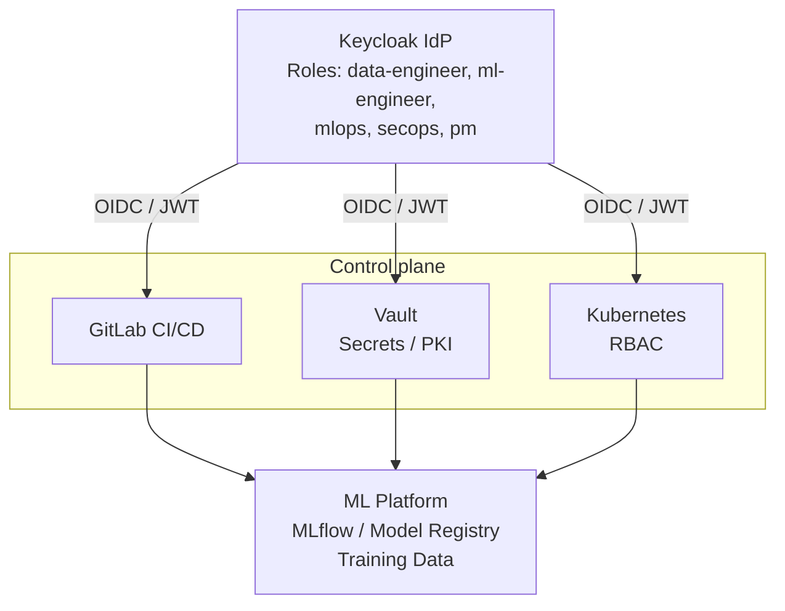
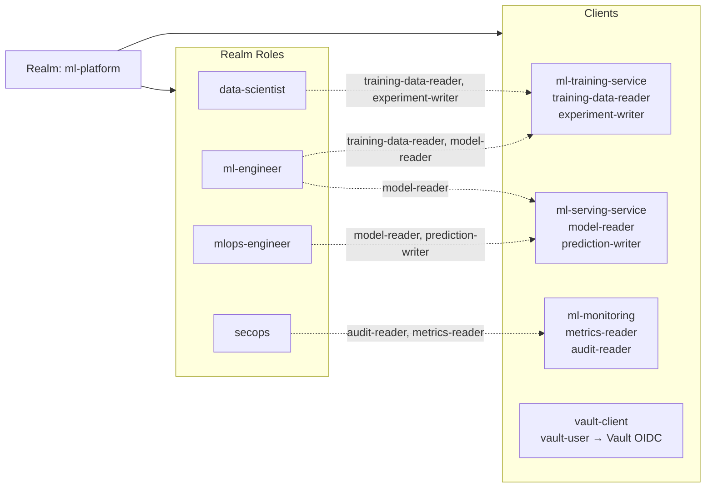

<a id="rekomendazii-ib-upravlenie-dostupom-i-sekretami-v-mlsec"></a>

# Рекомендации ИБ: Управление доступом и секретами в MLSec

> Версия: 2.1 · Обновлено: 2026-05-29 · Теги: Vault, SOPS, Keycloak, RBAC, PoLP, audit, NHI, dynamic secrets · Tier: 1-4
>
> **TL;DR**. HashiCorp Vault / OpenBao, SOPS, Keycloak, RBAC / ABAC, Row-Level Security, ротация секретов, audit log для ML-нагрузок. Отдельная ветвь - Non-Human Identity для агентов и автоматизации. Секрет, лежащий в env-переменной 6 месяцев, - это не секрет.

**Навигация:** обзор · инструменты · RBAC/ABAC · dynamic secrets · NHI для агентов · новый раздел интерактивных сценариев leak-атак · новый раздел **"С чего начать по вашей роли"**.

**Тематическое дополнение от 13.11.2026**: §3.13 содержит workload identity, projected tokens и проверку отзыва производных credentials. Это дополнение не означает повторной сверки всех команд и версий стека в базовой редакции.

<a id="soderjanie"></a>

## Содержание

1. [Краткое содержание разделов](#1-kratkoe-soderjanie-razdelov)
2. [Верификация инструментов и практик](#2-verifikazia-instrumentov-i-praktik)
3. [Рекомендации ИБ](#3-rekomendazii-ib)
4. [Матрица ролей и доступов](#4-matriza-rolej-i-dostupov)
5. [Шаблоны Vault-политик](#5-sablony-vault-politik)
6. [Чек-лист](#6-cek-list)
7. [Типичные ошибки](#7-tipicnye-osibki)

---

<a id="1-kratkoe-soderjanie-razdelov"></a>

## 1. Краткое содержание разделов

Глава охватывает десять связанных направлений. Ниже сводка ключевых идей каждого из них.

<a id="11-zeli-i-riski-nezasisennyh-sekretov-v-ml-prozessah"></a>

### 1.1. Цели и риски незащищённых секретов в ML-процессах

Незащищённые секреты (API-ключи, токены ML-трекинг-систем, пароли баз данных, ключи объектных хранилищ) в ML-пайплайнах формируют критические векторы атак:

- **Компрометация обучающей инфраструктуры** - злоумышленник, получивший токен MLflow или ключ S3, может подменить обучающие данные (data poisoning) или внедрить backdoor в модель.
- **Утечка модельных артефактов** - доступ к Model Registry позволяет извлечь проприетарные модели (model theft) или провести атаку model inversion для восстановления обучающих данных.
- **Несанкционированный доступ к персональным данным** - секреты к хранилищам с PII/PHI открывают путь к массовым утечкам, влекущим за собой нарушение GDPR и иных регуляторных требований.
- **Lateral movement** - статические, долгоживущие секреты, единожды скомпрометированные, позволяют атакующему перемещаться между компонентами инфраструктуры без ограничений по времени.

**Цель** - полностью исключить статические секреты из кода, артефактов и логов; минимизировать время жизни каждого секрета; обеспечить аудит каждого обращения к секрету.

<a id="12-bezopasnoe-hranenie-klucej-i-tokenov-vault-sops"></a>

### 1.2. Безопасное хранение ключей и токенов (Vault, SOPS)

**HashiCorp Vault** выступает центральным хранилищем секретов с поддержкой:

- **KV v2** - статические секреты (API-токены MLflow, ключи S3) с версионированием.
- **Database Secrets Engine** - динамические учётные данные для PostgreSQL, MySQL, MongoDB с автоматическим отзывом по TTL.
- **PKI Engine** - выпуск TLS-сертификатов для межсервисного mTLS.
- **Transit Engine** - шифрование данных «на лету» без хранения открытого текста в Vault; используется как backend для SOPS.

**Mozilla SOPS** дополняет Vault, обеспечивая шифрование файлов конфигурации (YAML, JSON, ENV) непосредственно в Git-репозиториях. SOPS шифрует только значения, оставляя ключи читаемыми - это сохраняет возможность code review и diff.

<a id="13-integrazia-upravlenia-sekretami-s-gitlab-cicd"></a>

### 1.3. Интеграция управления секретами с GitLab CI/CD

GitLab поддерживает нативную интеграцию с Vault через JWT-аутентификацию: каждый CI/CD-job получает JWT-токен через `id_tokens:` (стандарт с GitLab 15.7; legacy `CI_JOB_JWT` удалён в GitLab 17.0 в мае 2024 года), который обменивается на временный Vault-токен с ограниченными правами. Секреты можно получать через:

- **Директиву `secrets:`** в `.gitlab-ci.yml` (нативная интеграция).
- **Vault CLI** в `before_script` с явной аутентификацией через JWT.
- **SOPS** с Vault Transit backend для расшифровки конфигов.

Дополнительно используются **masked variables** (маскирование в логах) и **protected variables** (доступ только из protected branches/tags).

<a id="14-avtomaticeskaa-rotazia-sekretov-i-polp"></a>

### 1.4. Автоматическая ротация секретов и PoLP

Динамические секреты Vault с коротким TTL - основной механизм ротации. Ниже пример внутреннего профиля TTL, включая 24h для мониторинга: это не универсальная норма. Owner выбирает значения по backend, renewal, длительности задачи и проверенному отзыву:

| Компонент | TTL | Обоснование |
|-----------|-----|-------------|
| CI/CD job credentials | 1h | Ограничено временем выполнения job |
| Учётные данные для обучения модели | 4h | Длительные тренировки GPU-задач |
| Model serving credentials | 15m | Минимизация окна компрометации |
| Мониторинг и аудит | 24h | Непрерывный сбор метрик |
| SSH OTP для GPU-нод | 30m | Разовые операции администрирования |

Статические секреты (API-токены MLflow, webhook-секреты) ротируются по расписанию: критичные - еженедельно, остальные - ежемесячно.

<a id="15-prinzip-naimen_sih-privilegij-polp-v-mlsec"></a>

### 1.5. Принцип наименьших привилегий (PoLP) в MLSec

PoLP применяется на каждом уровне стека:

- **Vault** - гранулярные HCL-политики с явными `deny` на нерелевантные пути.
- **Kubernetes RBAC** - ServiceAccount с минимальными verbs (только `get`, `list` без `create`/`delete`).
- **PostgreSQL RLS** - Row-Level Security на таблицах с данными обучения.
- **Keycloak** - роли с минимальными scopes, привязанные к конкретным стадиям ML-цикла.

<a id="16-audit-dostupa"></a>

### 1.6. Аудит доступа

Аудит строится на централизованном сборе логов из всех компонентов:

| Источник | Что логируется | Формат | Интеграция |
|----------|---------------|--------|------------|
| Vault Audit Log | Все операции с секретами | JSON (file + syslog) | Filebeat -> ELK |
| GitLab Audit Events | Deploy, изменение переменных, доступ | JSON API | Webhook -> ELK |
| Keycloak Events | Аутентификация, авторизация, TOKEN_EXCHANGE | JSON/Syslog | Logstash |
| PostgreSQL logs + RLS | Доступ к данным обучения | SQL Log | Filebeat |
| Kubernetes Audit | API-вызовы к кластеру | JSON | Fluent Bit -> ELK |
| MinIO Access Logs | Доступ к артефактам и датасетам | JSON | Filebeat |
| Istio EnvoyAccessLog | Межсервисные вызовы | JSON | Fluent Bit |
| MLflow | Эксперименты, модели, переходы стадий | PostgreSQL | Custom exporter |

<a id="17-politiki-dostupa-k-dannym-modelam-i-pajplajnam"></a>

### 1.7. Политики доступа к данным, моделям и пайплайнам

Политики доступа строятся на трёх осях:

- **Данные** - классификация по уровням чувствительности (Public, Internal, Confidential, Restricted) с привязкой к ролям через Vault-политики и PostgreSQL RLS.
- **Модели** - контроль жизненного цикла (Experiment -> Staging -> Pre-production -> Production) с обязательным security gate перед промоцией в production.
- **Пайплайны** - Separation of Duties через GitLab CODEOWNERS и multi-stage approvals.

<a id="18-mejservisnaa-autentifikazia-keycloak-istio"></a>

### 1.8. Межсервисная аутентификация (Keycloak, Istio)

- **Keycloak** выступает IdP (Identity Provider), выдавая JWT-токены сервисным аккаунтам через Client Credentials Grant. TTL access-токена 5 минут — пример локальной настройки. По умолчанию этот grant не выдаёт refresh token и не создаёт пользовательскую сессию: после expiry сервис аутентифицируется заново.
- **Istio** обеспечивает mTLS между всеми сервисами (PeerAuthentication с mode: STRICT) и контроль доступа через AuthorizationPolicy на уровне путей и HTTP-методов.
- **Vault** аутентифицирует сервисы через JWT/OIDC auth method, привязанный к Keycloak.

<a id="19-primer-tipovoj-arhitektury-i-rolej"></a>

### 1.9. Пример типовой архитектуры и ролей



Каждый компонент получает доступ только через Keycloak-аутентификацию и Vault-авторизацию. Прямой доступ к хранилищам секретов и данных запрещён.

<a id="110-universal_nye-praktiki-dla-open-source-infrastruktury"></a>

### 1.10. Универсальные практики для open-source инфраструктуры

Все рекомендованные инструменты (Vault, SOPS, Keycloak, Istio, OPA, GitLab CE) - полностью open-source и self-hosted, что обеспечивает:

- Полный контроль над данными и секретами без зависимости от облачных провайдеров.
- Соответствие требованиям локализации данных.
- Возможность глубокой кастомизации под специфику ML-инфраструктуры.
- Воспроизводимость инфраструктуры через IaC (Terraform, Ansible, Helm).

---

<a id="2-verifikazia-instrumentov-i-praktik"></a>

## 2. Верификация инструментов и практик

<a id="21-ozenka-zrelosti-predlagaemogo-steka"></a>

### 2.1. Оценка зрелости предлагаемого стека

| Инструмент | Версия | Назначение | Зрелость | Альтернативы |
|------------|--------|-----------|----------|-------------|
| HashiCorp Vault | 1.15+ | Централизованное хранилище секретов | Production-ready, широко используется в enterprise | CyberArk Conjur, AWS Secrets Manager |
| Mozilla SOPS | 3.8+ | Шифрование конфигов в Git | Стабильный, активно поддерживается | Sealed Secrets, git-crypt |
| Keycloak | 24+ | IdP, SSO, OIDC/SAML | Production-ready, CNCF-проект | Authentik, Dex, Zitadel |
| Istio | 1.20+ | Service mesh, mTLS | Production-ready, CNCF graduated | Linkerd, Cilium |
| OPA/Gatekeeper | 0.60+ | Policy-as-Code | Production-ready, CNCF graduated | Kyverno, Polaris |
| GitLab CE | 16+ | CI/CD, source control | Production-ready | GitHub Actions, Jenkins |

<a id="22-kriterii-verifikazii"></a>

### 2.2. Критерии верификации

Каждый инструмент проверен по следующим критериям:

1. **Поддержка динамических секретов** - Vault Database использует leases для credentials; PKI выпускает сертификаты с собственным сроком действия. У PKI `generate_lease=false` по умолчанию: expiry сертификата, lease revoke и публикация revocation в CRL / OCSP — разные события, которые проверяются отдельно у relying party ([PKI API](https://developer.hashicorp.com/vault/api-docs/secret/pki), проверено 13.11.2026).
2. **JWT-интеграция** - GitLab CI `id_tokens` корректно аутентифицируются в Vault через JWT auth method.
3. **Шифрование at-rest** - SOPS с Vault Transit backend обеспечивает шифрование конфигурационных файлов без хранения ключей в репозитории.
4. **mTLS** - Istio PeerAuthentication в режиме STRICT принудительно включает mTLS между всеми сервисами в namespace.
5. **Row-Level Security** - PostgreSQL RLS корректно ограничивает доступ к строкам на основе роли текущего пользователя.
6. **Policy-as-Code** - OPA Rego-политики интегрируются в CI/CD для автоматической проверки соответствия перед деплоем.

<a id="23-izvestnye-ogranicenia"></a>

### 2.3. Известные ограничения

| Ограничение | Влияние | Митигация |
|-------------|---------|-----------|
| Vault - single point of failure | Недоступность секретов при отказе | HA-кластер (Raft), auto-unseal через HSM/Cloud KMS |
| SOPS - ручная ротация ключей шифрования | Устаревание ключей | Раздельно автоматизировать SOPS DEK rotation и Transit KEK rotation / rewrap; проверять decrypt и восстановление |
| Keycloak - высокое потребление ресурсов | Проблемы производительности при масштабировании | Горизонтальное масштабирование, Infinispan кластер |
| Istio - операционная сложность | Рост накладных расходов на сопровождение | Ambient mesh (sidecarless), постепенное внедрение |
| OPA - кривая обучения Rego | Задержки во внедрении | Готовые библиотеки политик, обучение команды |

---

<a id="3-rekomendazii-ib"></a>

## 3. Рекомендации ИБ

<a id="31-obazatel_noe-vnedrenie-hashicorp-vault"></a>

### 3.1. Обязательное внедрение HashiCorp Vault

**Приоритет: КРИТИЧЕСКИЙ**

Vault является центральным элементом управления секретами. Без него невозможно обеспечить динамическую выдачу, ротацию и аудит секретов.

**Требования к внедрению:**

- Развернуть Vault в HA-конфигурации (минимум 3 ноды) с Raft-хранилищем.
- Настроить auto-unseal через HSM или облачный KMS (недопустимо хранить unseal-ключи на тех же серверах).
- Включить **все** Engines, необходимые для ML-стека:
  - KV v2 - для статических секретов (API-токены MLflow, webhook-секреты).
  - Database - для динамических credentials PostgreSQL, MongoDB.
  - PKI - для выпуска TLS-сертификатов (если Istio не покрывает все сценарии).
  - Transit - как backend для SOPS и для шифрования чувствительных полей данных.
  - SSH OTP - для доступа к GPU-нодам и training-серверам.
- Настроить JWT auth method для интеграции с GitLab CI/CD.
- Настроить OIDC auth method для интеграции с Keycloak (интерактивный доступ).
- Включить audit-логирование на оба backend (file + syslog) для отказоустойчивости.

**Пример активации ключевых компонентов:**

```bash
# HA-кластер Vault с Raft
vault operator raft list-peers

# Включение движков секретов
vault secrets enable -path=secret kv-v2
vault secrets enable database
vault secrets enable pki
vault secrets enable transit
vault secrets enable ssh

# JWT auth для GitLab CI
vault auth enable jwt
vault write auth/jwt/config \
  jwks_url="https://gitlab.company.com/-/jwks" \
  bound_issuer="https://gitlab.company.com"

# OIDC auth для Keycloak
vault auth enable oidc
vault write auth/oidc/config \
  oidc_discovery_url="https://keycloak.company.com/realms/ml-platform" \
  oidc_client_id="vault-client" \
  oidc_client_secret="$OIDC_SECRET" \
  default_role="default"
```

<a id="32-politika-zero-trust-dla-ml-infrastruktury"></a>

### 3.2. Политика Zero Trust для ML-инфраструктуры

**Приоритет: КРИТИЧЕСКИЙ**

ML-инфраструктура должна работать в модели Zero Trust - ни один компонент не доверяет другому по умолчанию, каждый запрос аутентифицируется и авторизуется.

**Принципы:**

1. **Verify explicitly** - каждый вызов между сервисами ML-платформы аутентифицируется через mTLS (Istio) или JWT (Keycloak).
2. **Least privilege access** - каждый компонент получает минимально необходимый набор прав (см. раздел 3.4).
3. **Assume breach** - архитектура проектируется с учётом возможной компрометации любого отдельного компонента. Blast radius минимизируется через сегментацию, короткие TTL и гранулярные политики.

**Конкретные меры:**

- Запретить прямой доступ к базам данных из training-кода - только через Vault динамические credentials.
- Запретить хранение секретов в переменных окружения Kubernetes - только через Vault Agent Injector.
- Запретить межсервисное взаимодействие без mTLS - Istio PeerAuthentication в режиме STRICT.
- Запретить доступ к Model Registry без JWT-токена с соответствующим scope.
- Внедрить network policies в Kubernetes для ограничения сетевого доступа между namespace.

```yaml
# Istio: обязательный mTLS для всех ML-сервисов
apiVersion: security.istio.io/v1beta1
kind: PeerAuthentication
metadata:
  name: ml-strict-mtls
  namespace: ml-production
spec:
  mtls:
    mode: STRICT
---
# Kubernetes: Network Policy для изоляции ML-namespace
apiVersion: networking.k8s.io/v1
kind: NetworkPolicy
metadata:
  name: ml-production-isolation
  namespace: ml-production
spec:
  podSelector: {}
  policyTypes:
    - Ingress
    - Egress
  ingress:
    - from:
        - namespaceSelector:
            matchLabels:
              purpose: api-gateway
        - namespaceSelector:
            matchLabels:
              purpose: monitoring
  egress:
    - to:
        - namespaceSelector:
            matchLabels:
              purpose: vault
        - namespaceSelector:
            matchLabels:
              purpose: database
```

<a id="33-formalizovannaa-klassifikazia-dannyh-4-urovna"></a>

### 3.3. Формализованная классификация данных (4 уровня)

**Приоритет: ВЫСОКИЙ**

Все данные, используемые в ML-процессах, классифицируются по четырём уровням. Классификация определяет требования к шифрованию, контролю доступа и аудиту.

| Уровень | Описание | Примеры в ML | Шифрование | Доступ | Аудит |
|---------|----------|-------------|------------|--------|-------|
| **Public** | Открытые данные | Публичные датасеты, синтетические данные, open-source модели | At-rest | Все роли ML-платформы | Стандартный |
| **Internal** | Внутренние данные | Агрегированные метрики, анонимизированные датасеты, параметры обучения | At-rest + in-transit | ML Engineers, Data Engineers | Стандартный |
| **Confidential** | Конфиденциальные данные | Псевдонимизированные данные с бизнес-контекстом, проприетарные модели, feature stores | At-rest + in-transit + field-level | Senior ML Engineers, Data Engineers (с обоснованием) | Обязательный |
| **Restricted** | Ограниченные данные | PII, PHI, финансовые данные, модели с встроенными PII | At-rest + in-transit + field-level + Vault Transit | Data Engineers + явное одобрение DPO | Обязательный + real-time alerts |

**Реализация через Vault-политики:**

```hcl
# Политика доступа по классификации данных
path "secret/data/datasets/public/*" {
  capabilities = ["read"]
}

# KV-v2 LIST uses metadata; names can reveal sensitive information.
path "secret/metadata/datasets/public" {
  capabilities = ["list"]
}

path "secret/metadata/datasets/public/*" {
  capabilities = ["list"]
}

path "secret/data/datasets/internal/*" {
  capabilities = ["read"]
}

path "secret/data/datasets/confidential/*" {
  capabilities = ["deny"]
}

path "secret/data/datasets/restricted/*" {
  capabilities = ["deny"]
}
```

**Реализация через PostgreSQL RLS:**

```sql
-- Включение Row-Level Security
ALTER TABLE training_data ENABLE ROW LEVEL SECURITY;

-- Политика для ML-инженера: только public и internal
CREATE POLICY ml_engineer_data_access ON training_data
  FOR SELECT
  TO ml_engineer_role
  USING (
    classification IN ('public', 'internal')
  );

-- Политика для Data Engineer: полный доступ
CREATE POLICY data_engineer_full_access ON training_data
  FOR ALL
  TO data_engineer_role
  USING (true);

-- View-based доступ для изоляции столбцов с PII
CREATE VIEW training_data_anonymized AS
  SELECT id, feature_1, feature_2, label, classification
  FROM training_data
  WHERE classification IN ('public', 'internal');
-- PII-столбцы (name, email, phone) не включены в view

GRANT SELECT ON training_data_anonymized TO ml_engineer_role;
```

<a id="34-obazatel_noe-primenenie-polp-na-vseh-urovnah"></a>

### 3.4. Обязательное применение PoLP на всех уровнях

**Приоритет: КРИТИЧЕСКИЙ**

Принцип наименьших привилегий применяется на каждом уровне стека без исключений.

**Разделение прав по стадиям ML-цикла:**

| Роль | Данные | Модели | Пайплайны | Production | Секреты |
|------|--------|--------|-----------|------------|---------|
| Data Scientist (Train) | R (анонимизированные) | R/W (experiments) | R | - | R (training secrets) |
| Data Engineer | R/W (все уровни) | - | R/W (data pipelines) | - | R (data secrets) |
| ML Engineer (Deploy) | R (обезличенные) | R/W (staging) | R | - | R (staging secrets) |
| MLOps Engineer | R | R/W (production) | R/W | Deploy (с approval) | R (prod secrets, ограничено) |
| Security/Compliance (Audit) | Audit only | Audit only | R/W (security policies) | Audit only | R (audit paths) |
| CI/CD Service Account | R (datasets) | W (artifacts) | Execute | Controlled (с gates) | R (ci/cd secrets) |

**Правило:** ни одна роль не должна иметь прав, выходящих за рамки её прямых обязанностей. Доступ к production-секретам запрещён для ролей, не связанных с деплоем.

**Реализация в Kubernetes RBAC:**

```yaml
# ServiceAccount для ML-сервиса с минимальными правами
apiVersion: v1
kind: ServiceAccount
metadata:
  name: ml-serving-sa
  namespace: ml-production
---
apiVersion: rbac.authorization.k8s.io/v1
kind: Role
metadata:
  name: ml-serving-role
  namespace: ml-production
rules:
  - apiGroups: [""]
    resources: ["pods"]
    verbs: ["get", "list"]
  - apiGroups: [""]
    resources: ["configmaps"]
    verbs: ["get"]
  # Явный запрет: нет доступа к secrets Kubernetes напрямую
  # Секреты получаются только через Vault Agent Injector
```

ServiceAccount и Role выше — фрагменты: без отдельного RoleBinding RBAC-права этой Role не присвоены. Отсутствие `secrets` в одной Role не отменяет grants из других bindings. Injector annotations размещаются на **Pod / Pod template**, не на ServiceAccount:

```yaml
# Fragment of a Deployment's spec.template; not a complete Deployment.
metadata:
  annotations:
    vault.hashicorp.com/agent-inject: "true"
    vault.hashicorp.com/auth-path: "auth/kubernetes"
    vault.hashicorp.com/role: "ml-serving"
    vault.hashicorp.com/agent-inject-secret-db: "database/creds/ml-serving-role"
spec:
  serviceAccountName: ml-serving-sa
```

В namespace workload должны быть отдельно настроены webhook, Vault Kubernetes auth и role `ml-serving`, ограниченная нужными ServiceAccount / namespace и policies. Имя ServiceAccount не настраивает эту привязку само. [Vault Injector annotations](https://developer.hashicorp.com/vault/docs/deploy/kubernetes/injector/annotations), проверено 13.11.2026. Приёмка: Pod мутирован, secret доступен только ожидаемому контейнеру; чужая SA / namespace не аутентифицируется. Синтаксис YAML не доказывает работу webhook или authorization.

<a id="konstruktor-vault-politiki-dla-roli-ml-engineer-deploy"></a>

#### Конструктор Vault-политики для роли ML Engineer (Deploy)

Включайте только те capabilities, которые реально нужны роли. Справа считается «privilege footprint» (чем меньше — тем ближе к PoLP) и появляются нарушения принципа least-privilege.

```widget:policy-builder
{
  "id": "ch08-vault-policy",
  "title": "Vault policy для ML Engineer (Deploy → Staging)",
  "description": "Учебный план полномочий для Deploy → Staging. Сумма условных весов не измеряет PoLP, риск или фактические права. Конкретные запреты проверяются отдельными правилами; необходимость разрешений, effective ACL и выполнение контролей подтверждаются вне конструктора по матрице §4.1.",
  "scoreLabel": "Условный вес выбранных полномочий",
  "scoreMax": 199,
  "groups": [
    {
      "name": "Datasets",
      "items": [
        { "id": "ds-public-read", "label": "secret/data/datasets/public/* → read", "weight": 5, "default": true, "description": "Базовое чтение публичных датасетов — обычно нужно." },
        { "id": "ds-internal-read", "label": "secret/data/datasets/internal/* → read", "weight": 8, "default": true, "description": "Внутренние данные — часто нужно для validation/staging тестов." },
        { "id": "ds-conf-read", "label": "secret/data/datasets/confidential/* → read", "weight": 12, "description": "Confidential data — НЕ должно быть доступно ML Engineer (Deploy). Это роль Data Scientist." },
        { "id": "ds-restricted-read", "label": "secret/data/datasets/restricted/* → read", "weight": 18, "description": "Restricted (PII, биометрия) — категорически нет. Используйте Data Scientist роль с DPIA." },
        { "id": "ds-write", "label": "secret/data/datasets/* → create/update", "weight": 15, "description": "Запись датасетов — это роль Data Engineer. ML Engineer не должен модифицировать датасеты." }
      ]
    },
    {
      "name": "Models",
      "items": [
        { "id": "m-staging-rw", "label": "secret/data/models/staging/* → read/create/update", "weight": 6, "default": true, "recommended": true, "description": "Профильная capability — деплой в staging." },
        { "id": "m-staging-delete", "label": "secret/data/models/staging/* → delete", "weight": 10, "description": "Удаление staging-моделей — для cleanup. Лучше доверить CI/CD job, не интерактивному пользователю." },
        { "id": "m-prod-read", "label": "secret/data/models/production/* → read", "weight": 5, "default": true, "description": "Read-only на production — для отладки." },
        { "id": "m-prod-write", "label": "secret/data/models/production/* → write", "weight": 20, "description": "Запись в production — только для MLOps Engineer с MFA + approval." }
      ]
    },
    {
      "name": "Infrastructure secrets",
      "items": [
        { "id": "infra-db-staging", "label": "database/creds/ml-staging-role → read", "weight": 5, "default": true, "recommended": true, "description": "Динамические креды для staging БД — TTL 1 час." },
        { "id": "infra-db-prod", "label": "database/creds/ml-prod-role → read", "weight": 18, "description": "Production БД — нет для роли Deploy (Staging)." },
        { "id": "infra-cloud-staging", "label": "aws/creds/ml-staging → read", "weight": 6, "description": "Cloud creds для staging — если используется." },
        { "id": "infra-cloud-prod", "label": "aws/creds/ml-prod → read", "weight": 18, "description": "Production cloud — категорически нет." }
      ]
    },
    {
      "name": "Vault administration",
      "items": [
        { "id": "vault-policies", "label": "sys/policies/* → list/read/create", "weight": 25, "description": "Управление политиками Vault — только Vault Admins, не ML Engineer." },
        { "id": "vault-auth", "label": "auth/* → create", "weight": 25, "description": "Регистрация новых auth methods — admin-only." },
        { "id": "vault-leases", "label": "Lease metadata через ограниченный credential broker", "weight": 3, "default": true, "description": "Проектный broker проверяет владельца lease до обращения к POST sys/leases/lookup (capability update). Прямой доступ к этому API не означает scope «только свои». Broker требует отдельной реализации и приёмки." }
      ]
    }
  ],
  "rules": [
    { "id": "no-restricted", "type": "forbid-all", "items": ["ds-restricted-read"], "message": "ML Engineer (Deploy) не должен иметь доступа к restricted/PII данным — это роль Data Scientist с DPIA." },
    { "id": "no-prod-write", "type": "forbid-all", "items": ["m-prod-write"], "message": "Запись в production-модели — это роль MLOps Engineer, не Deploy. Promotion идёт через signed event с MFA." },
    { "id": "no-prod-cloud", "type": "forbid-all", "items": ["infra-cloud-prod"], "message": "Production cloud creds — для MLOps Engineer. Deploy в staging не требует prod-cloud." },
    { "id": "no-vault-admin", "type": "forbid-all", "items": ["vault-policies"], "message": "Управление Vault-политиками — только Vault Admin. ML Engineer не должен иметь sys/policies." },
    { "id": "no-confidential-datasets", "type": "forbid-all", "items": ["ds-conf-read"], "message": "В учебной матрице Deploy → Staging запрещено чтение confidential datasets; отдельный допуск данных не выводится из суммы весов." },
    { "id": "no-dataset-write", "type": "forbid-all", "items": ["ds-write"], "message": "В учебной матрице Deploy → Staging запрещена запись datasets; права на data pipeline допускаются отдельно." },
    { "id": "no-prod-db", "type": "forbid-all", "items": ["infra-db-prod"], "message": "В учебной матрице Deploy → Staging запрещены production DB credentials независимо от низкого суммарного веса." },
    { "id": "no-auth-admin", "type": "forbid-all", "items": ["vault-auth"], "message": "В учебной матрице Deploy → Staging запрещено администрирование auth methods; разрешение на эту операцию рассматривается отдельно." },
    { "id": "min-staging", "type": "require-all", "items": ["m-staging-rw"], "message": "Без write на staging models роль не выполняет своё назначение." }
  ],
  "thresholds": [
    { "from": 0, "to": 25, "label": "0–25% условного веса списка; запреты проверяются отдельно", "tone": "info" },
    { "from": 25, "to": 50, "label": "25–50% условного веса списка; проверьте необходимость каждого разрешения", "tone": "info" },
    { "from": 50, "to": 75, "label": "50–75% условного веса списка; это не измерение effective privileges", "tone": "warn" },
    { "from": 75, "to": 100, "label": "75–100% условного веса списка; фактические права и scope проверяются отдельно", "tone": "warn" }
  ]
}
```

<a id="35-dinamiceskie-sekrety-dla-cicd"></a>

### 3.5. Динамические секреты для CI/CD

**Приоритет: КРИТИЧЕСКИЙ**

Каждый CI/CD job должен получать уникальные, короткоживущие credentials через Vault. Статические токены в GitLab CI variables допустимы только для начальной аутентификации в Vault.

**Схема интеграции GitLab CI + Vault:**

```yaml
# Вариант 1: нативная интеграция через secrets keyword
variables:
  VAULT_SERVER_URL: "https://vault.company.internal"
  VAULT_AUTH_ROLE: "ml-cicd-role"

train_model:
  stage: train
  id_tokens:
    VAULT_ID_TOKEN:
      aud: https://vault.company.internal
  secrets:
    MLFLOW_TOKEN:
      vault: ml/cicd/mlflow_token@secret
      token: $VAULT_ID_TOKEN
    S3_ACCESS_KEY:
      vault: ml/cicd/s3_access_key@secret
      token: $VAULT_ID_TOKEN
  script:
    - python train.py
```

```yaml
# Вариант 2: динамические credentials БД через Vault CLI
train_with_dynamic_creds:
  stage: train
  id_tokens:
    VAULT_ID_TOKEN:
      aud: https://vault.company.internal
  script:
    - |
      set -eu
      : "${VAULT_ADDR:?Set the approved Vault endpoint}"
      : "${VAULT_ID_TOKEN:?GitLab ID token is required}"
      VAULT_TOKEN=$(vault write -field=token auth/jwt/login \
        role=ml-cicd-role jwt="$VAULT_ID_TOKEN")
      test -n "$VAULT_TOKEN"
      export VAULT_TOKEN
      cleanup_job_token() {
        result=$?
        trap - EXIT HUP INT TERM
        # Revoke only this job's service token and its derived leases.
        if ! vault token revoke -self >/dev/null; then
          echo 'Job token revocation is unconfirmed; notify the credential owner' >&2
          result=1
        fi
        exit "$result"
      }
      trap cleanup_job_token EXIT
      trap 'exit 130' INT
      trap 'exit 143' HUP TERM
      DB_CREDS=$(vault read -format=json database/creds/ml-training-role)
      DB_USER=$(printf '%s' "$DB_CREDS" | jq -er '.data.username | select(type == "string" and length > 0)')
      DB_PASS=$(printf '%s' "$DB_CREDS" | jq -er '.data.password | select(type == "string" and length > 0)')
      export DB_USER DB_PASS
      # Project training entrypoint reads DB_USER / DB_PASS from the environment.
      python train.py
```

Вариант 2 предполагает отдельный **service token на job**, не общий или batch token; роль и минимальный `revoke-self` grant показаны в §5.5–5.6. Уникальная выдача и read-back должны проверяться владельцем backend: trap не выполняется гарантированно при SIGKILL / потере runner, а отзыв credentials не доказывает закрытие уже открытых DB-сессий. Для потерянного job owner использует сохранённый безопасный accessor / lease ID и согласованный scope; весь `database/creds/ml-training-role` отзывать нельзя — там leases других jobs. `after_script` запускается в новом shell и не наследует `export VAULT_TOKEN` из `script`; пример намеренно выполняет cleanup в том же shell. Источники: [GitLab variable execution context](https://docs.gitlab.com/ci/variables/), [Vault revoke-self](https://developer.hashicorp.com/vault/api-docs/auth/token), [lease revoke scope](https://developer.hashicorp.com/vault/docs/commands/lease/revoke), проверено 13.11.2026. Образ runner должен содержать проверенные Vault CLI, jq и Python; stdout секретов / shell tracing отключены, окружение и harness не контролируются недоверенным PR.

```yaml
# Вариант 3: SOPS + Vault Transit для зашифрованных конфигов
decrypt_and_train:
  stage: train
  # Owner-provided real project image, pinned by digest; no fallback image.
  image: "$ML_SECRETS_RUNNER_IMAGE"
  variables:
    VAULT_ADDR: "https://vault.company.internal"
  id_tokens:
    VAULT_ID_TOKEN:
      aud: https://vault.company.internal
  script:
    - |
      set -eu
      : "${VAULT_ADDR:?Set the approved Vault endpoint}"
      : "${VAULT_ID_TOKEN:?GitLab ID token is required}"
      VAULT_TOKEN=$(vault write -field=token auth/jwt/login \
        role=ml-cicd-role jwt="$VAULT_ID_TOKEN")
      test -n "$VAULT_TOKEN"
      export VAULT_TOKEN
      cleanup_job_token() {
        result=$?
        trap - EXIT HUP INT TERM
        if ! vault token revoke -self >/dev/null; then
          echo 'Job token revocation is unconfirmed; notify the credential owner' >&2
          result=1
        fi
        exit "$result"
      }
      trap cleanup_job_token EXIT
      trap 'exit 130' INT
      trap 'exit 143' HUP TERM
      # Static reviewed command; candidate data cannot supply shell fragments.
      sops exec-file config/model_config.enc.yaml 'python train.py --config {}'
```

`ML_SECRETS_RUNNER_IMAGE` — обязательная ссылка на **реально собранный и разрешённый образ проекта с digest**, которую owner задаёт до запуска CI. Здесь такой образ не опубликован и его наличие не обещается. В нём фиксируются версии Vault CLI, SOPS, shell и Python / зависимостей training entrypoint; lock / provenance проверяются отдельно. Native `secrets:` использует `VAULT_SERVER_URL` / `VAULT_AUTH_ROLE`, а CLI — `VAULT_ADDR`; эти переменные не взаимозаменяемы ([GitLab Vault integration](https://docs.gitlab.com/ci/secrets/hashicorp_vault/)).

`exec-file` с `{}` подтверждён [SOPS v3.8.1](https://github.com/getsops/sops/blob/v3.8.1/README.rst): на Unix по умолчанию используется FIFO, а не plaintext-файл в checkout. Пример требует, чтобы `train.py` читал конфигурацию один раз и поддерживал FIFO; повторное открытие / seek требуют другого согласованного контракта. Для проверенной версии toolchain проверяются exit дочернего процесса, ошибки decrypt и завершение runner. Это не обещание удаления plaintext из памяти, logs, crash dumps или копий, сделанных training-кодом; `--no-fifo` с временным файлом здесь не используется. Реальное расшифрование и доступ к Transit в этой сверке не выполнялись. Проверено 13.11.2026.

**Правила безопасности переменных GitLab CI:**

| Тип переменной | Применение | Видимость в логах | Доступность |
|----------------|-----------|-------------------|-------------|
| Обычная | Нечувствительные данные (MODEL_NAME, BATCH_SIZE) | Видна | Все ветки |
| Masked | Токены, пароли | Скрыта (замена на `***`) | Все ветки |
| Protected + Masked | Production-секреты | Скрыта | Только protected branches |
| File | Сертификаты, ключи | Записывается в файл | Настраивается |

<a id="36-obazatel_naa-mfa-dla-vseh-interaktivnyh-akkauntov"></a>

### 3.6. Обязательная MFA для всех интерактивных аккаунтов

**Приоритет: ВЫСОКИЙ**

Все интерактивные (человеческие) аккаунты в ML-инфраструктуре должны использовать многофакторную аутентификацию (MFA).

**Область применения:**

- GitLab - вход в UI, операции с protected branches.
- Keycloak - вход в административную консоль и ML-платформу.
- Vault UI - интерактивный доступ к секретам (для отладки и аудита).
- Kubernetes Dashboard (если используется) - доступ к кластеру.

**Конфигурация Keycloak:**

```json
{
  "realm": "ml-platform",
  "requiredActions": ["CONFIGURE_TOTP"],
  "otpPolicyType": "totp",
  "otpPolicyAlgorithm": "HmacSHA256",
  "otpPolicyDigits": 6,
  "otpPolicyPeriod": 30,
  "otpPolicyInitialCounter": 0,
  "bruteForceProtected": true,
  "maxFailureWaitSeconds": 900,
  "maxDeltaTimeSeconds": 43200,
  "failureFactor": 5,
  "permanentLockout": false,
  "waitIncrementSeconds": 60
}
```

**Исключения:** сервисные аккаунты (machine-to-machine) аутентифицируются через Client Credentials Grant и отдельный workload credential, а не человеческий MFA. TTL access-токена 5 минут — пример политики; refresh token по умолчанию не выдаётся. [Keycloak Service Accounts](https://www.keycloak.org/docs/latest/server_admin/index.html#_service_accounts), проверено 13.11.2026.

<a id="kakoj-mfa-metod-podhodit-vasemu-szenariu"></a>

#### Какой MFA-метод подходит вашему сценарию

```widget:decision-tree
{
  "id": "ch08-mfa-method",
  "title": "Подбор MFA-метода для роли в ML-инфраструктуре",
  "start": "q1",
  "nodes": {
    "q1": {
      "type": "question",
      "text": "Какой уровень доступа у пользователя?",
      "sub": "Выбор зависит от угрозы, требуемой phishing resistance, recovery и возможностей verifier. Класс production/read-only и внутренний Tier сами по себе не присваивают AAL.",
      "choices": [
        {
          "label": "Production secrets (Vault prod, sys/policies, model registry write)",
          "next": "q2-prod"
        },
        {
          "label": "Sensitive read (audit logs, restricted datasets metadata)",
          "next": "q2-sensitive"
        },
        {
          "label": "Стандартный ML-инженер (staging, internal data)",
          "next": "q2-standard"
        },
        {
          "label": "Read-only / dashboards / SaaS-продукты ML-команды",
          "next": "leaf-totp"
        }
      ]
    },
    "q2-prod": {
      "type": "question",
      "text": "Готова ли организация раздать hardware tokens (~$50/чел)?",
      "choices": [
        {
          "label": "Да — есть бюджет на YubiKey / Titan / SoloKey для ~50 человек с prod-доступом",
          "next": "leaf-yubikey"
        },
        {
          "label": "Нет, но есть managed devices с TPM (Mac / iPhone / managed Windows)",
          "next": "leaf-passkey"
        },
        {
          "label": "Нет — только software-tokens",
          "hint": "Не рекомендуется для prod",
          "next": "leaf-totp-with-warning"
        }
      ]
    },
    "q2-sensitive": {
      "type": "question",
      "text": "Пользователи в основном работают с одного устройства или с разных?",
      "choices": [
        {
          "label": "Одно устройство (managed laptop)",
          "next": "leaf-passkey"
        },
        {
          "label": "Разные устройства (BYOD, работа из дома + офиса)",
          "next": "leaf-totp"
        }
      ]
    },
    "q2-standard": {
      "type": "question",
      "text": "Есть ли SSO с уже установленной MFA на корпоративном IdP?",
      "choices": [
        {
          "label": "Да — IdP MFA проверяется на уровне SSO (Keycloak / Okta / AD FS)",
          "next": "leaf-sso-mfa"
        },
        {
          "label": "Нет — каждый сервис аутентифицируется отдельно",
          "next": "leaf-totp"
        }
      ]
    },
    "leaf-yubikey": {
      "type": "leaf",
      "tone": "ok",
      "title": "Hardware token (YubiKey / Titan) — золотой стандарт",
      "summary": "FIDO2 / WebAuthn с проверкой origin поддерживает phishing-resistant аутентификацию. Скомпрометированная рабочая станция и уже открытая сессия требуют отдельных контролей.",
      "details": [
        "Выбрать совместимый FIDO2/WebAuthn authenticator и проверить свойства конкретной модели",
        "Безопасная регистрация, резервный authenticator и recovery не должны обходить выбранную гарантию",
        "Проверить user verification, origin/RP binding и отзыв потерянного устройства",
        "AAL3 требует non-exportable ключа и остальных условий authenticator/verifier; бренд и NFC не присваивают уровень"
      ]
    },
    "leaf-passkey": {
      "type": "leaf",
      "tone": "info",
      "title": "Passkey: проверить device-bound или syncable",
      "summary": "WebAuthn с проверкой RP origin даёт phishing resistance; managed device сам по себе не подтверждает способ хранения ключа и AAL.",
      "details": [
        "Разделить device-bound non-exportable ключ и syncable passkey: одинаковое название интерфейса не означает одинаковую гарантию.",
        "Syncable authenticators не допускаются на AAL3; корпоративный sync не меняет это условие.",
        "Для AAL3 нужны non-exportable private key, activation factor/пароль и остальные требования к authenticator и verifier. Одной attestation недостаточно.",
        "Регистрацию, recovery, backup и отзыв проверять вместе с IdP policy; бренд устройства не присваивает AAL."
      ],
      "links": [{"label": "NIST SP 800-63B-4: AAL", "href": "https://pages.nist.gov/800-63-4/sp800-63b/aal/"}]
    },
    "leaf-sso-mfa": {
      "type": "leaf",
      "tone": "info",
      "title": "SSO MFA — единая точка проверки",
      "summary": "Downstream может опираться на MFA IdP, если валидирует assertion и нужный authentication context. Сама кнопка SSO этого не доказывает.",
      "details": [
        "Проверять expected issuer/audience, signature, expiry и привязку к своему RP/session",
        "Зафиксировать требуемые assurance/method/freshness и step-up при доступе к чувствительному действию",
        "Session lifetime, reauthentication и recovery определяются политикой и применимым профилем",
        "Тестировать single-factor/fallback login, устаревшую MFA, отзыв и активную downstream-сессию"
      ]
    },
    "leaf-totp": {
      "type": "leaf",
      "tone": "warn",
      "title": "TOTP (Google / Microsoft / 1Password Authenticator)",
      "summary": "TOTP не является phishing-resistant. Допустимость определяется профилем аутентификации и риском, а не ролью «read-only» сама по себе.",
      "details": [
        "AAL2 требует подходящего сочетания факторов и условий verifier; один TOTP не назначает AAL2",
        "Rate limiting, безопасное хранение seed и recovery проверять как единый процесс",
        "Для phishing-resistant сценария оценить подходящий WebAuthn authenticator",
        "SMS/PSTN имеет отдельные ограничения и риски SIM-swap/AiTM; отсутствие porting не делает его неуязвимым"
      ]
    },
    "leaf-totp-with-warning": {
      "type": "leaf",
      "tone": "err",
      "title": "TOTP для prod — НЕ рекомендуется",
      "summary": "Если политика требует phishing resistance, TOTP её не обеспечивает. Выберите совместимый authenticator или отдельно одобренный ограниченный режим до готовности.",
      "details": [
        "IP restrictions и поведенческие сигналы дополняют контроль, но не превращают TOTP в phishing-resistant метод",
        "Проверить recovery, регистрацию, identity и сессии, включая compromised workstation",
        "Требования AAL проверяются по NIST-профилю, а российские обязанности — по конкретному применимому акту",
        "716-П и внутренний production-ярлык не означают автоматически NIST AAL3"
      ]
    }
  }
}
```

<a id="37-rotazia-sekretov-avtomatizazia-i-monitoring"></a>

### 3.7. Ротация секретов: автоматизация и мониторинг

**Приоритет: ВЫСОКИЙ**

**Матрица ротации:**

| Тип секрета | Механизм ротации | Периодичность | Ответственный |
|-------------|-----------------|---------------|---------------|
| БД credentials (dynamic) | Vault Database Engine, TTL | Автоматически при каждом запросе (TTL=1h) | Vault |
| SSH-ключи (OTP) | Vault SSH Engine | Одноразовые (TTL=30m) | Vault |
| API-токены MLflow | Скрипт ротации + Vault KV | Еженедельно | CI/CD job |
| S3/MinIO access keys | Скрипт ротации + Vault KV | Еженедельно | CI/CD job |
| TLS-сертификаты | Vault PKI / cert-manager: перевыпуск и проверка expiry; revocation отдельно | TTL=30d — пример профиля, не обещание автоматического lease revoke | PKI owner / cert-manager |
| Keycloak client secrets | Keycloak Admin API | Ежемесячно | CI/CD job |
| Vault root token | Ручная ротация | После каждого использования | Security team |
| SOPS data key / Transit wrapping key | Отдельные операции DEK rotation и KEK rotation / rewrap | По внутренней политике; квартал — пример | Security team |

**Скрипт автоматической ротации статических секретов:**

```bash
#!/bin/bash
# rotate_static_secrets.sh
# Вызывается по cron или из CI/CD scheduled pipeline

set -euo pipefail

VAULT_ADDR="https://vault.company.internal"
LOG_FILE="/var/log/ml-secops/rotation.log"

rotate_mlflow_token() {
  NEW_TOKEN=$(python3 /opt/scripts/generate_mlflow_token.py)
  vault kv put secret/ml/cicd/mlflow_token \
    value="$NEW_TOKEN" \
    rotated_at="$(date -u +%Y-%m-%dT%H:%M:%SZ)" \
    rotated_by="rotation-service"
  echo "$(date -u): MLflow token rotated successfully" >> "$LOG_FILE"
}

rotate_s3_keys() {
  NEW_KEYS=$(python3 /opt/scripts/rotate_minio_keys.py)
  ACCESS_KEY=$(echo "$NEW_KEYS" | jq -r '.access_key')
  SECRET_KEY=$(echo "$NEW_KEYS" | jq -r '.secret_key')
  vault kv put secret/ml/cicd/s3_credentials \
    access_key="$ACCESS_KEY" \
    secret_key="$SECRET_KEY" \
    rotated_at="$(date -u +%Y-%m-%dT%H:%M:%SZ)"
  echo "$(date -u): S3 credentials rotated successfully" >> "$LOG_FILE"
}

rotate_mlflow_token
rotate_s3_keys

# Уведомление в Slack/Mattermost
curl -X POST "$WEBHOOK_URL" \
  -H 'Content-Type: application/json' \
  -d '{"text":"Secrets rotation completed successfully"}'
```

**Мониторинг ротации:**

- Alerting при неудачной ротации (Prometheus + Alertmanager).
- Дашборд со статусом всех секретов и датой последней ротации (Grafana).
- Alert при приближении TTL статического секрета к порогу (7 дней до плановой ротации).

<a id="kal_kulator-ttl-dinamiceskih-sekretov-vs-operational-overhead"></a>

#### Калькулятор: TTL динамических секретов vs operational overhead

```widget:threshold-slider
{
  "id": "ch08-secret-ttl",
  "title": "TTL и средняя нагрузка renew: учебная арифметика",
  "description": "Допущение:1500 постоянно активных клиентов, каждый делает один renew каждые TTL / 2 минут, обновления равномерно разнесены. Нет retries, выдачи новых credentials и ограничений max TTL. Это средняя нагрузка, не peak-capacity Vault и не оценка соответствия нормам.",
  "min": 1,
  "max": 1440,
  "step": 1,
  "default": 60,
  "unit": " мин",
  "axisLabel": "TTL исходного credential",
  "tracks": [
    {
      "label": "Исходный TTL (мин)",
      "compute": "x",
      "format": "fixed1",
      "tone": "info",
      "hint": "Срок исходного credential без продления. Производные credentials, max TTL и уже открытые сессии проверяются отдельно (§3.13). TTL не равен полному окну компрометации."
    },
    {
      "label": "Средние renew-запросы/сек",
      "compute": "1500/(30*x)",
      "format": "fixed2",
      "tone": "info",
      "hint": "TTL / 2 минут =30*TTL секунд. На 60 мин:1500 / 1800 ≈ 0.83 RPS; на 5 мин:10 RPS. Синхронные renew/retries могут создавать пики."
    },
    {
      "label": "Интервал renew одного клиента (сек)",
      "compute": "30*x",
      "format": "fixed1",
      "tone": "info",
      "hint": "Плановый интервал примера. Реальный scheduler учитывает remaining lease, jitter, backoff и отказ renew; duration ML-job не задаёт срок токена автоматически."
    }
  ],
  "regions": []
}
```

**Граница MFA-дерева:** [NIST SP 800-63B-4](https://pages.nist.gov/800-63-4/sp800-63b/aal/) различает требования к authenticator и verifier; syncable authenticators не допускаются на AAL3. Проверка источника 13.11.2026; дерево — маршрут выбора проверок, не сертификат AAL.

<a id="38-audit-dostupa-zentralizazia-v-siem"></a>

### 3.8. Аудит доступа: централизация в SIEM

**Приоритет: ВЫСОКИЙ**

Все логи доступа агрегируются в централизованной SIEM-системе (ELK/OpenSearch, Splunk или аналог) для корреляции событий и обнаружения аномалий.

**Включение аудита Vault:**

```bash
# Файловый аудит-лог (основной)
vault audit enable file file_path=/var/log/vault/audit.log

# Syslog-аудит (резервный, для интеграции с SIEM)
vault audit enable syslog tag="vault" facility="AUTH"
```

**Формат записи аудита Vault (пример):**

```json
{
  "time": "2025-01-15T10:23:45Z",
  "type": "request",
  "auth": {
    "token_type": "service",
    "policies": ["ml-engineer"],
    "metadata": {"role": "ml-engineer", "username": "ivanov"}
  },
  "request": {
    "operation": "read",
    "path": "secret/data/ml/training/config",
    "remote_address": "10.0.1.42"
  }
}
```

**Ключевые алерты для SIEM:**

| Событие | Severity | Действие |
|---------|----------|---------|
| Доступ к `restricted` данным | HIGH | Немедленное уведомление Security team |
| Неудачная аутентификация (>5 за 10 мин) | HIGH | Блокировка + расследование |
| Доступ к секретам вне рабочего времени | MEDIUM | Уведомление + логирование |
| Чтение production-секретов из non-protected branch | CRITICAL | Блокировка + немедленное расследование |
| Массовое чтение секретов (>20 путей за 1 мин) | HIGH | Ревокация токена + расследование |
| Отказ Vault audit backend | CRITICAL | Проверить все devices: запрос не обслуживается, если не удалось записать ни в один включённый device; один отказ требует устранения деградации |
| Изменение Vault-политики | MEDIUM | Уведомление Security team |
| Новый сервисный аккаунт в Keycloak | MEDIUM | Верификация Security team |

**Экспорт событий GitLab в SIEM:**

```yaml
# GitLab CI job для экспорта аудит-событий
export_audit_events:
  stage: audit
  rules:
    - if: '$CI_PIPELINE_SOURCE == "schedule"'
  script:
    - |
      curl --header "PRIVATE-TOKEN: $GITLAB_AUDIT_TOKEN" \
        "https://gitlab.company.com/api/v4/audit_events?\
        entity_type=Group&entity_id=$CI_GROUP_ID&\
        created_after=$(date -u -d '1 hour ago' +%Y-%m-%dT%H:%M:%SZ)" \
        | jq '.[] | select(.details.action |
          test("deploy|secret|variable|member|permission"))' \
        >> /var/log/gitlab/ml_audit.json
    - filebeat -e -c /etc/filebeat/gitlab-audit.yml
```

**Настройка экспорта событий Keycloak:**

```properties
# keycloak.conf
spi-events-listener-jboss-logging-success-level=info
spi-events-listener-jboss-logging-error-level=warn

# Типы событий для мониторинга ML SecOps:
# LOGIN, LOGIN_ERROR          -- интерактивная аутентификация
# CLIENT_LOGIN                -- межсервисная аутентификация
# TOKEN_EXCHANGE              -- обмен токенов (delegation)
# PERMISSION_TOKEN            -- запрос permission ticket
# REGISTER, UPDATE_PROFILE    -- изменение учётных данных
# GRANT_CONSENT, REVOKE_GRANT -- управление согласиями
```

<a id="pesocniza-detection-rule-dla-anomal_nogo-dostupa-v-vault"></a>

#### Песочница: detection-rule для аномального доступа в Vault

Vault audit log пишет каждое чтение секрета как JSON-строку. Detection-правило в SIEM ищет паттерны: чтение prod-секрета не-CI-аккаунтом, доступ из необычных источников, всплески запросов. Правьте regex и смотрите, какие тестовые строки правильно классифицируются.

```widget:regex-tester
{
  "id": "ch08-vault-anomaly",
  "title": "Detection-rule: чтение production-секрета интерактивным пользователем",
  "description": "Учебный поиск сочетания display_name без префикса ci- и выбранного prod/restricted path в компактной JSON-строке. Это не проверка реальной identity, операции чтения, maintenance approval, источника или частоты доступа.",
  "defaultPattern": "(?=.*\"display_name\":\"(?!ci-)[^\"]+\").*\"path\":\"secret/data/(?:ml/production|datasets/restricted)/",
  "flags": "g",
  "tests": [
    { "id": "alert1", "shouldMatch": true, "label": "Подозрительно: интерактивный пользователь читает prod-секрет", "text": "{\"time\":\"2026-05-03T10:23:14Z\",\"type\":\"response\",\"auth\":{\"display_name\":\"alice@acme.com\"},\"request\":{\"path\":\"secret/data/ml/production/openai-api-key\",\"operation\":\"read\"}}" },
    { "id": "alert2", "shouldMatch": true, "label": "Подозрительно: чтение restricted dataset metadata", "text": "{\"time\":\"2026-05-03T11:05:22Z\",\"type\":\"response\",\"auth\":{\"display_name\":\"bob@acme.com\"},\"request\":{\"path\":\"secret/data/datasets/restricted/customer-pii-2026\",\"operation\":\"read\"}}" },
    { "id": "ok1", "shouldMatch": false, "label": "Легитимно: CI job читает prod (имя ci-*)", "text": "{\"time\":\"2026-05-03T10:00:00Z\",\"type\":\"response\",\"auth\":{\"display_name\":\"ci-deploy-12345\"},\"request\":{\"path\":\"secret/data/ml/production/db-creds\",\"operation\":\"read\"}}" },
    { "id": "ok2", "shouldMatch": false, "label": "Легитимно: alice читает свой staging-секрет", "text": "{\"time\":\"2026-05-03T09:15:00Z\",\"type\":\"response\",\"auth\":{\"display_name\":\"alice@acme.com\"},\"request\":{\"path\":\"secret/data/ml/staging/db-creds\",\"operation\":\"read\"}}" },
    { "id": "ok3", "shouldMatch": false, "label": "Легитимно: общедоступные данные", "text": "{\"time\":\"2026-05-03T08:00:00Z\",\"type\":\"response\",\"auth\":{\"display_name\":\"alice@acme.com\"},\"request\":{\"path\":\"secret/data/datasets/public/imagenet-mirror\",\"operation\":\"read\"}}" },
    { "id": "alert3", "shouldMatch": true, "label": "Подозрительно: компрометированный SA с не-ci именем", "text": "{\"time\":\"2026-05-03T03:45:00Z\",\"type\":\"response\",\"auth\":{\"display_name\":\"sa-old-test\"},\"request\":{\"path\":\"secret/data/ml/production/aws-creds\",\"operation\":\"read\"}}" }
  ]
}
```

> Regex видит только текстовую форму примеров: пробелы, переносы, другой формат события или имя ci-* могут изменить сигнал. SIEM сначала разбирает JSON, устанавливает authenticated actor и operation, затем связывает path с текущими правами, maintenance window и агрегацией по времени. Отсутствие match не разрешает чтение секрета.

<a id="39-politiki-dostupa-kak-kod-policy-as-code-s-opa"></a>

### 3.9. Политики доступа как код (Policy-as-Code с OPA)

**Приоритет: ВЫСОКИЙ**

Политики проходят review и публикуются доверенной платформенной identity. Изменение политики в PR или ответ модели не даёт права применять её в production. Ниже один ограниченный пример: promotion **того же immutable bundle** в согласованную production-цель. Проверено на **OPA 1.22.4 / Rego v1**; это решение допуска, не выполнение promotion и не криптографический verifier.

**Граница доверия:** `input` — заявка, `data.promotion_trust` — отдельно доставленные платформой факты. Adapter получает `principal` из аутентифицированного CI/workload context, а не доверяет этому полю пользовательского body. До gate независимый verifier проверяет реальную подпись/attestation, trusted issuer/signer, digest проверенного bundle и отдельное согласование владельца для конкретного действия. Он выдаёт receipt, связанный с principal, target, policy/request revisions и сроком; revisions сверяются с фактически загруженным policy bundle и неизменной заявкой, а не только с их названиями. Проверенный receipt попадает в read-only data bundle через платформенный adapter, а не из checkout PR, запроса модели или полей `security_approved` / `artifact_hash`. Один hash доказывает только соответствие байтов, не подпись или право на promotion.

Файл `policies/promotion.rego`:

```rego
package ml.promotion

import rego.v1

default allow := false

request_fields := {
    "operation", "action_id", "bundle_digest", "principal",
    "target", "policy_revision", "request_revision",
}

allow if {
    is_object(input)
    object.keys(input) == request_fields
    every key in request_fields {
        is_string(input[key])
        count(input[key]) > 0
    }
    input.operation == "promote"
    regex.match("^sha256:[0-9a-f]{64}$", input.bundle_digest)

    t := data.promotion_trust
    is_object(t)
    object.keys(t) == {
        "policy_revision", "target", "allowed_principal",
        "verifier_identity", "now", "receipt",
    }
    input.policy_revision == t.policy_revision
    input.target == t.target
    input.principal == t.allowed_principal
    is_string(t.verifier_identity)
    count(t.verifier_identity) > 0
    is_number(t.now)
    floor(t.now) == t.now
    t.now > 0

    r := t.receipt
    is_object(r)
    object.keys(r) == request_fields | {
        "decision", "verifier_identity", "issued_at", "expires_at",
    }
    every key in request_fields {
        r[key] == input[key]
    }
    r.decision == "allow"
    r.verifier_identity == t.verifier_identity
    is_number(r.issued_at)
    is_number(r.expires_at)
    floor(r.issued_at) == r.issued_at
    floor(r.expires_at) == r.expires_at
    r.issued_at > 0
    r.issued_at <= t.now
    t.now < r.expires_at
    r.expires_at - r.issued_at <= 900
}
```

Exact shape отклоняет отсутствующие и неизвестные поля, строки вместо чисел, неподдерживаемую операцию и несовпадение любого binding. `now` поступает от доверенного adapter непосредственно перед gate; окно receipt ≤900 секунд — учебная внутренняя политика, не универсальный TTL. В реальном проекте publisher повторно проверяет актуальность policy, отзыва и права перед эффектом, атомарно резервирует `action_id` и продвигает именно проверенный digest: OPA не хранит одноразовость, не останавливает гонку и не отзывает уже принятый внешний job.

**Синтетический positive input** `deployment_request.json`:

```json
{
  "operation": "promote",
  "action_id": "promotion-042",
  "bundle_digest": "sha256:aaaaaaaaaaaaaaaaaaaaaaaaaaaaaaaaaaaaaaaaaaaaaaaaaaaaaaaaaaaaaaaa",
  "principal": "ci:protected-release",
  "target": "production/scoring",
  "policy_revision": "promotion-policy-v3",
  "request_revision": "request-v7"
}
```

**Только fixture доверенных данных**, не самовыдача production approval. Файл `trust-fixture.json`:

```json
{
  "promotion_trust": {
    "policy_revision": "promotion-policy-v3",
    "target": "production/scoring",
    "allowed_principal": "ci:protected-release",
    "verifier_identity": "platform:promotion-verifier-v2",
    "now": 2000000100,
    "receipt": {
      "operation": "promote",
      "action_id": "promotion-042",
      "bundle_digest": "sha256:aaaaaaaaaaaaaaaaaaaaaaaaaaaaaaaaaaaaaaaaaaaaaaaaaaaaaaaaaaaaaaaa",
      "principal": "ci:protected-release",
      "target": "production/scoring",
      "policy_revision": "promotion-policy-v3",
      "request_revision": "request-v7",
      "decision": "allow",
      "verifier_identity": "platform:promotion-verifier-v2",
      "issued_at": 2000000000,
      "expires_at": 2000000600
    }
  }
}
```

**Локальный gate:** после установки закреплённого бинарника команды исполняются из каталога с указанными файлами. Synthetic fixture разрешает только связанный пример; удаление trust data не даёт allow.

```bash
/tmp/mlsec-opa check --strict policies/promotion.rego
/tmp/mlsec-opa eval --strict-builtin-errors --fail --format=raw \
  -d policies/promotion.rego -d trust-fixture.json \
  -i deployment_request.json 'data.ml.promotion.allow = true'
```

Здесь используется unification `= true`: при `false` или undefined нет результата, `--fail` возвращает ненулевой код. Запрос `allow == true` может вернуть **определённое false с exit 0**; наличие результата не равно разрешению. Ошибка parse/load/eval тоже останавливает gate. Положительный пример обязателен наряду с отказами:

| Проба | Ожидаемое решение / CLI |
|---|---|
| Неизменный input + соответствующий fixture | `true`, gate exit 0 |
| Нет input-поля, лишнее поле, неверный тип или неизвестная операция | `false`, gate exit 1 |
| Подмена action/digest/principal/target/policy/request revision только в заявке | `false`, gate exit 1 |
| Нет receipt/data, иной verifier, deny, истёкший/будущий/слишком длинный receipt | `false`, gate exit 1 |
| Повреждённый JSON/Rego или недоступный файл | Ошибка CLI, ненулевой exit; не трактуется как отсутствие нарушений |

**GitLab CI — интеграционная заготовка:** адаптеры проекта создают request и доставляют проверенные JSON data. `$MLSEC_POLICY_IMAGE` — утверждённый образ **по digest** с shell, bash, curl, CA и sha256sum; минимальный OPA image для этого script не подходит. `$OPA_SHA256` берётся из независимо проверенного manifest OPA 1.22.4 linux amd64 static. Policy, installer, verifier и путь `$OPA_TRUST_DATA` защищены платформой от изменения недоверенным checkout; простое наличие protected variable этого не обеспечивает. В trust bundle для этого примера нужен именно объект `promotion_trust` указанной формы. Не монтируйте туда синтетический fixture и не запускайте непроверенные PR scripts с publish credentials.

```yaml
opa_policy_check:
  stage: validate
  image: "$MLSEC_POLICY_IMAGE"
  script:
    - bash ci/scripts/install-opa.sh /tmp/mlsec-opa
    - /tmp/mlsec-opa check --strict policies/promotion.rego
    - >-
      /tmp/mlsec-opa eval --strict-builtin-errors --fail --format=raw
      -d policies/promotion.rego -d "$OPA_TRUST_DATA"
      -i deployment_request.json 'data.ml.promotion.allow = true'
  rules:
    - if: '$MLSEC_INTEGRATION_ENABLED == "true" && $CI_COMMIT_REF_PROTECTED == "true" && $CI_PIPELINE_SOURCE != "merge_request_event"'
```

Контракт владения данными и installer: [ci/README.md](ci/README.md), [install-opa.sh](ci/scripts/install-opa.sh). Другие ресурсы и fixtures: [opa/](opa/README.md). Синтетические решения/CLI проверены локально; подписи, project verifier, image/runner permissions и реальный GitLab/publisher здесь не испытывались. Источники: [Rego v1](https://www.openpolicyagent.org/docs/policy-language), [OPA CLI](https://www.openpolicyagent.org/docs/cli), проверены 13.11.2026.


<a id="310-offboarding-prozedura"></a>

### 3.10. Offboarding-процедура

**Приоритет: КРИТИЧЕСКИЙ**

Offboarding запускают по подтверждённому событию HR/ИБ и согласованному сроку. Атомарного «одновременно во всех системах» нет: блокировку нового доступа, отзыв credentials/sessions и остановку уже принятых задач контролируют отдельно. Недоступная система остаётся `unknown`, а не исчезает из отчёта.

<a id="offboarding-ml-injenera-10-obazatel_nyh-sagov"></a>

#### Offboarding ML-инженера: 10 обязательных шагов

```widget:flashcards
{
  "id": "ch08-offboarding",
  "title": "Offboarding ML-engineer: reviewed scope и проверка результата",
  "description": "Десять направлений проверки для согласованного identity manifest. Порядок, owners и сроки задаются планом; карточки не являются разрешением на массовые административные действия. Реализация preview/apply/readback — ниже.",
  "shuffle": false,
  "cards": [
    {
      "tag": "Identity · verified mapping",
      "front": "Disable IdP account",
      "subFront": "Keycloak / AD FS / Okta",
      "back": "Сверить issuer/realm и immutable user UUID с reviewed identity manifest. Для Keycloak: PUT /admin/realms/{realm}/users/{user-id} с enabled=false; ожидается 204 и независимый GET readback того же ID.\n\n403/timeout не означают выполненную блокировку. Активные sessions и downstream access tokens учитываются отдельно. Owner и срок задаёт план."
    },
    {
      "tag": "Sessions · отдельный контур",
      "front": "Revoke active sessions",
      "subFront": "Принудительное logout",
      "back": "Keycloak Admin REST: POST /admin/realms/{realm}/users/{user-id}/logout для точного approved UUID; это не DELETE users/.../sessions. Проверить IdP sessions readback и поддерживаемый logout downstream-клиентов.\n\nOffline/application sessions и уже выданные JWT могут требовать отдельного контроля. Token Exchange не является универсальным механизмом revoke."
    },
    {
      "tag": "Vault · scoped targets",
      "front": "Revoke Vault tokens & leases",
      "subFront": "Все creds выданные пользователю",
      "back": "Не строить token/lease paths из username. Inventory связывает namespace, accessor/entity и lease IDs с immutable subject; ошибки lookup не пропускаются. Отзываются только reviewed targets с readback.\n\nAccessor revocation не охватывает любую производную identity автоматически: orphan/batch tokens и backend credentials разбираются отдельно. Batch tokens не имеют accessors; открытые DB-соединения требуют своей проверки."
    },
    {
      "tag": "Cloud · principal UID",
      "front": "Disable cloud IAM principals",
      "subFront": "AWS IAM / GCP IAM / Yandex IAM",
      "back": "Зафиксировать точные provider/tenant/project и principal ARN/UID из verified mapping. Console login, API keys, временные sessions и производные credentials — разные цели плана.\n\nОбщий service account нельзя автоматически удалить или выключить из-за совпадения имени: сначала решение owner/передачи задач. Ответ API и реальный отказ старой identity проверяются раздельно."
    },
    {
      "tag": "Code · полный inventory",
      "front": "Remove from Git repos",
      "subFront": "GitLab / GitHub project-membership",
      "back": "Для mapped GitLab/GitHub account собрать полный inventory прямого и унаследованного membership, PAT и SSH keys. Согласовать конкретные resource IDs и scoped revoke/remove, затем проверить результат.\n\nНе удалять общий group grant ради одного сотрудника. Потерянная страница/403/timeout оставляют unknown. Сохраняются commits и evidence; удаление user record не является обязательным условием отзыва доступа."
    },
    {
      "tag": "K8s · UID/version preconditions",
      "front": "Revoke Kubernetes RBAC",
      "subFront": "RoleBinding & ServiceAccount",
      "back": "Сверить cluster UID, namespace, binding UID/resourceVersion и точный subject из configured OIDC mapping. Для shared binding меняют только reviewed subject с preconditions. Никаких delete по user-label на весь кластер.\n\nОтдельно проверить group membership, service-account credentials и уже запущенные jobs. IdP disable не гарантирует отказ cached/offline JWT; см. §3.13."
    },
    {
      "tag": "Data / jobs · отдельные outcomes",
      "front": "Revoke data-plane access",
      "subFront": "MLflow / Snowflake / S3 buckets",
      "back": "У каждого data-tool свой verified principal/resource mapping и API. План ограничивает конкретные ACL/grants, credentials и sessions; success подтверждается readback и разрешённой отрицательной пробой.\n\nОтзыв доступа не требует автоматически DROP USER или удаления данных. Accepted training/jobs, очереди, schedules и callbacks имеют отдельные target IDs и terminal outcomes; старый token revoke их не отменяет."
    },
    {
      "tag": "Devices · отдельное согласование",
      "front": "Review device quarantine / wipe",
      "subFront": "MDM-команда",
      "back": "Сначала reviewed inventory устройств по MDM/device UID, подтверждение ownership и решение о quarantine/отзыве device credentials. BYOD и корпоративные устройства имеют разные границы управления.\n\nWipe удаляет данные: для него нужны отдельные точный scope/разрешение и учёт preservation/legal hold. Он не является универсальным автоматическим шагом этого offboarding helper-а."
    },
    {
      "tag": "Audit · утверждённое окно",
      "front": "Plan enhanced audit",
      "subFront": "SIEM rule: track ex-employee identity",
      "back": "Окно 30 дней — пример внутреннего плана, не универсальная обязанность. Security/data owner задаёт цели наблюдения, срок и доступ к evidence.\n\nКоррелировать устойчивые identity/run IDs и оставшиеся sessions/jobs; email сам по себе недостаточен. Forensic-copy домашнего каталога требует отдельного обоснования и scope; обычный audit не должен копировать secrets или всё содержимое пользователя."
    },
    {
      "tag": "Verification · readback/status",
      "front": "Run offboarding verification",
      "subFront": "Automated check across all systems",
      "back": "Проверять каждое принятое действие и заявленный scope: новые логины, credentials, sessions, grants и отдельные jobs/queues/schedules. Verified требует независимого postcondition, а не только HTTP success.\n\nMissing inventory, stale resource,403, timeout, pending и необработанный контур остаются unknown/needs_reconciliation. Итог verified_in_scope не означает отсутствие любого доступа во всей организации."
    }
  ]
}
```

**Reviewed plan вместо массового удаления по username**

Оператор сначала получает read-only inventory по устойчивой идентичности `issuer + subject_id`. Directory mapping связывает её с Keycloak UUID, GitLab numeric user ID, Vault entity и точным Kubernetes subject из настроенного OIDC mapping. Display name, email, label и `meta.username` не являются достаточным доказательством владельца. План перечисляет разрешённые **конкретные** account/resource IDs, tenant/cluster/namespace, revision и ссылку на discovery evidence. Общие service accounts и bindings требуют отдельного решения о владельце; нельзя удалять общий grant ради одного сотрудника.

Последовательность: **inventory → preview с digest → явное согласование этого digest → свежая проверка target → scoped apply → readback**. Новая цель, смена UID/revision или истечение срока требуют нового review; preview не резервирует состояние и не гарантирует будущий результат. При продолжающейся утечке containment выполняют отдельным утверждённым emergency-процессом, сохраняя учёт затронутых действий.

**Минимальная форма плана** ниже — синтетическая фикстура с `now=2000000000`. Evidence refs здесь условны; они не дают production approval. В примере выбранных действий только два: завершение этих действий не означает offboarding всей организации.

```json
{
  "case_id": "case-001",
  "subject": {"issuer": "https://idp.example.test/realms/ml", "subject_id": "subject-uuid"},
  "expires_at": 2000000600,
  "coverage": {
    "idp": {"complete": true, "evidence_ref": "inventory:idp:v1"},
    "vault": {"complete": true, "evidence_ref": "inventory:vault:v1"},
    "gitlab": {"complete": true, "evidence_ref": "inventory:gitlab:v1"},
    "kubernetes": {"complete": true, "evidence_ref": "inventory:kubernetes:v1"},
    "jobs": {"complete": true, "evidence_ref": "inventory:jobs:v1"}
  },
  "actions": [
    {
      "action_id": "idp-disable-01", "system": "idp", "operation": "disable_login",
      "scope": "idp:instance-uuid/realm-uuid", "account_id": "account-uuid",
      "resource_id": "account-uuid", "revision": "snapshot-1", "evidence_ref": "discovery:idp-01"
    },
    {
      "action_id": "job-stop-01", "system": "jobs", "operation": "stop_job",
      "scope": "scheduler:cluster-uuid/project-uuid", "account_id": "owner-uuid",
      "resource_id": "job-uid", "revision": "job-generation-4", "evidence_ref": "discovery:job-01"
    }
  ]
}
```

`coverage.complete` формирует доверенный discovery adapter по проверенным ответам и полному обходу страниц, а не клиентский запрос. В него входят и подтверждённые пустые результаты с evidence; ошибка lookup/list не считается пустым результатом. Профиль helper-а охватывает пять указанных систем. Cloud/VPN/data tools и другие providers добавляют отдельными проверенными adapters/планами; их нельзя молча считать охваченными. В принятом плане не хранят значения токенов, пароли или session cookies.

Evidence refs должны разрешаться в неизменяемые, проверенные snapshots. Для Kubernetes такой snapshot содержит apiVersion/kind, namespace/name, UID/resourceVersion и полный subject descriptor; `resource_id` не подставляется вместо имени объекта. Review связывает эти данные с digest плана, а adapter повторно сверяет их перед эффектом. После блокировки новой выдачи доступа и apply повторяют discovery по тем же scopes: новые/пропущенные IDs образуют delta-plan с новым preview и approval, а не добавляются незаметно в прежнее разрешение.

**Локальный helper: preview и ограниченный executor (Python 3.12, Unix).** Код не содержит API/CLI-клиента и не имеет default adapter. `preview_plan` только проверяет форму и возвращает digest. `apply_plan` — отдельный явный вызов, который требует проверенного approval через project callback. Окно ≤900 секунд — учебная внутренняя политика. Ошибка approval/audit останавливает исполнение; ошибка конкретной операции даёт `unknown`, без автоматического retry. Intent без terminal event после сбоя процесса требует reconciliation.

```python
import hashlib
import copy
import json
import os
import stat
import fcntl
import time

OPS = {
    'idp': {'disable_login', 'end_idp_sessions'},
    'vault': {'revoke_accessor', 'revoke_lease'},
    'gitlab': {'revoke_pat', 'revoke_ssh_key', 'remove_membership'},
    'kubernetes': {'remove_rbac_subject'},
    'jobs': {'stop_job', 'disable_schedule', 'cancel_queue_entry'},
}
FIELDS = {'action_id', 'system', 'operation', 'scope', 'account_id',
          'resource_id', 'revision', 'evidence_ref'}


def preview_plan(plan, now):
    """Local validation and digest only; no adapter calls or mutations."""
    if set(plan) != {'case_id', 'subject', 'expires_at', 'coverage', 'actions'}:
        raise ValueError('unexpected plan shape')
    subject = plan['subject']
    if set(subject) != {'issuer', 'subject_id'}:
        raise ValueError('immutable subject binding required')
    if type(plan['expires_at']) is not int or not now < plan['expires_at'] <= now + 900:
        raise ValueError('expired or excessive plan lifetime')
    coverage = plan['coverage']
    if set(coverage) != set(OPS):
        raise ValueError('missing system coverage')
    for receipt in coverage.values():
        if (set(receipt) != {'complete', 'evidence_ref'} or
                receipt['complete'] is not True or
                not isinstance(receipt['evidence_ref'], str) or not receipt['evidence_ref']):
            raise ValueError('incomplete discovery is unknown')
    if not isinstance(plan['actions'], list) or not plan['actions']:
        raise ValueError('empty plan requires separate reconciliation')
    ids = set()
    for item in plan['actions']:
        if set(item) != FIELDS or not all(isinstance(v, str) and v for v in item.values()):
            raise ValueError('exact scoped action fields required')
        if item['operation'] not in OPS.get(item['system'], set()):
            raise ValueError('unsupported operation')
        if item['action_id'] in ids:
            raise ValueError('duplicate action ID')
        ids.add(item['action_id'])
    if not all(isinstance(v, str) and v for v in [plan['case_id'], *subject.values()]):
        raise ValueError('identity/case fields required')
    raw = json.dumps(plan, sort_keys=True, separators=(',', ':'), allow_nan=False).encode()
    digest = hashlib.sha256(raw).hexdigest()
    return {'plan_sha256': digest, 'actions': len(ids), 'status': 'preview_only'}


def append_event(path, event):
    """Append to an owner-only regular file in an already protected directory."""
    data = (json.dumps(event, sort_keys=True, allow_nan=False) + '\n').encode()
    fd = os.open(path, os.O_WRONLY | os.O_CREAT | os.O_APPEND | os.O_NOFOLLOW, 0o600)
    with os.fdopen(fd, 'ab') as stream:
        info = os.fstat(stream.fileno())
        if (not stat.S_ISREG(info.st_mode) or info.st_nlink != 1 or
                info.st_uid != os.getuid() or info.st_mode & 0o077):
            raise PermissionError('protected single-link audit file required')
        fcntl.flock(stream, fcntl.LOCK_EX)
        stream.write(data)
        stream.flush()
        os.fsync(stream.fileno())


def apply_plan(plan, approval_ref, adapter, audit, clock=time.time):
    """No built-in API/CLI adapter; every effect is an explicit project callback."""
    plan = copy.deepcopy(plan)
    digest = preview_plan(plan, clock())['plan_sha256']
    if not isinstance(approval_ref, str) or not approval_ref:
        raise PermissionError('explicit reviewed approval required')
    audit({'plan_sha256': digest, 'state': 'apply_requested'})
    # Must verify and atomically consume a trusted, digest-bound approval.
    if adapter.claim_approval(approval_ref, digest, copy.deepcopy(plan['subject']), plan['expires_at']) is not True:
        raise PermissionError('approval not valid for this exact plan')
    outcomes = []
    for item in plan['actions']:
        preview_plan(plan, clock())  # Stop if the plan expired during execution.
        event = {'plan_sha256': digest, 'action_id': item['action_id']}
        audit({**event, 'state': 'intent'})  # A durable intent is required before an effect.
        try:
            precheck = adapter.precheck(copy.deepcopy(plan['subject']), copy.deepcopy(item))
            if (type(precheck.get('matches')) is not bool or
                    not isinstance(precheck.get('evidence_ref'), str) or not precheck['evidence_ref']):
                raise RuntimeError('invalid precheck receipt')
            if precheck['matches'] is False:
                state, evidence = 'blocked', precheck.get('evidence_ref', '')
            else:
                preview_plan(plan, clock())  # Recheck expiry after potentially slow reads.
                receipt = adapter.perform(copy.deepcopy(item), digest + ':' + item['action_id'])
                if (receipt.get('accepted') is not True or
                        not isinstance(receipt.get('evidence_ref'), str) or not receipt['evidence_ref']):
                    raise RuntimeError('missing effect receipt')
                observed = adapter.observe(copy.deepcopy(plan['subject']), copy.deepcopy(item))
                state, evidence = observed.get('state'), observed.get('evidence_ref')
                if (state not in {'verified', 'pending', 'failed', 'unknown'} or
                        not isinstance(evidence, str) or not evidence):
                    raise RuntimeError('invalid readback')
        except Exception as error:
            # A timeout may have happened after an external effect: do not retry blindly.
            state, evidence = 'unknown', ''
            event['error_type'] = type(error).__name__  # No exception body or credential values.
        outcome = {**event, 'state': state, 'evidence_ref': evidence}
        audit(outcome)  # Audit failure propagates; it must never yield a success result.
        outcomes.append(outcome)
    status = 'verified_in_scope' if all(o['state'] == 'verified' for o in outcomes) else 'needs_reconciliation'
    audit({'plan_sha256': digest, 'state': status})
    return {'plan_sha256': digest, 'status': status, 'outcomes': outcomes}
```

`audit(event)` связывают с `append_event` и фиксированным защищённым путём, созданным платформой; путь не получают из username/запроса. Append + fsync сохраняют предыдущие записи, но не делают файл WORM: защиту каталога, forwarding, retention и восстановление незавершённой строки задаёт платформа. В журнал идут action/plan IDs, статусы и opaque evidence refs, а не credential values или exception body.

**Обязательный контракт project adapter** — это часть реализации, а не обещание встроенной интеграции:

| Callback / контур | Что обязан проверить и выполнить | Приёмочное свидетельство |
|---|---|---|
| `claim_approval(ref, digest, subject, expires_at)` | Получить approval из доверенного хранилища; проверить reviewer/scope/срок и атомарно употребить разрешение для точного digest. Не доверять `approved=true` из JSON | Повтор, подмена subject/target и expired approval не разрешают effect |
| `precheck(subject, item)` | Независимо сверить mapping владельца, настроенный instance/tenant, immutable ID и revision; вернуть `matches` и evidence ref. Endpoint/credentials берутся из конфигурации adapter, не из `scope` как произвольного URL | Замена ресурса под прежним именем, чужой account или устаревший snapshot блокируют effect |
| `perform(item, idempotency_key)` | Только allowlisted operation над точной целью. Применить provider preconditions/CAS, где доступны; вести durable idempotency ledger и сохранять receipt. Не повторять unknown effect вслепую. Без CAS гонка не исчезает: конфликт/неопределённость требуют review | Нет namespace-wide/label-wide delete; shared binding меняет только утверждённый subject |
| `observe(subject, item)` | Независимо прочитать тот же ресурс/контур и вернуть `state` + evidence ref: `verified`, `pending`, `failed`, `unknown` | HTTP success или accepted job сами по себе не являются verified postcondition |
| Keycloak | Для точного UUID: `PUT /admin/realms/{realm}/users/{user-id}` с `enabled=false`, отдельно `POST .../users/{user-id}/logout`; ожидается 204 и readback состояния/сессий | Downstream/offline sessions и уже выданные access tokens проверяются отдельно; Token Exchange не является универсальным revoke |
| Vault | Авторизованный lookup accessor с verified entity mapping; отзыв только утверждённых accessors/lease IDs. Не строить пути из username. Отдельно учитывать orphan/batch и производные credentials | Batch tokens не имеют accessors; неполный inventory/ошибка lookup остаются unknown. Отзыв credentials не доказывает остановку DB-соединений |
| GitLab | Полностью прочитать PAT/SSH/membership collections для mapped numeric user ID. Revoke PAT: `DELETE /personal_access_tokens/:id`, ожидается 204; затем проверить metadata/postcondition |403/timeout не означают отсутствие токена. Direct/inherited membership и shared credentials разбираются раздельно |
| Kubernetes | Сверить cluster/namespace, binding UID/resourceVersion и **точный subject**. Для shared binding — JSON Patch с `test` UID/version и изменением только reviewed subject; group grant не удалять ради одного участника | Resource recreated/concurrently changed → отказ/review. Нет `kubectl delete -l ... --all-namespaces` |
| Jobs / queues / schedules | По отдельным job UID/controller/schedule IDs остановить запуск, обработать queued/running work и проверить terminal outcome; при передаче shared job назначить нового owner | Credential revoke не отменяет уже принятый job/callback; выполненные внешние эффекты учитываются отдельно |

**Pagination helper для контролируемого GitLab offset-профиля.** `get_page(page, per_page)` — read-only callback, привязанный к одному approved endpoint/user ID; он валидирует transport/status и следует проверенному серверному `Link` внутри разрешённого origin/path/query scope. Helper сверяет `X-Next-Page`, IDs и владельца PAT (`owner_id` передают обязательно для PAT). Для SSH keys владелец связан с точным `/users/:id/keys` в callback. Если instance/proxy не отдаёт этот профиль headers, helper возвращает ошибку: нужен адаптированный Link/keyset reader, а не предположение «одна страница = всё». Budget ограничивает сбор; его превышение не означает полноту.

```python
def collect_gitlab_ids(get_page, *, owner_id=None, per_page=100, max_pages=100):
    """get_page is bound to one approved collection; it does not accept a URL."""
    if (type(per_page) is not int or not 1 <= per_page <= 100 or
            type(max_pages) is not int or max_pages < 1 or
            (owner_id is not None and (type(owner_id) is not int or owner_id <= 0))):
        raise ValueError('invalid collection scope/budget')
    ids, seen = [], set()
    for page in range(1, max_pages + 1):
        status, headers, rows = get_page(page, per_page)
        if type(status) is not int or status != 200 or not isinstance(rows, list) or len(rows) > per_page:
            raise RuntimeError('invalid collection response; coverage unknown')
        headers = {k.lower(): v for k, v in headers.items()}
        if 'x-next-page' not in headers:
            raise RuntimeError('pagination evidence missing; coverage unknown')
        for row in rows:
            item_id = row.get('id')
            if type(item_id) is not int or item_id <= 0 or item_id in seen:
                raise RuntimeError('invalid or repeated resource ID')
            if owner_id is not None and (type(row.get('user_id')) is not int or row['user_id'] != owner_id):
                raise RuntimeError('resource owner mismatch')
            seen.add(item_id)
            ids.append(item_id)
        next_page = headers['x-next-page']
        if next_page == '':
            return ids
        if next_page != str(page + 1):
            raise RuntimeError('unexpected pagination continuation')
    raise RuntimeError('page budget exceeded; coverage unknown')
```

В HTTP adapter проверяют ожидаемые status/body, timeouts и redirects; один `curl -s` не сигнализирует об HTTP 4xx/5xx. Даже с `--fail-with-body` требуется endpoint-specific readback. Остановка новой выдачи доступа, разбор производных credentials и актуальность inventory проверяются между фазами: пагинация сама по себе не даёт атомарный snapshot.

**Локальные acceptance fixtures:** preview не вызывает adapter; digest/approval replay и подмена цели отклоняются; read 403, stale UID/version, write timeout, pending/readback error не дают `verified_in_scope`; audit failure блокирует успех; append сохраняет предыдущую запись; потерянная/повторная страница или иной PAT owner блокируют полный inventory. Эти тесты используют только fake callbacks и синтетический локальный журнал, не реальные административные команды.

Источники, проверено 13.11.2026: [Keycloak Admin REST](https://www.keycloak.org/docs-api/latest/rest-api/index.html#_users), [Vault token lookup](https://developer.hashicorp.com/vault/docs/commands/token/lookup), [revoke](https://developer.hashicorp.com/vault/docs/commands/token/revoke) и [типы токенов](https://developer.hashicorp.com/vault/docs/concepts/tokens), [GitLab pagination](https://docs.gitlab.com/api/rest/#pagination) / [PAT API](https://docs.gitlab.com/api/personal_access_tokens/), [Kubernetes API/preconditions](https://kubernetes.io/docs/reference/using-api/api-concepts/), [curl failure handling](https://curl.se/docs/manpage.html#--fail-with-body). Binding/approval schema и callbacks выше — проектный reference contract, а не стандарт этих продуктов.

**Контрольный список offboarding:**

- [ ] Issuer/subject и provider IDs связаны проверенным mapping; inventory имеет понятные границы и evidence, включая полный обход страниц.
- [ ] Read-only preview перечисляет конкретные цели/операции; reviewer согласовал точный digest и срок. Shared identities/roles имеют отдельное решение.
- [ ] Новые логины, credentials и sessions обработаны раздельно; производные leases, cached/offline sessions и data-plane проверены по scope.
- [ ] Для каждого принятого job/queue/schedule/callback есть owner и outcome; остановка identity не выдана за отмену работы.
- [ ] Свежие UID/revision prechecks и provider-specific readback сохранены;403, timeout, pending и слепые зоны остаются видимыми.
- [ ] Audit append содержит intent/outcome и связь с approval; незавершённые intent разобраны без слепого повтора эффекта.
- [ ] `verified_in_scope` относится только к указанным проверенным действиям; оставшиеся cloud/VPN/data/device контуры не объявлены завершёнными.

<a id="311-separation-of-duties-v-cicd"></a>

### 3.11. Separation of Duties в CI/CD

**Приоритет: ВЫСОКИЙ**

Ни один человек или сервисный аккаунт не должен иметь возможность единолично провести изменение от коммита до production-деплоя.

**Реализация через GitLab CODEOWNERS:**

```
# .gitlab/CODEOWNERS

# Данные --- только Data Engineers
/data/**                  @data-engineers-team

# Обучение --- ML Engineers + обязательный security review
/training/**              @ml-engineers-team @security-team

# Деплой --- только MLOps
/deployment/**            @mlops-team

# Политики безопасности --- только SecOps
/security-policies/**     @secops-team
/vault-policies/**        @secops-team

# Конфигурации инфраструктуры --- DevOps + SecOps
/infrastructure/**        @devops-team @secops-team
```

**Multi-stage pipeline с обязательными gates:**

```yaml
stages:
  - validate        # Автоматическая валидация
  - train           # Обучение модели (ML Engineer)
  - security_gate   # Проверка безопасности (автоматическая)
  - staging         # Деплой в staging (MLOps)
  - approval        # Ручное одобрение (Security + PM)
  - deploy          # Деплой в production (MLOps)

security_gate:
  stage: security_gate
  script:
    - python run_security_tests.py --model-version $MODEL_VERSION
    - python check_adversarial_robustness.py
    - python check_data_leakage.py
    - python verify_model_signature.py
  rules:
    - if: '$CI_COMMIT_BRANCH == "main"'

production_approval:
  stage: approval
  script:
    - echo "Awaiting security team and PM approval"
  environment:
    name: production
    action: prepare
  rules:
    - if: '$CI_COMMIT_BRANCH == "main"'
      when: manual
  allow_failure: false

deploy_production:
  stage: deploy
  needs: ["security_gate", "production_approval"]
  script:
    # Верификация подписи артефакта модели
    - STORED_HASH=$(vault kv get -field=hash
        secret/ml/models/v${MODEL_VERSION})
    - CURRENT_HASH=$(sha256sum model.pkl | awk '{print $1}')
    - |
      if [ "$STORED_HASH" != "$CURRENT_HASH" ]; then
        echo "Model artifact integrity check FAILED!"
        exit 1
      fi
    - ./deploy_model.sh $MODEL_VERSION production
  rules:
    - if: '$CI_COMMIT_BRANCH == "main"'
      when: manual
```

<a id="312-rekomendazii-po-keycloak-hardening"></a>

### 3.12. Рекомендации по Keycloak hardening

**Приоритет: ВЫСОКИЙ**

Keycloak как центральный IdP требует дополнительного усиления безопасности.

**Конфигурация realm для ML-платформы:**

| Параметр | Значение | Обоснование |
|----------|----------|-------------|
| Access Token Lifespan | 5 минут | Минимизация окна компрометации |
| Refresh Token Lifespan | 30 минут | Баланс UX и безопасности |
| SSO Session Idle | 30 минут | Автоматический logout при бездействии |
| SSO Session Max | 8 часов | Максимальная длительность рабочей сессии |
| Brute Force Protection | Включена | 5 попыток, блокировка 15 минут |
| Required Actions | CONFIGURE_TOTP | Обязательная MFA для всех пользователей |
| Password Policy | length(12), upperCase(1), digit(1), specialChars(1), notUsername | Минимальные требования |
| Client Authentication | По типу клиента | Server-side clients могут хранить credential; browser / client-side public clients используют Authorization Code + PKCE S256 без встроенного client secret |

Параметры времени в таблице — внутренний профиль, не дефолты всех Keycloak realms. Public client не должен получать «секрет» в JavaScript / desktop bundle ради выполнения строки Confidential; проверяются redirect URI и PKCE S256 для конкретного authorization flow. [Keycloak clients](https://www.keycloak.org/docs/latest/server_admin/index.html#_oidc_clients), проверено 13.11.2026.

**Роли Keycloak для ML-платформы:**



**Дополнительные меры hardening:**

- Отключить все неиспользуемые Identity Providers.
- Включить HTTPS-only для всех endpoints.
- Отключить realm `master` для пользователей (использовать только для администрирования Keycloak).
- Настроить Content Security Policy headers.
- Ограничить Redirect URIs для каждого client строго по списку.
- Включить Audit Logging для всех event types.
- Регулярно обновлять Keycloak (отслеживать CVE).

---


<a id="313-workload-identity-korotkij-token-i-proveraemyj-otzyv"></a>

### 3.13. Workload identity: короткий токен и проверяемый отзыв

**Приоритет: КРИТИЧЕСКИЙ**

Для ML-job, inference worker и агента различаются три вещи: **идентичность процесса**, **делегированные права** и **разрешение на конкретную операцию**. Валидный JWT подтверждает не всё сразу. Скомпрометированный worker не должен обменивать токен одного сервиса на доступ ко всему ML-контуру.

<a id="granizy-doveria-pri-vypuske-tokena"></a>

#### Границы доверия при выпуске токена

| Граница | Обязательная проверка | Пример отказа |
|---|---|---|
| Кто выпустил | Разрешённый issuer, подпись и набор алгоритмов | JWT другого кластера с тем же `sub` отклонён |
| Кому предназначен | Точный audience получателя | Токен для Kubernetes API не принимается как токен Gateway |
| Кто предъявляет | Namespace, ServiceAccount, окружение; при наличии привязки - UID объекта | Пересозданный Pod не наследует полномочия старого запуска по одному имени |
| Сколько действует | `exp`, `nbf`, допустимое рассогласование часов | Истёкший токен не принимается из-за недоступного IdP |
| Что разрешено сейчас | Текущая policy, resource scope и состояние запуска | Приостановленный агент не получает новый секрет при валидной подписи |

Для стандартной JWT-роли OpenBao проверяйте `bound_audiences` и нужные `bound_claims`; их смысл подтверждён [документацией JWT/OIDC](https://openbao.org/docs/auth/jwt/). Не переносите настройки между JWT auth, Kubernetes auth и пользовательскими CEL-ролями без проверки семантики конкретного метода.

<a id="projected-token-dla-otdel_nogo-polucatela"></a>

#### Projected token для отдельного получателя

Ниже фрагмент PodSpec для worker, которому нужен токен брокера credentials. Namespace, ServiceAccount, image и политики доступа создаются отдельными манифестами. Пример не выдаёт права сам по себе.

```yaml
spec:
  serviceAccountName: ml-task-worker
  automountServiceAccountToken: false
  containers:
    - name: worker
      # Use an approved image pinned by digest in the deployment manifest.
      image: registry.example.org/ml/worker:approved
      volumeMounts:
        - name: broker-identity
          mountPath: /var/run/identity/broker
          readOnly: true
  volumes:
    - name: broker-identity
      projected:
        sources:
          - serviceAccountToken:
              audience: https://credentials.example.org
              expirationSeconds: 600
              path: token
```

`expirationSeconds` задаёт запрашиваемое время действия; фактический `exp` проверяется в выданном токене. Worker перечитывает файл после ротации и не сохраняет его как постоянную переменную окружения. Монтирование через `subPath` не подходит для получения обновлений projected volume. Источник: [Kubernetes Projected Volumes](https://kubernetes.io/docs/concepts/storage/projected-volumes/), проверено 13.11.2026.

> [!warn]
> Короткий TTL ограничивает окно компрометации, но не обеспечивает немедленный отзыв. При offline-проверке подписи внешняя система может считать Pod-bound JWT действительным до `exp`, даже если Pod уже удалён. Для проверки актуальности привязки Kubernetes описывает TokenReview. Сам TokenReview не заменяет авторизацию операции и проверку состояния агентного запуска.

<a id="otzyv-proveraem-vsu-zepocku-obmena"></a>

#### Отзыв: проверяем всю цепочку обмена

Один workload-токен может быть обменян на Vault/OpenBao token, затем на DB credentials и сессию приложения. Отключение исходной ServiceAccount не доказывает завершение всех производных сессий.

1. **Platform** блокирует новые задачи и обмены credentials для конкретного запуска или identity, фиксирует момент изменения policy.
2. **IAM / владелец secret store** отзывает производные токены и leases, учитывая тип токена и поддерживаемое каскадирование. Результат API сохраняется без значения секрета.
3. **Владелец ресурса** проверяет уже открытые соединения и выполняющиеся операции. При необходимости отдельно завершает сессии по согласованной процедуре.
4. **SecOps** подтверждает отказ на синтетическом защищённом ресурсе: старый токен, новый обмен, существующая сессия и повтор queued job проверяются отдельно.
5. В evidence остаются identity ID, token accessor или иной несекретный идентификатор, время отзыва и наблюдаемый результат. Полный JWT и credentials в SIEM не записываются.

| Негативная проверка | Ожидаемый результат |
|---|---|
| Токен с верной подписью, но чужим audience | Отказ до выдачи downstream credentials |
| Старый токен после удаления привязанного тестового Pod | Зафиксировано фактическое поведение каждого получателя; offline-окно известно |
| Отозван исходный токен, но DB-соединение уже открыто | Проверена отдельная остановка или ограничение сессии |
| Secret store недоступен во время refresh | Новые полномочия не выдаются; сигнал о деградации, без fallback к общему root-токену |
| Worker заменён, но сохранено имя Pod | Решение не основано только на имени; проверена актуальная привязка |

Основа ограничения offline-проверки: [Kubernetes Managing Service Accounts](https://kubernetes.io/docs/reference/access-authn-authz/service-accounts-admin/), проверено 13.11.2026. Порядок отзыва и матрица - рекомендуемая приёмка для ML-платформы. Делегирование действий агента описано в [главе 33](33-ai-agents-security-overlay.md), остановка и восстановление - в [главе 34](34-ai-agents-runtime-procedure.md).

<a id="4-matriza-rolej-i-dostupov"></a>

## 4. Матрица ролей и доступов

<a id="41-svodnaa-matriza"></a>

### 4.1. Сводная матрица

| Роль | Vault paths | Keycloak roles | GitLab permissions | K8s RBAC | PostgreSQL |
|------|------------|----------------|-------------------|----------|------------|
| **Data Scientist** | `secret/data/datasets/public/*` (R), `secret/data/datasets/internal/*` (R), `secret/data/mlflow/experiments/*` (CRUD) | `training-data-reader`, `experiment-writer` | Developer (training repos) | `ml-training` ns: pods get/list | `ml_engineer_role`: SELECT on `training_data_anonymized` |
| **Data Engineer** | `secret/data/datasets/*` (R/W), `database/creds/data-engineer-role` (R) | `training-data-reader`, `data-pipeline-writer` | Maintainer (data repos) | `ml-data` ns: full access | `data_engineer_role`: ALL on `training_data` |
| **ML Engineer** | `secret/data/ml/training/*` (R), `secret/data/ml/models/*` (R/W), `database/creds/ml-training-role` (R) | `training-data-reader`, `model-reader` | Developer (training + model repos) | `ml-staging` ns: pods get/list/create | `ml_engineer_role`: SELECT on `training_data_anonymized` |
| **MLOps Engineer** | `secret/data/ml/production/*` (R), `secret/data/ml/models/*` (R/W), `database/creds/ml-serving-role` (R) | `model-reader`, `prediction-writer` | Maintainer (deployment repos) | `ml-production` ns: deployments CRUD | `mlops_role`: SELECT/INSERT on `predictions_log` |
| **Security/Compliance** | Audit events из разрешённого log sink; `secret/metadata/*` (R/list), `auth/token/accessors` (list; отдельно делегированная incident capability) | `audit-reader`, `metrics-reader` | Reporter (all repos), Maintainer (security-policies) | All ns: read-only | `audit_role`: SELECT on `data_access_log` |
| **CI/CD Service Account** | `secret/data/ml/cicd/*` (R), `database/creds/ml-training-role` (R), `transit/encrypt/ml-config-key` (update) | `training-data-reader` (limited) | `ci-token` (per-project) | `ml-cicd` ns: jobs create/get | `ci_role`: SELECT on `training_data_anonymized` |

<a id="42-matriza-mejservisnogo-dostupa-istio-authorizationpolicy"></a>

### 4.2. Матрица межсервисного доступа (Istio AuthorizationPolicy)

| Source Service | Destination Service | Allowed Methods | Allowed Paths |
|---------------|-------------------|-----------------|--------------|
| api-gateway | ml-serving | POST, GET | `/predict`, `/health` |
| ml-training | mlflow | POST, GET | `/api/2.0/*` |
| ml-training | postgres | TCP | Port 5432 |
| ml-serving | postgres | TCP | Port 5432 |
| prometheus | ml-serving | GET | `/metrics`, `/health` |
| prometheus | ml-training | GET | `/metrics`, `/health` |
| ml-training | minio | GET, PUT | `/ml-datasets/*`, `/ml-artifacts/*` |
| ml-serving | minio | GET | `/ml-models/*` |
| Все остальные | * | DENY | * |

**Пример AuthorizationPolicy для ML-модели:**

```yaml
apiVersion: security.istio.io/v1beta1
kind: AuthorizationPolicy
metadata:
  name: ml-model-access-policy
  namespace: ml-production
spec:
  selector:
    matchLabels:
      app: ml-serving
  rules:
    - from:
        - source:
            principals:
              - "cluster.local/ns/api-gateway/sa/api-gateway-sa"
              - "cluster.local/ns/monitoring/sa/prometheus-sa"
      to:
        - operation:
            methods: ["POST"]
            paths: ["/predict"]
    - from:
        - source:
            principals:
              - "cluster.local/ns/monitoring/sa/prometheus-sa"
      to:
        - operation:
            methods: ["GET"]
            paths: ["/health", "/metrics"]
```

---

<a id="5-sablony-vault-politik"></a>

## 5. Шаблоны Vault-политик

В KV-v2 `read` значения использует `secret/data/...`, а LIST имён — `secret/metadata/...`: capability `list` на data-path не заменяет metadata grant. Метаданные тоже могут раскрывать имена чувствительных объектов, поэтому list ограничен разрешённым subtree, без открытия родительского каталога всех datasets. [KV-v2 API](https://developer.hashicorp.com/vault/api-docs/secret/kv/kv-v2), проверено 13.11.2026.

<a id="51-politika-data-scientist-train"></a>

### 5.1. Политика: Data Scientist (Train)

```hcl
# vault-policy-data-scientist.hcl
# Роль: Data Scientist
# Назначение: доступ к анонимизированным данным и экспериментам

# Чтение анонимизированных и публичных датасетов
path "secret/data/datasets/public/*" {
  capabilities = ["read"]
}

# KV-v2 LIST uses metadata; names can reveal sensitive information.
path "secret/metadata/datasets/public" {
  capabilities = ["list"]
}

path "secret/metadata/datasets/public/*" {
  capabilities = ["list"]
}

path "secret/data/datasets/internal/*" {
  capabilities = ["read"]
}

# Управление экспериментами в MLflow
path "secret/data/mlflow/experiments/*" {
  capabilities = ["create", "update", "read"]
}

# KV-v2 LIST uses metadata; names can reveal sensitive information.
path "secret/metadata/mlflow/experiments" {
  capabilities = ["list"]
}

path "secret/metadata/mlflow/experiments/*" {
  capabilities = ["list"]
}

# Чтение конфигураций обучения
path "secret/data/ml/training/config/*" {
  capabilities = ["read"]
}

# Получение динамических credentials для training DB
path "database/creds/ml-training-role" {
  capabilities = ["read"]
}

# Явный запрет на production и PII
path "secret/data/ml/production/*" {
  capabilities = ["deny"]
}

path "secret/data/datasets/restricted/*" {
  capabilities = ["deny"]
}

path "secret/data/datasets/confidential/*" {
  capabilities = ["deny"]
}

# KV-v2: data — это только один из суб-путей, метаданные и
# destroy/delete живут отдельно и тоже должны быть закрыты,
# иначе data-scientist может перечислить названия restricted-секретов
# или удалить версии.
path "secret/metadata/datasets/restricted/*" {
  capabilities = ["deny"]
}

path "secret/metadata/datasets/confidential/*" {
  capabilities = ["deny"]
}

path "secret/delete/datasets/restricted/*" {
  capabilities = ["deny"]
}

path "secret/destroy/datasets/restricted/*" {
  capabilities = ["deny"]
}

# Запрет на административные операции
path "sys/*" {
  capabilities = ["deny"]
}

path "auth/*" {
  capabilities = ["deny"]
}
```

<a id="52-politika-ml-engineer-deploy"></a>

### 5.2. Политика: ML Engineer (Deploy)

```hcl
# vault-policy-ml-engineer.hcl
# Роль: ML Engineer
# Назначение: обучение моделей и промоция в staging

# Чтение training-секретов
path "secret/data/ml/training/*" {
  capabilities = ["read"]
}

# KV-v2 LIST uses metadata; names can reveal sensitive information.
path "secret/metadata/ml/training" {
  capabilities = ["list"]
}

path "secret/metadata/ml/training/*" {
  capabilities = ["list"]
}

# Управление моделями (staging)
path "secret/data/ml/models/*" {
  capabilities = ["read", "create", "update"]
}

# KV-v2 LIST uses metadata; names can reveal sensitive information.
path "secret/metadata/ml/models" {
  capabilities = ["list"]
}

path "secret/metadata/ml/models/*" {
  capabilities = ["list"]
}

# Получение динамических credentials
path "database/creds/ml-training-role" {
  capabilities = ["read"]
}

# Подпись артефактов моделей
path "transit/sign/ml-model-signing-key" {
  capabilities = ["update"]
}

path "transit/verify/ml-model-signing-key" {
  capabilities = ["update"]
}

# Явный запрет на production
path "secret/data/ml/production/*" {
  capabilities = ["deny"]
}

# Запрет на PII-данные
path "secret/data/datasets/restricted/*" {
  capabilities = ["deny"]
}

path "sys/*" {
  capabilities = ["deny"]
}
```

<a id="53-politika-mlops-engineer-production-deploy"></a>

### 5.3. Политика: MLOps Engineer (Production Deploy)

```hcl
# vault-policy-mlops.hcl
# Роль: MLOps Engineer
# Назначение: деплой моделей в production

# Чтение production-секретов
path "secret/data/ml/production/*" {
  capabilities = ["read"]
}

# KV-v2 LIST uses metadata; names can reveal sensitive information.
path "secret/metadata/ml/production" {
  capabilities = ["list"]
}

path "secret/metadata/ml/production/*" {
  capabilities = ["list"]
}

# Чтение моделей (без записи --- модели создаются ML Engineers)
path "secret/data/ml/models/*" {
  capabilities = ["read"]
}

# KV-v2 LIST uses metadata; names can reveal sensitive information.
path "secret/metadata/ml/models" {
  capabilities = ["list"]
}

path "secret/metadata/ml/models/*" {
  capabilities = ["list"]
}

# Получение production DB credentials
path "database/creds/ml-serving-role" {
  capabilities = ["read"]
}

# Верификация подписи артефактов
path "transit/verify/ml-model-signing-key" {
  capabilities = ["update"]
}

# Запрет на training-секреты
path "secret/data/ml/training/*" {
  capabilities = ["deny"]
}

# Запрет на данные
path "secret/data/datasets/*" {
  capabilities = ["deny"]
}

# Запрет на изменение политик
path "sys/policies/*" {
  capabilities = ["deny"]
}
```

<a id="54-politika-securitycompliance-audit"></a>

### 5.4. Политика: Security/Compliance (Audit)

```hcl
# vault-policy-security-audit.hcl
# Роль: Security/Compliance
# Назначение: аудит и мониторинг

# Audit-device administration is not access to audit event logs.
path "sys/audit" {
  capabilities = ["deny"]
}

path "sys/audit/*" {
  capabilities = ["deny"]
}

# Чтение метаданных секретов (без значений)
path "secret/metadata/*" {
  capabilities = ["read", "list"]
}

# Список токенов и accessor'ов (для offboarding)
path "auth/token/accessors" {
  capabilities = ["list"]
}

path "auth/token/lookup-accessor" {
  capabilities = ["update"]
}

# Ревокация токенов (при инцидентах)
path "auth/token/revoke-accessor" {
  capabilities = ["update"]
}

# Чтение политик (без изменения)
path "sys/policies/acl/*" {
  capabilities = ["read", "list"]
}

# Запрет на чтение значений секретов
path "secret/data/*" {
  capabilities = ["deny"]
}

# Запрет на создание/удаление секретов
path "secret/data/*" {
  capabilities = ["deny"]
}

# Чтение аудит-записей offboarding
path "secret/data/audit/offboarding/*" {
  capabilities = ["read"]
}

# KV-v2 LIST uses metadata; names can reveal sensitive information.
path "secret/metadata/audit/offboarding" {
  capabilities = ["list"]
}

path "secret/metadata/audit/offboarding/*" {
  capabilities = ["list"]
}
```

<a id="55-politika-cicd-service-account"></a>

### 5.5. Политика: CI/CD Service Account

Аудитор §5.4 читает события из отдельно разрешённого SIEM / log sink, а не из `sys/audit`: этот API перечисляет и настраивает audit devices; даже GET inventory требует `sudo`. Не выдавайте device-administration права ради чтения логов. Для inventory доверенный оператор может публиковать проверенный несекретный снимок конфигурации в отдельный audit channel. Источники: [Audit API](https://developer.hashicorp.com/vault/api-docs/system/audit), [Audit devices](https://developer.hashicorp.com/vault/docs/audit), проверено 13.11.2026. Incident revocation capabilities в роли аудитора — отдельное делегирование, не read-only роль.

```hcl
# vault-policy-cicd.hcl
# Роль: CI/CD Service Account (GitLab Runner)
# Назначение: автоматическое получение секретов в пайплайнах

# Чтение CI/CD-специфичных секретов
path "secret/data/ml/cicd/*" {
  capabilities = ["read"]
}

# Получение динамических DB credentials для обучения
path "database/creds/ml-training-role" {
  capabilities = ["read"]
}

# Шифрование/дешифрование через Transit (для SOPS)
path "transit/encrypt/ml-config-key" {
  capabilities = ["update"]
}

path "transit/decrypt/ml-config-key" {
  capabilities = ["update"]
}

# Direct artifact-record writes are denied for this workload identity.
# A separately authorized publisher must validate schema and provenance.
path "secret/data/ml/models/v*" {
  capabilities = ["deny"]
}

# Запрет на production-секреты
path "secret/data/ml/production/*" {
  capabilities = ["deny"]
}

# Запрет на чтение данных напрямую
path "secret/data/datasets/confidential/*" {
  capabilities = ["deny"]
}

path "secret/data/datasets/restricted/*" {
  capabilities = ["deny"]
}

# Запрет на административные операции
path "sys/*" {
  capabilities = ["deny"]
}

path "auth/*" {
  capabilities = ["deny"]
}

# This exact path grants only self-revocation, not revocation of other jobs.
path "auth/token/revoke-self" {
  capabilities = ["update"]
}
```

**Граница KV-v2:** `allowed_parameters`, `denied_parameters` и `required_parameters` для этого engine не поддерживаются ([Vault KV-v2 setup](https://developer.hashicorp.com/vault/docs/secrets/kv/kv-v2/setup), проверено 13.11.2026). Даже ACL allow на `data` не означает «можно записывать только hash»: вложенная schema, provenance и subject binding должны проверяться отдельным доверенным publisher / broker. Код такого сервиса здесь не реализован; CI identity выше не получает прямой write к artifact records. Точный `auth/token/revoke-self` специфичнее `auth/*`; объединённые политики и фактический service-token lifecycle проверяются в тестовом Vault, не одним HCL parse.

<a id="56-privazka-politik-k-auth-methods"></a>

### 5.6. Привязка политик к auth methods

```bash
# Привязка к JWT auth (GitLab CI).
# bound_claims_type="glob" + project_path="ml-team/*" — небезопасно:
# любой свежесозданный проект ml-team/<любой> сможет получить токен.
# Используйте явный список project_id (численный, immutable) или string-список путей.
vault write auth/jwt/role/ml-cicd-role \
  role_type="jwt" \
  bound_audiences="https://vault.company.internal" \
  policies="cicd" \
  bound_claims_type="string" \
  bound_claims='{"project_id":["123","456","789"],"ref_protected":"true"}' \
  user_claim="project_path" \
  token_type="service" \
  token_ttl="1h" \
  token_max_ttl="2h"

# Привязка к OIDC auth (Keycloak --- интерактивные пользователи)
vault write auth/oidc/role/data-scientist \
  role_type="oidc" \
  bound_audiences="vault-client" \
  bound_claims='{"groups":["/ml/data-scientist"]}' \
  allowed_redirect_uris="https://vault.company.com/ui/vault/auth/oidc/oidc/callback" \
  user_claim="sub" \
  groups_claim="groups" \
  policies="data-scientist" \
  token_ttl="8h" \
  token_max_ttl="12h"

vault write auth/oidc/role/ml-engineer \
  role_type="oidc" \
  bound_audiences="vault-client" \
  bound_claims='{"groups":["/ml/ml-engineer"]}' \
  allowed_redirect_uris="https://vault.company.com/ui/vault/auth/oidc/oidc/callback" \
  user_claim="sub" \
  groups_claim="groups" \
  policies="ml-engineer" \
  token_ttl="8h" \
  token_max_ttl="12h"

vault write auth/oidc/role/mlops \
  role_type="oidc" \
  bound_audiences="vault-client" \
  bound_claims='{"groups":["/ml/mlops"]}' \
  allowed_redirect_uris="https://vault.company.com/ui/vault/auth/oidc/oidc/callback" \
  user_claim="sub" \
  groups_claim="groups" \
  policies="mlops" \
  token_ttl="4h" \
  token_max_ttl="8h"

vault write auth/oidc/role/security-audit \
  role_type="oidc" \
  bound_audiences="vault-client" \
  bound_claims='{"groups":["/ml/security-audit"]}' \
  allowed_redirect_uris="https://vault.company.com/ui/vault/auth/oidc/oidc/callback" \
  user_claim="sub" \
  groups_claim="groups" \
  policies="security-audit" \
  token_ttl="8h" \
  token_max_ttl="12h"
```

В JWT-роли `bound_audiences` совпадает с `aud` из §3.5. Начиная с Vault 1.17, JWT с `aud` требует соответствующий bound audience; один `bound_issuer` эту проверку не заменяет. В OIDC-ролях `groups_claim` создаёт identity group aliases, но **не ограничивает выбор role** и сам по себе не выдаёт проверяемую привязку роли к членству. Здесь прямые `policies` защищены точным `bound_claims`: только нужная группа может получить соответствующую роль. Путь `/ml/...` — пример: Keycloak owner должен настроить mapper списка групп в ID token и зафиксировать его точный формат; отсутствие или переименование группы должно давать отказ. `sub` связывает identity с issuer-scoped субъектом, а не переиспользуемым отображаемым username. Альтернатива — минимальная login role и отдельно настроенные внешние identity groups / aliases по mount accessor; без этой настройки считать policies связанными с Keycloak roles нельзя. Источники: [JWT/OIDC API](https://developer.hashicorp.com/vault/api-docs/auth/jwt), [JWT authentication](https://developer.hashicorp.com/vault/docs/auth/jwt), проверено 13.11.2026. Проверить положительный вход своей группы, отказ при чужой / отсутствующей группе, чужом audience / issuer и попытку выбрать `mlops` обычным пользователем; offline fixture не заменяет такую приёмку в тестовом IdP/Vault.

---

<a id="6-cek-list"></a>

## 6. Чек-лист

<a id="61-upravlenie-sekretami"></a>

### 6.1. Управление секретами

- [ ] HashiCorp Vault развёрнут в HA-конфигурации (минимум 3 ноды, Raft storage).
- [ ] Auto-unseal настроен через HSM или облачный KMS.
- [ ] KV v2 Engine включён для статических секретов.
- [ ] Database Secrets Engine настроен для PostgreSQL с динамическими credentials.
- [ ] Transit Engine включён и используется как backend для SOPS.
- [ ] SSH OTP Engine настроен для доступа к GPU-нодам.
- [ ] PKI Engine настроен (если Istio не покрывает все сценарии TLS).
- [ ] SOPS интегрирован с Vault Transit для шифрования конфигов в Git.
- [ ] Файл `.sops.yaml` определяет creation rules для всех типов конфигов.
- [ ] Ни один секрет не хранится в коде, артефактах, Dockerfile или docker-compose.

<a id="62-integrazia-cicd"></a>

### 6.2. Интеграция CI/CD

- [ ] JWT auth method настроен в Vault для GitLab CI.
- [ ] GitLab CI использует `id_tokens` и `secrets:` keyword для получения секретов.
- [ ] Все чувствительные переменные GitLab помечены как masked.
- [ ] Production-переменные помечены как protected (доступны только из protected branches).
- [ ] Для SOPS выбран проверенный plaintext lifecycle: FIFO / ограниченный временный файл, корректный exit и остаточные копии проверены; `after_script` не считается гарантией удаления.
- [ ] CI/CD job получает динамические DB credentials через Vault Database Engine.
- [ ] Vault-токены CI/CD имеют TTL не более 2h.

<a id="63-rotazia-sekretov"></a>

### 6.3. Ротация секретов

- [ ] Динамические секреты используются везде, где технически возможно.
- [ ] TTL динамических секретов настроены согласно матрице (1h для CI/CD, 15m для serving).
- [ ] Статические секреты ротируются по расписанию (еженедельно/ежемесячно).
- [ ] Скрипт ротации автоматизирован через CI/CD scheduled pipeline.
- [ ] Настроен мониторинг и alerting при неудачной ротации.
- [ ] Vault root token ротируется после каждого использования.
- [ ] Периоды SOPS DEK и Transit KEK rotation / rewrap утверждены отдельно; квартал — пример, потребители и восстановление проверены.

<a id="64-kontrol_-dostupa-polp"></a>

### 6.4. Контроль доступа (PoLP)

- [ ] Vault-политики созданы для каждой роли (Data Scientist, ML Engineer, MLOps, SecOps, CI/CD).
- [ ] Каждая политика содержит явные `deny` для нерелевантных путей.
- [ ] Kubernetes ServiceAccounts используют Vault Agent Injector (а не K8s Secrets).
- [ ] PostgreSQL RLS включён на таблицах с данными обучения.
- [ ] View-based access настроен для изоляции PII-столбцов.
- [ ] Keycloak-роли соответствуют ролям Vault и K8s RBAC.
- [ ] Сервисные аккаунты имеют минимальные scopes.
- [ ] Разделение обязанностей (Separation of Duties) реализовано через CODEOWNERS.

<a id="65-autentifikazia-i-mfa"></a>

### 6.5. Аутентификация и MFA

- [ ] MFA обязательна для всех интерактивных аккаунтов.
- [ ] Keycloak настроен как единый IdP для всех компонентов.
- [ ] Brute force protection включена в Keycloak (5 попыток, блокировка 15 минут).
- [ ] Access Token TTL = 5 минут, Refresh Token TTL = 30 минут.
- [ ] Все межсервисные вызовы аутентифицируются через Client Credentials Grant.
- [ ] Istio PeerAuthentication включён в режиме STRICT для всех ML-namespace.
- [ ] AuthorizationPolicy настроены для каждого ML-сервиса.

<a id="66-audit"></a>

### 6.6. Аудит

- [ ] Vault audit включён на два backend (file + syslog).
- [ ] GitLab Audit Events экспортируются в SIEM.
- [ ] Keycloak Events экспортируются в SIEM.
- [ ] PostgreSQL query logging включён для ML-ролей.
- [ ] Kubernetes Audit Policy настроен для ML-namespace.
- [ ] Istio EnvoyAccessLog включён для межсервисных вызовов.
- [ ] Все логи агрегируются в централизованной SIEM.
- [ ] Настроены алерты на критические события (доступ к restricted данным, массовое чтение секретов, аутентификация вне рабочего времени).
- [ ] MinIO access logs собираются и анализируются.

<a id="67-policy-as-code"></a>

### 6.7. Policy-as-Code

- [ ] OPA-политики хранятся в Git-репозитории.
- [ ] CI/CD pipeline включает stage проверки OPA-политик.
- [ ] Vault-политики применяются через Terraform/Ansible (IaC).
- [ ] Ручное изменение политик на серверах запрещено (все изменения через MR).
- [ ] Изменения политик проходят обязательный review Security team.

<a id="68-offboarding"></a>

### 6.8. Offboarding

- [ ] Автоматизированный скрипт offboarding покрывает все системы (Vault, Keycloak, GitLab, K8s, VPN).
- [ ] Offboarding выполняется в течение 1 часа после уведомления HR.
- [ ] Каждое событие offboarding документируется в аудит-лог.
- [ ] Проводится верификация: попытка аутентификации с отозванными credentials неуспешна.
- [ ] Ежеквартальный пересмотр активных учётных записей.

<a id="69-keycloak-hardening"></a>

### 6.9. Keycloak hardening

- [ ] Realm `master` недоступен для пользователей платформы.
- [ ] Password Policy соответствует требованиям (длина >= 12, спецсимволы, цифры).
- [ ] HTTPS-only для всех endpoints.
- [ ] Redirect URIs строго ограничены для каждого client.
- [ ] Неиспользуемые Identity Providers отключены.
- [ ] Content Security Policy headers настроены.
- [ ] Регулярные обновления (отслеживание CVE).

---

<a id="7-tipicnye-osibki"></a>

## 7. Типичные ошибки

<a id="71-sekrety-v-kode-i-artefaktah"></a>

### 7.1. Секреты в коде и артефактах

**Ошибка:** API-ключи, токены MLflow, пароли баз данных хранятся в `.py`-файлах, `docker-compose.yml`, `Dockerfile` или Jupyter-ноутбуках.

**Последствия:** При компрометации Git-репозитория (или при случайном push в public repo) все секреты утекают. История Git сохраняет секреты даже после их удаления из текущей версии файла.

**Решение:** Все секреты - только через Vault (динамические) или SOPS (зашифрованные конфиги). Внедрить pre-commit hooks с инструментами обнаружения секретов (gitleaks, trufflehog, detect-secrets).

```yaml
# .pre-commit-config.yaml
repos:
  - repo: https://github.com/gitleaks/gitleaks
    rev: v8.18.0
    hooks:
      - id: gitleaks
```

---

<a id="72-edinyj-dolgojivusij-token-dla-vseh-pajplajnov"></a>

### 7.2. Единый долгоживущий токен для всех пайплайнов

**Ошибка:** Один и тот же статический токен Vault (или PAT GitLab) используется во всех CI/CD-пайплайнах, всеми командами, без ротации и ограничения TTL.

**Последствия:** Компрометация одного job приводит к доступу ко всем секретам. Невозможно определить, какой именно job обратился к секрету (отсутствие granularity в аудите).

**Решение:** Каждый job аутентифицируется через JWT, инжектируемый блоком `id_tokens:` (`VAULT_ID_TOKEN` в актуальном GitLab; legacy `CI_JOB_JWT` удалён в 17.0), и получает уникальный Vault-токен с TTL, ограниченным временем выполнения job. Политики привязаны к конкретным проектам и branches.

---

<a id="73-izbytocnye-prava-narusenie-polp"></a>

### 7.3. Избыточные права (нарушение PoLP)

**Ошибка:** Data Scientist имеет доступ к production-секретам. ML Engineer может читать PII-данные. CI/CD Service Account имеет `root` policy в Vault.

**Последствия:** Расширенный blast radius при компрометации любого аккаунта. Невозможность отследить источник утечки данных.

**Решение:** Гранулярные политики с явными `deny`. Ежеквартальный пересмотр прав. Автоматическая проверка через OPA (см. раздел 3.9).

---

<a id="74-otsutstvie-audita-operazij-s-sekretami"></a>

### 7.4. Отсутствие аудита операций с секретами

**Ошибка:** Vault audit не включён, или включён только один backend (при его отказе Vault перестаёт обслуживать запросы). Логи не экспортируются в SIEM.

**Последствия:** Невозможность расследования инцидентов. Отсутствие доказательной базы для compliance. Невозможность обнаружить аномальное поведение.

**Решение:** Vault audit на два backend (file + syslog). Все логи - в централизованную SIEM с настроенными алертами. Обязательно: Vault прекращает работу при отказе всех audit backends (это защитная функция, а не баг).

---

<a id="75-mtls-otklucen-ili-v-permissive-rejime"></a>

### 7.5. mTLS отключён или в permissive-режиме

**Ошибка:** Istio PeerAuthentication настроен в режиме `PERMISSIVE` (допускает plaintext-трафик) или отключён для отдельных сервисов ML-платформы.

**Последствия:** Межсервисный трафик (включая передачу данных обучения и предсказаний модели) передаётся в открытом виде. Возможность man-in-the-middle атаки внутри кластера.

**Решение:** Режим `STRICT` для всех namespace ML-платформы без исключений. Если legacy-сервисы не поддерживают mTLS, они выносятся в отдельный namespace с PERMISSIVE и планом миграции.

---

<a id="76-otsutstvie-offboarding-prozedury"></a>

### 7.6. Отсутствие offboarding-процедуры

**Ошибка:** При увольнении сотрудника его доступы не отзываются немедленно и единообразно. Vault-токены продолжают действовать, Keycloak-аккаунт остаётся активным, GitLab PAT не отзываются.

**Последствия:** Бывший сотрудник сохраняет доступ к секретам, данным и ML-моделям. Insider threat.

**Решение:** Автоматизированный скрипт offboarding (см. раздел 3.10), интегрированный с HR-процессом. Выполнение в течение 1 часа. Верификация через попытку аутентификации.

---

<a id="77-sops-kluci-bez-rotazii"></a>

### 7.7. SOPS-ключи без ротации

**Ошибка:** Ключи шифрования SOPS (PGP, age или Vault Transit) не ротируются годами. При компрометации ключа все зашифрованные конфиги в истории Git становятся доступны.

**Последствия:** Долгосрочная компрометация всех конфигурационных файлов в репозитории.

**Решение:** Разделить SOPS data encryption key (DEK) и Transit wrapping key (KEK). `vault write -f transit/keys/ml-config-key/rotate` создаёт новую версию KEK для будущих encrypt; старые ciphertext остаются расшифровываемыми через key ring. Это не автоматическое изменение SOPS-файлов или старых Git commits. SOPS `rotate` обновляет DEK и перешифровывает значения текущего файла; `updatekeys` обновляет recipients / wrapping и не подменяет DEK rotation. Отдельно планируются rollout / read-back всех потребителей, восстановление и rewrap. Квартал — пример внутренней периодичности, не свойство продукта. Не выключать старые версии KEK до проверенной миграции; отзыв ключа не отзывает уже полученный plaintext или доступную атакующему историю. [Transit engine](https://developer.hashicorp.com/vault/docs/secrets/transit), [SOPS v3.8.1](https://github.com/getsops/sops/blob/v3.8.1/README.rst), проверено 13.11.2026.

---

<a id="78-hranenie-sekretov-v-kubernetes-secrets-bez-sifrovania"></a>

### 7.8. Хранение секретов в Kubernetes Secrets без шифрования

**Ошибка:** Секреты ML-сервисов хранятся в стандартных Kubernetes Secrets (base64, не шифрование). При доступе к etcd все секреты читаются в открытом виде.

**Последствия:** Компрометация etcd (или backup etcd) приводит к утечке всех секретов кластера.

**Решение:** Использовать Vault Agent Injector для внедрения секретов в Pod напрямую из Vault. Kubernetes Secrets - только для нечувствительных конфигов. Если Kubernetes Secrets неизбежны - включить etcd encryption at rest.

---

<a id="79-otsutstvie-network-policies"></a>

### 7.9. Отсутствие Network Policies

**Ошибка:** Все Pod в кластере Kubernetes могут свободно обращаться друг к другу и к внешним ресурсам. ML-training pod может обратиться к production-базе данных напрямую.

**Последствия:** Lateral movement внутри кластера при компрометации одного Pod. Возможность data exfiltration через неограниченный egress.

**Решение:** Network Policies для каждого ML-namespace. Default deny ingress/egress. Явное разрешение только необходимых маршрутов (training -> Vault, training -> training DB, serving -> serving DB).

---

<a id="710-ignorirovanie-row-level-security-v-bazah-dannyh"></a>

### 7.10. Игнорирование Row-Level Security в базах данных

**Ошибка:** Все пользователи и сервисы подключаются к PostgreSQL под единым суперпользователем. RLS не включён. View-based access не настроен.

**Последствия:** ML-инженер с динамическими credentials для training может читать production-данные, PII и данные других проектов в той же базе.

**Решение:** Включить RLS на всех таблицах с данными обучения. Создать политики на основе ролей. Создать views для изоляции PII-столбцов. Динамические credentials Vault должны создавать пользователей с минимальными GRANT (только SELECT на конкретные таблицы/views).

---

<a id="711-otsutstvie-verifikazii-artefaktov-modelej"></a>

### 7.11. Отсутствие верификации артефактов моделей

**Ошибка:** Модель деплоится в production без проверки целостности артефакта. Нет подписи, нет сравнения хэшей.

**Последствия:** Атакующий, получивший доступ к Model Registry или S3-хранилищу, может подменить модель на backdoor-версию. Модель с data poisoning проходит в production незамеченной.

**Решение:** Разделить подпись, доверенную запись digest и сравнение фактических bytes. Запись SHA-256 в KV не является подписью или release approval. Отдельный доверенный publisher регистрирует digest после проверки provenance; его write ACL не выдаётся workload deployment. Receiver читает record по версии из защищённой release policy, не принимает expected hash от candidate и не перезаписывает его перед сравнением.

Ниже только **проверка целостности**, не публикация записи и не загрузка модели. `MODEL_VERSION` и `MODEL_ARTIFACT` задаются доверенным controller: version — один проверенный компонент KV-path, artifact — конкретный файл в защищённом staging, не изменяемый кандидатом. Record `secret/ml/models/v<version>` содержит lowercase SHA-256 в поле `hash`; право записи этого subtree и актуальность record проверяются отдельно. Обычная CI identity из §5.5 этого права не имеет.

```bash
#!/usr/bin/env bash
set -euo pipefail
fail_integrity() {
  echo 'Artifact integrity check failed or is inconclusive' >&2
  exit 1
}
: "${MODEL_VERSION:?Trusted release version is required}"
: "${MODEL_ARTIFACT:?Trusted staged artifact path is required}"
[[ "$MODEL_VERSION" =~ ^[A-Za-z0-9][A-Za-z0-9._-]*$ ]] || fail_integrity
[[ -f "$MODEL_ARTIFACT" && -r "$MODEL_ARTIFACT" && ! -L "$MODEL_ARTIFACT" ]] || fail_integrity
if ! STORED_HASH=$(vault kv get -mount=secret -field=hash "ml/models/v${MODEL_VERSION}"); then
  fail_integrity
fi
[[ "$STORED_HASH" =~ ^[a-f0-9]{64}$ ]] || fail_integrity
if ! HASH_OUTPUT=$(sha256sum -- "$MODEL_ARTIFACT"); then
  fail_integrity
fi
CURRENT_HASH=${HASH_OUTPUT%% *}
[[ "$CURRENT_HASH" =~ ^[a-f0-9]{64}$ ]] || fail_integrity
[[ "$STORED_HASH" == "$CURRENT_HASH" ]] || fail_integrity
echo 'Digest matched; signature and release admission remain separate checks'
```

Пустые / malformed digests, ошибка Vault или чтения файла дают отказ, а не совпадение пустых строк. Проверенные bytes должны быть теми же, которые receiver затем загружает: staging не изменяется между check и load; для multi-file bundle проверяется manifest и каждый subject. Сравнение одного файла не проверяет tokenizer, adapter или code bundle и не разрешает десериализацию недоверенного checkpoint. Реальная подпись / identity / review / policy gate — [§3.9](#39-politiki-dostupa-kak-kod-policy-as-code-s-opa), [глава 19, §5.3](19-training-infrastructure.md); atomic handoff и live Vault ACL здесь не реализованы. CLI требует подготовленные Vault и GNU `sha256sum`; в локальной проверке исполнялся точный script только на synthetic fixtures с fake CLI, без secret store. Проверено 13.11.2026.

---

<a id="712-public-dostupnyj-vaultkeycloak-bez-waf"></a>

### 7.12. Public-доступный Vault/Keycloak без WAF

**Ошибка:** Vault UI и Keycloak Admin Console доступны из интернета без дополнительных слоёв защиты (WAF, IP whitelisting, VPN).

**Последствия:** Brute force атаки на Vault unseal, атаки на Keycloak Admin API, эксплуатация CVE в веб-интерфейсах.

**Решение:** Vault и Keycloak доступны только из внутренней сети или через VPN. При необходимости внешнего доступа - через WAF с rate limiting. IP whitelisting для Admin Console. Регулярное обновление для устранения CVE.

---

> **Пересмотр документа: ежеквартально или при существенных изменениях в инфраструктуре.**

---

<a id="rassirenia-upravlenia-dostupom-i-sekretami"></a>

## Расширения управления доступом и секретами

Базовый раздел покрывает Vault, SOPS, Keycloak, RBAC, управление ключами. В ML/LLM-контуре к этому добавляются ещё три слоя: доверенные среды исполнения для критичного inference, ГОСТ-крипто на границах периметра и SSO/RBAC на LLM Gateway для внутренних пользователей.

<a id="tee-i-hsm-dla-zasity-klucej-i-inference"></a>

### TEE и HSM для защиты ключей и inference

TEE и HSM решают разные задачи: TEE ограничивает доступ к выбранным вычислениям/памяти в своей модели угроз, HSM — к ключевому материалу и разрешённым криптооперациям. Внутренние Tier 1 и K3 сами по себе не предписывают эти технологии и не задают правовой допуск. Сначала указать, от какого администратора/компонента защищаемся, кто входит в TCB и кто всё ещё получает plaintext/output. Шифрование at rest, data-in-use и разрешённость обработки проверяются отдельно.

**Trusted Execution Environments:**

| Технология | Производитель | Граница защиты | Предпосылки и ограничения |
|---|---|---|---|
| [Intel SGX](https://www.intel.com/content/www/us/en/developer/tools/software-guard-extensions/overview.html) | Intel | Enclave для выбранного кода/данных | Поддерживаемый CPU, размер защищённой памяти, SDK/LibOS и measurement приложения; enclave не включает весь внешний I/O |
| Intel TDX | Intel | Confidential VM | Проверить CPU/firmware, guest image и attestation; guest OS и приложение остаются частью доверенной основы |
| [AMD SEV-SNP](https://www.amd.com/en/developer/sev.html) | AMD | Защита памяти confidential VM в модели платформы | Поддерживаемые firmware/guest stack, TCB status и appraisal policy; не переносить свойства одной конфигурации на другую |
| [ARM CCA (Realms)](https://www.arm.com/architecture/security-features/arm-confidential-compute-architecture) | Arm | Realm как отдельная область исполнения | Поддержка конкретного SoC/firmware/runtime и verifier; название архитектуры не подтверждает готовую поставку |
| [NVIDIA Confidential Computing](https://docs.nvidia.com/confidential-computing/virtual-machines/v1.0.0/threat-model) | NVIDIA | Поддерживаемый CPU/GPU path | Зафиксировать GPU mode, firmware/driver и interconnect; защита CPU-to-GPU не означает одинаковых гарантий всех GPU-to-GPU соединений |

Таблица не оценивает доступность в РФ. Procurement/Legal отдельно подтверждают конкретную поставку, право эксплуатации, поддержку и сервисы attestation; Platform — доступность обновлений и совместимость. Модель TCB и ограничения CPU/GPU: [глава 17, §3](17-privacy-enhancing-tech.md#3-trusted-execution-environments-tee).

**Практическое применение TEE в ML-контуре:**

- Confidential inference — кандидат при угрозе от инфраструктурного наблюдателя; получатели output, logs и plaintext за пределами TEE остаются отдельными границами. Биометрия/медицинские данные требуют своего основания и мер; название TEE не разрешает обработку гостайны и не заменяет применимую оценку системы.
- Key release связывается с одобренными measurement, статусом TCB, freshness и конкретной средой/сессией. Заявление «boot правильный» без appraisal policy не является решением о выдаче ключа.
- [RATS / RFC 9334](https://www.rfc-editor.org/rfc/rfc9334.html) различает Attester, Verifier и Relying Party; это Informational architecture, не готовый verifier и не доказательство безопасного поведения приложения.
- [Confidential Containers](https://github.com/confidential-containers/confidentialcontainers.org/blob/4f68ac70adea7a5db82634e81e4721939f955348/content/en/docs/architecture/trust-model/trust-model.md) связывает поддерживаемый guest/TEE с attestation и выдачей секретов. Обычный Kata/container без этой цепочки не становится confidential workload.

**HSM для защиты ключей:**

| Класс HSM | Применение в ML |
|---|---|
| Network HSM (Thales Luna, Utimaco) | Ключи подписи моделей, ключи для cosign, корневые ключи для шифрования данных at rest |
| Cloud HSM (AWS CloudHSM, Azure Dedicated HSM) | Для cloud-deployed ML-систем, где это допустимо политикой |
| Российские HSM с оценкой соответствия | Кандидаты для контура с установленными требованиями; K3 сам по себе не предписывает HSM. Проверить функцию, исполнение, сертификат и эксплуатационные ограничения |

**Схема использования HSM в ML-контуре:**

- В [Vault v1.21.x PKCS#11 seal](https://developer.hashicorp.com/vault/docs/v1.21.x/configuration/seal/pkcs11) auto-unseal/seal wrapping требуют **Enterprise** и совместимой PKCS#11 library. Это seal-механизм, не storage backend; edition/build, функции HSM и recovery проверяются для выбранного продукта. Доступность HSM может требоваться и во время работы, а не только при старте.
- Для [cosign PKCS#11](https://docs.sigstore.dev/cosign/signing/pkcs11/) руководство указывает отдельную сборку с поддержкой `pkcs11key` и установленный module. Зафиксировать фактический binary, механизм подписи и key attributes; право вызвать HSM-signing отдельно от права публиковать model digest. Неэкспортируемый ключ не исключает злоупотребления разрешённой операцией подписи.
- Для шифрования весов определить DEK/KEK flow: какой ключ остаётся в HSM, где происходит unwrap и где видны plaintext weights. Наличие master key в HSM само по себе не помещает inference или все операции Vault внутрь аппаратной границы.
- Защита каналов связи с HSM по модели угроз и применимому режиму; ГОСТ и сертифицированное СКЗИ — при установленной необходимости для данного канала.

**Предлагаемая проверка допуска:** неверный measurement/отозванный TCB или недоступный verifier не приводят к выдаче ключа и скрытому plaintext fallback; одобренная среда выполняет штатный запрос. Evidence разделяет appraisal/решение key release и фактический plaintext/egress/log path. Для HSM отдельно проверяют отказ запрещённой identity в signing/unwrap и работоспособность разрешённой операции, включая установленный recovery-порядок. Это план приёмки, не выполненные здесь hardware-тесты.

Источники проверены 13.11.2026; механизм/версии и юридическая применимость уточняются для своей сборки. Архитектура и проверки границ — [глава 17, §3](17-privacy-enhancing-tech.md#3-trusted-execution-environments-tee), key flow и доступ — эта глава; наличие технологии не заменяет [применимые требования главы 18](18-ru-compliance-deep.md).

<a id="gost-kriptografia-na-granizah-perimetra"></a>

### ГОСТ-криптография на границах периметра

Внутренний класс K3, российская юрисдикция или принадлежность организации к КИИ не назначают универсальное СКЗИ каждому каналу. Сначала определить режим системы: ИСПДн, ГИС, значимый объект КИИ, отраслевой процесс; режимы могут сочетаться. Затем связать защищаемые данные и актуальную угрозу с конкретным требованием к каналу, ключам и оценке средства.

| Вопрос допуска | Кто отвечает / какое свидетельство |
|----------------|-------------------------------------|
| Какие операции и данные защищаются, где границы системы? | Data owner + Legal: data-flow, основание обработки, границы ИСПДн / объекта |
| Какой акт и пункт требуют функцию защиты / характеристики средства? | Специалист ИБ: применимый набор мер, модель угроз и обоснование криптозащиты |
| Какое средство, класс и исполнение допустимы? | Владелец СКЗИ: документ оценки, версия, область и ограничения эксплуатации |
| Что проверено при вводе и изменении? | Security Architect: транспорт, управление ключами, отказные сценарии, сохранённый протокол |

**Типовой стек ГОСТ-крипто в ML-контуре** (в колонке «Реализация» перечислены известные на российском рынке СКЗИ в качестве примера; фактический выбор делается по действующему реестру сертифицированных СКЗИ ФСБ России на момент проекта):

| Функция | ГОСТ-алгоритм | Пример реализации |
|---|---|---|
| TLS на границах периметра | ГОСТ Р 34.10-2012, ГОСТ Р 34.11-2012, ГОСТ 28147-89 (замещается новыми ГОСТами) | Сертифицированные СКЗИ уровня CSP/JCP |
| S/MIME для служебной переписки | Аналогично | Сертифицированное СКЗИ + почтовый клиент |
| Подпись документов / кода | ГОСТ Р 34.10-2012 | Сертифицированное СКЗИ и утилиты подписи |
| Аппаратные токены для администраторов | PKCS#11 с ГОСТ | Сертифицированные токены с ГОСТ-профилем |
| HSM для корневых ключей | ГОСТ | Сертифицированный российский HSM |
| Криптошлюзы на границе | ГОСТ | Сертифицированные ГОСТ-шлюзы |

**Проверка архитектуры при установленной применимости криптозащиты:**

- Для внешнего канала: получатель, данные, применимое требование, допустимое исполнение шлюза и фактический transport.
- Для внутреннего канала: угрозы и требования проверяются отдельно; слово «периметр» не создаёт автоматического исключения.
- Для административного доступа: полномочия, MFA, ключевые носители и необходимость их оценки по выбранному режиму; не любой доступ требует одинаковый токен.
- Для CI/CD: требуемая подпись, доверие verifier и защита ключа; HSM и алгоритм выбираются по обоснованному требованию, не по одному классу K3.

**Сертификация ФСБ:**

- Для ИСПДн необходимость СКЗИ, класс и исполнение обосновываются по угрозам и применимым требованиям; наличие ПДн и УЗ не являются готовой таблицей выбора класса.
- Для сведений, составляющих гостайну, устанавливается отдельный режим допуска системы, участников и средств. Внутренняя метка K4 не определяет требуемый класс СКЗИ и не разрешает обработку в обычном LLM Gateway; см. [главу 18](18-ru-compliance-deep.md).
- [Приказ ФСБ 378](https://minjust.consultant.ru/files/11180) относится к защите ПДн в ИСПДн **с использованием СКЗИ**; его предмет не означает обязанность любого оператора внедрить один и тот же криптографический стек.

**Сертификация ФСТЭК:**

- Для функции защиты проверить необходимость оценки соответствия, требуемые характеристики и область документа конкретной сборки. Сертификат продукта не заменяет оценку эффективности мер системы; запись реестра ПО не заменяет сертификат средства.
- Приказ ФСТЭК 21 - технические меры для ПДн
- Приказ ФСТЭК 239 - для значимых объектов КИИ

Правовая основа общего выбора мер — [ст. 19 152-ФЗ](https://mintrud.gov.ru/docs/laws/130); проверено 13.11.2026. Разбор применимости, классификации и разных форм оценки — [глава 18](18-ru-compliance-deep.md). Перечень продуктов в таблицах — примеры для обоснованного выбора, не универсальный нормативный минимум.

<a id="sso-i-rbac-na-llm-gateway-dla-razrabotcikov"></a>

### SSO и RBAC на LLM Gateway для разработчиков

Базовый раздел описывает RBAC для административного доступа. Для внутренних пользователей LLM-системы (разработчиков, аналитиков, специалистов поддержки) требуется отдельный контур управления доступом на LLM Gateway.

**Архитектура аутентификации на Gateway:**

| Канал | Метод | Идентичность |
|---|---|---|
| IDE (Claude CLI, Cursor, Aider и т.п.) | API key от имени пользователя | Привязан к конкретному user через SSO provisioning |
| Web UI (внутренний портал) | SSO (OIDC через Keycloak/Azure AD/ADFS) | Пользователь и его группы |
| Приложения (продакшен) | API key от имени сервисного аккаунта | Привязан к service account, не к человеку |
| Агентские платформы | API key агента + HITL-подтверждение для критичных tool calls | Attributable traces per agent run |

**RBAC на Gateway (типовые роли, конкретные значения RPM и бюджетов калибруются под нагрузку организации):**

| Роль | RPM (пример) | Бюджет | Разрешённые модели | Разрешённые классы данных |
|---|---|---|---|---|
| admin | отдельный лимит административных и inference-операций | утверждённый бюджет | отдельно допущенный набор | по отдельному разрешению на данные, без автоматического K4 |
| developer | средний (порядок десятков RPM) | team budget | self-hosted + controlled cloud | K0-K2 |
| data_scientist | средний с повышением для batch-нагрузки | team budget | self-hosted + cloud | K0-K3 в допущенном сценарии; DPO review не заменяет основание и ACL |
| analyst | низкий | per-user | только self-hosted | K0-K2 |
| viewer (default, anonymous) | минимальный | per-user | только K0 | K0 |
| prod_service_account | по нагрузке сервиса | service budget | заданная модель | по специфике приложения |
| agent | по профилю агента | agent budget | заданный набор | по специфике агента |

Таблица задаёт кандидатов на профиль, а не доступ к любому документу данного класса. Проверяются конкретные ресурс, операция, получатель, актуальные ACL и срок разрешения. Администрирование Gateway не даёт права читать пользовательские prompts или обходить общий ledger расходов; полномочия управления, доступа к данным и бюджета разделяются. Анонимный профиль, если он вообще включён, ограничивается заранее одобренным публичным набором и не наследует пользовательские credentials.

Конкретные числовые лимиты RPM и месячные бюджеты в рублях выставляются после замера реальной нагрузки разработчиков, sizing-теста LLM Gateway и утверждения FinOps-бюджета. Значения по умолчанию, которые поставляются с референсным LLM Gateway Rilio, - стартовая точка, не целевая конфигурация.

**Scoped tokens для код-ассистентов:**

- Каждый разработчик получает scoped-token с привязкой к команде, бюджету, разрешённым моделям
- Token ротируется автоматически (max 90 дней)
- Ротация через Keycloak с уведомлением в Slack/Mattermost
- На стороне IDE: локальное хранение в keychain / Windows Credential Manager, не в plain-text конфигах

**MFA и session management:**

- Административный доступ к Gateway - обязательно через MFA (YubiKey, TOTP, push-notification)
- Session TTL для admin - максимум 8 часов
- Session TTL для user - 24 часа
- API token TTL - 90 дней max, с возможностью более коротких при необходимости

**Audit и accountability:**

- Полный лог запросов per-user с сохранением prompts/responses в compliant хранилище
- Экспорт audit log в SIEM (CEF/syslog)
- Compliance-отчёты: usage per user/team/model/project для FinOps и для аудита

Подробно с матрицей инструментов, конфигурациями Keycloak и примерами политик - в главе [20](20-code-assistants-security.md).


---

<a id="interaktivnye-szenarii-leak-atak"></a>

## Интерактивные сценарии leak-атак

<a id="leaked-service-account-token"></a>

### Leaked service account token

```widget:attack-stepper
{
  "title": "Service account token попал в публичный git-репозиторий",
  "steps": [
    {
      "label": "Шаг 1. Разработчик торопится",
      "text": "Для локального теста ML-job-а разработчик захардкодил token в notebook. Commit с 'fix for stage', push в open-source fork (ошибочно публичный вместо private)."
    },
    {
      "label": "Шаг 2. Credentials scanner ловит",
      "text": "В учебном примере scanner/поиск обнаруживает раскрытый credential. Время «часы» не является обещанием конкретного инструмента. Установите тип, issuer, identity и реально выданные grants; один token не обязательно открывает все MLflow/DVC/storage системы."
    },
    {
      "label": "Шаг 3. Эксплуатация",
      "text": "Возможные чтение данных и регистрация модели зависят от этих grants. Долгий срок жизни увеличивает потенциальное окно, но сам по себе не объясняет отсутствие rotation/anomaly alerts: проверить их конфигурацию, покрытие и фактические события."
    },
    {
      "label": "Шаг 4. Обнаружение через 3 недели",
      "text": "Условная задержка обнаружения 21 день показывает сценарий, а не статистику GitHub secret scanning. Сопоставьте время раскрытия, события доступа и detection receipts; отсутствие раннего алерта не означает отсутствие следов."
    },
    {
      "label": "Шаг 5. Контроль: что должно было быть",
      "text": "Отозвать подтверждённо раскрытый credential в проверенном scope и отдельно проверить сессии, производные grants и фоновые jobs. Выбирать поддерживаемый lease/renewal/rotation, а не универсальный TTL для любого backend. Pre-commit дополняется проверкой истории/образов, минимальными правами, положительным доступом и отрицательным revoke/resume тестом."
    }
  ]
}
```

<a id="proverka-ponimania"></a>

### Проверка понимания

```widget:quiz
{
  "id": "ch08-q1",
  "question": "ML-job требует доступ к S3 с обучающими данными. Корректный подход к секретам?",
  "options": [
    "Статический AWS access key в env переменной",
    "Короткоживущие workload credentials с ограниченным TTL; проверяемые renew/reissue в пределах политики, revoke и отказ при потере identity; lifetime job отдельно",
    "Access key в kubernetes secret",
    "IAM user с permanent key"
  ],
  "answer": 1
}
```

---

<a id="s-cego-nacat_-po-vasej-roli"></a>

## С чего начать по вашей роли

<a id="devsecops"></a>

### DevSecOps

| Горизонт | Что делать |
|---|---|
| **Day 1** | Установить Vault (или OpenBao) + приватный AWS/GCP secrets engine. Отключить static AWS keys для всех ML-namespace. |
| **Week 1** | Мигрировать top-10 critical service accounts на dynamic credentials. Rotation policy: max 24h TTL. |
| **Month 1** | Все ML-job'ы используют Vault Agent или CSI. Alert на static secrets в кластере. |

<a id="secops"></a>

### SecOps

| Горизонт | Что делать |
|---|---|
| **Day 1** | Pre-commit gitleaks в CI для всех репо. Publicly-scoped secret scanner для всех public forks. |
| **Week 1** | Dashboard: количество static secrets, their TTL distribution, stale-secret count. |
| **Month 1** | Runbook "leaked secret": detection → rotate → revoke → investigate. SLA 1 час. |

<a id="ml-engineer"></a>

### ML Engineer

| Горизонт | Что делать |
|---|---|
| **Day 1** | Удалить hardcoded tokens из всех notebooks. Использовать env-переменные из Vault Agent. |
| **Week 1** | Настроить локальную dev-среду с Vault Dev Mode. Документировать onboarding. |
| **Month 1** | Bootstrap новых ML-проектов только из утверждённого template с Vault integration. |

<a id="platform-engineer"></a>

### Platform Engineer

| Горизонт | Что делать |
|---|---|
| **Day 1** | Kubernetes: projected service account tokens с audience + TTL. Отключить automountServiceAccountToken где не нужен. |
| **Week 1** | OPA/Kyverno policy: запрет создания k8s Secret с тегом type=static. |
| **Month 1** | Сервис-меш с SPIFFE/SPIRE для zero-trust identity между сервисами. |

<a id="ai-risk-governance"></a>

### AI Risk / Governance

| Горизонт | Что делать |
|---|---|
| **Day 1** | Реестр всех high-privilege API-ключей (какие модели, кто owner, last rotation). |
| **Week 1** | Политика: Tier 1-2 модели не имеют production-креды с TTL > 24h. |
| **Month 1** | Quarterly access review: кто имеет доступ к чему, правило минимальных привилегий. |

<a id="compliance"></a>

### Compliance

| Горизонт | Что делать |
|---|---|
| **Day 1** | Audit trail всех операций с секретами (Vault audit log → SIEM). |
| **Week 1** | Separation of duties: admin Vault ≠ admin ML платформы. |
| **Month 1** | Pre-audit pack: evidence по key rotation и access reviews. |

```widget:quiz
{"id": "ch08-q2", "question": "Вы - SecOps. В Sentry / log alert обнаружен приватный ключ. Порядок действий?", "options": ["Удалить из логов и забыть", "Ограничить использование и отозвать скомпрометированный credential по incident-процедуре; выдать замену с учётом зависимостей, проверить scope/сессии/последствия и уведомить владельца", "Дождаться плановой ротации без containment", "Объявить любой такой случай P3 без проверки"], "answer": 1, "explanation": "Credential считается раскрытым в пределах подтверждённого scope. Время реакции задаётся риском и внутренним SLO; универсальной нормы «rotate за 1 час» здесь нет. Простое удаление лога не отзывает ключ, а массовая rotation без карты зависимостей может нарушить работающие сервисы."}
```

---

[← 07. Red Teaming и методы тестирования](07-red-teaming-testing-methods.md) · [↑ Индекс](00-INDEX.md) · [09. Threat Modeling →](09-threat-modeling.md)
