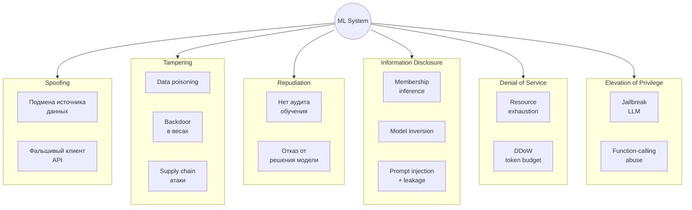
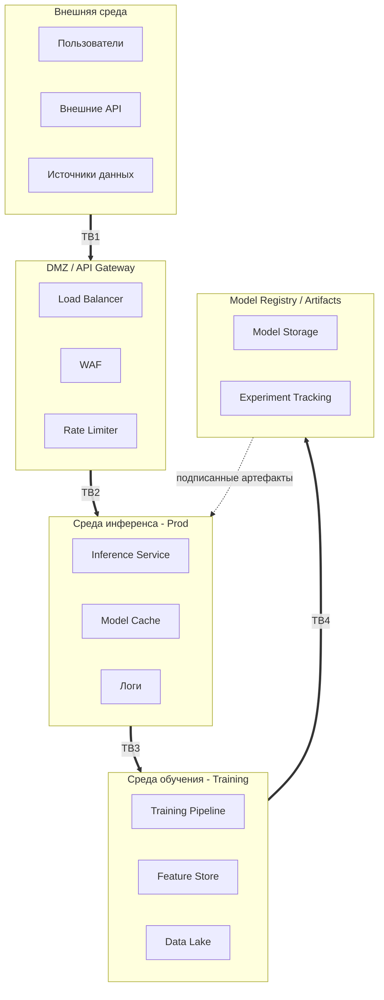

<a id="threat-modeling-dla-ml-sistem-rekomendazii-ib"></a>

# Threat Modeling для ML-систем: Рекомендации ИБ

> Версия: 2.0 · Обновлено: 2026-04-23 · Теги: STRIDE-AI, OWASP LLM, OWASP ML, MITRE ATLAS, DFD, MAESTRO, LINDDUN · Tier: 1-2
>
> **TL;DR**. STRIDE-AI / MAESTRO / LINDDUN, OWASP ML Top 10, OWASP LLM Top 10 (2025), MITRE ATLAS v5.4+ для построения DFD-моделей угроз на этапе проектирования. Threat model без DFD - это набор страхов; с DFD - карта контрмер.

**Навигация:** методологии · OWASP Top 10 · MITRE ATLAS · DFD примеры · новый раздел с интерактивным threat-walkthrough · новый раздел **"С чего начать по вашей роли"**.

**Тематическое дополнение от 13.11.2026**: пути влияния на решения агента, делегирование полномочий и проверка места принудительного контроля (§3.10-3.12). Таблица OWASP 2025 ниже сохранена как историческая редакция; новые ссылки не означают автоматический перенос кодов в 2026.

**Новый источник для отслеживания**: 09.11.2026 NIST опубликовал [SP 2400-102e2026, Initial Public Draft](https://csrc.nist.gov/pubs/sp/2400-102/e2026/ipd) с отдельным фокусом на атаках на агентные системы. На дату проверки 13.11.2026 это проект для публичного обсуждения, а не окончательная редакция или новый обязательный контроль. При ссылке сохраняйте статус draft и не подменяйте им автоматически действующие внутренние требования, основанные на прежней серии AI 100-2.

<a id="1-kratkoe-soderjanie-razdela"></a>

## 1. Краткое содержание раздела

<a id="stride-ai-karta-ugroz-v-ml-pajplajne"></a>

### STRIDE-AI: карта угроз в ML-пайплайне



Раздел посвящён систематическому моделированию угроз (Threat Modeling) применительно к системам машинного обучения. Традиционные подходы к threat modeling (STRIDE, PASTA, Attack Trees) адаптируются с учётом специфики ML: наличие обучающих данных, модели как артефакта, пайплайна MLOps, а также новых векторов атак - adversarial-примеры, отравление данных, извлечение модели, prompt injection и др.

**Ключевые тезисы раздела:**

- Триада CIA в контексте ML приобретает дополнительные измерения: конфиденциальность распространяется на обучающие данные и параметры модели, целостность - на весь пайплайн от данных до инференса, доступность - на сервисы предсказаний и обучающую инфраструктуру.
- Существуют адаптированные методологии моделирования угроз для AI/ML: STRIDE-AI, MITRE ATLAS, OWASP ML Top 10, OWASP LLM Top 10, LINDDUN (для privacy), PASTA, DREAD, FMEA.
- Threat modeling должен быть интегрирован в жизненный цикл ML-системы - от проектирования до эксплуатации, включая CI/CD-пайплайн (Shift-Left подход).
- Для каждого ML-проекта рекомендуется строить DFD (Data Flow Diagram), идентифицировать trust boundaries и применять структурированные шаблоны угроз.
- Инструменты автоматизации (pytm, OWASP Threat Dragon, ATLAS Navigator) позволяют встроить моделирование угроз в DevSecOps-процесс.

---

<a id="2-verifikazia-metodologij-i-instrumentov"></a>

## 2. Верификация методологий и инструментов

<a id="21-stride-ai"></a>

### 2.1. STRIDE-AI

| Параметр | Значение |
|---|---|
| **Статус** | Актуален |
| **Источник** | Mauri L., Damiani E. - «Modeling Threats to AI/ML Systems Using STRIDE» (2022) |
| **Суть** | Расширение классического STRIDE для AI-систем: учёт adversarial-атак, отравления данных, model stealing, inference attacks |
| **Применимость** | Любые ML-системы, особенно системы с внешними входами |

STRIDE-AI сохраняет шесть категорий угроз (Spoofing, Tampering, Repudiation, Information Disclosure, Denial of Service, Elevation of Privilege), но адаптирует их к компонентам ML-пайплайна:

- **Spoofing** - подмена источников данных, подмена модели в реестре.
- **Tampering** - adversarial-примеры, отравление обучающих данных, модификация весов модели.
- **Repudiation** - отсутствие логирования предсказаний, невозможность воспроизвести обучение.
- **Information Disclosure** - извлечение обучающих данных (membership inference, model inversion), утечка гиперпараметров.
- **Denial of Service** - перегрузка сервиса инференса, sponge-примеры (замедляющие инференс).
- **Elevation of Privilege** - эксплуатация LLM для обхода авторизации, prompt injection для выполнения привилегированных действий.

<a id="22-mitre-atlas"></a>

### 2.2. MITRE ATLAS

| Параметр | Значение |
|---|---|
| **Статус** | Актуален (версия обновляется регулярно) |
| **Источник** | [atlas.mitre.org](https://atlas.mitre.org) |
| **Русскоязычный ресурс** | [atlas.securityhub.ru](https://atlas.securityhub.ru) - переведённая версия |
| **Суть** | Матрица тактик и техник атак на AI-системы, аналог ATT&CK для ML |

ATLAS (Adversarial Threat Landscape for AI Systems) содержит:
- Тактики: разведка, сбор ресурсов, начальный доступ, выполнение на модели, уклонение, воздействие и др.
- Техники: отравление данных, adversarial evasion, model extraction, prompt injection, backdoor в модели и др.
- Реальные case studies - задокументированные инциденты атак на ML-системы.

**Рекомендация ИБ:** использовать ATLAS Navigator для маппинга угроз конкретного ML-проекта на известные техники атак.

<a id="23-owasp-machine-learning-security-top-ten"></a>

### <span id="23-owasp-ml-top-10-2023" aria-hidden="true"></span>2.3. OWASP Machine Learning Security Top Ten

| Параметр | Значение |
|---|---|
| **Статус** | Изменяемый draft, OWASP Lab Project; проверено 13.11.2026 |
| **Источник** | [owasp.org/www-project-machine-learning-security-top-10](https://owasp.org/www-project-machine-learning-security-top-10/) |

Ниже сохранён перечень рисков этой методики. Официальная landing page предупреждает, что draft часто меняется; она не закрепляет редакцию «2023» или неизменность приведённых ID и названий. Перед новым mapping фиксируйте конкретную ревизию исходного списка и проверяйте соответствия; таблица ниже не обновляется автоматически вместе с сайтом OWASP.

| ID | Угроза |
|---|---|
| ML01 | Input Manipulation (Adversarial Attack) |
| ML02 | Data Poisoning |
| ML03 | Model Inversion |
| ML04 | Membership Inference |
| ML05 | Model Stealing (Extraction) |
| ML06 | AI Supply Chain Attack |
| ML07 | Transfer Learning Attack |
| ML08 | Model Skewing |
| ML09 | Output Integrity Attack |
| ML10 | Model Poisoning (Backdoor) |

<a id="24-owasp-llm-top-10-2025"></a>

### 2.4. OWASP LLM Top 10 (2025)

| Параметр | Значение |
|---|---|
| **Статус** | Историческая редакция 2025; для новой оценки сверять [GenAI LLM Top 10 2026](https://genai.owasp.org/resource/owasp-genai-llm-top-10-2026/) по [таблице соответствия кодов](compliance-matrices/OWASP-LLM-TOP10.md#sootvetstvie-redakzij-2025-2026) |
| **Источник** | [OWASP GenAI](https://genai.owasp.org/); редакцию и дату сохранять в threat model |

Перечень рисков:

| ID | Угроза |
|---|---|
| LLM01 | Prompt Injection |
| LLM02 | Sensitive Information Disclosure |
| LLM03 | Supply Chain Vulnerabilities |
| LLM04 | Data and Model Poisoning |
| LLM05 | Improper Output Handling |
| LLM06 | Excessive Agency |
| LLM07 | System Prompt Leakage |
| LLM08 | Vector and Embedding Weaknesses |
| LLM09 | Misinformation |
| LLM10 | Unbounded Consumption |

<a id="25-linddun"></a>

### 2.5. LINDDUN

| Параметр | Значение |
|---|---|
| **Статус** | Актуален |
| **Источник** | [linddun.org](https://linddun.org) - KU Leuven |
| **Суть** | Методология моделирования угроз приватности |

Категории угроз приватности:

- **Linkability** - возможность связать записи/действия одного субъекта.
- **Identifiability** - возможность идентифицировать субъекта данных.
- **Non-repudiation** - невозможность отрицания действия (в контексте приватности - нежелательное).
- **Detectability** - возможность обнаружить факт наличия данных.
- **Disclosure of information** - раскрытие персональных данных.
- **Unawareness** - субъект не осведомлён об обработке его данных.
- **Non-compliance** - несоответствие требованиям регуляторов (GDPR, 152-ФЗ).

**Применимость в ML:** критически важна для систем, обрабатывающих персональные данные - RAG-системы с корпоративными документами, рекомендательные системы, модели для HR/финансов.

<a id="26-pasta-process-for-attack-simulation-and-threat-analysis"></a>

### 2.6. PASTA (Process for Attack Simulation and Threat Analysis)

| Параметр | Значение |
|---|---|
| **Статус** | Актуален |
| **Суть** | Risk-centric методология из 7 этапов |

Этапы PASTA, адаптированные для ML:

1. **Определение бизнес-контекста** - бизнес-цели ML-системы, допустимые риски.
2. **Описание технического окружения** - архитектура ML-пайплайна, DFD.
3. **Декомпозиция приложения** - компоненты: хранилище данных, обучение, реестр моделей, инференс, API.
4. **Анализ угроз** - применение ATLAS, OWASP ML/LLM Top 10.
5. **Анализ уязвимостей** - сканирование зависимостей, аудит конфигураций.
6. **Моделирование сценариев атак** - Attack Trees, табличные сценарии.
7. **Определение мер защиты** - контрмеры, приоритизация по DREAD.

<a id="27-instrumenty"></a>

### 2.7. Инструменты

| Инструмент | Тип | Статус | Назначение |
|---|---|---|---|
| **OWASP Threat Dragon** | Open source | Актуален | Визуальное построение DFD и моделей угроз, поддержка STRIDE |
| **pytm** | Open source (Python) | Актуален | Threat modeling as code - описание системы на Python, автоматическая генерация DFD и списка угроз |
| **ATLAS Navigator** | Веб-инструмент (MITRE) | Актуален | Навигация по тактикам и техникам ATLAS, построение профилей угроз |
| **Microsoft Threat Modeling Tool** | Бесплатный | Актуален | Построение DFD, автоматическое предложение угроз по STRIDE |
| **Threatspec** | Open source | Актуален | Threat modeling as code, аннотации в исходном коде |

---


<a id="3-rekomendazii-ib"></a>

## 3. Рекомендации ИБ

<a id="31-obazatel_noe-provedenie-threat-modeling-dla-kajdogo-ml-proekta"></a>

### 3.1. Обязательное проведение threat modeling для каждого ML-проекта

**Требование:** Ни один ML-проект не должен переходить в продакшн без проведённого и задокументированного threat modeling.

Threat modeling проводится:
- На этапе проектирования (Design Phase) - основной threat model.
- При существенных изменениях архитектуры - пересмотр threat model.
- Регулярно (ежеквартально) - актуализация threat model.
- При инцидентах безопасности - внеплановый пересмотр.

**Ответственные:**
- Владелец ML-продукта - инициация.
- ML-инженер - описание архитектуры и пайплайна.
- Специалист ИБ - проведение и фасилитация threat modeling.
- DevOps/MLOps-инженер - описание инфраструктуры и CI/CD.

<a id="32-vybor-metodologii-v-zavisimosti-ot-tipa-ml-sistemy"></a>

### 3.2. Выбор методологии в зависимости от типа ML-системы

Для различных типов ML-систем рекомендуется комбинация методологий:

<a id="llm-sistemy-cat-boty-generativnye-modeli-summarizazia"></a>

#### LLM-системы (чат-боты, генеративные модели, суммаризация)

| Методология | Назначение |
|---|---|
| STRIDE-AI | Базовое моделирование угроз по компонентам |
| OWASP LLM Top 10 (2025) | Специфичные риски LLM: prompt injection, excessive agency, system prompt leakage |
| MITRE ATLAS | Маппинг на известные техники атак |
| LINDDUN | Если система обрабатывает персональные данные |

**Приоритетные угрозы:** prompt injection (прямой и косвенный), утечка системного промпта, excessive agency, sensitive information disclosure.

<a id="cv-sistemy-komp_uternoe-zrenie-detekzia-klassifikazia-segmentazia"></a>

#### CV-системы (компьютерное зрение: детекция, классификация, сегментация)

| Методология | Назначение |
|---|---|
| STRIDE-AI | Базовое моделирование угроз |
| OWASP ML Top 10 (2023) | Adversarial attacks, data poisoning, model extraction |
| MITRE ATLAS | Техники evasion, poisoning |
| ART (Adversarial Robustness Toolbox) | Практическое тестирование устойчивости |

**Приоритетные угрозы:** adversarial-примеры (evasion), отравление обучающих данных, model stealing, физические атаки (adversarial patches).

<a id="tablicnye-modeli-skoring-rekomendazii-prognozirovanie"></a>

#### Табличные модели (скоринг, рекомендации, прогнозирование)

| Методология | Назначение |
|---|---|
| STRIDE | Классическое моделирование угроз (без расширений, если нет adversarial-контекста) |
| OWASP ML Top 10 (2023) | Data poisoning, membership inference, model inversion |

**Приоритетные угрозы:** data poisoning, membership inference (раскрытие данных обучения), model inversion, bias exploitation.

<a id="rag-sistemy-retrieval-augmented-generation"></a>

#### RAG-системы (Retrieval-Augmented Generation)

| Методология | Назначение |
|---|---|
| STRIDE-AI | Моделирование угроз для всех компонентов (retriever, generator, vector store) |
| OWASP LLM Top 10 (2025) | Prompt injection, vector/embedding weaknesses, sensitive information disclosure |
| OWASP ML Top 10 (2023) | Supply chain, data poisoning |
| MITRE ATLAS | Техники атак на pipeline |
| LINDDUN | Приватность данных в vector store, утечка документов |

**Приоритетные угрозы:** indirect prompt injection через документы в knowledge base, утечка конфиденциальных документов, poisoning vector store, несанкционированный доступ к данным через генеративный компонент.

<a id="33-postroenie-dfd-kak-pervyj-sag"></a>

### 3.3. Построение DFD как первый шаг

Data Flow Diagram - обязательный первый артефакт threat modeling. DFD для ML-системы должна включать:

**Обязательные элементы DFD:**

- **Внешние сущности (External Entities):** пользователи, внешние API, источники данных, дата-инженеры, ML-инженеры.
- **Процессы:** сбор данных, препроцессинг, обучение, валидация, деплой, инференс, мониторинг.
- **Хранилища данных:** сырые данные, обработанные данные, feature store, model registry, vector store, логи предсказаний.
- **Потоки данных:** все соединения между компонентами с указанием протоколов и форматов.
- **Trust boundaries:** границы доверия между средами (dev/staging/prod), между внутренней сетью и внешними пользователями, между компонентами с разным уровнем привилегий.

**Типовые trust boundaries в ML-системе:**



Переходы между зонами (TB1..TB4) - точки обязательной аутентификации, авторизации и аудита.

**Инструменты для построения DFD:**
- pytm (Python) - threat modeling as code, автогенерация DFD.
- OWASP Threat Dragon - графический редактор DFD.
- draw.io / diagrams.net - универсальный инструмент.

<a id="34-dread-dla-prioritizazii-riskov"></a>

### 3.4. DREAD для приоритизации рисков

Каждая идентифицированная угроза оценивается по шкале DREAD (1-10 по каждому критерию):

Это внутренний способ упорядочить обсуждение, а не объективная вероятность эксплуатации и не нормативная оценка. Числа в примерах иллюстративны: одна техника имеет разную воспроизводимость и ущерб при разных доступах, данных и контрмерах. В оценке фиксируются допущения, источник свидетельств и уверенность; критический бизнес-эффект может блокировать выпуск независимо от среднего балла.

| Критерий | Описание | Пример для ML |
|---|---|---|
| **D - Damage** | Потенциальный ущерб | Adversarial attack на систему автопилота → 10; bias в рекомендациях → 5 |
| **R - Reproducibility** | Воспроизводимость атаки | Adversarial-примеры с известными техниками → 8; side-channel на GPU → 3 |
| **E - Exploitability** | Сложность эксплуатации | Prompt injection → 9; model extraction через API → 6 |
| **A - Affected Users** | Количество затронутых пользователей | Публичный API → 10; внутренний инструмент → 3 |
| **D - Discoverability** | Обнаружимость уязвимости | Документированная техника в ATLAS → 9; zero-day → 2 |

**Формула:** `DREAD Score = (D + R + E + A + D) / 5`

**Шкала приоритизации:**

| Диапазон | Приоритет | Действие |
|---|---|---|
| 8.0 - 10.0 | Критический | Немедленное устранение, блокировка деплоя |
| 6.0 - 7.9 | Высокий | Устранение в текущем спринте |
| 4.0 - 5.9 | Средний | Планирование устранения в ближайших итерациях |
| 1.0 - 3.9 | Низкий | Мониторинг, принятие риска с обоснованием |

<a id="35-integrazia-threat-modeling-v-cicd-shift-left"></a>

### 3.5. Интеграция threat modeling в CI/CD (Shift-Left)

Threat modeling должен быть встроен в DevSecOps-пайплайн:

**Этап 1: Design (проектирование)**
- Проведение threat modeling сессии с командой.
- Создание DFD и документа threat model.
- Code review включает проверку соответствия threat model.

**Этап 2: Build (сборка)**
- Автоматическая проверка зависимостей (SCA) на уязвимости в ML-библиотеках.
- Проверка моделей на backdoor (при загрузке pretrained models).
- Линтинг конфигураций (инференс-сервер, API Gateway).

**Этап 3: Test (тестирование)**
- Adversarial testing (ART, Counterfit).
- Fuzz-тестирование API инференса.
- Проверка на утечку данных через предсказания.

**Этап 4: Deploy (деплой)**
- Проверка подписей моделей (model signing).
- Валидация конфигурации безопасности (RBAC, сетевые политики).
- Gate на деплой: threat model актуален и подписан ИБ.

**Этап 5: Monitor (эксплуатация)**
- Мониторинг аномалий во входных данных (data drift как индикатор атаки).
- Мониторинг аномалий в предсказаниях (output drift).
- Алертинг на подозрительные паттерны запросов.

**Автоматизация через pytm:**

```python
# Пример описания ML-системы в pytm
from pytm import TM, Server, Datastore, Dataflow, Boundary, Actor

tm = TM("ML Inference System Threat Model")
tm.description = "Threat model для сервиса инференса CV-модели"

# Trust boundaries
internet = Boundary("Internet")
dmz = Boundary("DMZ")
internal = Boundary("Internal Network")
training_env = Boundary("Training Environment")

# Actors
user = Actor("User")
user.inBoundary = internet

ml_engineer = Actor("ML Engineer")
ml_engineer.inBoundary = internal

# Components
api_gateway = Server("API Gateway")
api_gateway.inBoundary = dmz
api_gateway.hasAccessControl = True

inference_service = Server("Inference Service")
inference_service.inBoundary = internal
inference_service.isEncrypted = True

model_registry = Datastore("Model Registry")
model_registry.inBoundary = training_env
model_registry.isEncrypted = True
model_registry.hasAccessControl = True

# Dataflows
user_request = Dataflow(user, api_gateway, "Inference Request")
user_request.protocol = "HTTPS"
user_request.isEncrypted = True

api_to_inference = Dataflow(api_gateway, inference_service, "Validated Request")
api_to_inference.protocol = "gRPC"
api_to_inference.isEncrypted = True

model_load = Dataflow(model_registry, inference_service, "Model Artifacts")
model_load.protocol = "S3/HTTPS"
model_load.isEncrypted = True

tm.process()
```

<a id="pesocniza-detection-rule-na-izmenenia-arhitektury-v-pr"></a>

#### Песочница: detection-rule на изменения архитектуры в PR

Когда архитектура меняется без обновления Threat Model — это TM drift. Detection в CI ищет diff-патерны, требующие пересмотра TM: новые сетевые вызовы, новые pickle/HTTP/GRPC endpoints, новые зависимости от ML-фреймворков.

```widget:regex-tester
{
  "id": "ch09-tm-drift",
  "title": "Detection в pre-merge hook: TM drift",
  "description": "Ищет в добавленных строках diff выбранные сетевые/parsing/SDK-сигнатуры. Это кандидаты на review Threat Model, а не доказательство новой trust boundary или отсутствия её описания.",
  "defaultPattern": "^\\+.*(?:requests\\.(?:get|post)|httpx|urllib|fetch\\(|pickle\\.loads?|yaml\\.load[^_]|openai\\.|anthropic\\.|huggingface_hub|new\\s+(?:Client|Session)|grpc\\.insecure)",
  "flags": "gm",
  "tests": [
    { "id": "p1", "shouldMatch": true, "label": "Новый HTTP-вызов к внешнему API", "text": "+    response = requests.post('https://api.partner.com/v2/data', json=payload)" },
    { "id": "p2", "shouldMatch": true, "label": "Pickle.load — RCE-риск, новый trust boundary", "text": "+    data = pickle.loads(response.content)" },
    { "id": "p3", "shouldMatch": true, "label": "Новый OpenAI-клиент — данные уходят за периметр", "text": "+    client = openai.OpenAI(api_key=os.getenv('OPENAI_KEY'))" },
    { "id": "p4", "shouldMatch": true, "label": "Insecure gRPC — отсутствие TLS на новом канале", "text": "+    channel = grpc.insecure_channel('legacy-service:50051')" },
    { "id": "n1", "shouldMatch": false, "label": "Удалённый код (минус-строка) не триггерит", "text": "-    response = requests.get('http://internal-api/v1/health')" },
    { "id": "n2", "shouldMatch": false, "label": "Контекст без изменений (без + в начале)", "text": "        response = requests.get('http://localhost/health')" },
    { "id": "n3", "shouldMatch": false, "label": "Безопасное использование yaml.safe_load", "text": "+    config = yaml.safe_load(stream)" },
    { "id": "p5", "shouldMatch": true, "label": "Новый HuggingFace pull — supply chain риск", "text": "+    model = huggingface_hub.snapshot_download('mistralai/Mistral-7B')" }
  ]
}
```

> Pre-merge hook на этом regex даст false-positive (например, тестовые requests'ы) — это feature, а не bug. Hook должен лишь ставить требование «обновить Threat Model» в PR, не блокировать merge. Reviewer проверяет, что TM учитывает новый trust boundary.

<a id="36-regularnyj-peresmotr"></a>

### 3.6. Регулярный пересмотр

| Триггер | Частота | Объём пересмотра |
|---|---|---|
| Плановый пересмотр | Ежеквартально | Полный пересмотр threat model |
| Изменение архитектуры | По факту | Затронутые компоненты |
| Новая модель / переобучение | По факту | Компоненты модели и данных |
| Инцидент безопасности | По факту | Полный пересмотр + дополнительный анализ |
| Обновление ATLAS / OWASP | По факту обновления | Маппинг новых техник на текущий threat model |
| Изменение регуляторных требований | По факту | Compliance-аспекты threat model |

<a id="kal_kulator-cadence-peresmotra-tm-vs-stoimost_"></a>

#### Калькулятор: cadence пересмотра TM vs стоимость

```widget:threshold-slider
{
  "id": "ch09-review-cadence",
  "title": "Плановый пересмотр Threat Model: учебный расчёт нагрузки",
  "description": "Условная система: 4 изменения в месяц, 8 человеко-часов на один плановый review. Ползунок показывает только календарную нагрузку и ожидание review при равномерном поступлении изменений. Это не прогноз покрытия угроз, трудозатрат конкретной команды или допустимый срок устранения риска. Значимое изменение запускает внеплановый review независимо от ползунка.",
  "min": 1,
  "max": 24,
  "step": 1,
  "default": 3,
  "unit": " мес",
  "axisLabel": "Интервал между пересмотрами TM",
  "tracks": [
    { "label": "Плановых review в год, среднее", "compute": "12 / x", "format": "fixed1", "tone": "info", "hint": "Для интервала 24 месяца — в среднем 0,5 review в год за несколько лет; фактическое расписание дискретное." },
    { "label": "Изменений между review при 4 изменениях/мес", "compute": "4 * x", "format": "fixed1", "tone": "warn", "hint": "Изменение не равно угрозе или дефекту. Реальный поток берите из change log, включая изменения полномочий и источников данных." },
    { "label": "Плановая нагрузка (человеко-часов/год)", "compute": "96 / x", "format": "fixed1", "tone": "info", "hint": "12/x review × 8 человеко-часов. В модели нагрузка строго убывает; оптимальный интервал из неё не следует. Внеплановые проверки и исправления не включены." },
    { "label": "Среднее ожидание планового review (мес)", "compute": "x / 2", "format": "fixed1", "tone": "warn", "hint": "Только при равномерном поступлении изменений и отсутствии внепланового review. Для критичного изменения ожидать плановой даты нельзя." }
  ],
  "regions": [
    { "from": 1, "to": 3, "label": "Частые плановые проверки; внеплановые триггеры сохраняются", "tone": "info" },
    { "from": 3, "to": 6, "label": "Интервал нужно обосновать темпом изменений и риском", "tone": "info" },
    { "from": 6, "to": 12, "label": "Проверьте, какие изменения проходят внеплановый review", "tone": "warn" },
    { "from": 12, "to": 24, "label": "Длительное ожидание плановой проверки в учебной модели", "tone": "warn" }
  ]
}
```

<a id="37-table-top-exercises"></a>

### 3.7. Table-top exercises

Проведение настольных учений для отработки сценариев атак на ML-системы:

**Формат:**
- Участники: ML-инженеры, ИБ-специалисты, DevOps, владелец продукта.
- Длительность: 2-4 часа.
- Частота: минимум 2 раза в год.

**Примеры сценариев для table-top exercises:**

1. **Отравление обучающих данных.** Злоумышленник получил доступ к data lake и внёс изменения в обучающую выборку. Как обнаружить? Как откатить? Как предотвратить повторение?

2. **Adversarial attack на продакшн-модель.** Обнаружены аномальные входные данные, приводящие к некорректным предсказаниям. Какова процедура реагирования? Как определить масштаб?

3. **Prompt injection в LLM-сервисе.** Пользователь обошёл системный промпт и получил доступ к конфиденциальной информации. Как обнаружить? Какие логи анализировать? Как усилить защиту?

4. **Supply chain attack.** Обнаружен бэкдор в популярной ML-библиотеке, используемой в проекте. Какие системы затронуты? Как оперативно обновить зависимости?

5. **Model extraction.** Конкурент систематически запрашивает API для извлечения модели. Как обнаружить? Какие метрики мониторить? Какие ограничения ввести?

<a id="38-svaz_-s-frejmvorkami-upravlenia-riskami-ai"></a>

### 3.8. Связь с фреймворками управления рисками AI

| Фреймворк | Связь с threat modeling |
|---|---|
| **NIST AI RMF** (AI 100-1) | Threat modeling реализует функции GOVERN (управление рисками) и MAP (идентификация рисков). Результаты threat modeling напрямую вводятся в процесс управления рисками AI. |
| **ISO/IEC 42001** (AI Management System) | Threat modeling является частью процесса оценки рисков (раздел 6.1). Результаты документируются как часть AIMS. |
| **ГОСТ Р 59898-2021** | Оценка рисков информационной безопасности AI-систем - threat modeling как метод идентификации угроз. |
| **EU AI Act** | Для высокорисковых AI-систем (High-Risk) threat modeling является обязательным элементом оценки соответствия. |

<a id="39-dokumentirovanie-i-otslejivanie-ugroz"></a>

### 3.9. Документирование и отслеживание угроз

Все идентифицированные угрозы должны:

1. **Регистрироваться** в системе управления уязвимостями (Jira, DefectDojo, Gitlab Issues) с тегом `threat-model`.
2. **Классифицироваться** по STRIDE-AI категории и DREAD-оценке.
3. **Маппиться** на MITRE ATLAS техники (ID техники).
4. **Иметь владельца** - конкретного человека, ответственного за устранение.
5. **Отслеживаться** до полного устранения или принятия риска с обоснованием.
6. **Верифицироваться** - после устранения проводится проверка эффективности контрмеры.

<a id="konstruktor-completeness-threat-model-dokumenta"></a>

#### Конструктор completeness Threat Model документа

Оцените готовность вашего Threat Model — отметьте, какие артефакты у вас есть. Справа считается completeness score и появляются нарушения для регулируемых систем (716-П / EU AI Act).

```widget:policy-builder
{
  "id": "ch09-tm-completeness",
  "title": "Completeness вашего Threat Model документа",
  "description": "Каждый toggle отмечает наличие артефакта в учебном шаблоне. Веса и порог выбраны для демонстрации внутреннего review: процент не измеряет защищённость, применимость закона или решение аудитора. Содержание и испытания контролей проверяются отдельно.",
  "scoreLabel": "Completeness",
  "scoreMax": 100,
  "scoreUnit": "",
  "groups": [
    {
      "name": "Метаданные и scope",
      "items": [
        { "id": "meta-owner", "label": "Указан владелец системы и threat model owner", "weight": 4, "default": true, "recommended": true, "description": "Без явного owner документ умирает — нет ответственного за поддержание актуальности." },
        { "id": "meta-scope", "label": "Чётко определён scope анализа (что включено, что — нет)", "weight": 5, "default": true, "recommended": true, "description": "Out-of-scope компоненты должны быть явно перечислены с обоснованием." },
        { "id": "meta-version", "label": "Версионирование + дата ревизии", "weight": 3, "default": true, "description": "TM должен версионироваться вместе с архитектурой; устаревший TM хуже отсутствующего." }
      ]
    },
    {
      "name": "Архитектура",
      "items": [
        { "id": "arch-dfd-l0", "label": "DFD Level 0 (контекстная диаграмма)", "weight": 6, "default": true, "recommended": true, "description": "Хайп-уровневая карта системы с внешними сущностями." },
        { "id": "arch-dfd-l1", "label": "DFD Level 1 (детальный поток)", "weight": 7, "recommended": true, "description": "Детальная карта компонентов и потоков данных." },
        { "id": "arch-trust-boundaries", "label": "Trust boundaries обозначены явно", "weight": 8, "recommended": true, "description": "Без trust boundaries STRIDE-анализ невозможен — это самая критичная часть DFD." },
        { "id": "arch-tech-stack", "label": "Перечислены конкретные технологии (БД, frameworks, APIs)", "weight": 4, "default": true, "description": "Помогает мапить угрозы на конкретные CVE и known issues." }
      ]
    },
    {
      "name": "Анализ угроз",
      "items": [
        { "id": "threat-stride", "label": "STRIDE-AI per element (для каждого компонента DFD)", "weight": 10, "recommended": true, "description": "Систематический проход по каждому элементу — основа методологии." },
        { "id": "threat-mlspecific", "label": "ML-специфические угрозы (poisoning, evasion, extraction, MIA)", "weight": 9, "recommended": true, "description": "Без них TM сводится к классическому ИТ — теряется ML-ценность." },
        { "id": "threat-atlas-mapping", "label": "Mapping угроз на MITRE ATLAS technique IDs", "weight": 6, "description": "Стандартизирует язык; помогает интегрировать с внешним threat intel." },
        { "id": "threat-owasp-mapping", "label": "Mapping на OWASP LLM/ML Top 10", "weight": 5, "description": "Для LLM/GenAI — обязательно; для классического ML — рекомендация." }
      ]
    },
    {
      "name": "Оценка и приоритизация",
      "items": [
        { "id": "risk-dread", "label": "Обоснованная оценка приоритета каждой угрозы", "weight": 7, "recommended": true, "description": "Внутренний метод приоритизации с допущениями, свидетельствами и уровнем уверенности. Балл DREAD не равен вероятности атаки." },
        { "id": "risk-residual", "label": "Residual risk после контрмер задокументирован", "weight": 6, "description": "Risk acceptance с подписью владельца — обязательно для unmitigated." }
      ]
    },
    {
      "name": "Контрмеры",
      "items": [
        { "id": "ctm-list", "label": "Каждой угрозе сопоставлена контрмера", "weight": 9, "default": true, "recommended": true, "description": "Без контрмер TM — это просто список страхов." },
        { "id": "ctm-owner", "label": "Каждая контрмера имеет владельца + срок", "weight": 6, "recommended": true, "description": "Без owner и deadline контрмера не реализуется." },
        { "id": "ctm-verification", "label": "Plan verification контрмеры (как проверим эффективность)", "weight": 5, "description": "Особенно важно для adversarial controls — нужно доказать, что они работают." }
      ]
    }
  ],
  "rules": [
    { "id": "must-trust", "type": "require-all", "items": ["arch-trust-boundaries"], "message": "Без trust boundaries STRIDE-анализ невозможен — это базовый артефакт DFD." },
    { "id": "must-stride", "type": "require-all", "items": ["threat-stride"], "message": "STRIDE-AI per element — основа методологии. Без него TM не считается полным." },
    { "id": "must-mlspecific", "type": "require-all", "items": ["threat-mlspecific"], "message": "ML-специфические угрозы (poisoning, evasion) — обязательная часть. Иначе это TM для классической ИТ-системы." },
    { "id": "must-controls", "type": "require-all", "items": ["ctm-list"], "message": "Без контрмер для каждой угрозы документ — список страхов, а не план защиты." },
    { "id": "min-tier1", "type": "min-score", "threshold": 80, "message": "Учебный внутренний порог полноты — 80%. Не является требованием 716-П, EU AI Act или гарантией аудиторского заключения." }
  ],
  "thresholds": [
    { "from": 0, "to": 30, "label": "Черновик — недостаточно даже для internal review", "tone": "err" },
    { "from": 30, "to": 60, "label": "Часть артефактов отмечена; требуется содержательная проверка пробелов", "tone": "warn" },
    { "from": 60, "to": 80, "label": "Большинство артефактов отмечено; проверьте основания риска и план испытаний", "tone": "info" },
    { "from": 80, "to": 100, "label": "Высокая полнота учебного списка; решение о допуске принимается отдельно", "tone": "info" }
  ]
}
```

---


<a id="310-tri-karty-sistemy-dannye-vlianie-i-polnomocia"></a>

### 3.10. Три карты системы: данные, влияние и полномочия

**Проблема**: DFD показывает HTTPS между агентом и tool server, но не объясняет, почему вложение из письма смогло изменить назначение экспорта. Канал зашифрован, а граница между данными и управляющим решением нарушена.

Для агентной системы к DFD добавляются два представления. Это рабочий приём анализа, а не новая обязательная таксономия вместо STRIDE, ATLAS или OWASP.

| Представление | Какие связи показывать | Контрольный вопрос |
|---|---|---|
| Потоки данных | Источник → parser → retrieval → model → tool → storage/log/export | Какие данные пересекают границу и кому они доступны? |
| Пути влияния | Документ, tool response, memory, правила репозитория → выбор следующего действия | Может ли недоверенная информация изменить цель, аргументы, tool или получателя? |
| Делегирование | Пользователь → orchestrator → worker → credentials broker → executor | Чьи полномочия используются, что ограничивает объект и кто может их отозвать? |

**Пример**: агент готовит внутренний отчёт по обращению клиента. Он читает почтовое вложение, получает таблицу из CRM и может создавать черновик.

1. В DFD отмечаем, что вложение и CRM имеют разное происхождение, но оба попадают в контекст модели.
2. На карте влияния отмечаем, что содержимое вложения может предложить новое действие, включая отправку данных на другой адрес. Доверие к домену почтового сервиса не делает содержимое письма управляющей инструкцией.
3. На карте полномочий проверяем, не использует ли worker общий аккаунт с правом отправки сообщений, хотя бизнес-задача допускает только черновик.
4. Контрмера ставится в executor: допустимый эффект, текущий tenant и объект определяются серверной политикой. Скрытие tool в prompt или предварительная фильтрация текста не заменяют эту проверку.
5. В тесте проверяется внешнее состояние: не появились сообщение, export job или сетевой запрос к недопущенному получателю. Один отказ в финальном ответе модели не доказывает отсутствие эффекта.

Особенно важны обратные связи: summary → memory → следующий run; tool response → уточнение аргументов → повтор; результат subagent → план orchestrator. На каждом таком ребре фиксируются происхождение, сохранение прав доступа и допустимое влияние. Сводка недоверенного текста не становится доверенной инструкцией после переписывания другой моделью.

**Основа**: [OWASP Securing Agentic Applications V2](https://genai.owasp.org/resource/securing-agentic-applications-v2/), опубликован 10.11.2026, и [NCSC Managing the cyber risk of agentic AI](https://www.ncsc.gov.uk/blogs/managing-the-cyber-risk-of-agentic-ai), проверено 13.11.2026. Разделение на три карты выше - практическая адаптация для threat modeling. Проверки действий описаны в [главе 07](07-red-teaming-testing-methods.md), авторизация tools - в [главе 33](33-ai-agents-security-overlay.md).

<a id="311-szenarij-ugrozy-kak-proveraemaa-zepocka"></a>

### 3.11. Сценарий угрозы как проверяемая цепочка

Запись «prompt injection → DLP» не описывает ни условия атаки, ни ожидаемый отказ. Для каждой приоритетной угрозы заполняется цепочка **предусловие → управляемая поверхность → переход доверия → эффект → контроль → свидетельство**.

| Сценарий | Предусловие и поверхность | Где должен сработать контроль | Наблюдаемое свидетельство |
|---|---|---|---|
| Вложение меняет получателя выгрузки | Атакующий может прислать документ, агент имеет export tool | Executor проверяет разрешённое назначение и scope операции | Отказ до создания внешнего job; проверены очередь и состояние назначения |
| Старое разрешение используется после отзыва | Сохранён run/checkpoint с прежней policy revision | Повторная авторизация при resume и перед защищённым действием | Старый checkpoint не возобновляет операции с отозванным доступом |
| Subagent расширяет полномочия | Worker получает делегированную задачу и может создавать дочерние задачи | Broker не выдаёт прав шире исходного scope и срока | Попытка расширения отвергнута, identity chain восстановлена по событиям |
| Audit channel используется для вывода данных | Tool или model может влиять на текст ошибки/атрибуты span | Минимизация telemetry, разрешённые поля и получатели | Синтетический секрет отсутствует в логах, traces и экспортёрах |
| Fallback обходит класс данных | Основной provider недоступен | Маршрутизатор повторно применяет ограничения данных и региона | Нет вызовов недопущенного provider, пользователь видит ограниченный режим |
| Подписанный артефакт имеет вредоносное поведение | Издатель подписал модель/пакет, но его поведение не проверено | Допуск издателя, разбор артефакта и поведенческая приёмка | Подпись проверена отдельно от отчёта испытаний; одно не заменяет другое |

**Порядок проверки**:

- [ ] Для кейса задано, что атакующий действительно контролирует; локальный admin не предполагается без основания.
- [ ] Разделены достижимость компонента, достаточность полномочий и влияние на бизнес-результат.
- [ ] Есть допустимый контрольный запрос: защита не должна достигаться отключением всей полезной функции.
- [ ] Зафиксированы кандидат, baseline, состояние данных и последовательность шагов.
- [ ] Если нужное свидетельство недоступно, результат записан как непроверенный, а не как отсутствие уязвимости.
- [ ] Проверены обходные каналы: retry, очередь, batch, cache, дочерний run и восстановление состояния.

Остаточный риск описывается после испытания: **что проверено**, **какая поверхность не покрыта**, **какое допущение удерживает границу** и **кто принимает оставшийся риск**. Средний pass rate нельзя подставить вместо ответа на эти вопросы. Нормализованный контракт eval приведён в [главе 12](12-detection-protection-cicd-llm.md).

<a id="sootvetstvie-poruceniu-ne-dokazyvaet-dopustimost_-zeli"></a>

#### Соответствие поручению не доказывает допустимость цели

[NIST SP 2400-102e2026, Initial Public Draft от 09.11.2026](https://nvlpubs.nist.gov/nistpubs//SpecialPublications/NIST.SP.2400-102e2026.ipd.pdf#page=79), §4.2, печатные с.64–65 / PDF79–80, рассматривает предел task consistency при вредоносной исходной задаче. [OWASP Securing Agentic Applications V2](https://genai.owasp.org/download/58383/?tmstv=1794198262), §7.2.1, с.91–92, дополняет это рассмотрением последовательности действий. Следующий сценарий — предлагаемая приёмка Milksec, не установленная эффективность защиты или обязательный тест этих источников.

**Сценарий:** пользователь вправе читать источники и создавать черновики, но дробит запрещённую политикой кампанию на внешне допустимые поручения workers. Каждый точно следует своему поручению. Граница — **локальный scope операции → совокупная цель и результат по политике владельца системы**. Проверка «агент не отклонился от просьбы» здесь может подтвердить исполнение вредоносного запроса.

Контроль связывает parent goal, подзадачи и итог с независимой deployer policy. В negative-набор входят прямой запрос запрещённого результата и его декомпозиция через несколько разрешённых операций/агентов. В positive — близкая легитимная задача с теми же tools и сопоставимым объёмом, чтобы блокировка всех цепочек не выглядела успехом. Evidence: parent/subtask lineage, минимизированные признаки совокупного результата, решения контроля и receipts внешних действий; скрытые рассуждения модели не требуются. Если часть результата не наблюдается, общий исход не объявляется `pass`.

Используйте два oracle: **нарушение policy** и **отклонение от baseline**. Привычная запрещённая последовательность должна отклоняться даже без anomaly; редкая разрешённая — не считаться нарушением только из-за редкости. Для маршрутов, чью композицию контроль не умеет оценить, задайте ограниченный scope или review владельца, а не обещание универсального понимания любой цели.

<a id="312-novye-control-frameworks-proveraem-pokrytie-a-ne-nazvanie"></a>

### 3.12. Новые control frameworks: проверяем покрытие, а не название

В 2026 появился [OWASP Agent Control Standard (ACS)](https://owaspacs.org/), предлагающий направления Instrument, Trace и Inspect для контроля агентных систем. На 13.11.2026 сайт указывает release `v0.1.4` и specification namespace `v0.1.0`: это развивающаяся спецификация. Номер release и версия схемы различаются; в проекте закрепляются точные артефакты, а не ссылка `latest`.

| Что обещает интеграция | Что проверить в threat model и на стенде |
|---|---|
| Instrument: есть hooks на действия | Вызываются ли они **до** эффекта, охватывают ли streaming, background и remote tools; что происходит при ошибке hook |
| Trace: есть события исполнения | Связываются ли intent, решение политики, вызов и внешний результат; нет ли утечки данных через telemetry |
| Inspect: есть инвентарь агента | Отражены ли dynamically acquired tools, модели и зависимости; обнаруживается ли расхождение с допущенным составом |
| Заявлена совместимость / conformance | Какой профиль, версия схемы и набор проверок заявлены; есть ли воспроизводимый отчёт, а не только логотип |

Сама по себе выгрузка traces не блокирует действие, а прохождение проверки схемы не доказывает полноту hooks и защищённость executor. Отдельно проверяются полномочия компонента контроля, его обновление и недоступность: иначе общий policy service становится новой точкой обхода или отказа.

<a id="tri-proverki-fakticeskogo-kontrakta-acs"></a>

#### Три проверки фактического контракта ACS

Зафиксированный источник: release `v0.1.4`, specification namespace `v0.1.0`, repository SHA [`db457a84393bd80954c9b70b2271a719bf7c61cd`](https://github.com/GenAI-Security-Project/agent-control-standard/commit/db457a84393bd80954c9b70b2271a719bf7c61cd). В [Instrument §6.4–6.5](https://github.com/GenAI-Security-Project/agent-control-standard/blob/db457a84393bd80954c9b70b2271a719bf7c61cd/docs/spec/instrument/specification.md) отсутствие пригодного решения по умолчанию допускает `proceed`, тогда как DEFER timeout по умолчанию даёт deny; `postCompact` не отменяет уже состоявшееся сжатие. [Conformance](https://github.com/GenAI-Security-Project/agent-control-standard/blob/db457a84393bd80954c9b70b2271a719bf7c61cd/docs/spec/conformance.md) не предусматривает mid-session renegotiation wrapped MCP в v0.1. Это свойства данного контракта, не обязательная безопасная deployment policy.

[OWASP Guide V2 §3.3.7, с.49–54](https://genai.owasp.org/download/58383/?tmstv=1794198262) рекомендует fail-closed; наличие ACS-совместимого канала само его не устанавливает. В таблице — наша предлагаемая приёмка выбранного deployment, не результат испытания reference implementation.

| Сценарий и граница | Negative: ожидаемый запрет | Positive: полезный контроль | Два этапа evidence |
|---|---|---|---|
| Guardian не возвращает пригодного решения; agent → policy service → sink | Раздельно испытать startup failure, handshake refusal, timeout, malformed response и expired DEFER; выбранный закрытый отказ не выпускает новый consequential effect | После восстановления актуальное allow для того же неизменного operation digest даёт один разрешённый результат | Effective startup/failure posture и факт отсутствия решения; затем dispatch и readback mock sink. Сам timeout или failure log не доказывает запрет |
| Summary уже создано; untrusted content → compaction → persistent context | Клиент без MODIFY на `postCompact` не изображает отмену прошлого; потеря lineage блокирует следующее опасное действие | Разрешённая сводка сохраняет provenance, полезная задача после resume работает | Before/after context digests и lineage; затем следующий policy decision и sink effect. Post-event аудит не заменяет pre-effect gate |
| MCP server добавлен после handshake; discovery → instrumentation → context | Испытать новый `resources/read` / prompt path отдельно от `tools/call`; inventory event не выпускает недопущенный контент к привилегированному executor | Новая сессия с согласованным wrapped namespace читает разрешённый ресурс | Handshake, namespace/method list и inventory diff; затем фактически intercepted resource trace. Generic tool hook не доказывает wrapped coverage нового сервера |

Неподдерживаемый hook, недоступный sink или непроведённый attach-test — отдельный пробел проверки, а не автоматический отказ атаки. Для каждого endpoint фиксируйте, в какой момент ещё можно остановить эффект. Матрицы приёмки этого раздела — рекомендации Milksec, не заявление о сертификации конкретного продукта.

<a id="4-sablon-threat-model-document-dla-ml-sistemy"></a>

## 4. Шаблон Threat Model Document для ML-системы

Ниже представлена рекомендуемая структура документа Threat Model для ML-проектов.

---

<a id="threat-model-document"></a>

### THREAT MODEL DOCUMENT

**Метаданные документа:**

| Поле | Значение |
|---|---|
| Название системы | [Название ML-системы] |
| Версия документа | [1.0] |
| Дата создания | [YYYY-MM-DD] |
| Дата последнего пересмотра | [YYYY-MM-DD] |
| Автор | [ФИО, роль] |
| Согласовано (ИБ) | [ФИО, дата, подпись] |
| Согласовано (владелец продукта) | [ФИО, дата, подпись] |
| Классификация | [Конфиденциально / Для служебного пользования] |
| Следующий плановый пересмотр | [YYYY-MM-DD] |

---

**Раздел 1: Описание системы**

- 1.1. Бизнес-назначение системы.
- 1.2. Тип ML-модели (LLM / CV / табличная / RAG / другое).
- 1.3. Используемые ML-фреймворки и библиотеки.
- 1.4. Источники обучающих данных.
- 1.5. Среда развёртывания (on-premise / cloud / hybrid).
- 1.6. Пользователи системы (внутренние / внешние / API-интеграции).
- 1.7. Классификация обрабатываемых данных (ПДн, коммерческая тайна, публичные данные).

**Раздел 2: Архитектура и Data Flow Diagram**

- 2.1. Высокоуровневая архитектурная схема.
- 2.2. Data Flow Diagram (DFD) Level 0 (контекстная).
- 2.3. Data Flow Diagram (DFD) Level 1 (детализированная).
- 2.4. Описание компонентов.
- 2.5. Trust boundaries и обоснование.
- 2.6. Протоколы взаимодействия между компонентами.
- 2.7. Внешние зависимости (третьесторонние модели, API, библиотеки).

**Раздел 3: Область анализа (Scope)**

- 3.1. Компоненты, включённые в анализ.
- 3.2. Компоненты, исключённые из анализа (с обоснованием).
- 3.3. Предположения (assumptions).
- 3.4. Ограничения (constraints).

**Раздел 4: Применённые методологии**

- 4.1. Перечень применённых методологий (STRIDE-AI, OWASP ML Top 10, ATLAS и др.).
- 4.2. Обоснование выбора методологий.
- 4.3. Использованные инструменты.

**Раздел 5: Реестр угроз**

Таблица угроз:

| ID | Угроза | Категория (STRIDE-AI) | ATLAS ID | OWASP ID | Компонент | DREAD (D/R/E/A/D) | Итоговый балл | Приоритет | Контрмера | Статус | Владелец |
|---|---|---|---|---|---|---|---|---|---|---|---|
| T-001 | Пример | Tampering | AML.T0020 | ML02 | Training Pipeline | 8/7/6/9/7 | 7.4 | Высокий | Описание | Открыт | ФИО |

**Раздел 6: Сценарии атак**

Для каждой угрозы с приоритетом «Высокий» и «Критический» - детальное описание:

- 6.X.1. Описание сценария.
- 6.X.2. Предусловия.
- 6.X.3. Шаги атаки.
- 6.X.4. Ожидаемое воздействие.
- 6.X.5. Вероятность (с обоснованием).
- 6.X.6. Attack Tree (при необходимости).

**Раздел 7: Контрмеры и план устранения**

| ID угрозы | Контрмера | Тип (превентивная / детективная / корректирующая) | Срок реализации | Ответственный | Статус |
|---|---|---|---|---|---|
| T-001 | Пример | Превентивная | YYYY-MM-DD | ФИО | В работе |

**Раздел 8: Остаточные риски**

- 8.1. Перечень принятых рисков с обоснованием.
- 8.2. Утверждение владельцем продукта и ИБ.

**Раздел 9: Рекомендации по мониторингу**

- 9.1. Метрики для мониторинга (data drift, output drift, аномальные запросы).
- 9.2. Пороговые значения для алертов.
- 9.3. Процедура реагирования на срабатывание.

**Раздел 10: История изменений**

| Версия | Дата | Автор | Описание изменений |
|---|---|---|---|
| 1.0 | YYYY-MM-DD | ФИО | Первичное создание |

---

<a id="5-matriza-ugroz-po-etapam-mlops"></a>

## 5. Матрица угроз по этапам MLOps

Каждый этап жизненного цикла ML-системы имеет специфические угрозы. Ниже представлена матрица для систематического анализа.

<a id="51-sbor-i-podgotovka-dannyh"></a>

### 5.1. Сбор и подготовка данных

| Угроза | Описание | ATLAS / OWASP | Контрмеры |
|---|---|---|---|
| Data Poisoning | Внедрение вредоносных данных в обучающую выборку | AML.T0020 / ML02 | Валидация данных, проверка целостности, мониторинг аномалий, контроль доступа к data lake |
| Data Tampering | Модификация существующих данных | STRIDE: Tampering | Хеширование датасетов, версионирование (DVC), immutable storage |
| Privacy Violation | Использование ПДн без применимого основания или вне согласованной цели | LINDDUN: Disclosure | Основание и минимизация обработки, управление доступом, оценка применимости PET |
| Supply Chain (данные) | Использование скомпрометированных внешних датасетов | ML06 / LLM03 | Проверка провенанса данных, верификация источников, карантин |
| Label Manipulation | Подмена меток в обучающей выборке | AML.T0020 | Перекрёстная валидация разметки, консенсус аннотаторов, аудит |

<a id="52-razrabotka-i-obucenie-modeli"></a>

### 5.2. Разработка и обучение модели

| Угроза | Описание | ATLAS / OWASP | Контрмеры |
|---|---|---|---|
| Backdoor в модели | Скрытое поведение из отравленных обучающих данных либо изменённого артефакта | AML.T0020 Training Data Poisoning — воздействие на train / fine-tuning; AML.T0018 Manipulate AI Model — изменение артефакта / ML10 | Проверить путь изменения, data / artifact revisions и срабатывание триггера; provenance, независимая валидация и аудит обученных моделей |
| Transfer Learning Attack | Атака через предобученные модели | ML07 | Проверка источника pretrained models, fine-tuning с валидацией |
| Supply Chain (библиотеки) | Уязвимости в ML-фреймворках | ML06 / LLM03 | SCA-сканирование, pinning версий, SBOM |
| Утечка гиперпараметров | Раскрытие конфигурации обучения | STRIDE: Info Disclosure | Контроль доступа к experiment tracking, шифрование |
| Избыточные привилегии | Training pipeline с излишними правами | STRIDE: EoP | Least privilege, изоляция сред, RBAC |

<a id="53-validazia-i-testirovanie-modeli"></a>

### 5.3. Валидация и тестирование модели

| Угроза | Описание | ATLAS / OWASP | Контрмеры |
|---|---|---|---|
| Подмена метрик | Фальсификация результатов валидации | STRIDE: Tampering | Независимая валидация, immutable логирование метрик |
| Model Skewing | Расхождение между валидационной и боевой средой | ML08 | Идентичные пайплайны для валидации и прод, A/B-тестирование |
| Недостаточное adversarial-тестирование | Модель не проверена на устойчивость | ML01 | Обязательное adversarial-тестирование (ART, Counterfit) как gate |
| Bias / Fairness | Предвзятость модели, дискриминация | NIST AI RMF | Fairness-метрики, тестирование на subgroup performance |

<a id="54-razvertyvanie-deploj"></a>

### 5.4. Развёртывание (деплой)

| Угроза | Описание | ATLAS / OWASP | Контрмеры |
|---|---|---|---|
| Подмена модели при деплое | Замена артефакта модели на вредоносный | STRIDE: Tampering | Model signing (Sigstore/cosign), проверка хешей |
| Небезопасная десериализация | Эксплуатация pickle/joblib/safetensors | ML06 | Использование безопасных форматов (ONNX, SafeTensors), sandbox |
| Misconfiguration | Небезопасная конфигурация инференс-сервера | OWASP Top 10: A05 | Hardening чеклисты, IaC-сканирование, CIS benchmarks |
| Unauthorized Access | Несанкционированный доступ к API модели | STRIDE: Spoofing | Аутентификация, авторизация, API keys, mTLS |

<a id="55-inferens-ekspluatazia"></a>

### 5.5. Инференс (эксплуатация)

| Угроза | Описание | ATLAS / OWASP | Контрмеры |
|---|---|---|---|
| Adversarial Evasion | Обход модели adversarial-примерами | AML.T0015 / ML01 | Input validation, adversarial training, ensemble methods |
| Prompt Injection | Внедрение вредоносных инструкций (LLM) | AML.T0051 / LLM01 | Input/output filtering, system prompt hardening, guardrails |
| Model Extraction | Сбор выходов через API и возможное воспроизведение поведения модели | AML.T0135 Outputs from AI Models — сбор; AML.T0024 Exfiltration via AI Inference API — канал передачи; AML.T0005.001 Replicate Behavior from Model Outputs — подтверждённое обучение / адаптация другой модели на выходах | Разделять наблюдаемые действия: запросы не доказывают обучение суррогата. AML.T0137 относится к сведениям об обучающих данных, AML.T0144 — к восстановлению непубличных internals; применять только при соответствующем evidence |
| Membership Inference | Определение принадлежности примера обучающей выборке | AML.T0137.000 / ML04 | Оценка атаки на независимых member/non-member выборках; DP только при проверенных предпосылках и учёте бюджета |
| Model Inversion | Вывод свойств или реконструкция представлений данных по модели | AML.T0137.002 / ML03 | Минимизация выдаваемых сведений; отдельная оценка приватности, а не обещание точного восстановления каждой записи |
| DoS / Sponge Attack | Перегрузка сервиса, замедление инференса | STRIDE: DoS / LLM10 | Rate limiting, таймауты, автоскейлинг, мониторинг |
| Output Manipulation | Перехват и подмена ответов модели | ML09 | TLS, подпись ответов, integrity checks |

<a id="56-monitoring-i-soprovojdenie"></a>

### 5.6. Мониторинг и сопровождение

| Угроза | Описание | ATLAS / OWASP | Контрмеры |
|---|---|---|---|
| Log Tampering | Подмена логов для сокрытия атаки | STRIDE: Repudiation | Append-only логирование, централизованный SIEM, подпись логов |
| Маскировка атаки под drift | Гипотеза: атакующий использует изменение распределения как объяснение аномалий | Сценарий threat model; отдельная техника ATLAS этим названием не закреплена | Сопоставить версии данных, изменения источников, целевые срезы и результаты контрольных прогонов; drift сам по себе не доказывает атаку |
| Alert Fatigue | Игнорирование алертов из-за обилия ложных срабатываний | - | Тюнинг пороговых значений, приоритизация алертов |
| Feedback Loop Poisoning | Отравление через механизм обратной связи | AML.T0020 | Валидация feedback, human-in-the-loop, карантин |

---

<a id="kakoj-frejmvork-vybrat_-interaktiv"></a>

### Какой фреймворк выбрать — интерактив

```widget:decision-tree
{
  "id": "ch09-tm-framework",
  "title": "Подбор методологии threat modeling под вашу систему",
  "start": "q1",
  "nodes": {
    "q1": {
      "type": "question",
      "text": "Что именно вы защищаете?",
      "sub": "Выберите доминирующий компонент. Если их несколько (RAG-агент с LLM), идите по самому критичному.",
      "choices": [
        { "label": "LLM / GenAI / агент с tool use", "next": "q2-llm" },
        { "label": "Классическая ML-модель (CV / NLP / табличная)", "next": "q2-classic" },
        { "label": "Платформа MLOps (CI/CD, registry, обучение)", "next": "leaf-stride-pasta" },
        { "label": "RAG-система с приватной базой знаний", "next": "q2-rag" }
      ]
    },
    "q2-llm": {
      "type": "question",
      "text": "Сочетаются ли частные данные, недоверенный контент и внешний канал?",
      "choices": [
        {
          "label": "Да — все три фактора есть в одном связанном workflow",
          "next": "leaf-trifecta"
        },
        {
          "label": "Только generation без tool use; проверить данные, output и downstream",
          "next": "leaf-owasp-llm"
        },
        {
          "label": "Tools есть; состав данных/полномочий и оставшиеся факторы нужно разобрать",
          "next": "leaf-owasp-agentic"
        }
      ]
    },
    "q2-classic": {
      "type": "question",
      "text": "Каковы материальность, последствия и применимые режимы?",
      "choices": [
        {
          "label": "Высокая внутренняя материальность или есть применимые требования независимого review",
          "next": "leaf-stride-ai-mria"
        },
        {
          "label": "Ограниченное влияние обосновано; требуется базовый scenario review",
          "next": "leaf-stride-ai"
        }
      ]
    },
    "q2-rag": {
      "type": "question",
      "text": "Кто загружает в индекс контент?",
      "choices": [
        { "label": "Только trusted-источники (внутренние документы)", "next": "leaf-owasp-llm" },
        { "label": "Пользователи или внешние парсеры", "hint": "Indirect prompt injection", "next": "leaf-rag-poison" }
      ]
    },
    "leaf-trifecta": {
      "type": "leaf",
      "tone": "err",
      "title": "Lethal Trifecta + OWASP Agentic Top 10",
      "summary": "При сочетании private data, untrusted content и external communication исследуйте путь до конкретного запрещённого эффекта. Разрыв одного пути снижает этот риск, но не доказывает безопасность всей системы.",
      "details": [
        "Базовый чек-лист: OWASP Agentic Top 10 (2026)",
        "Дополнить: STRIDE по data flow между LLM, tool, store",
        "Tabletop: симуляция indirect prompt injection через RAG-источник"
      ],
      "links": [
        { "label": "Глава 10. Защита агентов", "href": "/ch/10-llm-agent-protection" },
        { "label": "Глава 23. MITRE ATLAS", "href": "/ch/23-mitre-atlas-ru" }
      ]
    },
    "leaf-owasp-llm": {
      "type": "leaf",
      "tone": "info",
      "title": "OWASP LLM Top 10 (2025) + STRIDE",
      "summary": "OWASP и STRIDE — отправные точки, а не доказанная достаточность. Для закреплённой редакции 2025: LLM01 Prompt Injection, LLM02 Sensitive Information Disclosure и LLM05 Improper Output Handling; applicability зависит от конкретного потока.",
      "links": [
        { "label": "Глава 11. Чат-боты", "href": "/ch/11-chatbot-conversational-security" }
      ]
    },
    "leaf-owasp-agentic": {
      "type": "leaf",
      "tone": "warn",
      "title": "OWASP Agentic Top 10 (2026)",
      "summary": "В редакции OWASP Agentic2026 используйте ASI06 Memory & Context Poisoning, ASI02 Tool Misuse & Exploitation, ASI03 Identity & Privilege Abuse. Привяжите категории к identity, делегированию, executor и effect oracle, а не только к списку tools.",
      "links": [
        {
          "label": "Глава 10. Защита агентов",
          "href": "/ch/10-llm-agent-protection"
        },
        {
          "label": "OWASP Agentic Applications 2026",
          "href": "https://genai.owasp.org/resource/owasp-top-10-for-agentic-applications-for-2026/"
        }
      ]
    },
    "leaf-rag-poison": {
      "type": "leaf",
      "tone": "warn",
      "title": "OWASP LLM01 Indirect Injection + Vector DB threat model",
      "summary": "Untrusted-контент в индексе → indirect prompt injection. Threat model должен включать: pipeline загрузки, sanitization, ACL на retrieve, pre-retrieval фильтр (а не post-hoc).",
      "links": [
        { "label": "Глава 16. RAG / Multimodal", "href": "/ch/16-ml-attacks-rag-multimodal" },
        { "label": "Глава 24. Vector DB", "href": "/ch/24-vector-db-security" }
      ]
    },
    "leaf-stride-ai": {
      "type": "leaf",
      "tone": "info",
      "title": "STRIDE-AI",
      "summary": "Расширенный STRIDE с категориями для ML: data poisoning, model evasion, model extraction, membership inference. Отправная точка для внутренней модели; достаточность проверяют по её данным, полномочиям и сценариям ущерба.",
      "details": ["Минимум: DFD + STRIDE per element", "Tabletop: 1 сценарий poisoning + 1 evasion"]
    },
    "leaf-stride-ai-mria": {
      "type": "leaf",
      "tone": "warn",
      "title": "STRIDE-AI + MRIA + DPIA",
      "summary": "Проверьте применимость независимого model-risk review и PIA/DPIA. Внутренний Tier сам по себе не создаёт законодательную обязанность; роли 2LoD/аудита и набор оценок закрепляются применимым режимом и политикой организации.",
      "links": [
        { "label": "Глава 14. Model Risk Governance", "href": "/ch/14-model-risk-governance" },
        { "label": "Глава 18. Российский compliance", "href": "/ch/18-ru-compliance-deep" }
      ]
    },
    "leaf-stride-pasta": {
      "type": "leaf",
      "tone": "info",
      "title": "STRIDE + PASTA для платформ",
      "summary": "Платформа MLOps — это инфраструктура. Используйте классический STRIDE на компоненты + PASTA для бизнес-attack-surface. ML-специфика: подпись артефактов, ML-BOM, isolation training jobs.",
      "links": [
        { "label": "Глава 06. Operations Platform", "href": "/ch/06-stage4-operations-platform" },
        { "label": "Глава 19. Training Infrastructure", "href": "/ch/19-training-infrastructure" }
      ]
    }
  }
}
```

---

<a id="6-rekomenduemyj-prozess-threat-modeling-dla-ml-sistemy"></a>

## 6. Рекомендуемый процесс threat modeling для ML-системы

<a id="sag-1-podgotovka-1-2-dna"></a>

### Шаг 1: Подготовка (1-2 дня)

**Цель:** Собрать информацию о системе и определить участников.

**Действия:**
1. Определить владельца ML-системы и собрать документацию: архитектуру, описание модели, потоки данных, SLA.
2. Сформировать рабочую группу: ML-инженер, ИБ-специалист, DevOps/MLOps, владелец продукта, QA (опционально).
3. Определить scope: какие компоненты включены в анализ, какие исключены (с обоснованием).
4. Выбрать методологии в зависимости от типа системы (см. раздел 3.2).
5. Подготовить шаблон Threat Model Document (см. раздел 4).

**Артефакты:** заполненные разделы 1-4 шаблона Threat Model Document.

<a id="sag-2-postroenie-dfd-05-1-den_"></a>

### Шаг 2: Построение DFD (0.5-1 день)

**Цель:** Визуализировать архитектуру и потоки данных.

**Действия:**
1. Построить DFD Level 0 (контекстная диаграмма) - система как «чёрный ящик», внешние сущности, основные потоки.
2. Построить DFD Level 1 - декомпозиция системы на компоненты: data ingestion, preprocessing, training, model registry, inference, monitoring.
3. Определить и отметить trust boundaries.
4. Идентифицировать все точки входа и выхода данных.
5. Задокументировать протоколы и механизмы защиты на каждом потоке.

**Инструменты:** pytm (для code-based подхода), OWASP Threat Dragon (для визуального), draw.io.

**Артефакты:** DFD Level 0, DFD Level 1, описание trust boundaries.

<a id="sag-3-identifikazia-ugroz-1-2-dna"></a>

### Шаг 3: Идентификация угроз (1-2 дня)

**Цель:** Систематически идентифицировать угрозы для каждого компонента и потока данных.

**Действия:**
1. Для каждого компонента DFD применить STRIDE-AI - определить применимые категории угроз.
2. Для каждого потока данных проанализировать угрозы (перехват, подмена, DoS).
3. Маппинг на OWASP ML Top 10 / LLM Top 10 - проверить, какие риски из списка применимы.
4. Маппинг на MITRE ATLAS - определить релевантные тактики и техники.
5. Для систем с ПДн - применить LINDDUN для анализа угроз приватности.
6. Заполнить реестр угроз в Threat Model Document.

**Техники фасилитации:**
- Brainstorming с рабочей группой - каждый участник предлагает угрозы из своей экспертизы.
- Abuser Stories - «Как злоумышленник, я хочу ... чтобы ...».
- Evil User Stories - рассмотрение внутренних угроз.
- What-if анализ - «Что если компонент X будет скомпрометирован?».

**Артефакты:** заполненный реестр угроз.

<a id="sag-4-ozenka-i-prioritizazia-05-1-den_"></a>

### Шаг 4: Оценка и приоритизация (0.5-1 день)

**Цель:** Оценить каждую угрозу и расставить приоритеты.

**Действия:**
1. Для каждой угрозы оценить DREAD-показатели (1-10).
2. Рассчитать итоговый DREAD Score.
3. Присвоить приоритет: критический / высокий / средний / низкий.
4. Для угроз с приоритетом «Критический» и «Высокий» - детализировать сценарии атак (Attack Trees).
5. Согласовать приоритеты с владельцем продукта (баланс безопасности и бизнес-рисков).

**Артефакты:** приоритизированный реестр угроз, Attack Trees для критических угроз.

<a id="sag-5-opredelenie-kontrmer-1-2-dna"></a>

### Шаг 5: Определение контрмер (1-2 дня)

**Цель:** Для каждой угрозы определить контрмеры и план устранения.

**Действия:**
1. Для каждой угрозы определить контрмеры: превентивные, детективные, корректирующие.
2. Оценить стоимость и сложность реализации каждой контрмеры.
3. Определить сроки и ответственных.
4. Для рисков, которые принимаются - задокументировать обоснование и получить утверждение.
5. Определить метрики эффективности контрмер.

**Принципы выбора контрмер:**
- Defense in Depth - несколько уровней защиты.
- Least Privilege - минимальные необходимые привилегии.
- Fail-Safe Defaults - безопасное поведение по умолчанию.
- Separation of Duties - разделение обязанностей (ML-инженер не может самостоятельно деплоить в прод).

**Артефакты:** план устранения, раздел остаточных рисков.

<a id="sag-6-soglasovanie-i-utverjdenie-05-dna"></a>

### Шаг 6: Согласование и утверждение (0.5 дня)

**Цель:** Формальное утверждение Threat Model Document.

**Действия:**
1. Провести финальный обзор документа с рабочей группой.
2. Получить подписи: ИБ-специалист, владелец продукта, ML-lead.
3. Зарегистрировать документ в системе управления документацией.
4. Создать задачи (tickets) в трекере для каждой контрмеры.
5. Назначить дату следующего планового пересмотра.

**Артефакты:** утверждённый Threat Model Document, задачи в трекере.

<a id="sag-7-vnedrenie-i-verifikazia-ongoing"></a>

### Шаг 7: Внедрение и верификация (ongoing)

**Цель:** Реализовать контрмеры и убедиться в их эффективности.

**Действия:**
1. Реализация контрмер согласно плану.
2. Верификация: пентест, adversarial testing, code review.
3. Обновление статусов в реестре угроз.
4. Мониторинг метрик эффективности.
5. Периодический пересмотр (см. раздел 3.6).

---

<a id="kal_kulator-riska-ucebnyj-rascet-ojidaemyh-godovyh-poter_-ale"></a>

### <span id="kal_kulator-riska-rasscitajte-severity-ugrozy" aria-hidden="true"></span>Калькулятор риска: учебный расчёт ожидаемых годовых потерь — ALE

Учебная модель ожидаемых потерь: `ALE = SLE × ARO`. Это не DREAD и не нормативный расчёт. `ARO` - ожидаемое число событий в год, которое может превышать 1; его нельзя называть вероятностью. Числа ниже задают сценарий для обсуждения допущений, а не статистику отрасли.

```widget:threshold-slider
{
  "id": "ch09-risk-calc",
  "title": "Ожидаемые годовые потери (ALE) от инцидента ML-poisoning",
  "description": "Условный ущерб одного события SLE = $500k; подтверждённой отраслевой оценки здесь нет. ARO задаётся пользователем. Иллюстративная доля расходов на контроль не является рекомендацией по бюджету или применимости уведомлений.",
  "min": 0.01,
  "max": 2,
  "step": 0.01,
  "default": 0.2,
  "unit": "/год",
  "axisLabel": "ARO (Annualized Rate of Occurrence)",
  "tracks": [
    { "label": "ALE — условные потери в год ($k)", "compute": "500 * x", "format": "fixed1", "tone": "info", "hint": "При фиксированном SLE = $500k ожидаемые потери равны 500 × ARO в тысячах долларов. Не учитываются хвост распределения ущерба и зависимость событий." },
    { "label": "Сценарий расходов на контроль ($k/год)", "compute": "Math.min(500 * x * 0.3, 200)", "format": "fixed1", "tone": "info", "hint": "Условные 30% от ALE с потолком $200k. Эта доля выбрана для демонстрации и не выводится из Tier или закона." },
    { "label": "Хотя бы одно событие за год: модель Пуассона", "compute": "100 * (1 - Math.exp(-x))", "format": "%", "tone": "info", "hint": "Только при допущении стационарного пуассоновского процесса с интенсивностью ARO. Не вероятность эксплуатации конкретной системы и не основание уведомления регулятора." }
  ],
  "regions": [
    { "from": 0.01, "to": 0.5, "label": "Низкая заданная частота; тяжесть единичного эффекта оценивается отдельно", "tone": "info" },
    { "from": 0.5, "to": 2, "label": "Более высокая заданная частота; приоритет и периодичность review не выводятся автоматически", "tone": "info" }
  ]
}
```

---

<a id="7-cek-list-threat-modeling-dla-ml-sistemy"></a>

## 7. Чек-лист threat modeling для ML-системы

<a id="71-podgotovka"></a>

### 7.1. Подготовка

- [ ] Определён владелец ML-системы и threat model.
- [ ] Сформирована рабочая группа (ML, ИБ, DevOps, бизнес).
- [ ] Определён scope анализа.
- [ ] Выбраны методологии в зависимости от типа системы.
- [ ] Собрана документация: архитектура, описание модели, потоки данных.

<a id="72-dfd-i-arhitektura"></a>

### 7.2. DFD и архитектура

- [ ] Построена DFD Level 0 (контекстная).
- [ ] Построена DFD Level 1 (детализированная).
- [ ] Идентифицированы и отмечены все trust boundaries.
- [ ] Описаны все точки входа и выхода данных.
- [ ] Описаны протоколы и механизмы защиты на каждом потоке.
- [ ] Документированы внешние зависимости (библиотеки, pretrained models, API).

<a id="73-identifikazia-ugroz"></a>

### 7.3. Идентификация угроз

- [ ] Применён STRIDE-AI для каждого компонента DFD.
- [ ] Проведён маппинг на OWASP ML Top 10 (2023).
- [ ] Проведён маппинг на OWASP LLM Top 10 (2025) - для LLM/RAG-систем.
- [ ] Проведён маппинг на MITRE ATLAS.
- [ ] Применён LINDDUN - для систем с персональными данными.
- [ ] Рассмотрены угрозы supply chain (библиотеки, pretrained models, данные).
- [ ] Рассмотрены внутренние угрозы (insider threat).
- [ ] Заполнен реестр угроз.

<a id="74-ozenka-i-prioritizazia"></a>

### 7.4. Оценка и приоритизация

- [ ] Для каждой угрозы рассчитан DREAD Score.
- [ ] Угрозы приоритизированы: критические / высокие / средние / низкие.
- [ ] Для критических и высоких угроз построены Attack Trees.
- [ ] Приоритеты согласованы с владельцем продукта.

<a id="75-kontrmery"></a>

### 7.5. Контрмеры

- [ ] Для каждой угрозы определена контрмера (превентивная, детективная, корректирующая).
- [ ] Контрмеры реализуемы и имеют сроки.
- [ ] Для каждой контрмеры назначен ответственный.
- [ ] Принятые риски задокументированы с обоснованием.
- [ ] Принятые риски утверждены владельцем продукта и ИБ.

<a id="76-spezificeskie-proverki-dla-ml"></a>

### 7.6. Специфические проверки для ML

- [ ] Проверена защита обучающих данных: контроль доступа, целостность, версионирование.
- [ ] Проверена защита model registry: контроль доступа, подпись моделей, аудит.
- [ ] Проверена безопасность inference API: аутентификация, авторизация, rate limiting, input validation.
- [ ] Проверена изоляция training и inference сред.
- [ ] Проверена защита от adversarial-атак (для систем с внешними входами).
- [ ] Проверена защита от prompt injection (для LLM-систем).
- [ ] Проверена безопасность зависимостей (SCA для ML-библиотек).
- [ ] Проверена безопасность pretrained models (происхождение, целостность).
- [ ] Проверена реализация логирования и мониторинга предсказаний.
- [ ] Проверена реализация мониторинга data drift и output drift.

<a id="77-integrazia-i-prozess"></a>

### 7.7. Интеграция и процесс

- [ ] Threat model интегрирован в CI/CD: gate на деплой (threat model актуален).
- [ ] Настроена автоматическая проверка зависимостей (SCA).
- [ ] Определена частота пересмотра threat model.
- [ ] Определены триггеры внепланового пересмотра.
- [ ] Запланированы table-top exercises.
- [ ] Threat model документ зарегистрирован и доступен команде.
- [ ] Создан маппинг на NIST AI RMF / ISO 42001 (при необходимости).

<a id="78-utverjdenie"></a>

### 7.8. Утверждение

- [ ] Threat Model Document согласован рабочей группой.
- [ ] Threat Model Document утверждён ИБ.
- [ ] Threat Model Document утверждён владельцем продукта.
- [ ] Задачи по контрмерам созданы в трекере.
- [ ] Назначена дата следующего планового пересмотра.

---

> **Примечание:** Данный документ является живым документом и подлежит регулярной актуализации. При возникновении вопросов по применению методологий или выбору контрмер - обращайтесь в команду ИБ.

---

<a id="rassirenia-threat-modeling"></a>

## Расширения Threat Modeling

Базовый раздел покрывает STRIDE-AI, MITRE ATLAS, OWASP. В зрелой организации threat modeling для ML-систем дополняется тремя слоями: интеграция с Model Risk Management (модельный риск как полноценный класс), использование IR-сценариев для проверки реалистичности TM и использование детального атласа атак для глубокой проработки конкретных угроз.

<a id="model_nyj-risk-kak-cast_-risk-landscape"></a>

### Модельный риск как часть risk-landscape

В организациях с зрелым управлением рисками (банки, регулируемые отрасли) модельный риск формализован в Model Risk Management. Threat modeling для ML-систем должен интегрироваться с MRM, а не существовать параллельно.

**Карта связи TM ↔ MRM:**

| Вход MRM | Что даёт threat modeling |
|---|---|
| Tier модели | Threat model определяет реальный риск-профиль, что подтверждает или корректирует tier |
| Список угроз для валидации | Перечень угроз из STRIDE-AI/ATLAS - входной материал для 2LoD валидации |
| Контроли и митигации | TM-контроли становятся частью MRM-документации |
| Остаточный риск | Документированные остаточные риски - часть MRM формального согласования |
| Триггеры пересмотра | TM пересматривается при тех же триггерах, что и MRM (изменение архитектуры, данных, регулятора) |

**Интеграция в практике:**

- TM-сессия проводится до начала разработки и обязательно вовлекает 2LoD validator-а
- Артефакт TM (с DFD, перечнем угроз, контролями, остаточными рисками) становится частью MRM-пакета
- Decision log TM становится частью audit trail MRM
- Annual review TM совмещается с MRM annual review

**Дополнительные категории угроз для регулируемых отраслей:**

| Категория | Описание | Применимость |
|---|---|---|
| Reputational | Деградация репутации из-за решения модели | Tier 1, особенно публичные системы |
| Legal | Иски от клиентов из-за неправомерного решения | Tier 1-2, регулируемые решения |
| Regulatory | Санкции регулятора за нарушение требований | Все системы под регулированием |
| Concentration | Чрезмерная зависимость от одной модели или одного провайдера | Критичные процессы |
| Third-party | Риски от моделей или данных третьих сторон | Использование cloud-моделей, внешних датасетов |

Подробно с шаблонами интеграции TM/MRM и примерами для банковской отрасли - в главе 14.

<a id="szenarii-ir-dla-proverki-threat-model"></a>

### Сценарии IR для проверки threat model

Хорошо построенная threat model должна выдерживать проверку реальными сценариями. AI Incident Response даёт готовый набор сценариев для tabletop-упражнений, которые проверяют TM на устойчивость.

**Пять сценариев для проверки TM; общий процесс проведения учений — в [главе 15](15-ai-incident-response.md):**

1. **Indirect Prompt Injection через документ.** Корпоративный пользователь загружает PDF от внешнего источника в RAG, документ содержит скрытые инструкции, которые приводят к раскрытию confidential информации в ответе модели. Tabletop проверяет:
   - Видит ли threat model сценарий с indirect injection?
   - Есть ли контроли на загрузку внешних документов?
   - Кто принимает решение о containment?
   - Как происходит eradication (re-index)?

2. **Compromised LoRA-адаптер.** Команда загрузила LoRA с HuggingFace, после чего модель стала демонстрировать backdoor-поведение на специфических триггерах. Tabletop проверяет:
   - Покрывает ли TM supply chain для fine-tuning?
   - Кто отвечает за scan адаптеров?
   - Как detect-ит triggered behaviour в production?
   - Процесс rollback к baseline-модели?

3. **Model extraction атака.** Внешний клиент через API систематически извлекает поведение модели за период недель, в итоге воспроизводя её локально. Tabletop проверяет:
   - Есть ли в TM rate limiting и pattern detection?
   - Может ли SOC отличить нормальное использование от extraction?
   - Когда срабатывает kill-switch?

4. **Agent tool abuse.** Скомпрометированная учётная запись использует агентскую платформу для деструктивных действий через подключённые tools. Tabletop проверяет:
   - Покрывает ли TM компрометацию через scoped agent permissions?
   - Есть ли HITL для критичных tool calls?
   - Скорость detection и L4 kill-switch?

5. **Data poisoning через bug bounty inverse.** Внешний исследователь обнаруживает уязвимость в data pipeline, позволяющую внедрить poisoned примеры в auto-retrain набор. Tabletop проверяет:
   - Покрывает ли TM compromise data pipeline?
   - Безопасен ли continuous training?
   - Какие safeguards на принятие новых данных в train-set?

**Использование сценариев в TM:**

- Каждые 6 месяцев минимум один TM пересматривается через прогон tabletop-сценария
- Найденные пробелы документируются как новые угрозы в TM с соответствующими контролями
- Lessons learned из реальных инцидентов добавляются как новые сценарии в библиотеку

Полные playbook-и сценариев и шаблоны проведения tabletop - в главе [15](15-ai-incident-response.md).

<a id="ml-attack-atlas-dla-detal_noj-prorabotki-ugroz"></a>

### ML Attack Atlas для детальной проработки угроз

STRIDE-AI и MITRE ATLAS дают каркас, но не всегда содержат свежие специфические атаки на современные архитектуры. ML Attack Atlas (глава [16](16-ml-attacks-rag-multimodal.md)) - детальная проработка конкретных угроз для современных систем.

**Атаки, требующие явного покрытия в TM современных ML-систем:**

| Класс системы | Обязательные категории угроз |
|---|---|
| Классическая ML-модель (классификация, регрессия) | Evasion (FGSM/PGD/C&W), Inversion, Membership Inference, Extraction |
| LLM без инструментов | Direct prompt injection, Jailbreak, Sensitive disclosure, Hallucination causing harm |
| LLM с RAG | + Indirect prompt injection через документы, Corpus poisoning, Embedding inversion, Retrieval manipulation |
| Мультимодальная LLM (vision/audio) | + Adversarial patches, Cross-modal injection, OCR-injection, Audio-adversarial, Deepfake-bypass |
| LLM-агент с tools | + Tool abuse, Scope expansion, Infinite loops, Prompt injection via tool output |
| Custom fine-tuned LLM | + Fine-tuning supply chain (LoRA backdoor, ModelScan-bypass), Memorization, Extraction специально натренированных секретов |
| Multi-tenant ML-платформа | + Cross-tenant leakage, Resource isolation bypass, Cache-based information leakage |

**Маппинг атаки на контроль (пример для RAG):**

| Атака | Контроль (с привязкой к этапу/документу) |
|---|---|
| Indirect injection через PDF | Sanitization при ингесте (этап 1, глава 03), DLP на ответе (Gateway), guardrails (этап 4, глава 06) |
| Corpus poisoning | Allowlist источников (этап 1), content review (этап 1), периодический re-scan индекса (этап 4) |
| Embedding inversion | Не возвращать embeddings внешним клиентам, либо возвращать только агрегаты (Gateway) |
| Retrieval manipulation | Rate limiting на retrieval API (Gateway), monitoring scoring distribution (этап 4) |

**Workflow обновления TM из ML Attack Atlas:**

- Ежеквартально - команда ИБ проходит по обновлениям главы [16](16-ml-attacks-rag-multimodal.md) и атласам ATLAS / OWASP
- Новые применимые угрозы добавляются в TM с пометкой даты и источника
- Контроли проверяются на покрытие новых угроз; при отсутствии покрытия создаётся задача на разработку
- Тесты в Red Teaming (глава 07) дополняются для проверки новых контролей

Полный каталог атак с примерами и инструментами - в главе [16](16-ml-attacks-rag-multimodal.md).


---

<a id="interaktivnyj-threat-walkthrough"></a>

## Интерактивный Threat Walkthrough

<a id="stride-ai-6-kategorij-kratkij-spravocnik"></a>

### STRIDE-AI: 6 категорий, краткий справочник

```widget:flashcards
{
  "id": "ch09-stride",
  "title": "STRIDE-AI: 6 категорий угроз",
  "description": "Базовый словарь threat modeling. Раскройте запись — увидите категорию, её ML-проекцию и компенсирующие контроли. Отметка «пройдено» сохраняется локально, чтобы не возвращаться к уже разобранному.",
  "shuffle": true,
  "cards": [
    {
      "tag": "S — Spoofing",
      "front": "Spoofing",
      "subFront": "Подмена identity",
      "back": "Атакующий выдаёт себя за легитимного пользователя или сервис.\n\nML-проекции:\n• Запрос к inference API под чужим JWT.\n• MITM между training-job и model registry.\n• Подмена identity при подписи модели (без cosign keyless).\n\nКонтроли: mTLS, Sigstore keyless с проверкой identity-claims, RBAC на model registry."
    },
    {
      "tag": "T — Tampering",
      "front": "Tampering",
      "subFront": "Нарушение целостности",
      "back": "Атакующий модифицирует данные, артефакты или код.\n\nML-проекции:\n• Data poisoning (изменение датасета до обучения).\n• Backdoor через скомпрометированный pickle checkpoint.\n• Подмена adapters / LoRA в inference.\n\nКонтроли: SHA-256 + cosign sign на каждый артефакт, ML-BOM, Sigstore + Rekor proof."
    },
    {
      "tag": "R — Repudiation",
      "front": "Repudiation",
      "subFront": "Отказ от действий",
      "back": "Действие совершено, но субъект отрицает свою причастность из-за нехватки логов.\n\nML-проекции:\n• Audit log на inference не пишется → нельзя доказать, кто получил утечку.\n• Нет provenance для решения модели → невозможно проследить training run.\n\nКонтроли: OpenTelemetry GenAI traces, immutable audit log в SIEM, in-toto attestations."
    },
    {
      "tag": "I — Information Disclosure",
      "front": "Information Disclosure",
      "subFront": "Утечка информации",
      "back": "Конфиденциальные данные становятся доступны без авторизации.\n\nML-проекции:\n• PII в эмбеддингах (vec2text inversion).\n• Training data extraction через model probing.\n• Membership Inference Attack.\n• Эхо системного промпта.\n\nКонтроли: DP-обучение, scrubbing PII, anti-echoleak, output DLP."
    },
    {
      "tag": "D — Denial of Service",
      "front": "Denial of Service",
      "subFront": "Отказ в обслуживании",
      "back": "Атакующий блокирует или замедляет сервис.\n\nML-проекции:\n• Token-flood / Denial-of-Wallet (cloud-биллинг).\n• Adversarial inputs, заставляющие модель тратить максимум ресурсов.\n• Recursive RAG-запросы.\n\nКонтроли: per-user RPM, max-tokens, FinOps мониторинг, kill-switch L0-L4."
    },
    {
      "tag": "E — Elevation of Privilege",
      "front": "Elevation of Privilege",
      "subFront": "Повышение привилегий",
      "back": "Получение возможностей выше своих.\n\nML-проекции:\n• Prompt injection → агент выполняет tool, на который у пользователя нет прав.\n• Lethal Trifecta: untrusted input + private data + external action.\n• Sandbox escape через RCE в tool (pickle, eval).\n\nКонтроли: HITL для необратимых действий, capability scoping per-user, MCP broker."
    }
  ]
}
```

<a id="data-flow-threat-control-mini-uprajnenie"></a>

### Data Flow → Threat → Control (мини-упражнение)

```widget:attack-stepper
{
  "title": "Пошаговое построение threat model для RAG-бота внутренней базы знаний",
  "steps": [
    {"label": "Шаг 1. Data Flow Diagram", "text": "User → Chat UI → Gateway → Retrieval (Vector DB) → LLM → Response. Trust boundary: между User и Gateway; между Retrieval и внешним LLM-provider."},
    {"label": "Шаг 2. STRIDE-AI per element", "text": "Vector DB → T(ampering): индекс poisoning; I(nformation Disclosure): RAG retrieval возвращает чужой namespace. LLM → E(levation of Privilege): prompt injection из retrieved-контента."},
    {"label": "Шаг 3. OWASP LLM Top 10 mapping", "text": "Для закреплённой редакции 2025: LLM01 Prompt Injection через документы; LLM02 Sensitive Information Disclosure при выдаче чужих данных; LLM04 Data and Model Poisoning при отравлении данных; LLM06 Excessive Agency при избыточных полномочиях. Номер без года неоднозначен; редакции 2023/2025/2026 не смешиваются."},
    {"label": "Шаг 4. MITRE ATLAS mapping", "text": "В снимке v2026.10: AML.T0051 — prompt injection; AML.T0070 — poisoning базы знаний RAG. AML.T0020 относится к отравлению обучающих данных, а не к обычной индексации embeddings. Доступ к inference API (AML.T0040) и внешние последствия (AML.T0048) — отдельные части цепочки, требующие собственных свидетельств."},
    {"label": "Шаг 5. Контрмеры per угроза", "text": "(1) Проверка происхождения и карантин ingest. (2) Текущий tenant/object ACL перед выдачей чанков и кэша. (3) Недоверенный retrieval не меняет policy. (4) Проверка подписи и полномочий подписанта, без вывода об истинности документа. (5) Admission для tool args/destination и ограничение бюджета. (6) Approval для выбранных эффектов. (7) Негативные cross-tenant/injection/revocation cases и независимый readback. Владельцы и evidence → SDR раздел 4."}
  ]
}
```

<a id="proverka-ponimania"></a>

### Проверка понимания

```widget:quiz
{"id": "ch09-q1", "question": "Threat Model без DFD - это...", "options": ["Рабочий документ", "Недостаточный документ: без карты потоков сложно идентифицировать trust boundary и применить STRIDE per element", "Современный подход", "Не важно"], "answer": 1}
```

```widget:quiz
{"id": "ch09-q2", "question": "Для RAG-системы с внутренней базой знаний какой риск OWASP LLM Top 10 (2025) непосредственно связан с вредоносными инструкциями в документах?", "options": ["LLM10 Unbounded Consumption", "LLM01 Prompt Injection (в т.ч. indirect через документы)", "LLM03 Supply Chain Vulnerabilities", "LLM05 Improper Output Handling"], "answer": 1}
```

---

<a id="s-cego-nacat_-po-vasej-roli"></a>

## С чего начать по вашей роли

<a id="security-architect-threat-modeller"></a>

### Security Architect / Threat Modeller

| Горизонт | Что делать |
|---|---|
| **Day 1** | Выбрать фреймворк: STRIDE-AI + OWASP LLM Top 10 + MITRE ATLAS (минимум). Шаблон DFD. |
| **Week 1** | Провести threat modeling session для top-3 ML-систем (4 часа каждая). Зафиксировать угрозы и контрмеры. |
| **Month 1** | Threat model review cadence: каждый Tier 1-2 проект обязан иметь актуальный TM раз в 6 месяцев. |

<a id="ml-engineer"></a>

### ML Engineer

| Горизонт | Что делать |
|---|---|
| **Day 1** | Нарисовать DFD своей системы (5-10 элементов). |
| **Week 1** | Участвовать в threat modeling с security architect. |
| **Month 1** | Внедрить обнаруженные контрмеры в CI / runbooks. |

<a id="secops"></a>

### SecOps

| Горизонт | Что делать |
|---|---|
| **Day 1** | Собрать все Threat Model документы в одном месте. Проверить актуальность. |
| **Week 1** | Transform угроз в SIEM правила корреляции. |
| **Month 1** | Регулярный review: какие угрозы были реализованы, что не было покрыто. |

<a id="product-owner"></a>

### Product Owner

| Горизонт | Что делать |
|---|---|
| **Day 1** | Выделить время команды на threat modeling (1-2 дня на новый проект). |
| **Week 1** | Принять список остаточных рисков с sign-off. |
| **Month 1** | Threat model как evidence для AI Risk Committee. |

<a id="ai-risk-governance"></a>

### AI Risk / Governance

| Горизонт | Что делать |
|---|---|
| **Day 1** | Зафиксировать в политике: нет TM → нет production для Tier 1-2. |
| **Week 1** | Связать обнаруженные риски с enterprise risk register. |
| **Month 1** | Dashboard актуальности TM по всем Tier 1-2 системам. |

<a id="developer-ml-backend"></a>

### Developer (ML / Backend)

| Горизонт | Что делать |
|---|---|
| **Day 1** | Прочитать OWASP LLM Top 10. Самопроверка своих pull request'ов на паттерны из списка. |
| **Week 1** | Добавлять раздел "Security considerations" в каждый PR с изменениями архитектуры. |
| **Month 1** | Threat modeling для новых features как стандартная часть design-review. |

```widget:quiz
{"id": "ch09-q3", "question": "Threat Model составлен 14 месяцев назад. Что делать?", "options": ["Ничего не менять: любой threat model действует бессрочно", "Сверить фактическую конфигурацию и изменения угроз, данных, tools и прав; обновить затронутые сценарии и определить плановый review по внутренней политике", "Удалить весь документ без анализа актуальных частей", "Передать всё ML-команде, исключив владельцев безопасности"], "answer": 1, "explanation": "Возраст документа — сигнал для проверки актуальности, но универсального интервала 6 месяцев нет. Существенные изменения рассматриваются до допуска независимо от плановой даты; period review определяется риском и темпом изменений."}
```

---

[← 08. Управление доступом и секретами](08-access-secrets-management.md) · [↑ Индекс](00-INDEX.md) · [10. Защита LLM-агентов →](10-llm-agent-protection.md)
