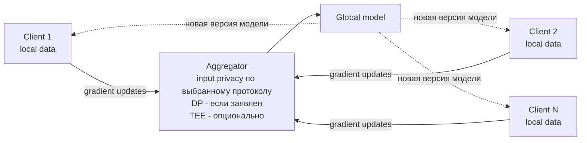
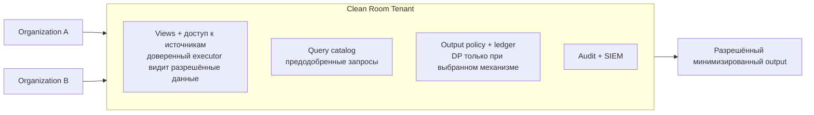

<a id="privacy-enhancing-technologies-pet-dla-mlsec"></a>

# Privacy Enhancing Technologies (PET) для MLSec

> Версия: 2.1 · Обновлено: 2026-05-29 · Теги: DP, FL, TEE, Homomorphic Encryption, SMPC, clean rooms, SGX, TDX · Tier: 1-2
>
> **TL;DR**. Differential Privacy (Opacus), Federated Learning (Flower, NVFlare), TEE (SGX, TDX, SEV-SNP), Homomorphic Encryption, SMPC, data clean rooms. В версии 2.0: интерактивный сценарий (выбор PET под use case) и расширенный гайд "С чего начать по вашей роли" (5 ролей: Data Privacy Engineer, ML Engineer, Platform, Юрист, Product Owner).

**Тематическая актуализация 2026-11-13**: единица защиты и соседство в DP, накопление privacy loss, подтверждения для выпуска и границы гарантий. Прикладные шаблоны ниже не устанавливают правовой статус данных или универсальный допустимый ε.

<a id="0-soderjanie"></a>

## 0. Содержание

1. Differential Privacy (DP)
2. Federated Learning (FL)
3. Trusted Execution Environments (TEE) и confidential computing
4. Homomorphic Encryption (HE)
5. Secure Multi-Party Computation (SMPC)
6. Data clean rooms
7. Специфика РФ и ГОСТ-криптографии

PET это набор технологий для снижения раскрытия чувствительных данных при обучении, вычислениях и публикации результатов. Защищаемый объект и доверенные стороны у них различаются: скрытый от администратора input не означает защищённый output. Комбинацию выбирают по модели угроз и проверяют на фактическом пути данных.

---

<a id="1-differential-privacy-dp"></a>

## 1. Differential Privacy (DP)

<a id="11-idea"></a>

### 1.1 Идея

DP — свойство рандомизированного механизма выпуска результата; DP-SGD — один из способов обучения с этой гарантией. Для заранее определённых соседних наборов D и D′ и любого множества выходов S выполняется:

`Pr[M(D) ∈ S] ≤ exp(ε) × Pr[M(D′) ∈ S] + δ`.

Соседство определяет, чьё участие защищено: одна запись, все записи человека или весь вклад клиента FL. Меньший ε при тех же δ, единице защиты и условиях механизма означает более строгую границу privacy loss. δ — добавочный член неравенства; его нельзя интерпретировать как измеренный процент утекших записей. Ни ε, ни δ не являются оценкой вероятности конкретной MIA-атаки.

<a id="12-kogda-primenat_"></a>

### 1.2 Когда применять

- Обучение на наборах с ПДн, когда нельзя гарантировать отсутствие утечки через модель
- Модели, подверженные membership inference или model inversion
- Модели, где есть требование регуляторов или клиентов по доказуемой приватности
- Federated learning как добавочный слой защиты

<a id="13-instrumenty"></a>

### 1.3 Инструменты

| Библиотека | Фреймворк | Лицензия | Комментарий |
|-----------|-----------|----------|-------------|
| Opacus | PyTorch | [Apache-2.0 · df040e4](https://github.com/meta-pytorch/opacus/blob/df040e4a1594ee8ae706679db06c9981eec9bf4c/LICENSE) | От Meta, продакшн-готовый |
| TensorFlow Privacy | TF | [Apache-2.0 · 1bbd795](https://github.com/tensorflow/privacy/blob/1bbd79511915878a5f6eb402d59e745ad05da132/LICENSE) | От Google |
| PyTorch-DP | PyTorch | Историческое обозначение; проверить выбранный артефакт | Не отдельная квалифицированная текущая поставка; для Opacus см. запись выше |
| diffprivlib | Sklearn-like | [MIT · 79a2558](https://github.com/IBM/differential-privacy-library/blob/79a2558146eee4d9dfab279ef6bdb1e5ef576591/LICENSE.md) | Для классических ML-моделей |
| Google DP | C++/Python | [Apache-2.0 · 95c78d9](https://github.com/google/differential-privacy/blob/95c78d929b1d4e7ff1ab54e6c4977db1c38d5f69/LICENSE) | Библиотека для агрегированных запросов |

<a id="14-prakticeskoe-primenenie"></a>

### 1.4 Практическое применение

Лицензионные ссылки в §1.3, §2.4 и §4.4 ведут к root LICENSE конкретного SHA, проверенного 13.11.2026. Это выбранные source revisions, не утверждение «последний релиз», не версии выполненных примеров и не лицензия всего dependency tree. Для выпуска владелец зависимости фиксирует package / edition / version / digest, сохраняет LICENSE и NOTICE из фактической поставки; Legal проверяет условия распространения и отдельно коммерческие расширения, сервис и патентные вопросы.

Минимальный пример Opacus (концептуально):

```python
from opacus import PrivacyEngine

privacy_engine = PrivacyEngine(accountant="prv")
model, optimizer, train_loader = privacy_engine.make_private(
    module=model,
    optimizer=optimizer,
    data_loader=train_loader,
    noise_multiplier=1.1,
    max_grad_norm=1.0,
)

# Run the validated DP-compatible training loop here.
# Query accounting for the steps actually completed.
epsilon = privacy_engine.get_epsilon(delta=1e-5)
print(f"(ε = {epsilon}, δ = 1e-5)")
```

Ключевые параметры: `noise_multiplier`, `max_grad_norm`, sampling scheme/rate, фактическое число шагов и выбранный δ. Совместимость модели, preprocessing и randomness проверяется отдельно. Учебный фрагмент не задаёт user-level DP и не доказывает приватность всего data pipeline.

<a id="kal_kulator-masstab-suma-pri-fiksirovannom-clipping"></a>

#### <span id="kal_kulator-noise_multiplier-vs-accuracyprivacy-v-dp-sgd" aria-hidden="true"></span>Калькулятор: масштаб шума при фиксированном clipping

```widget:threshold-slider
{
  "id": "ch17-dp-noise",
  "title": "DP-SGD: σ, clipping и шум суммы",
  "description": "Учебная арифметика для фиксированного batch B=256 и clipping C=1.0: стандартное отклонение гауссова шума суммы равно σC; после деления на B — σC/B. Здесь не вычисляются ε, accuracy, MIA или compliance. Для privacy guarantee нужен accountant с параметрами реального запуска.",
  "min": 0.5,
  "max": 4,
  "step": 0.05,
  "default": 1.1,
  "unit": " σ",
  "axisLabel": "noise_multiplier (σ)",
  "tracks": [
    { "label": "Стандартное отклонение шума суммы, C=1", "compute": "x", "format": "fixed2", "tone": "info", "hint": "Это параметр распределения шума одной координаты, а не наблюдаемый шум конкретного шага." },
    { "label": "Дисперсия шума суммы", "compute": "x * x", "format": "fixed2", "tone": "info", "hint": "Дисперсия равна квадрату стандартного отклонения." },
    { "label": "Шум среднего: std × 1000, B=256", "compute": "1000 * x / 256", "format": "fixed2", "tone": "warn", "hint": "Упрощённый фиксированный batch. В реальном DP-SGD надо проверить sampling и нормировку реализации." }
  ],
  "regions": [
    { "from": 0.5, "to": 1.5, "label": "Меньший масштаб шума в учебной схеме; ε неизвестен без accountant", "tone": "info" },
    { "from": 1.5, "to": 4, "label": "Больший масштаб шума; полезность проверяется измерением, не этим ползунком", "tone": "warn" }
  ]
}
```

<a id="15-ogranicenia"></a>

### 1.5 Ограничения

- Возможная потеря полезности зависит от задачи, масштаба данных, модели и бюджета; фиксированный процент без измерения не задаётся
- Требует больше данных для того же качества
- Tuning сложнее (epsilon budget нужно заранее планировать)
- Для sequence моделей (LLM) DP обучение требует специфических техник

<a id="16-ceklist"></a>

### 1.6 Чеклист

- [ ] Проведена оценка риска: оправдано ли DP для этой модели
- [ ] Утверждены единица защиты, соседство, ε и δ с обоснованием для сценария
- [ ] Настроен clipping (max_grad_norm) и noise
- [ ] Проверена просадка качества на validation
- [ ] В Model Card указаны граница механизма, accountant, накопленный бюджет и исключения

<a id="konstruktor-pet-strategii-pod-vas-ml-proekt"></a>

#### Конструктор PET-стратегии под ваш ML-проект

Включайте PETs, которые рассматриваете для проекта. Баллы показывают выбранные компоненты учебного плана, а не процент приватности. Избыточное число технологий не заменяет проверку единицы защиты, доверенных сторон и реализационных предпосылок.

```widget:policy-builder
{
  "id": "ch17-pet-strategy",
  "title": "PET-стратегия проекта",
  "description": "План выбора PET по модели угроз. Отметки компонентов не подтверждают гарантии и не задают универсальную комбинацию. FL применимость и условия защиты updates рассматриваются отдельно: компонент не вычисляет условие «если FL, то secure aggregation».",
  "scoreLabel": "Компоненты учебного плана",
  "scoreMax": 100,
  "groups": [
    {
      "name": "Training privacy",
      "items": [
        { "id": "dp-sgd", "label": "DP-SGD с утверждёнными unit, ε и δ", "weight": 12, "recommended": true, "description": "Проверяется граница privacy loss по выбранному соседству, а не универсальный порог для ПДн." },
        { "id": "dp-fl", "label": "DP в Federated Learning", "weight": 8, "description": "Применяется только при выбранном FL-сценарии; unit, доверие к серверу и защита updates обосновываются отдельно." },
        { "id": "synthetic-data", "label": "Synthetic data с отдельной проверкой выпуска", "weight": 5, "description": "CTGAN не становится DP автоматически; у DP-генератора фиксируются механизм, unit, accountant и граница post-processing." }
      ]
    },
    {
      "name": "Federated training",
      "items": [
        { "id": "fl-flower", "label": "FL platform (Flower / NVIDIA FLARE / TFF)", "weight": 8, "description": "Для распределённого обучения по филиалам / устройствам." },
        { "id": "secure-agg", "label": "Secure Aggregation (Bonawitz 2017)", "weight": 6, "recommended": true, "description": "При применимости защищает индивидуальные updates от просмотра агрегатором в рамках допущений протокола; не универсальная обязательная мера для любого FL." },
        { "id": "fl-byzantine", "label": "Byzantine-robust aggregation (FLTrust / FLAME)", "weight": 5, "description": "Защита от malicious clients (model poisoning через FL)." }
      ]
    },
    {
      "name": "Inference privacy",
      "items": [
        { "id": "tee-cpu", "label": "TEE для CPU inference (Intel TDX / AMD SEV-SNP)", "weight": 8, "description": "Confidential computing для классических ML-моделей в cloud." },
        { "id": "tee-gpu", "label": "TEE для GPU (NVIDIA H100 Confidential Compute)", "weight": 8, "description": "Для LLM / CV inference в cloud с гарантиями integrity." },
        { "id": "he-batch", "label": "HE для batch processing (PALISADE / Concrete-ML)", "weight": 4, "description": "Только для критичных batch use cases — high latency." }
      ]
    },
    {
      "name": "Multi-party computation",
      "items": [
        { "id": "smpc-2pc", "label": "Secure 2PC (Garbled Circuits / EMP-toolkit)", "weight": 5, "description": "Для двусторонней private computation (PSI, joint scoring)." },
        { "id": "smpc-multi", "label": "Multi-party SMPC (MP-SPDZ / Sharemind)", "weight": 4, "description": "Для consortium 3+ организаций." },
        { "id": "clean-room", "label": "Data Clean Room (Snowflake / AWS / Yandex)", "weight": 5, "description": "Для аналитики без physical data movement." }
      ]
    },
    {
      "name": "Compliance + governance",
      "items": [
        { "id": "fl-applicability-reviewed", "label": "Применимость FL и защита updates проверены отдельно", "weight": 0, "description": "Зафиксировано «FL не используется» либо выбран FL и документированы угрозы / допустимость просмотра updates, необходимость secure aggregation и её проверка. Этот checkbox означает review, а не включение secure aggregation." },
        { "id": "privacy-budget", "label": "Ledger накопленного privacy loss по защищаемым единицам", "weight": 5, "default": true, "description": "Учитываются перекрывающиеся наборы, все раскрываемые результаты и возобновление запусков. Квартал не обнуляет расход." },
        { "id": "model-card-privacy", "label": "Privacy section в Model Card", "weight": 3, "default": true, "description": "Privacy guarantees в model documentation." },
        { "id": "dpia", "label": "Оценка privacy-рисков и применимости DPIA / FRIA", "weight": 6, "default": true, "recommended": true, "description": "Зафиксированы риск и применимые правовые основания оценки; DPIA / FRIA не объявляются обязанностью любого российского проекта." }
      ]
    }
  ],
  "rules": [
    { "id": "must-fl-review", "type": "require-all", "items": ["fl-applicability-reviewed"], "message": "Не отмечен отдельный review применимости FL / защиты updates. Для проекта без FL достаточно документировать неприменимость; secure aggregation не требуется этим конструктором безусловно." },
    { "id": "must-pii-protection", "type": "require-any", "items": ["dp-sgd", "dp-fl", "synthetic-data"], "message": "В учебном плане не выбрана мера против training-data leakage. Выбор и достаточность требуют модели угроз; сам checkbox ничего не доказывает." },
    { "id": "must-dpia", "type": "require-all", "items": ["dpia"], "message": "Не отмечена оценка privacy-рисков / применимости формальной оценки. Проведите её по контексту проекта." },
    { "id": "min-coverage", "type": "min-score", "threshold": 50, "message": "Выбрано мало компонентов учебного плана. Необходимость каждого компонента определяется моделью угроз, а не отраслевым процентом." }
  ],
  "thresholds": [
    { "from": 0, "to": 25, "label": "Начальный набор компонентов — определить модель угроз", "tone": "warn" },
    { "from": 25, "to": 50, "label": "Часть компонентов выбрана — проверить обоснование", "tone": "info" },
    { "from": 50, "to": 75, "label": "Расширенный набор — проверить совместимость и расходы", "tone": "info" },
    { "from": 75, "to": 100, "label": "Много компонентов — проверить необходимость; гарантии ещё не подтверждены", "tone": "info" }
  ]
}
```

---


<a id="17-privacy-threat-model-kogo-zasisaet-vybrannyj-mehanizm"></a>

### 1.7 Privacy threat model: кого защищает выбранный механизм

**Проблема**: клиника заявляет «patient privacy», но в DP-accountant одна строка считается одним независимым примером. У пациента десятки посещений; удаление одной строки не моделирует отсутствие всего пациента. Маленький ε для record-level соседства нельзя подписать как тот же ε для user-level защиты.

Перед настройкой шума ML Engineer и Data Privacy Engineer заполняют карточку:

| Поле | Что зафиксировать | Негативная проверка |
|------|-------------------|---------------------|
| Единица защиты | Запись, человек, домохозяйство, участник FL; способ объединения событий | Один человек с несколькими ID не должен обходить contribution bound |
| Соседство | Добавление/удаление одной единицы либо замена её вклада | Accountant и clipping используют одно и то же определение |
| Вклад | Максимум событий, строк, групп и диапазон значений на единицу | Повторная загрузка и дубликаты не увеличивают вклад незаметно |
| Наблюдатель | Получатель модели, API-пользователь, aggregator, администратор источника | Central DP не скрывает raw data от доверенного training operator |
| Выход механизма | Модель, статистика, адаптер, checkpoint, метрики отбора | Вспомогательный файл не раскрывает необработанные значения |
| Граница данных | Источники, preprocessing, validation и возможные внешние знания | Не-DP словарь редких категорий не публикуется рядом с DP-моделью |

**Пример соседства**:

- Record-level add/remove: D′ получается удалением одной строки посещения. Защищается вклад строки.
- Patient-level add/remove: D′ получается удалением всех посещений одного пациента. Для такой гарантии нужен механизм с ограничением и учётом вклада пациента; одного per-sample clipping недостаточно.
- Client-level FL: единица — участник обучения. Если участник — целая клиника, гарантия не становится автоматически индивидуальной гарантией для каждого пациента с теми же параметрами.

**Рекомендации ИБ**:

1. Связать privacy unit с целью защиты в DPIA / Model Card. Если цель «невозможность уверенно установить участие человека», не подменять её защитой одного технического события.
2. Выполнить ограничение вклада **до** приватного механизма и проверить, какая чувствительность используется. Правила clipping и preprocessing должны входить в versioned pipeline.
3. Не сравнивать ε двух решений, пока не сопоставлены соседство, unit, δ, доверенные стороны и граница выпуска. «У поставщика ε ниже» без этих полей не является сравнением защиты.
4. Исключить автоматический сброс unit при смене квартала, устройства или псевдонима. Повторяющиеся люди и коррелированные события требуют анализа композиции.

Основа: [NIST SP 800-226, Guidelines for Evaluating Differential Privacy Guarantees](https://csrc.nist.gov/pubs/sp/800/226/final), финальная редакция марта 2025; проверено 13.11.2026. Таблица — внутренний шаблон проектирования, а не стандарт сертификации.

<a id="18-ledger-i-accounting-ne-terat_-uje-potracennyj-budjet"></a>

### 1.8 Ledger и accounting: не терять уже потраченный бюджет

Бюджет принадлежит механизму и защищаемым данным, а не одному графику обучения. Если получатель видит несколько результатов, privacy loss анализируется для их совместного выпуска.

| Событие | Что учитывать | Что нельзя считать бесплатным |
|---------|---------------|--------------------------------|
| Продолжение обучения | Фактические шаги, sampling, σ и состояние accountant | Resume с нулевым accountant после загрузки весов |
| Несколько моделей на пересекающихся людях | Общую композицию раскрываемых результатов | Новое имя датасета или модели |
| Тюнинг и отбор | Механизмы доступа к private validation и публикуемые метрики | Публикацию точной accuracy по малой приватной группе |
| Квартальный отчёт | Состав защищаемых единиц и связь с прошлыми окнами | Календарную смену даты при тех же людях |
| Синтез из уже выпущенного DP-генератора | Проверить, что используются только его выходы и независимая randomness | Фильтр, который снова обращается к исходным приватным строкам |

**Простая композиция**: для k последовательно раскрываемых механизмов с общей единицей защиты `(Σεᵢ, Σδᵢ)` даёт базовую верхнюю границу. Это не «advanced composition». Более точная оценка использует согласованный accountant и предпосылки механизма. Parallel composition применима только при обоснованном непересечении **защищаемых единиц**; разбиения по строкам недостаточно, если один человек попал в обе части.

Пример ledger (внутренняя схема, не API Opacus):

```yaml
privacy_ledger:
  protected_population_ref: registry://patients/cohort-r7
  unit: patient
  adjacency: add_remove_all_contributions
  contribution_policy_ref: policy://patient-events/r3
  mechanism_ref: registry://dp-training/patient-level-r2
  accountant:
    implementation_ref: lock://privacy-accountant/approved-build
    state_ref: evidence://training/run-42/accountant-state
    target_delta: 0.000001
  releases:
    - release_id: cohort-model-r5
      mechanism_run_ref: evidence://training/run-42
      accounted_parameters_ref: evidence://training/run-42/privacy-report
      artifact_manifest_ref: evidence://releases/cohort-model-r5
  approval:
    owner_role: data-privacy-engineer
    decision_ref: approvals://cohort-release/r5
```

Число `target_delta` иллюстративно, не нормативный рецепт. Сам ledger не доказывает user-level DP: у `mechanism_ref` должны быть соответствующие алгоритм, ограничения вклада и расчёт.

Для конкретного Opacus-проекта фиксируются версия, явно выбранный `accountant`, sampling scheme, ожидаемый sample rate, δ и фактическая история шагов. В текущем [API PrivacyEngine](https://opacus.ai/api/privacy_engine.html) default accountant — `prv`; [get_noise_multiplier](https://opacus.ai/api/accounting/utils.html) требует также sample rate и epochs/steps. Поэтому формула «σ=1.1 ⇒ ε=3» без запуска не применяется. Сохранение/восстановление состояния проверяется в тесте с разрывом обучения; в релизном окружении отдельно проверяются режим randomness и зависимости secure mode. Источники проверены 13.11.2026.

**Чеклист accounting**:

- [ ] Непрерывный запуск и resume дают согласованную историю privacy loss при тех же фактических шагах.
- [ ] Смена logical batch / gradient accumulation не меняет число приватных шагов незаметно для accountant.
- [ ] Метрики и промежуточные артефакты включены в manifest выпуска; что не раскрывается — явно ограничено доступом.
- [ ] На исчерпании бюджета предусмотрен останов обучения / выпуска, а не автоматическое увеличение ε.
- [ ] Решение о новом выпуске учитывает прошлые результаты на пересекающихся единицах; бюджет не обнуляется cron-задачей.

<a id="19-formal_naa-garantia-i-empirical-privacy-audit"></a>

### 1.9 Формальная гарантия и empirical privacy audit

DP ограничивает добавочную информацию об участии выбранной единицы. Она не обещает, что модель не знает публичного факта о человеке, не угадает распространённый диагноз или не выдаст секрет, переданный ей **при inference**. Утечка через RAG, logs, tool response или сырой training checkpoint находится вне гарантии опубликованного DP-механизма, если не включена в его анализ.

| Проверка | Что подтверждает | Чего не подтверждает |
|----------|------------------|----------------------|
| Проверка DP-реализации и accountant | Соответствие заявленной границе при указанных предпосылках | Правомерность исходного сбора данных |
| MIA / extraction / attribute inference | Найденный эмпирический путь раскрытия при заданном доступе атакующего | Отсутствие всех возможных атак, если результат близок к random |
| Utility на real holdout | Полезность для выбранной задачи и сегментов | Приватность публикации |
| Проверка ACL, egress и log redaction | Ограничение конкретных побочных каналов | DP для неучтённых выходов |

**Measurement evidence**: фиксировать train/holdout split по privacy unit, threat model атакующего, доступ к API/весам, версии атак, количество попыток, baseline без целевого участия, TPR при выбранном низком FPR и доверительные интервалы. Один средний AUC около 0.5 может скрыть уязвимость редкой группы; он не называется «perfect privacy». Неудача слабого attack harness не заменяет формальную проверку DP.

**Негативный прогон перед выпуском**:

- [ ] Синтетический canary попадает в raw debug artifact: manifest и DLP обнаруживают незаявленный выход.
- [ ] В private preprocessing добавляется выгрузка уникальных категорий: выпуск блокируется до accounting или исключения файла.
- [ ] После DP-training в RAG подключается исходная карточка пациента: проверка доступа блокирует её для чужого субъекта; ε обучения не используется как оправдание.
- [ ] Для малого сегмента не хватает положительных/отрицательных примеров MIA: результат отмечен `inconclusive`, а не `passed`.

Решение о выпуске подписывается по отдельным privacy, utility и access-control результатам. См. [14. Governance](14-model-risk-governance.md) и [28. Синтетические данные](28-synthetic-data-security.md). Обзор реализации и модели угроз опирается на [NIST SP 800-226](https://csrc.nist.gov/pubs/sp/800/226/final); методика измерения выше — предлагаемый внутренний protocol.

<a id="110-membership-v-inference-cache-otdel_nyj-privacy-audit"></a>

### 1.10 Membership в inference cache: отдельный privacy audit

**TL;DR.** Наблюдение «этот prefix уже обрабатывался сервером» относится к состоянию serving, а не к участию человека в training dataset. DP-training, шифрование хранилища и отсутствие raw prompt в логах сами по себе не скрывают hit/miss или общую конкуренцию за ресурсы.

Prefix/KV cache переиспользует вычисленное состояние входа; semantic answer cache возвращает готовый результат; provider prompt cache имеет собственные правила usage и billing. Их нельзя проверять одним hit ratio. В исследованном [vLLM commit](https://github.com/vllm-project/vllm/blob/4ba787ec9959e566d3b587a796dff07673324da5/docs/usage/security.md#L580) `cache_salt` уменьшает риск cross-group prefix reuse, но не создаёт изоляцию scheduler и всех caches процесса. Salt не является DP-механизмом и не гарантирует отсутствие любого timing channel.

**Протокол проверки на собственных данных**:

1. Создайте два синтетических principals A/B и private prefix без реальных секретов. Зафиксируйте release, block/length classes, разрешённую sharing policy и нагрузку.
2. A прогревает prefix. В случайном порядке выполните разрешённые повторы A и запросы B, добавив cold controls и baseline с отключённым reuse. Разделите полный/частичный block prefix, LoRA и media identity; короткий вход без cacheable block не заменяет проверку длинного prefix.
3. Сопоставьте runtime evidence о cached tokens/blocks с внешними TTFT и stream gaps. Учтите очередь, batching, transport, sample size и доверительные интервалы; заранее задайте критерий различимости.
4. Проверьте полезную функцию: A сохраняет разрешённый reuse и корректность ответа. Негативный случай: B не получает hit на private prefix A; подмена клиентского salt не меняет серверный namespace. Отдельно проверьте отсутствие телеметрии: результат тогда unknown.

**Evidence**: схема эксперимента, версии, классы входов, агрегаты hit/miss и распределения задержек без самих salts/prompts. Отсутствие статистически значимого различия на малой выборке — inconclusive; оно не доказывает отсутствие side channel. Этот protocol требует отдельного согласованного runtime-стенда: pure hash fixtures подтверждают состав ключа, но не временную изоляцию работающего GPU-сервера.

**Исследовательские варианты, актуальные на 13.11.2026**:

| Работа | Полезная идея | Граница результата |
|---|---|---|
| [CacheSolidarity, v3 от 29.10.2026](https://arxiv.org/html/2603.10726v3) | Selective isolation по cross-user prefix overlap | Теорема условная; §4.1 исключает first-entry и first-try/unflagged hits |
| [Mirage, v1 от 07.11.2026](https://arxiv.org/html/2611.10756v1) | Gateway emission equalization и учёт prefix probes | Условная гарантия для наблюдаемого stream; Appendix I обсуждает sensitivity routing, calibration и ещё не измеренные издержки multi-replica coordination |

Это research designs, а не shipping flags vLLM. Их benchmark-эффект нельзя переносить в SLA без своего испытания; произвольная задержка или jitter не наследуют доказательство авторов. Практические namespace/remote-transfer границы — [глава 05](05-stage3-model-deployment.md#kv-cache-trust), независимые наблюдения — [глава 06](06-stage4-operations-platform.md#kv-cache-observability).

<a id="2-federated-learning-fl"></a>

## 2. Federated Learning (FL)

<a id="21-idea"></a>

### 2.1 Идея

Обучение распределено между клиентами (устройства, филиалы, организации). В типовом horizontal FL исходные записи остаются локально, а сервер агрегирует updates — градиенты или дельты параметров. Но updates, metrics и служебные metadata тоже являются передаваемыми данными и могут раскрывать сведения. Код job, разрешённые outputs и egress проверяются отдельно; установка FL-платформы сама по себе не запрещает отправку raw records. Для vertical FL дополнительно фиксируются alignment и обмен между участниками.

<a id="22-szenarii"></a>

### 2.2 Сценарии

- Межбанковское обучение моделей AML без обмена клиентскими данными
- Обучение на пользовательских устройствах (клавиатуры, рекомендации)
- Медицинские модели на данных из разных клиник
- Промышленное обучение на данных с разных заводов

<a id="23-riski"></a>

### 2.3 Риски

- Gradient leakage: при определённых updates, модели и доступе атакующий может восстановить training examples; [DLG](https://arxiv.org/abs/1906.08935) показывает такую возможность, а не неизбежность для любого FL-run
- Model poisoning от malicious клиента
- Sybil attacks (много фейковых клиентов)
- Privacy unit: клиент или пример в клиенте

Меры:

- Secure aggregation: раскрывается разрешённый aggregate, individual updates скрываются в пределах выбранного протокола и его collusion/dropout assumptions; согласованность модели и cohort проверяется отдельно (§2.7)
- DP с явно выбранным уровнем: record / user / client. DP-SGD внутри клиники не становится client-level DP автоматически
- Robust aggregation (trimmed mean, median, Krum) против poisoning
- Client authentication + reputation

Secure aggregation и robust aggregation нельзя считать автоматически совместимыми: первый механизм скрывает индивидуальные updates, второй часто требует их анализа. Для выбранного протокола проверяются видимость вкладов, допустимое число сговорившихся участников, dropout и место clipping/noise. Комбинация «FL + DP + TEE» без этих предпосылок не задаёт единую гарантию.

<a id="24-instrumenty"></a>

### 2.4 Инструменты

| Платформа | Лицензия | Комментарий |
|-----------|----------|-------------|
| Flower (FLWR) | [Apache-2.0 · 9de7cc5](https://github.com/adap/flower/blob/9de7cc5b54972ef67129c77953c7aa3ee36f6e3d/LICENSE) | Документация 1.43: ClientApp/ServerApp, simulation и deployment; SecAgg workflow/mod подключаются отдельно |
| NVFlare | [Apache-2.0 · df74d77](https://github.com/NVIDIA/NVFlare/blob/df74d775589f7f982b8dfe8fecc9f4567343d7e2/LICENSE) | Документация 2.9: cross-site provisioning, site policies, auth/filters и deployment paths; Confidential Federated AI отдельно помечен Technical Preview |
| FedML | [Apache-2.0 · 03e11df](https://github.com/FedML-AI/FedML/blob/03e11dfee69a458a9820ec4e05b531a5f935eb2b/LICENSE) | Академические корни, широкий набор алгоритмов |
| TensorFlow Federated | [Apache-2.0 · 206711d](https://github.com/google-parfait/tensorflow-federated/blob/206711d4ac06de3c939fc594862fd8f91a10cf72/LICENSE) | От Google |
| PySyft | [Apache-2.0 · ca66134](https://github.com/OpenMined/PySyft/blob/ca661342f019b03fa7eefc2956024cad26b2412d/LICENSE) | OpenMined, интеграция с PyTorch |
| FATE | [Apache-2.0 · 5a06d9e](https://github.com/FederatedAI/FATE/blob/5a06d9e4c4cd7ab97a5c8357828adbffaca87785/LICENSE) | WeBank, ориентирован на межорганизационный FL |

<a id="25-arhitektura"></a>

### 2.5 Архитектура

Apache-2.0 в таблице относится к указанному открытому репозиторию на выбранной revision. Hosted platform, enterprise edition, дополнительные модули и условия поддержки проверяются отдельно; одинаковый бренд не переносит лицензию исходного кода на весь сервис.



<a id="26-ceklist"></a>

### 2.6 Чеклист

- [ ] Определён сценарий: horizontal FL (общие features, разные пользователи) или vertical (разные features, общие пользователи)
- [ ] Выбраны версия и features платформы по integration/operations evidence; бренд не разделяет автоматически pilot и production
- [ ] Проверен выбранный input-privacy протокол, его модель доверия, collusion/dropout и условия abort (§2.7)
- [ ] Если заявлен DP — подтверждены unit/соседство, механизм и accounting (§1.8); cryptographic input privacy не называется DP
- [ ] Настроены client authentication, logical participant identity и admission в round/cohort
- [ ] Проверены poisoning controls, их предпосылки и совместимость с видимостью updates в выбранной aggregation-схеме
- [ ] Заключены соглашения с участниками FL-консорциума

<a id="27-dopusk-raunda-modelcohort-identity-i-granizy-secure-aggregation"></a>

### 2.7 Допуск раунда: model/cohort identity и границы secure aggregation

**TL;DR.** Secure aggregation защищает входы конкретного вычисления при его предпосылках; она не доказывает автоматически, что сервер выдал всем одну допустимую модель и один контекст раунда. В работе [Pasquini et al., CCS 2022](https://arxiv.org/html/2111.07380v5) malicious server использует разные model parameters, а SA рассматривается как идеальная функция. Это атака на применение SA в FL, не взлом её криптографии. [Bonawitz et al., CCS 2017](https://research.google/pubs/practical-secure-aggregation-for-privacy-preserving-machine-learning/) доказывают свойства протокола и для malicious-server модели при своих условиях; SA нельзя описывать ни как защиту только от honest-but-curious, ни как гарантию безопасности любого FL workflow.

Ниже — предлагаемая методика допуска, а не реализованный SDK wrapper или доказанный новый протокол. Пример относится к horizontal FL с общей base model. Если проект предусматривает разные role-specific модели, проверяется заранее утверждённое отображение role → bundle, а не произвольное требование одинаковых байтов всем ролям.

| Граница раунда | Что фиксировать до отправки private-derived update |
|---|---|
| Model/training identity | Утверждённый bundle: architecture/weights, code/loss/config/preprocessing, protocol revision; job/run/round ID и freshness |
| Общая согласованность | Как участники проверяют один допустимый manifest/context в принятой adversary model. Подписи сервера под разными bundles сами по себе не исключают split view; нужен проверяемый общий reference и явная граница доверия |
| Cohort identity | Logical participants, credentials/revocation, admission и duplicate/Sybil policy. Число процессов или сертификатов не равно числу независимых честных вкладов или privacy units |
| Secure aggregation | Protocol/version, adversary/collusion model, shares/threshold/neighbor graph и фактический surviving set; что считается допустимым dropout и когда round прекращается |
| Output и recovery | Разрешённые aggregate/weights, counts, metrics и debug artefacts; повторные/пересекающиеся cohorts и retry. Неопределённый round не переключается молча на plain FedAvg |

Privacy unit определяется задачей: пример, человек с несколькими записями и организация-клиент не взаимозаменяемы. Количество честных вкладов и threshold берутся из выбранного proof/config; универсального безопасного минимума эта таблица не вводит. Если применяется DP, accounting остаётся в §1.8, а не выводится из числа клиентов.

**Приёмочные случаи**:

| Случай | Ожидаемое evidence |
|---|---|
| Positive: все admitted участники подтверждают один разрешённый bundle/context, dropout остаётся в условиях протокола | Сопоставленные receipts, effective cohort/graph и параметры, trace всех стадий; aggregate на синтетических vectors сопоставлен с controlled reference в пределах quantization/error contract |
| Negative: target получает другой model/loss/config, хотя server signatures валидны | Общая consistency view обнаруживает несовпадение; клиент не отправляет update по недопущенному контексту. Один local hash без общей reference этого не доказывает |
| Negative: stale round, подменённая или повторная logical identity, изменение cohort после фиксации контекста | Admission/replay rejection по выбранной схеме; trace и отсутствие незаявленного update/output. Возможность сервера создавать Sybils отдельно включена в threat model |
| Negative: недостаточно survivors/shares либо protocol timeout | Abort/unknown, нет выдачи individual updates и незаявленного fallback; retry получает новый допустимый round context |
| Negative: aggregate и известные colluding contributions или adaptive overlapping cohorts позволяют изолировать target | Release policy отклоняет недопустимое раскрытие либо меняется принятая схема. Успех вычисления суммы сам по себе не означает privacy pass |

**Версионные ориентиры**. В [Flower 1.43](https://flower.ai/docs/framework/1.43/en/ref-api/flwr.server.workflow.SecAggPlusWorkflow.html) `SecAggPlusWorkflow` работает вместе с client `secaggplus_mod`; `num_shares` и `reconstruction_threshold` имеют семантику count/proportion. Фактические integer counts, graph, quantization и abort проверяются для закреплённой версии. `clipping_range` перед quantization не заменяет DP contribution clipping/noise или robust aggregation. [Официальный пример](https://flower.ai/docs/examples/flower-secure-aggregation.html) — отдельная конфигурация, не свойство любого FedAvg.

В [NVFlare, документация 2.9](https://nvflare.readthedocs.io/en/main/system_architecture/security_overview.html), site authorization/filters и HE/TEE — разные пути с разным trust. [Confidential Federated AI](https://nvflare.readthedocs.io/en/main/user_guide/confidential_computing/index.html) помечен Technical Preview; статус этой функции не переносится на весь продукт или наоборот. Документация прочитана 13.11.2026; deployment фиксирует собственный lock/revision. Здесь не исполнялись Flower/NVFlare, обучение или криптографический протокол. Pure metadata fixture проверяет лишь admission schema, не confidential aggregation или защиту от malicious server.

---

<a id="3-trusted-execution-environments-tee"></a>

## 3. Trusted Execution Environments (TEE)

<a id="31-idea"></a>

### 3.1 Идея

TEE предоставляет аппаратно поддерживаемую границу изоляции в пределах модели угроз конкретной платформы. Enclave и confidential VM имеют разную trusted computing base: например, guest OS и администратор внутри CVM могут оставаться доверенными. Аттестация сообщает измерения и состояние платформы; verifier сопоставляет их с политикой допуска до выдачи секретов. Это не доказательство отсутствия ошибок приложения или безопасного поведения модели.

<a id="32-tehnologii"></a>

### 3.2 Технологии

| Технология | Производитель | Комментарий |
|-----------|---------------|-------------|
| Intel SGX | Intel | Enclave для выбранного приложения; TCB, доступная защищённая память и поддержка workload проверяются отдельно |
| Intel TDX | Intel | Confidential VM: guest OS и приложение входят в доверенную границу; не просто «SGX следующего поколения» |
| AMD SEV-SNP | AMD | Confidential VM с защитой памяти и её целостности в пределах модели угроз конкретной платформы/firmware |
| ARM CCA | ARM | Confidential Compute Architecture |
| NVIDIA Confidential Computing | NVIDIA | Защита поддерживаемого CPU/GPU path зависит от поколения, режима и interconnect; см. карту TCB в §3.8 |

<a id="33-primenenia-v-ml"></a>

### 3.3 Применения в ML

- Обучение на чувствительных данных при согласованном размещении plaintext, ключей и output
- Совместное вычисление в выбранном доверенном executor: это другое предположение, чем распределённый SMPC-протокол
- Защита весов от части инфраструктурных наблюдателей; output-based extraction и разрешённый вредоносный код внутри TCB проверяются отдельно
- Federated aggregation внутри TEE при явно принятом доверии к агрегатору и key-release policy; это не автоматически тот же протокол, что cryptographic secure aggregation
- Signal processing (биометрия, медицинские данные)

<a id="34-open-source-stek"></a>

### 3.4 Open source стек

- Confidential Containers (CNCF sandbox)
- [Kata Containers](https://github.com/kata-containers/kata-containers/blob/main/docs/design/README.md): контейнеры внутри VM; Confidential Containers связывает поддерживаемый TEE backend с attestation/key release, а не превращает любой контейнер в enclave
- Open Enclave SDK (Microsoft)
- Gramine для запуска unmodified Linux apps в SGX
- Occlum как LibOS для enclave
- Enarx (Red Hat) для WebAssembly в TEE
- Attestation implementations: Keylime, Veraison; совместимость evidence formats и поддерживаемых платформ проверяется по версии

[RATS / RFC 9334](https://www.rfc-editor.org/info/rfc9334/) — архитектура remote attestation со статусом **Informational RFC**, а не готовый verifier. Она различает Attester, Verifier и Relying Party: measurement становится основанием допуска только после appraisal по выбранной policy. Установка SDK не создаёт эту policy и не определяет, кому выдаётся ключ.

<a id="35-ogranicenia"></a>

### 3.5 Ограничения

Лицензия TEE-стека не едина: firmware, runtime, SDK, verifier, контейнер и облачная услуга — отдельные компоненты. Platform owner сохраняет их версии / digests и документы поставки; OSPO / Legal проверяют LICENSE / NOTICE каждого реально распространяемого компонента. Перечень проектов выше не является утверждением общей Apache / MIT-лицензии всей сборки.

- Зависимость от железа (закупки, сертификация)
- Ограничения памяти, I/O и поддерживаемого workload; overhead измеряется относительно того же обычного workload на сопоставимом hardware, а не задаётся универсальными 10–30%
- Сложность attestation chain, freshness, статуса TCB и привязки ключа к среде/сессии
- Side channels и нарушения предпосылок не исключаются названием TEE: [Intel описывает TDX threat model и исследования](https://www.intel.com/content/www/us/en/developer/articles/technical/software-security-guidance/technical-documentation/tdx-security-research-and-assurance.html), [AMD-SB-3021](https://www.amd.com/en/resources/product-security/bulletin/amd-sb-3021.html) рассматривает ciphertext side channels для SEV-SNP. Для своей платформы фиксируются CPU/firmware/microcode, применимость advisory, mitigations и остаточный риск

<a id="36-rf-ogranicenia"></a>

### 3.6 РФ-ограничения

- Для конкретной TEE-платформы проверить допустимость поставки и эксплуатации по юридическому лицу, стране / региону, условиям производителя и поддержки. Procurement / Legal сохраняют датированное решение; Platform проверяет доступность firmware updates, attestation collateral и срок сопровождения. Бренд процессора не доказывает доступность конкретной конфигурации, а доступность оборудования не доказывает право на нужный сервис.
- Наличие или отсутствие зрелого российского аналога устанавливается по конкретному продукту, поставке и подтверждённым возможностям. Обзор апреля 2026 без источника не используется как доказательство отсутствия всех решений. В карточке выбора нужны TCB, функции attestation / key release, совместимость и support evidence; техническая замена оценивается отдельно.
- Альтернатива: изолированный bare-metal + hardware HSM для критических операций.

<a id="37-ceklist"></a>

### 3.7 Чеклист

- [ ] Указано, от какого администратора/компонента нужна изоляция, кто входит в TCB и кто получает plaintext/output; TEE само по себе не устанавливает data residency
- [ ] Выбрана технология с учётом санкционных ограничений
- [ ] Настроена remote attestation
- [ ] Привязан workflow к attestation (без аттестации артефакт не принимается)
- [ ] Отрабатывается scenario замены платформы (при отзыве certs или уязвимости)

---


<a id="38-tcb-i-proverka-otkaza-v-vydace-klucej"></a>

### 3.8 TCB и проверка отказа в выдаче ключей

Для confidential inference составляется карта пути: клиент → TLS termination → CPU TEE → GPU → interconnect → output/logging. У каждого участка фиксируются защищаемые свойства, кто видит plaintext и какие firmware / driver / security modes разрешены.

**Пример NVIDIA**: CPU-to-GPU защита не означает одинаковую защиту всех GPU interconnects. По [официальной модели угроз confidential VMs](https://docs.nvidia.com/confidential-computing/virtual-machines/threat-model), Hopper PPCIe допускает незашифрованный NVLink и требует учитывать fabric/physical access; Blackwell multi-GPU CC защищает NVLink шифрованием. Нельзя переносить свойства одного режима на другой по общему ярлыку «H100 confidential». Проверено 13.11.2026.

| Отказ / подмена | Ожидаемое поведение | Подтверждение |
|-----------------|--------------------|---------------|
| Неодобренные measurement или security mode | KMS не выдаёт ключ модели и не принимает чувствительный input | Решение verifier + audit key release |
| Старый firmware / отозванный certificate | Политика учитывает актуальный статус; обход не включается автоматически | Версия policy / collateral и результат проверки |
| Недоступен attestation service | Запрос отложен либо отклонён по утверждённой политике | Нет fallback на plaintext inference |
| Ключ выдан корректному TEE, но приложение пишет raw prompt в log | Log/egress policy блокирует побочный выход | Тест с синтетическим секретом и readback logs |

Attestation freshness и срок жизни сессии/ключа задаются протоколом и моделью угроз. Универсальное требование «повторять полную аттестацию на каждый request» не заменяет проверку привязки ключа к аттестованной сессии. Отказ TEE нельзя маскировать прозрачным переходом на стандартный serving без отдельного допуска владельца данных.

<a id="4-homomorphic-encryption-he"></a>

## 4. Homomorphic Encryption (HE)

<a id="41-idea"></a>

### 4.1 Идея

Шифрование, позволяющее выполнять определённые вычисления над ciphertext без выдачи secret key исполнителю. Корректность зависит от схемы, представления чисел и параметров: BFV/BGV выполняют модульную целочисленную арифметику, CKKS даёт **приближённый** результат для real/complex values ([Microsoft SEAL](https://github.com/microsoft/SEAL)). Для модели отдельно проверяются квантование, аппроксимация нелинейностей, wraparound/noise/depth и допустимая ошибка. HE не делает результат автоматически дифференциально-приватным и не доказывает честность вычисления сервером.

<a id="42-vidy"></a>

### 4.2 Виды

- Partially Homomorphic: поддерживает ограниченный класс операций; практическая скорость зависит от реализации и размера
- Leveled / Somewhat Homomorphic: вычисление ограничено допустимой глубиной/бюджетом, который закладывается в параметры
- Fully Homomorphic: расширяет вычисление, в том числе через bootstrapping; «любые вычисления» не означает непосредственную поддержку любого Python/ML-оператора или неограниченную скорость/точность

<a id="43-primenenia-v-ml"></a>

### 4.3 Применения в ML

- Private inference: клиент шифрует вход, провайдер считает на зашифрованном, клиент расшифровывает результат
- Private aggregation в FL
- Secure feature extraction

<a id="44-instrumenty"></a>

### 4.4 Инструменты

| Библиотека | Лицензия | Комментарий |
|-----------|----------|-------------|
| OpenFHE | [BSD-2-Clause · b59e1f2](https://github.com/openfheorg/openfhe-development/blob/b59e1f291965f14fbee5172cd83a20f5b856204f/LICENSE) | Несколько HE-схем и bootstrapping; [выбранные design ideas](https://openfhe.org/) PALISADE, HElib, HEAAN и FHEW, а не слияние двух библиотек |
| Microsoft SEAL | [MIT · ce53aa4](https://github.com/microsoft/SEAL/blob/ce53aa40969364f79599009bc8882f71fce0c13d/LICENSE) | Популярна в образовании и прототипах |
| TenSEAL | [Apache-2.0 · c962074](https://github.com/OpenMined/TenSEAL/blob/c962074f0aa82cf30eeaddf17af887a8ea0e66fe/LICENSE) | ML-friendly обёртка над SEAL |
| TFHE-rs (Zama) | [BSD-3-Clause-Clear · b07e249](https://github.com/zama-ai/tfhe-rs/blob/b07e249c925bad47b03ed2bc93a99c2b6feaaad7/LICENSE) | Fully HE в Rust, очень активные релизы |
| Concrete (Zama) | [BSD-3-Clause-Clear · ecb729b](https://github.com/zama-ai/concrete/blob/ecb729bb0a6d516c7742593b66e1db11122f0db9/LICENSE.txt) | ML-ориентированный FHE с автоматической трансляцией из Python |
| HElib | [Apache-2.0 · 3e337a6](https://github.com/homenc/HElib/blob/3e337a66a91a92d49de6a9505340826b0eb71081/LICENSE.md) | [BGV с bootstrapping и approximate CKKS](https://github.com/homenc/HElib); выбор по операции/параметрам, не неподтверждённому первенству |
| Lattigo | [Apache-2.0 · aacd8b2](https://github.com/tuneinsight/lattigo/blob/aacd8b2c0c2c900d3063a30b8290e255463e1bb9/LICENSE) | Go-implementation |

<a id="45-praktika"></a>

### 4.5 Практика

**BSD-3-Clause-Clear не сокращается до обычной BSD-3-Clause.** В проверенных LICENSE [TFHE-rs](https://github.com/zama-ai/tfhe-rs/blob/b07e249c925bad47b03ed2bc93a99c2b6feaaad7/LICENSE) и [Concrete](https://github.com/zama-ai/concrete/blob/ecb729bb0a6d516c7742593b66e1db11122f0db9/LICENSE.txt) исключено предоставление патентных лицензий. Pinned README [TFHE-rs](https://github.com/zama-ai/tfhe-rs/blob/b07e249c925bad47b03ed2bc93a99c2b6feaaad7/README.md#license) и [Concrete](https://github.com/zama-ai/concrete/blob/ecb729bb0a6d516c7742593b66e1db11122f0db9/README.md#license) отдельно заявляют необходимость коммерческой patent license для коммерческого использования технологии. До такого выпуска Legal фиксирует применимые условия конкретной версии / сценария; лицензия кода и отдельные патентные / коммерческие права не смешиваются. Concrete и Concrete ML — разные проекты: строка одного репозитория не квалифицирует поставку другого.

Практичность определяется выбранным circuit и реализацией, а не общей оценкой «100–10000x». Начните с ограниченной операции: линейный score, сумма или небольшой поддерживаемый model path. До выбора библиотеки зафиксируйте:

| Что сравнить | Условие воспроизводимого измерения |
|---|---|
| Полезность | Тот же plaintext baseline, признаки, веса и допустимая ошибка; отдельно conversion/quantization и cryptographic approximation |
| Стоимость | Key generation, encryption, evaluation, decryption, serialization и network — отдельно; cold/warm, batch и hardware указаны |
| Параметры | Схема, security parameters, packing, depth, scale/modulus chain и bootstrapping; успешный toy-run не квалифицирует их для другого circuit |
| Раскрытие | Кто держит secret key, видит model coefficients, ciphertext sizes и output; какие повторные запросы разрешены |
| Отказ | Недопустимый ввод, неподдерживаемый оператор, исчерпанная глубина и недоступный сервис отклоняются; plaintext fallback не включается автоматически |

Проверяйте текущие поддерживаемые операторы и compiled circuit конкретной версии. Комбинация HE + TEE может быть полезна, но требует общей модели угроз: если ключ расшифровки перенесён в TEE, меняется доверенная граница, а не просто «добавляется ещё один слой».

<a id="46-ceklist"></a>

### 4.6 Чеклист

- [ ] Определён сценарий (private inference, aggregation)
- [ ] Проведён прототип на библиотеке (обычно Concrete ML или TenSEAL)
- [ ] Оценены end-to-end расходы и ошибка относительно независимого plaintext baseline, сохранены параметры/версии
- [ ] У executor нет client secret key; определены output recipients, допустимое вычисление и проверка результата
- [ ] Проверены ошибочные/пустые/нечисловые входы и отсутствие plaintext fallback; сочетание с TEE при необходимости имеет отдельный key-flow

<a id="47-korotkij-prototip-ckks-score-i-graniza-kluca"></a>

### 4.7 Короткий прототип: CKKS score и граница ключа

Учебная операция — `2*x0 + 3*x1 + 4*x2`. Коэффициенты публичны; клиент хранит secret key, сервер получает только сериализованный context без него. В отдельном Python 3.12 environment проверены TenSEAL **0.3.16** и NumPy **2.3.3**. Это пины воспроизведения примера на macOS arm64, не выбор актуальной версии для любого deployment.

```python
import math
import tenseal as ts

WEIGHTS = (2.0, 3.0, 4.0)  # Public coefficients in this example.


def checked_features(values):
    if not isinstance(values, (list, tuple)) or len(values) != 3:
        raise ValueError("expected exactly three features")
    if not all(type(v) in (int, float) and abs(v) <= 10 and math.isfinite(v) for v in values):
        raise ValueError("features must be finite numbers in [-10, 10]")
    return [float(v) for v in values]


def server_score(public_context, blob):
    if public_context.has_secret_key():
        raise ValueError("server must not receive the client secret key")
    if type(blob) is not bytes or not 0 < len(blob) <= 1_000_000:
        raise ValueError("invalid ciphertext envelope")
    vector = ts.ckks_vector_from(public_context, blob)
    if vector.size() != 3:
        raise ValueError("unsupported circuit input shape")
    return vector.dot(WEIGHTS).serialize()


def ckks_demo(values):
    features = checked_features(values)
    client = ts.context(
        ts.SCHEME_TYPE.CKKS, poly_modulus_degree=8192,
        coeff_mod_bit_sizes=[60, 40, 40, 60],
    )
    client.global_scale = 2**40
    client.generate_galois_keys()
    # Only this serialization crosses the simulated client/server boundary.
    public_context = ts.context_from(client.serialize(save_secret_key=False))
    if public_context.has_secret_key():
        raise RuntimeError("private context crossed the boundary")
    encrypted = ts.ckks_vector(client, features).serialize()
    response = server_score(public_context, encrypted)
    decoded = ts.ckks_vector_from(client, response).decrypt()
    if len(decoded) != 1 or not math.isfinite(decoded[0]):
        raise RuntimeError("invalid decoded result")
    expected = math.fsum(v * w for v, w in zip(features, WEIGHTS))
    error = abs(decoded[0] - expected)
    if error > 1e-3:  # Illustrative tolerance for this bounded synthetic circuit.
        raise RuntimeError("utility tolerance exceeded")
    return {"expected": expected, "actual": decoded[0], "abs_error": error}
```

Контракт сериализации и операций — в [TenSEAL](https://github.com/OpenMined/TenSEAL), свойства approximate arithmetic — в [SEAL](https://github.com/microsoft/SEAL). Для `[0.25, -0.5, 1]` plaintext baseline равен 3.0; CKKS проверяется с допуском, а не строгим равенством. В локальном synthetic run ошибка на четырёх векторах была ниже `1e-3`; это не верхняя оценка для иной глубины/размерности или всех случайных шифрований.

**Негативные проверки**: пустой/нечисловой/NaN/бесконечный/слишком большой input отклоняется до encryption; повреждённый ciphertext и другая размерность не принимаются; передача private context серверной функции запрещена; попытка decrypt с public context завершается отказом. Есть и положительный контроль: разрешённый score расшифровывается клиентом и укладывается в utility tolerance.

Этот пример не аутентифицирует сервер, не доказывает правильность его вычисления и не ограничивает раскрытие через результат или повторные запросы. В реальном протоколе нужны согласованные параметры/ключи, circuit и session binding, ограничения parser/ресурсов и проверка допустимого output. HE не заменяет эти меры и не создаёт DP или разрешение на обработку. Для линейного toy-score клиент способен сам вычислить baseline; это способ проверить интеграцию, а не обоснование применения HE к такой задаче.

---

<a id="5-secure-multi-party-computation-smpc"></a>

## 5. Secure Multi-Party Computation (SMPC)

<a id="51-idea"></a>

### 5.1 Идея

Несколько участников совместно вычисляют согласованную функцию при заданной модели противника. Каждый знает свой input; скрытие чужих значений зависит от выбранного протокола, допустимого сговора и раскрываемого результата. Semi-honest участники следуют протоколу, malicious могут отклоняться; обнаружение нарушения не всегда означает возможность завершить вычисление. Output и transcript способны раскрывать разрешённую функцией информацию — это отдельная граница от хранения shares.

<a id="52-primenenia"></a>

### 5.2 Применения

- Совместный скоринг (один участник видит features, другой labels)
- Совместное обучение без централизованного сбора
- Private set intersection (нахождение общих клиентов без раскрытия всех)

<a id="53-instrumenty"></a>

### 5.3 Инструменты

- [MP-SPDZ](https://mp-spdz.readthedocs.io/en/latest/readme.html): выбор по security model, числу сторон, арифметическому домену и preprocessing. Поддержка протокола библиотекой не означает проведённый аудит вашего приложения
- Crypten (Meta, PyTorch-intergated)
- TF Encrypted (TF-integrated)
- PySyft (OpenMined)
- ABY3 framework

<a id="54-ogranicenia"></a>

### 5.4 Ограничения

- Число раундов, bandwidth и latency измеряются для выбранных topology/размерности; preprocessing и online phase учитываются отдельно
- Модель сети, число доступных участников, dropout, допустимый abort и recovery определяются протоколом. Требование «все всегда синхронны» не является общим свойством любого SMPC
- Сговор сверх принятого порога, неверная модель malicious/semi-honest, повторное использование preprocessing material или незащищённые каналы могут нарушить предпосылки
- Повторный/изменённый запрос и transcript после restart должны оставаться в согласованном session/circuit context; полезный положительный результат проверяется вместе с отказами

---

<a id="6-data-clean-rooms"></a>

## 6. Data Clean Rooms

<a id="61-idea"></a>

### 6.1 Идея

Контролируемая среда совместного анализа по согласованным query/output rules. Кто видит raw данные, определяется архитектурой: оператор SQL-сервера, connector или приложение внутри TEE может иметь доступ к plaintext. RBAC не является криптографическим доказательством «никто не видит чужие данные». До внедрения укажите inputs, executor/администраторов, storage/log/support copies, получателей output и допустимые повторные вычисления.

<a id="62-tehnologiceskie-varianty"></a>

### 6.2 Технологические варианты

- SaaS: AWS Clean Rooms, Google Ads Data Hub, Snowflake Data Clean Rooms, LiveRamp Safe Haven
- Self-hosted: например, Trino + access control + query approval + output enforcement. [Trino security overview](https://trino.io/docs/current/security/overview.html) разделяет клиентский доступ, внутренние соединения и доступ к data sources; базовая установка не включает security автоматически
- TEE/SMPC/HE/DP могут обеспечивать выбранные свойства при своих предпосылках. FL организует обучение и само по себе не создаёт clean room или ограничения выдачи

<a id="63-dla-rf"></a>

### 6.3 Для РФ

Доступность clean-room SaaS проверяется по конкретному provider, договорному юридическому лицу, service region, функциям, текущим terms и поддержке. Фраза «все иностранные SaaS недоступны» не является результатом такой проверки. Например, [AWS Service Terms](https://aws.amazon.com/service-terms/) различают договорную сторону аккаунта, дополнительные service terms и применимую документацию; это не подтверждение доступности AWS для произвольной российской организации.

Procurement / Legal фиксируют основание допустимости сервиса и ограничения, data owner — реальные data-flow, регионы баз / копий / поддержки и допустимых получателей. Отсутствие подтверждения остаётся открытым вопросом допуска; в этой главе учётные записи и доступ не проверялись. Регион размещения и возможность оплатить сервис не заменяют проверку оснований обработки и трансграничной передачи, см. [главу 18](18-ru-compliance-deep.md).

Для допущенного self-hosted варианта на выбранной платформе либо on-prem можно рассмотреть комбинацию:

- Изолированное окружение (отдельный tenant или ВПК)
- Предварительно одобренные запросы (query catalog)
- Differential privacy на выходе (агрегация с шумом)
- Аудит и привязка к SIEM
- Юридические соглашения (NDA, DPA)

<a id="64-arhitekturnyj-sablon"></a>

### 6.4 Архитектурный шаблон



**Приёмка clean room**:

- [ ] Разрешённый query возвращает ожидаемый полезный результат; запрещённый raw SELECT и обход через connector/export/spill/debug paths не доступны участнику.
- [ ] Проверены два пересекающихся агрегатных запроса: разность «группа» и «группа без одного человека» не становится обходом output policy. Минимальный размер группы сам по себе этого не доказывает.
- [ ] Query approval связан с параметрами, snapshot, исполнителем и получателем; смена join key/filter/tenant требует новой проверки.
- [ ] Если заявлена DP, ledger учитывает повторные/адаптивные запросы и contribution bounds по выбранной unit; restart не обнуляет расход.
- [ ] При отказе policy/ledger output не публикуется автоматически; raw data, previews и diagnostics не уходят в обычные логи.

Это проектный шаблон, а не реализация DP-фильтра или доказательство приватности конкретного Trino/SaaS deployment. Карта доверенных наблюдателей и критерии приёмки — в §1.7–1.9.

---

<a id="7-svodka-kogda-cto-primenat_"></a>

## 7. Сводка. Когда что применять

| Сценарий | DP | FL | TEE | HE | SMPC |
|----------|----|----|-----|----|------|
| Обучение на ПДн в одном контуре | ++ | | + | | |
| Обучение данных из разных филиалов | + | ++ | + | | |
| Межорганизационное обучение | + | ++ | + | | + |
| Inference чувствительных данных в недоверенной среде | | | ++ | + | |
| Private aggregation | + | ++ | + | + | + |
| Private set intersection | | | | + | ++ |
| Ограничение training-unit leakage при inversion | ++ | | | | |
| Ограничение training membership leakage | ++ | | | | |
| Совместный скоринг | | + | + | + | ++ |

++ основная защита, + дополняющая.

<a id="kakoj-pet-vybrat_-dla-vasego-use-case"></a>

#### Какой PET выбрать для вашего use case

```widget:decision-tree
{
  "id": "ch17-pet-selection",
  "title": "Подбор PET под архитектуру и compliance",
  "start": "q1",
  "nodes": {
    "q1": {
      "type": "question",
      "text": "Какую угрозу и результат требуется ограничить?",
      "sub": "PET защищают разные объекты при разных предпосылках. Выбор требует privacy unit, получателей, доверия, допустимого вычисления и полезности; название технологии не является допуском.",
      "choices": [
        {
          "label": "Ограничить раскрытие сведений из обучения и последующих публикаций",
          "next": "q2-training"
        },
        {
          "label": "Выполнять inference при ограниченном доверии к инфраструктуре",
          "next": "q2-inference"
        },
        {
          "label": "Совместное обучение / аналитика нескольких сторон",
          "next": "q2-multi-party"
        },
        {
          "label": "Согласованные аналитические запросы и ограничения выдачи в clean room",
          "next": "leaf-clean-room"
        }
      ]
    },
    "q2-training": {
      "type": "question",
      "text": "Где данные?",
      "choices": [
        { "label": "В одном дата-центре (но с риском model leakage через MIA / inversion)", "next": "leaf-dp" },
        { "label": "Распределены по филиалам / устройствам — не должны покидать локацию", "next": "leaf-fl-dp" },
        { "label": "У пользователей на устройствах (mobile, IoT)", "next": "leaf-fl-mobile" }
      ]
    },
    "q2-inference": {
      "type": "question",
      "text": "Какие предпосылки инфраструктуры и вычисления допустимы?",
      "choices": [
        {
          "label": "Допускаем выбранный hardware TCB; есть поддерживаемый workload и проверяемая attestation",
          "next": "leaf-tee"
        },
        {
          "label": "Хотим криптографически защищённое вычисление без раскрытия plaintext хосту; нужна проверка совместимости операции",
          "next": "leaf-he"
        },
        {
          "label": "Trust, key release, side channels или ограничения workload ещё не определены",
          "next": "leaf-tee-extended"
        }
      ]
    },
    "q2-multi-party": {
      "type": "question",
      "text": "Как устроены участники и обмен?",
      "choices": [
        {
          "label": "Две стороны: исследовать вычисление, доверие и допустимый output",
          "next": "leaf-smpc-2pc"
        },
        {
          "label": "Несколько организаций: выбрать протокол и модель сговора",
          "next": "leaf-fl-or-smpc"
        },
        {
          "label": "Много клиентов с непредсказуемой доступностью и задержками",
          "next": "leaf-fl-async"
        }
      ]
    },
    "leaf-dp": {
      "type": "leaf",
      "tone": "ok",
      "title": "Differential Privacy (DP-SGD)",
      "summary": "DP — кандидат для ограничения влияния выбранной единицы приватности на результат. DP-SGD не является единственным DP-механизмом и не даёт автоматической юридической анонимности.",
      "details": [
        "Задать соседство, unit, clipping/contribution bounds, δ и privacy budget до прогона",
        "Проверить sampling/accountant и композицию training, tuning и публикаций в ledger",
        "Оценить полезность, чувствительные срезы и ограничения механизма",
        "Выбор Opacus/TF Privacy и параметры проверяются на конкретном стеке; отсутствие найденной MIA не доказывает DP"
      ],
      "links": [
        {
          "label": "§1 DP — детальный gid",
          "href": "#1-differential-privacy-dp"
        },
        {
          "label": "NIST SP 800-226: оценка DP-гарантий",
          "href": "https://csrc.nist.gov/pubs/sp/800/226/final"
        }
      ]
    },
    "leaf-fl-dp": {
      "type": "leaf",
      "tone": "info",
      "title": "Federated Learning + DP",
      "summary": "FL оставляет raw данные у клиентов, но передаёт производные updates. Local, central или distributed DP выбираются по тому, кому доверяют и что он наблюдает.",
      "details": [
        "Выбрать record/user/client unit и допустимый уровень доверия server/clients",
        "Secure aggregation может скрывать individual updates при своих условиях; она не заменяет DP или poisoning defense",
        "Проверить collusion/dropout thresholds, contribution bounds, композицию и возобновление",
        "Связь и convergence измерять на выбранной topology; универсального overhead10–100x нет"
      ],
      "links": [
        { "label": "§2 FL — детали", "href": "#2-federated-learning-fl" }
      ]
    },
    "leaf-fl-mobile": {
      "type": "leaf",
      "tone": "warn",
      "title": "Mobile Federated Learning (Apple-style)",
      "summary": "Cross-device FL требует планирования доступности, ограничений устройства и конкретного privacy-протокола. «Apple-style» не определяет готовый совместимый контроль.",
      "details": [
        "Явные условия участия, contribution bounds, identity и защита updates",
        "Выбрать local/central/distributed DP и secure aggregation по доверенным наблюдателям и dropout/collusion условиям",
        "Измерить сеть, энергию, задержки и качество на целевой группе устройств",
        "Проверить consent/основание участия, доступные telemetry и retirement клиента"
      ]
    },
    "leaf-tee": {
      "type": "leaf",
      "tone": "info",
      "title": "TEE: Intel TDX / AMD SEV-SNP / NVIDIA H100 Confidential",
      "summary": "TEE — кандидат, если его TCB и гарантии соответствуют угрозе. CPU/GPU, VM/container, firmware и режимы должны поддерживать нужный связанный workload.",
      "details": [
        "Назначить доверенные measurements, TCB policy, freshness и trusted verifier",
        "Привязать key release к одобренной среде и сессии; отказ при неподтверждённой attestation",
        "Проверить CPU/GPU/data-path границы, plaintext buffers, logs и выходные данные",
        "Измерить полезность/latency/throughput; TEE не защищает от разрешённого вредоносного кода внутри границы"
      ],
      "links": [
        { "label": "§3 TEE", "href": "#3-trusted-execution-environments-tee" }
      ]
    },
    "leaf-tee-extended": {
      "type": "leaf",
      "tone": "warn",
      "title": "Сначала threat model и проверка осуществимости",
      "summary": "Неопределённое доверие или latency target не позволяют автоматически выбрать TEE/HE. Соберите условия и выполните ограниченный benchmark до допуска.",
      "details": [
        "Кто видит plaintext, updates, outputs и ключи; какие collusion/side-channel угрозы входят в scope",
        "Какая операция, размер, точность, latency и стоимость нужны фактически",
        "Для TEE — измерения/attestation/key release; для HE/MPC — параметры, протокол и выходное раскрытие",
        "При недоступной зависимости — отдельно согласованный отказ/очередь; не молчаливый fallback в слабый контур"
      ]
    },
    "leaf-he": {
      "type": "leaf",
      "tone": "warn",
      "title": "Homomorphic Encryption (HE)",
      "summary": "HE позволяет определённые вычисления над ciphertext при выбранной схеме и параметрах. Практичность определяется конкретным circuit/model, размером и требованиями, а не универсальным множителем latency.",
      "details": [
        "Установить владельца secret key, получателя результата и разрешённые операции",
        "Проверить поддерживаемые операторы/квантование, security parameters, depth/noise/error и key management",
        "Измерить end-to-end latency, bandwidth, memory и utility на своём workload",
        "Шифрование при вычислении не скрывает автоматически output, metadata или доступные стороне интерфейсы; правовые основания рассматриваются отдельно"
      ],
      "links": [
        { "label": "§4 HE", "href": "#4-homomorphic-encryption-he" }
      ]
    },
    "leaf-smpc-2pc": {
      "type": "leaf",
      "tone": "info",
      "title": "Secure 2PC (Garbled Circuits / GMW)",
      "summary": "2PC — кандидат для согласованного вычисления двух сторон, например PSI или joint scoring. Выбор зависит от доверия, противника, раскрываемого output и стоимости.",
      "details": [
        "Определить semi-honest/malicious security, допустимый abort и доступные вспомогательные данные",
        "Явно задать функцию, inputs, output recipients и повторные запросы",
        "Выбрать совместимый проверенный протокол/реализацию и измерить сеть/память/время на своём размере данных",
        "Количество сторон не создаёт гарантию само по себе; leakage через результат проверяется отдельно"
      ]
    },
    "leaf-fl-or-smpc": {
      "type": "leaf",
      "tone": "info",
      "title": "Federated Learning или multi-party SMPC",
      "summary": "FL задаёт организацию обучения, SMPC — способ защищённого вычисления при конкретном протоколе. Их нельзя ранжировать как «математически сильнее» без общей модели угроз.",
      "details": [
        "Указать наблюдателей, collusion threshold, malicious behavior, dropout и доступные outputs",
        "Выбрать нужную функцию: обучение, aggregation, PSI или аналитика; это разные задачи",
        "При hybrid FL+SMPC/DP проверить совокупные предпосылки и учет раскрытий",
        "Сравнить полезность и стоимость на одинаковом scope, не по одному числу организаций"
      ]
    },
    "leaf-fl-async": {
      "type": "leaf",
      "tone": "info",
      "title": "Asynchronous Federated Learning",
      "summary": "Асинхронный обмен может быть полезен при нестабильных клиентах, но не гарантирует convergence или приватность.",
      "details": [
        "Ограничить staleness, contribution и принятие updates; проверить malicious/повторные сообщения",
        "Выбранные DP/aggregation механизмы должны сохранять предпосылки при async/dropout",
        "Сравнить качество, задержки, bandwidth и privacy ledger с подходящим синхронным baseline"
      ]
    },
    "leaf-clean-room": {
      "type": "leaf",
      "tone": "info",
      "title": "Data Clean Room",
      "summary": "Clean room ограничивает совместный анализ по выбранным rules и trust model. Это не универсальная гарантия отсутствия копий/перемещения или правомерности обработки.",
      "details": [
        "Зафиксировать источники, исполнителя, storage/log/support copies, юрисдикции и получателей output",
        "Проверить разрешённые queries, join keys, повторные/дифференциальные запросы и output constraints",
        "DPA и provider settings — часть review; основания обработки и применимые права проверяются отдельно",
        "DP/минимальные группы применяются только в проверенном протоколе; не считать один threshold исчерпывающей защитой",
        "Проверить запрет выдачи raw данных и допустимый аналитический результат на независимых случаях"
      ],
      "links": [
        { "label": "§6 Data Clean Rooms", "href": "#6-data-clean-rooms" }
      ]
    }
  }
}
```

---

<a id="8-spezifika-rf-i-gost-kriptografii"></a>

## 8. Специфика РФ и ГОСТ-криптографии

<a id="81-kriptografia-dla-pdn"></a>

### 8.1 Криптография для ПДн

Требования к мерам защиты определяются применимыми нормами, угрозами и характеристиками системы; обработка ПДн сама по себе не означает универсальную обязанность использовать ГОСТ в любом соединении. Если для выбранного контура требуется применение СКЗИ, отдельно проверяются действующие требования ФСБ, область сертификата и условия эксплуатации. Основа общей обязанности обеспечить безопасность — [ст.19 152-ФЗ](https://mintrud.gov.ru/docs/laws/130). Примеры компонентов для такого контура:

- Транспорт: mTLS с ГОСТ-suites (через ВипНет, Контур, Крипто-Про)
- At-rest: ГОСТ-шифрование носителей (КриптоПро CSP, Signal-COM, ВипНет Файл)
- Ключи: HSM с сертификатом ФСБ (РУТОКЕН, JaCarta)

<a id="82-sovmestimost_-pet-i-gost"></a>

### 8.2 Совместимость PET и ГОСТ

- DP: математически независимо от крипто, совместимо
- FL: применимость ГОСТ-транспорта определяется для контура; secure aggregation оценивается отдельно, один механизм не заменяет другой
- TEE: hardware-based, ГОСТ-криптография внутри enclave реализуется через программные библиотеки (КриптоПро JCE или аналоги)
- HE: исследовательский статус, ГОСТ-версии пока академические
- SMPC: аналогично HE

<a id="83-praktika"></a>

### 8.3 Практика

Для ПДн в продуктиве применимая комбинация на 2026:

- DP при обучении на ПДн в рамках одной организации
- FL с ГОСТ-транспортом для межфилиального обучения
- TEE для обработки, где нужна защита от внутреннего admin (при условии доступности железа)
- HE и SMPC в пилотах и для специфических сценариев

<a id="pesocniza-poisk-nezaversennogo-kriptograficeskogo-review"></a>

#### <span id="pesocniza-proverka-gost-sovmestimosti-ml-steka" aria-hidden="true"></span>Песочница: поиск незавершённого криптографического review

Учебный pattern ищет строки, требующие ручного архитектурного review. Он не проверяет применимость ГОСТ, действительность сертификата, схему развёртывания или юрисдикцию обработки. Даже совпадение названия одобренного компонента не является подтверждением соответствия.

```widget:regex-tester
{
  "id": "ch17-gost-compliance",
  "title": "Учебный поиск компонентов для криптографического review",
  "description": "Ищет явно отмеченные pending/unverified/expired review в учебной записи. Не определяет требования по названию cipher или provider. Отсутствующий статус тоже требует review, но regex его не обнаружит.",
  "defaultPattern": "\\b(?:crypto_review_status|data_transfer_review_status)\\s*[:=]\\s*\"?(?:pending|unverified|expired)\\b",
  "flags": "gi",
  "tests": [
    { "id": "alert1", "shouldMatch": true, "label": "Криптографический review ожидается", "text": "crypto_review_status: \"pending\"" },
    { "id": "alert2", "shouldMatch": true, "label": "Путь передачи ещё не проверен", "text": "data_transfer_review_status = \"unverified\"" },
    { "id": "alert3", "shouldMatch": true, "label": "Решение review истекло", "text": "crypto_review_status: \"expired\"" },
    { "id": "ok1", "shouldMatch": false, "label": "Approved не совпадает; основание проверяется отдельно", "text": "crypto_review_status: \"approved\"" },
    { "id": "ok2", "shouldMatch": false, "label": "Имя cipher не является решением review", "text": "cipher_suite: \"AES-256-GCM\"" },
    { "id": "ok3", "shouldMatch": false, "label": "Имя provider не доказывает нарушение", "text": "llm_provider: \"mistral\"" },
    { "id": "ok4", "shouldMatch": false, "label": "Отсутствующий статус regex не обнаруживает", "text": "deployment: \"on-prem\"" },
    { "id": "alert4", "shouldMatch": true, "label": "Комментарий ГОСТ не завершает review", "text": "crypto_review_status: \"pending\" # GOST mentioned" }
  ]
}
```

> Базовый pattern для DPIA-checklist. Для production нужны проверка применимости требований и реальных сертификатов, readback конфигурации и approval владельца контроля. Policy-as-code проверяет только формализованные условия; whitelist не доказывает правильность их исходных предпосылок.

---

<a id="9-tipicnye-osibki"></a>

## 9. Типичные ошибки

1. Обещать privacy claim без соответствующего механизма и предпосылок. HE/SMPC/secure aggregation могут защищать входы вычисления без DP; DP ограничивает влияние выбранной unit на распределение выхода. Locality сама по себе не устраняет output leakage (§1.9, §2.7).
2. Выставить ε наугад: маленькое значение не задаёт качество без эксперимента, а большое ослабляет границу privacy loss, не отменяя формальное определение DP.
3. Передавать individual FL updates недоверенному aggregator без согласованной input-protection схемы. Видимость update создаёт риск reconstruction, но результат зависит от модели, local steps/batch, доступа и attack budget; отсутствие конкретного SA не исключает HE/TEE или иной проверенный протокол.
4. Считать benign FedAvg устойчивым к любому клиенту. Один участник может внедрить backdoor в определённых условиях ([model replacement](https://proceedings.mlr.press/v108/bagdasaryan20a.html)); эффект зависит от веса, clipping, данных и состава раунда. Проверять targeted attack и benign utility отдельно, не обещать универсальную защиту по имени Krum/median.
5. Купить SGX-серверы и использовать их как обычные, без attestation. Никакой добавленной защиты.
6. Внедрять HE без performance benchmarks. Обычно шок при первом же бенчмарке.
7. Полагаться на clean room без query governance. Если можно любой запрос, приватности нет.
8. Использовать DP/FL как privacy-слоган без определённых claim, механизма, trust model и evidence. Formal proof, проверка реализации и empirical audit подтверждают разные свойства и не заменяют друг друга.

<a id="antipatterny-pet-vnedrenia-spravocnik"></a>

#### Антипаттерны PET-внедрения — справочник

```widget:flashcards
{
  "id": "ch17-pet-pitfalls",
  "title": "10 ошибок PET-внедрения",
  "description": "Учебные сценарии типовых ошибок. Числа, сроки и последствия иллюстративны; публичные исследования отмечены отдельной ссылкой и датой. Это не статистика частоты или ущерба.",
  "shuffle": false,
  "cards": [
    {
      "tag": "DP basics",
      "front": "«Privacy by isolation» — без DP",
      "subFront": "Данные не покидают сервер",
      "back": "Сценарий: организация называет locality «privacy by isolation» и считает MIA / model inversion неприменимыми.\n\nReality: updates и outputs могут раскрывать сведения; наличие и успех memorisation/extraction зависят от модели, данных и доступа. Отсутствие DP не отменяет input-privacy свойства HE/SMPC/secure aggregation при их предпосылках. Regularisation может менять риск, но не является formal DP.\n\nFix: сопоставить claim механизму и trust model; при DP проверить выбранные unit/соседство, ε/δ и accounting, для криптографического протокола — assumptions и реализацию. MIA-аудит фиксирует доступ, baseline, FPR и интервалы; отсутствие успешной атаки не доказывает DP."
    },
    {
      "tag": "DP guess",
      "front": "«Поставили ε=10 — задумано»",
      "subFront": "Random epsilon",
      "back": "Сценарий: ε=10 выставлено по умолчанию из туториала Opacus; никто не понимает, что это даёт.\n\nReality: интерпретировать ε без unit, соседства, δ и модели доверия нельзя. При прочих равных большее ε ослабляет ограничение privacy loss.\n\nFix: записать механизм, unit, обоснованные ε/δ и utility/privacy measurements в Model Card; универсальные отраслевые ε не назначать."
    },
    {
      "tag": "FL secure-agg",
      "front": "«FL без secure aggregation»",
      "subFront": "Видимость individual updates",
      "back": "Сценарий: данные остаются в филиалах, но aggregator видит individual updates. FL не означает автоматически secure aggregation; возможность восстановления зависит от updates, модели и доступа атакующего.\n\nFix: при недоверенном aggregator оценить leakage и выбрать совместимый input-protection протокол с явными trust, collusion и dropout assumptions. Bonawitz 2017 — один из протоколов, не универсальная обязательная реализация.\n\nSecure aggregation не подтверждает общую model/cohort identity: допуск раунда проверяется отдельно (§2.7), как и output leakage. Malicious-server свойства конкретного SA-протокола не равны безопасности всего FL workflow."
    , "href": "https://research.google/pubs/practical-secure-aggregation-for-privacy-preserving-machine-learning/"},
    {
      "tag": "FL byzantine",
      "front": "«FL без robust aggregation»",
      "subFront": "Single malicious client wins",
      "back": "Учебный сценарий: клиент отправляет update с нормой в 100 раз выше обычной. Он может исказить aggregate, но успешный backdoor или потеря качества не следуют из одного множителя: важны вес клиента, clipping, модель, данные и выбранная цель.\n\nFix: оценить Byzantine/poisoning threat model и предпосылки выбранного FLTrust/FLAME/Krum или другого протокола; contribution bounds и обработку outliers проверять на атаке и benign non-IID клиентах. Измерить targeted attack success и clean/subgroup utility на независимом тесте. Видимость индивидуальных updates и совместимость с secure aggregation согласуются отдельно; clipping само по себе не является универсальной защитой."
    },
    {
      "tag": "TEE attestation",
      "front": "«SGX-серверы как обычные»",
      "subFront": "No remote attestation",
      "back": "Сценарий: компания купила Intel SGX, но deployment как обычное K8s — без attestation, без проверки enclave integrity.\n\nReality: удалённая сторона не подтверждает, что секрет получает одобренный enclave в допустимом состоянии. Аппаратная изоляция сама по себе не доказывает identity/deployment и безопасную выдачу ключа; отсутствие такого подтверждения не означает исчезновения всех свойств изоляции.\n\nFix: verifier проверяет measurement, security mode, freshness и статус платформы; KMS выдаёт ключ только одобренной сессии. Поведение приложения и побочные выходы проверяются отдельно."
    },
    {
      "tag": "HE benchmarks",
      "front": "«HE без benchmarks»",
      "subFront": "Performance shock",
      "back": "Учебный сценарий: ML-team начала FHE proof-of-concept и обнаружила latency 10000x относительно своего plaintext baseline. Это условная вводная, не benchmark для всех глубоких сетей.\n\nПрактичность HE/FHE зависит от circuit, поддерживаемых операторов, параметров безопасности, аппроксимации и hardware. До выбора измерить keygen/encrypt/evaluate/decrypt/network, utility и end-to-end cost на разрешённых репрезентативных данных (§4.5).\n\nHE/SMPC/TEE сравнивают по input-confidentiality и trust model. DP решает отдельную задачу ограничения output privacy loss и не заменяет шифрование входа. Выбор механизма следует claim и предпосылкам, а не универсальному verdict «практичен/непрактичен»."
    },
    {
      "tag": "Clean room",
      "front": "«Clean room без query governance»",
      "subFront": "Free-for-all queries",
      "back": "Сценарий: partner делает повторные адаптивные запросы и пытается восстановить individual records через differencing.\n\nFix: query allowlist и проверка совокупности запросов, ограничение overlapping/adaptive queries, audit и release review. k-threshold и rate limiting — дополнительные меры, сами по себе не доказательство защиты от differencing.\n\nЕсли применяется DP — определить privacy unit, ε/δ, composition и accountant для всего query history, а не только одного ответа."
    , "href": "https://csrc.nist.gov/pubs/sp/800/226/final"},
    {
      "tag": "Marketing",
      "front": "«PET как marketing label»",
      "subFront": "Без математических гарантий",
      "back": "Сценарий: продукт заявляет privacy-preserving AI без описанного механизма, threat model и evidence. Отсутствие DP само по себе не означает отсутствие любой PET.\n\nFix: claims сопоставлять механизму и границам: для DP — unit, ε/δ и accounting; для cryptographic protocol — assumptions и proof/implementation; для эмпирической MIA — dataset, priors, FPR и ограничения.\n\nε, MIA AUC и formal proof не взаимозаменяемы. Независимую оценку выбирать по проверяемому claim; не придумывать универсальную обязательную сертификацию."
    , "href": "https://csrc.nist.gov/pubs/sp/800/226/final"},
    {
      "tag": "Composition",
      "front": "«Privacy budget overspent»",
      "subFront": "Composition не учитывали",
      "back": "Сценарий: раскрыты 5 моделей на пересекающихся защищаемых единицах с ε=3 каждая. Базовая последовательная композиция даёт верхнюю границу ε ≤ 15 и δ≤суммы δ; более точная оценка требует подходящего accountant.\n\nFix: единый ledger и сохранение его состояния; retraining и смена квартала не обнуляют уже раскрытые результаты."
    },
    {
      "tag": "RU compliance",
      "front": "«PET без ГОСТ-крипто в transport»",
      "subFront": "Проверка требований к transport/СКЗИ",
      "back": "Сценарий: командой выбран transport без проверки требований конкретного контура.\n\nFix: установить применимость СКЗИ/сертификации и условия эксплуатации, проверить сертификаты и фактическую конфигурацию. Наличие ПДн не заменяет эту оценку; secure aggregation отдельно не доказывает выполнение требований к transport."
    }
  ]
}
```

---


<a id="10-svazi-s-drugimi-dokumentami"></a>

## 10. Связи с другими документами

- [03. Data Operations](03-stage1-data-operations.md). Классификация данных, где применять PET.
- [04. Model Operations](04-stage2-model-operations.md). Обучение с DP.
- [16. ML Attacks](16-ml-attacks-rag-multimodal.md). DP как защита от MIA и inversion.
- [18. RU Compliance](18-ru-compliance-deep.md). ГОСТ-крипто и сертификация.

---

<a id="11-literatura"></a>

## 11. Литература

- Dwork, C., Roth, A. (2014). The Algorithmic Foundations of Differential Privacy
- Abadi, M. et al. (2016). Deep Learning with Differential Privacy (работа по DP-SGD, не публикация библиотеки Opacus)
- McMahan, H.B. et al. (2017). Communication-Efficient Learning from Decentralized Data (FedAvg)
- Bonawitz, K. et al. (2017). Practical Secure Aggregation for Privacy-Preserving Machine Learning
- Brakerski-Gentry-Vaikuntanathan (BGV) FHE scheme
- Cheon-Kim-Kim-Song (CKKS) FHE scheme
- NIST SP 800-226 Guidelines for Evaluating Differential Privacy Guarantees (финализирован март 2025)
- Приказ ФСБ 378 (требования к СКЗИ при обработке ПДн)


---

<a id="interaktivnyj-szenarij-vybor-pet-pod-use-case"></a>

## Интерактивный сценарий: выбор PET под use case

```widget:attack-stepper
{
  "title": "Консорциум банков обучает антифрод-модель без обмена клиентскими данными",
  "steps": [
    {
      "title": "Проблема",
      "actor": "CISO консорциума",
      "action": "В учебном консорциуме 10 банков хотят совместно улучшить антифрод. До выбора архитектуры владельцы определяют цели, основания, роли, допустимых получателей и ограничения данных; 152-ФЗ не является универсальным запретом любого обмена raw данными.",
      "defense": "Составить data-flow для исходных записей, обновлений, моделей, метрик и служебных данных; сравнить разрешённые варианты и зафиксировать правовой review."
    },
    {
      "title": "Выбор PET",
      "actor": "Архитектор",
      "action": "FL меняет размещение обучения, но gradients/updates и метаданные тоже могут раскрывать сведения. Выбрать защищаемую единицу: запись, человек с несколькими записями или банк-участник дают разные гарантии.",
      "defense": "Задать adversary/collusion/dropout модель. DP, secure aggregation, TEE и защита от poisoning решают разные задачи; ни одна технология не заменяет остальные предпосылки автоматически."
    },
    {
      "title": "FL + DP setup",
      "actor": "ML Engineers",
      "action": "Закрепить версии FL/DP компонентов и проверяемую реализацию механизма: clipping, noise, sampling, единицу и соседство, ε/δ и accounting повторных запусков/раскрытий. Per-sample DP не объявляется user-level DP без обоснования.",
      "defense": "Использовать privacy ledger без сброса при resume; проверить, кому доступны individual updates, что скрывает secure aggregation и при каких допущениях. ε=1 не является универсально безопасным бюджетом."
    },
    {
      "title": "Governance",
      "actor": "Compliance",
      "action": "Роли и договоры определяются фактическими целями/обработкой, а согласования — применимыми основаниями. Attestation связывает измерение с конфигурацией/TCB и выдачей ключей; она не доказывает, что доверенный код агрегатора никогда не видит открытые gradients.",
      "defense": "Зафиксировать доступ оператора, участников и кода внутри TEE, revocation и изменения конфигурации. Проверить отрицательные случаи stale quote, недопустимого участника/выпуска и остановки учёта; не объявлять всех участников processor по шаблону."
    },
    {
      "title": "Pilot + Evaluation",
      "actor": "Консорциум",
      "action": "Пилот сравнивает с локальным обучением и согласованным baseline: качество/ошибки по срезам, формальный privacy accounting, эксплуатационные затраты и отдельно антифрод-пользу. Срок 90 дней — пример плана, не обещание результата.",
      "defense": "Сохранить независимый holdout, uncertainty, positive/negative protocol cases и ограничения. Empirical leakage tests не заменяют DP-доказательство, а DP-параметры не доказывают бизнес-эффект. Решение: ограничить, исправить, продолжить или расширить по evidence."
    }
  ]
}
```

```widget:quiz
{"id": "ch17-q1", "question": "Два банка хотят объединить данные для антифрода без передачи raw PII. Что применимо?", "options": ["Только DP", "FL + DP + secure aggregation через SMPC или TEE (defense-in-depth)", "Только copy данных", "Ничего возможного нет"], "answer": 1, "explanation": "FL может оставить raw данные у участников, но updates и outputs тоже могут раскрывать информацию. DP ограничивает privacy loss по выбранной unit/соседству; secure aggregation скрывает individual updates в границах протокола. Состав мер и их совместимость выбирают по модели угроз и проверяют отдельно."}
```

```widget:quiz
{"id": "ch17-q2", "question": "Differential Privacy гарантирует:", "options": ["100% защита от всех атак", "Ограничение изменения распределения выхода при выбранном соседстве, с параметрами ε и δ", "Скорость обучения", "Compliance с любым регулятором"], "answer": 1, "explanation": "DP — формальное свойство механизма. Гарантия зависит от unit, соседства, ε/δ и реализации; она не обещает нулевую утечку, одинаковое качество или юридическую анонимность."}
```

<a id="s-cego-nacat_-po-vasej-roli"></a>

## С чего начать по вашей роли

<a id="data-privacy-engineer"></a>

### Data Privacy Engineer

| Горизонт | Действия |
|----------|----------|
| День 1 | Map PET к use cases: DP для training on sensitive data, FL для cross-org, TEE для sensitive inference. |
| Неделя 1 | POC: Opacus DP-SGD на синтетических данных. Измерение trade-off ε vs quality. |
| Месяц 1 | Privacy budget methodology. Team training. First production PET. |

<a id="ml-engineer"></a>

### ML Engineer

| Горизонт | Действия |
|----------|----------|
| День 1 | Опыт с PyTorch-DP (Opacus), Flower для FL. Понимание compute overhead. |
| Неделя 1 | Benchmark: quality impact DP-training. Оптимизация batch size, clipping. |
| Месяц 1 | Production DP-training pipeline с monitoring ε budget. |

<a id="platform"></a>

### Platform

| Горизонт | Действия |
|----------|----------|
| День 1 | TEE availability: Intel SGX/TDX, AMD SEV-SNP. Выбор поставщика (Azure Confidential, GCP CC, on-prem). |
| Неделя 1 | Attestation pipeline для TEE. Remote attestation as service. |
| Месяц 1 | Confidential workload для sensitive inference. Monitoring performance overhead. |

<a id="urist"></a>

### Юрист

| Горизонт | Действия |
|----------|----------|
| День 1 | PET как compensating control для DPIA. Документация privacy guarantees. |
| Неделя 1 | Проверка оснований обработки, обязанностей оператора и заявлений о privacy; взаимодействие с РКН по применимости. |
| Месяц 1 | Privacy policy update: transparency про PET-use. |

<a id="product-owner"></a>

### Product Owner

| Горизонт | Действия |
|----------|----------|
| День 1 | ROI: измерить compute, latency и стоимость для выбранного PET; обосновать их результатом целевой задачи. |
| Неделя 1 | User-facing transparency: что остаётся на устройстве, какие updates / metadata передаются и кому. On-device FL сам по себе не подтверждает обещание «данные не покидают устройство»; гарантии secure aggregation / DP описываются в пределах проверенного механизма. |
| Месяц 1 | A/B тест: quality impact, user trust metrics, regulatory readiness. |

---

[← 16. ML Attack Atlas: RAG, Multimodal, Fine-tuning](16-ml-attacks-rag-multimodal.md) · [↑ Индекс](00-INDEX.md) · [18. Российская специфика, deep dive →](18-ru-compliance-deep.md)
