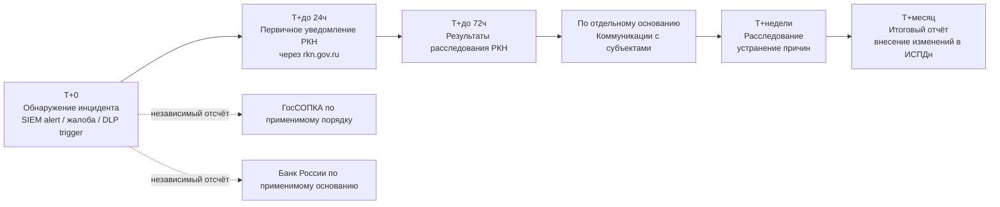
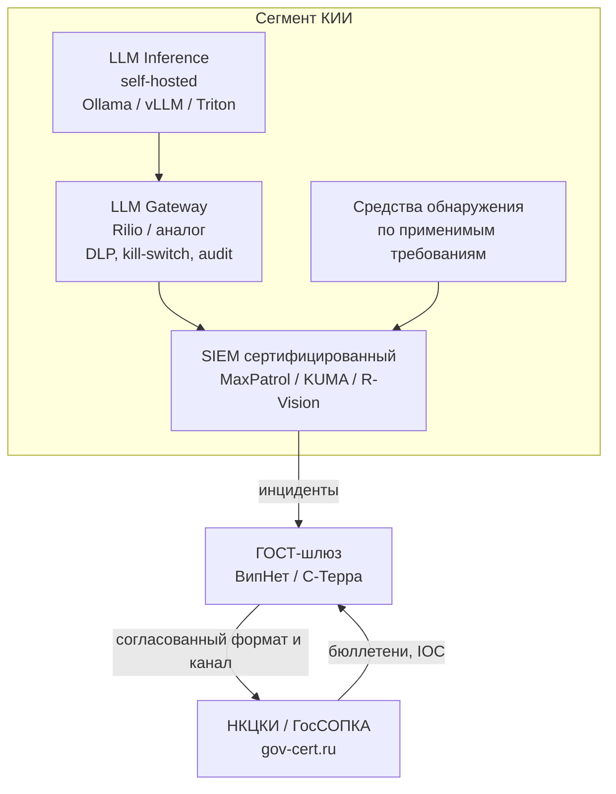
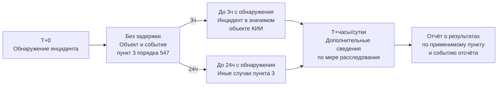
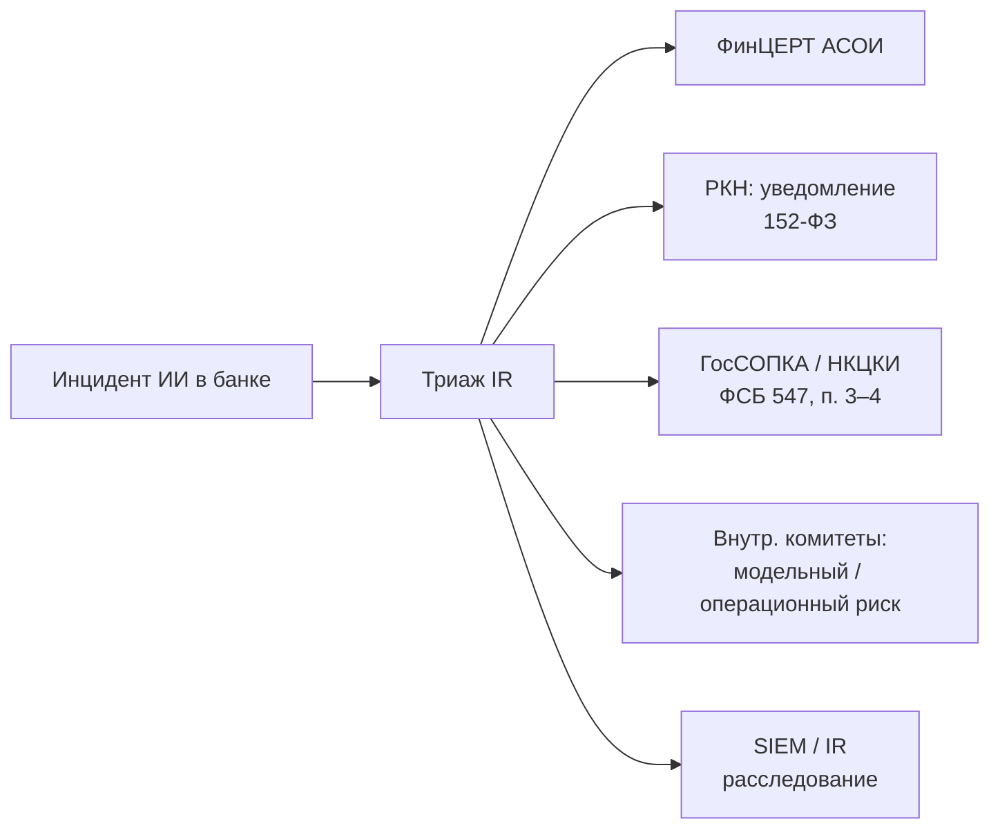
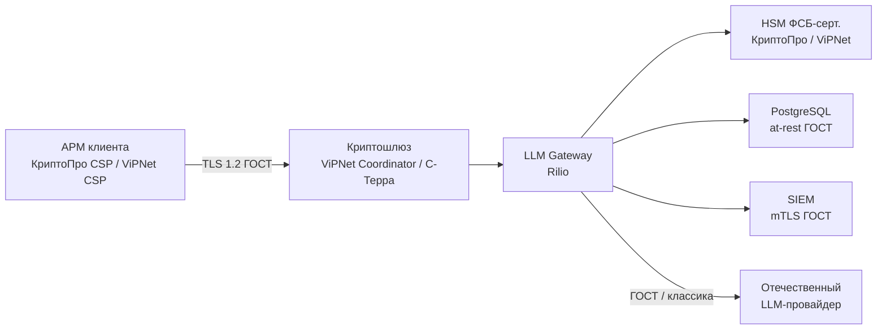
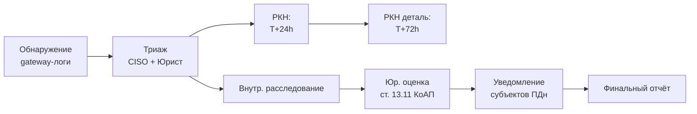
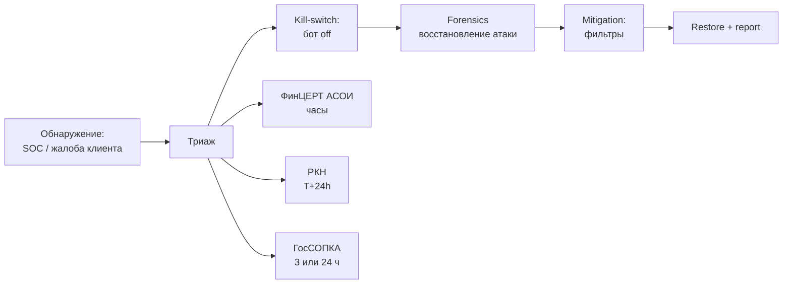
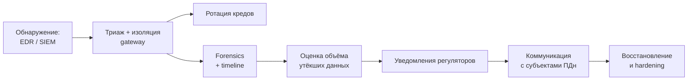

<a id="rossijskaa-spezifika-mlsec-deep-dive"></a>

# Российская специфика MLSec. Deep Dive

> Версия: 2.2 · Обновлено: 2026-11-13 · Теги: 152-ФЗ, 187-ФЗ, ФСТЭК, ЦБ, ГОСТ, маркировка, ЭПР, Указ 490 · Tier: 1-4
>
> **TL;DR**. Российские требования применяются к конкретной обработке данных, организации, информационной системе и событию, а не к названию модели. Глава связывает 152-ФЗ, КИИ, требования ФСТЭК и Банка России с архитектурой ML/LLM: данные и подрядчики, модель угроз, технические меры, свидетельства допуска и параллельные уведомления. Реестр ПО, сертификат средства, оценка системы и внутренний Tier решают разные задачи.

**Тематическая актуализация от 13.11.2026**: применимость норм к AI-конфигурации (§1.10), изменения обработки и подрядчиков (§1.11), реестр нормативных обязанностей (§11.5). Уточнены 152-ФЗ, порядок ФСБ №547 и опубликованный ISO/IEC 27090:2026. Перечни продуктов, отраслевые процедуры и все технические параметры базовой редакции не проходили полной повторной квалификации; в них требуется проверка указанного акта и конкретного исполнения.


<a id="0-soderjanie"></a>

## 0. Содержание

1. 152-ФЗ и подзаконные акты в разрезе ИИ
2. КИИ и 187-ФЗ. Взаимодействие с ГосСОПКА
3. Приказы ФСТЭК 117 (ранее 17), 21, 31, 239 применительно к ИИ-системам
4. Положения Банка России 716-П, 850-П, 802-П, 821-П. ФинЦЕРТ
5. Реестр отечественного ПО. Сертификация ФСТЭК и ФСБ
6. ГОСТ-криптография и её применение к LLM-шлюзу
7. Регулирование маркировки ИИ-контента
8. Российское регулирование ИИ в развитии (Указ 490, Кодекс этики, ЭПР, ГОСТ-серия)
9. Отраслевая специфика: банк, страхование, медицина, промышленность, телеком, госсектор, EdTech
10. Типовые процедурные сценарии инцидентов
11. Сводный чеклист соответствия
12. Roadmap приведения в соответствие (90 / 180 / 365 дней)
13. Типичные ошибки
14. Связи с другими документами
15. Полезные источники

Документ уточняет пункты, намеченные в [плейбуке 13](13-implementation-ru-playbook.md) и в [главе 15 об инцидент-реагировании](15-ai-incident-response.md), с акцентом на процедуры, сроки, формы уведомлений, конкретные статьи нормативов и технические требования. Шаблоны уведомлений регуляторам вынесены в папку [templates/regulator-notifications](templates/regulator-notifications/README.md).

---

<a id="1-152-fz-i-podzakonnye-akty"></a>

## 1. 152-ФЗ и подзаконные акты

<a id="11-bazovye-dokumenty-i-redakzii-2024-2025"></a>

### 1.1 Базовые документы и редакции 2024-2025

- Федеральный закон 152-ФЗ «О персональных данных» в действующей редакции
- Федеральный закон 420-ФЗ от 30.11.2024 изменяет КоАП РФ; уголовная статья 272.1 введена отдельным 421-ФЗ. Это не редакция 152-ФЗ и не источник универсального запрета передачи биометрии через любой внешний канал
- Федеральный закон 266-ФЗ от 14.07.2022 (дополнения к трансграничной передаче, обязанность уведомления РКН)
- Часть 5 ст. 18 152-ФЗ в редакции 23-ФЗ от 28.02.2025: ограничения использования зарубежных баз при сборе ПДн граждан РФ; проверять конкретные операции и предусмотренные законом исключения
- 156-ФЗ от 24.06.2025: согласие на обработку оформляется отдельно от иных подтверждаемых субъектом сведений и документов (ст. 9 152-ФЗ)
- Постановление Правительства 1119 от 01.11.2012 об уровнях защищённости ПДн в ИСПДн
- Постановление Правительства 687 от 15.09.2008 о бумажной обработке ПДн
- Приказ ФСТЭК 21 от 18.02.2013 (требования к защите ПДн в ИСПДн)
- Приказ ФСБ 378 от 10.07.2014 (требования к СКЗИ для ИСПДн)
- Действующие формы РКН для уведомления об обработке, трансграничной передаче и инциденте проверяются отдельно: у них разные основания и состав сведений
- Методический документ ФСТЭК «Методика оценки угроз безопасности информации» от 05.02.2021
- 572-ФЗ от 29.12.2022 «Об осуществлении идентификации и аутентификации с использованием биометрических персональных данных» (Единая биометрическая система)

Применительно к ИИ-системам важно учитывать все три слоя одновременно: 152-ФЗ определяет требования к обработке, ПП 1119 - уровень защищённости, Приказ ФСТЭК 21 - конкретные меры защиты.

<a id="12-klassifikazia-ispdn-po-pp-1119"></a>

### 1.2 Классификация ИСПДн по ПП 1119

4 уровня защищённости (УЗ-1 самый высокий) устанавливаются по сочетаниям условий пунктов 9-12 ПП 1119. Учитываются тип актуальных угроз, категория данных, количество субъектов и то, являются ли они сотрудниками оператора. Нельзя назначить УЗ по одной отрасли, наличию нейросети или самому факту биометрии.

| Вход классификации | Что фиксировать | Свидетельство |
|---|---|---|
| Граница ИСПДн | Источники, хранилища, retrieval, модели, логи и доступ подрядчиков | Схема обработки и перечень компонентов |
| Категория ПДн | Специальные, биометрические, общедоступные или иные по определениям постановления | Перечень полей и целей использования |
| Тип угроз | Актуальность угроз 1, 2 или 3 типа с обоснованием | Материалы оценки угроз, а не название ОС или приложения |
| Субъекты | Сотрудники / не сотрудники, количество по условиям конкретного пункта | Инвентаризация субъектов с указанной датой |
| Результат | Применимый пункт 9-12, требуемый УЗ, выбранные меры | Решение оператора с исходными допущениями |

Применительно к ИИ-системам:

- Для биометрической ИСПДн тип угроз имеет значение: постановление предусматривает разные уровни для угроз 1, 2 и 3 типа. Поэтому правило «биометрия = УЗ-1» неверно.
- Медицинские сведения относятся к специальным категориям, но и для них УЗ зависит от сочетания условий, а не назначается автоматически по названию медицинского сервиса.
- Публикация человеком сведений в интернете сама по себе не превращает любой последующий сбор в обработку общедоступной категории и не доказывает УЗ-4.
- Код-ассистент может обрабатывать ПДн сотрудников, авторов commits и заявителей в issues даже без клиентской базы. Это проверяется по фактическому контексту.

Уровень и его обоснование фиксируются в документации оператора. PIA удобна как внутренний рабочий формат, но название DPIA не подменяет требования РФ. [Текст ПП 1119, пункты 5-12](https://www.consultant.ru/document/cons_doc_LAW_137356/8c86cf6357879e861790a8a7ca8bea4227d56c72/) сверён 13.11.2026; это воспроизведение нормативного текста в правовой системе, а не официальный сайт его опубликования. Для принятия решения сохраняют действующий официальный экземпляр акта. Проектный процесс: [глава 02](02-stage0-ml-system-design.md).

<a id="13-tipovaa-model_-ugroz-dla-ispdn-s-ii"></a>

### 1.3 Типовая модель угроз для ИСПДн с ИИ

Методика ФСТЭК 2021 требует моделирования угроз на основе Банка данных угроз (БДУ ФСТЭК). Для ИИ-систем к стандартным угрозам добавляются ИИ-специфичные. Стандартная структура модели угроз:

| Группа угроз | Классические | ИИ-специфичные |
|--------------|--------------|----------------|
| Угрозы целостности ПДн | Несанкционированная модификация, удаление | Data poisoning (модификация обучающей выборки), adversarial input |
| Угрозы конфиденциальности ПДн | Неавторизованный доступ, утечка через каналы связи | Memorization (восстановление из весов), membership inference, model inversion, утечка через контекст промпта, утечка через ответ LLM, утечка через RAG chunks |
| Угрозы доступности | DoS, отказ инфраструктуры | Token flood, denial of wallet, ресурсоёмкие промпты, compromise модели с остановкой сервиса |
| Угрозы репутации и юридические | Неправомерная обработка, отсутствие согласия | Генерация персонализированного ответа без согласия, hallucination с ПДн другого субъекта, автоматическое принятие значимых решений без согласия (ст. 16 152-ФЗ) |

Источник угроз в ИИ-системе дополнительно включает:

- Внутренний нарушитель с доступом к обучающим данным (поведение до категории Н2 по БДУ)
- Внешний нарушитель через публичный API LLM (Н6-Н7)
- Нарушитель через каналы поставки модели (open-source веса с закладками)
- Нарушитель через каналы поставки данных (внешние датасеты)

Модель угроз актуализируется при каждом значимом изменении ИИ-системы: смене базовой модели, расширении состава обрабатываемых ПДн, изменении архитектуры RAG, добавлении новых каналов интеграции.

<a id="14-roli-v-organizazii-obrabotki-pdn"></a>

### 1.4 Роли в организации обработки ПДн

152-ФЗ и подзаконные акты определяют набор обязательных ролей. Для ИИ-систем эти роли пересекаются с ролями MLSec (см. [главу 21](21-people-process.md)):

| Роль по 152-ФЗ | Основание | Пересечение с MLSec |
|----------------|-----------|---------------------|
| Ответственный за организацию обработки ПДн (Юрист) | Ст. 22.1 152-ФЗ | В ИИ-системах - ответственный за соблюдение политики обработки, согласование новых моделей и сценариев |
| Ответственный за обеспечение безопасности ПДн | Приказ ФСТЭК 21 | Обычно CISO или руководитель ИБ, отвечает за меры Приказа ФСТЭК 21, включая контроли ИИ-шлюза |
| Оператор ПДн (юридическое лицо) | Ст. 3 152-ФЗ | Организация в целом |
| Уполномоченные лица | Внутренние приказы | ML-инженеры, имеющие доступ к ПДн-содержащим датасетам, должны быть учтены в матрице доступов |

Типовые ошибки: отсутствие Юрист в организации с массовой обработкой, совмещение Юрист и CISO без разграничения функций, отсутствие обновления приказов при смене ответственных.

<a id="15-soglasie-sub_ektov-pdn-i-osobennosti-dla-ii"></a>

### 1.5 Согласие субъектов ПДн и особенности для ИИ

Основание обработки устанавливается по ст. 6 152-ФЗ и специальным условиям ст. 10, 11 и 16. Согласие - одно из оснований, а не универсальная замена анализа цели и операций. Для ИИ-систем важны следующие нюансы:

- **Цель и совместимость.** Обучение, inference, оценка качества и reuse prompts для улучшения provider-модели рассматриваются отдельно. Политика конфиденциальности не создаёт отсутствующего правового основания и не разрешает несовместимую обработку.
- **Форма согласия.** Если выбрано это основание, проверяют требования ст. 9, включая отдельное оформление от иных подтверждаемых документов, доказательство получения и отзыв.
- **Специальные категории.** Письменное согласие предусмотрено ст. 10 наряду с другими названными в ней основаниями. Нельзя считать его единственным вариантом или выводить основание из факта обезличивания.
- **Биометрия.** Для ст. 11 важно использование физиологических/биологических характеристик именно для установления личности. Фото в карточке и face-ID могут иметь разные режимы. Применимость 572-ФЗ и ЕБС устанавливается по сценарию идентификации/аутентификации, а не по любому наличию лица или голоса.
- **Автоматические решения.** Ст. 16 относится к решениям на основании исключительно автоматизированной обработки, затрагивающим права и законные интересы. Часть 2 предусматривает письменное согласие либо случаи федерального закона; часть 3 - разъяснение порядка/последствий и возможность возражения, часть 4 - рассмотрение возражения в течение 30 дней. Кнопка «human review» полезна, но сама не доказывает исполнение этих обязанностей.

Источник: [152-ФЗ на сайте Минтруда, статьи 5, 6, 9-11, 16](https://mintrud.gov.ru/docs/laws/130), проверено 13.11.2026.

<a id="16-transgranicnaa-peredaca-pdn"></a>

### 1.6 Трансграничная передача ПДн

Локализация при сборе и трансграничная передача - отдельные проверки. По [152-ФЗ, ст. 12 и ч. 5 ст. 18](https://mintrud.gov.ru/docs/laws/130), проверено 13.11.2026:

- При сборе ПДн граждан РФ проверяются запрет названных операций с использованием зарубежных баз и исключения ч. 5 ст. 18. Размещение одной копии в РФ не доказывает соблюдение всех условий.
- Уведомление о намерении трансграничной передачи направляется до её начала и отдельно от уведомления об обработке по ст. 22. До уведомления получают сведения о получателе, мерах защиты и применимом праве по ч. 5 ст. 12.
- Возможность передачи после уведомления различается по стране и условиям ч. 10-11 ст. 12. Нельзя заменить это правилом «за 10 дней до первой передачи»: закон связывает десятидневный период с рассмотрением и предусматривает приостановку при запросе сведений.
- РКН вправе запретить или ограничить трансграничную передачу в конкретных случаях.
- Договор с provider не создаёт исключение из остальных обязанностей. Указание «ст. 12.1» в прежней редакции было ошибочным: основания и порядок проверяются по действующей ст. 12 и другим применимым нормам.

Применительно к облачным LLM вне РФ (OpenAI, Anthropic, Google Gemini, Mistral La Plateforme):

- Юрисдикция бренда недостаточна: фиксируются конкретные получатель, регион обработки, субподрядчики, support-доступ, telemetry, storage и условия reuse. Перечень РКН проверяется на дату решения по каждой стране.
- Передача допускается только после подтверждения всех применимых условий. Для проектного запрета внешних LLM не требуется сначала доказывать неизбежность утечки; внутреннее ограничение может быть строже минимального правового режима.
- Практические решения:
  1. **LLM-шлюз с DLP** (Rilio или аналог): технически ограничивает канал. Отсутствие находок сканера не доказывает обезличивание всего контекста, вложений и ответов tools.
  2. **Отечественные LLM с DPA**: GigaChat, YandexGPT, Cotype (МТС), T-Technologies. Заключается договор, предусматривающий обработку ПДн на территории РФ.
  3. **Self-hosted модели**: развёртывание open-weights моделей (Qwen, DeepSeek, LLaMA-производные) через Ollama, vLLM, TGI внутри контура.
  4. **Псевдонимизация на входе**: уменьшает раскрытие прямых идентификаторов, но обратимые токены и оставшийся контекст требуют отдельной оценки. Это не автоматическое исключение из 152-ФЗ или правил трансграничной передачи; `k`, `ε` и score DLP не вычисляют правовой статус.

Чеклист для трансграничной передачи через LLM:

- [ ] Проведена инвентаризация сценариев, где ПДн попадают в промпт.
- [ ] Для каждого сценария определён путь: блокировка DLP / отечественный LLM / self-hosted / псевдонимизация.
- [ ] Получены необходимые согласия субъектов.
- [ ] При необходимости направлено уведомление РКН о трансграничной передаче.
- [ ] Договоры с отечественными LLM-провайдерами предусматривают обработку ПДн.
- [ ] Настроен аудит передач в SIEM.

<a id="17-otvetstvennost_-kvalifikazia-do-rasceta-sankzii"></a>

### <span id="17-strafy-za-utecki-pdn-redakzia-420-fz-ot-30112024" aria-hidden="true"></span>1.7 Ответственность: квалификация до расчёта санкции

420-ФЗ от 30.11.2024 изменил КоАП РФ, включая ответственность по ст. 13.11. Прежняя таблица смешивала основания, повторность и разные показатели масштаба. Для практического решения нужен действующий текст конкретной части статьи, а не средняя сумма штрафа по числу строк в базе.

| Фактор | Что установить | Что нельзя вывести автоматически |
|---|---|---|
| Действие и последствия | Какая обработка, передача, доступ или неисполненная обязанность подтверждены | Любой alert DLP не равен установленному составу нарушения |
| Субъект ответственности | Организация, должностное или другое лицо по конкретной норме | Единую сумму для всех участников |
| Масштаб и категория | Уникальные субъекты, идентификаторы, специальные или биометрические данные | Число субъектов из числа chunks или строк лога |
| Повторность | Ранее назначенное наказание, период и условия применимой части | Оборотный штраф из факта второго alert |
| Процедура | Уведомления, обнаружение, сроки, доказательства отправки и обстоятельства | Максимальную санкцию из отсутствующего toggle в checklist |

Статья 272.1 УК РФ введена отдельным 421-ФЗ от 30.11.2024 и относится к названным в ней незаконным действиям с компьютерной информацией, содержащей ПДн. Число субъектов `100000` не является универсальным переключателем уголовной ответственности или срока лишения свободы. Автоматически переносить административную шкалу в уголовный состав нельзя.

Для AI-инцидента расследование устанавливает фактический доступ и последствия: демонстрация membership inference, воспроизведение синтетического canary и подтверждённая передача реальных ПДн - разные свидетельства. Правовую квалификацию связывают с фактами, отдельно от приоритета технического реагирования. Источники: [официальная публикация 420-ФЗ](https://publication.pravo.gov.ru/document/0001202411300011), [обзор 421-ФЗ Федерального казначейства](https://roskazna.gov.ru/uploads/migrate/roskaznagovru/documents/inaya-deyatelnost/pravovaya-rabota/e47/Byulleten-yanvarya-2025.pdf). Реквизиты проверены 13.11.2026; эта тематическая проверка не заменяет сверку действующей санкции по установленному составу.

<a id="razbor-faktorov-otvetstvennosti"></a>

#### <span id="kal_kulator-strafa-po-st-1311-koap-redakzia-420-fz-ot-30112024" aria-hidden="true"></span>Разбор факторов ответственности

```widget:flashcards
{
  "id": "ch18-fines-calc",
  "title": "Ответственность: что установить до расчёта санкции",
  "description": "Учебный разбор факторов квалификации. Число субъектов само по себе не вычисляет штраф или уголовную ответственность.",
  "shuffle": false,
  "cards": [
    {
      "front": "Какой состав нарушения?",
      "back": "Разделить неправомерную обработку, неуведомление и передачу или доступ с названными в конкретной норме последствиями. Нужны действующая часть статьи и установленные факты.",
      "tag": "Основание"
    },
    {
      "front": "Субъекты и идентификаторы — одно и то же?",
      "back": "Нет. Повторы одного человека в логах и chunks не становятся новыми субъектами. Применимая норма может учитывать разные показатели; метод подсчёта фиксируется расследованием.",
      "tag": "Масштаб"
    },
    {
      "front": "Специальные категории и биометрия",
      "back": "Проверяется состав данных и условия конкретной нормы. Биометрическая квалификация связана с использованием для установления личности; не каждое фото или голос автоматически биометрия.",
      "tag": "Категория"
    },
    {
      "front": "Повторность и оборотный штраф",
      "back": "Нужны предыдущая квалификация, статус субъекта ответственности, условия повторности и применимая база расчёта. Ступенька по размеру базы этого не доказывает.",
      "tag": "Повторность"
    },
    {
      "front": "Уголовная статья 272.1",
      "back": "Введена 421-ФЗ, не 420-ФЗ. Применимость устанавливается по элементам состава и обстоятельствам; порог 100000 не является универсальным переключателем «до 10 лет».",
      "tag": "Отдельный режим"
    },
    {
      "front": "Кто выносит решение?",
      "back": "Итоговую санкцию назначает уполномоченный орган или суд. Внутренний checklist помогает собрать доказательства, но не предсказывает максимальный или средний штраф.",
      "tag": "Результат"
    }
  ]
}
```

<a id="18-inzident-s-pdn-timeline-i-prozedura"></a>

### 1.8 Инцидент с ПДн - timeline и процедура



Шаблон уведомления РКН: [templates/regulator-notifications/RKN-152FZ.md](templates/regulator-notifications/RKN-152FZ.md). Параллельные уведомления: [GOSSOPKA-187FZ.md](templates/regulator-notifications/GOSSOPKA-187FZ.md), [FINCERT.md](templates/regulator-notifications/FINCERT.md).

Форма уведомления в РКН подаётся через портал pd.rkn.gov.ru. Первичное уведомление должно содержать:

1. Информацию об операторе (наименование, ИНН, ОГРН, контактное лицо).
2. Обстоятельства инцидента (дата, время, источник обнаружения).
3. Предположительные причины и категории затронутых ПДн.
4. Предварительную оценку числа затронутых субъектов.
5. Принятые меры локализации.
6. Сведения об уполномоченном контактном лице и другие поля действующей формы РКН.

Уведомление о результатах расследования направляется **в течение 72 часов с предусмотренного законом выявления**, а не через 72 часа после первичного сообщения. Не требуется ждать истечения срока. Собираются:

1. Окончательное число затронутых субъектов и состав ПДн.
2. Подтверждённые причины и техническую картину.
3. Меры по устранению и предотвращению повторения.
4. Оценку риска для субъектов и решение о необходимости их уведомления.

Обязанности перед субъектами устанавливаются отдельно по применимой норме и обстоятельствам; универсальное GDPR-правило «high risk → уведомить субъектов» нельзя автоматически приписывать 152-ФЗ. Коммуникационный план и устранение нарушений не откладываются до выбора шаблона.

Для РКН основание и отсчёт закреплены [ч. 3.1 ст. 21 152-ФЗ](https://mintrud.gov.ru/docs/laws/130), проверено 13.11.2026. Для ГосСОПКА отдельно определяется применимый порядок, участник и канал; неизвестная обязанность не заменяется общим утверждением «всем в ЕПД». Инциденты с ПДн и события КИИ могут иметь пересекающиеся, но не одинаковые основания.

<a id="19-ceklist-152-fz-dla-ii-sistemy"></a>

### 1.9 Чеклист 152-ФЗ для ИИ-системы

- [ ] ИСПДн классифицирован, акт классификации подписан.
- [ ] Уведомление РКН о начале обработки направлено (если применимо).
- [ ] Назначены ответственное лицо по ст. 22.1 и необходимые роли безопасности; функции разграничены.
- [ ] Политика обработки ПДн опубликована и учитывает сценарии ИИ.
- [ ] Модель угроз включает ИИ-специфичные угрозы (memorization, inversion, MIA, poisoning).
- [ ] Собраны согласия субъектов на обработку, включая цель «обучение моделей» если применимо.
- [ ] Для исключительно автоматизированных решений проверены условия ст. 16 и основание допуска.
- [ ] Реализованы разъяснение, возражение и процесс его рассмотрения по ст. 16.
- [ ] Трансграничная передача через LLM оценена и либо заблокирована, либо легализована.
- [ ] LLM-шлюз с DLP применяет ПДн-фильтры (Rilio DLP или аналог).
- [ ] IR-плейбуки различают 24/72 часа РКН по ст. 21(3.1) и отдельные обязанности ГосСОПКА.
- [ ] Проведены учения на сценарий утечки ПДн через LLM.

<a id="konstruktor-sootvetstvia-152-fz-dla-ii-sistemy"></a>

#### Конструктор соответствия 152-ФЗ для ИИ-системы

```widget:policy-builder
{
  "id": "ch18-152fz-readiness",
  "title": "Документы и меры защиты ПДн: рабочий checklist",
  "description": "Учебные веса показывают полноту выбранных пунктов, а не процент соответствия 152-ФЗ. Обязательные условия проверяются по применимым нормам; score не предсказывает штраф или решение аудитора.",
  "scoreLabel": "Полнота checklist",
  "scoreMax": 100,
  "groups": [
    {
      "name": "Регистрация и роли",
      "items": [
        {
          "id": "rkn-notice",
          "label": "Проверено уведомление по ст. 22",
          "weight": 6,
          "default": true,
          "recommended": true,
          "description": "Определены обязанность или исключение, актуальные сведения и подтверждение подачи, если она требуется."
        },
        {
          "id": "lawyer",
          "label": "Назначены ответственные и разграничены функции",
          "weight": 6,
          "default": true,
          "recommended": true,
          "description": "Лицо по ст. 22.1 назначается оператором-юрлицом; должность юриста не является единственным допустимым вариантом."
        },
        {
          "id": "policy-published",
          "label": "Политика описывает реальные цели и операции",
          "weight": 5,
          "default": true,
          "description": "Training, inference, eval и reuse рассматриваются отдельно; документ не создаёт правовое основание сам по себе."
        }
      ]
    },
    {
      "name": "Согласия и legal basis",
      "items": [
        {
          "id": "consents-training",
          "label": "Определены цель и основание обучения",
          "weight": 8,
          "recommended": true,
          "description": "Основание по ст. 6 и специальным условиям; если выбрано согласие, проверены его форма, получение, отзыв и охват."
        },
        {
          "id": "consents-art16",
          "label": "Проверены условия автоматизированного решения",
          "weight": 5,
          "description": "Ст. 16: характер решения, письменное согласие либо случай федерального закона и меры защиты прав."
        },
        {
          "id": "human-review",
          "label": "Есть разъяснение и процедура возражения по ст. 16",
          "weight": 5,
          "description": "Проверены содержание разъяснения, приём возражения и 30-дневный срок рассмотрения; кнопка в UI не заменяет процесс."
        }
      ]
    },
    {
      "name": "Модель угроз и контроли",
      "items": [
        {
          "id": "tm-ai-specific",
          "label": "Проверены актуальные ИИ-угрозы для конкретной системы",
          "weight": 7,
          "recommended": true,
          "description": "Проверена актуальность сценариев memorization, MIA, inversion и poisoning для конкретной системы; включение или исключение обосновано через данные, доступ, нарушителя и меры."
        },
        {
          "id": "uz-acts",
          "label": "Акт классификации ИСПДн (УЗ-1..УЗ-4 по ПП 1119)",
          "weight": 6,
          "default": true,
          "recommended": true,
          "description": "Формальный акт с подписью — основа для применения 21-приказа ФСТЭК."
        },
        {
          "id": "fstek-21",
          "label": "Выбран и адаптирован набор мер для ИСПДн",
          "weight": 7,
          "default": true,
          "description": "УЗ и актуальные угрозы обоснованы; выбор не сводится к правилу «УЗ-1 — все меры, УЗ-3 — базовый набор»."
        }
      ]
    },
    {
      "name": "Трансграничная передача",
      "items": [
        {
          "id": "cross-border-rkn",
          "label": "Уведомление РКН о трансграничной передаче (если применимо)",
          "weight": 5,
          "description": "152-ФЗ ст. 12: до начала передачи. Включая cloud-LLM из non-RU юрисдикций."
        },
        {
          "id": "cross-border-consent",
          "label": "Проверены основание и условия трансграничной передачи",
          "weight": 4,
          "description": "По ст. 12 отдельно проверены страна по актуальному перечню, получатель, цель, основание обработки, необходимость согласия, уведомление, сроки начала передачи и запреты/ограничения. Категория страны сама по себе не создаёт универсального требования отдельного согласия."
        },
        {
          "id": "anonymisation-pre-cloud",
          "label": "Проверены минимизация и риск идентификации до cloud-передачи",
          "weight": 6,
          "description": "Маскирование снижает раскрытие, но не прекращает режим ПДн автоматически. Проверены повторная идентификация, дополнительная информация, доступ получателя и правовой режим фактического payload; вывод об отсутствии ПДн обоснован отдельно."
        }
      ]
    },
    {
      "name": "Технические контроли",
      "items": [
        {
          "id": "llm-gateway-dlp",
          "label": "AI-каналы контролируются по принятой архитектуре",
          "weight": 7,
          "default": true,
          "recommended": true,
          "description": "Gateway/DLP — технические меры; их наличие не заменяет правовое основание и не гарантирует отсутствие ПДн."
        },
        {
          "id": "rag-acl",
          "label": "Проверены ACL и отзыв доступа в RAG",
          "weight": 6,
          "default": true,
          "description": "Тестируются query, cache, export и backup restore; наличие filter не доказывает отсутствие утечки."
        },
        {
          "id": "audit-logs",
          "label": "Аудит достаточен для расследования и защищён",
          "weight": 5,
          "default": true,
          "description": "Установлены цели, состав, доступ и сроки хранения; raw prompts не записываются автоматически ради полноты."
        }
      ]
    },
    {
      "name": "Incident response",
      "items": [
        {
          "id": "ir-rkn-24h",
          "label": "Runbook отражает событие и 24/72 ч по ст. 21(3.1)",
          "weight": 8,
          "default": true,
          "recommended": true,
          "description": "Отсчёт от предусмотренного законом выявления; сообщения РКН и квитанции учитываются раздельно."
        },
        {
          "id": "ir-tabletop",
          "label": "Tabletop на сценарий утечки ПДн через LLM",
          "weight": 4,
          "description": "Регулярно — раз в полгода. Первое учение проваливается у всех."
        }
      ]
    }
  ],
  "rules": [
    {
      "id": "must-rkn",
      "type": "require-all",
      "items": [
        "rkn-notice"
      ],
      "message": "Не отмечена проверка уведомления по ст. 22: установите обязанность или исключение и подтвердите подачу, когда она требуется. Неотмеченный пункт checklist сам по себе не устанавливает незаконность обработки."
    },
    {
      "id": "must-dpo",
      "type": "require-all",
      "items": [
        "lawyer"
      ],
      "message": "Не отмечена проверка ответственного по ст. 22.1 для оператора-юрлица: проверьте назначение, полномочия и функции. Отдельная должность юриста не является универсальным требованием."
    },
    {
      "id": "must-tm",
      "type": "require-all",
      "items": [
        "tm-ai-specific"
      ],
      "message": "Не отмечен review актуальных ИИ-угроз. Определите применимые memorization/MIA/inversion/poisoning сценарии и обоснуйте угрозы и меры для конкретной системы; checkbox не предсказывает решение аудитора."
    },
    {
      "id": "must-gateway",
      "type": "require-all",
      "items": [
        "llm-gateway-dlp"
      ],
      "message": "В учебном checklist требуется контролируемый канал; реальная необходимость и реализация фиксируются в модели угроз."
    },
    {
      "id": "must-ir",
      "type": "require-all",
      "items": [
        "ir-rkn-24h"
      ],
      "message": "Проверить процесс уведомления: событие, адресат, отсчёт, ответственный и квитанция."
    },
    {
      "id": "min-readiness",
      "type": "min-score",
      "threshold": 65,
      "message": "Учебный порог полноты 65%; он не подтверждает нормативную готовность или размер санкции."
    }
  ],
  "thresholds": [
    {
      "from": 0,
      "to": 30,
      "label": "Много непроверенных пунктов",
      "tone": "err"
    },
    {
      "from": 30,
      "to": 65,
      "label": "Часть свидетельств собрана",
      "tone": "warn"
    },
    {
      "from": 65,
      "to": 85,
      "label": "Проверить применимость и реализацию",
      "tone": "info"
    },
    {
      "from": 85,
      "to": 100,
      "label": "Checklist заполнен; правовой вывод и испытания отдельно",
      "tone": "ok"
    }
  ]
}
```

---


<a id="110-primenimost_-trebovanij-k-konkretnoj-ai-konfigurazii"></a>

### 1.10 Применимость требований к конкретной AI-конфигурации

**Проблема**: договор описывает «чат с моделью», а реальная конфигурация отправляет документы в reranker, сохраняет trace у другого подрядчика и использует prompts для обучения provider. Правовая оценка бренда или весов модели не покрывает эти операции.

Для сценария составляется **карта обработки**. Каждый маршрут сопоставляется с целью, операциями, субъектами, основанием и получателями. Внутренние K0-K4 и Tier помогают организации выбирать контроли, но не заменяют эту карту.

| Маршрут | Что установить | Подтверждение для допуска |
|---|---|---|
| Training / fine-tuning | Происхождение данных, совместимость цели обучения, основание по категориям, условия reuse и прекращения | Запись цели/основания, договоры или receipts согласий, версия разрешённого dataset |
| Inference и RAG | Какие пользовательские данные, chunks и tool responses доступны каждому получателю | Схема запроса, ACL, tenant scope, provider/region и режим хранения |
| Embedding / reranker / OCR / ASR | Выполняется ли отдельная передача до обращения к основной модели | Реестр subprocessors, endpoints и состава payload |
| Eval и red team | Какие данные видят генератор тестов, target, grader и dashboard | Разрешённый набор данных, маршрут каждого участника и защищённые отчёты |
| Telemetry, support и backup | Кто получает логи, memory, traces, выгрузки, дампы и доступ поддержки | Поля журналов, сроки/основания хранения, роли доступа и восстановление после удаления |
| Действие агента | Чьи данные и права затрагиваются отправкой, изменением записи или решением | Правовое основание действия и независимая техническая авторизация executor |

**Роли сторон** определяются фактическими действиями и документами, а не маркетинговым словом `processor`. Статья 6 ч. 3 152-ФЗ задаёт состав поручения: данные, операции, цели, конфиденциальность, требования к защите, подтверждающие документы и информирование оператора о соответствующих инцидентах. Если provider использует информацию для собственных целей, эту обработку нужно оценить отдельно; исходное поручение не считается автоматически достаточным.

**Порядок приёмки**:

1. Product Owner описывает результат сценария и все операции с данными, включая побочные маршруты.
2. Data Owner подтверждает состав, происхождение и допустимые цели конкретных данных.
3. Юрист связывает операции с основанием, условиями поручения, локализации и трансграничной передачи.
4. ИБ проверяет фактический маршрут по синтетическому запросу и сверяет его с заявленным: основной API, embedding, grader, telemetry и support.
5. Решение допуска связывается с версиями конфигурации и условий поставщика. Недоказанный маршрут не получает статус «ПДн нет» только из-за пустого отчёта DLP.

Источник нормы: [152-ФЗ, статьи 3, 5, 6, 9, 12, 18-19](https://mintrud.gov.ru/docs/laws/130), проверено 13.11.2026. Таблица и процесс выше - рабочая адаптация для ML/LLM. Состав технического релиза: [глава 14](14-model-risk-governance.md); обработка и отзыв данных: [глава 03](03-stage1-data-operations.md).

<a id="111-izmenenia-pajplajna-i-podradcika-kogda-nujen-povtornyj-review"></a>

### 1.11 Изменения пайплайна и подрядчика: когда нужен повторный review

Обновление model ID не единственный триггер. Новый получатель или цель обработки может появиться без изменения весов и пользовательского интерфейса.

| Изменение | Что проверять до включения | Пример блокирующей проверки |
|---|---|---|
| Подключён внешний reranker | Получатель, страна, содержание chunks, основание и договорные условия | Запрос с синтетическими ПДн не уходит по недопущенному маршруту |
| Provider включил reuse prompts для обучения | Совместимость цели, роли сторон, основание и сроки хранения | Недопустимый reuse отключён проверяемой настройкой/договором; одного названия Enterprise недостаточно |
| Добавлен cloud grader | Данные в тестах и traces, получатель, доступ к отчёту | Закрытые тексты не покидают разрешённый контур при generation, evaluation и debugging |
| Agent получил send/export tool | Цель передачи, получатель, полномочия оператора и человека | Подмена адресата в документе не создаёт разрешение на передачу |
| Сменился subprocessor или support region | Фактический доступ, условия договора, сведения уведомлений | Обновлена карта обработки; новый регион не включается через fallback |
| Отозвано согласие или достигнута цель | Оставшиеся основания и обязанности по прекращению/уничтожению | Данные не возвращаются из cache, backup restore, RAG-копий и очередей |

Не каждое изменение требует одинакового объёма проверки: владелец фиксирует **что изменилось**, **какая обязанность затронута**, **какие свидетельства обновлены** и **кто разрешил новый маршрут**. Для ст. 22 отдельно проверяется необходимость уведомить РКН об изменениях сведений; общий процесс не должен подменять установленный законом срок своим календарным review.

**Отзыв и производные артефакты**: удаление исходного файла не доказывает удаление embeddings, выгрузок, eval-наборов или сведений из обученной модели. При затронутых model weights решение о retraining/unlearning принимается по правовому основанию и техническим подтверждениям, а не по заявлению «мы удалили строку». Оставшийся законный срок хранения и обязанность сохранения доказательств устанавливаются отдельно. Методики: [17. PET](17-privacy-enhancing-tech.md), [28. Синтетические данные](28-synthetic-data-security.md).

Правовая основа пересмотра целей и прекращения обработки: [152-ФЗ, статьи 5, 6, 21-22](https://mintrud.gov.ru/docs/laws/130), проверено 13.11.2026. Негативные проверки в таблице являются рекомендациями приёмки, а не самостоятельными нормами закона.

<a id="2-kii-i-187-fz"></a>

## 2. КИИ и 187-ФЗ

<a id="21-normativnaa-baza"></a>

### 2.1 Нормативная база

- Федеральный закон 187-ФЗ от 26.07.2017 «О безопасности критической информационной инфраструктуры РФ»
- Постановление Правительства 127 от 08.02.2018 (правила категорирования объектов КИИ, перечень показателей)
- Постановление Правительства 162 от 17.02.2018 (правила ведения реестра значимых объектов КИИ)
- Постановление Правительства 452 от 14.04.2023 (изменения в ПП 127, уточнение порядка категорирования для субъектов с облачной инфраструктурой)
- Приказ ФСТЭК 235 от 21.12.2017 (требования к созданию систем безопасности)
- Приказ ФСТЭК 239 от 25.12.2017 (состав и содержание мер по обеспечению безопасности значимых объектов КИИ)
- Приказ ФСБ 367 от 24.07.2018 (перечень информации, подлежащей представлению в ГосСОПКА)
- Приказ ФСБ 547 от 25.12.2025 (порядок информирования, реагирования и ликвидации последствий; сроки по виду события и объекту)
- Приказы ФСБ 546 / 548 от 25.12.2025 (обмен и непрерывное взаимодействие): применимость и редакцию проверять по [официальному перечню НКЦКИ](https://www.cert.gov.ru/materialy/pravovye-osnovaniya/)
- Приказ ФСБ 297 от 06.08.2026 относится к взаимодействию операторов ГИС и иных названных в нём государственных ИС; не подменяет все порядки взаимодействия одним общим режимом
- Указ Президента РФ 250 от 01.05.2022 «О дополнительных мерах по обеспечению информационной безопасности РФ» (запрет использования средств защиты из недружественных стран в субъектах КИИ)

<a id="22-kto-sub_ekt-kii"></a>

### 2.2 Кто субъект КИИ

Определяется ст. 2 187-ФЗ. Субъект КИИ - юридическое лицо, которое владеет информационными системами, информационно-телекоммуникационными сетями, АСУ ТП в сферах:

- Государственная власть и подведомственные организации
- Банковская и иная финансово-кредитная (включая страховую, инвестиционную)
- Топливно-энергетическая
- Атомная
- Оборонная и ракетно-космическая
- Горнодобывающая, металлургическая, химическая
- Транспортная
- Связь
- Наука и образование (в части критически значимых объектов)
- Здравоохранение

Статус субъекта определяется законом и фактическими правами/деятельностью организации. Реестр значимых объектов КИИ и статус субъекта - разные понятия: отсутствие записи о значимом объекте само по себе не доказывает, что организация не субъект КИИ.

<a id="23-kategorirovanie-ob_ektov-kii"></a>

### 2.3 Категорирование объектов КИИ

Процесс категорирования по ПП 127:

1. Создание комиссии по категорированию (приказом руководителя субъекта).
2. Инвентаризация объектов КИИ (ИС, АСУ ТП, ИТКС).
3. Оценка показателей значимости по трём группам критериев: социальные последствия, экологические последствия, экономические последствия (таблица в Приложении к ПП 127).
4. Присвоение категории (от К1 до К3, К1 - высшая) или установление, что объект не подлежит категорированию.
5. Утверждение актов категорирования.
6. Направление сведений в ФСТЭК (30 рабочих дней со дня утверждения акта).
7. Включение значимых объектов в реестр ФСТЭК.

Результат категорирования связывают с набором мер и процедурами оценки, а не с автоматическим обещанием аттестата:

| Результат | Что обосновать | Свидетельство |
|-----------|---------------|---------------|
| Значимый объект, категория 1, 2 или 3 | Базовый набор по категории, его адаптацию и дополнение по угрозам | Решение комиссии, модель угроз, проект системы безопасности, результаты испытаний |
| Категория значимости не присвоена | Основания решения и сохраняющиеся обязанности субъекта | Утверждённые сведения, проверка обязанностей по информированию и реагированию |
| На объект наложены другие режимы | ИСПДн, ГИС, АСУ ТП и отраслевые требования рассматриваются отдельно | Реестр применимых актов и процедур оценки по каждому режиму |

Сам по себе номер категории не определяет единую форму аттестации: см. §3.5. «Категория не присвоена» и «система вообще не является объектом КИИ» — разные выводы.

<a id="kakaa-kategoria-kii-u-vasego-ob_ekta-navigator"></a>

#### Какая категория КИИ у вашего объекта — навигатор

```widget:decision-tree
{
  "id": "ch18-kii-category",
  "title": "КИИ: какие сведения собрать для категорирования",
  "start": "q1",
  "nodes": {
    "q1": {
      "type": "question",
      "text": "Какой контур и последствия нужно исследовать?",
      "sub": "Отрасль — вход проверки, не автоматическая категория. Статус субъекта, объект, критические процессы и показатели устанавливаются отдельно.",
      "choices": [
        {
          "label": "Финансовая (банки, НФО, страховые, биржи)",
          "next": "q2-finance"
        },
        {
          "label": "Энергетика / нефтегаз / атомная",
          "next": "leaf-energy"
        },
        {
          "label": "Транспорт (метро, ж/д, аэропорты)",
          "next": "leaf-transport"
        },
        {
          "label": "Здравоохранение (больницы, ЛПУ)",
          "next": "leaf-health"
        },
        {
          "label": "Связь / телеком / ЦОД",
          "next": "leaf-telecom"
        },
        {
          "label": "Госорганы / госкорпорации",
          "next": "leaf-gov"
        },
        {
          "label": "Иной сценарий или область пока не определена",
          "next": "leaf-not-kii"
        }
      ]
    },
    "q2-finance": {
      "type": "question",
      "text": "Какие сервисы используют ИИ?",
      "choices": [
        {
          "label": "Банковское ABS / процессинг карт / payment gateway",
          "next": "leaf-k1-finance"
        },
        {
          "label": "Антифрод / AML / скоринг (с автономным decisioning)",
          "next": "leaf-k2-finance"
        },
        {
          "label": "Чат-боты support / маркетинг / аналитика (без direct влияния на платежи)",
          "next": "leaf-k3-finance"
        }
      ]
    },
    "leaf-k1-finance": {
      "type": "leaf",
      "tone": "err",
      "title": "Платёжный контур: определить значимость",
      "summary": "Участие в платеже требует оценки последствий, но не присваивает К1 по названию сервиса.",
      "details": [
        "Определить границы объекта и поддерживаемый процесс",
        "Рассчитать применимые показатели по действующим правилам",
        "Зафиксировать категорию или отсутствие оснований для её присвоения",
        "Связать AI-компоненты с объектом; не считать каждую модель отдельным ЗОКИИ"
      ]
    },
    "leaf-k2-finance": {
      "type": "leaf",
      "tone": "err",
      "title": "Антифрод / AML / скоринг: роль в процессе",
      "summary": "Автономное decisioning увеличивает риск, но не вычисляет К2.",
      "details": [
        "Сопоставить отказ и ошибку с критическим процессом",
        "Рассмотреть деградацию, недоступность и неправомерные операции",
        "Разделить категорирование КИИ, операционный риск и внутренний Tier",
        "Независимо проверить ПДн и автоматизированные решения"
      ]
    },
    "leaf-k3-finance": {
      "type": "leaf",
      "tone": "warn",
      "title": "Support и аналитика: проверить зависимости",
      "summary": "Внутренний чат-бот не автоматически К3 и не автоматически вне сферы КИИ.",
      "details": [
        "Проверить доступ к данным и tool-интеграции",
        "Исследовать зависимость критического процесса от сервиса",
        "Не назначать категорию по проценту облегчённых мер",
        "Проверить cache и tenant scope отдельно от категорирования"
      ]
    },
    "leaf-energy": {
      "type": "leaf",
      "tone": "err",
      "title": "Промышленный контур: физические последствия",
      "summary": "Категория зависит от объекта и показателей, не от одного названия отрасли.",
      "details": [
        "Определить границу ИС / АСУ / сети",
        "Собрать сценарии воздействия на критические процессы",
        "Проверить применимость 31 / 239 раздельно",
        "Установить безопасный ручной режим и ограничения AI-действий"
      ]
    },
    "leaf-transport": {
      "type": "leaf",
      "tone": "warn",
      "title": "Транспорт: определить значимость объекта",
      "summary": "Масштаб и последствия оцениваются по применимым критериям.",
      "details": [
        "Учесть зависимости диспетчеризации и управления",
        "Связать AI-сценарий с реальным объектом",
        "Разделить непосредственное управление и вспомогательную аналитику"
      ]
    },
    "leaf-health": {
      "type": "leaf",
      "tone": "err",
      "title": "Здравоохранение: разделить три проверки",
      "summary": "КИИ, ИСПДн и медицинское изделие имеют разные основания.",
      "details": [
        "Оценить объект и последствия по КИИ",
        "УЗ выбрать по ПП 1119 с типом актуальных угроз",
        "Применимость 572-ФЗ / ЕБС проверить по сценарию идентификации",
        "DP может быть мерой защиты, но не условием законности каждого медицинского сервиса"
      ]
    },
    "leaf-telecom": {
      "type": "leaf",
      "tone": "warn",
      "title": "Связь: исследовать объект и последствия",
      "summary": "National-scale само по себе не означает автоматическую К1.",
      "details": [
        "Определить поддерживаемые услуги и зависимости",
        "Проверить отраслевые нормы отдельно от КИИ",
        "Установить scope доступа к биллингу и результатам RAG"
      ]
    },
    "leaf-gov": {
      "type": "leaf",
      "tone": "err",
      "title": "Госсектор: 117 и обязанности ГосСОПКА",
      "summary": "Сфера ГИС / иных государственных ИС и КИИ может пересекаться, но это разные режимы.",
      "details": [
        "Идентифицировать оператора и систему",
        "Сверить редакцию 117 и даты вступления изменений",
        "Проверить обязанности ГосСОПКА даже вне значимых объектов КИИ",
        "Реестр ПО и сертификат средства проверять по конкретным условиям закупки / защиты"
      ]
    },
    "leaf-not-kii": {
      "type": "leaf",
      "tone": "info",
      "title": "Уточнить сферу и объект",
      "summary": "Отсутствие в этом списке не доказывает неприменимость КИИ или ГосСОПКА.",
      "details": [
        "Проверить определения и права на систему",
        "Зафиксировать основание вывода «неприменимо»",
        "Отдельно проверить ПДн, отраслевые требования и государственные ресурсы"
      ]
    }
  }
}
```

<a id="24-ii-v-kii"></a>

### 2.4 ИИ в КИИ

Применительно к LLM и ML-системам в объектах КИИ:

- **Ограничения поставщика и ПО**: отдельно проверить адресатов, предмет и действующую редакцию указов 166 и 250. Перечень торговых марок не заменяет квалификацию ПО, средств защиты, владельца объекта и конкретного запрета.
- **Self-hosted модели** (Ollama, vLLM, TGI, Triton, SberCloud ML-платформы): развёртывание внутри сегмента КИИ с изоляцией по NetworkPolicy и сетевым фильтрам.
- **Отечественные LLM-сервисы**: российское происхождение само по себе не даёт допуска. Проверить договор, фактическую обработку, субподрядчиков, обязательные ограничения, модель угроз и возможность контроля сервиса.
- **LLM-шлюз** — архитектурный способ централизовать DLP, kill-switch, аудит и RBAC; название продукта и наличие шлюза не являются самостоятельным требованием приказа 239.
- **Аудит и мониторинг** обеспечивают сбор сведений и передачу по согласованному каналу ГосСОПКА; состав и условия подключения проверяются отдельно.

Ошибка: включение ИИ-системы в КИИ без проверки изменения угроз и границ объекта. Исследовать prompt injection, poisoning, model extraction и утечку через контекст.

<a id="25-poradok-fsb-547-sobytie-ob_ekt-i-srok"></a>

### <span id="25-prikaz-fsb-367-i-taksonomia-inzidentov" aria-hidden="true"></span>2.5 Порядок ФСБ №547: событие, объект и срок

В прежней редакции сроки ошибочно выводились из номера 367 и «значимости» самого инцидента. В [зарегистрированном тексте приказа ФСБ от 25.12.2025 №547](https://minjust.consultant.ru/files/57932), п. 3, условия привязаны к **объекту и виду события**. Скан размещён в банке зарегистрированных актов Минюста; стр. 5 прочитана 13.11.2026.

| Условие п. 3 | Отсчёт и предельный срок | Что установить для AI-сценария |
|---|---|---|
| Компьютерный инцидент в значимом объекте КИИ | Не позднее 3 часов с обнаружения инцидента | Граница значимого объекта и связь затронутого ML-компонента с ним |
| Компьютерный инцидент в ином объекте КИИ | Не позднее 24 часов с обнаружения инцидента | Принадлежность объекта субъекту и квалификация события |
| Инцидент на информационном ресурсе регулируемого органа/организации | Не позднее 24 часов с обнаружения | Входит ли ресурс и организация в названную в порядке область |
| Компьютерная атака в отношении объекта КИИ или указанного ресурса | Не позднее 24 часов с обнаружения атаки | Не смешивать атаку и уже установленный компьютерный инцидент |

Для финансового субъекта КИИ п. 4 предусматривает направление соответствующей информации также в Банк России через его техническую инфраструктуру или предусмотренный резервный способ, в сроки п. 3. Это конкретная обязанность данного порядка, а не универсальное правило «любая банковская AI-ошибка в ФинЦЕРТ за 24 часа».

**Результаты реагирования считаются от другого события.** По п. 14 субъекты КИИ, которым на праве собственности, аренды или ином законном основании принадлежат значимые объекты, информируют НКЦКИ не позднее **48 часов после завершения мероприятий по реагированию и ликвидации последствий компьютерных атак**. Для банковских и иных финансовых субъектов этой группы предусмотрено также информирование ЦБ в тот же срок. По п. 15 охваченные им органы / организации направляют результаты по их информационным ресурсам в течение **24 часов с окончания соответствующих мероприятий**. Пункты 14–15 проверены по стр. 10–11 [того же зарегистрированного скана](https://minjust.consultant.ru/files/57932), 13.11.2026.

В реестре обязанностей фиксируются отдельно обнаружение атаки / инцидента и завершение мероприятий. Эти 48 / 24 часа не заменяют первичные сроки п. 3, не являются универсальным временем расследования и не изменяют часы РКН по ст. 21(3.1). Доказательство завершения мероприятий и квитанции НКЦКИ / ЦБ сохраняются в карточке; см. [шаблон ГосСОПКА](templates/regulator-notifications/GOSSOPKA-187FZ.md).

Состав сообщения и канал сверяются с применимым порядком и техническими условиями. В рабочей карточке IR заранее предусматриваются:

- Идентификационные данные субъекта КИИ.
- Дата и время обнаружения.
- Характер инцидента и источник обнаружения.
- Затронутые объекты КИИ.
- Предварительные последствия.
- Принятые и планируемые меры.
- Идентификаторы компрометации (IOC).

<a id="26-podklucenie-k-gossopka-tehniceskie-aspekty"></a>

### 2.6 Подключение к ГосСОПКА: технические аспекты

Подключение к НКЦКИ проектируется по действующему порядку и условиям конкретного участника. Публичная страница не доказывает наличие универсального API, формата XML или сертификации конкретного SIEM как средства ГосСОПКА.

- **Владелец взаимодействия** фиксирует основной и резервный способы, полномочия отправителя и контактные данные.
- **Интеграция** реализует именно полученные форматы/требования; названия полей и протокол не придумываются из аналогии с IODEF.
- **Защита канала** выбирается по установленным условиям и модели угроз; запись «ГОСТ-VPN есть» не подтверждает приём сообщения адресатом.
- **Приёмка** проверяет подготовку сообщения, регистрацию исходящего события, получение квитанции и повтор при сбое канала. Учебная отправка проводится только согласованным способом, без реального ложного уведомления.
- **Оборудование и ПО** оцениваются по конкретному назначению, исполнению и условиям сертификата. SIEM и средство обнаружения атак не приравниваются друг к другу автоматически.

Типовая архитектура для ИИ-системы в КИИ:



<a id="27-timeline-uvedomlenia-v-gossopka"></a>

### 2.7 Timeline уведомления в ГосСОПКА



<a id="28-ceklist-kii"></a>

### 2.8 Чеклист КИИ

- [ ] Статус субъекта, границы объектов и сведения о значимых объектах установлены раздельно.
- [ ] Комиссия по категорированию создана, акты категорирования утверждены.
- [ ] Объекты с ИИ-системами учтены в категорировании (отдельно, не сливаются с носителями).
- [ ] Для значимых объектов применён Приказ ФСТЭК 239 в нужной категории.
- [ ] Выделен ответственный за взаимодействие с ГосСОПКА.
- [ ] Подключение к ГосСОПКА настроено (ЛК gov-cert.ru и/или API с ГОСТ-крипто).
- [ ] Сертифицированное СОА развёрнуто и интегрировано.
- [ ] SIEM из реестра отечественного ПО собирает логи ИИ-шлюза, моделей, RAG.
- [ ] Модель угроз обновлена с учётом ИИ-специфики.
- [ ] IR-плейбуки различают события/объекты п. 3 порядка №547; у каждого срока указан отсчёт и адресат.
- [ ] Проведены учения на сценарии утечки через LLM, prompt injection, model compromise.

---


<a id="3-prikazy-fstek-117-ranee-17-21-31-239-primenitel_no-k-ii-sistemam"></a>

## <span id="3-prikazy-fstek-17-21-31-239-primenitel_no-k-ii-sistemam" aria-hidden="true"></span>3. Приказы ФСТЭК 117 (ранее 17), 21, 31, 239 применительно к ИИ-системам

<a id="31-svodnaa-tabliza"></a>

### 3.1 Сводная таблица

| Приказ | Область | Применимость к ИИ | Классы/уровни |
|--------|---------|-------------------|---------------|
| ФСТЭК 117 (от 11.04.2025, в силе с 01.03.2026; отменяет 17) | ГИС и иные ИС госорганов, ГУП, госучреждений; муниципальные ИС по п. 3 с оговоркой законодательства | П. 34т, 49, 60–61: мероприятия защиты при использовании ИИ в установленной области; подробнее ниже | 1, 2, 3 классы защищённости ИС; не внутренние K0–K4 |
| ФСТЭК 21 (от 18.02.2013, в ред. 2024) | ИСПДн | Любая коммерческая ИИ-система с ПДн | УЗ-1, УЗ-2, УЗ-3, УЗ-4 |
| ФСТЭК 31 (от 14.03.2014, в ред. 2024) | АСУ ТП критически важных и потенциально опасных объектов | Предиктивная аналитика, digital twin, контроль качества | 1-й, 2-й, 3-й класс защищённости |
| ФСТЭК 239 (от 25.12.2017, в ред. 2024) | Значимые объекты КИИ | ИИ внутри границ значимого объекта; наличие модели само по себе не делает объект значимым | 1, 2, 3 категории значимости; не класс данных K |
| ФСТЭК 235 (от 21.12.2017) | Требования к созданию систем безопасности КИИ | Обязателен для субъектов КИИ | - |

Ключевая идея: сначала определить область действия и актуальную редакцию акта, затем связать его требования с ML/LLM-контролами. Приказ 117 содержит положения об использовании ИИ; прежнее утверждение «приказы не знают про ИИ» неверно. Даты «в ред. 2024» в таблице не являются подтверждением актуальности всего текста: в реестре обязанностей фиксируется проверенная редакция конкретного пункта.

<a id="311-prikaz-117-konkretnye-ai-meropriatia-i-svidetel_stva"></a>

### 3.1.1 Приказ 117: конкретные AI-мероприятия и свидетельства

Сверено 13.11.2026 по полным первичным текстам: [зарегистрированный приказ 117 с Требованиями](https://minjust.consultant.ru/files/55701), регистрация 16.06.2025 №82619, и [официально опубликованные изменения 137 от 08.05.2026](http://publication.pravo.gov.ru/file/pdf?eoNumber=0001202608110006), регистрация 10.08.2026 №87797. Проверены именно эти акты; исчерпывающий перечень всех последующих изменений и связанных методических документов этим не подтверждается. По п. 2–4 приказа 117 приказ 17 отменён с 01.03.2026, ранее выданные аттестаты считаются действительными. Это не освобождает от оценки изменений конфигурации. Изменения 137 действуют с 01.09.2026, кроме п. 7 приложения (новая редакция п. 32 Требований) — с 01.03.2027; будущий п. 32 не следует выдавать за действующий в ноябре 2026. Пункты 34т, 49, 60 и 61 изменения 137 не меняют.

Сначала Legal и специалист ИБ фиксируют применимость: п. 1 Требований охватывает названные ИС на территории РФ и некриптографическую защиту; п. 2 отдельно регулирует принимающую ИС при передаче из ГИС информации ограниченного доступа. При ПДн, значимом объекте КИИ или использовании СКЗИ дополнительно проверяются соответствующие режимы, п. 5–7; наличие ИИ не назначает автоматически УЗ, категорию КИИ или класс СКЗИ. Это иной scope, чем БФМ по 243-ФЗ.

В таблице разделены нормативный результат и возможный внутренний способ его проверки. Форматы/шаблоны ответов по п. 61 устанавливает оператор (обладатель информации); Product/ML owner ниже — распределение внутренних функций, а не замена адресата нормы. Номер страницы — физическая страница PDF 117, не напечатанная нумерация приложения.

| Пункт / PDF | Что установлено | Наш способ проверки и владелец свидетельства |
|---|---|---|
| 34т / 16 | Защита информации при использовании ИИ входит в мероприятия защиты | ИБ: связать конкретную функцию ИИ, данные и угрозы с применимыми п. 60–61; сохранить карту применимости |
| 49 / 22–23 | При мониторинге для анализа событий и признаков актуальных угроз допускается применение доверенных технологий ИИ | SOC: описать выбранное средство, доступ и проверку результатов. Это возможность, а не обязанность внедрить AI-SIEM |
| 60, абз. 1 / 28 | Защита от перечисленных несанкционированных действий через воздействие на данные, модели/параметры, процессы и сервисы | ИБ + ML Platform: карта data/model/tool flow и тесты актуальных путей воздействия. ACL, подпись, sandbox — возможные реализации, не дословно предписанные продукты |
| 60, абз. 2 / 28 | Не допускается передача разработчику модели информации ограниченного доступа из ИС, в том числе для улучшения модели | Data Owner + Legal: квалифицировать информацию и получателя; Platform проверяет feedback, support, telemetry и обучение. Согласие или ЦОД в РФ сами по себе не снимают этот специальный запрет |
| 61а–б / 28–29 | Для шаблонного взаимодействия — шаблоны запросов/ответов и контроль соответствия; для свободного текста — допустимые тематики, форматы ответов и контроль | Product + ИБ: версии шаблонов/тематик/форматов, позитивные и негативные тесты. Один system prompt не доказывает контроль |
| 61в–г / 29 | Статистические критерии выявления недостоверных ответов; реагирование через ограничение решений и/или функций ИС на их основе | ML owner + владелец процесса: критерии и протокол оценки, проверка ограничения действия/эскалации. Универсальный accuracy-порог или конкретный judge пунктом не задан |
| 61, заключительные абзацы / 29 | Исключается нерегламентированное влияние ИИ на параметры модели и функционирование ИС; непосредственно в состав ИС включаются доверенные технологии ИИ или компоненты | Platform + ИБ: регламент допустимых изменений/действий и тест отказа. Legal + архитектор обосновывают доверенность по отсылке к Нацстратегии, не только по бренду/hosting |

«Доверенные технологии ИИ» в п. 49 и 61 отсылают к п. 5ц Национальной стратегии (сноски 17/25); это не автоматический синоним суверенной/национальной БФМ по 243-ФЗ, российского размещения или наличия сертификата у произвольного продукта. Конкретные технические средства и процедуры выбирают и проверяют отдельно. Первичный текст и заполненная карта — основания для работы, а не свидетельство уже достигнутого соответствия.

<a id="32-metodika-fstek-2021-i-modelirovanie-ugroz-ii"></a>

### 3.2 Методика ФСТЭК 2021 и моделирование угроз ИИ

Методика определения угроз безопасности информации в информационных системах (утв. ФСТЭК 05.02.2021): базовый документ для построения модели угроз. В контексте ИИ:

1. Сбор сведений об объекте. Описать не только инфраструктуру, но и поток данных через ML-pipeline: источники, обучающая выборка, этапы, хранилища, интеграции, LLM-провайдеры.
2. Определение негативных последствий. Добавить AI-specific: некорректное решение модели, утечка через response, галлюцинации, biases, компрометация через prompt injection.
3. Инвентаризация объектов воздействия. Включить: модели (checkpoints), датасеты, vector stores, prompt templates, system prompts, feature stores.
4. Определение источников угроз. Включить внешних атакующих ИИ (adversarial ML community), инсайдеров с доступом к датасетам, скомпрометированных поставщиков моделей, конечных пользователей чат-ботов.
5. Оценка способов реализации. Использовать БДУ ФСТЭК (bdu.fstec.ru), дополненный ML-каталогом: MITRE ATLAS и соответствующая редакция OWASP. [ISO/IEC 27090:2026](https://committee.iso.org/standard/27090) опубликован 14.10.2026; он содержит guidance по угрозам AI-системам и дополняет обычные меры кибербезопасности. Это не FDIS и не основание считать российскую систему автоматически соответствующей требованиям. Статус проверен 13.11.2026; полный текст платного стандарта здесь не воспроизводится.
6. Оценка актуальности. Матрица: потенциал источника × уязвимость × воздействие.
7. Документирование. Модель угроз утверждается руководителем оператора (152-ФЗ) или субъекта КИИ (187-ФЗ).

Разделы AI-specific, которые обязаны присутствовать в модели угроз:

- Угрозы извлечения из модели (membership inference, model inversion, model extraction, memorization)
- Угрозы на этапе обучения (data poisoning, backdoor, supply chain через weights)
- Угрозы на этапе эксплуатации (prompt injection прямая/косвенная, jailbreak, token flood, denial of wallet)
- Угрозы к инфраструктуре ML (компрометация MLflow/DVC, secrets в notebooks, атаки на vector store)
- Угрозы к данным (утечка через response, RAG ACL bypass, reproduction memorized content)

<a id="33-svodnyj-nabor-mer-zasity"></a>

### 3.3 Сводный набор мер защиты

Основные группы мер из приказов ФСТЭК, присутствующие в каждом:

- ИАФ (идентификация и аутентификация субъектов и объектов доступа)
- УПД (управление доступом)
- ОПС (ограничение программной среды)
- ЗНИ (защита машинных носителей информации)
- АВЗ (антивирусная защита)
- ОСИ (обнаружение и реагирование на вторжения)
- РСБ (регистрация событий безопасности)
- АНЗ (анализ защищённости)
- ЗСВ (защита среды виртуализации)
- ЗТС (защита технических средств)
- ЗКА (защита каналов связи, мера ЗИС.3 в актуальных редакциях)
- ЗИС (защита информационной системы)
- ИНЦ (управление инцидентами)
- УКФ (управление конфигурацией)
- ОЦЛ (обеспечение целостности)
- ОДТ (обеспечение доступности)
- АУД (аудит)

<a id="34-matriza-mappinga-mer-fstek-na-mlllm-kontroly"></a>

### 3.4 Матрица маппинга мер ФСТЭК на ML/LLM-контролы

Ключевая таблица документа. Для каждой группы мер ФСТЭК указан ML-specific контроль, компонент архитектуры, отсылка к главам документа.

| Код мер | Название | ML-specific реализация | Компоненты | Глава |
|---------|----------|------------------------|------------|-------|
| ИАФ.1-ИАФ.7 | Идентификация/аутентификация | OIDC SSO (Keycloak), mTLS для сервис-сервис, service account с ротацией | Keycloak, Vault, OPA | 08 |
| УПД.1-УПД.17 | Управление доступом | RBAC на уровне модели, ABAC через OPA, ACL на vector store, per-tenant изоляция RAG | OPA, gateway, vector store | 08, 20 |
| ОПС.1-ОПС.4 | Ограничение ПО | AppArmor/SELinux в inference нодах, signed container images, allow-list для librareies в training | K8s, image registry | 19 |
| ЗНИ.1-ЗНИ.8 | Защита машинных носителей | Шифрование дисков с checkpoints (LUKS + ГОСТ), контроль вноса/выноса, запрет USB в training-зоне | K8s node, DLP | 19 |
| АВЗ.1-АВЗ.2 | Антивирусная защита | AV-сканирование артефактов модели перед деплоем, ClamAV/KES в CI/CD | CI/CD, registry | 12 |
| ОСИ.1-ОСИ.4 | Обнаружение вторжений | EDR на training/inference узлах, NTA внутри ML-сегмента, gateway-anomaly detection | EDR, SIEM, gateway | 12, 15 |
| РСБ.1-РСБ.7 | Регистрация событий | Достаточные для расследования события; состав и доступ обоснованы, raw prompt/response не сохраняются автоматически | Gateway (Rilio), MLflow, SIEM | 08, 12 |
| АНЗ.1-АНЗ.5 | Анализ защищённости | SAST/DAST/SCA в CI/CD, red-team кампании (см. 07), периодические пентесты ML-pipeline | CI/CD, red-team | 07, 12 |
| ЗСВ.1-ЗСВ.10 | Защита виртуализации | Изоляция namespace, network policies, admission controllers, non-root контейнеры | K8s, Kyverno/OPA Gatekeeper | 19 |
| ЗТС.1-ЗТС.5 | Защита технических средств | Физическая защита training-кластера (GPU-ноды), контроль доступа в серверную | Физический периметр | 19 |
| ЗИС.3, ЗИС.17 | Защита каналов связи | mTLS с ГОСТ-suites между клиент-шлюз, шифрование внутренних каналов | VipNet, С-Терра, Rilio | 06 документа |
| ЗИС (остальные) | Защита инф. системы | WAF перед gateway, DLP внутри gateway, rate limit, kill-switch | Rilio | 02, 15 |
| ИНЦ.1-ИНЦ.6 | Управление инцидентами | Playbooks для AI-инцидентов, интеграция с ГосСОПКА/ФинЦЕРТ, forensics модели | IR-платформа | 15 |
| УКФ.1-УКФ.4 | Управление конфигурацией | MLflow model registry, DVC для датасетов, GitOps для конфигов, AI-BOM | MLflow, DVC, Argo CD | 10, 12 |
| ОЦЛ.1-ОЦЛ.8 | Обеспечение целостности | Подпись артефактов моделей (cosign/Sigstore), hash обучающих данных в AI-BOM | Sigstore, DVC | 10 |
| ОДТ.1-ОДТ.8 | Обеспечение доступности | SLA на gateway, rate limit, резервные модели (fallback chain), DRP | Rilio fallback, K8s HPA | 02 |
| АУД (рабочая группа) | Аудит | Логирование администраторских действий и анализ; срок хранения привязан к конкретному основанию и типу записи | SIEM, audit storage | 12 |

Это рабочее сопоставление архитектуры, а не дословный единый перечень мер всех приказов. Перед применением номера и названия мер сопоставляются с конкретным актом/редакцией и выбранным набором; реализованный ML-контроль подтверждается испытанием.

<a id="35-attestazia-i-podtverjdenie-sootvetstvia"></a>

### 3.5 Аттестация и подтверждение соответствия

Два режима проверки системы:

**Аттестация объекта информатизации** и **оценка эффективности мер** не приравниваются к сертификации продукта. Необходимость, форма, исполнитель и периодичность устанавливаются по конкретному режиму системы и действующему порядку. Универсальная формула «УЗ-1 или значимый КИИ → аттестат на 3-5 лет» здесь не подтверждена и не применяется.

Этапы:

1. Разработка рабочей документации (модель угроз, проект СЗИ, техническое задание)
2. Приёмочные испытания
3. Заявка в орган аттестации
4. Проверка и испытания комиссией
5. Выпуск Аттестата + Протокола

План и срок согласуются для выбранной процедуры после определения границ объекта, документации, испытаний и изменений. Сценарная оценка длительности не является нормативным сроком.

Для ИСПДн [п. 17 ПП 1119](https://www.consultant.ru/document/cons_doc_LAW_137356/8c86cf6357879e861790a8a7ca8bea4227d56c72/) предусматривает контроль оператором самостоятельно и/или с привлечением лицензиатов, не реже одного раза в три года. Это не срок хранения всех логов и не разрешение заменить обязательную для другого режима процедуру внутренним актом. Проверено 13.11.2026.

- В реестре требований фиксируются вид оценки, основание и область системы.
- Результат связан с конкретной конфигурацией и протоколом испытаний, а не только с названием продукта.
- При изменениях model, retrieval, tools и доступа проверяется необходимость дополнительных испытаний или пересмотра документов.

<a id="36-ceklist"></a>

### 3.6 Чеклист

- [ ] Приказы определены по области (117/21/31/239); для ИИ проверены применимые п. 60–61 приказа 117.
- [ ] Раздельно обоснованы класс защищённости ИС, категория значимости объекта КИИ и УЗ ИСПДн, когда соответствующий режим применим.
- [ ] Модель угроз актуализирована с AI-specific разделом
- [ ] Матрица мер ФСТЭК → ML-контроль заполнена и утверждена
- [ ] Журнал мер защиты ведётся (кто, когда, как реализовано)
- [ ] Средства защиты из применимой категории сертифицированы ФСТЭК
- [ ] Решено, что нужно: аттестация или подтверждение соответствия
- [ ] Назначен ответственный за эксплуатацию СЗИ
- [ ] План испытаний и приёмки согласован
- [ ] Периодические контрольные испытания (анализ защищённости) запланированы

---

<a id="4-polojenia-banka-rossii-716-p-850-p-802-p-821-p-finzert"></a>

## 4. Положения Банка России 716-П, 850-П, 802-П, 821-П. ФинЦЕРТ

<a id="41-normativnaa-baza"></a>

### 4.1 Нормативная база

| Документ | Область | Ключевое для ИИ |
|----------|---------|-----------------|
| Положение 716-П | Система управления операционным риском в кредитной организации и банковской группе | Модельный риск и риск ИБ рассматриваются в этой системе; конкретные обязанности проверяются по действующему пункту и профилю организации |
| Положение 850-П (ранее 787-П) | Операционная надёжность ИС | Требования к непрерывности, RPO/RTO, тестирование ИС, в том числе с ИИ |
| Положение 802-П от 25.07.2022 | О требованиях к защите информации в платёжной системе Банка России | Пришло на смену 747-П. Применимо к ИИ в платёжной системе Банка России |
| Положение 821-П от 17.08.2023 (с 01.04.2024 вместо 719-П) | О требованиях к обеспечению защиты информации при осуществлении переводов денежных средств | Для процессов перевода денежных средств |
| Историческое Положение 672-П | Требования к защите информации в платёжной системе Банка России | Не отдельный стандарт управления AI-риском; для действующего сценария сверять актуальную нормативную цепочку |
| Стандарт СТО БР ИББС-1.0-2014 | Общие требования к ИБ | Базовый стандарт |
| Письмо 240-Т | Рекомендации по ИТ-риску (устаревшее, методологическое) | Историческое; для действующих требований см. 716-П |
| Письмо 83-Т без даты | Неполная ссылка прежней редакции | Не использовать как источник MRM: номер без даты не идентифицирует документ, а проверенное 83-Т от 11.06.2010 относится к товарно-транспортным накладным |
| Указание 6673-У от 15.01.2024 | Изменение методики определения расходов на ремонт повреждённого ТС по 755-П | Не проект нормативного акта об ИИ; исключить из оснований AI-policy |

<a id="42-primenimost_-k-ii-sistemam"></a>

### 4.2 Применимость к ИИ-системам

- 716-П регулирует операционный риск кредитной организации. AI-сценарий сопоставляется с определёнными видами риска и внутренними процедурами; неверная ссылка «глава 5 = отдельный AI/MRM-стандарт» не используется.
- Банк России в [разъяснениях о модельном риске](https://cbr.ru/faq_ufr/dbrnfaq/doc/forPrint/?id=1824) описывает независимую валидацию, регулярную проверку и мониторинг. Частота, объём испытаний и подразделения определяются с учётом применимого регулирования и модели управления банка, а не универсальным Tier этой документации.
- 850-П (ранее 787-П). ИИ-сервисы в критичных бизнес-процессах (call-center ассистент, антифрод) попадают под требования к непрерывности. Нужны: SLA, RTO, RPO, тестирование отказоустойчивости, контрольные процедуры
- 821-П (для переводов денежных средств, с 01.04.2024 вместо 719-П) и 802-П (для платёжной системы Банка России). ИИ-системы, участвующие в процессах перевода денежных средств (антифрод, risk-скоринг платежа, LLM-bot при оформлении платежа), подчиняются требованиям. Включая защиту информации о совершаемых переводах
- Указание 6673-У не применяется как основание общей AI-policy: его предмет проверен по [официальному перечню Банка России за 2024 год](https://cbr.ru/about_br/publ/vestnik-akts/?year=2024). Статус проекта, рекомендации и действующего требования всегда фиксируется раздельно. Проверено 13.11.2026.

<a id="43-finzert-i-asoi"></a>

### 4.3 ФинЦЕРТ и АСОИ

ФинЦЕРТ это подразделение Банка России, выполняет функции центра реагирования на инциденты в финансовой сфере.

АСОИ (автоматизированная система обработки инцидентов) ФинЦЕРТа это основной канал уведомления. Интеграция:

- Регистрация в ФинЦЕРТе (оформление соглашения + получение доступа)
- Технический канал: API АСОИ (HTTPS + ГОСТ-TLS), формат XML по Альбому форматов ФинЦЕРТ
- Справочники инцидентов ФинЦЕРТ. СПП.ИР, СПП.МО и др.
- Обязательные реквизиты инцидента: тип, категория, время обнаружения, затронутые системы, ущерб, действия
- Сроки. Первичное уведомление как можно скорее (в пределах часов с обнаружения), детальное в соответствии с регламентом

Инциденты с ИИ-системами в банке и классификация:

| Инцидент | Категория | Регулятор уведомлений |
|----------|-----------|------------------------|
| Утечка клиентских данных через облачный LLM | Инцидент ИБ + инцидент ПДн | ФинЦЕРТ + РКН, ГосСОПКА (если банк является субъектом КИИ) |
| Сбой антифрод-модели, пропущенные мошеннические транзакции | Инцидент операционной надёжности + финансовый ущерб | ФинЦЕРТ (АСОИ) |
| Prompt injection в клиентском чат-боте с выдачей чужих данных | Инцидент ИБ + инцидент ПДн | ФинЦЕРТ + РКН |
| Ошибка скоринг-модели, системный bias → жалобы клиентов | Модельный риск (716-П), риск deliverability | Внутренние комитеты, регулятор при претензиях |
| Компрометация LLM-шлюза, атакующий получил доступ к prompts клиентов | Инцидент ИБ | ФинЦЕРТ, ГосСОПКА (если КИИ), РКН |

<a id="44-parallel_nye-uvedomlenia-regulatorov"></a>

### 4.4 Параллельные уведомления регуляторов

Типичная ошибка: уведомить только ФинЦЕРТ и забыть про РКН и ГосСОПКА. Архитектура параллельного уведомления:



Важно: квалификация события определяет применимые каналы, которые запускаются параллельно, а не последовательно. Для каждого сохраняются собственные основание, точка отсчёта и срок. Задержка на одном канале или внутреннее согласование не откладывают остальные применимые обязанности.

Сроки (совокупно):

- ФинЦЕРТ: первичное в часы, детальное в сроках регламента ФинЦЕРТ
- РКН (152-ФЗ при утечке): первичное до 24 часов, детальное до 72 часов
- ГосСОПКА: по п. 3 порядка ФСБ №547 - инцидент в значимом объекте КИИ до 3 часов, иные перечисленные случаи до 24 часов с соответствующего обнаружения; финансовый канал п. 4 проверяется параллельно
- Внутренние комитеты: по регламентам банка

<a id="45-validazia-modelej-v-banke"></a>

### 4.5 Валидация моделей в банке

См. [14. MRM](14-model-risk-governance.md). Для банков требование валидации жёстче:

- Независимая валидация (3-я линия защиты либо выделенное подразделение)
- Challenger-модели для основных моделей
- Annual revalidation + quarterly monitoring
- Документирование всех изменений в реестре моделей
- Комитет по моделям с протоколами
- Стресс-тестирование моделей на предмет устойчивости к adversarial inputs
- Bias/fairness-метрики в мониторинге
- План вывода модели из эксплуатации (sunset plan)

<a id="46-ceklist"></a>

### 4.6 Чеклист

- [ ] Управление модельным риском увязано с применимыми требованиями и внутренними процедурами банка.
- [ ] Реестр моделей ведётся, включает все ИИ-системы
- [ ] Для каждой модели: owner, валидатор, частота мониторинга, пороги деградации
- [ ] Подключение к АСОИ ФинЦЕРТ оформлено, технический канал работает
- [ ] IR-плейбуки для банковских ИИ-инцидентов учитывают параллельное уведомление
- [ ] BCP/DRP учитывают сценарии отказа ключевых ИИ-сервисов
- [ ] СОДБР (система обнаружения атак) покрывает ML-сегмент
- [ ] Годовой аудит ИБ включает ML-инфраструктуру
- [ ] Отчётность по 716-П/850-П в Банк России формируется корректно
- [ ] Каждый акт ЦБ идентифицирован номером, датой и предметом; ошибочная AI-привязка 6673-У исключена.

---

<a id="47-cto-izmenilos_-v-povestke-banka-rossii-v-2026-godu"></a>

### 4.7 Что изменилось в повестке Банка России в 2026 году

В [итогах обсуждения от 28.05.2026](https://www.cbr.ru/press/event/?id=31568) Банк России обозначил мягкое регулирование, технологически нейтральный подход и доверенные платформы обмена данными. Подготовка предложений по таким платформам не означает уже выданного разрешения совместно обучать модели на любых клиентских данных.

Практический шаг для банка: завести в реестре отдельные строки для действующих требований, добровольно принятых рекомендаций кодекса этики и отслеживаемых инициатив. Для совместного обучения определить состав и правовой режим данных, участников, цели, доступ и свидетельства разрешённой обработки до запуска. PET и договор о сотрудничестве не заменяют эту проверку. Источник проверен 13.11.2026.

<a id="5-reestr-otecestvennogo-po-sertifikazia-fstek-i-fsb"></a>

## 5. Реестр отечественного ПО. Сертификация ФСТЭК и ФСБ

<a id="51-edinyj-reestr-rossijskih-programm-errp"></a>

### 5.1 Единый реестр российских программ (ЕРРП)

Реестр ведётся Минцифры по правилам ПП 1236. Статус конкретного продукта проверяют в [официальном реестре](https://reestr.digital.gov.ru/) по записи, правообладателю и составу решения. Запись в реестре и условия закупки — разные проверки:

- Для закупок по 44-ФЗ и 223-ФЗ проверить действующий национальный режим, включая ПП 1875, предмет закупки, исключения и подтверждение происхождения. Нельзя выводить процедуру только из прежней формулы «мотивированный отказ по 1236».
- Для значимых объектов КИИ отдельно проверить адресатов и ограничения Указа 166, сроки, согласования и состав используемого ПО. Статус субъекта КИИ сам по себе не превращает любое его ПО в один закупочный режим.
- Для коммерческого проекта проверить договор и отраслевой режим; требование заказчика фиксируется отдельно от общей нормы закона.

Процесс включения:

1. Подача заявления в Минцифры (юр: лицо РФ, отсутствие иностранного контроля)
2. Проверка соответствия классу по ПП 325
3. Внесение в реестр, получение реестрового номера
4. Периодическое подтверждение статуса

Ниже примеры классов и названий для поиска, а не подтверждённый список реестровых записей на 13.11.2026. Для допуска нужны номер записи и проверка фактически поставляемой версии:

- LLM-платформы: GigaChat, YandexGPT, Cotype, MTS AI, Сайга, T-Bank AI
- MLOps: Yandex DataSphere, Cloud.ru ML, VK Cloud ML, MLSpace (SberCloud)
- Шлюзы для LLM / DLP: отдельные корпоративные решения, активно пополняется
- SIEM: MaxPatrol SIEM, KUMA, R-Vision SIEM, Ankey SIEM, Пакет HPE/VolgaBlob
- Защита данных / DLP: Solar Dozor, InfoWatch Traffic Monitor, Гарда Технологии, Стахановец
- Crypto и ключевые носители. КриптоПро CSP/JCP/HSM, ViPNet, С-Терра, Signal-COM, JaCarta, Рутокен
- WAF: PT Application Firewall, Nemesida, RED Shield, Solar webProxy
- IDM/SSO: Solar inRights, Indeed Access Manager, Аванпост, VipID
- EDR: Kaspersky EDR, PT XDR, R-Vision EDR, Ankey EDR

<a id="52-sertifikazia-fstek"></a>

### 5.2 Сертификация ФСТЭК

Сертификация: это оценка средств защиты информации на соответствие требованиям. ФСТЭК ведёт реестр сертифицированных СрЗИ. Применимо к:

- Средства защиты от несанкционированного доступа (СрЗИ НСД)
- Межсетевые экраны (МЭ)
- Системы обнаружения вторжений (СОА)
- Антивирусные средства (САВЗ)
- Средства доверенной загрузки
- Средства контроля отчуждаемой информации (ДСС)
- Системы управления событиями (SIEM)

Уровень доверия не назначается по приблизительной таблице «отрасль → УД». Для выбора средства собрать:

| Проверка | Свидетельство |
|----------|---------------|
| Применимый акт, класс системы, категория объекта и угрозы | Конкретный пункт требования к средству |
| Функция защиты и необходимые характеристики | ТЗ и обоснование выбора |
| Исполнение, версия, среда эксплуатации | Сертификат, приложение и эксплуатационные ограничения |
| Срок действия и изменения продукта | Актуальная запись реестра и процедура сопровождения |

Процесс сертификации (упрощённо):

1. Выбор органа по сертификации из реестра ФСТЭК
2. Разработка Технических условий, Программы и методик испытаний
3. Испытания (лабораторные + документальные)
4. Решение по результатам оценки, выдача документа с установленными для него сроком и областью действия, внесение сведений в реестр.

Срок, стоимость и возможность сертификации согласуются для конкретного продукта и схемы. Универсальный бюджет или срок «6–18 месяцев» не является нормативной гарантией.

Применительно к MLSec:

- Gateway (Rilio или аналог) может сертифицироваться как МЭ прикладного уровня, как DLP (контроль отчуждаемой информации) или как комбинированное средство
- Для SIEM, EDR и AV устанавливаются функция защиты, необходимость оценки соответствия, требуемые характеристики и область сертификата. Присутствие продукта в ML-контуре не задаёт единое правило сертификации всех систем.
- Для допущенного средства проверяются исполнение, версия, условия эксплуатации и срок документа; сертификат другой сборки не переносится автоматически.

<a id="53-sertifikazia-fsb-skzi"></a>

### 5.3 Сертификация ФСБ (СКЗИ)

Требования к СКЗИ и оценке соответствия определяются применимым режимом и моделью угроз. Если защита ИСПДн строится с использованием СКЗИ, проверяется применимость требований ФСБ, включая приказ 378. УЗ, категория КИИ или слово «государственный» не выбирают автоматически конкретный TLS-шлюз, HSM и сертификат для каждого канала.

Классы СКЗИ. КС1, КС2, КС3, КВ, КА1. Выбирается в зависимости от модели нарушителя.

Сертифицированные СКЗИ: примеры (актуальный перечень в реестре ФСБ):

- КриптоПро CSP, JCP, HSM, DSS, Stunnel/CSP
- ViPNet (Coordinator, Client, TLS Gate, CSP)
- С-Терра Шлюз (IPsec с ГОСТ)
- Signal-COM
- КриптоСвязь
- JaCarta, Рутокен (ключевые носители с поддержкой ГОСТ)

Если в проекте обосновано применение СКЗИ, проверяют состав реализации. Ниже возможные элементы, а не универсальный минимум для любого УЗ-1:

- КриптоПро CSP или ViPNet CSP на стороне клиента (для TLS с ГОСТ)
- ViPNet Coordinator / С-Терра Шлюз или КриптоПро Stunnel на границе периметра
- HSM с сертификатом ФСБ для хранения ключей
- Сертифицированное ПО формирования ЭП, если используется

<a id="54-matriza-primenimosti"></a>

### 5.4 Матрица применимости

| Проверка | Что подтверждает | Чего не подтверждает |
|---|---|---|
| Реестр ПО | Статус конкретного продукта и условий записи для применимого закупочного режима | Соответствие требованиям ИБ и допустимость обработки любых данных |
| Сертификат средства | Названные функции, исполнение, версию, требования и условия применения | Защищённость всей AI-системы после подключения tools и внешних API |
| Оценка системы | Результаты процедуры для установленной границы и конфигурации | Допустимость будущих изменений и новых получателей данных |
| Договор provider | Зафиксированные обязанности и права сторон | Фактическое отсутствие незаявленного egress, корректность ACL или законность любой цели |

<a id="55-ceklist"></a>

### 5.5 Чеклист

- [ ] Определена применимость ЕРРП к проекту
- [ ] Для каждого компонента: проверка присутствия в ЕРРП
- [ ] Для критичных СрЗИ: проверка в реестре ФСТЭК
- [ ] Для СКЗИ: проверка в реестре ФСБ
- [ ] План замены несертифицированных компонентов с бюджетом и сроками
- [ ] Учтены сроки действия сертификатов, ведётся календарь продления
- [ ] Для аттестации ИСПДн/КИИ/ГИС: выбор органа аттестации

<a id="pesocniza-pre-commit-check-na-errp-nesovmestimye-zavisimosti"></a>

#### Песочница: pre-commit check на ЕРРП-несовместимые зависимости

Pattern в pre-commit hook ловит import / require / FROM с импортными SaaS-провайдерами в IaC и коде, где ожидается импортозамещение.

```widget:regex-tester
{
  "id": "ch18-import-substitution",
  "title": "Поиск зависимостей для правового и реестрового review",
  "description": "Ищет выбранные import/provider/registry имена как кандидаты инвентаризации. Не устанавливает продукт/версию, запись в реестре, применимый режим или обязанность замены; отсутствие match и российское имя не означают соответствие.",
  "defaultPattern": "(?:from\\s+(?:openai|anthropic|cohere|google\\.cloud|azure|aws|huggingface_hub)\\s+import)|(?:import\\s+(?:openai|anthropic|cohere|boto3|google-cloud)\\b)|(?:FROM\\s+(?:gcr\\.io|registry\\.access\\.redhat\\.com|public\\.ecr\\.aws|mcr\\.microsoft\\.com)/)|(?:provider\\s*\"?(?:aws|azurerm|google)\"?\\s*\\{)",
  "flags": "gmi",
  "tests": [
    { "id": "alert1", "shouldMatch": true, "label": "OpenAI import", "text": "from openai import OpenAI" },
    { "id": "alert2", "shouldMatch": true, "label": "Anthropic import", "text": "from anthropic import Anthropic" },
    { "id": "alert3", "shouldMatch": true, "label": "AWS boto3", "text": "import boto3\\nclient = boto3.client('s3')" },
    { "id": "alert4", "shouldMatch": true, "label": "GCR base image в Dockerfile", "text": "FROM gcr.io/google-containers/python:3.11" },
    { "id": "alert5", "shouldMatch": true, "label": "Terraform AWS provider", "text": "provider \"aws\" {\\n  region = \"eu-west-1\"\\n}" },
    {"id": "ok1", "shouldMatch": false, "label": "Имя GigaChat: не ищется этим pattern, реестр проверяется отдельно", "text": "from gigachat import GigaChat"},
    {"id": "ok2", "shouldMatch": false, "label": "Имя YandexGPT: отсутствие match не доказывает соответствие", "text": "from yandex_cloud_ml_sdk import YCloudML"},
    {"id": "ok3", "shouldMatch": false, "label": "Имя registry: не является реестровой/сертификационной проверкой", "text": "FROM cr.yandex/yc-mirror/python:3.11"},
    {"id": "ok4", "shouldMatch": false, "label": "Имя Cotype: применимость и исполнение проверяются отдельно", "text": "from cotype import CotypeClient"}
  ]
}
```

> Видим имя в коде, но не юридический статус конкретного исполнения. Следом сопоставляют продукт/версию и фактический endpoint с действующей записью реестра и применимым требованием; owner сохраняет источник и дату проверки. Замена или исключение выбираются по этому анализу: DPIA/risk acceptance сами по себе не являются универсальным разрешением отступить от обязательной нормы.

---

<a id="6-gost-kriptografia-i-ee-primenenie-k-llm-sluzu"></a>

## 6. ГОСТ-криптография и её применение к LLM-шлюзу

<a id="61-normativnaa-osnova-i-algoritmy"></a>

### 6.1 Нормативная основа и алгоритмы

- ГОСТ Р 34.12-2015 «Блочные шифры». Кузнечик (128-бит блок, 256-бит ключ), Магма (64-бит блок, 256-бит ключ)
- ГОСТ Р 34.13-2015 «Режимы работы блочных шифров». CTR, CBC, CFB, OFB, MAC
- ГОСТ Р 34.11-2012 «Функция хеширования». Стрибог (256/512 бит)
- ГОСТ Р 34.10-2012 «Электронная подпись». ЭЦП на эллиптических кривых
- Rec. ТК-26 по применению ГОСТ в TLS 1.2 / TLS 1.3 (CS01, CS02, CS03 и CC*)
- Приказ ФАПСИ 152 (2001, с изм.). Инструкция о работе с СКЗИ
- Приказ ФСБ 378 (2014): меры при обработке ПДн с использованием СКЗИ

Для TLS не копировать название cipher suite из приблизительного примера. В протоколе совместимости зафиксировать точные профили и идентификаторы, версии клиента и сервера, поддерживаемую реализацию, цепочку доверия и результат handshake. Для сертифицированного исполнения проверить, что выбранный режим входит в разрешённую конфигурацию. Альтернативный endpoint не должен создавать обход обязательного защищённого маршрута.

<a id="62-gde-primenimo-k-llm-sluzu"></a>

### 6.2 Где применимо к LLM-шлюзу

- Транспорт клиент → LLM-шлюз (mTLS ГОСТ для пользователей с АРМ на СКЗИ)
- Транспорт между шлюзом и backend-сервисами внутри периметра (решается по модели угроз)
- Транспорт шлюз → сторонние API-эндпоинты отечественных LLM-платформ (проверять поддержку ГОСТ на стороне провайдера)
- At-rest шифрование хранилищ promt/response-логов, vector store, checkpoints
- Хранение ключей в HSM с сертификатом ФСБ
- ЭЦП (ГОСТ Р 34.10-2012) на артефакты моделей, AI-BOM, политики, протоколы

<a id="63-referensnaa-arhitektura"></a>

### 6.3 Референсная архитектура



Это пример архитектуры для контура, где применение СКЗИ обосновано; он не назначает обязательную криптографию всем каналам и хранилищам. Для каждой границы терминирования проверить применимое требование, угрозы и условия эксплуатации средств. Размещение канала «внутри периметра» само по себе не разрешает отступление от установленного требования.

<a id="64-hsm-i-upravlenie-klucami"></a>

### 6.4 HSM и управление ключами

- Выбор HSM: проверять конкретное средство, исполнение и действующий сертификат в применимом реестре; семейство продукта не доказывает сертифицированные функции
- Функции HSM в архитектуре: хранение ключей TLS-сервера, ключей ЭЦП артефактов, ключей шифрования БД
- Политики: криптопериод по документации средства и применимым требованиям, ротация, резервирование и действия при компрометации; класс СКЗИ сам по себе не задаёт универсальный интервал ротации.
- Журнализация работы с СКЗИ согласно Инструкции ФАПСИ 152: журнал пользователей, журнал ключей, журнал инцидентов
- Назначение ответственного за СКЗИ, подготовка акта о вводе в эксплуатацию

<a id="65-ogranicenia-i-tipovye-resenia"></a>

### 6.5 Ограничения и типовые решения

- Стандартные open-source компоненты (nginx, envoy, haproxy) не поддерживают ГОСТ из коробки. Решения. КриптоПро nginx (патчи), ViPNet Gate, С-Терра Шлюз, stunnel с КриптоПро
- Python-клиенты (httpx, requests) не работают напрямую с ГОСТ-TLS. Обход: локальный stunnel на АРМ или заворачивать через ViPNet Coordinator
- Для межсервисных каналов отдельно обосновать транспорт и его соответствие требованиям; ссылка на защищённую зону не заменяет проверку.
- Совместимость внешнего API с требуемым криптографическим контуром проверяется по transport и условиям provider. DLP-маскирование не является автоматическим юридическим обходом требований к данным и каналу

<a id="66-ceklist"></a>

### 6.6 Чеклист

- [ ] Определены границы применения ГОСТ-крипто
- [ ] Выбран и развёрнут ГОСТ-шлюз (ViPNet Coordinator, С-Терра Шлюз или альтернатива)
- [ ] HSM с сертификатом ФСБ установлен, документация о классе СКЗИ имеется
- [ ] СКЗИ на клиентских АРМ (КриптоПро CSP / ViPNet CSP) установлены, журнал ведётся
- [ ] TLS-эндпоинты LLM-шлюза проверены на поддержку ГОСТ-suites
- [ ] При интеграциях с отечественными LLM-провайдерами проверена ГОСТ-совместимость
- [ ] Политики ротации ключей и управления ЭЦП утверждены
- [ ] Журналы СКЗИ (Инструкция 152) ведутся и хранятся
- [ ] Назначен ответственный за СКЗИ приказом

---

<a id="7-regulirovanie-markirovki-ii-kontenta"></a>

## 7. Регулирование маркировки ИИ-контента

<a id="71-cto-proverat_-pered-publikaziej"></a>

### <span id="71-tekusij-status-aprel_-2026" aria-hidden="true"></span>7.1 Что проверять перед публикацией

Опубликован [243-ФЗ от 26.07.2026 «О поддержке развития технологий искусственного интеллекта в Российской Федерации»](http://publication.pravo.gov.ru/file/pdf?eoNumber=0001202607260003). Первоначальный официальный текст сверён 13.11.2026. На эту дату [официальная база актуальных редакций](http://actual.pravo.gov.ru/) возвращает для публикации 0001202607260003 единственную редакцию 495300: «Действует без изменений», «исходная, актуальная»; текст статей 9 и 13 сопоставлен с опубликованным PDF. Это состояние базы на дату проверки, а не проверка всех связанных подзаконных актов. По ст. 13 общая дата вступления — 01.09.2026, но статьи 8–10, части 2–5 статьи 6 и пункты 3–5 части 2 статьи 5 вступают в силу **01.03.2027**.

Предмет закона — разработка, внедрение и применение больших фундаментальных моделей (БФМ), ст. 1. По ст. 3 п. 2 не менее 1 млрд параметров — один из совокупных признаков, наряду с назначением, обучением на данных, использованием как основы для разных видов ПО и выполнением большого количества различных задач. Один размер, синтетический голос или изображение не позволяют автоматически отнести любой CV/TTS-сервис к БФМ.

| Проверка | Норма и граница | Владелец / свидетельство |
|---|---|---|
| Создание аудио- и/или визуального материала с БФМ | Ст. 9(1) обеспечивает применяющему лицу возможность размещения предупреждения; ст. 9(2) связывает формат, содержание и порядок с соглашением применяющего и предоставляющего возможность применения. С 01.03.2027; это не всеобщая обязанность пользователя маркировать каждый output и не универсальная норма о тексте | Legal + Product: квалификация модели, роль, соглашение, проверяемый путь размещения предупреждения |
| Площадка с персональными страницами пользователей | Ст. 9(3): отдельная обязанность владельца обеспечить возможность предупреждения. Проверяются все условия: назначение/использование для предоставления/распространения через персональные страницы информации на государственном языке РФ, государственных языках республик или иных языках народов РФ, возможность рекламы на потребителей в РФ и более 500 тыс. находящихся в РФ пользователей в сутки. С 01.03.2027; одного числа подписчиков или наличия сайта недостаточно | Владелец площадки + Legal: описание функций, аудитория/география, квалификация условий и тест интерфейса |
| Разработчик суверенной/национальной БФМ | Ст. 8: меры безопасности, правила эксплуатации и техническая документация; с 01.03.2027. Это адресат конкретной статьи, а не каждый пользователь API. Статусы по ст. 6 требуют совокупности условий и установленного порядка; российский бренд/ЦОД не создаёт статус автоматически, категории «доверенная» этот закон не устанавливает | ML owner + Legal: происхождение/версия, применимость статуса, порядок и документы допуска |
| Предоставление применения и использование результатов | Ст. 10(1): уведомление о принадлежности прав и условиях доступа, использования и сохранения с предусмотренными оговорками. Ст. 10(2) — ограниченная норма об авторских/смежных правах и конкретных операциях, включая краткосрочную запись исключительно для обучения суверенной/национальной БФМ при установленных условиях. С 01.03.2027; не универсальная лицензия на любой training dataset и не основание обработки ПДн | Legal + владелец данных: права на источники, условия получения/доступности, операции, уведомление пользователя |

Для конкретного канала дополнительно проверяются действующие нормы и договоры площадки. Прежние записи о проектах поправок в 149-ФЗ и прогнозе 01.09.2027 остаются историческими сведениями с отдельно не подтверждённым текущим статусом; не считать их ни принятыми, ни отклонёнными без первичного источника. Даты выше относятся именно к опубликованному 243-ФЗ.

Параллельно проверяются общие нормы об информации, ПДн, рекламе и использовании изображения гражданина. Изображение или голос не становятся биометрическими ПДн автоматически: значение имеет обработка для установления личности по ст. 11 152-ФЗ. Применимость 572-ФЗ и ЕБС устанавливается по конкретному сценарию идентификации, а не по наличию синтетического лица.

Практическая рекомендация: готовить provenance-инфраструктуру с отдельной картой применимости. Соглашение, версия интерфейса и тест доступности предупреждения — проверяемые свидетельства; наличие watermark или метаданных само по себе не доказывает выполнение обязанности.

<a id="72-tehnologiceskie-varianty"></a>

### 7.2 Технологические варианты

Следующие средства — инженерные варианты для разных задач происхождения и обнаружения. Статья 9 243-ФЗ не предписывает C2PA, SynthID или криптографический watermark; технический профиль и предупреждение пользователю проверяются раздельно.

- C2PA (Content Authenticity Initiative). Открытый стандарт, поддерживается Adobe, Microsoft, Google, BBC, OpenAI. Манифест подписан издателем, проверяется любым потребителем. Оптимален для изображений и видео
- SynthID (Google DeepMind). Watermarking для image/audio/text, частично открытая спецификация
- Текстовые watermarks (Kirchenbauer и др.). Алгоритмы рандомизации logits при генерации с возможностью обнаружения. Исследовательский статус, умеренная устойчивость к перефразированию
- Криптографические манифесты. Привязка хэша артефакта к издателю, публикация в transparency log (аналог Certificate Transparency). Подпись ГОСТ Р 34.10-2012 возможна
- Метаданные EXIF/XMP с отметкой «AI-generated». Дополнительный слой для обычных пользователей

<a id="73-prakticeskaa-realizazia"></a>

### 7.3 Практическая реализация

Ниже — рекомендуемый внутренний профиль, а не перечень прямых требований 243-ФЗ ко всем организациям.

- Для публикуемого контента оценить C2PA и поддержку проверки в целевых каналах. Совместимость профиля подписи, доверия и валидаторов проверяется практически; произвольная ГОСТ-подпись не объявляется совместимой с C2PA автоматически.
- Для внутреннего контента вести учёт в AI-BOM с привязкой к модели, промпту, оператору
- Для client-facing коммуникаций (чат-боты, контент-ассистенты) иметь явную политику раскрытия использования ИИ
- Для чувствительных категорий (медицина, финансы): дополнительная отметка «сгенерировано ИИ, требует проверки человеком»

<a id="74-ceklist"></a>

### 7.4 Чеклист

- [ ] Инвентаризация каналов публикации AI-контента
- [ ] Выбор технологии по каналам публикации; добровольный C2PA не объявлен всеобщим нормативным минимумом.
- [ ] Встраивание в pipeline генерации (подписание при публикации)
- [ ] Политика раскрытия для сотрудников
- [ ] Чат-боты имеют явный disclaimer об использовании ИИ
- [ ] Юридическая проверка по использованию биометрических данных
- [ ] Мониторинг регулятивных изменений, назначен ответственный

---

<a id="8-rossijskoe-regulirovanie-ii-v-razvitii"></a>

## 8. Российское регулирование ИИ в развитии

Отдельная ветка норм: регулирование собственно ИИ-систем (а не просто их инфраструктуры). В РФ развивается пул документов, который к 2026-2027 определит значительную часть compliance-фреймворка для ИИ.

<a id="81-ukaz-prezidenta-490-o-razvitii-ii-v-rf-i-nazional_naa-strategia"></a>

### 8.1 Указ Президента 490 «О развитии ИИ в РФ» и Национальная стратегия

Указ 490 от 10.10.2019 (в ред. от 15.02.2024) утвердил Национальную стратегию развития искусственного интеллекта на период до 2030 года. Редакция 2024 года внесла:

- Уточнения по безопасному и доверенному ИИ
- Приоритет отечественных решений
- Целевые показатели по доле ИИ в экономике
- Задачи подготовки кадров и стандартизации

Практическое влияние на compliance:

- Приоритет отечественных LLM и MLOps-платформ (через ЕРРП) для госзакупок
- Поддержка программ ответственного ИИ (ответственное использование, human-in-the-loop, объяснимость)
- Формирование стандартов серии ГОСТ Р 59276/59898/59921 (см. 8.4)

<a id="82-kodeks-etiki-v-sfere-ii-2021"></a>

### 8.2 Кодекс этики в сфере ИИ (2021)

Подписан в 2021 на AI Journey 24+ крупными организациями (Сбер, Яндекс, МТС, Ростелеком, VK, Росатом и др.). Актуализируется рабочей группой Альянса в сфере ИИ.

Ключевые положения:

- Человеко-ориентированность: приоритет интересов человека
- Прозрачность и объяснимость решений ИИ
- Ответственное отношение к рискам
- Безопасность и защита персональных данных
- Надзор человека в критичных решениях (human oversight)
- Запрет на применение ИИ, нарушающего права
- Ответственность участников жизненного цикла; термины provider / deployer из EU AI Act могут использоваться для сравнения ролей, но не определяют российский правовой статус и обязанности.

Статус: необязательный, но фактически для компаний из Альянса это часть корпоративной политики. Для государственных проектов он служит одним из критериев отбора поставщиков. Для аудитов ESG и corporate responsibility используется как частая ссылка.

Практическая имплементация:

- Собственный Кодекс этики ИИ в компании (наследуется от рамочного)
- Этический комитет для review high-impact моделей
- Механизм обращения пользователей, несогласных с решением ИИ
- Отдельная оценка влияния (AI Impact Assessment) для новых use cases

<a id="83-eksperimental_nye-pravovye-rejimy-epr-po-258-fz"></a>

### 8.3 Экспериментальные правовые режимы (ЭПР) по 258-ФЗ

ФЗ 258 «Об экспериментальных правовых режимах в сфере цифровых инноваций» (от 31.07.2020): основа для пилотирования технологий вне общих ограничений.

Для ИИ наиболее известен:

- ЭПР в Москве по 258-ФЗ (ПП 1799 от 26.10.2020, в ред. 2024). Сфера: медицинский ИИ, беспилотный транспорт, персональные данные в Москве. Срок режима 5 лет
- Отраслевые ЭПР: в сфере беспилотного транспорта (ПП 1849), беспилотных авиасистем, телемедицины

Что даёт ЭПР в ИИ:

- Возможность работать с отдельными видами данных в облегчённом режиме (по регламенту ЭПР, но с компенсирующими мерами)
- Разрешённые эксперименты с автоматическими решениями в медицине без полной регистрации как МИ (в обмен на контроль Минздрава)
- Снижение регулятивных барьеров для инноваторов

Требования внутри ЭПР:

- Принятие компенсирующих мер (усиленная безопасность, логирование, реестр участников)
- Отчётность перед регулятором режима
- Правила выхода из ЭПР (что делать с данными и системами)
- Возможность оперативного приостановления режима при инцидентах

<a id="84-gost-seria-po-ii"></a>

### 8.4 ГОСТ-серия по ИИ

Развивается серия стандартов для проектирования, оценки и обеспечения ИИ:

- [ГОСТ Р 71476-2024 (ИСО/МЭК 22989:2022)](https://protect.gost.ru/gost/details/5718a44b-69aa-4491-b85f-1e08596edeb2): концепции и терминология ИИ, действует с 01.01.2025. Его область — общий язык, а не сертификация AIMS.
- ISO/IEC 23053: рамочная структура систем с машинным обучением; ISO/IEC 23894: руководство по управлению рисками ИИ; ISO/IEC 42001: требования к системе менеджмента ИИ. Наличие международного стандарта не подтверждает автоматически наличие идентичного российского документа.
- ISO/IEC 27090:2026: рекомендации по угрозам и компрометации ИИ; подтверждённый статус публикации приведён в §3.2.

Для применения стандарта фиксируют точное обозначение, действующий статус, область и основание обязательности в конкретном проекте. Стандарт может стать условием договора или быть включён в обязательные требования; обозначение «ГОСТ Р» само по себе не означает ни универсальной обязательности, ни гарантированной достаточности для аттестации. Карточка Росстандарта проверена 13.11.2026.

Практическое применение:

- В модели угроз и ТЗ: опираться на определения из серии, а не на собственные толкования
- Процедуру тестирования связывать с выбранными действующими стандартами и конкретными требованиями, избегая ссылок на номер без точного названия и области.
- Для AIMS рассмотреть ISO/IEC 42001; статус национального принятия проверять отдельно.
- При оценке поставщика сопоставить обещанные стандарты с областью предоставленного сертификата и фактическим сервисом.

<a id="85-procie-iniziativy-i-trendy"></a>

### 8.5 Прочие инициативы и тренды

- Рамочные инициативы об ИИ: вести карточку проекта, отделяя внесение, принятие, опубликование и вступление в силу. Прогноз срока принятия не является действующим требованием.
- Реестры и оценка доверенных ИИ-систем: отслеживать точный документ, адресатов и даты; сообщение о разработке не создаёт обязанности включения в реестр.
- Методические материалы ФСТЭК: проверять опубликованный документ и область применения вместо неподтверждённого прогноза публикации.
- ЕБС и 572-ФЗ: проверить конкретную идентификацию или аутентификацию; наличие биометрических ПДн не означает автоматическое применение всего режима ЕБС.

<a id="86-prakticeskie-sledstvia-dla-compliance-programmy"></a>

### 8.6 Практические следствия для compliance-программы

- Определить применимость и добровольно принимаемые обязательства кодекса этики.
- Принципы объяснимости встроить в процесс разработки моделей
- Встроить оценку воздействия в внутренний допуск модели; обязательные требования и выбранную методику разделить.
- Ссылаться на проверенные стандарты с точным обозначением, областью и основанием применения.
- Мониторить проект рамочного закона, готовить адаптацию
- Рассмотреть участие в ЭПР для пилотных проектов в медицине, транспорте, FinTech

---

<a id="9-otraslevaa-spezifika"></a>

## 9. Отраслевая специфика

<a id="91-banki-i-finansy"></a>

### 9.1 Банки и финансы

Ключевые области: операционный риск (716-П), операционная надёжность (850-П), защита в соответствующих платёжных процессах (802-П / 821-П). Редакция, субъект и конкретный процесс проверяются отдельно; 6673-У не относится к AI-policy.

Особенности:

- Валидация и мониторинг моделей по применимым требованиям и процедурам управления риском (см. 4.5)
- Antifraud + AML ИИ-модели под жёстким мониторингом, интеграция с ФинЦЕРТ
- Для скоринга и андеррайтинга установить российские требования и внутренний модельный риск; EU high-risk проверяется отдельно при территориальной применимости AI Act и конкретном сценарии. Аналогия сама по себе не создаёт российской обязанности.
- Кросс-граничная передача (152-ФЗ) под особым контролем: клиентские ПДн не должны уходить к иностранным LLM
- Ответственное использование LLM в клиентских коммуникациях с disclaimer
- Примеры применения: antifraud, skoring, call-center ассистенты, комплаенс-скрининг, документооборот

<a id="92-strahovanie"></a>

### 9.2 Страхование

Нормативная база: 4015-1 «Об организации страхового дела», рекомендации Банка России по управлению рисками для страховщиков (многие входят в банковские группы и применяют аналогичные подходы).

Особенности:

- Андеррайтинг с ИИ: объект валидации, особенно по ДМС, life, автостраховке
- ДМС и медицинские данные: специальные категории ПДн; УЗ определяется по совокупности условий ПП 1119, см. §1.2.
- Антифрод моделей (false claims) под мониторингом
- Телематические устройства в auto-страховании генерируют ПДн водителя: обработка по 152-ФЗ

<a id="93-medizina"></a>

### 9.3 Медицина

Дополнительные нормативы:

- ФЗ 323 «Об основах охраны здоровья граждан»: специальные категории ПДн
- Соответствующие приказы Минздрава и Росздравнадзора: требования к медицинской информации и медицинским информационным системам
- Регистрация клинических ИИ-систем как МИ класса риска 2а-3 при диагностических/лечебных функциях регулируется ст. 38 ФЗ 323-ФЗ и ПП о государственной регистрации медицинских изделий (порядок Росздравнадзора)
- Приказ Росздравнадзора о регистрации программного обеспечения как МИ
- ЭПР по медицинскому ИИ (ПП 1799 в Москве)

Применительно к ИИ:

- Клинические ИИ (диагностика по снимкам, предиктивная аналитика заболеваний, чат-боты для пациентов с медицинскими рекомендациями): регистрация как МИ
- ИСПДн со специальными категориями: установить угрозы, количество и состав субъектов; отрасль и масштаб сами по себе не определяют УЗ.
- Применение ИИ в телемедицине: дополнительные требования по 242-ФЗ и телемед-приказам
- Обязательно человек в цикле для критичных решений

<a id="94-promyslennost_-i-kii"></a>

### 9.4 Промышленность и КИИ

- Приказ ФСТЭК 31 (АСУ ТП)
- Изоляция ОТ-сетей от ИТ-сетей (Purdue Model 3.5)
- Жёсткий контроль внесения ИИ в контур АСУ ТП (риск сбоев физических процессов)
- Обязательная изоляция от внешних сетей, для ИИ. inference on-premise без internet egress
- Примеры: предиктивное обслуживание, компьютерное зрение для контроля качества, digital twin, оптимизация технологических режимов
- Model risk: отдельный процесс для моделей в АСУ ТП, потенциальный ущерб физический

<a id="95-telekom"></a>

### 9.5 Телеком

- ФЗ 126 «О связи»
- Хранение данных по пакету Яровой (не прямое ИИ-применение, но влияет на архитектуру ЦОД и retention)
- СОРМ-совместимость для ряда операторских систем
- Применение ИИ: антифрод в биллинге, churn prediction, customer support, оптимизация сети, анализ трафика

<a id="96-gosudarstvennyj-sektor"></a>

### 9.6 Государственный сектор

- Приказ ФСТЭК 117 (ГИС, ранее 17)
- Локализация ПДн и данных в РФ (242-ФЗ)
- Реестр отечественного ПО (приоритетный выбор)
- Необходимость криптографической защиты, характеристики и оценка соответствия определяются применимыми требованиями и угрозами.
- При наличии сведений, составляющих государственную тайну, применяется отдельный режим Закона РФ №5485-1 «О государственной тайне». Это не 1-ФКЗ.
- Применение ИИ: госуслуги, контроль исполнения (мониторинг обращений), аналитика по социально-экономическим показателям, машинное зрение для городской инфраструктуры

<a id="97-edtech-i-obrazovanie"></a>

### 9.7 EdTech и образование

- ФЗ 273 «Об образовании в РФ»: часть о персональных данных обучающихся
- Возраст сам по себе не делает данные специальной категорией по ст. 10 152-ФЗ. Проверить состав данных, основание обработки, дееспособность и полномочия законного представителя в конкретном действии.
- Федеральный закон о защите детей от информации (436-ФЗ): контент-фильтрация в ИИ-ассистентах
- Применение ИИ: адаптивное обучение, прокторинг, проверка заданий, чат-боты для учащихся
- Особое внимание: prompt injection, вывод неподходящего контента, bias в оценивании

<a id="98-ritejl-i-e-commerce"></a>

### 9.8 Ритейл и e-commerce

- 152-ФЗ (ПДн клиентов, профилирование)
- 38-ФЗ «О рекламе» (особенности ИИ-генерированной рекламы)
- Закон о защите прав потребителей (ответственность за ошибки рекомендательных систем)
- Применение ИИ: recsys, ценообразование, прогноз спроса, чат-боты, антифрод, генерация описаний

---

<a id="10-tipovye-prozedurnye-szenarii-inzidentov"></a>

## 10. Типовые процедурные сценарии инцидентов

Ниже приведены разобранные сценарии с конкретными сроками, ответственными, регуляторами. Использовать как основу для IR-плейбуков.

<a id="101-szenarij-a-utecka-pdn-cerez-oblacnyj-llm"></a>

### 10.1 Сценарий A: утечка ПДн через облачный LLM

Контекст: сотрудник коммерческой компании вставил в промпт ChatGPT фрагмент базы клиентов (имена, телефоны, email). Обнаружено через 2 дня в ходе анализа gateway-логов.



Ответственные и действия:

- CISO: координация, триаж, временная блокировка доступа к облачным LLM
- Юрист: уведомления в РКН, субъектам ПДн
- HR + юрист: внутреннее разбирательство с сотрудником, дисциплинарные меры
- IT: блок доступа, форензика логов gateway, ретроактивный DLP-анализ
- Регуляторы. РКН (обязательно, по 152-ФЗ в ред. 266-ФЗ)
- Риски: штраф до 15 млн руб. по 420-ФЗ (за утечку более 1000 субъектов)

Compensating controls для предотвращения повторения: включить DLP на gateway, ограничить доступ к облачным LLM по ролям, провести дополнительное обучение.

<a id="102-szenarij-b-prompt-injection-v-bankovskom-klientskom-cat-bote"></a>

### 10.2 Сценарий B: Prompt injection в банковском клиентском чат-боте

Контекст: банк использует LLM-бота для поддержки клиентов. Клиент через косвенный prompt injection заставляет бота выдать системный промпт и, частично, данные другого клиента из сессионного контекста.

Уведомления: параллельные, как в 4.4.



Ответственные: CISO (координация), Юрист (РКН), Банк/ФинЦЕРТ-контакт (АСОИ), IR-команда ГосСОПКА (если банк является субъектом КИИ), ML-команда (mitigations), юрист (клиентские претензии).

Временные рамки:

- T+0: обнаружение, триаж
- T+1 час: внутренний целевой срок ограничения атаки; канал и срок ФинЦЕРТ определяются применимым требованием, а не этим примером.
- Не позднее 3 ч: сведения об инциденте в значимом объекте КИИ по п. 3 приказа 547; для других названных в п. 3 событий — 24 ч. Для банковского субъекта проверить параллельную передачу ЦБ по п. 4.
- Не позднее 24 ч: первичное уведомление РКН при событии по ст. 21(3.1) 152-ФЗ.
- Не позднее 72 ч: результаты внутреннего расследования РКН; отсчёт от того же обнаружения, что для первых 24 ч.
- T+7 дней: отчёт во внутренние комитеты, post-mortem
- Последующий отчёт ФинЦЕРТ: содержание и срок по применимому регламенту; интервал 14–30 дней не установлен здесь как общая норма.

Технические мероприятия: усиление фильтрации prompts, изоляция контекстов между клиентами, red-team кампания по injection, обновление system prompt и правил gateway.

<a id="103-szenarij-c-sboj-antifrod-modeli"></a>

### 10.3 Сценарий C: сбой антифрод-модели

Контекст: антифрод-модель в банке даёт аномалию и массово пропускает мошеннические транзакции в течение 4 часов. Ущерб оценивается в 40 млн руб. Обнаружено внутренним монитором (резкий рост claims).

Регулятивная квалификация:

- Операционный риск по 716-П
- Инцидент операционной надёжности по 850-П (ранее 787-П)
- Возможно сбой средства антифрода по 821-П (защита информации при переводах денежных средств)

Уведомления: ФинЦЕРТ (АСОИ), внутренние комитеты (модельный риск, операционный риск), при значительном ущербе в Банк России через установленные формы.

Процедура:

1. T+0: мониторинг обнаруживает аномалию
2. T+15 минут: триаж, подтверждение инцидента, откат к предыдущей версии модели (challenger/fallback)
3. T+1 час: первичное уведомление ФинЦЕРТ
4. T+4 часа: разбор причины (data drift, adversarial attack, ошибка data pipeline)
5. T+24 часа: отчёт в операционный комитет, план compensating controls
6. T+7 дней: обновлённая модель после валидации, детальный отчёт ФинЦЕРТ
7. T+30 дней: внешний аудит инцидента (в зависимости от размера ущерба)

Уроки: обязательные challenger-модели, real-time качество-мониторинг, автоматические rollback-триггеры по SLA.

<a id="104-szenarij-d-komprometazia-llm-sluza"></a>

### 10.4 Сценарий D: компрометация LLM-шлюза

Контекст: атакующий скомпрометировал креды администратора gateway через фишинг, получил доступ к prompt-логам за последние 30 дней. В логах: фрагменты ПДн клиентов, коммерческие тайны, внутренние процессы.

Квалификация: инцидент ИБ + инцидент ПДн + возможно КИИ (если объект значимый) + возможно утечка коммерческой тайны.

Уведомления. ФинЦЕРТ (если банк), РКН, ГосСОПКА (если КИИ), внутренний комитет ИБ.



Ключевые шаги:

- Немедленная изоляция скомпрометированного gateway-узла
- Ротация всех административных кредов, ключей TLS, токенов API провайдеров
- Отдельное расследование supply chain (как получены креды)
- Оценка субъектов ПДн, попавших в утечку (часто самая дорогая часть)
- План коммуникации с пострадавшими субъектами
- Hardening: 2FA для admin, привилегированный доступ через PAM, отделение prompt-логов в защищённое хранилище

<a id="105-szenarij-e-osibka-skoring-modeli-sistemnyj-bias"></a>

### 10.5 Сценарий E: ошибка скоринг-модели, системный bias

Контекст: скоринг-модель банка отказывает непропорционально часто заявителям из конкретной группы (региональной, по возрасту). Выявлено при регулярном fairness-аудите.

Регулятивная квалификация: модельный риск в системе управления операционным риском по 716-П, репутационный риск, потенциальные претензии клиентов. Отдельно проверить ст. 16 152-ФЗ, если решение исключительно автоматизировано и затрагивает права или законные интересы.

Процедура:

1. Заморозка выводов модели по затронутой группе
2. Расследование: данные, feature engineering, label bias, модельный artifact
3. План mitigation: data rebalancing, fairness constraints, calibration
4. Валидация новой версии независимой группой
5. Коммуникация с клиентами: процедура пересмотра решения по запросу
6. Отчёт в комитет по моделям

Регуляторные уведомления: обычно не требуются автоматически (это не инцидент ИБ), но при жалобе клиента в Банк России необходимо предоставить полную документацию по модели и процедурам её контроля

---

<a id="11-svodnyj-ceklist-sootvetstvia-dla-ii-sistemy"></a>

## 11. Сводный чеклист соответствия для ИИ-системы

<a id="antipatterny-ru-compliance-spravocnik"></a>

#### Антипаттерны RU compliance — справочник

```widget:flashcards
{
  "id": "ch18-compliance-failures",
  "title": "Антипаттерны: правовое основание и проверяемые меры",
  "description": "Учебные ситуации для разбора: симптом, проверяемая применимость и практическая мера. Это не подборка подтверждённых регуляторных кейсов и не прогноз решения аудитора.",
  "shuffle": false,
  "cards": [
    {
      "tag": "152-ФЗ",
      "front": "«Старая Privacy Policy покрывает обучение моделей»",
      "subFront": "Цель и основание не проверены",
      "back": "Симптом: сервисные данные повторно используются для обучения без проверки цели и основания.\n\nПроверка: ст. 5/6/9, при особых категориях ст. 10/11; Privacy Policy сама не разрешает новую обработку.\n\nМера: карта операций, целей и получателей, подтверждённое основание и необходимые изменения документов до reuse."
    },
    {
      "tag": "152-ФЗ",
      "front": "«Cloud-LLM на ПДн без DLP-шлюза»",
      "subFront": "Маршрут и основания передачи не проверены",
      "back": "Симптом: новый внешний LLM получает данные, а учтён только основной договор.\n\nПроверка: ст. 12 и 18(5), получатели, страны, subprocessors, storage и support. Псевдонимизация не вычисляет неприменимость закона.\n\nМера: проверить фактический маршрут и предусловия до отправки; DLP дополняет этот review."
    },
    {
      "tag": "187-ФЗ",
      "front": "«Категорирование «потом сделаем»»",
      "subFront": "Применимость КИИ не установлена",
      "back": "Симптом: категория КИИ выведена из отрасли или названия модели.\n\nПроверка: субъект, объект, критический процесс и показатели; реестр значимых объектов не равен перечню всех субъектов.\n\nМера: документировать исходные сведения, решение комиссии и применимый порядок передачи сведений."
    },
    {
      "tag": "НКЦКИ",
      "front": "«Уведомили НКЦКИ через 24 часа»",
      "subFront": "Срок зависит от события и применимого режима",
      "back": "Симптом: в runbook универсальное «3 часа для значимого инцидента по 367».\n\nПроверка: п. 3 порядка ФСБ 547 различает инцидент в значимом объекте КИИ (3 ч) и иные названные случаи (24 ч), с соответствующего обнаружения.\n\nМера: сопоставить объект, событие и адресата; проверить параллельный канал ЦБ по п. 4, где применимо."
    },
    {
      "tag": "ст.16",
      "front": "«Скоринг без human review»",
      "subFront": "Автономное decisioning без права проверки",
      "back": "Симптом: исключительно автоматизированное решение затрагивает права лица.\n\nПроверка: условия ст. 16, письменное согласие или случай федерального закона, разъяснение и возможность возражения.\n\nМера: действующий процесс рассмотрения возражения в 30 дней, а не только UI-кнопка."
    },
    {
      "tag": "ФСТЭК",
      "front": "«Класс СКЗИ выбрали по номеру УЗ»",
      "subFront": "Криптография по threat model и применимым требованиям",
      "back": "Симптом: уровень ИСПДн сразу объявлен основанием для конкретного бренда СКЗИ или HSM.\n\nПроверка: необходимость СКЗИ по модели угроз и применимым требованиям, класс, исполнение и условия сертификата.\n\nМера: обосновать выбор; ГОСТ-алгоритм, сертификат средства и соответствие системы проверяются раздельно."
    },
    {
      "tag": "716-П",
      "front": "«ML-модели не в реестре банка»",
      "subFront": "Отсутствие AI-BOM",
      "back": "Симптом: перечень допущенных AI-конфигураций расходится с runtime.\n\nПроверка: обязанности по управлению риском и принятые внутренние процедуры банка; 716-П не устанавливает универсальную схему CycloneDX или MRC.\n\nМера: связать владельцев, версии и подтверждения валидации; сравнивать фактический состав с допуском."
    },
    {
      "tag": "ЕРРП",
      "front": "«Госсектор использует cloud-LLM из США»",
      "subFront": "Проверить закупочные и реестровые ограничения",
      "back": "Симптом: требования закупки, сертификата и передачи данных смешаны в одно правило «бренд разрешён».\n\nПроверка: конкретный режим закупки, реестровая запись, версия, граница системы и нормативная область.\n\nМера: подтверждать каждый слой отдельно; наличие в реестре ПО не доказывает допустимость отправки ПДн."
    },
    {
      "tag": "оборотный",
      "front": "«После первой утечки решили исправить»",
      "subFront": "Повторное нарушение → оборотный",
      "back": "Симптом: после инцидента исправлено одно место в коде, но копии данных и процессы не проверены.\n\nПроверка: причины, распространение последствий, получатели и производные артефакты; правовая повторность оценивается отдельно.\n\nМера: контроль устранения и негативные сценарии; не выводить санкцию из условного калькулятора."
    },
    {
      "tag": "DPIA",
      "front": "«DPIA сделали после старта»",
      "subFront": "Риск-оценка постфактум",
      "back": "Симптом: последствия обработки выясняются после запуска.\n\nПроверка: основания и меры до начала обработки; название GDPR-процедуры DPIA не устанавливает универсальную обязанность для всякого AI по РФ.\n\nМера: Stage 0 review по применимым нормам, владельцы и свидетельства допуска."
    }
  ]
}
```

<a id="111-bazovye-trebovania"></a>

### 11.1 Базовые требования

- [ ] Классификация данных проведена и задокументирована
- [ ] Для ПДн: основания обработки, политика, применимость уведомления РКН и назначение ответственного по ст. 22.1.
- [ ] Для КИИ: категорирование объектов, подключение к ГосСОПКА
- [ ] Для банка: реестр моделей, валидация, АСОИ ФинЦЕРТ
- [ ] Специальные категории: основание по ст. 10, УЗ по ПП 1119, необходимость и состав криптографической защиты обоснованы раздельно.
- [ ] Трансграничная передача оценена, уведомление РКН при необходимости
- [ ] Для внешних LLM проверены операции с ПДн, локализация, трансграничная передача и поручение; DLP — дополнительный контроль, а не правовое основание.

<a id="112-tehniceskie-mery"></a>

### 11.2 Технические меры

- [ ] LLM-шлюз с DLP как единая точка доступа
- [ ] Применимость СКЗИ и требования к конкретным каналам подтверждены (см. 6).
- [ ] Для SIEM установлены функция защиты и необходимые документы оценки соответствия.
- [ ] Аттестация или подтверждение соответствия (см. 3.5)
- [ ] Аудит-логи хранятся в соответствии с retention-требованиями
- [ ] IR-плейбуки включают параллельные уведомления РКН, ГосСОПКА, ФинЦЕРТ
- [ ] Матрица ФСТЭК → ML-контрол заполнена (см. 3.4)
- [ ] Для средств, требующих оценки соответствия, проверены записи реестров, исполнения и ограничения эксплуатации.
- [ ] Происхождение ПО и закупочные ограничения проверены по применимому режиму, а не только по отрасли.

<a id="113-dokumentazia"></a>

### 11.3 Документация

- [ ] Политика обработки ПДн актуальна
- [ ] Модель угроз обновлена с AI-specific разделом
- [ ] Технический паспорт ИИ-системы
- [ ] Акт категорирования КИИ (если применимо)
- [ ] AI-BOM с привязкой к классификации
- [ ] Решение о присоединении к кодексу этики и принятых обязательствах зафиксировано.
- [ ] Оценка воздействия ИИ встроена в допуск; добровольная методика отделена от обязательной оценки вреда при обработке ПДн.

<a id="114-prozessy"></a>

### 11.4 Процессы

- [ ] Регулярный мониторинг регулятивных изменений, назначен ответственный
- [ ] Ежеквартальные compliance-ревью по контуру ИИ
- [ ] Периодичность контроля и необходимость внешнего исполнителя установлены по конкретному режиму; ежегодный внешний аудит не объявлен универсальной нормой.
- [ ] Программа обучения сотрудников по обработке ПДн, защите информации и безопасной работе с ИИ.
- [ ] Учения / desktop-exercises по IR-плейбукам не реже 1 раз в год

---

<a id="115-reestr-normativnyh-obazannostej-akt-fakt-svidetel_stvo"></a>

### 11.5 Реестр нормативных обязанностей: акт → факт → свидетельство

**Проблема**: в Jira стоит «уведомить регулятора», но не записано, какой акт применим, когда начался отсчёт и что подтверждает исполнение. Общая задача не удерживает срок, особенно при параллельных каналах.

Для каждого требования ведётся **regulatory evidence ledger**. Это внутренний реестр обязанностей, не государственная форма и не замена содержанию уведомления.

| Поле | Содержание | Пример проверки |
|---|---|---|
| Норма | Издатель, номер, дата, действующая редакция, пункт и дата вступления | Не смешаны действующий акт, проект и рекомендация |
| Область | Организация, роль, система, объект, данные и операция | Причина применимости подтверждена документами, а не отраслевым названием |
| Триггер | Установленный факт или изменение, запускающее обязанность | Alert, выявление инцидента и завершение расследования различаются |
| Отсчёт | Источник времени, часовой пояс и событие начала | Срок не отсчитывается заново после внутренней эскалации |
| Действие | Адресат, канал, состав сведений и предельный срок | Для каждого параллельного канала собственная запись |
| Исполнение | Владелец, замещение, квитанция, версия сообщения, ошибки доставки | Отправка в локальную очередь не считается приёмом адресатом |
| Пересмотр | События изменения и дата проверки актуальности | Новый processor или редакция акта не наследует старое «выполнено» |

Пример для подтверждённого события по ч. 3.1 ст. 21 152-ФЗ. Значения и идентификаторы учебные; реальные ПДн в этот реестр не копируются:

```yaml
obligation_id: rkn-incident-primary-example
authority: Roskomnadzor
legal_basis:
  act: "152-FZ"
  article: "21"
  part: "3.1"
  item: "1"
  verified_at: "2026-11-13"
scope_ref: "inventory://ai-system/support-rag"
trigger_ref: "ir://example/established-event"
clock:
  start_event: statutory-incident-detection
  detected_at: "2026-11-13T10:00:00+03:00"
  deadline_at: "2026-11-14T10:00:00+03:00"
owner_role: personal-data-responsible
backup_role: legal-on-call
evidence:
  message_revision_ref: "ir://example/rkn-message/v1"
  receipt_ref: null
status: pending-receipt
```

Для результатов расследования создаётся отдельная запись по п. 2 с тем же предусмотренным законом исходным событием и пределом 72 часа. Она не наследует время первого отправленного сообщения. Если момент выявления или применимость спорны, юридическая функция фиксирует основания решения, а IR-команда продолжает сбор и локализацию; внутреннее согласование не перезапускает нормативные часы.

**Приёмка процесса**:

1. Синтетический tabletop проверяет ночь, выходной и отсутствие основного владельца; учебные сообщения не отправляются регулятору без согласованного режима.
2. Потерянная квитанция, недоступный основной канал и отклонённая форма имеют отдельные состояния, эскалацию и резервный порядок.
3. Автоматизация не публикует необоснованные цифры субъектов или причину «модель взломана»: предварительные и подтверждённые сведения различаются.
4. Нормативный дедлайн и внутренний целевой срок реакции показываются отдельно. SLA команды не объявляется законом, а работающий таймер не считается доказательством исполнения.
5. Изменение редакции проходит review владельца; `неприменимо` имеет обоснование и условия пересмотра, `не проверено` не превращается в `выполнено` по наступлению календарной даты.

Основы: [152-ФЗ, ст. 21(3.1)](https://mintrud.gov.ru/docs/laws/130), [ФСБ №547, пункты 3-4](https://minjust.consultant.ru/files/57932), [официальная страница ФинЦЕРТ](https://cbr.ru/information_security/fincert/), проверено 13.11.2026. Схема и проверки являются рекомендуемым способом исполнения применимых обязанностей. Техническая корреляция событий и безопасный forensic trace: [глава 15](15-ai-incident-response.md).

<a id="12-roadmap-privedenia-ii-sistemy-v-sootvetstvie"></a>

## 12. Roadmap приведения ИИ-системы в соответствие

Реалистичный путь от «ничего нет» до compliance-ready состояния. Рассчитан на средне-крупную компанию с 2-5 ИИ-сервисами.

<a id="121-pervye-90-dnej-ostanovit_-krovotecenie"></a>

### 12.1 Первые 90 дней: остановить кровотечение

Цели: закрыть грубые нарушения, установить базовый контроль.

- Инвентаризация: полный реестр ИИ-систем, датасетов, LLM-провайдеров, пользователей
- Классификация по ПДн/КИИ/риску
- LLM-шлюз как единая точка входа для всех облачных обращений (минимальный DLP)
- Блок маршрутов, для которых не подтверждены основания, локализация и условия трансграничной передачи; DLP используется как техническая мера.
- Формирование модели угроз v0 (черновик с AI-specific)
- Проверка ключевых документов: политика обработки ПДн, назначение ответственного, основания и при необходимости согласия.
- Базовый IR-плейбук с уведомлениями РКН / ФинЦЕРТ / ГосСОПКА
- Назначения: owner модели, ответственный за организацию обработки ПДн, ИБ и криптографическую защиту в применимом контуре.

Deliverables 90 дней: инвентарь, шлюз с DLP, IR-плейбук v1, план mitigation.

<a id="122-90-180-dnej-zakryt_-normativnye-trebovania"></a>

### 12.2 90-180 дней: закрыть нормативные требования

Цели: закрыть подтверждённые разрывы и собрать свидетельства. Горизонты roadmap — пример внутреннего планирования, они не переносят уже наступившие законные сроки.

- Категорирование КИИ (если применимо), акт категорирования, уведомление ФСТЭК
- Подключение к ГосСОПКА в применимом порядке и проверка согласованного технического канала.
- Подключение к ФинЦЕРТ АСОИ (для банка)
- Реестр моделей, валидация критичных моделей, challenger-модели
- Модель угроз v1.0 с AI-specific разделом
- Матрица ФСТЭК → ML-контрол заполнена
- СрЗИ и СКЗИ из реестров внедрены в периметре ИИ
- Криптографическая защита каналов и хранилищ по установленным требованиям (см. 6).
- Обновление политик: обработки ПДн, ИБ, управления моделями
- Первое внутреннее обучение команды
- Программа regular compliance-мониторинга

Deliverables 180 дней: акт категорирования, подключения к регуляторам, реестр моделей, обновлённые политики.

<a id="123-180-365-dnej-zrelost_-i-dokazatel_stva"></a>

### 12.3 180-365 дней: зрелость и доказательства

Цели: пройти аудиты, достичь устойчивого compliance.

- Процедуры оценки по установленному режиму: аттестация, испытания и оценка эффективности в применимых случаях (см. §3.5).
- Интеграция AI Impact Assessment в процесс разработки
- Этический комитет, собственный Кодекс этики ИИ
- Регулярная валидация и мониторинг моделей (квартальный цикл)
- Red-team кампания на ИИ-системы (см. 07)
- Desktop-exercise по IR-плейбукам
- Включение ИИ-инфраструктуры в годовой ИБ-аудит
- План миграции несертифицированных компонентов
- Готовность к изменениям: план реагирования на новые редакции нормативов (следить за законопроектами об ИИ)
- ISO/IEC 42001 (AIMS): как опция для зрелых организаций
- Публикация AI-отчёта (transparency report) при необходимости

Deliverables 365 дней: аттестат (если требовался), закрытый внутренний аудит, зрелый реестр моделей, отработанные IR-плейбуки, план на год вперёд.

<a id="124-klucevye-metriki-compliance-programmy"></a>

### 12.4 Ключевые метрики compliance-программы

- % моделей в реестре с owner и валидатором
- % ИИ-обращений проходит через gateway (целевое: 100%)
- DLP-события с учётом объёма запросов, изменения правил и пропусков: снижение счётчика само по себе не доказывает снижение утечек.
- Время от обнаружения до уведомления регулятора (T+уведомление) по сценариям
- % критичных моделей с актуальной валидацией (за последний год)
- Покрытие AI-specific угроз в модели угроз (qualitative)
- Результаты red-team кампаний (findings, mitigation velocity)

---

<a id="13-tipicnye-osibki"></a>

## 13. Типичные ошибки

1. Считать согласие и DLP достаточным разрешением любой передачи в зарубежный LLM. Отдельно проверяются основания, ст. 18(5), ст. 12, поручение и реальные маршруты обработки.
2. Не уведомлять РКН о трансграничной передаче, которая фактически происходит через облачный LLM.
3. «Категорировать LLM» вместо определения объекта КИИ, критических процессов и влияния сервиса на его безопасность.
4. Путать сертификацию ФСТЭК и ФСБ. Разные регуляторы и разные сертификаты.
5. Решать вопрос допуска SIEM только по лицензии open source или наличию логотипа сертификата. Требуются функция защиты, применимое требование и область оценки конкретной версии.
6. Игнорировать 716-П в банке при внедрении LLM. Модели без валидации становятся уязвимостью.
7. Писать модель угроз без раздела про ИИ-специфичные угрозы (extraction, injection, poisoning).
8. Приравнивать запись ЕРРП к разрешению любой закупки или к сертификации защиты. Проверять национальный режим и условия конкретной закупки отдельно.
9. Не подключаться к ГосСОПКА, имея объект КИИ. Ответственность реальная.
10. Требовать именно должность юриста вместо назначения и обеспечения полномочий ответственного по ст. 22.1 для оператора-юрлица.
11. Полагаться только на последовательные уведомления регуляторов. Нужны параллельные потоки (см. 4.4).
12. Не проверять организацию эксплуатации СКЗИ, полномочия ответственных и применимость инструкций к конкретному контуру.
13. Делать AI Impact Assessment только формой без решения о допуске, владельца риска и повторной оценки после изменений.
14. Представлять добровольный кодекс этики как замену закону или обязательную норму для всех компаний. Зафиксировать принятые обязательства и проверять их исполнение.
15. Хранить все prompts и ПДн «три года по закону» без конкретного основания. Для каждого журнала определить состав, цель, пункт требования, срок и уничтожение; периодический контроль по ПП 1119 не является сроком хранения логов.

---

<a id="14-svazi-s-drugimi-dokumentami"></a>

## 14. Связи с другими документами

- [08. Access & Secrets](08-access-secrets-management.md). HSM, Keycloak, управление СКЗИ.
- [09. Threat Modeling](09-threat-modeling.md). Интеграция AI-specific угроз в модель по методике ФСТЭК 2021.
- [11. Chatbot Security](11-chatbot-conversational-security.md). Сценарий B (prompt injection) и защиты.
- [13. Внедрение в РФ](13-implementation-ru-playbook.md). Общий roadmap с организационным фокусом.
- [15. IR](15-ai-incident-response.md). Инцидент-плейбуки (расширяет раздел 10).
- [14. MRM](14-model-risk-governance.md). Валидация, роли, пакет подтверждений и реестр конфигураций.
- [17. PET](17-privacy-enhancing-tech.md). Privacy-технологии для снижения compliance-нагрузки.
- [19. Training Infrastructure](19-training-infrastructure.md). ФСТЭК 235 / 239 в приложении к training-кластеру.
- [20. Code Assistants Security](20-code-assistants-security.md). LLM-шлюз для разработчиков в терминах compliance.
- [21. People & Process](21-people-process.md). Юрист, обучение, этический комитет.
- [22. FinOps for AI](22-finops-ai.md). Экономика compliance (HSM, сертификация).

---

<a id="15-poleznye-istocniki"></a>

## 15. Полезные источники

Нормативная база:

- Портал РКН: rkn.gov.ru (152-ФЗ, приказы, реестр операторов ПДн)
- ФСТЭК: fstec.ru (Приказы 117 (ранее 17), 21, 31, 235, 239; методика 2021; реестр сертифицированных средств)
- ФСБ ЦЛСЗ: clsz.fsb.ru (реестр СКЗИ, приказы 367, 368, 378)
- Банк России: cbr.ru (Положения 716-П, 850-П, 802-П, 821-П)
- Реестр отечественного ПО: reestr.digital.gov.ru
- НКЦКИ / ГосСОПКА: gov-cert.ru / cert.gov.ru
- ФинЦЕРТ: fincert.cbr.ru
- БДУ ФСТЭК: bdu.fstec.ru (база угроз)
- Портал нормативной базы: regulation.gov.ru (проекты актов)

Стандартизация и рекомендации:

- Техкомитет 26 (ТК-26): рекомендации по применению ГОСТ-крипто в TLS
- Росстандарт: protect.gost.ru (ГОСТ Р 59276, 59898, 59921 серия)
- Альянс в сфере ИИ: a-ai.ru (Кодекс этики ИИ)
- Цифровая экономика РФ: digital.gov.ru (стратегии, планы)
- ИСО/МЭК 42001 (AI management system): через Росстандарт при переводе

Отраслевые и тематические порталы:

- Минцифры: digital.gov.ru (постановления, регулирование)
- Росздравнадзор: roszdravnadzor.gov.ru (МИ, регистрация)
- Минпромторг: minpromtorg.gov.ru (промышленный ИИ, ЭПР)
- Московский ЭПР: ai.mos.ru (медицинский ИИ, беспилотный транспорт)

Форматы уведомлений:

- Шаблоны уведомлений РКН: [templates/regulator-notifications/RKN-152FZ.md](templates/regulator-notifications/RKN-152FZ.md)
- Шаблоны ГосСОПКА: [templates/regulator-notifications/GOSSOPKA-187FZ.md](templates/regulator-notifications/GOSSOPKA-187FZ.md)
- Форматы ФинЦЕРТ. Альбом форматов АСОИ (запрашивается в ФинЦЕРТ после регистрации)

---

<a id="s-cego-nacat_-po-vasej-roli"></a>

## С чего начать по вашей роли

<a id="ciso-compliance-lead"></a>

### CISO / Compliance Lead

| Горизонт | Действия |
|----------|----------|
| День 1 | Мэппинг вашей AI-системы на 152-ФЗ, 187-ФЗ, профильные отраслевые акты. Регистр оператора ПДн в РКН (если не сделан). |
| Неделя 1 | Инвентаризация объектов КИИ, уведомление ГосСОПКА/НКЦКИ если применимо. Подключение к ФинЦЕРТ АСОИ если банк. |
| Месяц 1 | Применимые приказы ФСТЭК 117/21/31/239: границы системы, класс или УЗ, набор мер и свидетельства оценки. |

<a id="urist"></a>

### Юрист

| Горизонт | Действия |
|----------|----------|
| День 1 | Карта целей, оснований и операций; оценка вреда по применимым требованиям. DPIA — выбранная методика, а не универсальное название обязанности 152-ФЗ. |
| Неделя 1 | Согласия субъектов (форма, срок, отзыв). Трансграничная передача (уведомление в РКН). |
| Месяц 1 | Шаблоны уведомлений РКН (incident, DSR). Тренировка команды. Timing validation (24 часа). |

<a id="security-architect"></a>

### Security Architect

| Горизонт | Действия |
|----------|----------|
| День 1 | Оценка применимости ГОСТ-криптографии (Кузнечик/Магма/Стрибог). Решение: нативная или через proxy. |
| Неделя 1 | Выбор сертифицированных СКЗИ (КС1-КС3) в зависимости от требований. |
| Месяц 1 | Проверка необходимости оценки продукта и системы, области документов и плана испытаний (§3.5, §5). |

<a id="legal"></a>

### Legal

| Горизонт | Действия |
|----------|----------|
| День 1 | Анализ применимости Указа 490, Кодекса этики AI, Постановления по ЭПР (258-ФЗ). |
| Неделя 1 | Договоры с AI-поставщиками: data localization, ответственность, SLA. |
| Месяц 1 | Ongoing: отслеживание законопроектов (профильные комитеты Госдумы). Ежеквартальное ревью изменений. |

<a id="ir-manager"></a>

### IR Manager

| Горизонт | Действия |
|----------|----------|
| День 1 | Параллельные каналы РКН / ГосСОПКА / ЦБ с условиями применимости. Коммуникации с субъектами — по установленному основанию. |
| Неделя 1 | Шаблоны уведомлений готовы. Контакты регуляторов. |
| Месяц 1 | Первый tabletop с одновременным multi-regulator notification. Timing check. |

<a id="cro"></a>

### CRO

| Горизонт | Действия |
|----------|----------|
| День 1 | Мэппинг AI-рисков на ЦБ 716-П (операционный риск). Reporting в ЦБ. |
| Неделя 1 | Методика модельного риска с AI-спецификой; независимость, периодичность и триггеры валидации обоснованы. |
| Месяц 1 | Integrated risk dashboard: AI + cyber + operational. Ежеквартальный отчёт в Правление. |

```widget:quiz
{"id": "ch18-q1", "question": "Банк обнаружил компьютерный инцидент в значимом объекте КИИ и событие по ст. 21(3.1) 152-ФЗ. Как уведомлять?", "options": ["После завершения расследования", "Параллельно: НКЦКИ до 3 ч по п. 3 приказа 547; ЦБ в тот же срок по п. 4; РКН до 24 ч и результаты до 72 ч от предусмотренного законом обнаружения", "Всех через 72 ч после первого письма РКН", "Только внутренний комитет"], "answer": 1, "explanation": "Срок 3 ч связан именно с инцидентом в значимом объекте КИИ; приказ 547 различает случаи. Пункт 4 устанавливает параллельную передачу ЦБ банковскими и иными финансовыми субъектами КИИ. Два срока РКН отсчитываются от одного обнаружения, не последовательно. Коммуникации с субъектами проверяются отдельно по основанию."}
```

```widget:quiz
{"id": "ch18-q2", "question": "Как определить требования к криптографической защите LLM-шлюза?", "options": ["Нейросеть означает обязательный ГОСТ", "По применимому режиму, угрозам, каналам и требованиям к конкретному исполнению СКЗИ", "Российский поставщик автоматически разрешён", "По галочке в checklist"], "answer": 1, "explanation": "Отрасль сама по себе не задаёт универсальный алгоритм, класс СКЗИ и область сертификата. Зафиксировать пункт требования, канал, угрозы, исполнение средства и условия эксплуатации. Сертификация продукта и оценка системы различаются."}
```

---

[← 17. Privacy Enhancing Technologies (PET)](17-privacy-enhancing-tech.md) · [↑ Индекс](00-INDEX.md) · [19. Безопасность обучающей инфраструктуры →](19-training-infrastructure.md)
