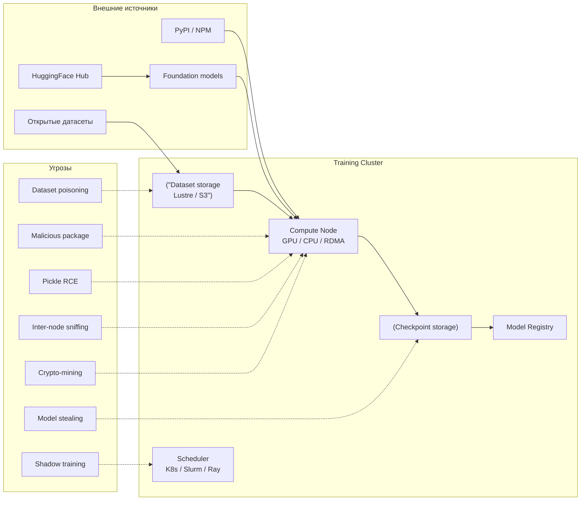
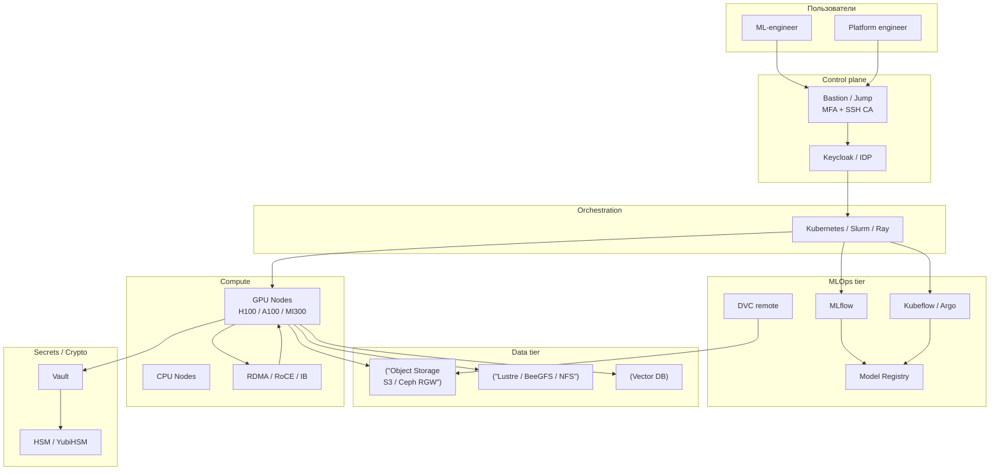
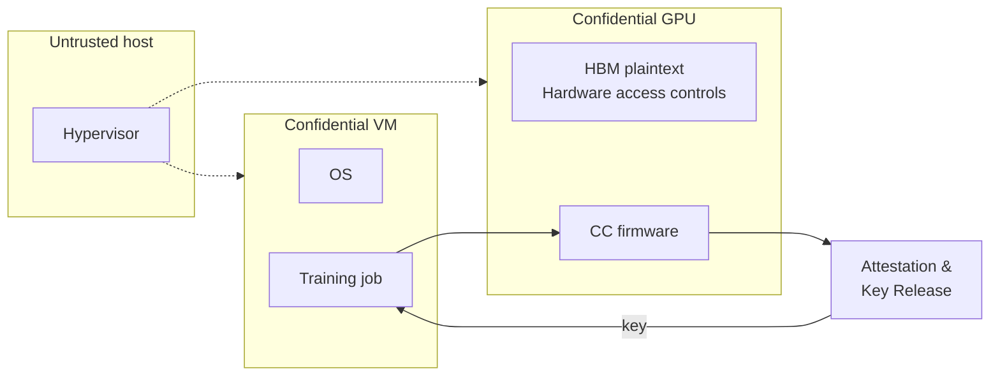
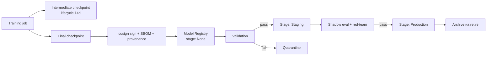
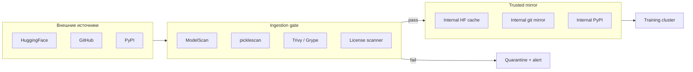
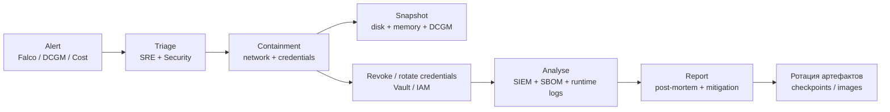
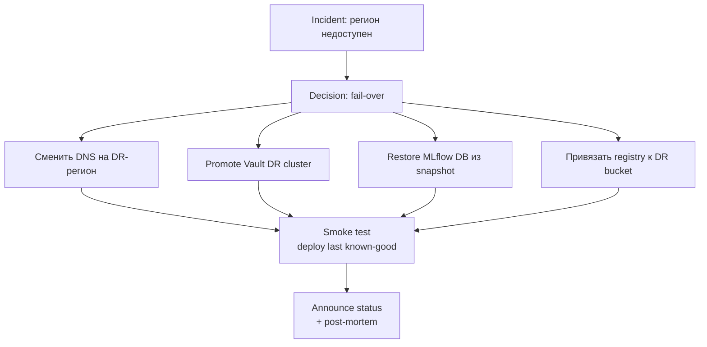

<a id="bezopasnost_-obucausej-infrastruktury"></a>

# Безопасность обучающей инфраструктуры

> Версия: 2.1 · Обновлено: 2026-05-29 · Теги: training, GPU, distributed, SLSA, multi-tenant, confidential-computing · Tier: 1-2
>
> **TL;DR**. Training это отдельный класс инфраструктуры: дорогие GPU, концентрация данных, долгие задания, inter-node коммуникации. Документ покрывает архитектуру и сегментацию кластера, защиту compute-нод и checkpoint-ов, изоляцию тренингов (namespace, MIG, Confidential Computing), supply chain для данных и моделей, Distributed Training Security (NCCL, RoCE, rendezvous), доступ и секреты, противодействие crypto-mining и модели-stealing, observability, DR и backup, finops-контроли, российскую специфику (GPU-дефицит, отечественные ускорители, ФСТЭК в контексте training), roadmap 90/180/365.

> **Тематическая актуализация 2026-11-13**: границы доверия распределённого training, приёмка GPU-изоляции, завершённость checkpoint и безопасный resume. Проверены первичные документы PyTorch, NCCL и NVIDIA MIG; эта дата не означает повторную юридическую проверку раздела 13 или квалификацию конкретного кластера.


<a id="0-soderjanie"></a>

## 0. Содержание

0. Зачем отдельный документ и каталог угроз для training
1. Кластер для обучения. Архитектура и сегментация
2. Защита Compute Nodes (CPU, GPU, RDMA)
3. Изоляция тренингов (namespace, MIG, Confidential Computing, Kata/gVisor)
4. Защита Checkpoint-ов и artifact lifecycle
5. Distributed Training Security (NCCL, rendezvous, RDMA, InfiniBand)
6. Supply Chain для Training (код, данные, базовые модели)
7. Доступ и секреты в training
8. Защита от злоупотреблений (crypto-mining, model stealing, shadow training)
9. Observability, аудит и forensics
10. DR и backup обучающей инфраструктуры
11. FinOps-контроли в training
12. Российская специфика: GPU-дефицит, отечественные ускорители, ФСТЭК/ФСБ
13. Сводные чеклисты
14. Roadmap 90/180/365 дней
15. Типичные ошибки
16. Связи с другими документами

---

<a id="1-zacem-otdel_nyj-dokument-i-katalog-ugroz-dla-training"></a>

## 1. Зачем отдельный документ и каталог угроз для training

<a id="11-pocemu-training-eto-ne-inference"></a>

### 1.1 Почему training это не inference

Документы 05 и 06 описывают безопасность inference. Training infrastructure отличается на каждом уровне:

- Концентрация данных. Training использует датасеты и промежуточные артефакты: токенизованные корпуса, shard-файлы, merged dataset. Компрометация может раскрыть доступные workload данные, checkpoints и credentials; фактический объём определяется правами, mounts, хранилищами и каналами вывода.
- Дорогое железо. GPU H100/A100 стоят десятки тысяч долларов за карту. Отечественные аналоги в дефиците. Кластер на 64-128 GPU это привлекательная цель для криптомайнеров и supply-chain-атак.
- Долгоживущие задания. Часы, дни, недели. За это время атакующий успевает закрепиться, вывести данные, подменить артефакт.
- Inter-node communication. NCCL, MPI, RoCE. Нестандартный и исторически plain-текст трафик между нодами.
- Специфический стек. NCCL, PyTorch, DeepSpeed, FSDP, transformers, HuggingFace Hub, DVC, MLflow. Каждый компонент несёт свой CVE-трек.
- Чувствительные артефакты. Checkpoint это интеллектуальная собственность. SafeTensors вместо pickle, подписание, immutable storage.

<a id="12-katalog-ugroz-training-steka"></a>

### 1.2 Каталог угроз training-стека



Полный каталог угроз training-стека:

| Группа | Угроза | Вход | Итог | Уровень |
|--------|--------|------|------|---------|
| Supply chain: код | Tainted package в transitive deps | pip install / uv sync | RCE на compute-ноде | Высокий |
| Supply chain: код | Typosquatting в private mirror | кеш PyPI / Artifactory | RCE и персистентность | Средний |
| Supply chain: данные | Poisoning публичного датасета | HuggingFace datasets, WebDataset | Backdoor в модели | Высокий |
| Supply chain: данные | Label flipping инсайдером | Data labeling pipeline | Деградация качества | Средний |
| Supply chain: модели | Pickle-based экзекуция в checkpoint | torch.load | RCE на compute-ноде | Критический |
| Supply chain: модели | Неофициальный fine-tune с backdoor | HuggingFace зеркала | Утечка промптов через trigger | Высокий |
| Compute | Эскалация из non-root контейнера | runc/containerd CVE | Побег на хост | Критический |
| Compute | Crypto-mining в скомпрометированном image | CI подменён | Кража GPU-часов | Средний |
| Compute | Плохо сконфигурированный MIG | Shared H100 между tenant-ами | VRAM leak между заданиями | Средний |
| Compute | Доступ через nvidia-smi / DCGM | Ошибка NetworkPolicy | Сбор телеметрии о workload | Низкий |
| Inter-node | NCCL plain-text | Ошибка VLAN | Sniff весов при AllReduce | Высокий |
| Inter-node | Rendezvous compromise (etcd, c10d) | Слабая auth | Master hijack, fault injection | Критический |
| Inter-node | RoCE/IB misconfiguration | Общие PKey | Cross-tenant чтение | Высокий |
| Artifacts | Подмена checkpoint в registry | Слабые ACL | Распространение backdoor | Критический |
| Artifacts | Утечка промежуточных checkpoints | Open S3 bucket | Модельный IP leak | Высокий |
| Доступ | Долгоживущие HF-токены и S3-ключи | Env vars в pod | Кража при компрометации | Средний |
| Доступ | Общий SA для team | Недостаток least-privilege | Широкий blast radius | Средний |
| Злоупотребление | Shadow training через личные OpenAI-ключи | Dev нарушает policy | Утечка данных в облако | Высокий |
| Злоупотребление | Несанкционированное distillation из внешнего API | Прокси не настроен | Юридический риск и утечка | Средний |

Эту таблицу имеет смысл вложить в модель угроз по 09-главе и отдельно по 18-главе для российских регуляторных сценариев.

<a id="13-gde-zakancivaetsa-training-i-nacinaetsa-inference"></a>

### 1.3 Где заканчивается training и начинается inference

Граница проходит по model registry с подписанными артефактами. До registry это training-домен (см. 04, 19). После registry это deployment-домен (см. 05, 06).

Утечка до registry может затронуть обучающие данные и промежуточные веса, после — опубликованные артефакты и доступные runtime данные. Registry обозначает границу процесса; фактический scope инцидента устанавливается по доступным объектам, credentials и подтверждённым операциям.

---

<a id="2-klaster-dla-obucenia-arhitektura-i-segmentazia"></a>

## 2. Кластер для обучения. Архитектура и сегментация

<a id="21-referensnaa-topologia"></a>

### 2.1 Референсная топология



<a id="22-vybor-orkestratora"></a>

### 2.2 Выбор оркестратора

| Вариант | Где уместен | Плюсы | Минусы |
|---------|-------------|-------|--------|
| Kubernetes + Kubeflow | Cloud-native организации, smaller jobs | Экосистема, Pod Security, NetworkPolicies | Накладные расходы, сложнее для HPC-стилей |
| Slurm | Классический HPC, on-prem | Proven, эффективное управление очередями | Менее cloud-native, аудит требует донастройки |
| Ray | Elastic training, RL, distributed inference | Гибкость, хорошо для RLHF | Security контроли моложе |
| K8s + Volcano / Koordinator | Mixed batch + online | Gang scheduling | Сложнее стек |
| Nebius / Yandex DataSphere / Cloud.ru ML Platform | Российское облако | Compliance готов, русскоязычная поддержка | Ограничение на выбор железа |

<a id="23-segmentazia-seti"></a>

### 2.3 Сегментация сети

- Training network отделена от production inference.
- Inter-node communication (NCCL, RoCE) внутри выделенного VLAN/subnet, без маршрута наружу.
- Scheduler access через bastion с MFA и SSH-CA (короткоживущие сертификаты).
- Storage защищается средствами конкретного протокола: HTTPS/TLS и IAM для S3, Kerberos `krb5p` для поддерживаемых NFS-конфигураций, проверенный защищённый transport и ACL для параллельной ФС. Нельзя считать mTLS универсальной встроенной функцией S3/NFS/Lustre. Ограничения сети дополняют авторизацию хранилища.
- Отдельная VPC/subnet для управления (Grafana, Prometheus, DCGM-exporter) с запретом egress из compute в эту сеть.
- Egress через explicit proxy (squid с allowlist) для HuggingFace, registry, MLflow.

<a id="24-kubernetes-spezificnye-kontroli"></a>

### 2.4 Kubernetes-специфичные контроли

- Pod Security Standards `restricted` по умолчанию, `baseline` для GPU workloads с обоснованием.
- Kyverno или OPA Gatekeeper для enforcement: запрет privileged, host paths, hostNetwork.
- NetworkPolicies: default deny, explicit allowlist между namespace-ами.
- ResourceQuota + LimitRange: предотвращают noisy-neighbor и обеспечивают прозрачность cost-аллокации.
- Отдельный RuntimeClass для nvidia-container-toolkit.
- PriorityClass для prod-training vs dev-training.
- Node taints: `workload=gpu-training:NoSchedule`, tolerations только у разрешённых namespace.
- Image pull secrets из Vault (external-secrets operator), ротация 24-48 часов.

<a id="25-slurm-spezificnye-kontroli"></a>

### 2.5 Slurm-специфичные контроли

- `SlurmctldHost` в выделенной подсети, защищён sssd + LDAP/Kerberos.
- `AuthType=auth/munge`, `AuthAltTypes=auth/jwt` для API.
- PAM-профиль, запрещающий прямой SSH на compute-ноды (только через job allocation).
- `pam_slurm_adopt` включён, чтобы процессы пользователя жили только внутри job cgroup.
- Accounting (slurmdbd) пишет в Postgres с TLS, аудит сохраняется ≥ 1 год.
- CgroupV2 для enforcement CPU/Memory/Devices.

<a id="26-ray-spezificnye-kontroli"></a>

### 2.6 Ray-специфичные контроли

- `--object-store-memory` с лимитом, исключение swap-attack.
- Dashboard доступен только через tunnel, TLS + auth.
- Kubernetes Ray operator, Ray cluster в namespace с сетевой изоляцией.
- Logs отправляются в Loki, не в локальный дашборд.

---

<a id="3-zasita-compute-nodes-cpu-gpu-rdma"></a>

## 3. Защита Compute Nodes (CPU, GPU, RDMA)

<a id="31-bazovoe-uprocnenie-hosta"></a>

### 3.1 Базовое упрочнение хоста

- CIS Benchmark for Linux (Debian/Ubuntu/Rocky).
- Отключение ненужных сервисов.
- AppArmor или SELinux в enforcing.
- auditd с правилами на execve, open, connect, ptrace, bpf, module_load.
- Firewall (nftables) с allowlist на управляющий и NCCL VLAN.
- Kernel hardening: `kernel.kptr_restrict=2`, `kernel.dmesg_restrict=1`, `kernel.unprivileged_bpf_disabled=1`, `net.core.bpf_jit_harden=2`.
- Обновления ядра и nvidia-driver по графику с canary-нодами.
- FIM (AIDE, Wazuh) на `/usr/local`, `/opt`, `/etc`.

<a id="32-gpu-spezifika"></a>

### 3.2 GPU-специфика

- Driver через проверенный Helm chart или packaged ISO, signature verified.
- `nvidia-smi` и DCGM недоступны из worker-pod-ов, только из admin namespace.
- MIG (Multi-Instance GPU) на поддерживаемых SKU для аппаратного разделения GPU Instances. Профили зависят от GPU и объёма памяти; нельзя переносить таблицу A100 80 GB на A100 40 GB или другой SKU без проверки.
- Освобождение ресурсов между заданиями по поддерживаемой процедуре платформы. GPU reset — административная операция с воздействием на соседние workloads, а не универсальное доказательство гарантированного стирания VRAM. Процедуру повторного назначения GPU проверять отдельно, см. 4.7.
- DCGM health checks per job, alert на ECC errors, Xid events, PCIe errors.
- FM (Fabric Manager) для NVSwitch систем сертифицирован и запущен от dedicated user.
- GPU P2P ограничен пределами одного NVLink-домена.

<a id="33-rdma-roce-infiniband"></a>

### 3.3 RDMA / RoCE / InfiniBand

- RoCEv2 в lossless VLAN с PFC (Priority Flow Control) настроен и мониторится.
- PKey partitioning (IB) с уникальными ключами на tenant, `partitions.conf` управляется декларативно.
- `ibstat`, `ibnetdiscover` доступ только admin.
- SRIOV на NIC c виртуальными функциями per tenant, без overlapping.
- Мониторинг ASIC-уровневых событий через ibdiag.

<a id="34-container-security"></a>

### 3.4 Container security

- Non-root контейнеры, `runAsNonRoot: true`, `runAsUser ≥ 10000`.
- Read-only root filesystem, writable tmpfs для `/tmp`, `/var/tmp`.
- Capabilities: `drop: [ALL]`, `add: []` по умолчанию. Для CUDA нужно тщательно аудировать.
- seccomp profile `RuntimeDefault` или кастомный.
- AppArmor profile per workload.
- Image signing (cosign, optional with Rekor transparency log), verification через Kyverno `verify-images`.
- SBOM (SPDX или CycloneDX) вложена в registry.
- Base image pinned digest, не tag (`@sha256:...`).

<a id="35-runtime-monitoring"></a>

### 3.5 Runtime monitoring

- Falco или Tetragon с rules:
  - Запуск xmrig, ethminer, ccminer, phoenixminer.
  - Reverse-shell паттерны (bash -i, nc -e, python -c pty.spawn).
  - Unexpected egress (connect к mining pool, Telegram bot API).
  - ptrace, process injection, LD_PRELOAD на неожиданных бинарях.
- Tracee (Aqua) для syscall-based detection.
- eBPF-based observability (Cilium Hubble, Pixie).
- GPU-уровневые аномалии: util=100 при idle job, неожиданные CUDA-контексты.

<a id="36-node-attestation"></a>

### 3.6 Node attestation

- TPM 2.0 или Platform Firmware Resilience.
- Measured boot и remote attestation через Keylime.
- Для Confidential Computing (AMD SEV-SNP, Intel TDX, NVIDIA H100 CC mode) полный attestation quote проверяется контроллером перед выдачей секретов.

<a id="kal_kulator-gpu-utilisation-vs-cost-dla-training-cluster"></a>

#### Калькулятор: GPU utilisation vs cost для training cluster

```widget:threshold-slider
{
  "id": "ch19-gpu-utilization",
  "title": "GPU utilisation vs cost / time-to-train",
  "description": "Учебная модель с условными кривыми, не измерение H100-кластера и не рекомендация регулятора. GPU utilisation не равна заполнению VRAM: по одному этому показателю нельзя вычислить OOM, стоимость run или требуемый уровень изоляции.",
  "min": 10,
  "max": 95,
  "step": 1,
  "default": 65,
  "unit": "%",
  "axisLabel": "Целевая утилизация GPU (%)",
  "tracks": [
    { "label": "Условный индекс стоимости (модель)", "compute": "200 / x * 100 / 1.2", "format": "fixed1", "tone": "warn", "hint": "Произвольная обратная зависимость для демонстрации. Реальную стоимость считать по GPU-часам, тарифам, storage и измеренному времени задания." },
    { "label": "Условное время (единицы модели)", "compute": "200 / x", "format": "fixed1", "tone": "info", "hint": "Учебная кривая. Реальный step time зависит от compute, communication, data pipeline и checkpoint I/O." },
    { "label": "Условный индекс накладных расходов", "compute": "x >= 80 ? 30 : (x >= 60 ? 15 : 5)", "format": "fixed1", "tone": "err", "hint": "Ступенчатая учебная функция, не измеренный overhead MIG/TEE. Изоляция выбирается по модели угроз, а не по универсальному лимиту utilisation." },
    { "label": "Условный индекс нагрузки", "compute": "Math.min(80, x * 0.6)", "format": "fixed1", "tone": "info", "hint": "Не вероятность сбоя. Для OOM нужны VRAM allocation и memory peak, для thermal issues — показания температуры и throttling." }
  ],
  "regions": [
    { "from": 10, "to": 30, "label": "Низкая утилизация в учебном примере", "tone": "info" },
    { "from": 30, "to": 60, "label": "Средняя утилизация; проверить bottleneck по метрикам", "tone": "info" },
    { "from": 60, "to": 80, "label": "Повышенная утилизация; изоляция оценивается отдельно", "tone": "info" },
    { "from": 80, "to": 95, "label": "Высокая утилизация не доказывает OOM или нарушение compliance", "tone": "info" }
  ]
}
```

---


<a id="4-izolazia-treningov"></a>

## 4. Изоляция тренингов

<a id="41-multi-tenant-szenarij"></a>

### 4.1 Multi-tenant сценарий

На одном кластере обучаются модели от разных команд, с разной чувствительностью данных.

Базовые требования:

- Namespace per tenant с NetworkPolicy default deny.
- Volumes изолированы (без shared PVC).
- Credentials (Vault, K8s Secrets) ограничены namespace-ом.
- Audit-лог доступа к shared ресурсам (object storage).
- Per-tenant квота ресурсов и cost-таг.

<a id="42-matriza-urovnej-izolazii"></a>

### 4.2 Матрица уровней изоляции

| Модель | Плюсы | Минусы | Когда |
|--------|-------|--------|-------|
| Dedicated node | Максимальная изоляция, простая отчётность | Низкая утилизация, дорого | Чувствительные данные, tier 3+ модели, внешние заказчики |
| MIG (hardware split) | Аппаратное разделение ресурсов GI на поддерживаемых GPU | Профили и совместимость зависят от SKU/driver; L40 не поддерживает MIG; общий host/driver остаётся в модели угроз | Несколько workloads при согласованной границе доверия, см. 4.7 |
| vGPU | Виртуальные GPU для VM; доступны разные способы backing | Time-sliced и MIG-backed vGPU имеют разные свойства; проверять платформу и hypervisor | По подтверждённой конфигурации изоляции |
| Time-sharing | Oversubscription и чередование GPU-контекстов | GPU Operator не даёт memory/fault isolation между replicas | Кооперативные dev-нагрузки с принятым риском |
| Confidential Computing | Защита выбранных данных в использовании и проверка измерений | Ограниченная модель угроз, совместимость и измеряемый overhead | Сценарии, требующие TEE; применимость определяют отдельно от факта наличия ПДн |

<a id="kakoj-uroven_-izolazii-training-zadac-vybrat_"></a>

#### Какой уровень изоляции training-задач выбрать

```widget:decision-tree
{
  "id": "ch19-isolation-level",
  "title": "Выбор кандидата на изоляцию training по модели угроз",
  "start": "q1",
  "nodes": {
    "q1": {
      "type": "question",
      "text": "Какие данные используются в training?",
      "sub": "Класс данных — только один вход решения. Во всех ветках отдельно оцениваются взаимное доверие tenants, полномочия администратора, исполняемый код, shared driver/storage и поддержка CPU/GPU. Это не нормативный допуск; synthetic/public не гарантируют отсутствие чувствительных сведений.",
      "choices": [
        {
          "label": "Restricted (PII, биометрия, медицина) или клиентские данные нескольких организаций",
          "next": "q2-restricted"
        },
        {
          "label": "Confidential (внутренние корпоративные)",
          "next": "q2-internal"
        },
        {
          "label": "Internal без PII (метрики, эксперименты)",
          "next": "leaf-mig"
        },
        {
          "label": "Public / synthetic / publicly licensed",
          "next": "leaf-vgpu"
        }
      ]
    },
    "q2-restricted": {
      "type": "question",
      "text": "Кто ваш cloud-provider / на чьей инфре обучаетесь?",
      "choices": [
        {
          "label": "Подтверждённая поддерживаемая конфигурация CVM + GPU CC с attestation",
          "next": "leaf-confidential"
        },
        {
          "label": "Собственный on-prem кластер",
          "next": "leaf-onprem-dedicated"
        },
        {
          "label": "Внешний облачный провайдер без CC (или его недоступно)",
          "next": "leaf-no-cloud"
        }
      ]
    },
    "q2-internal": {
      "type": "question",
      "text": "Multi-tenant или single team?",
      "choices": [
        {
          "label": "Multi-tenant: несколько команд / проектов делят cluster",
          "next": "leaf-mig-multi"
        },
        {
          "label": "Single team / project — нет необходимости делить с другими",
          "next": "leaf-dedicated-internal"
        }
      ]
    },
    "leaf-confidential": {
      "type": "leaf",
      "tone": "ok",
      "title": "Confidential Computing (CC) на CPU+GPU",
      "summary": "Кандидат для ограничения доступа определённых привилегированных компонентов хоста. Защита зависит от поддерживаемой конфигурации CPU+GPU, TCB, attestation и выдачи ключей.",
      "details": [
        "Для CPU проверить конкретную CVM и режим AMD SEV-SNP / Intel TDX; это не подтверждение защиты GPU-пути",
        "Для GPU проверить SKU, driver/firmware и CC-режим; CPU attestation не заменяет проверку GPU и связей компонентов",
        "NVIDIA H100 CC: аппаратные access controls и защищённые каналы в выбранном режиме; HBM не зашифрована",
        "Ключи выдаются только при допустимых свежих измерениях, identity и конфигурации; проверить отказ при неверном quote/revision",
        "Overhead, throughput и память измерить на своей модели и коммуникационной нагрузке; универсальных процентов нет",
        "TEE не устраняет вредоносный доверенный код, все side channels или обязанности по обработке данных; применимость норм оценивается отдельно"
      ],
      "links": [
        {
          "label": "Глава 17 §3 TEE",
          "href": "/ch/17-privacy-enhancing-tech"
        }
      ]
    },
    "leaf-onprem-dedicated": {
      "type": "leaf",
      "tone": "info",
      "title": "Dedicated nodes в on-prem кластере",
      "summary": "Выделенные ноды уменьшают часть совместного использования. Доступ администраторов, control plane, сети, драйверов и хранилища остаётся отдельной частью модели угроз.",
      "details": [
        "Node affinity/taints и admission ограничивают размещение; toleration сам по себе не является разрешением получить ноду",
        "Проверить CNI/NetworkPolicy, межузловые training-каналы и запрет неподтверждённого egress",
        "Раздельные grants и ключи для storage, datasets и checkpoints; отзыв проверить при resume",
        "CC рассматривать при соответствующей угрозе привилегированного доступа, а не автоматически из-за УЗ-1",
        "Проверить очередь, временные артефакты и повторное назначение GPU; утилизацию измерить"
      ]
    },
    "leaf-no-cloud": {
      "type": "leaf",
      "tone": "err",
      "title": "Cloud без CC: оценить доверие к оператору и допустимость обработки",
      "summary": "Если модель угроз запрещает доступ привилегированного оператора к данным в использовании, конфигурация без подходящей изоляции не закрывает эту угрозу. Само отсутствие CC не доказывает нарушение 152-ФЗ.",
      "details": [
        "Зафиксировать данные, цели, географию, получателей и доступ оператора; решение согласуют Data Owner, Security и Legal",
        "Сравнить подходящую CC-конфигурацию, выделенную инфраструктуру и минимизацию данных по одной модели угроз",
        "Маскирование или DP не добавляются универсально перед отправкой: определить защищаемую единицу, механизм и остаточное раскрытие",
        "FL меняет размещение данных, но обновления, градиенты и метаданные также могут раскрывать сведения",
        "До допуска подтвердить положительные и отрицательные проверки; если обязательная граница не обеспечена, не запускать этот маршрут"
      ]
    },
    "leaf-mig": {
      "type": "leaf",
      "tone": "info",
      "title": "MIG (Multi-Instance GPU) — hardware split",
      "summary": "MIG доступен на SKU из официальной матрицы NVIDIA, включая A100/H100/H200 и ряд Blackwell. L40 не поддерживает MIG. Граница изоляции зависит от GI/CI и конфигурации.",
      "details": [
        "MIG profiles: фиксированные размеры (1g.10gb, 2g.20gb, 3g.40gb для A100)",
        "Hardware isolation: отдельные L2 caches, memory partitions, SM clusters",
        "Поддержка: проверить конкретный SKU, driver и поддерживаемые profiles по матрице NVIDIA; не выводить поддержку только из архитектуры GPU",
        "K8s: GPU operator с MIG strategy 'mixed' или 'single'",
        "MIG-backed vGPU может использовать MIG-границы; отличать его от time-sliced vGPU и обычного GPU time-slicing"
      ]
    },
    "leaf-mig-multi": {
      "type": "leaf",
      "tone": "info",
      "title": "MIG + namespace-isolation для multi-tenant",
      "summary": "Кандидат для разделения GPU на поддерживаемые аппаратные инстансы. Проверить GI/CI, общие драйверы/control plane и права каждого проекта; namespace не заменяет эти границы.",
      "details": [
        "Проектная identity, namespace/RBAC и ResourceQuota; проверить запрет изменения чужих ресурсов",
        "MIG-профиль и поддерживаемый SKU/driver: подтвердить фактическую выдачу отдельных GI/CI",
        "Проверить CNI/NetworkPolicy и допустимые distributed-training связи",
        "Storage и ключи ограничены проектом; общие control plane и администраторы остаются в TCB",
        "Негативные проверки: чужие dataset/checkpoint, расширение ресурсов и старые credentials"
      ]
    },
    "leaf-dedicated-internal": {
      "type": "leaf",
      "tone": "ok",
      "title": "Dedicated nodes per project",
      "summary": "Выделенные ноды — вариант уменьшить совместное использование. Это не максимальная изоляция автоматически: control plane, администраторы и storage могут оставаться общими.",
      "details": [
        "Node selectors / taints: training pods только на assigned nodes",
        "Простая отчётность: cost-per-project через node allocation",
        "Утилизацию, очередь и стоимость простоя измерить на своей нагрузке; универсального диапазона 10–30% нет",
        "Combine: time-share queue для ad-hoc experiments на остальных nodes"
      ]
    },
    "leaf-vgpu": {
      "type": "leaf",
      "tone": "warn",
      "title": "Режим sharing: отличить vGPU, MIG-backed vGPU и time-slicing",
      "summary": "Способ разделения выбирается по границам доверия и поддержке платформы. Публичный корпус не делает безопасным произвольный код job или его доступ к credentials и соседним workloads.",
      "details": [
        "MIG-backed vGPU сочетает виртуализацию с выделенными ресурсами MIG; свойства проверить по SKU и режиму",
        "Time-slicing позволяет sharing без той же гарантии memory/fault isolation, что у отдельных MIG-инстансов",
        "Зафиксировать общие driver/kernel/control plane и права на host/GPU devices; виртуализация не исключает уязвимости этих компонентов",
        "Для недоверенных job проверить необходимость отдельного runtime/node/tenant-контура независимо от класса исходного корпуса",
        "Синтетические данные сначала оценить на чувствительные сведения; провести cross-tenant/resource/egress negative tests"
      ]
    }
  }
}
```

<a id="43-confidential-computing-dla-training"></a>

### 4.3 Confidential Computing для training

Доступные технологии:

- AMD SEV-SNP для CPU-изоляции VM.
- Intel TDX для trusted domains.
- NVIDIA Hopper (H100) с Confidential Computing mode: аппаратные ограничения доступа к GPU memory и attestation. On-package HBM не зашифрована; защита строится на иной границе доверия, чем CPU memory encryption.
- NVIDIA Blackwell расширяет CC возможности.

Архитектура Confidential Training:



Практика:

- Confidential VM (AMD SEV-SNP или Intel TDX) поднимается через cloud API.
- Attestation quote собирается, отправляется в KMS (Azure Attestation, AWS Nitro, Keylime on-prem).
- Только после успешной верификации KMS отдаёт data encryption key.
- Режим GPU CC и поддерживаемая CPU/GPU/hypervisor-конфигурация проверяются по deployment guide; key release привязывается к свежему attestation report, допустимым измерениям и режиму, а не к наличию CUDA device.
- Защита каналов рассматривается раздельно. В single-GPU CC CPU–GPU трафик защищён; для multi-GPU режимов свойства NVLink и внешнего RDMA зависят от архитектуры и режима. Нельзя выводить шифрование всех DMA из одного признака `CC-On`.

Оверхед:

- 5-10% на CPU-вычисления в CVM.
- 5-15% на GPU-интенсивные workloads из-за шифрования PCIe-трафика.
- Существенная экономия на compliance (возможность обрабатывать данные внешних заказчиков).

Проценты overhead выше — ориентир старой редакции, не SLA и не универсальный результат измерений. Для выбранного CPU/GPU и topology отдельно сравнить step time, checkpoint I/O и collective bandwidth. TEE не ограничивает злонамеренный training-код внутри доверенной VM и не заменяет data-access policy. Основа: [NVIDIA H100 CC architecture](https://developer.nvidia.com/blog/confidential-computing-on-h100-gpus-for-secure-and-trustworthy-ai/) и [актуальная модель угроз VM](https://docs.nvidia.com/confidential-computing/virtual-machines/threat-model), проверено 13.11.2026.

<a id="44-sandbox-tehnologii"></a>

### 4.4 Sandbox-технологии

| Технология | Уровень | GPU support | Use case |
|------------|---------|-------------|----------|
| gVisor | syscall interception | Ограниченный | CI-джобы, dev-нотебуки |
| Kata Containers | Lightweight VM | Через vfio-pci passthrough | Исполнение notebook-ов разных tenant |
| Firecracker | Lightweight VM | Нет | Serverless inference, не training |
| Confidential containers (Kata + TEE) | VM + TEE | H100 CC через passthrough | Multi-tenant с регуляторными требованиями |

<a id="45-shared-storage-security"></a>

### 4.5 Shared storage security

Для больших датасетов обычно Lustre, BeeGFS, CephFS или NFS over RDMA.

Требования:

- POSIX ACL или POSIX XATTR для fine-grained access.
- Audit enable (Lustre jobstats, CephFS audit).
- Quota per tenant (уровень OST/MDT для Lustre, pool для Ceph).
- Network ACL: только namespace-ы tenant-а могут mount.
- Для NFS: Kerberos (krb5p) с шифрованием.
- Для S3: bucket policy с `aws:SourceVpce`, `aws:PrincipalTag` или эквиваленты в Yandex / Cloud.ru.

<a id="46-notebook-izolazia"></a>

### 4.6 Notebook-изоляция

Jupyter / JupyterHub в multi-tenant среде часто источник утечек.

Контроли:

- JupyterHub с OAuth через IDP, профиль per user.
- Spawner создаёт pod в user-namespace с SA, ограниченным на его данные.
- Запрет sudo, privileged, hostPath.
- Egress через proxy, логирование всех HTTP-вызовов.
- Auto-shutdown idle notebook через 1-2 часа.
- Запрет подключения личных OpenAI-ключей (см. 8.3).

<a id="47-priemka-izolazii-gi-ci-time-sharing-i-graniza-hosta"></a>

### 4.7 Приёмка изоляции: GI, CI, time-sharing и граница хоста

**Проблема**: scheduler показывает разные ресурсы `nvidia.com/...`, но это ещё не доказывает, что два проекта разделены по памяти и административным полномочиям. MIG, Compute Instance и time-slicing решают разные задачи.

| Размещение двух workloads | Что разделяется | Что нельзя считать доказанным |
|---|---|---|
| Разные MIG GPU Instances (GI) | Выделенные аппаратные ресурсы памяти/compute согласно профилю | Изоляция от host root, уязвимости общего driver или ошибочной выдачи device nodes |
| Разные Compute Instances (CI) внутри одного GI | Часть compute-ресурсов | Независимые memory slices: CI разделяют память и движки родительского GI |
| Time-slicing replicas одного GPU/MIG instance | Время доступа к общему устройству | Memory/fault isolation между replicas и пропорциональная доля compute при запросе нескольких replicas |
| Разные VM с MIG-backed vGPU | Свойства конкретной GPU+hypervisor+vGPU-конфигурации | Равенство с любой time-sliced vGPU-конфигурацией |
| Разные физические ноды | Уменьшение общего hardware/driver blast radius | Отсутствие общих credentials, storage ACL, сети и административных аккаунтов |

**Порядок допуска multi-tenant профиля:**

1. Записать точный SKU, firmware/driver, CUDA, GPU Operator/device plugin, GI/CI mapping и режим sharing. Сохранять фактический readback после перезапуска ноды, а не только желаемый ConfigMap.
2. Для недоверяющих друг другу проектов запретить выдачу нескольких CI одного GI как независимых memory-isolated tenants. Если внутри GI дополнительно включён time-slicing, учитывать его отдельную границу доверия.
3. Admission-контролем запретить tenant-job создавать MIG instances, менять sharing ConfigMap, выбирать чужую ноду через обход allocation или монтировать все `/dev/nvidia*`. Управление MIG не делегировать обычному training SA.
4. Проверить namespace, storage и сеть независимо от GPU: изолированная VRAM не закрывает общий PVC, notebook download, service-account token или hostNetwork.
5. Измерить на синтетических нагрузках влияние OOM/сбоя одного workload на другой, доступный device inventory и видимость телеметрии. Такой drill подтверждает конкретную конфигурацию, а не отсутствие любых side channels или driver CVE.
6. При повторном назначении GPU проверить завершение старых процессов/контекстов и освобождение ресурсов. Требование к уничтожению остаточных данных задаётся отдельно по документации платформы и классу данных; один код возврата `gpu-reset` не является аттестацией стирания.

**Negative acceptance:** tenant A не получает device/volume проекта B; непривилегированный job не меняет MIG topology; подмена request с dedicated на shared ресурс не проходит admission; ConfigMap drift выявляется до нового допуска. Нагрузочные и fault-injection проверки выполнять только на выделенных тестовых GPU, без соседних рабочих заданий.

На 13.11.2026 поддержка NCCL с MIG уже не описывается универсальным «не поддерживается»: документация NCCL указывает **экспериментальный** режим с версии 2.31, отдельный MIG instance на rank, CUDA driver API 13.0+ (это не номер ветки GPU-драйвера) и отключённый MNNVL (`NCCL_MNNVL_ENABLE=0`). Это условия конкретной возможности, а не blanket-рекомендация обновить весь кластер. Для выбранных GPU/driver/NCCL выполнить collective smoke и восстановление; неподдерживаемую комбинацию не компенсировать обещанием изоляции.

**Источники:** [MIG Concepts, release 620](https://docs.nvidia.com/datacenter/tesla/mig-user-guide/620/concepts.html), [поддерживаемые GPU](https://docs.nvidia.com/datacenter/tesla/mig-user-guide/supported-gpus.html), [GPU Operator time-slicing](https://docs.nvidia.com/datacenter/cloud-native/gpu-operator/latest/gpu-sharing.html), [NCCL: Using MIG instances](https://docs.nvidia.com/deeplearning/nccl/archives/nccl_2312/user-guide/docs/usage/communicators.html#using-mig-instances). Проверено 13.11.2026; порядок приёмки — инженерная рекомендация.

---


<a id="5-zasita-checkpoint-ov-i-artifact-lifecycle"></a>

## 5. Защита Checkpoint-ов и artifact lifecycle

<a id="51-riski"></a>

### 5.1 Риски

- Checkpoint содержит веса и могут быть украдены (модельный IP).
- Checkpoint может быть подменён (supply chain внутри pipeline).
- Десериализация Python-объектов из недоверенного checkpoint может исполнять код. Ограниченный loader снижает часть риска, но не заменяет доверие к источнику, актуальный security patch и изоляцию.
- Intermediate checkpoints часто остаются в S3/Lustre навсегда и становятся forgotten data.

<a id="52-formaty-i-ih-svojstva"></a>

### 5.2 Форматы и их свойства

| Формат | Pickle-risk | Streaming | Quantization | Рекомендация |
|--------|-------------|-----------|--------------|--------------|
| pickle (`.pt`, `.bin`) | Есть | Нет | Да | Запретить для ingestion |
| SafeTensors | Нет | Да (memory-map) | Да | Дефолт |
| GGUF | Нет | Да | Да | Для llama.cpp deployment |
| ONNX | Нет | Да | Да | Для inference-портирования |
| HDF5 | Зависит | Да | Да | Legacy TF |

Для переносимых tensor weights предпочтителен SafeTensors. Полный training-resume state может дополнительно включать optimizer, scheduler, RNG и состояние dataloader; это другой объект и другая граница доверия. Экспорт весов в SafeTensors сам по себе не заменяет такой checkpoint и не доказывает отсутствие backdoor в модели.

<a id="53-podpisanie-i-provenans"></a>

### 5.3 Подписание и провенанс

- Каждый финальный checkpoint подписан cosign (keyless via Fulcio/Rekor или key-based).
- SHA-256 фиксируется в MLflow tags и в SLSA provenance.
- in-toto attestations для training-шагов (dataset, hyperparams, code SHA, image digest).
- Merge-signature: объединённый quote от cosign + SBOM + provenance хранится рядом с артефактом.

Примеры ниже требуют адаптации к закреплённой версии Cosign/MLflow и выбранной модели доверия. Конвертация через `torch.load` не делает внешний checkpoint доверенным: до десериализации требуются установленные источник, digest, поддерживаемый loader и изолированный контур. Для PyTorch Distributed Checkpoint это особенно важно, см. 5.7.

Шаблон подписания:

```bash
set -euo pipefail
# Training завершён.
# Source provenance/admission is already established; require a supported scan.
modelscan -p model.pt
# Пакет safetensors не предоставляет универсальной CLI convert для произвольных форматов; конвертацию удобно делать из Python (пример ниже).
python - <<'PY'
import torch
from safetensors.torch import save_file
state = torch.load("model.pt", map_location="cpu", weights_only=True)
save_file(state, "model.safetensors")
PY
sha256sum model.safetensors > model.safetensors.sha256
cosign sign-blob --yes \
  --bundle model.sigstore.json \
  model.safetensors

# Blob attestation; predicate prepared by the training controller.
cosign attest-blob --yes \
  --predicate slsa-provenance.json \
  --type slsaprovenance \
  --bundle model.attestation.sigstore.json \
  model.safetensors

# Upload to an existing tracking run; this does not promote a model.
mlflow artifacts log-artifact --run-id "$MLFLOW_RUN_ID" --local-file model.safetensors
mlflow artifacts log-artifact --run-id "$MLFLOW_RUN_ID" --local-file model.sigstore.json
mlflow artifacts log-artifact --run-id "$MLFLOW_RUN_ID" --local-file model.attestation.sigstore.json
```

При деплое:

```bash
set -euo pipefail
cosign verify-blob \
  --bundle model.sigstore.json \
  --certificate-identity "$APPROVED_SIGNER_IDENTITY" \
  --certificate-oidc-issuer "$APPROVED_OIDC_ISSUER" \
  model.safetensors

cosign verify-blob-attestation \
  --bundle model.attestation.sigstore.json \
  --type slsaprovenance \
  --certificate-identity "$APPROVED_SIGNER_IDENTITY" \
  --certificate-oidc-issuer "$APPROVED_OIDC_ISSUER" \
  model.safetensors
```

ModelScan вызывается через console entrypoint `modelscan`, а не `python -m modelscan`: у 0.8.8 нет `__main__`. Scanner job в проверке использовал Python 3.12. Проверять нужно поддержку фактического source format и coverage отчёта до десериализации, а не только строку «No issues found». На синтетическом валидном SafeTensors ModelScan 0.8.8 вернул `skipped`/exit 3; это не успешный scan. Поэтому ModelScan применяется к поддерживаемому исходному checkpoint, а deployment-фрагмент показывает только криптографические проверки финального SafeTensors. Parser/schema, ожидаемые tensor names/shapes и совместимость loader проверяют отдельным gate до load; две команды Cosign их не проверяют. `set -euo pipefail` останавливает шаблон при неуспехе проверки; scanner не заменяет доверие к source и не подтверждает отсутствие backdoor.

`APPROVED_SIGNER_IDENTITY` и `APPROVED_OIDC_ISSUER` задаются политикой получателя, не берутся на доверии из bundle. Поддерживаемая keyless/корпоративная PKI должна быть настроена заранее; произвольный Keycloak issuer не становится доверенным для публичного Fulcio автоматически. Успешная криптопроверка дополняется проверкой `subject`, разрешённого builder/run, материалов provenance и решения release-gate. Проверено 13.11.2026: [Cosign blobs](https://docs.sigstore.dev/cosign/signing/signing_with_blobs/), [attest-blob CLI](https://github.com/sigstore/cosign/blob/main/doc/cosign_attest-blob.md), [MLflow artifacts CLI](https://mlflow.org/docs/latest/api_reference/cli.html). Команды сверены с документацией, внешняя подпись/публикация здесь не выполнялась.

<a id="54-immutable-storage-i-retention"></a>

### 5.4 Immutable storage и retention

- Финальные артефакты в bucket с Object Lock (compliance mode) минимум 90 дней.
- Intermediate checkpoints во временном bucket с lifecycle policy: delete через 14 дней (рекомендуемое значение, настраивается) после завершения run.
- Замороженные промежуточные точки для воспроизводимости переносятся в long-term bucket после ревью.
- KMS-encrypted at rest, ключи rotation 90-365 дней.

<a id="55-acl-i-razdelenie-po-proektam"></a>

### 5.5 ACL и разделение по проектам

- Bucket-per-project или prefix-per-project.
- IAM-политика: `List` и `Get` ограничены конкретным проектом/классом данных; trainer пишет только в output-prefix своего run. Финальную публикацию и изменение release-указателя выполняет отдельная роль после gate; право удаления не выдаётся trainer по умолчанию.
- Запрет public access на уровне аккаунта.
- Bucket access logging в отдельный append-only bucket.

<a id="56-artifact-lifecycle"></a>

### 5.6 Artifact lifecycle



<a id="konstruktor-checkpoint-security-pipeline"></a>

#### Конструктор checkpoint security pipeline

Включайте контроли на каждом этапе lifecycle артефакта. Конструктор покажет coverage и обязательные пробелы.

```widget:policy-builder
{
  "id": "ch19-checkpoint-pipeline",
  "title": "Учебный план проверок checkpoint lifecycle",
  "description": "Каждый toggle выбирает пункт учебного плана training → registry → production. Raw score — сумма из 85, индикатор — её доля в процентах. Выбор не применяет контроль и не доказывает provenance, безопасный формат или supply-chain readiness; фактические артефакты и результаты проверяют отдельно.",
  "scoreLabel": "Выбранный вес учебного checkpoint-плана",
  "scoreMax": 85,
  "groups": [
    {
      "name": "Training output",
      "items": [
        { "id": "fmt-safetensors", "label": "safetensors для переносимых tensor weights", "weight": 10, "default": true, "recommended": true, "description": "Нет pickle-инструкций в формате. Полный resume state проверяется отдельно; формат не гарантирует отсутствие ошибок downstream loader или backdoor в весах." },
        { "id": "intermediate-cleanup", "label": "Intermediate checkpoints: согласованный retention и точки восстановления", "weight": 4, "default": true, "description": "14 дней — пример политики. Не удалять единственную разрешённую точку resume длительного run или замороженные свидетельства инцидента." },
        { "id": "checksum", "label": "SHA-256 на final checkpoint при сохранении", "weight": 5, "default": true, "recommended": true, "description": "Digest связывается с доверенным release record и проверяется на фактических bytes. Вычисление требует I/O и compute; сам hash не подтверждает издателя или safety." }
      ]
    },
    {
      "name": "Provenance + signing",
      "items": [
        { "id": "cosign", "label": "Cosign sign на final checkpoint", "weight": 8, "recommended": true, "description": "Sigstore Model Transparency log для public; private Rekor для confidential." },
        { "id": "sbom-mlbom", "label": "ML-BOM (CycloneDX 1.6+) с datasets / code / image", "weight": 6, "recommended": true, "description": "Полный inventory зависимостей training run." },
        { "id": "intoto", "label": "in-toto attestations для каждого этапа training", "weight": 5, "description": "End-to-end provenance: dataset → code → image → checkpoint." },
        { "id": "model-card", "label": "Model Card auto-generated с performance / limitations", "weight": 3, "default": true, "description": "Автоматическая генерация в pipeline; нет — на release не выходит." }
      ]
    },
    {
      "name": "Registry controls",
      "items": [
        { "id": "registry-stages", "label": "Stage promotion: None → Staging → Production через signed events", "weight": 7, "default": true, "recommended": true, "description": "Manual promotion в UI запрещён; только через signed CI event." },
        { "id": "registry-immutable", "label": "Immutable storage с retention policy", "weight": 5, "description": "Object lock на S3 / WORM-storage; никаких overwrites." },
        { "id": "registry-acl", "label": "ACL на read/write по проектам и tier", "weight": 5, "default": true, "description": "Per-project namespace + RBAC; tier-1 read только определённым ролям." }
      ]
    },
    {
      "name": "Validation gates",
      "items": [
        { "id": "scan-pickle", "label": "Format-aware проверка external артефактов", "weight": 6, "recommended": true, "description": "ModelScan / picklescan применяются к поддерживаемым форматам; unsupported / skipped / error требуют другого проверенного маршрута. Отсутствие находок не доказывает безопасность loader или отсутствие backdoor." },
        { "id": "adv-test", "label": "Adversarial testing + MIA test", "weight": 5, "default": true, "description": "Gate перед promotion; методика, baseline и пороги MIA фиксируются по профилю риска, а не универсальной константой precision." },
        { "id": "shadow-eval", "label": "Shadow evaluation на production traffic перед promotion", "weight": 4, "description": "A/B на live traffic без direct impact; baseline сравнения." }
      ]
    },
    {
      "name": "Verification + monitoring",
      "items": [
        { "id": "load-verify", "label": "Verify cosign signature при load в production pod", "weight": 6, "default": true, "recommended": true, "description": "Без verify подменённый артефакт грузится в production." },
        { "id": "audit-load", "label": "Audit log всех load-операций (who, when, which version)", "weight": 4, "default": true, "description": "Forensic при инциденте: какая версия модели обслуживала запрос." },
        { "id": "version-header", "label": "X-Model-Version в каждом response (для debugging)", "weight": 2, "description": "Удобство debugging; не security-критично, но полезно." }
      ]
    }
  ],
  "rules": [
    { "id": "must-safetensors", "type": "require-all", "items": ["fmt-safetensors"], "message": "Для переносимых весов нужен утверждённый безопасный формат; доверие к полному training-resume state проверяется отдельно." },
    { "id": "must-cosign", "type": "require-any", "items": ["cosign"], "message": "В учебном плане не выбрана подпись checkpoint. Для этого профиля перед production load требуется подтвердить digest, разрешённого издателя и актуальный допуск; наличие подписи без verification этого не доказывает." },
    { "id": "must-stages", "type": "require-all", "items": ["registry-stages"], "message": "Без stage promotion через signed events possible подмена в production без code review." },
    { "id": "must-pickle-scan", "type": "require-all", "items": ["scan-pickle"], "message": "External артефакты без сканирования — supply chain attack vector." },
    { "id": "must-load-verify", "type": "require-all", "items": ["load-verify"], "message": "Без verify подписи в production load теряется весь смысл cosign sign." },
    { "id": "min-coverage", "type": "min-score", "threshold": 65, "message": "Выбрано менее 65 из 85 условных пунктов. Это raw-порог учебного примера; разберите применимость и обязательные проверки. Он не вычисляет процент защищённости и не является требованием Tier-1." }
  ],
  "thresholds": [
    { "from": 0, "to": 30, "label": "Выбрано 0–30% условного веса списка", "tone": "err" },
    { "from": 30, "to": 65, "label": "Выбрано 30–65% условного веса списка", "tone": "warn" },
    { "from": 65, "to": 85, "label": "Выбрано 65–85% условного веса списка", "tone": "info" },
    { "from": 85, "to": 100, "label": "Выбрано 85–100% условного веса списка; результаты проверяются отдельно", "tone": "ok" }
  ]
}
```

---

<a id="57-checkpoint-kak-zaversennoe-sostoanie-run-a-ne-nabor-fajlov"></a>

### 5.7 Checkpoint как завершённое состояние run, а не набор файлов

**Проблема**: один rank сохранил shard, другой упал, а наблюдатель увидел каталог и выставил `latest`. Следующий запуск получает смесь шагов или поколений. SHA-256 отдельных файлов не доказывает, что они образуют согласованную точку восстановления.

Разделять два назначения артефактов:

| Объект | Состав | Допустимая граница загрузки |
|---|---|---|
| Переносимые веса | Tensor weights, архитектурная конфигурация, tokenizer; при необходимости adapter | Проверенный export для дальнейшего обучения/инференса после admission |
| Training-resume checkpoint | Веса, optimizer/scheduler, RNG, global step, data cursor и framework metadata | Только доверенный job и контролируемый store, совместимый training loader |
| Adapter / merged model | Adapter плюс точный base model и параметры merge | Проверяется полная цепочка base → adapter → merged export; имя модели не заменяет digest |

PyTorch прямо распространяет доверенную модель distributed runtime на DCP: `torch.distributed.checkpoint` и его format-conversion utilities предназначены для состояния собственного доверенного job. Нельзя считать внешний DCP безопасным потому, что в другом месте программы используется `torch.load(weights_only=True)`. Статический scan не делает такой loader песочницей.

<a id="poradok-fiksazii-i-publikazii"></a>

#### Порядок фиксации и публикации

1. Каждый checkpoint записывается в новый, не переиспользуемый prefix: `project/run_uid/attempt_uid/checkpoint_uid/`. Человеческое имя и `rank` не используются как единственная идентичность объекта.
2. Сохранение координируется выбранным framework. Контроллер ждёт завершения **записи в storage** всех необходимых частей, а не только локального staging в RAM; ошибки и незавершённые async futures блокируют commit.
3. Проверяющий процесс сверяет полный ожидаемый состав: metadata/index, shards, sidecar state, размеры, digest и принадлежность одному checkpoint UID/step. Пути нормализуются; абсолютные пути, выход через `..`, ссылки за пределы prefix и неожиданные файлы отклоняются до load.
4. Манифест подписывается разрешённой идентичностью и связывает весь состав. Хранилище запрещает последующую замену принятых объектов; для versioned storage фиксируются object version IDs, а не только mutable key.
5. Только после проверок создаётся commit record и меняется указатель на принятую точку. Атомарность/условное обновление реализуются средствами конкретного store; обычный многофайловый upload не считается транзакцией.
6. Отдельная роль выполняет promotion в финальный registry. Trainer не может одновременно писать provisional output и самостоятельно разрешать его production-публикацию.

<a id="manifest-training-resume-state"></a>

#### Манифест training-resume state

Это проектная схема для контроллера артефактов, **не формат PyTorch DCP**. `<...>` — обязательные значения из фактического run; подписывается нормализованное содержимое с проверяемым составом объектов.

```yaml
schema_version: mlsec-training-checkpoint/v1
checkpoint:
  uid: "<checkpoint-uid>"
  run_uid: "<run-uid>"
  attempt_uid: "<attempt-uid>"
  global_step: 4200
  producer_world_size: 8
  purpose: training_resume
  parent_manifest_digest: "<previous-accepted-manifest-sha256>"
dependencies:
  training_image_digest: "<image-sha256>"
  code_digest: "<source-sha256>"
  dataset_manifest_digest: "<dataset-manifest-sha256>"
  base_model_manifest_digest: "<base-manifest-sha256>"
  framework_revision: "<pytorch-and-checkpoint-format-revision>"
state_inventory:
  model: true
  optimizer: true
  scheduler: true
  rng: true
  data_cursor: true
objects:
  - key: "<relative-shard-or-metadata-key>"
    version_id: "<immutable-storage-version>"
    size_bytes: 1048576
    sha256: "<object-sha256>"
commit:
  status: complete
  verifier_identity: "<approved-verifier-identity>"
```

Список `objects` обязан перечислять все фактические части; один shard выше только иллюстрирует запись. Для чистого export состояние optimizer не требуется; это явно другой `purpose`, а не восстановление, из которого молча исключили файлы.

**Приёмочные проверки:** недостающий shard, metadata от другого step, неверная подпись, неподходящий base digest и изменение object version блокируют load до запуска training-кода. Подпись валидного producer означает происхождение, но не отсутствие poisoning: артефакты run с подозрением на компрометацию изолируются даже при корректной подписи.

**Связи**: provenance данных и критерии допуска модели описаны в [03](03-stage1-data-operations.md) и [04](04-stage2-model-operations.md); здесь контролируется инфраструктурная целостность точки восстановления. Источники, проверено 13.11.2026: [PyTorch Security Policy](https://github.com/pytorch/pytorch/security/policy), [DCP API](https://docs.pytorch.org/docs/2.15/distributed.checkpoint.html). Версию документации выбирать под установленный framework; совместимость сохранённых DCP state dict между версиями PyTorch не гарантируется.

---

<a id="6-distributed-training-security"></a>

## 6. Distributed Training Security

<a id="61-osnovnye-frejmvorki"></a>

### 6.1 Основные фреймворки

- PyTorch DDP (DistributedDataParallel).
- PyTorch FSDP (FullyShardedDataParallel) для больших моделей.
- DeepSpeed (Microsoft, ZeRO-2/3 для оптимизации памяти).
- Horovod (Uber, MPI-based).
- Ray Train.
- MegaScale, NeMo, FSDP2, torchtitan для фронтира.

<a id="62-communication-sloj"></a>

### 6.2 Communication-слой

- NCCL (NVIDIA Collective Communications Library) для GPU-GPU.
- RCCL (ROCm, аналог NCCL для AMD).
- Gloo для CPU fallback.
- MPI (OpenMPI, MPICH) с PMIx.
- Транспорт: RoCEv2, InfiniBand, TCP.

Риски:

- NCCL исторически был без шифрования, trunk traffic в plain.
- InfiniBand PKey-based isolation работает только при корректной конфигурации.
- Rendezvous (etcd, c10d, TorchElastic) может быть скомпрометирован.
- При распределённом save/load возможны межранговые передачи; их конфиденциальность зависит от фактически выбранного transport, а не от наличия sharding.

Меры:

- NCCL-IB с изолированной сетью (отдельная VLAN, SRIOV на NIC).
- NCCL по умолчанию не шифрует сеть. Документация NCCL 2.32 описывает сборку с OpenSSL и `ncclSetEncryption()` для TCP, проходящего через встроенный `ncclSocket`; IB/RDMA, NVLink, shared memory и сторонние transports этим не покрываются. Наличие новой NCCL в образе не означает, что framework вызвал API и настроил ключи. Подробнее 6.5.
- Защита rendezvous зависит от backend: TLS/auth конкретного etcd не включают авторизацию у c10d/TCPStore. Для всех выбранных путей требуется подтверждённая сетевая граница и управление участниками.
- Межнодовая сеть только внутри security boundary, без маршрута наружу.
- Для MPI/RDMA зафиксировать версию MPI, выбранный transport и поддерживаемую конфигурацию PKey/VF. Не переносить флаги старого Open MPI `openib` в другой release как security-контроль; допуск подтверждается отрицательным cross-job тестом.

<a id="63-rendevu-i-elasticity"></a>

### 6.3 Рендеву и elasticity

- Использовать rendezvous backend, реально поддерживаемый выбранным launcher/framework. K8s Lease для оркестрации и backend `torchrun` — разные механизмы; один не включает защиту другого.
- `init_method="env://"` передаёт параметры инициализации; адрес, port и job ID не являются аутентификацией участников. Секреты выдаются отдельно минимальному составу job.
- Никаких public IP для inter-node communication.
- TorchElastic с health checks и graceful re-rendezvous.
- RDMA NIC binding per pod через PCIe passthrough или SRIOV.

<a id="64-sharded-checkpointing"></a>

### 6.4 Sharded checkpointing

FSDP и DeepSpeed сохраняют checkpoint распределённо. Контроли:

- Координация shards через подписанный manifest (SHA-256 per shard + единая подпись manifest).
- Все shard-файлы и manifest в одном immutable bucket.
- Reconstitution делает verify всех shard до загрузки.

<a id="65-doverennyj-sostav-job-control-plane-data-plane-i-vydaca-klucej"></a>

### 6.5 Доверенный состав job: control plane, data plane и выдача ключей

**Модель угроз**: скомпрометированный worker уже исполняет код и видит данные/градиенты, доступные его job. Шифрование канала не делает такого участника честным и не обнаруживает произвольную подмену его вкладов в collective. Поэтому защита строится и вокруг состава job, и вокруг каждого пути передачи.

| Контур | Примеры | Что необходимо ограничить | Проверяемое свидетельство |
|---|---|---|---|
| Управление | Scheduler API, launcher, rendezvous, TCPStore | Кто создаёт job, присоединяет/перезапускает workers, меняет endpoint | Admission decision, разрешённый состав, audit изменений |
| Данные между workers | NCCL Socket, IB/RDMA, NVLink, плагины | Между какими нодами и интерфейсами разрешены операции; что зашифровано | Фактический transport/topology, policy readback и тест из чужого allocation |
| Storage | Dataset reads, checkpoint writes/loads | Состав данных, output prefix, версии объектов | IAM decision, object access logs, принятый checkpoint manifest |
| Секреты | Storage credentials, ключи защищённого transport | Получатели, срок и отзыв; доступ после замены worker | Выдача по workload identity, проверенный отказ старой роли |
| Управление host/GPU | Driver, device plugin, MIG, RDMA VF | Кто меняет устройство, fabric и runtime | Отдельная admin-role, неизменяемые журналы и конфигурация |

PyTorch Distributed рассчитан на доверенную сеть и не является сервисом для произвольных клиентов. `RANK`, `WORLD_SIZE`, `rdzv-id` и знание адреса master не доказывают идентичность процесса. Даже выделенный VLAN на весь кластер может быть слишком широкой границей, если в нём выполняются задания разных недоверяющих проектов.

**Порядок допуска:**

1. Зафиксировать доверенную единицу: конкретный run/attempt, разрешённые nodes/workloads, image/code digests и класс данных. Управление составом оставить контроллеру; worker не выдаёт себе право добавлять peers.
2. Ограничить и bootstrap, и bulk communication. Проверить primary pod network, hostNetwork и дополнительные RDMA-интерфейсы; Kubernetes NetworkPolicy не предполагается автоматически действующей на все эти пути.
3. Для каждого transport записать механизм confidentiality/integrity. VLAN/PKey дают сегментацию, но сами по себе не шифруют данные. CPU/GPU CC не предполагается шифрованием внешней сети NIC.
4. Если используется TCP encryption NCCL, подтвердить поддерживаемую сборку, вызов API framework/application и безопасную доставку job-specific ключа **до** создания communicator. Не использовать один постоянный PSK на все команды; не помещать значение ключа в CLI, исходники, traceback или общий notebook.
5. Проверить отрицательные сценарии: peer из другого job не достигает rendezvous/data plane, старый worker после замены не читает storage, неподходящая версия/конфигурация transport не приводит к тихому plaintext fallback при требовании шифрования.
6. Перед допуском профиля выполнить безопасный collective smoke на синтетических данных с теми же interfaces и restart-политикой. Открытый TCP port или успешный ping не проверяют collective и защищённость всех его каналов.

<a id="primer-zapuska-i-granizy-ego-smysla"></a>

#### Пример запуска и границы его смысла

Флаги `torchrun` ниже соответствуют официальной документации; четыре локальных процесса и один повтор — учебные параметры, не профиль для произвольного оборудования. На каждой выделенной ноде контроллер задаёт одинаковые `TRAIN_RUN_ID` и `RDZV_ENDPOINT`. `train.py` — код организации с проверенным resume, а не встроенный скрипт PyTorch.

```bash
torchrun \
  --nnodes=2 \
  --nproc-per-node=4 \
  --max-restarts=1 \
  --rdzv-backend=c10d \
  --rdzv-id="$TRAIN_RUN_ID" \
  --rdzv-endpoint="$RDZV_ENDPOINT" \
  train.py
```

Этот пример не настраивает TLS, авторизацию c10d, RDMA-фильтрацию или NCCL encryption. Он показывает только параметры запуска. Управление ключами и проверку сетевой границы реализуют отдельно; не добавлять вымышленные «security flags» к launcher.

**Источники, проверено 13.11.2026**: [PyTorch distributed trust model](https://github.com/pytorch/pytorch/security/policy), [torchrun](https://docs.pytorch.org/docs/2.15/elastic/run.html), [NCCL Setup 2.32](https://docs.nvidia.com/deeplearning/nccl/user-guide/docs/setup.html), [Kubernetes NetworkPolicy и hostNetwork](https://kubernetes.io/docs/concepts/services-networking/network-policies/#networkpolicy-and-hostnetwork-pods). Защита job в таблице — рекомендуемый контракт платформы; наличие этих настроек в milksec-инфраструктуре здесь не заявляется.

---

<a id="7-supply-chain-dla-training"></a>

## 7. Supply Chain для Training

<a id="71-zavisimosti-koda"></a>

### 7.1 Зависимости кода

Типичный training environment:

- Python 3.10+, uv или pip+pip-tools.
- PyTorch / TensorFlow / JAX.
- transformers, accelerate, peft, trl, datasets.
- CUDA, cuDNN, NCCL.
- Optional: deepspeed, flash-attn, triton, xformers.

Уязвимости в любой из них означают компрометацию training.

Меры:

- Pinned versions с hash (`--require-hashes`) в requirements.txt или uv.lock.
- Vulnerability scan на CI: pip-audit, Safety, Trivy, Grype.
- Mirrored dependencies в internal PyPI (Artifactory, Nexus, devpi).
- SBOM (CycloneDX) для training image, хранится 1+ год.
- Allowlist PyPI: только проверенные namespace и maintainers.
- Renovate / Dependabot с проверкой CVE перед автомёрджем.

<a id="72-dataset-supply-chain"></a>

### 7.2 Dataset supply chain

Коротко (подробно в 03 и 16):

- DVC с hash-tracking, remote в защищённом bucket.
- Manifest с подписью источника (cosign sign-blob manifest.json).
- Anomaly detection и валидация данных (Cleanlab, Great Expectations, deepchecks).
- Provenance: откуда, кем, когда, лицензия, ссылка на источник.
- Отдельный staging-bucket для new data перед включением в training.

<a id="73-model-supply-chain"></a>

### 7.3 Model supply chain

Foundation model:

- Allowlist источников (HuggingFace организации Mistral AI, Meta, Ai2, Microsoft, Google, NVIDIA, Qwen и домашние для компаний вроде Yandex, T-Tech, MTS AI, Сбер AI).
- SafeTensors вместо pickle.
- ModelScan + picklescan + fickling при ingestion.
- Hash verify против подписанного манифеста.
- Behavioural тестирование (Garak) с триггер-пробами.

Fine-tune артефакты (LoRA, QLoRA):

- Всё то же + carrying-over base model digest в fine-tune attestation.
- `base_model_digest` в MLflow tags.

<a id="74-vnutrennaa-model_-doveria"></a>

### 7.4 Внутренняя модель доверия



<a id="75-build-pipeline-dla-training-image"></a>

### 7.5 Build pipeline для training image

- Multi-stage Dockerfile с минимальной runtime базой (distroless или ubi9-minimal).
- Pinned base image digest.
- Verified builder (signed builder image).
- Hermetic build (без сети после вытаскивания зависимостей).
- SBOM и provenance attestation на каждый build.
- Image scanning gate (Critical/High block).
- Cosign sign перед push в registry.
- Policy (Kyverno verify-images) блокирует pull неподписанных.

<a id="pesocniza-detection-anti-patternov-v-training-dockerfile"></a>

#### Песочница: detection анти-паттернов в training Dockerfile

Pattern в pre-merge hook ловит типичные проблемы Dockerfile для training-нагрузки: floating tags, USER root в final stage, открытые pip без --require-hashes.

```widget:regex-tester
{
  "id": "ch19-dockerfile-antipatterns",
  "title": "Detection анти-паттернов в training Dockerfile",
  "description": "Ищет выбранные строковые признаки: latest/main/master/stable, USER root/0, отдельную форму pip install и ADD URL. Не определяет final stage, все mutable tags или полную семантику pip options.",
  "defaultPattern": "(?:FROM\\s+\\S+:(?:latest|main|master|stable)(?!\\s*@sha256))|(?:^USER\\s+(?:root|0)\\s*$)|(?:^RUN\\s+pip\\s+install\\s+(?!--require-hashes)[^\\n]*(?:requirements|-r\\s))|(?:^ADD\\s+https?://)",
  "flags": "gmi",
  "tests": [
    { "id": "p1", "shouldMatch": true, "label": "Floating tag latest", "text": "FROM python:3.11-slim:latest" },
    { "id": "p2", "shouldMatch": true, "label": "USER root в финале", "text": "USER root" },
    { "id": "p3", "shouldMatch": true, "label": "pip без --require-hashes", "text": "RUN pip install -r requirements.txt" },
    { "id": "p4", "shouldMatch": true, "label": "ADD из URL (вместо COPY + verify)", "text": "ADD https://example.com/dataset.tar.gz /data/" },
    { "id": "p5", "shouldMatch": true, "label": "Floating tag main", "text": "FROM nvidia/cuda:main" },
    { "id": "ok1", "shouldMatch": false, "label": "Pin by digest", "text": "FROM python:3.11-slim@sha256:abc123def456" },
    { "id": "ok2", "shouldMatch": false, "label": "USER non-root", "text": "USER mluser" },
    { "id": "ok3", "shouldMatch": false, "label": "pip с --require-hashes", "text": "RUN pip install --require-hashes -r requirements.txt" },
    { "id": "ok4", "shouldMatch": false, "label": "COPY (а не ADD URL)", "text": "COPY ./data /data/" },
    {"id": "edge-build-stage-root", "shouldMatch": true, "label": "Сигнал build-stage root; final stage проверяется отдельно", "text": "FROM python:3.12 AS build\nUSER root\nRUN echo build\nFROM python:3.12-slim\nUSER 1000"},
    {"id": "edge-pip-option-order", "shouldMatch": true, "label": "FP-сигнал: --require-hashes есть после -r, нужен parser options", "text": "RUN pip install -r requirements.txt --require-hashes"},
    {"id": "edge-version-tag", "shouldMatch": false, "label": "Blind spot: version tag без digest не входит в эти четыре слова", "text": "FROM python:3.12"}
  ]
}
```

> Видим отдельные строки, а не итоговую конфигурацию образа. Dockerfile parser/linter должен разрешить stages/ARG/USER и digest базового образа; pip/lock validator — полный набор options и hashes. Build-stage root и перестановка флагов могут дать ложный сигнал, а version tag без digest — не дать его; разрешённая сборка проверяется парным тестом.

---

<a id="8-dostup-i-sekrety-v-training"></a>

## 8. Доступ и секреты в training

<a id="81-credentials"></a>

### 8.1 Credentials

- HuggingFace tokens, W&B API keys, S3 credentials, Vault tokens.
- Никакого hardcode, никакого `.env` в репозитории.
- Kubernetes Secrets + external-secrets operator, источник Vault.
- Vault для short-lived dynamic secrets (S3 role assumption через AWS STS / Yandex IAM).
- SOPS + KMS для GitOps secrets.

<a id="82-service-accounts"></a>

### 8.2 Service accounts

- Каждое задание запускается под выделенным SA.
- SA привязан к IAM через OIDC (EKS IRSA, GKE Workload Identity, Yandex Cloud service accounts, Cloud.ru IAM).
- Least privilege на storage: read train-bucket, write only to assigned output prefix.
- Periodic access review (90 дней).

<a id="83-jit-elevation"></a>

### 8.3 JIT elevation

- Обычные training jobs запускаются в ограниченной роли.
- Для admin-операций (ротация, drain node, GPU reset) используется JIT elevation: запрос через ChatOps бот, approvals, audit, timeout 1-4 часа.
- Ключи admin-ролей хранятся только в Vault, выдаются по запросу с approvals.

<a id="84-audit-dostupa"></a>

### 8.4 Аудит доступа

- CloudTrail / Yandex Cloud audit / Cloud.ru audit / MinIO audit.
- Логи доступа к object storage (включить S3 access logging или аналог).
- Алерты на необычные паттерны:
  - Выгрузка > 10 GB весов вовне.
  - Доступ к checkpoint-бакету из незнакомого IP.
  - `aws:PrincipalTag` вне ожидаемого tenant.
- SIEM-пайплайн с retention по виду записи, цели и конкретному основанию; data owner и Legal фиксируют срок, доступ, legal hold и уничтожение. Наличие ПДн само по себе не задаёт три года хранения.

---

<a id="9-zasita-ot-zloupotreblenij"></a>

## 9. Защита от злоупотреблений

<a id="91-crypto-mining"></a>

### 9.1 Crypto-mining

Классический сценарий: скомпрометированный container запускает XMRig или фермер GPU-coin.

Меры:

- Runtime detection (Falco rules: процессы xmrig, ethminer, ccminer, phoenixminer, trex-miner).
- Network egress limit: mining pools в deny list (stratum+tcp, популярные pool-эндпоинты).
- GPU utilization anomaly: job в idle, но GPU 100% → alert.
- CI/CD сканирование образов: ClamAV + Trivy + Falco image scanner.
- Выделенный egress proxy с allowlist (HuggingFace Hub, GitHub, отечественные зеркала).

<a id="92-model-stealing-cerez-training-access"></a>

### 9.2 Model stealing через training access

Инсайдер или внешний атакующий с доступом к checkpoint уносит веса.

Меры:

- Access log review и алерты на массовое скачивание из checkpoint-бакета.
- DLP на исходящий трафик: большие файлы в unusual destinations (см. LLM-шлюз в 06 и 18).
- Watermarking моделей (dataset-level или weight-level) для идентификации утечки.
- Canary tokens в training-данных: уникальные триггеры позволяют через inference модели доказать источник.
- Segmentation of duties: ML-engineer, который тренирует, не имеет доступа к финальному bucket регистра.

<a id="93-shadow-training-i-obhod-policy"></a>

### 9.3 Shadow training и обход policy

Команды запускают training без регистрации, часто с личными OpenAI-ключами для distillation или с неразрешёнными датасетами.

Меры:

- MLflow Gateway как обязательный для любых LLM-запросов в training.
- Egress firewall блокирует прямые вызовы к OpenAI/Anthropic/Gemini/любым внешним.
- Allowlist egress хостов: только корпоративные endpoints.
- Мониторинг GPU-кластера на unregistered jobs (jobs без MLflow run tag).
- Policy: все fine-tune через CI/CD с записью в реестр моделей.

<a id="94-adversarial-training-i-poisoning"></a>

### 9.4 Adversarial training и poisoning

- Staging pipeline с holdout-данными, которые не идут в training.
- Post-training behavioural test (Garak, Promptfoo) с каноническим набором проб.
- Detection of backdoors через activation analysis (Neural Cleanse, STRIP).
- Red-team на каждом значимом релизе.

<a id="95-denial-of-service-cerez-job"></a>

### 9.5 Denial of service через job

- `PriorityClass` предотвращает кражу ресурсов через low-priority job с резким увеличением запроса.
- ResourceQuota enforce через webhook.
- Алерты на очередь > N часов и на jobs с аномальным memory footprint.

---

<a id="10-observability-audit-i-forensics"></a>

## 10. Observability, аудит и forensics

<a id="101-metriki"></a>

### 10.1 Метрики

- Utilization (GPU util, VRAM, FLOPs, NVLink BW).
- Cost (per job, per team, per project).
- Job duration, queue time, retries.
- Data lineage (какой dataset, какой model init, какой output).
- Security metrics (scan results, policy violations, signed artifact coverage).
- Carbon footprint (kWh, estimated CO2).

<a id="102-stack"></a>

### 10.2 Stack

- Prometheus + Grafana + Loki для metrics/logs.
- OpenTelemetry для traces, hot paths DDP/FSDP инструментированы.
- MLflow Tracking для experiment metadata.
- W&B self-hosted или Aim как альтернатива.
- DCGM для GPU-уровневых метрик.
- Fluent Bit как коллектор логов с подписанными потоками.

<a id="103-audit"></a>

### 10.3 Аудит

- K8s audit log на control plane в immutable storage, retention ≥ 1 год.
- Slurm sacct / sreport в Postgres, append-only, retention ≥ 1 год.
- Object storage access logs (S3 access log, Ceph RGW logs) в отдельный bucket.
- Vault audit device в Loki/SIEM.
- Для ПДн / КИИ retention по требованиям (см. 18 раздел 1 и 2).

<a id="104-alerty"></a>

### 10.4 Алерты

- Job failed > N раз за час.
- GPU util < X% на длительных jobs (зомби или утечка).
- Cost > budget threshold.
- Policy violation: unsigned artifact, unallowed image, privilege escalation, hostPath mount.
- Runtime security: crypto-miner, reverse shell, suspicious connect.
- Node attestation failure.

<a id="105-forensics-readiness"></a>

### 10.5 Forensics readiness

- Snapshot процедура compute node: EBS-уровневый snapshot или fs-уровневый с hash.
- `crictl inspect`, `runc state`, `journalctl -u containerd` сохраняются в immutable bucket.
- Сначала сохранить доступные события и read-only telemetry. Активные DCGM diagnostics могут воздействовать на GPU workload; запускать их по поддерживаемой процедуре на выведенной из эксплуатации/тестовой ноде, а не автоматически перед сохранением свидетельств.
- Ключевой принцип: любое действие forensics делается на snapshot-копии, а не на production-ноде.
- Process: incident-commander создаёт ticket, backup forensic artifact, только после этого node возвращается к работе.

<a id="106-tipovoj-tajmlajn-forensics"></a>

### 10.6 Типовой таймлайн forensics



---

<a id="11-dr-i-backup-obucausej-infrastruktury"></a>

## 11. DR и backup обучающей инфраструктуры

<a id="111-cto-bekapim"></a>

### 11.1 Что бэкапим

- Финальные checkpoints (уже в immutable registry).
- Подписанные SBOM и provenance.
- MLflow БД (experiment metadata).
- Vault snapshots.
- Control plane (etcd для K8s, slurmdbd для Slurm).
- Dataset manifests и хэши (DVC files + remote).
- Infrastructure-as-Code репозитории.

Не бэкапим (осознанно):

- Intermediate checkpoints (идут в lifecycle policy).
- Docker images (есть в registry с retention).
- Raw logs старше retention окна.

<a id="112-strategia"></a>

### 11.2 Стратегия

- Cross-region replication для финальных артефактов и registry.
- Cross-provider replication для compliance-критичных (например между Yandex Cloud и on-prem) если применимо.
- RTO/RPO согласованы с бизнесом: типично RTO 4-24 часа, RPO 1-4 часа для training-сервисов (training job можно перезапустить).
- Восстановление control plane отрабатывается минимум 1 раз в полгода.
- Immutable backup: WORM-режим для финальных артефактов.

<a id="113-runbook-dr"></a>

### 11.3 Runbook DR



<a id="114-testy-vosstanovlenia"></a>

### 11.4 Тесты восстановления

- Chaos drill раз в квартал: удаление одной AZ, отключение Lustre MDT, падение Vault leader.
- Game day по сценарию «потеря registry bucket»: восстановление из replica + signed manifest.
- Пост-тестовый отчёт: gap list и метрики RTO/RPO.

<a id="115-resume-posle-preemption-i-posle-komprometazii-worker"></a>

### 11.5 Resume после preemption и после компрометации worker

**Разные события требуют разных решений.** При штатном preemption задача — продолжить вычисления из согласованной точки. При подозрении на скомпрометированный rank задача сначала — восстановить границу доверия. Автоматический restart на той же ноде не считается устранением компрометации.

| Событие | Допустимая точка старта | Что блокирует автоматическое продолжение |
|---|---|---|
| Spot/preemption без признаков компрометации | Последний принятый committed checkpoint | Незавершённая запись, отсутствующий shard или непроверенная совместимость |
| OOM или обычный отказ worker | Та же процедура после разбора причины и корректировки ресурсов | Повтор, который меняет данные/настройки без записи новой версии run |
| Смена world size при elasticity | Проверенный checkpoint и поддерживаемый resharding path | Код привязывает данные/секреты к старым rank IDs; неизвестно состояние sampler/optimizer |
| Подозрение на RCE, кражу credential или malicious rank | Независимо подтверждённая точка до окна компрометации либо новый run | Доверие к последнему checkpoint только потому, что у него корректный digest/подпись |
| Повреждённый/неизвестный state | Чистый восстановительный контур для анализа | Попытка «починить» внешнюю metadata через unrestricted loader на рабочем кластере |

<a id="prozedura-statnogo-resume"></a>

#### Процедура штатного resume

1. Scheduler выдаёт новый attempt UID; связь с исходным run и причиной restart сохраняется в журнале. Повтор не перезаписывает уже принятый prefix.
2. Контроллер разрешает только committed checkpoint из раздела 5.7; предварительно проверяет producer, состав, object versions и loader compatibility.
3. Код явно восстанавливает model/optimizer/scheduler, RNG и положение в данных согласно контракту обучения. Отсутствующее состояние не игнорируется молча; warm start из весов оформляется отдельным режимом с новой lineage.
4. Проверяются rank-to-device mapping и состав process group. В TorchElastic `RANK` не стабилен между рестартами, а при elasticity может меняться `WORLD_SIZE`; права на storage определяются workload identity/run, не числом rank.
5. Выполняется короткий verification interval: progress движется вперёд, нет неожиданного повторения/пропуска данных, метрики и потери сравниваются с допустимым коридором. Полная побитовая идентичность не предполагается без отдельной гарантированной конфигурации детерминизма.
6. RPO считают от последней **успешно зафиксированной** точки, а не от времени вызова `save`. Проверить, что политика удаления intermediate checkpoints не уничтожает единственную разрешённую точку восстановления длительного run.

<a id="prozedura-pri-podozrenii-na-malicious-worker"></a>

#### Процедура при подозрении на malicious worker

1. Ограничить дальнейшие операции job и доступ подозрительной ноды к peers/storage. `cordon` запрещает новое размещение, но не останавливает работающие процессы и не изолирует сеть; `drain` может удалить нужные свидетельства. Выбирать containment по runbook, сохраняя возможность безопасного сбора данных.
2. Отозвать job credentials/ключи затронутых каналов, ограничить promotion и изолировать новые checkpoints с момента возможного проникновения. Не ждать завершения snapshot, если продолжается утечка или запись.
3. Установить затронутые worker images, nodes, dataset reads, output prefixes и время доступа. Валидная подпись подтверждает заявленный producer, но скомпрометированный доверенный producer также может подписать отравленные веса.
4. Восстанавливать на переустановленных/проверенных нодах с новыми секретами. Принять checkpoint до подтверждённого окна атаки только при независимых свидетельствах; при неизвестном окне решение принимает владелец риска совместно с ИБ, включая вариант полного перезапуска.
5. Перед возобновлением провести negative-проверку старой роли и сетевого пути; затем повторить затронутые model/data gates из [03](03-stage1-data-operations.md), [04](04-stage2-model-operations.md) и [07](07-red-teaming-testing-methods.md). Инцидент и forensic-процесс — [15](15-ai-incident-response.md).

<a id="priemocnyj-drill-na-odnorazovom-test-klastere"></a>

#### Приёмочный drill на одноразовом test-кластере

| Воздействие | Ожидаемый результат | Артефакт проверки |
|---|---|---|
| Оборвать запись одного shard | Checkpoint не получает commit, следующий resume выбирает предыдущий принятый | Журнал writer/verifier и выбранный checkpoint UID |
| Изменить один object после save | Manifest verification блокирует load | Причина отказа с key/version/digest без содержимого данных |
| Завершить worker после шага и до commit | Возобновление из принятой точки; нет смешения step | Global step/data cursor до/после, run/attempt lineage |
| Изменить допустимый world size | Поддерживаемое восстановление либо понятный отказ до training | Mapping, framework revisions, результаты verification interval |
| Использовать прежние credentials после отзыва | Storage и управляющий контур отказывают | Независимые deny-логи IAM/control plane |
| Подать подписанный checkpoint из запрещённого run | Отказ по producer/run policy несмотря на валидную подпись | Решение admission и ссылка на блокировку run |

**Владельцы**: Platform отвечает за restart/isolation и проверку storage, ML Engineer — за полноту state и продолжение обучения, ИБ — за доверие после компрометации, владелец модели — за повторный допуск. Drill не выполняется на активных GPU, production bucket или реальных секретах.

**Источники, проверено 13.11.2026**: [TorchElastic failures и rank stability](https://docs.pytorch.org/docs/2.15/elastic/run.html#important-notices), [Distributed Checkpoint](https://docs.pytorch.org/docs/2.15/distributed.checkpoint.html), [PyTorch trusted distributed checkpoints](https://github.com/pytorch/pytorch/security/policy). Процедуры и критерии выше — рекомендуемый корпоративный runbook; фактические RTO/RPO подтверждаются отдельным drill.

---

<a id="12-finops-kontroli-v-training"></a>

## 12. FinOps-контроли в training

Пересечение с главой 22, здесь только security-релевантные аспекты.

- Теггирование всех ресурсов: `team`, `project`, `env`, `tier`, `data-classification`.
- Ежедневный cost-отчёт по командам, автоматическая заморозка jobs при превышении бюджета (soft limit с approval, hard limit с автостопом).
- Spot / preemptible только для fault-tolerant jobs с checkpoint-resume.
- Запрет на приватный инстанс вне реестра (любая созданная VM или GPU node должна иметь owner и tag).
- Регулярное обнаружение orphan resources (VM без тагов, недоступный bucket) через Cloud Custodian или внутренний сканер.
- Связь FinOps alert → Security: рост cost на 3σ часто признак crypto-mining или шадоу-тренинга.

---

<a id="13-rossijskaa-spezifika"></a>

## 13. Российская специфика

<a id="131-gpu-defizit-i-ego-security-posledstvia"></a>

### 13.1 GPU-дефицит и его security-последствия

С 2022 года прямые поставки NVIDIA H100/A100 в РФ ограничены. Практические последствия для безопасности training-инфраструктуры:

- Smuggled / серые поставки без официального support. Риски: поддельные карты (прошивка), отсутствие driver-обновлений, невозможность подтвердить провенанс.
- Использование облачных кластеров в дружественных юрисдикциях. Compliance-риски: трансграничная передача ПДн, см. 18 раздел 1.
- Отечественные/локализованные направления: NPU и ускорители на базе российских ASIC, разработки Элбрус-направления. Зрелого отечественного GPU для LLM-training пока нет; практическая зрелость для LLM ограничена.
- Импортные IPU/GPU (Graphcore — британская компания, с 2024 принадлежит SoftBank; AMD MI300) идут по серым каналам и к отечественным не относятся. ROCm-стек у AMD менее зрелый в security-инструментах (ModelScan, DCGM-аналог).

Меры:

- Обязательная процедура приёма GPU: проверка прошивки, сверка серийников с заявленными у поставщика, внесение в CMDB.
- Двойной контроль при закупке: финансовый департамент плюс security проверяют поставщика и источник.
- Политика consumption: какие нагрузки разрешены на серых картах, какие требуют сертифицированного железа.

<a id="132-importozamesenie-steka"></a>

### 13.2 Импортозамещение стека

- Отечественные облачные платформы для training: Yandex Cloud DataSphere, Cloud.ru ML Platform, VK Cloud.
- Hybrid on-prem + российское облако для критичных данных.
- Open-source стек предпочтителен: Kubeflow, MLflow, Harbor, Vault, Prometheus работают без иностранной лицензии.
- Проверенные MLOps-дистрибутивы от российских вендоров с поддержкой и контрактами.

<a id="133-fstek-i-fsb-v-kontekste-training"></a>

### 13.3 ФСТЭК и ФСБ в контексте training

- Data owner и Legal устанавливают границы ИСПДн / ГИС / объекта КИИ и операции training; эти режимы не назначаются по одному факту использования ML.
- Специалист ИБ связывает угрозы оркестратора, storage, compute и служебных доступов с применимыми мерами; приказ 239 проверяется для значимых объектов КИИ, приказ 21 — для соответствующей ИСПДн.
- Для каждого клиентского, межсервисного и backup-канала определить функцию защиты и требование к криптографическому средству. Ни TLS, ни название защищённого периметра сами по себе не доказывают нужное исполнение СКЗИ.
- По конкретной функции установить необходимость оценки продукта и системы; сохранить область, версию и ограничения документа. Наличие сертифицированного VPN / HSM не переносит сертификат на все внутренние open-source-компоненты и не заменяет оценку системы.
- IR owner устанавливает объект, событие и адресатов сообщений по ФСБ 547 и отраслевым нормам. Подготовка и квитанции НКЦКИ / ЦБ / РКН учитываются отдельно, см. [главу 18](18-ru-compliance-deep.md).

<a id="134-sootvetstvie-rossijskim-trebovaniam-svodnyj-ceklist"></a>

### 13.4 Соответствие российским требованиям: сводный чеклист

- Data owner документировал сбор, хранение, обучение, eval, поддержку и копии; Legal проверил ст. 18(5) и отдельно ст. 12 152-ФЗ. «Защищённый контур» не является альтернативой требованию закона.
- Установлены оператор, лица по поручению и ответственный за организацию обработки ПДн; приказ не создаёт статус оператора сам по себе.
- Модель угроз обновлена с учётом AI-специфичных угроз (poisoning, extraction, injection).
- Необходимость СКЗИ, класс, исполнение и каналы обоснованы конкретным требованием и угрозами; владелец СКЗИ хранит документы допуска и протокол проверки.
- Для SIEM / агента мониторинга определены функция защиты, нужная оценка соответствия и область документа; торговая марка не является свидетельством.
- Для каждого audit-log и training trace записаны состав, цель, пункт нормы / договор / legal hold, срок и владелец удаления. ПДн, КИИ и платёжный процесс не задают универсальные три / пять лет для всех логов.
- Реестр ИИ-систем ведётся; training-run регистрируется в реестре.
- Внутренние приказы об ответственных за training и за безопасность training назначены.

---

<a id="14-svodnye-ceklisty"></a>

## 14. Сводные чеклисты

<a id="141-bazovyj-training-klaster"></a>

### 14.1 Базовый training кластер

- [ ] K8s / Slurm / Ray с RBAC и enterprise auth (OIDC, Kerberos).
- [ ] Pod Security Standards restricted (или эквивалент).
- [ ] NetworkPolicies default deny.
- [ ] Image scanning (Trivy / Grype) в CI.
- [ ] SafeTensors как дефолтный формат checkpoint.
- [ ] Vault (или российская альтернатива) для secrets.
- [ ] OIDC + MFA для scheduler access.
- [ ] Prometheus + Grafana + Loki для observability.
- [ ] Falco / Tetragon runtime security.
- [ ] Retention policy для intermediate checkpoints.

<a id="142-prodvinutyj"></a>

### 14.2 Продвинутый

- [ ] Signed artifacts (cosign) + verification в deploy.
- [ ] SBOM на каждый training image.
- [ ] in-toto / SLSA provenance attestations.
- [ ] ModelScan + picklescan на ingestion.
- [ ] MIG для hardware isolation на multi-tenant.
- [ ] Confidential Computing (TEE) для чувствительных тренингов.
- [ ] Dataset provenance (DVC + signed manifest).
- [ ] Challenger infrastructure (отдельный кластер для валидации).
- [ ] Защита inter-node трафика подтверждена для фактического transport; CC CPU/GPU не считается автоматическим шифрованием внешнего RDMA/NIC-пути.
- [ ] Node attestation через TPM/Keylime.
- [ ] Checkpoint commit подтверждает согласованный полный state; незавершённые async saves не становятся `latest`
- [ ] Resume проверен при preemption, смене world size и отзыве старых credentials

<a id="143-multi-tenant"></a>

### 14.3 Multi-tenant

- [ ] Namespace per tenant с quotas.
- [ ] Dedicated или MIG GPU per tenant.
- [ ] Separate object storage buckets / prefix + bucket policy.
- [ ] Separate Vault paths + policies.
- [ ] Per-tenant audit logs.
- [ ] Cross-tenant test на утечки через shared storage.
- [ ] GI/CI/time-slicing mapping проверен фактически; CI внутри одного GI не выданы как независимые memory-isolated tenants
- [ ] Проверены bootstrap, collective и RDMA/hostNetwork пути, а не только основная pod network

<a id="144-rossijskij-kontur"></a>

### 14.4 Российский контур

- [ ] Карта операций, баз / копий и доступов проверена по применимым требованиям локализации и передачи.
- [ ] Модель угроз AI-specific (prompt injection, poisoning, extraction).
- [ ] Допуск средств защиты подтверждён по функции, требованию, версии и условиям оценки; нужная криптозащита обоснована.
- [ ] Реестр ИИ-систем и training-runs.
- [ ] Приказы об ответственных.
- [ ] Подключение к ГосСОПКА (при наличии объекта КИИ).
- [ ] Матрица retention и legal hold по видам логов; срок не скопирован из общей формулы «ПДн три года».

Проверенные основы: [152-ФЗ, ст. 5(5),(7), 18(5), 19](https://mintrud.gov.ru/docs/laws/130), [ФСБ 378: ИСПДн с использованием СКЗИ](https://minjust.consultant.ru/files/11180), [ФСБ 547: информирование и результаты реагирования](https://minjust.consultant.ru/files/57932); 13.11.2026. Периодический контроль по п. 17 ПП 1119 не является сроком хранения журналов. Подробная процедура и evidence ledger — [глава 18](18-ru-compliance-deep.md).

---

<a id="15-roadmap-90-180-365-dnej"></a>

## 15. Roadmap 90 / 180 / 365 дней

<a id="151-pervye-90-dnej-bazovaa-gigiena"></a>

### 15.1 Первые 90 дней: базовая гигиена

Цель: закрыть грубые нарушения, ввести минимальный контроль.

- Инвентаризация: все GPU-кластеры, тренинги, датасеты, foundation-модели.
- Запрет pickle-формата для ingestion. SafeTensors по умолчанию.
- Egress-прокси со строгим allowlist.
- NetworkPolicies default deny в training-namespaces.
- Базовый scanning (Trivy) в CI.
- Vault с external-secrets operator.
- MLflow или аналог как обязательный реестр экспериментов.
- Retention policy для intermediate checkpoints.

KPI 90 дней:

- 100% ingestion проходит проверку provenance, формата и решение admission. ModelScan применяется к поддерживаемым форматам; unsupported / skipped / error не считаются успешным scan и требуют отдельного маршрута проверки.
- 0 hard-coded HuggingFace/OpenAI токенов в репозиториях.
- Все GPU-ноды в CMDB с owner.

<a id="152-dni-90-180-zrelost_"></a>

### 15.2 Дни 90-180: зрелость

Цель: сделать security-меры частью процесса, а не инцидентных действий.

- Cosign signing и Kyverno verify-images включены в production.
- SBOM и SLSA provenance на каждый артефакт.
- DCGM + Falco с alerts в SIEM.
- MIG-профили на multi-tenant GPU.
- Dataset provenance через DVC + подписанные manifest.
- Incident response runbook (см. 15 и 18).
- Первый chaos drill по training-инфраструктуре.

KPI 180 дней:

- 100% checkpoint подписаны.
- < 1 час от алерта Falco до triage.
- Инцидент RTO / RPO отработан в drill.

<a id="153-dni-180-365-prodvinutyj-uroven_"></a>

### 15.3 Дни 180-365: продвинутый уровень

Цель: подготовка к требовательному аудиту и масштабированию.

- Confidential Computing пилот для чувствительных данных.
- Шифрование inter-node трафика средствами, покрывающими выбранный fabric/transport; отдельная проверка границ TCP encryption, NIC/RDMA и CC CPU/GPU.
- Node attestation через TPM/Keylime.
- Watermarking моделей.
- JIT elevation для admin-операций через ChatOps.
- Cross-region DR с регулярными drill.
- Независимый внешний аудит training-процесса.

KPI 365 дней:

- Полный coverage checkpoint → deploy signing chain.
- Mean time to recover при потере AZ ≤ 4 часа.
- Аудит без критических replies.

---

<a id="16-tipicnye-osibki"></a>

## 16. Типичные ошибки

1. Training в том же namespace, что inference. Заканчивается тем, что inference забирает GPU у training или наоборот.
2. GPU nodes с public IP. Открытые порты драйвера и SSH это приглашение.
3. Shared NFS без POSIX ACL. Любой training job читает всё.
4. Недоверенный checkpoint загружается как локальное состояние job. Unrestricted десериализация может исполнять код; DCP требует доверенного producer/store даже при наличии `weights_only=True` в других loader-ах.
5. Нет retention для intermediate checkpoints. За месяц накапливаются terabytes артефактов, которые никто не удаляет.
6. Долгоживущие credentials в env увеличивают окно компрометации. Доступ сохраняется до expiry / отзыва; производные токены и открытые сессии проверяются отдельно.
7. Подписание артефактов откладывается как «потом». Потом не наступает.
8. NCCL без изоляции. Inter-node traffic в общей сети это slowdown и security risk.
9. Игнорирование DCGM. GPU-инциденты обнаруживаются постфактум.
10. Один и тот же HuggingFace token для training и inference. Scope не учитывается.
11. Personal OpenAI/Anthropic токены в training для distillation. Shadow-training + утечка данных наружу.
12. Отсутствие egress proxy. Compute node напрямую ходит в интернет.
13. Один Vault path на команду. SA-ключи не изолированы.

<a id="antipatterny-training-infrastructure-spravocnik"></a>

#### Антипаттерны training infrastructure — справочник

```widget:flashcards
{
  "id": "ch19-training-failures",
  "title": "10 ошибок training-инфраструктуры",
  "description": "Учебные сценарии типовых ошибок. Числа, сроки и последствия иллюстративны; публичные исследования отмечены отдельной ссылкой и датой. Это не статистика частоты или ущерба.",
  "shuffle": false,
  "cards": [
    {
      "tag": "namespace",
      "front": "«Training и inference в одном namespace»",
      "subFront": "GPU contention",
      "back": "Симптом: inference latency скачет после старта training-job; SLA нарушается во время обучения.\n\nFix: отдельные namespaces (`ml-training`, `ml-inference`); ResourceQuota; node taints + tolerations с разными labels (`workload=training` vs `workload=inference`)."
    },
    {
      "tag": "network",
      "front": "«GPU nodes с public IP»",
      "subFront": "Драйвер + SSH открыты",
      "back": "Симптом: GPU node в cloud имеет public IP; SSH-порт открыт; драйверные exploits против NVIDIA Container Toolkit активно эксплуатируются.\n\nFix: GPU nodes только в private subnet; access через bastion с MFA; egress allowlist только на model registry / artifact storage."
    },
    {
      "tag": "storage",
      "front": "«Shared NFS без POSIX ACL»",
      "subFront": "Cross-tenant read",
      "back": "Симптом: пользователь A запускает training-job; обнаруживает в shared NFS dataset проекта B (другой team).\n\nFix: per-tenant subdirectories с POSIX ACL; encryption at rest с per-project keys в Vault; mount только relevant subdirectory в pod."
    },
    {
      "tag": "checkpoints",
      "front": "«torch.load на pickle checkpoint»",
      "subFront": "RCE при загрузке",
      "back": "Учебный сценарий: ML-инженер загрузил checkpoint от подрядчика unrestricted loader-ом; pickle с `__reduce__` запустил exfil shell.\n\nFix: проверенный producer и digest, поддерживаемый исправленный loader, изолированный admission; safetensors для переносимых весов. Scan и weights_only=True не превращают внешний distributed checkpoint в доверенное состояние training job; см. §5.7."
    },
    {
      "tag": "retention",
      "front": "«Intermediate checkpoints накопили 10TB»",
      "subFront": "No retention",
      "back": "Симптом: training artifacts/checkpoints накапливаются без owner, retention и связи с jobs/releases.\n\nFix: owner задаёт сроки по классу данных и целям. Intermediate 14 дней и final 12 месяцев — примеры внутреннего плана, не универсальные требования.\n\nCleanup — только по reviewed manifest точных объектов: проверить active jobs/references, approved release и preservation/legal hold. TTL/метка не разрешает автоматически удалить активный или чужой artifact; outcome удаления проверяется отдельно."
    },
    {
      "tag": "secrets",
      "front": "«Vault credentials в env vars»",
      "subFront": "Process inspection / log leak",
      "back": "Симптом: при OOM dump'е процесса в crash log попадают tokens из env; SIEM ретейнит crash logs 12 мес.\n\nFix: Vault Agent Injector с inject в memory tmpfs; ttl < 1ч; rotation; никаких static long-lived tokens."
    },
    {
      "tag": "signing",
      "front": "«Подписание checkpoint'ов «когда-нибудь»»",
      "subFront": "Stage-2 готов, signing не запланирован",
      "back": "Симптом: модель в production, никаких подписей; при инциденте integrity не верифицируется.\n\nFix: cosign sign в Stage 2 pipeline (см. главу 04 §3.4); blocking gate на verify при load в production pod; Sigstore Model Transparency."
    },
    {
      "tag": "network",
      "front": "«NCCL traffic в общей сети»",
      "subFront": "Slowdown + security",
      "back": "Симптом: distributed training теряет 30% performance; inter-node traffic пересекается с storage / management network.\n\nFix: dedicated NCCL network (separate VLAN или SR-IOV); RDMA / RoCE / InfiniBand отдельно от management; bandwidth monitoring per-train-job."
    },
    {
      "tag": "supply",
      "front": "«Один HF token на всё»",
      "subFront": "Scope creep",
      "back": "Симптом: utility-account с HF read+write доступом используется в training, dev, inference, CI; revoke ломает всё.\n\nFix: per-purpose tokens с минимальным scope; rotation 90 days; audit usage; service accounts по принципу single-responsibility."
    },
    {
      "tag": "shadow",
      "front": "«Personal OpenAI key в training»",
      "subFront": "Distillation = data leak",
      "back": "Симптом: ML-инженер подключил personal OpenAI API key в training-script для distillation; training data отправляется по неутверждённому маршруту.\n\nFix: egress allowlist training nodes для approved storage/registry и явно разрешённых сервисов; запрет personal credentials в production training.\n\nSource-policy проверяет запрещённые SDK/imports и прямые endpoints с reviewed exceptions; dependency inventory/SCA — отдельная проверка состава. Имя SDK не доказывает фактического получателя, а другой SDK/HTTP может обойти import-only rule. Runtime egress policy проверяет реальные назначения и обходные пути."
    }
  ]
}
```
14. Нет attestation на node. Скомпрометированный image получает доступ к secrets.
15. Unpinned base image в Dockerfile. `FROM python:3.10` без digest, завтра другая версия.
16. Развёртывание foundation model без проверки SBOM и provenance.
17. Отсутствие запрета на privilege escalation в Pod Security.
18. Downloadable notebooks без фильтра: пользователь выкачивает dataset локально.
19. MLflow без auth. Любой внутри сети видит всё.
20. Нет выбранного механизма атрибуции публичной модели. Отсутствие watermark лишает одного сигнала, но не исключает установления утечки по другим техническим свидетельствам; наличие метки тоже не заменяет расследование (см. [29](29-watermarking-attribution.md)).
21. Отсутствие incident runbook для training (см. 15).
22. Пропуск Russian regulatory requirements (см. 18) при работе с ПДн или КИИ.

---

<a id="17-svazi-s-drugimi-dokumentami"></a>

## 17. Связи с другими документами

- [03. Data Operations](03-stage1-data-operations.md). Dataset provenance, DVC.
- [04. Model Operations](04-stage2-model-operations.md). MLflow, experiment tracking.
- [05. Model Deployment](05-stage3-model-deployment.md). Переход из training в inference.
- [06. Operations & Platform](06-stage4-operations-platform.md). Observability общий.
- [08. Access & Secrets](08-access-secrets-management.md). Vault, Keycloak, HSM.
- [09. Threat Modeling](09-threat-modeling.md). Training как отдельный subject модели угроз.
- [12. CI/CD](12-detection-protection-cicd-llm.md). Integration гейтов signing / scanning.
- [15. AI Incident Response](15-ai-incident-response.md). Runbook для training-инцидентов.
- [16. ML Attacks](16-ml-attacks-rag-multimodal.md). Supply chain угрозы.
- [17. PET](17-privacy-enhancing-tech.md). TEE и Confidential Computing детально.
- [18. RU Compliance deep](18-ru-compliance-deep.md). ФСТЭК / ФСБ / retention для training.
- [22. FinOps](22-finops-ai.md). Cost governance и экономика training.

---

<a id="s-cego-nacat_-po-vasej-roli"></a>

## С чего начать по вашей роли

<a id="ml-platform-engineer"></a>

### ML Platform Engineer

| Горизонт | Действия |
|----------|----------|
| День 1 | Инвентаризация training кластеров. Сегментация сети (training != inference != общая). Read-only FS для runner-подов. |
| Неделя 1 | Namespace-isolation для tenants. MIG (Multi-Instance GPU) если applicable. Audit GPU utilization. |
| Месяц 1 | Confidential computing для sensitive training. Attestation pipeline. Checkpoint signing (Cosign). |

<a id="devsecops-training"></a>

### DevSecOps (Training)

| Горизонт | Действия |
|----------|----------|
| День 1 | Secrets management (Vault) для training credentials. Short-lived tokens. Audit в SIEM. |
| Неделя 1 | SLSA для training pipelines: signed provenance, reproducible builds, policy-as-code. |
| Месяц 1 | CI gate для всех training jobs: security scan, data lineage validation. |

<a id="secops-soc"></a>

### SecOps / SOC

| Горизонт | Действия |
|----------|----------|
| День 1 | Baseline GPU usage, network flows, inter-node traffic. Alert на anomalies (crypto-mining signatures). |
| Неделя 1 | Falco/Tetragon rules для training: new processes, suspicious syscalls. |
| Месяц 1 | Runbook: crypto-mining containment, model stealing (unauthorized checkpoint copy), data exfiltration. |

<a id="ml-engineer"></a>

### ML Engineer

| Горизонт | Действия |
|----------|----------|
| День 1 | Pin data versions (DVC/LakeFS). Reproducible training (seeds, versioned deps). |
| Неделя 1 | Checkpoint integrity: hash, signature. Pickle → safetensors migration. |
| Месяц 1 | Data/model lineage в MLflow. Audit trail для production checkpoints. |

<a id="finops-cost-owner"></a>

### FinOps / Cost Owner

| Горизонт | Действия |
|----------|----------|
| День 1 | Cost dashboard per team/project. Alert на unusual spikes (sign of unauthorized training). |
| Неделя 1 | Budget gates: training job requires approval > X $. |
| Месяц 1 | Chargeback модель. ROI review каждого major training. |

```widget:quiz
{
  "id": "ch19-q1",
  "question": "Какой набор свидетельств помогает проверить подозрение на cryptomining в training-кластере?",
  "options": [
    "Любая высокая стоимость доказывает атаку",
    "Связать процессы и egress с identity, разрешённым job и baseline; проверить подозрительные binaries/pool-протоколы и отсутствие согласованной задачи",
    "Достаточно GPU utilization 100%",
    "Низкая GPU utilization исключает mining"
  ],
  "answer": 1,
  "explanation": "Долгое легитимное обучение тоже может загружать GPU почти полностью. Майнер может ограничивать нагрузку, использовать CPU или proxy. Сопоставьте владельца job, образ/процессы, расписание, CPU/GPU и сеть; сохраните контрольный пример разрешённого training. Наличие сигнала требует проверки, отсутствие известного домена не исключает злоупотребление."
}
```

```widget:quiz
{
  "id": "ch19-q2",
  "question": "Как выбрать защиту чувствительных training-данных в multi-tenant GPU-кластере?",
  "options": [
    "Довериться ОС без проверки полномочий",
    "По модели угроз проверить runtime/node/GPU-границы, identity и доступ к данным; при использовании CC подтвердить поддержку CPU+GPU, attestation и выдачу ключей",
    "Namespace сам по себе изолирует память GPU и администраторов",
    "Любая CPU CVM автоматически защищает GPU, драйвер и межузловой трафик"
  ],
  "answer": 1,
  "explanation": "Kubernetes namespace разделяет ресурсы API, но не создаёт отдельное ядро или аппаратную границу GPU. MIG, MIG-backed vGPU, time-slicing и CPU/GPU CC имеют разные свойства. CPU CC не доказывает защиту GPU-пути. Проверьте поддерживаемую конфигурацию, TCB и оставшиеся общие компоненты; CC не становится обязательным только из-за наличия ПДн."
}
```

---

[← 18. Российская специфика, deep dive](18-ru-compliance-deep.md) · [↑ Индекс](00-INDEX.md) · [20. Безопасность код-ассистентов →](20-code-assistants-security.md)
