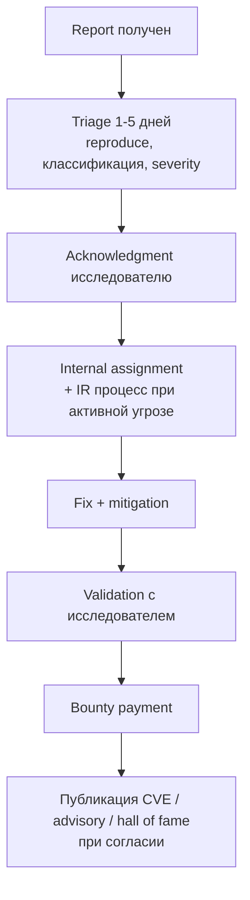
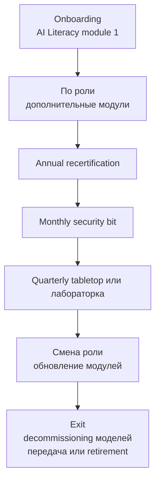

<a id="ludi-i-prozess-ai-literacy-decommissioning-bug-bounty"></a>

# Люди и процесс: AI Literacy, Decommissioning, Bug Bounty

> Версия: 2.1 · Обновлено: 2026-05-29 · Теги: AI Literacy, decommissioning, bug bounty, safe harbor, onboarding · Tier: 1-4
>
> **TL;DR**. Программа обучения по ролям, процесс снятия моделей с эксплуатации, bug bounty с AI-специфичной severity, responsible disclosure. В версии 2.0: расширенный гайд "С чего начать по вашей роли" (5 ролей: People Ops / L&D, AI Risk Owner, Bug Bounty Manager, Legal, Product Owner).

> **Тематическое дополнение 2026-11-13**: практическая проверка компетенций, reporting обходов и безопасный вывод AI-сценария вместе с расписаниями, полномочиями и производными данными. Базовые сроки и суммы из старой редакции не являются универсальными нормативами.

<a id="0-soderjanie"></a>

## 0. Содержание

1. AI Literacy: программа обучения по ролям
2. Decommissioning: процесс снятия моделей с эксплуатации
3. Bug Bounty и responsible disclosure для ИИ-уязвимостей

Три темы, без которых технический контур MLSec работает ниже возможного уровня. Люди создают уязвимости быстрее, чем устраняют. Модели, которые никто не снимает, превращаются в orphan-модели и технический долг (бесхозные, неподдерживаемые). Внешние исследователи находят уязвимости, которые мы не находим сами.

---

<a id="1-ai-literacy-program"></a>

## 1. AI Literacy Program

<a id="11-pocemu-nujna-otdel_naa-programma"></a>

### 1.1 Почему нужна отдельная программа

Общая ИБ-грамотность не покрывает ИИ-специфику. Сотрудник, сдавший phishing-тест, может спокойно скопировать ПДн клиента в ChatGPT потому что «в нём же нельзя найти». Программа должна покрывать:

- Что такое LLM, как это работает на верхнем уровне (обоснование правил)
- Специфические риски (утечка через провайдера, галлюцинации, prompt injection)
- Корпоративные правила (какие инструменты, какие данные)
- Как распознать и сообщать о подозрительных AI-инцидентах
- Как давать обратную связь по работе корпоративных AI-сервисов

<a id="12-razbivka-po-rolam"></a>

### 1.2 Разбивка по ролям

Не все одинаково. Разделение на уровни:

| Роль | Фокус | Длительность |
|------|-------|--------------|
| Все сотрудники | Base awareness: что можно, что нельзя | 30 минут |
| Руководители команд | + AI-риски, одобрение сценариев | 1 час |
| Разработчики | + код-ассистенты, secrets, supply chain | 2 часа |
| Data Scientists / ML | + training, модели, валидация | 4 часа |
| Security / SRE | + IR, forensics, красная команда | 8 часов |
| Юристы / Compliance | + нормативка, уведомления, контракты | 2 часа |
| Топ-менеджмент | + стратегия, риски, коммуникации | 45 минут |
| Аудит | + методы проверки, контрольные процедуры | 3 часа |

<a id="kakoj-nabor-obucenia-nujen-dla-vasej-roli"></a>

#### Какой набор обучения нужен для вашей роли

```widget:decision-tree
{
  "id": "ch21-training-role",
  "title": "Подбор обучения по AI Literacy под роль",
  "start": "q1",
  "nodes": {
    "q1": {
      "type": "question",
      "text": "Какая ваша основная роль?",
      "sub": "От роли зависит фокус и длительность обучения. Базовая грамотность нужна всем, специальные модули — по необходимости.",
      "choices": [
        { "label": "Все сотрудники (бизнес-юниты, support, маркетинг)", "next": "leaf-baseline" },
        { "label": "Руководитель команды / отдела", "next": "leaf-manager" },
        { "label": "Разработчик (back-end / front-end / mobile)", "next": "leaf-developer" },
        { "label": "Data Scientist / ML Engineer", "next": "leaf-ml" },
        { "label": "Security / SRE / DevSecOps", "next": "leaf-security" },
        { "label": "Юрист / Compliance", "next": "leaf-legal" },
        { "label": "Топ-менеджмент / правление", "next": "leaf-exec" },
        { "label": "Внутренний аудит", "next": "leaf-audit" }
      ]
    },
    "leaf-baseline": {
      "type": "leaf",
      "tone": "info",
      "title": "Базовый AI awareness — 30 минут",
      "summary": "Все сотрудники должны знать базу: что можно, что нельзя, куда обращаться при подозрении.",
      "details": [
        "Модуль 1. Введение в ИИ для всех",
        "Что такое LLM, генеративные модели, агенты — на верхнем уровне",
        "Реальные incident-сценарии (обобщённые)",
        "Политика использования + matrix «можно/нельзя»",
        "Cadence: онбординг + ежегодное обновление",
        "Формат: e-learning с квизом из 10 кейсов"
      ]
    },
    "leaf-manager": {
      "type": "leaf",
      "tone": "info",
      "title": "Risk awareness для руководителей — 1 час 30 минут",
      "summary": "Базовый модуль + responsibility за свою команду. Эскалации, одобрения, коммуникация при инциденте.",
      "details": [
        "Модуль 1 + 2 (Risk awareness)",
        "Инцидентные сценарии с финансовыми / регуляторными / репутационными последствиями",
        "Как одобрять нестандартные запросы сотрудников",
        "Матрица эскалации: ИБ / HR / Legal",
        "Коммуникация при инциденте (внешние и внутренние заявления)",
        "Cadence: онбординг + раз в полгода (обновление)"
      ]
    },
    "leaf-developer": {
      "type": "leaf",
      "tone": "warn",
      "title": "Developer track — 2 часа 30 минут",
      "summary": "Базовый модуль + code-assistants safely + supply chain. Lab с корпоративным gateway.",
      "details": [
        "Модуль 1 + 3 (AI-ассистенты безопасно)",
        "Tools matrix (что разрешено)",
        "Gateway (Rilio / LiteLLM / Portkey): как настроить клиент",
        "Secrets в коде: gitleaks, pre-commit",
        "Phantom packages: slopsquat detection",
        "License pollution в AI-генерируемом коде",
        "Prompt injection в процесс разработки",
        "Lab: настроить Claude CLI с corp gateway"
      ],
      "links": [
        { "label": "Глава 20. Code Assistants", "href": "/ch/20-code-assistants-security" }
      ]
    },
    "leaf-ml": {
      "type": "leaf",
      "tone": "err",
      "title": "MLSec для data scientist — 4 часа 30 минут",
      "summary": "Базовый + ML-специфика + validation процесс. Самый длинный практический трек.",
      "details": [
        "Модуль 1 + 4 (MLSec для DS)",
        "Классификация данных и применимость PET",
        "ML-угрозы: poisoning, stealing, MIA, inversion",
        "Red Teaming: Garak / Promptfoo / ART",
        "Валидация модели и MRM-процесс",
        "AI-BOM регистрация модели",
        "PET: DP / FL / TEE в практике",
        "CTF-style lab: найти уязвимости в demo-модели",
        "Cadence: онбординг + ежеквартально advanced topics"
      ],
      "links": [
        { "label": "Глава 04. Model Operations", "href": "/ch/04-stage2-model-operations" },
        { "label": "Глава 17. PET", "href": "/ch/17-privacy-enhancing-tech" }
      ]
    },
    "leaf-security": {
      "type": "leaf",
      "tone": "err",
      "title": "Security IR-track — 8 часов 30 минут",
      "summary": "Полный обвес + IR forensics + tabletop. Самый длинный технический модуль.",
      "details": [
        "Все базовые + Модуль 5 (IR и forensics)",
        "Playbooks (главу 15)",
        "Сбор artifact: prompts, agent traces, vector DB snapshots",
        "Chain of custody",
        "Tabletop: полный сценарий инцидента",
        "Коммуникация с регуляторами (РКН, ФинЦЕРТ, ГосСОПКА)",
        "Lab: разбор реального обезличенного инцидента",
        "Cadence: онбординг + tabletop ежеквартально"
      ],
      "links": [
        { "label": "Глава 15. Incident Response", "href": "/ch/15-ai-incident-response" }
      ]
    },
    "leaf-legal": {
      "type": "leaf",
      "tone": "warn",
      "title": "Legal / Compliance — 2 часа 30 минут",
      "summary": "Базовый + регуляторика + контрактные практики с AI-вендорами.",
      "details": [
        "Модуль 1 + 6 (Compliance & Legal)",
        "152-ФЗ + уведомления при ПДн-инцидентах",
        "187-ФЗ + ГосСОПКА для КИИ",
        "716-П / 850-П (ранее 787-П) для финсектора",
        "Контрактные практики: DPA шаблоны, no-train clauses",
        "Cadence: онбординг + при изменении регуляторики"
      ],
      "links": [
        { "label": "Глава 18. RU compliance", "href": "/ch/18-ru-compliance-deep" }
      ]
    },
    "leaf-exec": {
      "type": "leaf",
      "tone": "info",
      "title": "Executive overview — 45 минут + 30 минут base",
      "summary": "Базовый + стратегические аспекты. Короткий, но содержит критичные пункты.",
      "details": [
        "Модуль 1 + 7 (Strategic overview)",
        "Стратегическая роль AI и связанные риски",
        "Зрелость MLSec в отрасли и у конкурентов",
        "Ключевые метрики (KPI / KRI)",
        "First 24 hours при S1 инциденте",
        "Cadence: единоразовый + при крупных изменениях"
      ]
    },
    "leaf-audit": {
      "type": "leaf",
      "tone": "warn",
      "title": "Internal audit — 3 часа 30 минут",
      "summary": "Базовый + контрольные процедуры для всех трёх линий защиты + методы проверки.",
      "details": [
        "Модуль 1 + 8 (Audit MLSec)",
        "Контрольные процедуры для 3LoD",
        "Метрики зрелости",
        "Инструменты: как проверить DLP, logs, AI-BOM",
        "Red flags при проверке",
        "Cadence: онбординг + ежегодно (обновление)"
      ]
    }
  }
}
```

<a id="13-moduli"></a>

### 1.3 Модули

Модуль 1. Введение в ИИ для всех (30 мин)

- Что такое LLM, генеративные модели, агенты на верхнем уровне
- Примеры полезных применений в компании
- Реальные инциденты (обобщённые, без имён компаний)
- Политика использования и её смысл
- Matrix: «что можно, что нельзя» в конкретных сценариях
- Интерактивная часть: квиз из 10 кейсов

Модуль 2. Risk awareness для руководителей (1 час)

- Инцидентные сценарии с последствиями (финансовыми, регуляторными, репутационными)
- Как одобрять нестандартные запросы сотрудников
- Матрица эскалации (когда в ИБ, когда в HR, когда в legal)
- Коммуникация при инциденте (правила внешних и внутренних заявлений)

Модуль 3. AI-ассистенты безопасно для разработчиков (2 часа)

- Tools matrix (что разрешено, что нет)
- Gateway (Rilio): как настроить клиент
- Secrets в коде: gitleaks, pre-commit
- Phantom packages: как не стать жертвой supply chain
- License pollution: осторожнее с крупными AI-блоками
- Prompt injection в процесс разработки
- Lab: настроить Claude CLI с корпоративным gateway и попробовать несколько запросов

Модуль 4. MLSec для data scientist (4 часа)

- Классификация данных, применимость
- Угрозы, специфичные для ML: data poisoning, model stealing, MIA, inversion
- Red Teaming с Garak, Promptfoo, ART
- Валидация модели и процесс MRM
- AI-BOM: как правильно зарегистрировать модель
- PET: DP, FL, TEE в практических сценариях
- Lab: найти уязвимости в демо-модели (CTF-стиль)

Модуль 5. IR и forensics для security (8 часов)

- Плейбуки из [15. AI Incident Response](15-ai-incident-response.md)
- Сбор артефактов (prompts, agent traces, vector DB snapshots)
- Chain of custody
- Tabletop: провести полный сценарий инцидента
- Коммуникация с регуляторами (РКН, ФинЦЕРТ, ГосСОПКА)
- Lab: разбор реального инцидента (обезличенного)

Модуль 6. Compliance и юридические аспекты (2 часа)

- 152-ФЗ и уведомления при ПДн-инцидентах
- 187-ФЗ и ГосСОПКА
- Банковская специфика (716-П, 850-П — ранее 787-П)
- Контрактные практики с AI-вендорами
- DPA шаблоны

Модуль 7. Strategic overview для топ-менеджмента (45 минут)

- Стратегическая роль AI и связанные риски
- Зрелость MLSec в отрасли и у конкурентов
- Ключевые метрики, за которыми смотреть
- Что делать в первые 24 часа при инциденте high-severity

Модуль 8. Аудит MLSec (3 часа)

- Контрольные процедуры для трёх линий защиты
- Метрики зрелости
- Инструменты проверки (как проверить DLP, как проверить logs, как проверить AI-BOM)
- Red flags

<a id="14-formy-dostavki"></a>

### 1.4 Формы доставки

Длительности модулей и cadence ниже — пример внутренней программы. Они не выводятся из закона и подбираются под роль, сценарии и риск. Для применимых EU providers/deployers актуальное разъяснение [Еврокомиссии по Article 4](https://digital-strategy.ec.europa.eu/en/faqs/ai-literacy-questions-answers) описывает меры поддержки AI literacy с учётом контекста, а не гарантированный уровень знаний каждого человека или обязательную annual certification. Проверено 13.11.2026.

- Онлайн-курс (self-paced) с обязательным прохождением в первые 30 дней при найме
- Живые воркшопы раз в квартал для технических ролей
- Короткие обновления (15 мин) при выходе новых инструментов или при инцидентах
- Годовая обязательная recertification
- «Security bit» рассылка раз в 2 недели (5 мин чтения)

<a id="15-metriki-effektivnosti"></a>

### 1.5 Метрики эффективности

- Completion rate (% сотрудников прошли)
- Quiz score (средний балл и распределение)
- Reduction of violations (число инцидентов «по незнанию» до/после)
- Time-to-report (как быстро сотрудник сообщает о подозрительном)
- Proactive reports (сколько рапортов про подозрительное, а не по факту)

<a id="16-ceklist-programmy"></a>

### 1.6 Чеклист программы

- [ ] Утверждена структура программы по ролям
- [ ] Подготовлены материалы для каждой роли
- [ ] Запуск в LMS организации
- [ ] Обязательные прохождение при найме
- [ ] Annual recertification
- [ ] Обновление материалов при изменении политик или инструментов
- [ ] Метрики собираются ежемесячно
- [ ] Security bit рассылка работает

<a id="konstruktor-gotovnosti-ai-literacy-program"></a>

#### Конструктор готовности AI Literacy Program

```widget:policy-builder
{
  "id": "ch21-literacy-readiness",
  "title": "Компоненты AI Literacy Program",
  "description": "Самооценка состава программы: баллы суммируют отметки и не измеряют знания сотрудников, все обязательные компоненты или эффективность. У каждого отмеченного пункта должны быть owner и evidence; практические навыки проверяются отдельно в §1.7.",
  "scoreLabel": "Условные баллы выбранных пунктов",
  "scoreMax": 91,
  "groups": [
    {
      "name": "Структура и контент",
      "items": [
        { "id": "structure", "label": "Утверждённая структура по ролям (8 типов от base до audit)", "weight": 8, "default": true, "recommended": true, "description": "Без структуры обучение разваливается на ad-hoc сессии." },
        { "id": "materials-base", "label": "Материалы Module 1 (base awareness 30 мин)", "weight": 5, "default": true, "description": "Основа для всех сотрудников." },
        { "id": "materials-roles", "label": "Материалы для специальных ролей (Dev / DS / SecOps / Legal / Exec / Audit)", "weight": 8, "recommended": true, "description": "Без role-specific материалов разработчики читают тот же контент, что и юристы — оба не довольны." },
        { "id": "materials-incidents", "label": "Реальные incident-сценарии (обезличенные)", "weight": 4, "description": "Pedagogically самое ценное — реальные кейсы из российских / мировых компаний." }
      ]
    },
    {
      "name": "Доставка",
      "items": [
        { "id": "lms", "label": "Запуск в корпоративном LMS", "weight": 6, "default": true, "recommended": true, "description": "LMS — один из способов учёта; допускается иной проверяемый реестр прохождения и практических результатов." },
        { "id": "labs", "label": "Hands-on labs (CTF / sandbox / Claude CLI lab)", "weight": 5, "description": "Проверяйте практический навык на изолированном сценарии; пригодность формата оценивается по результатам конкретных ролей." },
        { "id": "tabletop", "label": "Tabletop exercises для security / IR", "weight": 5, "description": "Периодичность определяет программа по риску и изменениям; число учений само по себе не подтверждает IR-готовность." }
      ]
    },
    {
      "name": "Жизненный цикл",
      "items": [
        { "id": "onboard-mandatory", "label": "Обязательное прохождение при найме", "weight": 7, "default": true, "recommended": true, "description": "Без этого новые сотрудники не знают политик." },
        { "id": "annual-recert", "label": "Периодическая проверка навыков по внутренней программе", "weight": 6, "default": true, "recommended": true, "description": "Срок и содержание повторной проверки устанавливаются по роли, риску и изменениям; универсальная ежегодная юридическая обязанность здесь не задаётся." },
        { "id": "policy-update", "label": "Обновление при изменении политик / инструментов", "weight": 4, "description": "Например: при появлении нового AI-tool или regulatory change." },
        { "id": "security-bit", "label": "Security bit еженедельная рассылка", "weight": 3, "description": "Микро-обучение: 1 incident / 1 правило / 1 reminder в неделю." }
      ]
    },
    {
      "name": "Метрики и effectiveness",
      "items": [
        { "id": "metrics-completion", "label": "Tracking completion rate per role", "weight": 4, "default": true, "description": "Базовая метрика; без неё невозможно accountability." },
        { "id": "metrics-quiz", "label": "Pass-rate квизов и lab-results", "weight": 4, "description": "Содержательная метрика effectiveness." },
        { "id": "metrics-incidents", "label": "Корреляция incidents с completion (детектирование gaps)", "weight": 5, "description": "Если incidents концентрируются в команде с низким completion — focus на них." },
        { "id": "metrics-feedback", "label": "Surveys + retrospective на материалы", "weight": 3, "description": "Continuous improvement; раз в полгода review с participants." }
      ]
    },
    {
      "name": "Governance",
      "items": [
        { "id": "owner", "label": "Назначен Program Owner (typically L&D + AI Risk)", "weight": 6, "default": true, "recommended": true, "description": "Без owner программа deprioritises после первого года." },
        { "id": "executive-sponsor", "label": "Executive sponsor (CTO / CRO / CISO)", "weight": 4, "description": "Mandatory сверху — ускоряет участие." },
        { "id": "budget", "label": "Annual budget с защитой перед правлением", "weight": 4, "description": "Без бюджета программа умирает к концу первого года." }
      ]
    }
  ],
  "rules": [
    { "id": "must-structure", "type": "require-all", "items": ["structure"], "message": "Без структуры по ролям программа = набор разрозненных тренингов." },
    { "id": "must-roles", "type": "require-all", "items": ["materials-roles"], "message": "Не отмечены материалы по специальным ролям. Проверьте, какие действия и ограничения должен освоить каждый участник." },
    { "id": "must-onboard", "type": "require-all", "items": ["onboard-mandatory"], "message": "Без обязательного onboarding training новые сотрудники не знают политик." },
    { "id": "must-recert", "type": "require-all", "items": ["annual-recert"], "message": "Не отмечена периодическая проверка навыков. Определите её основания и период; фиксированная скорость утраты знаний не предполагается." },
    { "id": "must-owner", "type": "require-all", "items": ["owner"], "message": "Без Program Owner программа deprioritises после первого года." },
    { "id": "min-readiness", "type": "min-score", "threshold": 65, "message": "Сумма отметок ниже учебного порога 65 баллов. Разберите открытые пункты; эффективность подтверждается практической проверкой, не суммой." }
  ],
  "thresholds": [
    {"from": 0, "to": 30, "label": "Отмечена небольшая часть списка; сверить применимость и evidence", "tone": "info"},
    {"from": 30, "to": 60, "label": "Отмечена часть списка; открытые проверки указаны отдельно", "tone": "info"},
    {"from": 60, "to": 85, "label": "Отмечено много пунктов; обязательные проверки могут оставаться открытыми", "tone": "info"},
    {"from": 85, "to": 100, "label": "Высокая сумма отметок; результат реализации и приёмки проверяется отдельно", "tone": "info"}
  ]
}
```

---


<a id="17-prakticeskaa-proverka-cto-celovek-dejstvitel_no-umeet"></a>

### 1.7 Практическая проверка: что человек действительно умеет

**Проблема**: LMS показывает 100% прохождения, но пользователь не знает, куда сообщить об утечке, а оператор не умеет отозвать доступ фонового агента. Completion и quiz score подтверждают участие; готовность к работе требует наблюдаемого действия.

| Роль | Лабораторная работа на синтетических данных | Критерий приёмки | Свидетельство |
|---|---|---|---|
| Пользователь | В запросе есть тестовый секрет; внешний документ предлагает «отключить DLP» | Не отправляет секрет, не выполняет инструкцию документа, выбирает безопасный канал | Краткий протокол решения и ID учебного кейса |
| Руководитель | Команда просит «разрешить AI для всего» | Уточняет назначение, данные, получателей и действия; не выдаёт blanket approval | Заполненная карточка сценария с границами |
| Разработчик/ML | Новый connector получает лишний write-scope | Находит лишнее право, проверяет разрешённую операцию и отказ для запрещённой | Test results и связка с change ticket |
| Оператор/SRE | Остановить scheduled agent, затем проверить отзыв | Останавливает новые запуски, проверяет очередь и действие старой роли без восстановления широких прав | Readback scheduler/queue/IAM и test ID |
| SOC/IR | Подозрительный tool-call и неполный trace | Ограничивает последствия по runbook, фиксирует неопределённость, назначает owner | Incident timeline без реальных секретов |
| Legal/Compliance | Старый сервис заменяется новым поставщиком | Проверяет новый data-flow/договор/retention вместо молчаливого переноса прежнего разрешения | Решение о применимости и ограничениях миграции |

**Порядок оценки:**

1. Назначить роль и конкретный рабочий сценарий, затем выдать ограниченный учебный аккаунт. В lab нет production endpoints, реальных клиентских данных и действующих секретов.
2. Сначала выполнить чистую полезную задачу, затем её вариант с инъекцией/ошибкой. Полный отказ от любого AI не считается прохождением сценария, где требуется безопасно использовать разрешённый процесс.
3. Проверять действия, а не совпадение текста ответа с заученной формулировкой. Включить вариант, которого не было в демонстрации преподавателя.
4. При ошибке разбирать причину: непонятный UI, отсутствующее право, неверный runbook или пробел знаний. Обучение не исправляет отсутствующий технический контроль; дефект уходит его владельцу.
5. Зафиксировать результат, версию политики/инструмента и объём допуска. После значимого изменения connector, workflow или роли повторить затронутую практику; годовой курс не продлевает старые полномочия автоматически.

**Метрики:** доля участников, завершивших практику по своей роли; число ошибок критического действия; time-to-report; доля кейсов с выполненной полезной задачей; скорость устранения выявленных дефектов интерфейса/runbook. Показывать числители и знаменатели по cohort и версии задания. Меньше сообщений об инцидентах не означает лучшее обучение без проверки доступности канала reporting.

Для оператора допуск связан не только со знанием, но и с ресурсами: действующие права, доступный дежурный/заместитель, инструкция и возможность безопасно остановить сценарий. Передача роли при отпуске/offboarding проверяется такой же практикой, а не только пересылкой ссылки на wiki.

**Основа**, проверено 13.11.2026: [NIST GOVERN 2.2](https://airc.nist.gov/airmf-resources/playbook/govern/) рассматривает обучение под обязанности и контекст, [NCSC guidelines](https://www.ncsc.gov.uk/files/Guidelines-for-secure-AI-system-development.pdf) — подготовку responders и использование безопасных настроек. Таблица lab — рекомендуемая программа организации, не обязательный формат сертификации.

<a id="18-soobsenie-ob-obhode-policy-i-ai-inzidente"></a>

### 1.8 Сообщение об обходе policy и AI-инциденте

Сотруднику не требуется доказывать эксплуатируемость или самостоятельно определять CVSS, чтобы сообщить о проблеме. Канал должен принимать как предполагаемый инцидент, так и near miss: несанкционированный recipient, ответ с чужими данными, предложенный обход контроля, опасный tool-call или ошибочное бизнес-решение.

**Минимальная карточка сигнала:**

- Сервис/сценарий и время с timezone; доступный request/run/trace ID.
- Какую разрешённую задачу выполняли и что насторожило.
- Что уже могло произойти: показ данных, отправка, изменение, запуск расписания; отдельно «неизвестно».
- Что остановили и что продолжает работать. Не просить пользователя менять конфигурацию или удалять следы ради «проверки».
- Контакт для уточнения. Для чувствительных вложений — ссылка на разрешённое ограниченное хранилище, не копия полного prompt/log в общий чат.

**Маршрут:** пользователь → единая точка приёма/helpdesk → назначенный triage owner → SOC/IR при признаках угрозы; ошибки качества передаются product/model owner с сохранением связи с исходным сигналом. Если назначенный owner недоступен, срабатывает резервная эскалация. Оперативный stop по утверждённому runbook не откладывается до обсуждения bounty, полной записи отчёта или решения о внешнем уведомлении.

**Приёмка канала:** тестовый сигнал принимается от обычного пользователя, получает ID и owner; чувствительные поля не попадают в массовую рассылку; недоступность формы не обрывает альтернативный путь; инициатор получает статус без раскрытия чужих данных. Отсутствие заголовков в сообщении не является основанием потерять срочный сигнал.

Не поощрять сотрудника повторять опасную операцию на production для сбора «красивого PoC». Воспроизведение переносится в разрешённый тестовый контур по [07](07-red-teaming-testing-methods.md); реагирование — по [15](15-ai-incident-response.md). В [NIST GOVERN 4.3](https://airc.nist.gov/airmf-resources/playbook/govern/) информационный обмен и выявление инцидентов являются частью процесса управления рисками; проверено 13.11.2026. Конкретные SLA/адреса задаёт организация.

---


<a id="2-decommissioning-models"></a>

## 2. Decommissioning Models

<a id="21-zacem-prozess"></a>

### 2.1 Зачем процесс

Модели, которые никто не снимает:

- Потребляют ресурсы (inference стоит)
- Являются бесхозными с точки зрения ответственности
- Устаревают и выдают некачественные ответы
- Накапливают риски (drift, отсутствие patching зависимостей)
- Хранят логи и промпты, которые должны были быть удалены

<a id="22-triggery-decommissioning"></a>

### 2.2 Триггеры decommissioning

| Триггер | Описание |
|---------|---------|
| Бизнес-решение | Продукт или функция выведены |
| Замена | Вышла новая версия, старая деприкейтится |
| Drift | Модель показывает деградацию, не устраняется |
| Compliance | Регулятор запретил использование (архитектуры, датасета) |
| Supply chain | Выявлен риск в foundation model или библиотеке |
| Orphan | Модель работает, но не привязана к владельцу (выявлено в audit AI-BOM) |
| Поведенческое | Модель используется меньше N запросов в месяц (low utilization) |

<a id="23-prozess"></a>

### 2.3 Процесс

```
1. Инициация (Business/Owner/Security)
   └─ Обоснование в ticket

2. Deprecation (мягкое отключение)
   ├─ Объявление (email, docs, UI warning)
   ├─ Режим «только чтение» для существующих консумеров
   ├─ Новые потребители получают ошибку с указанием замены
   └─ Период: 30-90 дней

3. Подготовка к отключению
   ├─ Экспорт metadata в long-term storage
   ├─ Решение про артефакты (сохранить / заархивировать / удалить)
   ├─ Уведомление AI-BOM (статус → retiring до приёмки отключения)
   └─ Подготовка monitoring для перехода и проверки остаточных вызовов

4. Shutdown
   ├─ Снятие endpoint-ов
   ├─ Удаление из routing (gateway)
   ├─ Остановка inference service
   └─ Проверка отключения; ограниченное сохранение logs/метрик для readback и расследования

5. Post-retirement
   ├─ Retention артефактов согласно политике
   ├─ Обработка пользовательских запросов, поступавших к модели
   ├─ Приёмка остаточных данных/полномочий и статус retired
   └─ Пост-мортем (что узнали за время жизни модели)
```

<a id="24-cto-sohranat_"></a>

### 2.4 Что сохранять

Артефакты, которые обычно сохраняются даже после retirement:

- Финальная версия весов (immutable storage, с подписью)
- Model card с итоговыми метриками
- Training data lineage (DVC-ссылки или hash)
- История валидаций
- Аудит-логи (в соответствии с retention)
- Ключевые incidents, связанные с моделью (для уроков)

Удаляется (по расписанию retention):

- Реальные promps/responses (с PII)
- Intermediate checkpoints
- Temporary inference logs

<a id="25-orphan-modeli"></a>

### 2.5 Orphan-модели

Квартальный audit:

- Для каждой модели в AI-BOM: активна ли, есть ли владелец, использовалась ли в N дней
- Если владелец неизвестен или ушёл: назначается новый владелец из руководителей команды
- Если не использовалась > 90 дней: запускается процесс deprecation
- Результат: отчёт CISO/CRO

<a id="26-spezifika-dla-modelej-s-regulatornym-sledom"></a>

### 2.6 Специфика для моделей с регуляторным следом

Для моделей, использовавшихся в банке (716-П), медицине, КИИ, дополнительно:

- Определить основание, состав и срок хранения по конкретному сценарию/юрисдикции; универсального срока «5–7 лет» для всех AI-моделей здесь нет
- Архивировать incident log полностью
- Сохранить доказательства валидаций на случай проверок регулятора

<a id="27-ceklist"></a>

### 2.7 Чеклист

- [ ] Политика decommissioning утверждена
- [ ] Триггеры формализованы
- [ ] Процесс описан и имеет owner
- [ ] Orphan audit проводится квартально
- [ ] Retention policy согласована с юристами и compliance
- [ ] AI-BOM автоматически отражает статус модели
- [ ] Пост-мортем проводится для каждой retired модели

<a id="28-tipicnye-osibki"></a>

### 2.8 Типичные ошибки

- Отключать модель без уведомления потребителей. Приложения ломаются.
- Удалять артефакты сразу. Если потом окажется нужно доказывать поведение в регуляторной проверке, нечего показать.
- Хранить всё навсегда. Ненужные promps с PII становятся источником риска сами.
- Не снимать alert-ы и ресурсы. Команда SRE видит green-модель, которая никому не нужна.
- Не обновлять AI-BOM. Реестр показывает, что модель активна, а её нет.

---

<a id="29-manifest-vyvoda-endpoint-polnomocia-dannye-i-raspisania"></a>

### 2.9 Манифест вывода: endpoint, полномочия, данные и расписания

**Проблема**: endpoint выключен, но agent schedule, OAuth grant и старый retrieval-cache остались. Либо запросы незаметно переадресованы другой модели с иной географией, памятью и условиями обработки. Такой сервис не считается полностью выведенным и не наследует автоматически одобрение новой системы.

| Объект | Что найти до отключения | Решение и свидетельство |
|---|---|---|
| Consumers и routing | SDK, direct URLs, fallback/alias, batch jobs, downstream models | Явный отказ/утверждённая замена; readback маршрутов и наблюдение остаточных вызовов |
| Scheduled agents | Cron, webhooks, очереди/retries, background sessions | Остановка новых запусков; решение о находящихся в работе задачах; readback scheduler/queue |
| Полномочия | User sessions, API keys, OAuth refresh grants, service accounts, shares | Отзыв для retired scope; deny старой роли и сохранение работы соседних разрешённых сервисов |
| Данные и производные | Источники, embeddings/indexes, memory, caches, prompts/logs, exports | Для каждого объекта: сохранить/ограничить/удалить с основанием, сроком, owner и способом проверки |
| Модели и обучение | Base/adapter, merged weights, checkpoints, optimizer state, training caches | Lineage и доказательства в ограниченном архиве; удаление ненужных копий по утверждённой политике |
| Копии у поставщика | Remote files, vector stores, uploads, provider retention/backups | Подтверждённые API/договорные действия и границы подтверждения; неизвестное не отмечать как удалённое |
| Наблюдаемость | Alerts, dashboards, SIEM routes, shared logs | Не терять контроль до проверки выключения; затем скорректировать мониторинг без удаления нужных свидетельств |

**Последовательность:**

1. Создать retirement ticket с ID системы/сценария, причиной, consumers, owner и полномочиями исполнителей. Решить, что должно продолжать работать вручную и как пользователи узнают об изменении.
2. Зафиксировать inventory данных и ресурсов до изменений. Разделить совместно используемые и принадлежащие только этому сценарию; отзыв общего service account или ключа шифрования может затронуть активные системы.
3. Остановить новые действия и выдачу разрешений, затем обработать in-flight/retries по явному плану. Ожидающая согласования операция не исполняется после retirement на основании старого approval.
4. Отозвать права и проверить исполнение запрета независимо от UI. Удалённая из registry карточка коннектора не доказывает отзыв действующего OAuth grant или upstream API key.
5. Выполнить утверждённое решение по каждому классу данных. Legal hold или обязательный retention запрещает поспешное уничтожение, но сохранённые данные должны иметь ограниченный доступ и срок пересмотра.
6. Принять readback и остаточные обязательства: что удалено, что сохранено, что ожидается от поставщика и когда завершается backup retention. Только затем завершить статус `retired` с явно учтёнными исключениями.

Для физического/логического media sanitization метод выбирается отдельно от удаления записи из registry: [NIST SP 800-88 Rev. 2](https://csrc.nist.gov/pubs/sp/800/88/r2/final) рассматривает программу sanitization и проверяемую assurance. Для object storage/backups учесть versioning, replicas и cryptographic erase только при выполненных предпосылках; уничтожение shared key без проверки области не допускается. Проверено 13.11.2026; это инженерная основа, не универсальное правовое основание удаления.

<a id="210-zamena-bez-molcalivogo-perenosa-i-negative-acceptance"></a>

### 2.10 Замена без молчаливого переноса и negative acceptance

Замена получает собственное решение о допуске: назначение, данные, recipients, memory, permissions и ограничения. Уведомление о sunset не означает согласие перенести историю переписки новому поставщику. Не изменять fallback так, чтобы запрет старого endpoint превращался в скрытую передачу неутверждённому recipient.

**Учебный пример**: support-RAG `v1` заменяется `v2`. Права на источники проверяются заново, старые access tokens отзываются, cache/embeddings не копируются по умолчанию. Перенос только разрешённых данных оформляется отдельным заданием с mapping, dry run, проверкой ACL и возможностью прекратить миграцию. Если замена не допущена, пользователь получает понятный статус и безопасный ручной маршрут.

| Negative-case в тестовом контуре | Ожидаемое поведение |
|---|---|
| Вызов прямого старого URL/alias после shutdown | Понятный отказ; нет скрытого fallback к неутверждённой модели |
| Повтор старого webhook или очереди | Запрещённое действие не исполняется и не создаёт новую scheduled task |
| Использование старого token/grant | Независимый deny; не только отсутствие кнопки в UI |
| Поиск удалённого документа через cache/index/memory | Производная копия не возвращается после завершения предусмотренной invalidation; задержка явно учтена |
| Восстановление backup в изолированной среде | Retired service не запускается автоматически; применяются retirement tombstones/актуальная политика доступа |
| Попытка выгрузить закрытый архив обычной старой ролью | Архив доступен только утверждённым хранителям, не бывшим runtime consumers |
| Один credential использовали две системы | Вывод одной не приводит к необоснованному отключению другой; scope разделён и проверен |
| Ошибка удаления у поставщика | Ticket остаётся с открытым обязательством; нет ложной отметки «данные уничтожены» |

**Кто закрывает процесс**: business owner подтверждает непрерывность и replacement, data owner — судьбу данных, Platform — маршруты/планировщики/права, ИБ — результаты negative-case, Legal/Compliance — применимые основания retention/hold. Один назначенный retirement owner собирает эти свидетельства и ведёт незавершённые обязательства; аудит проверяет их независимо, а не выполняет удаление.

Закрывающая запись содержит список объектов и действий, их подтверждения, дату проверки, ответственных за оставшийся retention и дату следующего review. «Ноль запросов за сутки» не доказывает отсутствие забытых cron, long-lived grants или копий данных.

**Основа, проверено 13.11.2026**: [NIST GOVERN 1.7](https://airc.nist.gov/airmf-resources/playbook/govern/) рассматривает системный decommission и зависимости; [MANAGE 2.4](https://airc.nist.gov/airmf-resources/playbook/manage/) — ответственность за замену/отключение. Манифест, staged migration и negative-case выше — рекомендуемый runbook организации. Полномочия и agent runtime раскрыты в [08](08-access-secrets-management.md), [32](32-ai-agents-operating-overlay.md), [34](34-ai-agents-runtime-procedure.md); checkpoints — [19](19-training-infrastructure.md).

---

<a id="3-bug-bounty-i-responsible-disclosure-dla-ii"></a>

## 3. Bug Bounty и Responsible Disclosure для ИИ

<a id="31-pocemu-nujna-programma"></a>

### 3.1 Почему нужна программа

Внешние исследователи находят то, что не находим сами. Но для ИИ специфические особенности:

- Уязвимости не всегда имеют CVE (например, prompt injection в агенте)
- Сложно воспроизвести (stochastic output)
- Могут быть multi-turn (одним запросом не отловить)
- Могут вовлекать chain of actions

<a id="32-scope"></a>

### 3.2 Scope

Типичный scope для ИИ-программы:

Включено:

- Prompt injection, jailbreak с практическим импактом
- Утечка данных через LLM (PII leak, training data leak)
- Model inversion, MIA
- Bypass corporate DLP
- Уязвимости в self-hosted LLM сервисах
- Уязвимости в LLM-агентах с auto-execution
- Supply chain уязвимости в моделях и датасетах
- AuthN/AuthZ bypass в AI-endpoints

Исключено (обычно):

- Известные jailbreak public моделей без специфичного impact
- Простые prompts, которые не демонстрируют бизнес-риск
- Социальная инженерия сотрудников
- DoS (обычно scope отдельный)

<a id="33-severity-framework"></a>

### 3.3 Severity framework

CVSS 3.1 не подходит идеально для ИИ. Рекомендуется использовать расширения:

- MITRE ATLAS scoring proposals (эволюционирует)
- OWASP AI Security Severity Guide
- Внутренняя шкала, увязанная с impact:

| Severity | Bounty (пример) | Критерий |
|----------|-----------------|---------|
| Critical | 200k-1M RUB | Массовая утечка PII, compromise агента с autonomy, bypass критичных контролей |
| High | 50k-200k RUB | Утечка внутренних данных, bypass DLP, unauthorized tool access |
| Medium | 10k-50k RUB | Ограниченный bypass guard, галлюцинация с конкретным business impact |
| Low | 1k-10k RUB | Mild jailbreak, cosmetic issue с security implication |
| Info | 0 или символическое | Интересные наблюдения без impact |

Суммы зависят от бюджета и отрасли (в банках выше).

<a id="kal_kulator-ucebnaa-smeta-bounty-budget"></a>

#### <span id="kal_kulator-bounty-budget-vs-ojidaemyj-potok-nahodok" aria-hidden="true"></span>Калькулятор: учебная смета bounty budget

```widget:threshold-slider
{
  "id": "ch21-bounty-budget",
  "title": "Планирование bounty budget на фиксированной выплате",
  "description": "Учебная смета: 80% годового бюджета зарезервировано под выплаты, 20% — под triage и организацию; одна условная выплата равна 100 000 ₽. Это арифметический лимит сметы, не рыночный размер награды, число hunters / reports, прогноз находок или стоимость труда.",
  "min": 100000,
  "max": 50000000,
  "step": 100000,
  "default": 5000000,
  "unit": " ₽/год",
  "axisLabel": "Годовой бюджет учебной сметы",
  "tracks": [
    {"label": "Лимит условных выплат по 100 000 ₽", "compute": "Math.floor(x * 0.8 / 100000)", "format": "fixed1", "tone": "info", "hint": "При 1 млн ₽ — 8 полных выплат, при 50 млн ₽ — 400; находок может оказаться другое количество."},
    {"label": "Резерв triage / организации (₽/год)", "compute": "x * 0.2", "format": "fixed1", "tone": "info", "hint": "20% — заданное допущение упражнения. Рабочую оценку получают из фактической очереди и времени triage."}
  ],
  "regions": [
    {"from": 100000, "to": 1000000, "label": "Смета до 1 млн ₽ — заданные допущения, не отраслевой benchmark", "tone": "info"},
    {"from": 1000000, "to": 10000000, "label": "Смета 1–10 млн ₽ — не прогноз потока reports", "tone": "info"},
    {"from": 10000000, "to": 50000000, "label": "Смета 10–50 млн ₽ — размер не доказывает зрелость программы", "tone": "info"}
  ]
}
```

<a id="34-format-disclosure"></a>

### 3.4 Формат disclosure

- Выделенный канал (security@company.ru, PGP key)
- Портал bug bounty (HackerOne, BugCrowd, российские платформы: BI.ZONE Bug Bounty, Standoff 365)
- Чёткие шаблоны reporting (что описать, какие PoC предоставить)
- SLA на ответ (24 часа initial, 5 дней triage, 30 дней fix или обоснованный план)

<a id="pesocniza-validation-sablona-disclosure-reporta"></a>

#### Песочница: validation шаблона disclosure-репорта

Pattern проверяет наличие заголовков (summary, severity, reproduction steps, impact, PoC). Это подсказка для уточнения структуры, не проверка валидности находки: срочный сигнал принимается и без этих секций.

```widget:regex-tester
{
  "id": "ch21-disclosure-format",
  "title": "Auto-validation шаблона bug bounty report",
  "description": "Учебная проверка заголовков. Совпадение не доказывает impact, а отсутствие заголовка не делает находку невалидной; результаты нужны для уточнения отчёта, не для автоматического отказа в triage.",
  "defaultPattern": "(?=[\\s\\S]*##\\s*Summary)(?=[\\s\\S]*##\\s*Severity)(?=[\\s\\S]*##\\s*(?:Reproduction|Steps to Reproduce))(?=[\\s\\S]*##\\s*Impact)(?=[\\s\\S]*##\\s*(?:PoC|Proof of Concept))",
  "flags": "gi",
  "tests": [
    { "id": "p1", "shouldMatch": true, "label": "Полный валидный report", "text": "## Summary\\nJailbreak в chat-боте через Crescendo\\n## Severity\\nHigh\\n## Reproduction\\n1. Открыть бот\\n2. Multi-turn dialog\\n## Impact\\nUtterance prohibited content\\n## PoC\\nattached video" },
    { "id": "p2", "shouldMatch": true, "label": "Report с full sections", "text": "## Summary\\nPII leak via RAG\\n## Severity\\nCritical\\n## Steps to Reproduce\\n1. ...\\n## Impact\\n10k subjects affected\\n## Proof of Concept\\nattached log" },
    { "id": "n1", "shouldMatch": false, "label": "Нет Severity", "text": "## Summary\\nXSS in admin panel\\n## Reproduction\\nClick here\\n## Impact\\nlow\\n## PoC\\n<script>alert(1)</script>" },
    { "id": "n2", "shouldMatch": false, "label": "Нет PoC", "text": "## Summary\\nProblem found\\n## Severity\\nLow\\n## Reproduction\\nsteps\\n## Impact\\nminor" },
    { "id": "n3", "shouldMatch": false, "label": "Только текст без структуры", "text": "I found a bug in your chatbot. It can be jailbroken. Please fix." },
    { "id": "n4", "shouldMatch": false, "label": "Нет Impact", "text": "## Summary\\nIssue\\n## Severity\\nMedium\\n## Reproduction\\nsteps\\n## PoC\\ncode" }
  ]
}
```

> Некорректно оформленный report получает ID и запрос уточнений. Признаки активной утечки/опасного действия эскалируются до заполнения шаблона; regex не исключает сообщение из triage queue. Реальную интеграцию с конкретной bounty-платформой проверяют отдельно.

<a id="35-prozess-obrabotki"></a>

### 3.5 Процесс обработки



<a id="36-spezifika-dla-ai-reportov"></a>

### 3.6 Специфика для AI-репортов

- Воспроизведение: stochastic output, нужен seed или многократный run
- Для LLM-провайдера (если уязвимость в foundation model): эскалация в upstream (Anthropic, Mistral, GigaChat team)
- Для RAG: snapshot корпуса, воспроизведение отравления
- Для агентов: full agent trace как часть отчёта

<a id="37-responsible-disclosure-policy"></a>

### 3.7 Responsible disclosure policy

Публичный документ, содержащий:

- Scope и out-of-scope
- Правила (no public disclosure до fix, no data exfiltration beyond PoC)
- Safe harbor (отказ от юридического преследования добросовестных исследователей)
- Формат отчёта
- Ожидания по SLA
- Hall of fame

<a id="38-ceklist-programmy"></a>

### 3.8 Чеклист программы

- [ ] Написана responsible disclosure policy
- [ ] Выбрана платформа или построен in-house портал
- [ ] Выделен канал security@ с PGP
- [ ] Назначена команда triage
- [ ] Бюджет bounty согласован на год
- [ ] SLA на ответ и fix согласован
- [ ] Safe harbor клаузула согласована юристами
- [ ] Hall of fame доступна на сайте
- [ ] Процесс координации с upstream (для foundation models)

<a id="39-tipicnye-osibki"></a>

### 3.9 Типичные ошибки

- Игнорировать внешние репорты. Исследователи идут в публичный disclosure.
- Нечёткий scope. Получаете флуд out-of-scope отчётов.
- Отсутствие safe harbor. Исследователи боятся иска и уходят.
- Низкие выплаты для AI-багов. Конкурируют программы других компаний.
- Отсутствие эскалации к upstream-провайдеру. Уязвимость в OpenAI остаётся.
- Слишком медленный triage. Теряется доверие к программе.

<a id="antipatterny-people-amp-process-spravocnik"></a>

#### Антипаттерны People & Process — справочник

Для первых двух карточек retention означает сохранение проверяемого навыка, а не посещаемость курса. Методический ориентир — [NIST SP 800-50 Rev. 1](https://csrc.nist.gov/pubs/sp/800/50/r1/final): программа обучения, роли и оценка результатов; документ не устанавливает универсальные 30%/70% сохранения знаний. Протоколы и интервалы повторной оценки в карточках — внутренние примеры, проверка источника 13.11.2026.

```widget:flashcards
{
  "id": "ch21-people-failures",
  "title": "10 ошибок People & Process для AI",
  "description": "Учебные сценарии типовых проблем обучения, decommissioning и bug bounty. Числовые иллюстрации в карточках не являются результатом исследования российского рынка или программ обучения.",
  "shuffle": false,
  "cards": [
    {
      "tag": "training",
      "front": "«Generic e-learning для всех»",
      "subFront": "Один курс для всех ролей",
      "back": "Симптом: разработчики жалуются, что курс «не про их работу»; DS не отрабатывают ML-угрозы, SecOps — IR-практики.\n\nПроверка вместо неподтверждённых 30%/70%: owner обучения задаёт одинаковые role-relevant практические задачи до курса, сразу после и, например, через 30 дней. На delayed test считает выполненные без подсказки задачи / оценённые задачи, отдельно по роли; указывает cohort N, выбывших, сложность форм, критичные ошибки и версию rubric. Completion и quiz score не равны сохранённому навыку.\n\nFix: общий вводный модуль + практикум своей роли. Generic и role-specific варианты сравнивают на сопоставимых группах или поэтапном rollout с исходным baseline; различие не приписывают курсу без учёта различий групп. Не прошедшие critical action получают адресную практику и повторный независимый сценарий (§1.7)."
    },
    {
      "tag": "training",
      "front": "«Onboard и забыть»",
      "subFront": "Нет recertification",
      "back": "Симптом: после onboarding нет отложенной практической проверки, поэтому сохранение навыка неизвестно; новые tools и права агента могут не покрываться прежним курсом.\n\nFix: owner задаёт дату delayed assessment, применимые роли и evidence выполнения безопасного действия/эскалации. Например, сверяет один и тот же cohort через 30 и 90 дней на эквивалентных независимых задачах; показывает N и выбывание, а не прогноз «через год останется 30%». Критичная ошибка или изменение инструмента/полномочий запускает адресный retraining/retest; annual review — пример внутреннего cadence, не универсальная обязательная аттестация."
    },
    {
      "tag": "training",
      "front": "«Запретили, не объяснив»",
      "subFront": "Policy без обучения",
      "back": "Симптом: сотрудники нарушают AI Use Policy не из-за злого умысла, а из-за незнания.\n\nFix: training как обязательная часть rollout любой policy; security bit еженедельная рассылка; quarterly check-ins для крупных изменений."
    },
    {
      "tag": "decommissioning",
      "front": "«Orphan-модели в production»",
      "subFront": "No-decommissioning process",
      "back": "Учебный сценарий: при инвентаризации обнаруживаются модели без owner, в неподдерживаемых версиях, с устаревшими SDK.\n\nFix: выявление orphan и назначение ответственного с эскалацией; отсутствие ответа owner не разрешает автоматическое удаление/архивацию. Scope отключения, зависимые системы и данные проверяются по §2.9–2.10."
    },
    {
      "tag": "decommissioning",
      "front": "«Удалили модель, забыли downstream»",
      "subFront": "Cascade failures",
      "back": "Симптом: model A удалена; через неделю модель B (использовала A как pre-processing) ломается в production.\n\nFix: dependency graph для всех моделей; pre-decommissioning check на downstream consumers; deprecation period 30 дней с notifications."
    },
    {
      "tag": "decommissioning",
      "front": "«Уволили DS — модели остались»",
      "subFront": "Knowledge gap при offboarding",
      "back": "Учебный сценарий: DS уволилась; модель в production требует retrain — никто не знает hyperparameters / dataset / training procedure.\n\nFix: один accountable owner и назначенный заместитель; документированный runbook и практическая передача роли до offboarding. Доступ прежнего сотрудника отзывается отдельно от жизненного цикла модели."
    },
    {
      "tag": "bug bounty",
      "front": "«Игнорировать внешние репорты»",
      "subFront": "Public disclosure",
      "back": "Симптом: researcher отправил vulnerability на security@company.ru; через 30 дней ответа нет; researcher публикует на твиттере; репутационный ущерб.\n\nFix: SLA на acknowledgment 24 ч; weekly review queue; safe harbor policy + bug bounty с adequate bounties."
    },
    {
      "tag": "bug bounty",
      "front": "«Нечёткий scope»",
      "subFront": "Flood out-of-scope",
      "back": "Симптом: получаем сотни reports на out-of-scope assets (старые сайты, third-party сервисы); valid reports теряются в шуме.\n\nFix: explicit scope с whitelist (in-scope) и blacklist (out-of-scope); auto-filter на этапе submission; clear examples в guidelines."
    },
    {
      "tag": "bug bounty",
      "front": "«Низкие AI-bounties»",
      "subFront": "Researchers идут к конкурентам",
      "back": "Учебный сценарий: исследователь показывает подтверждённый AI-impact, но правила выплаты и scope вашей программы не объясняют решение; сравнение с рекламным максимумом другой программы не помогает.\n\nFix: bounty owner заранее публикует in/out-of-scope, разрешённые методы, severity по фактическому воздействию и правила оценки выплаты в утверждённом бюджете. Отличать jailbreak текста от подтверждённого нарушения доступа, утечки или действия инструмента; не обещать выплату за любой обход. Если сравниваете рынок, сохраняйте датированный первичный scope конкретной программы, условия и сопоставимый impact, а не общий диапазон OpenAI/Anthropic. Critical finding получает fast-track triage/IR по внутреннему runbook, независимо от обсуждения выплаты."
    },
    {
      "tag": "bug bounty",
      "front": "«Slow triage»",
      "subFront": "Researchers уходят",
      "back": "Учебный сценарий: acknowledgment и содержательный triage задерживаются; backlog растёт, а исследователь не понимает статус отчёта.\n\nFix: triage owner измеряет входящий поток по классам, фактическое время воспроизведения/коммуникации, долю дублей, backlog age и доступную ёмкость команды. План ресурсов строит по сумме работ и согласованным response targets с резервом на сложные отчёты, отпуска и всплески; универсальной нормы 0.5 FTE на 100 reports/month нет. Автоматический receipt подтверждает получение, но не severity, принятие scope или выплату. Дубли только связываются с evidence и проходят review; признаки активной угрозы эскалируются в IR без ожидания очереди."
    }
  ]
}
```

---

<a id="4-integrazia-treh-tem"></a>

## 4. Интеграция трёх тем

<a id="41-edinaa-programma-ludi-ii"></a>

### 4.1 Единая программа «Люди ИИ»



<a id="42-svaz_-s-ostal_nym"></a>

### 4.2 Связь с остальным

- AI Literacy даёт базу для соблюдения AI Use Policy (документ 14)
- Decommissioning это часть MRM lifecycle (документ 14)
- Bug Bounty дополняет Red Teaming (документ 07) внешним взглядом

---


<a id="5-svazi-s-drugimi-dokumentami"></a>

## 5. Связи с другими документами

- [07. Red Teaming](07-red-teaming-testing-methods.md). Internal red team.
- [13. Внедрение в РФ](13-implementation-ru-playbook.md). AI Literacy в roadmap.
- [14. Governance](14-model-risk-governance.md). MRM lifecycle и decommissioning.
- [15. IR](15-ai-incident-response.md). Tabletop и IR training.
- [20. Code Assistants](20-code-assistants-security.md). Специальный блок для разработчиков.

---

<a id="6-literatura"></a>

## 6. Литература

- NIST AI RMF 1.0 (раздел GOVERN включает literacy и process)
- ISO/IEC 42001:2023 (competence requirements)
- EU AI Act (Article 4: AI Literacy)
- OWASP Top 10 for LLM (версия 2025 включает ссылки на training)
- Опыт платформ: HackerOne Hacker-powered Security Report (секция AI)


---

<a id="s-cego-nacat_-po-vasej-roli"></a>

## С чего начать по вашей роли

<a id="people-ops-lampd"></a>

### People Ops / L&D

| Горизонт | Действия |
|----------|----------|
| День 1 | Caption: "AI Literacy required for all who use LLM products". LMS setup. |
| Неделя 1 | 3 tiers trainings: базовый (все), role-specific (Dev/SecOps/Юрист/PO), advanced (ML Engineers, Red Team). |
| Месяц 1 | Completion rate >= 95%. Acknowledgement policy. Quarterly refresh. |

<a id="ai-risk-owner"></a>

### AI Risk Owner

| Горизонт | Действия |
|----------|----------|
| День 1 | Decommissioning runbook: шаги, ответственные, таймлайн. |
| Неделя 1 | Список моделей, подлежащих decom (outdated, unused, replaced). |
| Месяц 1 | Первый dry-run decommissioning на staging. Validation graceful degradation. |

<a id="bug-bounty-manager"></a>

### Bug Bounty Manager

| Горизонт | Действия |
|----------|----------|
| День 1 | AI-specific severity rubric по фактическому impact, объёму данных и полномочиям; название техники само по себе не задаёт severity. |
| Неделя 1 | Scope AI-продуктов. Safe harbor для researchers. Вывод на платформу (BI.ZONE Bounty или аналог). |
| Месяц 1 | Первые отчёты. Triage SLA. Payout examples. |

<a id="legal"></a>

### Legal

| Горизонт | Действия |
|----------|----------|
| День 1 | Safe harbor clause в bug bounty program. ToS update. |
| Неделя 1 | Responsible disclosure template. Reviewed by external counsel. |
| Месяц 1 | Ongoing legal review findings. |

<a id="product-owner"></a>

### Product Owner

| Горизонт | Действия |
|----------|----------|
| День 1 | Decommissioning plan для любой deprecated модели. User comms. |
| Неделя 1 | Sunset timeline: 30-90-180 дней warning. Migration path. |
| Месяц 1 | Post-sunset audit: нулевые вызовы к deprecated endpoint. Final archival. |

```widget:quiz
{"id": "ch21-q1", "question": "Что подтверждает содержательная AI Literacy программа?", "options": ["Наличие сертификата гарантирует безопасность", "Контекстные меры обучения и практику по ролям; для применимых EU providers/deployers учитывается актуальный Art.4", "Достаточен один общий курс для ML Engineers", "Обучение заменяет runtime-контроли"], "answer": 1, "explanation": "Прохождение курса не гарантирует компетентность или отсутствие утечек. Важны действия в рабочих сценариях, reporting и роль; Art.4 не устанавливает универсальный уровень знаний каждого человека или фиксированную annual certification."}
```

---

[← 20. Безопасность код-ассистентов](20-code-assistants-security.md) · [↑ Индекс](00-INDEX.md) · [22. FinOps для ИИ и LLM →](22-finops-ai.md)
