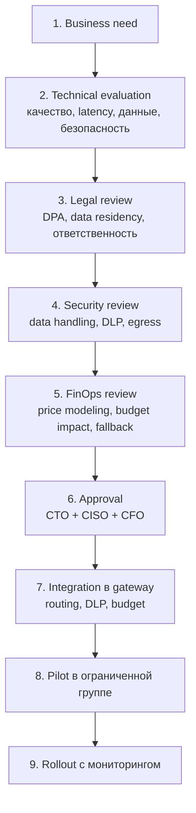

<a id="finops-dla-ii-i-llm"></a>

# FinOps для ИИ и LLM

> Версия: 2.1 · Обновлено: 2026-05-29 · Теги: FinOps, cost attribution, anomaly, token flood, denial of wallet, budget · Tier: 1-4
>
> **TL;DR**. Unit economics, cost attribution, budget guard, anomaly detection, optimization (cache/routing/batch), token flood и denial of wallet как security-темы. В версии 2.0: интерактивный сценарий (denial-of-wallet атака на публичный API бота) и расширенный гайд "С чего начать по вашей роли" (5 ролей: FinOps Lead, Platform/DevOps, Product Owner, SecOps, CFO).

**Тематическое дополнение от 13.11.2026**: бюджет параллельных агентных запусков (§2.6), границы cache/routing (§4.4), стоимость принятой задачи и сверка usage (§6.5). Тарифные числа в примерах иллюстративны; перед закупкой используйте актуальные условия провайдера и собственные измерения.

<a id="0-zacem-otdel_nyj-dokument"></a>

## 0. Зачем отдельный документ

Стоимость ИИ это не только ИТ-статья, но и операционный риск. Агентный запуск может разветвляться на дочерние задачи, повторять вызовы после ошибок и продолжать расходы после отключения пользовательского интерфейса. Причины роста счёта нужно различать: полезная нагрузка, неэффективная архитектура, ошибка автоматизации или атака типа token flood.

FinOps для ИИ отвечает на вопросы:

- Кто сколько тратит (unit economics по user/team/model/project)
- Сколько должны тратить (budget planning)
- Когда тревога (anomaly detection, thresholds)
- Как снижать без потери качества (optimization)
- Как реагировать на атаки, которые выражаются в росте счёта

Документ связывает FinOps с безопасностью: бюджетные контроли это часть защитного контура.

---

<a id="1-unit-economics"></a>

## 1. Unit Economics

<a id="11-dimensii"></a>

### 1.1 Дименсии

Стоимость LLM-запроса привязывается к 4+ дименсиям:

| Дименсия | Пример |
|----------|--------|
| User | Конкретный разработчик, сотрудник |
| Team | Frontend, Risk, Compliance, Marketing |
| Model | Точный provider/model ID, revision и тариф, применённый к запросу |
| Project | Название инициативы, проекта, продукта |
| Tool | Claude CLI, Cursor, Aider, внутренний сервис |
| Request type | chat/completion, embedding, vision, audio |

Gateway (Rilio) должен атрибутировать каждый запрос по всем дименсиям.

<a id="12-formula-stoimosti"></a>

### 1.2 Формула стоимости

```
Cost = Σ (input_tokens * input_price + output_tokens * output_price)
     + overheads (infrastructure, monitoring, egress)
     + DLP compute (внутренний scan)
```

Для self-hosted:

```
Cost = GPU hours * GPU hourly rate
     + support / maintenance
     + power + cooling
```

Для hybrid сценариев (routing): оценка по профилю трафика (% на cloud vs local).

<a id="13-primer-razbienia"></a>

### 1.3 Пример разбиения

Числа ниже иллюстративны: это пример распределения затрат, а не статистика milksec.com или рыночный бенчмарк.

| Team | Model mix | Monthly cost | Per seat |
|------|-----------|--------------|----------|
| Frontend | Claude (60%), GPT (30%), local (10%) | 420k ₽ | 14k/dev |
| Backend | Claude (80%), local (20%) | 310k ₽ | 10.3k/dev |
| Data Science | GPT (50%), local (50%) | 190k ₽ | 6.3k/ds |
| Support | GigaChat (90%), YandexGPT (10%) | 85k ₽ | 1.7k/agent |
| Marketing | GPT (100%) | 120k ₽ | 8k/marketer |

Вывод: Support оптимизирует через отечественные модели. Marketing на одной модели без fallback. Data Science использует local где возможно.

<a id="kal_kulator-cloud-llm-vs-self-hosted"></a>

#### Калькулятор: cloud LLM vs self-hosted

```widget:threshold-slider
{
  "id": "ch22-cloud-vs-onprem",
  "title": "Точка перелома: когда self-hosted дешевле cloud",
  "description": "Учебная модель, не тариф и не sizing-рекомендация: условный cloud $30 за 1M output tokens, self-hosted $55 000 фиксированных затрат в месяц плюс $0.5 за 1M. Качество, input tokens, пропускная способность и GPU capacity здесь не моделируются.",
  "min": 1,
  "max": 1000,
  "step": 1,
  "default": 100,
  "unit": " M токенов/мес",
  "axisLabel": "Output tokens / месяц",
  "tracks": [
    { "label": "Условный cloud ($k/мес)", "compute": "x * 0.03", "format": "fixed2", "tone": "warn", "hint": "x измеряется в миллионах токенов; x × $30 / 1000 даёт тысячи долларов. Input и инструменты не учтены." },
    { "label": "Условный self-hosted ($k/мес)", "compute": "55 + x * 0.0005", "format": "fixed1", "tone": "info", "hint": "$55 000 фиксировано + x × $0.5; делим на 1000 для $k. Это сценарные затраты, а не стоимость конкретного GPU-кластера." },
    { "label": "Разница затрат self-hosted к cloud (%)", "compute": "100 * (1 - (55 + x * 0.0005) / (x * 0.03))", "format": "%", "tone": "info", "hint": "Отрицательное значение означает, что self-hosted дороже. При этих допущениях равенство около 1864M output tokens/мес, за пределами шкалы." },
    { "label": "Средняя цена self-hosted ($/1M)", "compute": "55000 / x + 0.5", "format": "fixed1", "tone": "info", "hint": "Показывает распределение фиксированных затрат. Не учитывает предел мощности: реальную конфигурацию проверяют нагрузочным тестом." }
  ],
  "regions": [
    { "from": 1, "to": 1000, "label": "При заданных условных ценах self-hosted дороже на всей шкале; решение требует собственной модели качества, мощности и затрат", "tone": "info" }
  ]
}
```

---


<a id="2-budget-planning"></a>

## 2. Budget Planning

<a id="21-podhody"></a>

### 2.1 Подходы

- Top-down: от бизнеса выделяется бюджет, распределяется по командам
- Bottom-up: команды заявляют потребности, консолидируется
- Hybrid: baseline top-down, поверх flexible bottom-up

<a id="22-period-i-granularnost_"></a>

### 2.2 Период и гранулярность

- Годовой бюджет на уровне организации и крупных подразделений
- Квартальное уточнение
- Ежемесячное исполнение
- Еженедельный или ежедневный мониторинг для быстрых реакций

<a id="23-budjet-po-dimensiam"></a>

### 2.3 Бюджет по дименсиям

Gateway должен поддерживать бюджеты:

- Per team (monthly limit)
- Per user (для высокопотребительных сотрудников)
- Per model (отдельный лимит на дорогие модели вроде Opus)
- Per project (для временных инициатив)
- Per agent run (для autonomous agents с потенциалом token flood)

<a id="24-sablon-budget-record"></a>

### 2.4 Шаблон budget record

```
team: Data Science
period: 2026-Q2
budget: 800000 RUB
hard_limit: 1200000 RUB
used_so_far: 340000 RUB
warning_threshold: 80%
hard_block_threshold: 100%
owner: ds-lead@company.ru
approved_by: CFO, CTO
```

<a id="25-ceklist"></a>

### 2.5 Чеклист

- [ ] Установлен годовой бюджет на ИИ
- [ ] Распределение по командам согласовано
- [ ] Gateway применяет бюджеты на уровне teams/users
- [ ] Процесс увеличения бюджета описан
- [ ] Отчётность в финансовую систему автоматизирована

<a id="26-budjet-agentnogo-zapuska-rezervirovanie-do-vyzova"></a>

### 2.6 Бюджет агентного запуска: резервирование до вызова

**Проблема**: проверка `used < limit` перед запросом не обеспечивает лимит при параллельном исполнении. Если десять дочерних агентов одновременно видят остаток, каждый может потратить его целиком. Алерт провайдера также не заменяет контроль допуска: [AWS Budgets](https://docs.aws.amazon.com/cost-management/latest/userguide/budgets-managing-costs.html) обновляет данные с задержкой. Механизм ниже - рекомендуемый шаблон реализации в Gateway, а не обещание функции конкретного продукта.

Для запуска ведётся отдельный **budget ledger**: подтверждённый расход, активные резервы и операции с неизвестным исходом.

```text
available = limit - settled_cost - active_reservations

1. Рассчитать верхнюю оценку стоимости следующего вызова.
2. Атомарно зарезервировать сумму на run + team + tenant.
3. Выполнить вызов только при успешном резервировании всех лимитов.
4. По usage провайдера заменить резерв фактическим расходом.
5. При timeout сохранить неопределённость до сверки результата.
```

Оценка учитывает допустимый output, входной контекст и платные инструменты. Если верхняя граница неизвестна, вызов направляется на согласование или ограничивается поддерживаемыми параметрами. Все дочерние задачи расходуют общий лимит родительского запуска; новый `child_run_id` не создаёт новый бюджет.

| Ситуация | Поведение контроля | Подтверждение |
|---|---|---|
| Два запроса претендуют на последний резерв | Допускается только укладывающаяся в остаток совокупность | Тест конкурентного резервирования |
| Провайдер принял запрос, клиент получил timeout | Резерв остаётся до сверки; слепой повтор запрещён | Provider request ID, состояние `unknown` |
| UI закрыт, задачи продолжаются | Отмена доходит до очереди и worker; новые вызовы запрещены | Список активных задач и последнего допуска |
| Billing API недоступен | Неизвестный расход не считается нулевым | Алерт сверки и сохранённые резервы |
| Переключение на другого провайдера | Повторная оценка стоимости и тот же общий лимит | Запись решения маршрутизатора |

> [!warn]
> Истёкший локальный lease не доказывает, что провайдер перестал считать запрос. Нельзя просто освободить такой резерв и повторить вызов. У лимита остаётся оговорённое окно перерасхода для уже принятых операций, изменения тарифов и ошибок оценки; его измеряют на пилоте.

**Владелец**: Platform реализует атомарный ledger и отмену задач; FinOps утверждает тарифный снимок и запас оценки; SecOps проверяет обход через прямые ключи и параллельные запуски. Учёт `run_id`, дочерних вызовов и неизвестных исходов связывается с [runtime procedure](34-ai-agents-runtime-procedure.md).

Источники проверены 13.11.2026. Ledger и матрица проверок - инженерная рекомендация этой главы.

---

<a id="3-anomaly-detection"></a>

## 3. Anomaly Detection

<a id="31-tipy-anomalij"></a>

### 3.1 Типы аномалий

- Резкий рост (2x-10x за сутки на одном user/team)
- Систематическое превышение нормального профиля (цикличная аномалия)
- Аномалия по типу запросов (внезапный рост embedding запросов)
- Token flood (10000+ tokens в одном запросе от пользователя, который обычно шлёт 100)
- Pattern того, что похоже на извлечение модели (systematic probing)

<a id="pesocniza-detection-token-flood-model-extraction-v-otel-logah"></a>

#### Песочница: detection token-flood / model-extraction в OTel-логах

Pattern для SIEM-rule на gateway-логи: ловит patterns Denial-of-Wallet и model extraction в OTel GenAI traces.

```widget:regex-tester
{
  "id": "ch22-flood-detect",
  "title": "Объём и повторы в учебных gateway-логах",
  "description": "Ищет превышение примерных числовых порогов и готовый duplicate_hash_count в flattened log. Не считает повторы самостоятельно, не устанавливает DoW/model extraction или злонамеренность длинного запроса.",
  "defaultPattern": "(?:gen_ai\\.usage\\.input_tokens=([5-9]\\d{4}|\\d{6,}))|(?:gen_ai\\.usage\\.output_tokens=([2-9]\\d{4}|\\d{6,}))|(?:gen_ai\\.request\\.user=\"[^\"]+\".*duplicate_hash_count=([5-9]\\d|\\d{3,}))",
  "flags": "g",
  "tests": [
    { "id": "alert1", "shouldMatch": true, "label": "Input flood (>50k tokens)", "text": "gen_ai.system=openai gen_ai.request.model=gpt-4 gen_ai.usage.input_tokens=120000 gen_ai.usage.output_tokens=200" },
    { "id": "alert2", "shouldMatch": true, "label": "Output flood (>20k tokens)", "text": "gen_ai.system=anthropic gen_ai.usage.input_tokens=500 gen_ai.usage.output_tokens=85000" },
    { "id": "alert3", "shouldMatch": true, "label": "Probing: 100+ duplicate requests", "text": "gen_ai.request.user=\"alice@acme.com\" gen_ai.system=openai duplicate_hash_count=247" },
    { "id": "alert4", "shouldMatch": true, "label": "Mass generation (200k output)", "text": "gen_ai.usage.input_tokens=100 gen_ai.usage.output_tokens=200000" },
    { "id": "ok1", "shouldMatch": false, "label": "Обычный chat запрос", "text": "gen_ai.system=openai gen_ai.usage.input_tokens=450 gen_ai.usage.output_tokens=320" },
    { "id": "ok2", "shouldMatch": false, "label": "Code generation (умеренно large)", "text": "gen_ai.system=anthropic gen_ai.usage.input_tokens=8500 gen_ai.usage.output_tokens=4200" },
    { "id": "ok3", "shouldMatch": false, "label": "Repeated dev queries (но не probing)", "text": "gen_ai.request.user=\"dev@acme.com\" gen_ai.system=openai duplicate_hash_count=12" },
    { "id": "ok4", "shouldMatch": false, "label": "RAG-augmented (legitimate context)", "text": "gen_ai.usage.input_tokens=15000 gen_ai.usage.output_tokens=600" },
    {"id": "edge-legitimate-long-context", "shouldMatch": true, "label": "FP-сигнал: разрешённый длинный context тоже превышает порог", "text": "gen_ai.usage.input_tokens=80000 request_purpose=\"approved-document-review\""}
  ]
}
```

> Видим объёмный/повторный запрос, не атаку. Upstream adapter должен корректно вычислить count и окно по actor/tenant; затем сравнивают baseline, billing/usage и полезный бизнес-результат. Разрешённый длинный документ — контроль ложного срабатывания. Model extraction требует отдельной цепочки сбора/репликации; эти внутренние пороги её не доказывают.

<a id="32-metody"></a>

### 3.2 Методы

- Простые threshold-based (превышение от baseline)
- Z-score на daily spend
- Isolation Forest на multi-dimensional feature vector
- Prophet или ARIMA для forecasting + deviation

<a id="33-reakzii"></a>

### 3.3 Реакции

```
Warning (80% бюджета)
   ├─ Email/Slack владельцу
   └─ Slack в FinOps канал

Critical (100% бюджета)
   ├─ Блокировка дальнейших запросов от team/user
   ├─ Email руководителю team, FinOps, security
   └─ Требование approval для разблокировки

Anomaly (резкий рост)
   ├─ Алерт в security (возможна атака)
   ├─ Временное rate-limit
   └─ Investigation в SOC

Token flood (одноразовый огромный запрос)
   ├─ Throttle запроса (max context)
   ├─ Лог
   └─ Алерт при повторении
```

<a id="34-instrumenty"></a>

### 3.4 Инструменты

- Встроенные в gateway (Rilio: 80% warning, 100% block, spend anomaly detection)
- Prometheus + Alertmanager для metrics-based алертов
- Grafana dashboards с daily spend

<a id="konstruktor-finops-obvazki"></a>

#### Конструктор FinOps-обвязки

Включайте контроли, которые планируете внедрить на LLM Gateway. Конструктор покажет coverage против Denial-of-Wallet и token-flood атак.

```widget:policy-builder
{
  "id": "ch22-finops-controls",
  "title": "Компоненты FinOps и security для LLM Gateway",
  "description": "Самооценка состава контролей: сумма отметок не измеряет coverage, допустимость расхода или защищённость от DoW. Budget admission, cost attribution и фактическое исполнение hard cap проверяются отдельно на evidence конкретного маршрута.",
  "scoreLabel": "Условные баллы выбранных пунктов",
  "scoreMax": 88,
  "groups": [
    {
      "name": "Бюджеты и квоты",
      "items": [
        { "id": "budget-team", "label": "Per-team monthly budget с alerts на 80% / 100%", "weight": 8, "default": true, "recommended": true, "description": "Ограничение допуска расхода команды. Атрибуция затрат требует связи usage с tenant / project / model / provider request ID и возможна без заранее заданного бюджета." },
        { "id": "budget-user", "label": "Per-user limit (для разработчиков и customer service)", "weight": 6, "recommended": true, "description": "Защита от утечки credentials одного пользователя." },
        { "id": "budget-tenant", "label": "Per-tenant budget (для multi-tenant продуктов)", "weight": 6, "description": "B2B-сервис с tier'ами: free/paid/enterprise." }
      ]
    },
    {
      "name": "Rate limiting",
      "items": [
        { "id": "rate-rpm", "label": "Per-user RPM limit", "weight": 7, "default": true, "recommended": true, "description": "60-120 RPM типично; защита от abuse." },
        { "id": "rate-tokens", "label": "Per-user TPM (tokens-per-minute)", "weight": 5, "default": true, "description": "Дополнительно к RPM — защита от token-flood." },
        { "id": "rate-burst", "label": "Burst allowance (короткие spikes допустимы)", "weight": 3, "description": "UX-friendly: ML-инженер делает 10 запросов подряд для debug." }
      ]
    },
    {
      "name": "Защита от token-flood",
      "items": [
        { "id": "max-input", "label": "Hard max-input-tokens (защита от many-shot atacks)", "weight": 6, "default": true, "recommended": true, "description": "Anthropic Many-shot jailbreaking 2024 — context windows 200k+ — вектор атаки." },
        { "id": "max-output", "label": "Hard max-output-tokens", "weight": 6, "default": true, "recommended": true, "description": "Защита от forced-long-output (cost amplification)." },
        { "id": "context-budget", "label": "Per-conversation context-budget", "weight": 4, "description": "Кумулятивный лимит на одну conversation." }
      ]
    },
    {
      "name": "Anomaly detection",
      "items": [
        { "id": "anomaly-spike", "label": "Statistical anomaly detection (z-score > 3 на rate)", "weight": 6, "recommended": true, "description": "Detection через корреляцию historical baseline." },
        { "id": "anomaly-pattern", "label": "Pattern detection (one-shot huge requests)", "weight": 4, "description": "Single request 100k input tokens = подозрительно." },
        { "id": "anomaly-cost", "label": "Cost spike alerts (per-team / global)", "weight": 5, "default": true, "description": "Alert при росте daily spend ≥ 2× baseline." }
      ]
    },
    {
      "name": "Kill-switch",
      "items": [
        { "id": "kill-l0", "label": "L0 kill-switch — global stop через Redis-flag", "weight": 7, "recommended": true, "description": "Обходит deploy; отключает gateway за минуты." },
        { "id": "kill-l4", "label": "L4 kill-switch — per-user / per-team blocking", "weight": 5, "default": true, "description": "Точечное реагирование без global outage." }
      ]
    },
    {
      "name": "Visibility",
      "items": [
        { "id": "dashboard-team", "label": "Per-team daily spend dashboard", "weight": 4, "default": true, "description": "Visibility — основа для optimization decisions." },
        { "id": "alerts-finance", "label": "Finance + FinOps в loop алертов", "weight": 3, "default": true, "description": "Не только security; финансовая команда тоже получает." },
        { "id": "report-monthly", "label": "Monthly executive report", "weight": 3, "default": true, "description": "Tier-1 spend (>$10k/мес) — board-level visibility." }
      ]
    }
  ],
  "rules": [
    { "id": "must-budget", "type": "require-all", "items": ["budget-team"], "message": "Не отмечен per-team budget guard: требуется определить лимит допуска / escalation. Это не означает невозможность cost attribution." },
    { "id": "must-rate", "type": "require-all", "items": ["rate-rpm"], "message": "Не отмечен RPM limit. Проверьте admission, token limits и агрегированные ограничения на всех платных маршрутах." },
    { "id": "must-max-tokens", "type": "require-all", "items": ["max-input", "max-output"], "message": "Не отмечены hard input / output caps. Стоимость зависит от маршрута и тарифа; проверьте enforcement до обращения к провайдеру." },
    { "id": "must-killswitch", "type": "require-all", "items": ["kill-l0"], "message": "Не отмечен global stop. Измерьте реальное ограничение новых расходов, очередей и внешних jobs; наличие Redis-flag не доказывает исполнение." },
    { "id": "min-coverage", "type": "min-score", "threshold": 60, "message": "Сумма отметок ниже учебного порога 60 баллов. Разберите пробелы; размер возможного ущерба не вычисляется из этого списка." }
  ],
  "thresholds": [
    {"from": 0, "to": 30, "label": "Отмечена небольшая часть списка; сверить применимость и evidence", "tone": "info"},
    {"from": 30, "to": 60, "label": "Отмечена часть списка; открытые проверки указаны отдельно", "tone": "info"},
    {"from": 60, "to": 85, "label": "Отмечено много пунктов; обязательные проверки могут оставаться открытыми", "tone": "info"},
    {"from": 85, "to": 100, "label": "Высокая сумма отметок; результат реализации и приёмки проверяется отдельно", "tone": "info"}
  ]
}
```
- Отдельный FinOps dashboard (OpenCost для self-hosted, Kubecost, собственная BI)

<a id="35-ceklist"></a>

### 3.5 Чеклист

- [ ] Threshold алерты настроены для всех teams
- [ ] 80% warning и 100% block работают
- [ ] Anomaly detection включён для user/team/model
- [ ] Runbook по реакции на алерт
- [ ] Еженедельный review аномалий

---


<a id="4-optimization"></a>

## 4. Optimization

<a id="41-tehniki-snijenia-stoimosti"></a>

### 4.1 Техники снижения стоимости

<a id="caching"></a>

#### Caching

- Semantic cache (embedding-based lookup) для частых запросов
- Exact-match cache (SHA-256 hash) для повторяющихся
- Cache hit ratio как метрика (цель 20-40% для некоторых workloads)
- DLP и retention на cached responses

<a id="routing"></a>

#### Routing

- Cheap model first: попытка ответить быстрой и дешёвой моделью; fallback к дорогой при низкой confidence
- Self-hosted first: local models (Qwen, DeepSeek, Llama, GigaChat Lite) для базовых задач
- Rotation: distribute нагрузку между несколькими провайдерами для избегания tier limit

<a id="prompt-optimization"></a>

#### Prompt optimization

- Short system prompts (каждый токен стоит)
- Few-shot только когда реально нужно
- Output length limits (max_tokens strict)
- Output format (JSON instead of prose часто короче)

<a id="rag-optimization"></a>

#### RAG optimization

- Chunk size tuning (не слишком большие)
- Top-K limit (3-5 вместо 10)
- Reranker для повышения precision при меньшем K
- Summary вместо raw chunks где возможно

<a id="batching"></a>

#### Batching

- OpenAI Batch API: 50% скидка относительно соответствующих synchronous API для поддерживаемых Batch моделей / endpoints; конкретный model ID и тариф проверяются перед запуском.
- Асинхронная обработка с окном 24 часа; job и отдельные items проверяются по фактическому статусу, включая ошибки / истечение окна. Ночное расписание само по себе скидку не создаёт.

Условие подтверждено [официальной документацией OpenAI Batch API](https://developers.openai.com/api/docs/guides/batch), проверено 13.11.2026. Оно не означает экономию 50% полной стоимости workflow: retrieval, инструменты, infra, повторы и ручной review учитываются отдельно. Поддержка Batch у одного endpoint / model не переносится на другой автоматически.

<a id="context-management"></a>

#### Context management

- Context compression (LangChain ContextualCompression)
- Conversation summarization для long chats
- Memory TTL

<a id="42-model_naa-ekonomia"></a>

### 4.2 Модельная экономия

| Action | Экономия | Качество |
|--------|---------|----------|
| Cache: условно 30% пригодных hits | Измеряется по usage и затратам на cache; hit ratio не равен доле итоговой экономии | Повторная проверка качества, freshness, ACL и namespace; разные механизмы cache разобраны в §4.4 |
| Route 40% к Haiku/GigaChat вместо Opus | 50-70% на этих | Минимальная для простых задач |
| Short system prompt (с 500 токенов до 100) | 5-10% | Может потребовать редизайна |
| Max_tokens limit | 10-30% | Качество обрезания ответа |
| Local model для embeddings | 40-60% | Близко к cloud embeddings |
| Batch API для non-realtime | 50% | Latency выше |
| RAG с Top-K=3 вместо 10 | 30-40% на input | С хорошим reranker сопоставимо |

Проценты в таблице - сценарные оценки, а не гарантированная экономия; их нельзя складывать. Комбинацию техник проверяют на одном наборе задач с учётом стоимости повторов и качества результата.

<a id="43-ceklist-optimizazii"></a>

### 4.3 Чеклист оптимизации

- [ ] Cache включён и мониторится
- [ ] Fallback chains настроены (cheap-to-expensive)
- [ ] Self-hosted модели используются для базовых задач
- [ ] Prompts пересмотрены на компактность
- [ ] Max_tokens установлены разумно
- [ ] RAG chunks и Top-K tuned
- [ ] Batch API используется для non-realtime нагрузок

<a id="44-cache-i-routing-ekonomia-s-sohraneniem-graniz-dostupa"></a>

### 4.4 Cache и routing: экономия с сохранением границ доступа

Cache hit полезен только тогда, когда ответ разрешён текущему пользователю и соответствует текущей версии данных. Совпадение вопроса не означает совпадения полномочий.

| Механизм | Что входит в контекст решения | Что проверяем |
|---|---|---|
| Exact-match cache | Tenant, права пользователя, версия корпуса, prompt и model revision | Один запрос от двух разных tenant не даёт чужой ответ |
| Semantic cache | Те же границы плюс допустимая семантическая близость | Близкий вопрос с другим объектом или периодом не получает прежние данные |
| Provider prompt cache | Документированные правила провайдера, структура префикса и условия тарифа | Не приравниваем кеширование префикса к кешированию готового ответа |
| Routing / fallback | Класс данных, разрешённый регион, модель и инструменты | Дешёвый fallback не получает данные, запрещённые исходной политикой |
| Сводка разговора | Источники фактов, срок хранения, полномочия сессии | Сводка не восстанавливает удалённые данные и не превращает цитату в инструкцию |

При отзыве доступа инвалидируются связанные ответы и сводки либо повторно проверяется доступ к использованным источникам перед выдачей. Если восстановить происхождение кешированного ответа нельзя, для чувствительного сценария это cache miss. Политика хранения распространяется на cache так же, как на исходный документ. Практика проверки retrieval и tenant isolation приведена в [главе 24](24-vector-db-security.md).

**Чеклист пилота**:

- [ ] Hit ratio измеряется отдельно для каждого класса задач и tenant.
- [ ] Экономия учитывает cache storage, lookup, embedding и повторную генерацию.
- [ ] Проверены отзыв доступа, обновление корпуса и смена версии политики.
- [ ] Routing сравнивается с baseline по успешно решённым задачам, отказам защиты и latency.
- [ ] Недоступный разрешённый маршрут приводит к контролируемому отказу, а не к отправке в произвольный внешний API.

---

<a id="45-tri-vida-cache-savings-ne-skladyvat_-odno-i-to-je-uskorenie"></a>

### 4.5 Три вида cache savings: не складывать одно и то же ускорение

**TL;DR.** Answer cache, engine KV reuse и provider cached-token billing имеют разные числители. Сохраните общий знаменатель: стоимость принятой задачи с её retry, fallback и проверкой результата.

| Слой | Что считать | Что этим не подтверждается |
|---|---|---|
| Exact/semantic answer cache | Запросы, обслуженные допустимым готовым ответом, lookup/storage/embedding cost | Физический KV hit внутри engine |
| Self-hosted prefix/KV cache | Matched tokens/blocks, prefill work и фактическая стоимость serving | Отсутствие затрат на decoding или оплаченный provider discount |
| Provider prompt cache | Документированные cache-read/write usage и начисления для модели/API | Конкретный GPU KV reuse, низкий TTFT или полномочия вернуть готовый ответ |

На 13.11.2026 [OpenAI prompt caching guide](https://developers.openai.com/api/docs/guides/prompt-caching) различает cached-pricing eligibility и физическое KV reuse. В Responses usage доступны `input_tokens_details.cached_tokens`; для новых моделей также `cache_write_tokens` и `prompt_cache_options`, тогда как старые используют `prompt_cache_retention`. `prompt_cache_key` зависит от модели/API и не является универсальным аналогом vLLM `cache_salt`. Модель, API, retention и тариф фиксируются в cost record; поля нельзя переносить провайдеру по сходству названий.

У [Claude usage](https://platform.claude.com/docs/en/build-with-claude/prompt-caching#tracking-cache-performance) полный вход считается как `cache_read_input_tokens + cache_creation_input_tokens + input_tokens`: последнее поле само по себе не весь input. Provider boundary также зависит от выбранного API/cloud; разные tenants вашего приложения внутри одного provider account не становятся автоматически независимыми cache domains.

**Пример проверки экономии**: replay разрешённого стабильного prefix сохраняет quality/SLO, а total cost на accepted task снижается после учёта cache writes, storage и fallback. Отдельно сверяются provider usage с начислениями, клиентская latency и результат задачи. Негативный сценарий: короткий TTL, дорогие writes или разделение namespaces делают итог дороже; высокий hit ratio не отменяет этот результат. Отсутствующее usage — unknown cost, а не ноль.

Если ответ обслужен application cache без обращения к provider, не приписывайте тому же запросу ещё и provider/KV savings. Для исполненных попыток используйте фактические записи расходов; для экономии — явно заданный сопоставимый baseline. Разделение private sharing groups может снижать reuse: это измеряемая цена требуемой границы, а не основание объединить группы. О key/peer trust см. [главу 05](05-stage3-model-deployment.md#kv-cache-trust), о текущем доступе к источникам answer cache — [главу 24](24-vector-db-security.md).

<a id="5-finops-i-security"></a>

## 5. FinOps и Security

<a id="51-peresecenia"></a>

### 5.1 Пересечения

Атаки часто проявляются в финансовых метриках раньше, чем в security-алертах:

- Token flood = атака типа denial of wallet
- Systematic probing = model extraction attempt
- Sudden shift в model mix = возможная компрометация credentials
- Аномально высокий traffic from one user = либо bug, либо compromised account

<a id="52-integrazia"></a>

### 5.2 Интеграция

- FinOps dashboard видит security team
- Cost-based alerts идут и в security SIEM
- Runbook на cost anomaly включает security investigation
- Budget hard stop это не только financial контроль, но и защитный

<a id="53-token-flood-kak-ataka"></a>

### 5.3 Token flood как атака

Сценарий: атакующий получил доступ к API key. Запускает инструмент, который генерирует огромные prompts с максимальным max_tokens в цикле. За сутки компания получает счёт на миллионы.

Меры:

- Per-user rate limit (не только RPM, но и tokens per minute)
- Per-request лимит на max-output-tokens (например, 4000 для обычных пользователей) плюс отдельный hard max-input-tokens (типично 32k для chat), согласованно с §8
- Anomaly detection на spikes в token usage per user
- API key rotation при аномалии
- Kill-switch L1 (block user) в Rilio активируется при аномалии
- Multi-factor for key generation (чтобы нельзя было просто украсть token)

<a id="54-denial-of-wallet-pramaa-ataka"></a>

### 5.4 Denial of wallet прямая атака

Если API keys случайно утекли в public repo, злоумышленник может исчерпать бюджет за часы. Меры:

- Секрет-сканирование в CI (см. 22)
- Short-lived tokens
- Hard monthly limit на каждый team/user в gateway
- Email notification на быстрый rate of spend
- Policy: финансовая ответственность не сотрудника, а team, при утечке ключа через сотрудника

<a id="cto-delat_-pri-podozrenii-na-denial-of-wallet-navigator"></a>

#### Что делать при подозрении на Denial-of-Wallet — навигатор

```widget:decision-tree
{
  "id": "ch22-dow-response",
  "title": "Denial-of-Wallet incident response",
  "start": "q1",
  "nodes": {
    "q1": {
      "type": "question",
      "text": "Какой триггер сработал?",
      "sub": "Порог 2×/80%/3σ ниже — учебный триггер triage, не доказательство атаки и не универсальная настройка. Сначала ограничьте недопустимый новый расход в согласованном scope, затем различите атаку, ошибку и полезную нагрузку.",
      "choices": [
        {
          "label": "Cost spike alert (>2× baseline за час)",
          "next": "q2-spike"
        },
        {
          "label": "Budget threshold (80% или 100% пройден)",
          "next": "q2-budget"
        },
        {
          "label": "Rate anomaly (RPM > 3-sigma от baseline)",
          "next": "q2-rate"
        },
        {
          "label": "Notification от cloud-provider (unusual usage)",
          "next": "leaf-provider"
        },
        {
          "label": "Утечка API key обнаружена в gitleaks / secret scan",
          "next": "leaf-leak"
        }
      ]
    },
    "q2-spike": {
      "type": "question",
      "text": "Cost concentrated в одном tenant / user / IP?",
      "choices": [
        {
          "label": "Да, концентрация >80% в одном источнике",
          "next": "leaf-targeted"
        },
        {
          "label": "Нет, distributed across many users",
          "next": "leaf-distributed"
        }
      ]
    },
    "q2-budget": {
      "type": "question",
      "text": "Какой период бюджета?",
      "choices": [
        {
          "label": "Daily budget пройден за <8 ч",
          "next": "leaf-daily-fast"
        },
        {
          "label": "Monthly budget пройден за <2 недели",
          "next": "leaf-monthly-fast"
        },
        {
          "label": "Близко к норме, но достигли лимита",
          "next": "leaf-budget-normal"
        }
      ]
    },
    "q2-rate": {
      "type": "question",
      "text": "RPM аномалия — паттерн запросов?",
      "choices": [
        {
          "label": "Repetitive identical (probing / DDoS-style)",
          "next": "leaf-probing"
        },
        {
          "label": "Варьируется, но необычно высокий объём",
          "next": "leaf-rate-burst"
        }
      ]
    },
    "leaf-targeted": {
      "type": "leaf",
      "tone": "err",
      "title": "Концентрированный spike: ограничить scope и проверить причину",
      "summary": "Один tenant или ключ может соответствовать атаке, разрешённому batch job либо retry-loop. Не устанавливайте компрометацию только по доле расходов.",
      "details": [
        "Применить согласованный cap/приостановку новых расходов в затронутом scope, учесть легитимных пользователей и in-flight задачи",
        "Связать usage с владельцем, identity, job, model/tools и согласованным изменением нагрузки",
        "При подтверждённой утечке отозвать credential и зависимые сессии; замена ключа без отзыва не устраняет старый доступ",
        "Положительный контроль: разрешённый batch укладывается в согласованный бюджет; отрицательный — fan-out/retry не обходит cap",
        "Сверить фактические эффекты stop и provider usage; неизвестный исход записи не повторять автоматически; сообщить Finance и Product Owner"
      ],
      "links": [
        {
          "label": "Глава 15 §IR-AG-02 playbook",
          "href": "/ch/15-ai-incident-response"
        }
      ]
    },
    "leaf-distributed": {
      "type": "leaf",
      "tone": "warn",
      "title": "Distributed spike — anomaly investigation",
      "summary": "Может быть legit (вирусный успех продукта) или distributed attack. Требует analysis.",
      "details": [
        "Проверить product analytics, запланированные jobs, retry/error logs и distributed abuse; число IP не устанавливает причину",
        "Если рост подтверждён как полезный: изменение cap согласовать с владельцем бюджета и оценить нагрузку до расширения",
        "Если abuse-подобный: scoped rate/concurrency/token/tool/fan-out limits; challenges только там, где они применимы",
        "Во время triage сохранять проверяемый cap; срок расследования определить по материальности и фактической скорости расходов"
      ]
    },
    "leaf-daily-fast": {
      "type": "leaf",
      "tone": "err",
      "title": "Быстрое исчерпание дневного бюджета: triage",
      "summary": "Учебный порог 8 часов — сигнал проверки, а не диагноз атаки. Проверить незапланированные jobs, конфигурацию, повторы и полезный рост.",
      "details": [
        "Containment: temporary block dalсhих запросов (graceful degradation сообщение)",
        "Investigation: top users / IPs / endpoints за период",
        "Если targeted: kill-switch L4 на конкретный source",
        "Если distributed attack: ужесточить лимиты (уменьшить допустимые RPM / TPM / concurrency) в подтверждённом scope, учесть легитимных пользователей и проверить фактический отказ новых расходов"
      ]
    },
    "leaf-monthly-fast": {
      "type": "leaf",
      "tone": "warn",
      "title": "Monthly budget exhaustion",
      "summary": "Критичность зависит от суммы, скорости, доступного резерва и последствий ограничения. Плановый рост и steady abuse требуют разных решений.",
      "details": [
        "Investigation: weekly trend; growth pattern",
        "Если organic: budget revision + planning Q+1",
        "Если abuse: identify source, ужесточить per-user limit",
        "Communication: Finance, Product Owner для quota decision"
      ]
    },
    "leaf-budget-normal": {
      "type": "leaf",
      "tone": "info",
      "title": "Лимит достигнут близко к плану: проверить причину и следующий допуск",
      "summary": "Совпадение с прогнозом не исключает abuse или ошибку. Сверьте usage и разрешённую полезную нагрузку; не повышайте бюджет автоматически.",
      "details": [
        "Уведомить владельца и сверить attribution, оплаченные tools, повторы и принятые результаты",
        "Повышение лимита — отдельное решение владельца бюджета с новым scope и сроком",
        "Проверить сохранение ограничений дочерних задач и fallback; обновить прогноз по подтверждённым данным"
      ]
    },
    "leaf-probing": {
      "type": "leaf",
      "tone": "err",
      "title": "Probing pattern — model extraction или DoS",
      "summary": "Повторы могут быть probe, клиентским retry, мониторингом или batch. Проверить цель, identity и характер эффектов; одинаковость запроса не доказывает extraction.",
      "details": [
        "Containment: per-IP rate limit; geo-block при необходимости",
        "Investigation: query patterns (model extraction signatures)",
        "Long-term: anomaly detection на rate / entropy patterns; bot-detection",
        "Logs: preserve для forensic"
      ],
      "links": [
        {
          "label": "Глава 16 §1 Model Extraction",
          "href": "/ch/16-ml-attacks-rag-multimodal"
        }
      ]
    },
    "leaf-rate-burst": {
      "type": "leaf",
      "tone": "warn",
      "title": "Rate burst — investigation 1-4 ч",
      "summary": "Высокий объём сам по себе не определяет, органический он или атакующий. Сопоставьте задания, изменение клиентов, ошибки и стоимость.",
      "details": [
        "Per-user spike: один user сделал 1000 requests за час — credentials leak возможен",
        "Per-IP: behind NAT возможно; NAT IP блокировать осторожно",
        "Decision: temporary cap или wait + monitor"
      ]
    },
    "leaf-provider": {
      "type": "leaf",
      "tone": "err",
      "title": "Уведомление провайдера: проверить подлинность, scope и usage",
      "summary": "Уведомление — источник triage, не доказательство targeted attack. Проверяйте его через известный канал провайдера, без перехода по непроверенным ссылкам.",
      "details": [
        "Сопоставить provider request/job IDs, задержку учёта и внутренние usage receipts",
        "Применить scoped cap/остановку нового допуска; проверить accepted/in-flight задачи и реальные расходы",
        "Определить причину: полезная нагрузка, ошибочный retry/fan-out, изменение тарифа/конфигурации или компрометация",
        "При ограничении сервиса согласовать действия с владельцем и поддержкой; полноту provider logs оценить, а не предполагать"
      ]
    },
    "leaf-leak": {
      "type": "leaf",
      "tone": "err",
      "title": "API key leak detected — proactive response",
      "summary": "Подтверждённо раскрытый credential считается скомпрометированным; отзыв и проверка использования не должны ждать роста счёта.",
      "details": [
        "Containment (immediate): revoke compromised key через provider API",
        "Новый credential: минимальные scopes и поддерживаемый провайдером срок/механизм renewal; произвольный TTL 1 час доступен не для каждого типа ключа",
        "Investigation: где утёк; история git; кто committed; какие other secrets могут быть с тем же source",
        "Проверить источник утечки и другие доступные секреты; исключить секреты из репозитория и образа, внедрить поддерживаемую выдачу credentials и тест отзыва/resume"
      ],
      "links": [
        {
          "label": "Глава 13 §4 LLM tokens detection",
          "href": "/ch/13-implementation-ru-playbook"
        }
      ]
    }
  }
}
```

---

<a id="6-reporting-i-visibility"></a>

## 6. Reporting и visibility

<a id="61-dasbordy"></a>

### 6.1 Дашборды

Минимальный набор:

- Daily spend total + breakdown by provider
- Monthly spend vs budget per team (прогресс-бар)
- Top 10 users by spend
- Top 10 models by volume
- Cost per request evolution
- Cache hit ratio
- Alerts: recent warnings and blocks

<a id="62-otcety"></a>

### 6.2 Отчёты

- Monthly FinOps review (CFO, CTO, Security)
- Quarterly report с trends и projections
- Ad-hoc при аномалиях
- Annual report с ROI анализом

<a id="63-metriki-effektivnosti-finops"></a>

### 6.3 Метрики эффективности FinOps

- Forecast accuracy (насколько budget совпадает с actual)
- Cost per active user
- Cost per value unit (depends on use case: per ticket solved, per code PR, per document processed)
- Savings from optimization initiatives
- Incidents prevented by budget controls

<a id="64-instrumenty"></a>

### 6.4 Инструменты

- OpenCost для K8s self-hosted
- Kubecost
- Helicone self-hosted
- Langfuse (observability + cost)
- Собственные BI (Superset, Metabase, Grafana с exporters)
- Rilio встроенный cost attribution

<a id="65-stoimost_-rezul_tata-i-sverka-usage"></a>

### 6.5 Стоимость результата и сверка usage

Для агента `cost per request` легко улучшить, разбив один полезный результат на множество дешёвых вызовов и не посчитав повторы. Основная бизнес-метрика задаётся до пилота: стоимость принятого изменения, корректно обработанного документа или закрытой заявки.

```text
cost_per_accepted_task =
  (model + tools + retrieval + infrastructure + human_review)
  / accepted_tasks
```

Каждая статья числителя включает все попытки, в том числе повторы и неуспешные вызовы. Повторы дополнительно выделяются аналитическим срезом, но не прибавляются второй раз к уже учтённому usage. Стоимость embedding относится либо к model, либо к retrieval по принятой методике; статьи не пересекаются.

`accepted_tasks` определяется проверкой результата: ответ HTTP 200 или завершённая генерация сами по себе не означают принятую задачу. Отдельно показываются доля принятых результатов, нарушения политики, latency и ручная доработка. При нулевом числе принятых задач метрика не определена: нельзя подставлять ноль расходов на успешную задачу.

**Минимальная запись для сверки**: `tenant_id`, `project_id`, `run_id`, `parent_run_id`, `attempt_id`, provider request ID, model revision, тарифная версия и валюта, время вызова, usage, резерв, фактический расход, статус результата. Это внутренняя схема учёта, не универсальный формат API провайдеров. Промпты и содержимое документов в бюджетную запись не включаются.

1. Platform связывает worker events с Gateway и запросами провайдера, сохраняя попытки с ошибками и неизвестным исходом.
2. FinOps сверяет оценки с выгрузкой usage и счётом: cached tokens, инструменты, скидки и корректировки учитываются по конкретному договору.
3. Product Owner подтверждает критерий принятой задачи и выборку качества. Финансовая экономия показывается вместе с изменением этого показателя.
4. Неатрибутированные расходы остаются отдельной строкой. Их нельзя скрывать пропорциональным распределением без принятой методики.

Основа для распределения затрат и оценки бизнес-ценности: [FinOps for AI](https://www.finops.org/framework/technology-categories/ai/) и [Allocation](https://framework.finops.org/framework/capabilities/allocation/), проверено 13.11.2026. Состав записи и порядок сверки выше - практическая адаптация для агентных нагрузок.

---

<a id="7-integrazia-s-prozessom-zakupok"></a>

## 7. Интеграция с процессом закупок

<a id="71-prozedura-podklucenia-novogo-provajdera"></a>

### 7.1 Процедура подключения нового провайдера



<a id="72-mul_ti-provajdernaa-strategia"></a>

### 7.2 Мульти-провайдерная стратегия

- Минимум 2 провайдера для критичных функций (отказ одного не блокирует бизнес)
- Один из них self-hosted (Qwen, DeepSeek, GigaChat on-prem)
- Тестирование fallback по расписанию (ежеквартально chaos day)

---

<a id="8-tipicnye-osibki"></a>

## 8. Типичные ошибки

1. Нет per-user/per-team attribution. Месяц спустя никто не знает, откуда счёт.
2. Hard limit только на organization level. Один team убивает бюджет других.
3. Отсутствие fallback chain. Opus недоступен, все задачи падают.
4. Cache с PII leak. Responses с клиентскими данными кэшируются без DLP на read.
5. Max_tokens не ограничены. Один токен-flood превышает дневной бюджет.
6. Alerts в отдельном канале, FinOps не в security loop.
7. Rate limit только по RPM. Один запрос с огромным context обходит.
8. FinOps view не включает self-hosted (GPU hours, cooling). Видят только cloud, но total ownership больше.
9. Optimization один раз. Провайдеры меняют прайсы, модели выходят новые. Без re-evaluation экономия упускается.
10. Budget как cost center, а не risk control. Недоинвестирование в контроль приводит к incident с ущербом больше всего бюджета.

<a id="antipatterny-finops-for-ai-spravocnik"></a>

#### Антипаттерны FinOps for AI — справочник

```widget:flashcards
{
  "id": "ch22-finops-failures",
  "title": "10 ошибок FinOps for AI которые превращают spike в катастрофу",
  "description": "Авторские учебные сценарии FinOps: симптомы, возможные последствия и меры контроля. Суммы, сроки и поведение поставщиков в карточках — условные вводные, не подтверждённые инциденты российских компаний, тарифы или прогноз ущерба. Для расчёта используйте свой тарифный снимок и измеренный usage.",
  "shuffle": false,
  "cards": [
    {
      "tag": "attribution",
      "front": "«Никакой attribution»",
      "subFront": "Чей это $200k счёт?",
      "back": "Симптом: monthly bill вырос на $50k; никто не знает, какая команда / продукт ответственны.\n\nFix: per-team / per-tenant tagging обязательно с дня 1; каждый запрос в gateway имеет team_id / project_id; reporting daily / weekly с breakdown по этим dimension."
    },
    {
      "tag": "limits",
      "front": "«Hard limit только на org level»",
      "subFront": "One team kills budget for others",
      "back": "Симптом: одна команда (часто marketing для image generation) исчерпала org-level budget; другие команды получают rate-limit / block.\n\nFix: per-team budget с separately enforced limits; эскалация не происходит через org-level cap; quarterly budget review."
    },
    {
      "tag": "fallback",
      "front": "«Нет fallback chain»",
      "subFront": "Opus down → ALL down",
      "back": "Учебный сценарий: основной provider недоступен, продукт не имеет разрешённого пути деградации.\n\nFix: заранее approved fallback chain из совместимых model/provider/policy bundles. Перед routing сохранять data class, region/residency, retention, текущую authz и tool scopes; доступность или меньшая цена не разрешают новый data flow. Проверить качество, ошибки и фактический upstream.\n\nЕсли совместимого пути нет — контролируемый отказ. Cached response требует актуальной проверки source ACL. Для timeout после side-effect call оставить unknown и сделать readback/reconciliation по action ID; не повторять действие вслепую через другого provider."
    , "href": "https://aws.amazon.com/builders-library/making-retries-safe-with-idempotent-APIs/"},
    {
      "tag": "cache",
      "front": "«Cache responses с PII»",
      "subFront": "Cross-user data leak",
      "back": "Симптом: пользователь A спрашивает «Каков мой баланс»; ответ кэшируется; пользователь B задаёт идентичный вопрос — получает баланс A.\n\nFix: cache partition по tenant, effective scope/policy/source revision и нужной identity dimension. На hit повторно проверить актуальные права на каждый source/object; предусмотреть revocation/invalidation и no-cache для несовместимых scopes. User/tenant key и TTL сами по себе не заменяют current authz."
    , "href": "https://cheatsheetseries.owasp.org/cheatsheets/Authorization_Cheat_Sheet.html"},
    {
      "tag": "max-tokens",
      "front": "«Max_tokens не ограничены»",
      "subFront": "One token-flood = $5000",
      "back": "Симптом: пользователь отправляет 200k context + просит 100k output; gateway пропускает; один запрос стоит $30; повторённый 1000 раз = $30k.\n\nFix: hard max-input-tokens (типично 32k для chat) и max-output-tokens (4k); enforce на gateway уровне; reject с 400 если превышено."
    },
    {
      "tag": "alerting",
      "front": "«FinOps alerts не в security loop»",
      "subFront": "Spike обнаружен через bill",
      "back": "Симптом: cost spike на $20k произошёл в ночь; SOC узнал из утреннего finance dashboard, а не из alert.\n\nFix: FinOps anomaly alerts роутятся в SOC одновременно с finance; correlation в SIEM с другими signals (rate / probing patterns)."
    },
    {
      "tag": "rate-limit",
      "front": "«Только RPM rate limit»",
      "subFront": "One request bypass всё",
      "back": "Симптом: per-user RPM=60; атакующий делает 1 запрос с 200k context — bypass обычного rate limit, но cost = $30.\n\nFix: comprehensive rate limit: RPM + TPM (tokens-per-minute) + per-conversation cumulative; max-input-tokens отдельно."
    },
    {
      "tag": "self-hosted",
      "front": "«Self-hosted не в FinOps view»",
      "subFront": "Hidden TCO",
      "back": "Симптом: FinOps dashboard показывает $50k/мес cloud spend; реально org тратит $150k включая GPU clusters / DC / ops.\n\nFix: TCO modeling: включить GPU amortization (3-yr CapEx / 36 мес), power, cooling, ops FTE; full transparency для optimization decisions."
    },
    {
      "tag": "optimization",
      "front": "«Один раз отптимизировали»",
      "subFront": "Провайдеры меняют цены",
      "back": "Учебный сценарий: после выбора модели изменились цены, возможности и требования; прежняя cost estimate больше не описывает реальную задачу.\n\nFix: review стоимости принятого результата, quality/security evals и latency на разрешённом наборе. Routing — только среди approved совместимых model/provider/policy bundles с текущими data class, region, retention, authz и tool scopes.\n\nA/B на real traffic требует отдельного разрешения на этот data flow. Cheapest adequate model выбирается внутри утверждённых ограничений; если совместимой альтернативы нет — сохранить безопасный маршрут или контролируемо отказать."
    , "href": "https://cheatsheetseries.owasp.org/cheatsheets/Authorization_Cheat_Sheet.html"},
    {
      "tag": "mindset",
      "front": "«Budget = cost center»",
      "subFront": "Underinvestment в controls",
      "back": "Учебный сценарий: команда экономит на DLP/kill-switch/monitoring, затем сталкивается с инцидентом на условные $200k. Сам сценарий не доказывает окупаемость конкретной меры.\n\nFix: учитывать FinOps/security controls как возможное снижение риска. Owner оценивает стоимость controls, изменение ожидаемого ущерба и бизнес-результат по явным допущениям и диапазонам неопределённости.\n\nОтсутствие инцидента само по себе не доказывает ROI; это не отрицание защитной ценности. Сверять оценку с фактическими расходами, стоимостью принятого результата и качеством (§6.5)."
    }
  ]
}
```

---

<a id="9-ceklisty"></a>

## 9. Чеклисты

<a id="91-bazovyj-finops"></a>

### 9.1 Базовый FinOps

- [ ] Unit economics per user/team/model/project настроен
- [ ] Месячные бюджеты установлены
- [ ] 80% warning, 100% block настроены
- [ ] Dashboard с daily spend доступен
- [ ] Monthly review проводится
- [ ] Anomaly detection включён

<a id="92-prodvinutyj"></a>

### 9.2 Продвинутый

- [ ] Caching + hit ratio мониторинг
- [ ] Fallback chains с automatic routing
- [ ] Batch API для non-realtime
- [ ] Budget forecasting с ML
- [ ] Cost-aware routing (cheapest viable model)
- [ ] FinOps-Security integration (shared alerts)

<a id="93-kriticeskij"></a>

### 9.3 Критический

- [ ] Token flood detection и mitigation
- [ ] Denial of wallet playbook
- [ ] Multi-provider strategy с chaos tests
- [ ] ROI tracking per use case
- [ ] Annual procurement review

---


<a id="10-svazi-s-drugimi-dokumentami"></a>

## 10. Связи с другими документами

- [06. Operations](06-stage4-operations-platform.md). Observability.
- [13. Внедрение в РФ](13-implementation-ru-playbook.md). Бюджет в roadmap.
- [14. Governance](14-model-risk-governance.md). Attribution в AI-BOM.
- [15. IR](15-ai-incident-response.md). Денежные атаки как инциденты.
- [20. Code Assistants](20-code-assistants-security.md). Cost per tool.


---

<a id="interaktivnyj-szenarij-denial-of-wallet-ataka"></a>

## Интерактивный сценарий: Denial of Wallet атака

```widget:attack-stepper
{
  "title": "Атакующий сжигает $100k в LLM API за сутки",
  "steps": [
    {
      "title": "Discovery",
      "actor": "Attacker",
      "action": "Находит endpoint вашего бота без rate-limit. Public demo или частично защищённый. Начинает посылать long-context prompts.",
      "defense": "Проверяемые admission/rate/concurrency/token/tool/fan-out limits по identity и scope; CAPTCHA может быть дополнительной мерой для подходящего публичного маршрута, но не контролирует все фоновые расходы."
    },
    {
      "title": "Amplification",
      "actor": "Attacker",
      "action": "Для учебной арифметики зададим стоимость $5–10 за оплачиваемый запуск: 1000 запусков дают $5000–10000. Это не актуальный тариф и не вывод из размера context window; реальная цена зависит от модели, input/output, cache, retries и tools. Оплаченный запуск не означает принятый бизнесом результат.",
      "defense": "До параллельного допуска учитывать консервативный резерв бюджета и caps, затем сверять usage. Алерт на 50% — уведомление, а не запрет новых расходов."
    },
    {
      "title": "Detection не срабатывает",
      "actor": "FinOps",
      "action": "В условном сценарии учёт смотрят только по месячному отчёту. Чтобы получить $100k по принятой цене, нужно 10–20 тысяч оплачиваемых запусков; фактический темп и quota отдельно проверяются, это не измерение attack throughput.",
      "defense": "Сопоставить model/tool/job usage и новые admissions; dashboard/alert дополняется реально применяемым cap. Проверить полезный batch как положительный контроль и retry/fan-out обход как отрицательный."
    },
    {
      "title": "Утро обнаружения",
      "actor": "FinOps + CFO",
      "action": "После обнаружения ограничить новые расходы в подтверждённом scope, проверить identity/credentials и причину. Уже принятые provider jobs/in-flight запросы могут продолжаться; отключение UI или API не доказывает их отмену.",
      "defense": "Runbook указывает конкретный scope stop/revoke и проверку usage/readback, без универсальной привязки «L4 = endpoint». Повышение бюджета требует отдельного решения; неизвестный исход записи не повторять автоматически."
    },
    {
      "title": "Post-mortem",
      "actor": "CISO + FinOps",
      "action": "Разобрать источник расходов и полноту атрибуции; умысел устанавливается расследованием. Проверить возможность обращения к страховщику и провайдеру по условиям договора.",
      "defense": "Не предполагать покрытие API-abuse или обязательный refund: применимость, исключения и доказательства проверяются по конкретному договору."
    }
  ]
}
```

```widget:quiz
{
  "id": "ch22-q1",
  "question": "Как ограничить новые расходы при подозрении на Denial of Wallet в агентном LLM-сервисе?",
  "options": [
    "Достаточно уведомления о месячном бюджете",
    "Применить проверяемый бюджетный admission и лимиты запросов, concurrency, токенов, tools и дочерних задач; параллельно установить причину и проверить фактическую остановку новых расходов",
    "Любой высокий счёт доказывает компрометацию API key",
    "CAPTCHA на входе ограничит все фоновые и аутентифицированные задачи"
  ],
  "answer": 1,
  "explanation": "Рост расходов бывает следствием атаки, retry-loop, конфигурационной ошибки или полезной нагрузки. Алерт сообщает о пороге, но сам по себе не запрещает новый допуск. Проверяйте резервирование бюджета для параллельных задач, in-flight и provider-accepted операции, а после остановки — usage/readback. Лимиты провайдера и CAPTCHA могут быть дополнительными слоями в подходящем scope; их покрытие и задержки проверяются отдельно."
}
```

<a id="s-cego-nacat_-po-vasej-roli"></a>

## С чего начать по вашей роли

<a id="finops-lead"></a>

### FinOps Lead

| Горизонт | Действия |
|----------|----------|
| День 1 | Real-time dashboard: cost per team/product/model. Alert на spike (2x daily baseline). |
| Неделя 1 | Budget guards per team. Chargeback model. Anomaly detection rules. |
| Месяц 1 | Monthly FinOps review. ROI analysis на LLM use cases. Kill-switch drill. |

<a id="platform-devops"></a>

### Platform / DevOps

| Горизонт | Действия |
|----------|----------|
| День 1 | Rate limit per-user, per-IP, per-endpoint в Gateway. Max tokens cap. |
| Неделя 1 | Semantic cache для частых запросов. Routing к cheaper models для simple queries. |
| Месяц 1 | Batch processing для async workloads (Anthropic Batch API, OpenAI Batch). |

<a id="product-owner"></a>

### Product Owner

| Горизонт | Действия |
|----------|----------|
| День 1 | Unit economics: cost per user / per transaction. Pricing covers cost? |
| Неделя 1 | Tiering: freemium vs paid с разными limits. Customer abuse policy. |
| Месяц 1 | Optimize: A/B тесты cheaper models, prompt compression, cache. |

<a id="secops"></a>

### SecOps

| Горизонт | Действия |
|----------|----------|
| День 1 | SIEM-rule: spend anomaly (2x baseline). Correlation с suspicious access patterns. |
| Неделя 1 | Detection: token flood from single tenant, long-context abuse, multi-account abuse. |
| Месяц 1 | Runbook: Denial of Wallet response (throttle, kill-switch, forensics). |

<a id="cfo-finance"></a>

### CFO / Finance

| Горизонт | Действия |
|----------|----------|
| День 1 | Visibility: AI OpEx breakdown. Forecast vs actual. |
| Неделя 1 | Contracts с LLM-provider: volume discount, refund policy по incidents, committed spend. |
| Месяц 1 | Insurance coverage для API abuse. Board reporting. |

```widget:quiz
{"id": "ch22-q2", "question": "Как подтвердить пользу оптимизации LLM cost?", "options": ["Сравнить только цену одного запроса", "На одном наборе задач измерить стоимость принятого результата, качество, нарушения политики и latency; отдельно проверить границы cache и fallback", "Сложить проценты экономии cache, routing и compression", "Считать любой cache hit успешной задачей"], "answer": 1, "explanation": "Дешёвый запрос не означает дешёвую решённую задачу. Повторы, ручная доработка и платные инструменты входят в стоимость; качество и безопасность проверяются отдельно. Экономия из разных механизмов не складывается автоматически."}
```

---

[← 21. Люди и процесс: AI Literacy, Decommissioning, Bug Bounty](21-people-process.md) · [↑ Индекс](00-INDEX.md)
