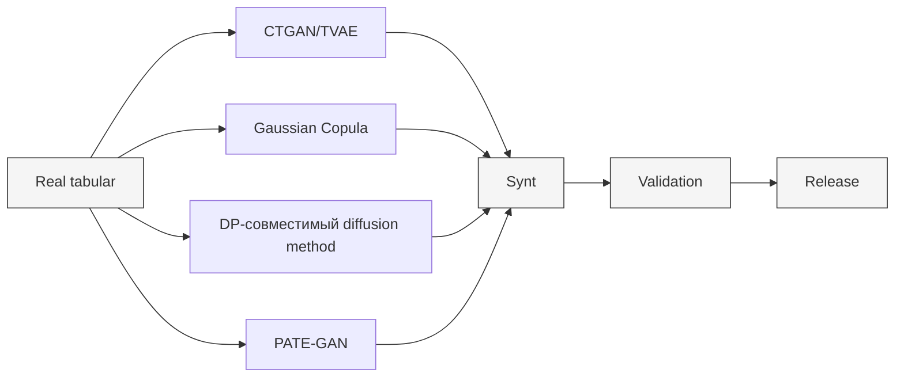
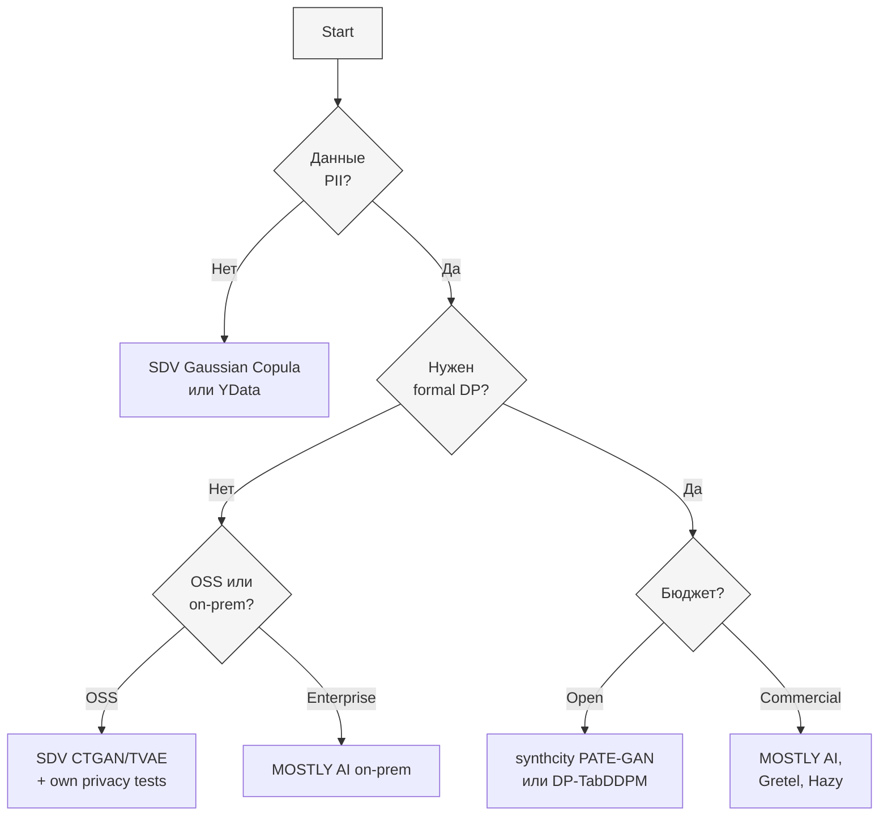

<a id="glava-28-bezopasnost_-sinteticeskih-dannyh"></a>

# Глава 28. Безопасность синтетических данных

> **Версия**: 2.1
> **Дата актуализации**: 2026-05-29
> **Область**: генерация синтетических данных, их верификация, риски, compliance
> **Связи**: [Глава 03](03-stage1-data-operations.md), [Глава 04](04-stage2-model-operations.md), [Глава 14](14-model-risk-governance.md), [Глава 17](17-privacy-enhancing-tech.md), [Глава 18](18-ru-compliance-deep.md), [Глава 29](29-watermarking-attribution.md)

**Тематическая актуализация 2026-11-13**: threat model и holdout для privacy-аудита, критерии допуска выпуска, feedback loops и отзыв производных артефактов. Проверка privacy, полезности и правового статуса выполняется раздельно; универсальных ε или NNDR, разрешающих публикацию, нет.

<a id="annotazia"></a>

## Аннотация

Синтетические данные это сгенерированные записи, имитирующие выбранные свойства исходной задачи. Для ML-команд это способ расширить обучающий корпус, покрыть edge cases и подготовить тестовую среду с меньшим раскрытием реальных данных. Синтез не является обходом ограничений на обработку ПДн: источник, генератор и результат оцениваются отдельно.

Но синтетика несёт шесть категорий рисков:

1. **Memorization и privacy leakage**. Генератор, обученный на реальных ПДн, способен воспроизвести реальные записи почти дословно: это показано для LLM (Carlini et al. 2021), для diffusion-моделей (Carlini et al. 2023), и для tabular GAN (Stadler et al. 2022).
2. **Distribution shift**. Генератор сглаживает хвосты, амплифицирует частые паттерны, создаёт собственные артефакты. Модель, обученная только на синт, работает хорошо на синт-test, но плохо на real.
3. **Model collapse**. Неуправляемая рекурсия и замещение исходных данных генерациями могут ухудшать покрытие распределения; фиксированного номера поколения для всех моделей нет.
4. **Compliance иллюзия**. «Это синт, 152-ФЗ не применяется» / правовой статус нельзя вывести из названия метода или одного privacy score.
5. **Laundering**. Использование synt для «отмыва» токсичных или проприетарных данных.
6. **Amplification of bias**. Generator воспроизводит и усиливает перекосы исходного корпуса в новых записях.

Эта глава систематизирует современные (2023-2026) практики, инструменты и компромиссы.

---

<a id="soderjanie"></a>

## Содержание

1. [Что считать синтетическими данными](#1-cto-scitat_-sinteticeskimi-dannymi)
2. [Use cases и их риск-профили](#2-use-cases-i-ih-risk-profili)
3. [Memorization и privacy leakage](#3-memorization-i-privacy-leakage)
4. [Distribution shift и bias](#4-distribution-shift-i-bias)
5. [Model Collapse](#5-model-collapse)
6. [Методы генерации и их свойства](#6-metody-generazii-i-ih-svojstva)
7. [DP-SGD параметры на практике](#7-dp-sgd-parametry-na-praktike)
8. [Сравнение инструментов](#8-sravnenie-instrumentov)
9. [Верификация синтетических данных](#9-verifikazia-sinteticeskih-dannyh)
10. [Reference pipeline с SDV](#10-reference-pipeline-s-sdv)
11. [Compliance: синт не делает данные не-персональными](#11-compliance-sint-ne-delaet-dannye-ne-personal_nymi)
12. [Attribution и watermarking](#12-attribution-i-watermarking)
13. [90-дневная программа внедрения](#13-90-dnevnaa-programma-vnedrenia)
14. [Чеклист](#14-ceklist)
15. [Связи](#15-svazi)

---

<a id="1-cto-scitat_-sinteticeskimi-dannymi"></a>

## 1. Что считать синтетическими данными

Типы по степени «синтетичности»:

| Тип | Определение | Пример |
|---|---|---|
| Полностью синтетические | 100% сгенерированы | tabular CTGAN, text LLM, image Flux |
| Частично синтетические | Реальные поля + синт-поля | реальный пол/возраст + синт-транзакции |
| Augmented | Реальные с модификациями | rotation, paraphrase, Gaussian noise |
| DP-generated | Real → synt через механизм с DP | медицинские записи через проверенный DP-генератор; правовой статус оценивается отдельно |
| Hybrid | Mixed training corpus | 70% real + 30% synt |

**Anonymization ≠ synthetic generation**. Синтез — метод создания данных, а анонимность — вывод о возможности связать информацию с реальным человеком в конкретных условиях использования. Удаление имён, k-anonymity и DP решают разные задачи и сами по себе не задают правовой статус. В частности, набор может содержать реальные редкие комбинации, даже если прямые идентификаторы заменены.

---

<a id="2-use-cases-i-ih-risk-profili"></a>

## 2. Use cases и их риск-профили

| Use case | Польза | Главный риск | Что должно быть в решении о допуске |
|---|---|---|---|
| Тест-среда вместо прод-БД | Меньшее раскрытие исходных записей | Memorization PII | Доступ staging, constraints и privacy-аудит |
| Class balancing (fraud, rare diseases) | Проверка редких классов | Bias и раскрытие редких лиц | Utility и атаки по редким сегментам |
| Edge case generation | Robustness, coverage | Нереалистичные примеры | Валидация специалистом предметной области |
| Demo / sales material | Показать сценарий | Re-identification | Предпочтительны независимые rule-based fixtures без связей с real |
| Open benchmark dataset | Расширить доступ к исследованиям | Неконтролируемое копирование | Disclosure review и threat model публичного получателя |
| Обучение ML модели внутри | Повысить качество на целевой задаче | Compliance иллюзия | Основание обработки, доступ и real holdout |
| Self-training LLM | Масштаб без новых данных | Feedback loop / model collapse | Lineage, контроль рекурсии и многопоколенная оценка |
| Voice / vision red teaming | Adversarial примеры | Dual-use, deepfake | Ограничение распространения и применимая маркировка |
| Synthetic customers для анализа продукта | Проверить гипотезы до сбора данных | Нерепрезентативность | Не выдавать выводы за результаты A/B на реальных пользователях |

**Режим допуска по аудитории** — внутренняя классификация, не новая шкала K0-K4:

- Режим A: публичная публикация или неконтролируемое копирование. Отдельный disclosure review; отказ, если границы раскрытия и основания выпуска не подтверждены.
- Режим B: передача определённому получателю. Доступ, допустимые задачи, ограничения на onward sharing, срок и процедура отзыва фиксируются договором и технически.
- Режим C: изолированное внутреннее использование. Проверяются роли, egress, retention и полезность; внутренний контур не отменяет риск memorization.

Класс исходных данных, специальная категория ПДн и аудитория учитываются отдельно. Допустимые ε/δ утверждаются вместе с privacy unit и механизмом, если заявляется DP; табличного отраслевого «разрешающего ε» нет.

---


<a id="3-memorization-i-privacy-leakage"></a>

## 3. Memorization и privacy leakage

<a id="31-naucnaa-baza"></a>

### 3.1 Научная база

| Работа | Результат | Воздействие |
|---|---|---|
| Carlini et al. 2021 «Extracting Training Data from Large Language Models» | Реальные email, SSN, phone из GPT-2 через целевые запросы | Доказано, что LLM запоминают редкие токены |
| [Stadler et al. 2022, Synthetic Data: Anonymisation Groundhog Day](https://www.usenix.org/conference/usenixsecurity22/presentation/stadler) | В исследованных сценариях синтез не устраняет все риски раскрытия; privacy/utility trade-off зависит от метода | Название генератора не является доказательством анонимности |
| Carlini et al. 2023 «Extracting Training Data from Diffusion Models» | В рассмотренных diffusion-моделях извлечены training images через целевые generation/extraction процедуры | Прямое доказательство memorization в диффузионных моделях |
| Somepalli et al. 2023 «Diffusion Art or Digital Forgery» | В рассмотренных diffusion-моделях обнаружено воспроизведение training examples; частота зависит от модели, корпуса и процедуры поиска | База для detection-инструментов |
| [Yao et al. 2025, The DCR Delusion](https://arxiv.org/abs/2505.01524) | Distance metrics могут пропускать membership leakage | Нужны атаки и явная модель получателя, а не один NNDR |
| Nasr et al. 2023 «Scalable Extraction of Training Data from (Production) LLMs» | ChatGPT выдаёт training data при divergence-атаке (повторение слова «poem») | Показывает, что RLHF-обёртки не устраняют memorization |

<a id="32-kak-izmerit_"></a>

### 3.2 Как измерить

**Exact match scan** / самый простой инструмент:

```python
import hashlib
import re
import pandas as pd

def canonical_pii(column, value):
    """Example schema: strings; international phones; INN/SNILS digits."""
    if not isinstance(value, str):
        raise ValueError(f"PII must be a string: {column}")
    value = value.strip()
    if not value:
        return None
    if column == "email":
        local, separator, domain = value.rpartition("@")
        if not separator or not local or not domain:
            raise ValueError("Invalid email")
        return local + "@" + domain.casefold()
    if column == "phone":
        value = re.sub(r"[\s().-]", "", value)
        if not re.fullmatch(r"\+[1-9][0-9]{7,14}", value):
            raise ValueError("Expected international phone with country code")
        return value
    value = re.sub(r"[\s-]", "", value)
    sizes = {"inn": (10, 12), "snils": (11,)}
    if column not in sizes or not value.isascii() or not value.isdigit() or len(value) not in sizes[column]:
        raise ValueError(f"Invalid identifier format: {column}")
    return value


def pii_hashes(df: pd.DataFrame, pii_cols: list[str]) -> set[tuple[str, str]]:
    """Internal copy flags; hashes are not anonymized public identifiers."""
    if not set(pii_cols).issubset(df.columns):
        raise ValueError("Missing PII columns")
    hashes = set()
    for col in pii_cols:
        for value in df[col].dropna():
            normalized = canonical_pii(col, value)
            if normalized is not None:
                hashes.add((col, hashlib.sha256(normalized.encode()).hexdigest()))
    return hashes

real = pd.read_parquet("real.parquet")
synt = pd.read_parquet("synt.parquet")
PII_COLS = ["email", "phone", "inn", "snils"]

real_h = pii_hashes(real, PII_COLS)
synt_h = pii_hashes(synt, PII_COLS)
leakage = real_h & synt_h

if leakage:
    raise ValueError(f"Copy flags require review: {len(leakage)} PII values")
```

Совпадение — copy flag для review, а не установленное membership или факт копирования. Здесь внутреннее правило блокирует candidate до разбора. Канонизация выше — явный учебный schema contract, не проверка существования номера/контрольной суммы ИНН или СНИЛС; правила страны, email case и допустимые missing values фиксируются отдельно. Не публикуйте unsalted hashes низкоэнтропийных PII как анонимный отчёт.

**Membership Inference Attack (MIA)** / проверка конкретной модели атакующего. Псевдокод, не API библиотеки `privacy_meter`:

```python
attack_report = evaluate_configured_membership_attack(
    generator=generator,
    member_units=train_units,
    nonmember_units=privacy_holdout_units,
    attacker_access=approved_threat_model,
    attack_config=versioned_attack_config,
)
# The project-defined evaluator records TPR/FPR, confidence intervals,
# attack baselines, subgroup sample counts, and any inconclusive result.
```

**Nearest Neighbor Distance Ratio (NNDR)** / для tabular:

```python
from sklearn.neighbors import NearestNeighbors
import numpy as np

def nndr(real_vec, synt_vec) -> np.ndarray:
    """Return first-to-second nearest-neighbor distance ratios.
    A low ratio flags relative proximity, not proven privacy leakage."""
    nn = NearestNeighbors(n_neighbors=2).fit(real_vec)
    dist, _ = nn.kneighbors(synt_vec)
    return np.divide(
        dist[:, 0], dist[:, 1],
        out=np.zeros(len(dist)), where=dist[:, 1] > 0,
    )

ratios = nndr(real_embeddings, synt_embeddings)
np.quantile(ratios, 0.01)  # Diagnostic only; not a privacy acceptance threshold.
```

**Attribute Inference Attack (AIA)** / для tabular с квази-идентификаторами:

Проверяется, можно ли по наблюдаемым квази-идентификаторам (возраст+регион+профессия) предсказать чувствительный атрибут (диагноз, доход) с точностью выше baseline.

<a id="33-zasita"></a>

### 3.3 Защита

- **Differential Privacy** на обучении генератора: проверенный механизм с выбранными unit, соседством, ε/δ и accountant. Метод DP-SGD / PATE сам по себе не подтверждает корректность конкретного pipeline.
- **Filter rules после генерации**:
  - фильтр близости как диагностика возможного копирования, с domain-specific preprocessing и разбором flagged records;
  - запрет exact-match для PII whitelist (email, phone, INN);
  - clip длинных строк (чтобы не воспроизводить длинные уникальные строки типа адресов).
- **Epsilon budget tracking** через накопленный composition (advanced composition / RDP-аккаунтант в Opacus / Moments Accountant).
- **Post-hoc privacy audit**: privacy-meter или custom MIA перед релизом датасета.

<a id="34-cto-ne-rabotaet"></a>

### 3.4 Что НЕ работает

- «Удалим уникальные значения и заменим на hash»: легко откатывается через rainbow-tables / preimage.
- «Несколько seeds и усреднение»: не даёт formal privacy, только эвристически сглаживает.
- «Генерация через закрытую облачную модель»: не меняет фундаментальной природы memorization, плюс возникает compliance-риск передачи PII в облако.
- «k-anonymity»: доказано уязвимым (Sweeney 2002, Machanavajjhala 2007) и не даёт формальной гарантии против composition attack.

---


<a id="35-privacy-audit-holdout-ataki-i-predely-vyvoda"></a>

### 3.5 Privacy-аудит: holdout, атаки и пределы вывода

**Проблема**: NNDR проходит, прямых email-совпадений нет, а sensitive attribute редкого человека предсказывается по его квази-идентификаторам. Расстояния до соседей и exact match — диагностика копирования; они не заменяют анализ раскрытия.

Работа [Yao et al., The DCR Delusion (2025)](https://arxiv.org/abs/2505.01524) показывает, что distance-based privacy metrics могут пропускать membership leakage в рассмотренных генераторах. Это исследовательский результат для указанных авторами настроек, а не доказательство уязвимости каждого synt-датасета. Для выпуска нужны явные threat model и attack coverage.

**Разделение данных до обучения**:

| Часть | Для чего используется | Ограничение |
|-------|-----------------------|-------------|
| Generator train | Обучение генератора и заранее утверждённый preprocessing | Только эти units считаются members для основного membership-теста |
| Development validation | Подбор модели, параметров и методики проверки | Повторное использование учитывается; это не независимый final holdout |
| Privacy holdout | Nonmembers и baseline атак | Не используется в fit, словаре категорий, ранней остановке или выборе sample |
| Utility holdout | Итоговая проверка TSTR и TRTR на реальной задаче | Не подаётся генератору и не служит источником исправлений до фиксации решения |

Если единица — человек, связанные строки, сессии и документы человека остаются в одной части. Для временного прогноза дополнительно соблюдается временная граница. Приватный holdout не становится публичным только потому, что не вошёл в обучение; доступ к нему и публикуемые метрики также контролируются.

**Threat model получателя**:

- Что доступно: один synt-release, несколько прошлых выпусков, веса генератора или неограниченный sampling API.
- Какие знания есть: известные квази-идентификаторы, публичные реестры, часть строк, дополнительные данные партнёра.
- Что проверяется: membership, sensitive attribute inference, linkage и targeted extraction. У каждой атаки — собственный baseline без доступа к synt.
- Кого защищаем: всех субъектов или определённый cohort; отдельно проверяются редкие комбинации и уязвимые сегменты.

**Measurement evidence**:

1. Зафиксировать ревизии split, генератора, synt-кандидата и attack harness. Для повторов использовать несколько seeds и записывать количество попыток/запросов.
2. Показать confusion counts, ROC-AUC и TPR при заранее выбранном FPR; для редких событий — precision с указанной base rate. Единый `AUC < 0.55` не является пропуском во все аудитории.
3. Для AIA сравнить с сильным baseline, который уже имеет те же внешние знания, но не получил synt-release. Рост accuracy может отражать population correlation, а не копирование конкретной строки; оба риска описываются отдельно.
4. Вывести доверительные интервалы и размеры каждого сегмента. Если при выбранном низком FPR отрицательных примеров недостаточно, результат — `inconclusive`, а не «приватность доказана».
5. Для DP отдельно проверить guarantee/accounting из [17. PET](17-privacy-enhancing-tech.md). Атаки могут обнаружить ошибку реализации, но их неуспех не доказывает ε или юридическую анонимность.

**Негативные проверки**:

- [ ] Один synthetic canary, намеренно скопированный из train, обнаруживается проверкой; реальные секреты в canary не используются.
- [ ] Один человек с несколькими строками не попадает одновременно в member и nonmember части.
- [ ] Повторный выпуск и доступ к generator API включены в threat model, если получатель реально их получит.
- [ ] В отчёт не попадают сами восстановленные ПДн: технические находки хранятся отдельно с ACL и incident/review ID.

Проверено 13.11.2026. Формат протокола выше — предлагаемый внутренний стандарт. Распределение доступа и ответственность за disclosure review согласуются с подходом [NIST SP 800-188](https://csrc.nist.gov/pubs/sp/800/188/final); SDMetrics предоставляет [отдельные privacy metrics](https://docs.sdv.dev/sdmetrics/data-metrics/privacy), а не универсальный privacy certificate.

<a id="4-distribution-shift-i-bias"></a>

## 4. Distribution shift и bias

<a id="41-problema"></a>

### 4.1 Проблема

Генератор никогда не воспроизводит распределение идеально:

1. Может недопредставлять редкие комбинации; величина измеряется по целевым сегментам, а не задаётся общим диапазоном.
2. Амплифицирует частые паттерны (majority class over-represented).
3. Добавляет собственные артефакты (CTGAN генерирует категориальные признаки с биасом order-в-обучении; diffusion добавляет характерные CNN-артефакты).
4. Нарушает inter-feature correlations даже при правильных marginal distributions.

Результат: модель, обученная на synt, работает хорошо на synt-test, но плохо на real-test. Даже если real-test проходит, модель может выучить распределение генератора, а не реальное.

<a id="42-metriki-fidelity"></a>

### 4.2 Метрики fidelity

| Метрика | Что измеряет | Acceptable |
|---|---|---|
| KS-test per feature | Marginal distribution | p-value вместе с effect size и объёмом; непринятие альтернативы не доказывает равенство |
| Chi-square per categorical feature | Marginal categorical | Проверить предпосылки частот и множественные сравнения; порог задаётся protocol |
| Pearson correlation matrix diff | Bivariate correlations | Domain-specific допуск по существенным связям |
| Wasserstein distance | 1D marginal, sliced либо ND — указать вариант, ground metric и scaling | Real-vs-real baseline и допуск по задаче; проекция не проверяет весь joint |
| Jensen-Shannon div | Marginal distribution | Baseline и допуск для задачи; не privacy score |
| pMSE (propensity score MSE) | Средний квадрат отклонения вероятности «synt» от доли synt в объединённой выборке | Сравнивать с null baseline для выбранного классификатора; 0.25 не является целевым значением случайного различения |
| ML utility (TSTR) | Train-on-Synt-Test-on-Real, целевая метрика | Согласованный критерий против TRTR на одном holdout |
| Subgroup TSTR | Utility по заранее определённым группам | Абсолютные ошибки, интервалы и согласованные пределы вреда |

Для pMSE используется `mean((p_i - c)²)`, где `c` — доля synthetic rows в объединённом наборе, а `p_i` — propensity, оценённая выбранным классификатором. При равных размерах `c=0.5`; это не значение самой pMSE. Интерпретация зависит от fitting procedure и null distribution: [Snoke et al., General and Specific Utility Measures for Synthetic Data (2018)](https://academic.oup.com/jrsssa/article/181/3/663/7072005), проверено 13.11.2026.

<a id="43-zasita"></a>

### 4.3 Защита

- **Real-test ВСЕГДА**. Валидация моделей обязательно на real holdout, никогда только на synt.
- **TSTR / TRTS**: измерить Train-Synt-Test-Real и Train-Real-Test-Synt, сравнить gap.
- **Subgroup fidelity**: для каждой защищаемой группы (пол, возраст, регион, раса, национальность) отдельная оценка.
- **Mix**: сравнить real-only, synt-only и mixed recipes на независимом real holdout; универсального отношения 70/30 нет.
- **Synt only** допускается для конкретной задачи по результатам quality/privacy review; сам факт отсутствия real в training не определяет production readiness.

<a id="44-bias-amplification"></a>

### 4.4 Bias amplification

Если в real есть перекос (например, 80% одобрений по одной группе и 50% по другой), генератор может:

- воспроизвести его (лучший случай);
- усилить до 90%/40% (нейросети любят majority);
- или наоборот сгладить в 65%/65%, создавая ложную иллюзию fairness.

Меры: явная условная генерация по protected attribute (conditional GAN), проверка fairness-метрик (demographic parity, equal opportunity) на synt и на итоговой модели.

---


<a id="5-model-collapse"></a>

## 5. Model Collapse

<a id="51-sut_-problemy"></a>

### 5.1 Суть проблемы

Работа [Shumailov et al., AI models collapse when trained on recursively generated data](https://doi.org/10.1038/s41586-024-07566-y) (Nature, July 2024; ранний препринт — The Curse of Recursion) исследует деградацию при рекурсивном обучении. Возможные проявления:

- **Потеря хвостов**: ухудшается покрытие редких примеров исходного распределения.
- **Потеря разнообразия**: сглаживаются малочастотные паттерны; проверяется отдельно по сегментам.
- **Усиление ошибок по поколениям**: зависит от замещения/накопления и качества генераций; фиксированного номера отказа нет.

Работы Alemohammad et al. 2024 (Rice University) показали те же эффекты для image diffusion (MAD-диета / Model Autophagy Disorder).

<a id="52-tekusaa-situazia-2026"></a>

### 5.2 Текущая ситуация (2026)

Доля AI-origin зависит от корпуса и метода определения происхождения; единая оценка 30–60% здесь не подтверждена первичным измерением. Для корпоративного решения измеряется происхождение собственного корпуса и доля источников с неизвестным lineage.

Даже для внутренних корпоративных пайплайнов есть риск: RAG-индекс или training corpus пополняется собственными ответами без проверки источников. Это создаёт feedback loop; деградация зависит от отбора, сохранения исходных данных и последующих поколений. Knowledge loop и переобучение весов проверяются раздельно (§5.5), а не объявляются неизбежным коллапсом по факту наличия LLM-ответа в log.

<a id="53-mery-na-urovne-industrii"></a>

### 5.3 Меры на уровне индустрии

- **Data provenance**. Проверяемый lineage источника; для поддерживаемых media — [C2PA 2.5 manifest](https://spec.c2pa.org/specifications/specifications/2.5/specs/C2PA_Specification.html) с установленным доверием к подписанту. Подпись не доказывает истинность записи или отсутствие синтетического происхождения.
- **Watermarking AI-generated content** (см. [главу 29](29-watermarking-attribution.md)). [SynthID Text](https://github.com/google-deepmind/synthid-text) и [Stable Signature](https://github.com/facebookresearch/stable_signature) имеют разные модальности и условия detection. Crawler не получает универсальный detector всех генераторов: отсутствие найденного watermark не означает real-origin, а найденный сигнал оценивается при заданном FPR и преобразованиях.
- **Detection pipelines**. Классификатор AI-origin — вспомогательный сигнал с измеренными FP/FN по языку, домену и длине. Он не заменяет подтверждённый lineage и не присваивает неизвестному источнику статус real автоматически.
- **Synthetic share policy**. Ограничение доли и глубины рекурсии выбирается по regression, rare-group utility и lineage; универсального безопасного 20–30% нет.
- **Curation over scale**. Качественный curated corpus предпочтительнее объёма.

<a id="54-mery-na-urovne-korporazii"></a>

### 5.4 Меры на уровне корпорации

- Не обучать production модели на выходах собственных же моделей без human-loop curation.
- Для request и response фиксировать происхождение раздельно: пользовательский ввод не становится synthetic из-за соседнего ответа LLM. `origin_type`, generator revision и parent IDs записывает доверенный pipeline; неизвестное происхождение сохраняется как unknown. Отбор в обучение следует manifest, а не одному неподтверждённому boolean.
- Для RAG: проверять происхождение источников и сохранять подтверждающие сведения; detector score отмечать отдельно от установленного AI-origin.
- Для agent pipelines: если агент пишет в knowledge base, его записи тегируются `agent_origin`.

---

<a id="55-kontrol_-rekursii-training-loop-i-knowledge-loop"></a>

### 5.5 Контроль рекурсии: training loop и knowledge loop

Разделять три события:

| Событие | Что меняется | Что измерять |
|---------|--------------|--------------|
| Модель переобучается на выходах предшественника | Training distribution и веса | Quality по поколениям, редкие паттерны, calibration |
| Ответ агента записан в knowledge base и снова retrieved | Контекст, даже если веса неизменны | Зависимость источников, повторное цитирование собственных ответов, factuality |
| Synthetic ответ попал в evaluation set | Измерение качества | Утечка train/eval, near duplicates и lineage |

В [Shumailov et al., Nature 2024](https://doi.org/10.1038/s41586-024-07566-y) исследована деградация при рекурсивном обучении. [Gerstgrasser et al. (2024)](https://arxiv.org/abs/2404.01413) показывают важность различия между замещением данных и накоплением с сохранением исходных. Из этих результатов нельзя вывести общий запрет synt-only training или безопасный максимум «30% synt» для любой задачи. Результаты зависят от процесса получения, отбора и накопления данных.

Отдельно [RAG Collapse (2026, препринт)](https://arxiv.org/abs/2608.22118) исследует self-authored retrieval feedback. Это не та же гарантия и не тот же эксперимент, что collapse весов при training. Для корпоративного RAG проверять knowledge loop имеет смысл независимо от наличия retraining.

**План внедрения**:

1. В lineage хранить `origin_type`, `parent_artifact_ids`, generator revision, номер поколения и проверяющего. AI-detector может быть вспомогательным сигналом, но не надёжным источником provenance.
2. Зафиксировать независимый real holdout и экспертно проверенные редкие случаи. Генерации и ответы production-агента не добавлять в final holdout автоматически.
3. Сравнить real-only, synt-only и выбранные mixed recipes при одинаковой целевой задаче и сопоставимом compute. Число поколений для regression выбирается до запуска; универсального критического поколения нет.
4. Для knowledge loop запретить агенту повышать собственную запись до trusted source без review. При retrieval выводить исходный source ID, а не цепочку самоссылок как независимые подтверждения.
5. При падении utility редкой группы или росте доли неподтверждённых источников приостановить ingest / retraining recipe и вернуться к последней одобренной ревизии корпуса.

**Подтверждение**: отчёт по поколениям с неизменным holdout, раздельные метрики сегментов и provenance manifest. Процент synthetic share в одиночку не служит критерием приёмки. Источники проверены 13.11.2026; процедура — рекомендация ИБ для контролируемого эксперимента.

<a id="6-metody-generazii-i-ih-svojstva"></a>

## 6. Методы генерации и их свойства

<a id="61-tabular"></a>

### 6.1 Tabular



| Метод | Качество | Privacy | Скорость | Реализация |
|---|---|---|---|---|
| Gaussian Copula | Низкое | Нет | Быстро | SDV, ydata-synthetic |
| CTGAN | Среднее | Нет без DP | Быстро | SDV |
| TVAE (Tabular VAE) | Среднее | Нет без DP | Быстро | SDV |
| CopulaGAN | Среднее | Нет без DP | Быстро | SDV |
| PATE-GAN | Измерить на задаче | DP алгоритма требует проверки конкретной реализации и всей цепочки | Измерить на workload | synthcity: pin revision и implementation review ниже |
| TabDDPM (Kotelnikov et al., ICML 2023) | Оценивать на задаче | Исходный метод не становится DP по названию; отдельный DP-fork требует проверки | Измерить на workload | github.com/rotot0/tab-ddpm |
| Gretel LSTM | Высокое | DP опция | Medium | Gretel Cloud |
| MOSTLY AI | Оценивать на задаче | DP-опция при training, проверить конфигурацию | Измерить на workload | MOSTLY AI Platform |
| Tonic AI | Высокое | Differential Privacy опция | Medium | Tonic |

**PATE-GAN: implementation check**. [Ganev et al., TMLR 2025](https://openreview.net/pdf?id=wcxrJcJ7vq) проверили шесть конкретных реализаций и обнаружили нарушения заявленных privacy bounds; это не вывод о любом будущем PATE-GAN. В отдельно прочитанном [synthcity SHA `23f322f`](https://github.com/vanderschaarlab/synthcity/blob/23f322fe381326ed01c41b13d469a06e38cce545/src/synthcity/plugins/privacy/plugin_pategan.py) constructor принимает `delta`, но присваивает `self.delta = None`, а `fit` вычисляет её из размера train. Это статическая проверка выбранной ревизии, не повторение эксперимента авторов.

Перед использованием фиксируются commit, фактическая δ, teacher partition и unit, доступ preprocessing к private data, соответствие шума accountant и остановка по budget. Минимальный regression fixture передаёт две разные δ и проверяет фактически использованные значения; несовпадение блокирует DP-claim. Исправление одного параметра не подтверждает остальные предпосылки. Accounting и composition ведутся по [главе 17](17-privacy-enhancing-tech.md); audit attacks дополняют эту проверку.

<a id="62-text"></a>

### 6.2 Text

| Метод | Качество | Privacy | Комментарий |
|---|---|---|---|
| Paraphrasing с LLM | Среднее diversity | Низкий | Быстро, но риск memorization |
| Seed-based generation | Высокое | Средний | Seed-записи от real, расширение LLM |
| DP-Language Model | Высокое | Formal DP | Anil et al. 2021, сложно на практике |
| Private Aggregation of Teacher Ensembles (PATE) | Среднее | Formal DP | Для классификационных задач |
| LLM + rewriter + privacy filter | Высокое | Эвристический | DLP post-scan (Presidio) |

<a id="63-image"></a>

### 6.3 Image

| Метод | Качество | Privacy | Комментарий |
|---|---|---|---|
| GAN (StyleGAN3) | Высокое | Memorization risk | Kid vs FID compromise |
| Diffusion (SDXL, Flux, SD3.5) | Очень высокое | Memorization risk | Carlini 2023 |
| DP-Diffusion (Chen et al. 2024) | Среднее | Formal DP | Потенциал, early-stage |
| DP-MERF | Среднее | Formal DP | Random feature, масштабируется лучше |

<a id="64-time-series"></a>

### 6.4 Time series

| Метод | Качество | Privacy | Применение |
|---|---|---|---|
| TimeGAN | Среднее | Без DP | Финансовый ряд |
| DoppelGANger | Хорошее | Есть DP-ext | Network traffic, IoT |
| DP-ARIMA / DP-SAX | Низкое-среднее | Formal DP | Simple series |
| Fourier Flows (ICLR 2021) | Измерить на forecasting task | В исходном методе DP не заявлена; отдельный DP-fork требует источника и accountant | Time-series likelihood model ([paper](https://alexjchan.com/docs/papers/fourier_flows.pdf)) |

<a id="65-graph"></a>

### 6.5 Graph

| Метод | Качество | Privacy |
|---|---|---|
| GraphVAE / GraphGAN | Среднее | Без DP |
| DP-GGAN | Среднее | Formal DP |
| PrivGraph (2023) | Хорошее | Formal DP |

<a id="66-domennye-instrumenty"></a>

### 6.6 Доменные инструменты

- **Synthea**. Синтетические medical records (пациенты, диагнозы, лекарства, события). Используется в healthcare research. [Java/Gradle, rule-based modules; экспорт FHIR/CSV/C-CDA](https://github.com/synthetichealth/synthea). Реалистичность симуляции проверяется по домену.
- **Syntegra**. Синтез medical records, включая tabular/longitudinal EHR, а не только images. [Работа авторов](https://arxiv.org/abs/2101.08658) описывает empirical fidelity/privacy evaluation; это не универсальная DP-гарантия без механизма и ε/δ-отчёта.
- **Mimesis / Faker**. Rule-based generators для dev/test. Не статистически достоверны, но быстро и приватно.
- **DataCebo SDV**. Набор моделей и инфраструктуры синтеза; лицензию выбранной версии нужно проверить отдельно, текущий SDV не следует описывать как безусловно MIT/OSS.
- **YData Synthetic**. Python библиотека от YData, фокус на tabular и time series.
- **Gretel Synthetics**. LSTM-based + Transformer-based + DP. Cloud и open-source.
- **MOSTLY AI**. Платформа с настраиваемой DP-опцией: [DP включается при обучении](https://mostly.ai/docs/generators/configure/enable-differential-privacy), а не подразумевается для любого генератора. Поддерживаемые режимы и отчёт проверяются для версии; знак vendor assurance не устанавливает GDPR/HIPAA-статус.
- **synthcity (vanderschaarlab)**. Академический сборник моделей включая PATE-GAN, DPGAN, ADSGAN.

---

<a id="7-dp-sgd-parametry-na-praktike"></a>

## 7. DP-SGD параметры на практике

<a id="71-giper-parametry"></a>

### 7.1 Гипер-параметры

DP-SGD — один из механизмов для обучения генератора. PATE и приватные статистические механизмы имеют другие предпосылки; перенос рецепта между ними требует проверки. Для DP-SGD фиксируются:

| Параметр | Значение | Интуиция |
|---|---|---|
| Privacy unit / соседство | Record, человек или другой вклад; add/remove либо replace | Определяет, чьё участие ограничивается |
| ε (epsilon) | Утверждённая граница с обоснованием | Сравнивать только при сопоставимых unit, δ и механизмах |
| δ (delta) | Добавочный член DP-неравенства, обоснованный для unit/популяции | Не измеренный процент раскрытых лиц |
| C (clip norm) | Зафиксирован в алгоритме и отчёте | Ограничивает вклад на выбранном уровне; per-sample clipping не равен user-level DP |
| σ (noise multiplier) | Рассчитывается с sampling и числом шагов | По одному σ нельзя восстановить ε |
| Sampling / batch | Scheme, sample rate, logical batch и accumulation | Accountant должен соответствовать реализации |
| Steps / epochs | Плановые и фактически выполненные | Resume не обнуляет историю |
| Learning rate | Настраивается по utility в рамках разрешённого доступа к данным | Универсальной скидки к non-DP learning rate нет |

<a id="72-rezept-podbora-pod-use-case"></a>

### <span id="72-tipovye-rezepty" aria-hidden="true"></span>7.2 Рецепт подбора под use case

1. Определить защищаемую unit, аудиторию и допустимый сценарий. Для sales demo сначала рассмотреть rule-based данные без real-source: уменьшение ε не гарантирует отсутствие реального человека в sample.
2. Зафиксировать целевые ε/δ и ограничения вклада по [17. PET](17-privacy-enhancing-tech.md). Владелец privacy утверждает параметры до оценки понравившегося результата.
3. Выбрать совместимый механизм и явно указать accountant. В текущем [Opacus PrivacyEngine](https://opacus.ai/api/privacy_engine.html) default — PRV, не RDP; библиотечный default не заменяет закреплённую конфигурацию.
4. Рассчитать σ с sample rate и steps/epochs через поддерживаемый accountant, затем записать фактический расход. Другая sampling scheme или дополнительные private-метрики могут изменить итоговый анализ.
5. Выполнить privacy-аудит и utility по сегментам на holdout. Если цена бюджета неприемлема, изменить сценарий/аудиторию либо отклонить выпуск; не объявлять compliance по выбранному ε.

Источники: [NIST SP 800-226](https://csrc.nist.gov/pubs/sp/800/226/final), [Opacus accounting utils](https://opacus.ai/api/accounting/utils.html), проверено 13.11.2026. Эти параметры не дают универсального отраслевого рецепта.

<a id="73-podtverjdenie-ε"></a>

### 7.3 Подтверждение ε

Для публикации или отчёта регулятору важно:

- Привести exact формулу accountant (RDP / Moments / GDP).
- Указать noise multiplier σ, clip C, batch size, epochs, sampling rate.
- Указать, по какому composition theorem считается финальный ε.
- Сопоставить расчёт с независимой проверкой реализации и ledger. MIA через privacy-meter — empirical audit, не cross-check математического значения ε.

<a id="74-opacus-pattern"></a>

### 7.4 Opacus pattern

```python
from opacus import PrivacyEngine
from torch.utils.data import DataLoader

model = TabularGenerator(...)
optimizer = torch.optim.Adam(model.parameters(), lr=1e-4)
data_loader = DataLoader(dataset, batch_size=2048, shuffle=True)

privacy_engine = PrivacyEngine(accountant="prv")
model, optimizer, data_loader = privacy_engine.make_private_with_epsilon(
    module=model,
    optimizer=optimizer,
    data_loader=data_loader,
    target_epsilon=3.0,
    target_delta=1e-5,
    epochs=50,
    max_grad_norm=1.0,
)

for epoch in range(50):
    for batch in data_loader:
        optimizer.zero_grad()
        loss = model(batch).loss
        loss.backward()
        optimizer.step()

epsilon = privacy_engine.get_epsilon(delta=1e-5)
if epsilon > 3.0:
    raise RuntimeError(f"Release requires privacy-budget review: {epsilon}")
```

---

<a id="8-sravnenie-instrumentov"></a>

## 8. Сравнение инструментов

<a id="81-open-source-vs-commercial"></a>

### 8.1 Open-source vs commercial

| Инструмент | Тип | Лицензия | DP | Sovereign-ready |
|---|---|---|---|---|
| SDV (DataCebo) | Python / source-available | [BSL 1.1 и Additional Use Grant](https://github.com/sdv-dev/SDV/blob/main/LICENSE); условия зависят от версии | CTGAN в этом примере не DP | Локальный запуск после лицензионной проверки |
| synthcity | Python / OSS | Apache 2.0 | Есть DP-механизмы; privacy-focused ADSGAN не следует автоматически считать DP | Да |
| YData Synthetic | Python / OSS | MIT | Нет | Да |
| Opacus | PyTorch DP / OSS | Apache 2.0 | Да | Да |
| tab-ddpm | Python / OSS | Проверить выбранную ревизию | Не подтверждена для исходного метода; нужен отдельный механизм и accountant | Локальный запуск не является privacy-гарантией |
| Gretel | Cloud + OSS | Commercial | Да, formal | Частично (VPC) |
| MOSTLY AI | Режим зависит от поставки | По условиям конкретного SDK/платформы | DP-опция при training; проверить отчёт и конфигурацию | Проверить конкретный способ развёртывания |
| Tonic AI | SaaS | Commercial | Да | SaaS только |
| Hazy | Enterprise | Commercial | Да | On-prem |
| Statice (Anonos) | Enterprise | Commercial | Да | On-prem |

<a id="82-matriza-vybora"></a>

### 8.2 Матрица выбора



<a id="83-dla-rf-organizazij"></a>

### 8.3 Для РФ организаций

- Для облачного генератора data owner документирует исходные записи, примеры в prompts, embeddings, eval, логи, копии и доступ поддержки. Legal проверяет основания и поручение, действующую ст. 18(5) 152-ФЗ о названных операциях при сборе ПДн граждан РФ и зарубежных базах с исключениями, отдельно ст. 12 о трансграничной передаче. Правило «первая копия в РФ» и название synthetic не доказывают допустимость маршрута. Решение, фактические регионы / получатели и свидетельства допуска сохраняются до запуска; [текст закона](https://mintrud.gov.ru/docs/laws/130), проверено 13.11.2026, [глава 18](18-ru-compliance-deep.md).
- On-prem варианты (MOSTLY AI on-prem, Statice) / после лицензионной и санкционной проверки.
- Приоритет: open-source (SDV, synthcity, Opacus) + собственная privacy-валидация + реестр ФСТЭК по применимости.

---

<a id="9-verifikazia-sinteticeskih-dannyh"></a>

## 9. Верификация синтетических данных

<a id="91-minimal_nyj-nabor-testov"></a>

### 9.1 Минимальный набор тестов

1. **Privacy tests**:
   - Exact match scan прямых идентификаторов и review совпадений / неприемлемые совпадения устранены.
   - MIA по протоколу §3.5: baseline, доступ атакующего, TPR/FPR, интервалы и редкие сегменты.
   - NNDR / DCR как диагностика, без автоматического пропуска по одному порогу.
   - AIA против baseline с теми же внешними знаниями; критерии утверждены для аудитории.
2. **Fidelity tests**:
   - Univariate: распределения и effect sizes; p-value зависит от объёма и не доказывает равенство.
   - Bivariate: различия связей с domain-specific критериями, а не общим MSE для всех задач.
   - Проекции: Wasserstein с явно указанной размерностью, метрикой и scaling; PCA fit на real train, число компонент и discarded variance записываются. Это диагностика проекции, не всего joint. Например, real `[(0,0),(1,0)]` и synt `[(0,100),(1,100)]` имеют W1=0 на первой оси, но W1=100 в полном пространстве с Euclidean cost. Отброшенные направления и предметные constraints проверяются отдельно ([SciPy 1D/ND API](https://docs.scipy.org/doc/scipy/reference/generated/scipy.stats.wasserstein_distance.html)).
   - pMSE: средний квадрат отклонения propensity от доли synt; сравнение с null/permutation baseline, не с «идеальными 0.25».
3. **Utility tests**:
   - TSTR и TRTR: один независимый real holdout, одинаковые метрики и зафиксированный acceptance contract.
   - TRTS — вспомогательный тест отличий; не подменяет generalization на real.
4. **Subgroup tests**:
   - Для каждой защищённой группы все три категории выше.
   - Fairness metrics (demographic parity, equalized odds) на итоговой модели.
5. **Outlier tests**:
   - Проверить что синт не содержит out-of-distribution артефактов (extreme values, impossible combinations).
6. **Temporal tests** (для time series):
   - Autocorrelation structure.
   - Seasonal patterns preserved.
   - Cross-series correlations.

<a id="92-instrumentarij"></a>

### 9.2 Инструментарий

| Tool | Open/Commercial | Возможности |
|---|---|---|
| SDMetrics (DataCebo) | OSS MIT | Univariate, bivariate, ML utility, privacy metrics |
| Synthetic Data Metrics (synthcity) | OSS Apache 2.0 | Extensive stat + privacy |
| Gretel Evaluate | Commercial | Dashboard, reports, DP-аккаунтант |
| MOSTLY AI QA report | По условиям продукта | Quality/privacy measurements; не самостоятельное правовое заключение |
| Opacus PrivacyEngine | OSS | DP-бюджет accounting |
| privacy-meter (NUS, группа Shokri) | OSS MIT | MIA attacks (LiRA, population, reference) |

<a id="93-artefakty-vypuska"></a>

### 9.3 Артефакты выпуска

Каждый выпуск синт-датасета сопровождается:

- **Data Card** (см. [templates/DATA-CARD-TEMPLATE.md](templates/DATA-CARD-TEMPLATE.md)): источник, метод, параметры, риск.
- **Privacy report**: DP-параметры (ε, δ, σ, C), MIA результаты, NNDR гистограмма.
- **Fidelity report**: все метрики из §9.1, визуализации.
- **Utility report per target task**: TSTR/TRTR baselines.
- **Hash + cosign подпись**: SHA-256 датасета, подпись ключа DGO.
- **Retention plan**: срок жизни, кто имеет доступ, как уничтожается.

---

<a id="94-priemka-vypuska-privacy-utility-i-dostup-ozenivautsa-otdel_no"></a>

### 9.4 Приёмка выпуска: privacy, utility и доступ оцениваются отдельно

До генерации Data Owner, ML Owner и ИБ фиксируют **конкретный release contract**: аудитория, разрешённые задачи, срок, критерии по сегментам и основания остановки. Нельзя подобрать пороги задним числом под понравившийся sample.

| Контур решения | Подтверждение | Основание отклонить или ограничить |
|----------------|--------------|-----------------------------------|
| Privacy | Threat model, отчёт атак, разбор copy flags; при DP — unit, accounting и весь manifest | Успешная неприемлемая атака, неучтённый raw-артефакт, неопределённый budget |
| Utility | TSTR и TRTR на одном независимом real holdout; ошибки и интервалы по целевым сегментам | Среднее качество скрывает провал критичного сегмента; тест был использован при fit |
| Fidelity / constraints | Диапазоны, связи таблиц, временная согласованность и предметные ограничения | Невозможные комбинации или нарушение ключей, влияющее на целевую задачу |
| Правовой режим и получатель | Основание обработки, оценка identifiability, утверждённые условия доступа | Отсутствие применимого основания; анонимность заявлена только по ε / score |
| Эксплуатация | Manifest, подпись, retention, журнал получателей и возможность приостановить выдачу | Неизвестны копии/потребители либо нет владельца отзыва |

**Utility protocol**:

- В TSTR модель учится на synt-кандидате, в TRTR baseline — на real train. Обе оцениваются на **том же real holdout**, который не видел генератор.
- Features, target, preprocessing, tuning budget и метрики сопоставимы; identifier не используется как predictive feature без отдельного обоснования.
- Для small/rare groups указываются размер, интервал и абсолютная ошибка; отношение к baseline не используется, если знаменатель неустойчив или задача требует иной метрики.
- Для augmentation сравнивается real-only с real+synt на одинаковом holdout. Рост similarity score без улучшения целевой задачи не называется бизнес-эффектом.

Пример записи решения (внутренний YAML, значения и ссылки иллюстративны):

```yaml
synthetic_release:
  candidate_id: support-events-synt-r8
  artifact_manifest_ref: evidence://synthetic/r8/manifest
  audience: named_internal_team
  allowed_use: staging-load-tests
  privacy:
    status: pending
    report_ref: evidence://synthetic/r8/privacy
    dp_claim: none
  utility:
    status: pending
    real_holdout_revision: staging-validation-r3
    acceptance_policy_ref: policy://synthetic/staging-r2
  legal_review:
    status: pending
    decision_ref: approvals://synthetic/r8/data-owner
  release_decision: not_approved
  withdrawal_owner_role: data-owner
```

Итоговое решение — `rejected / conditional / approved` с владельцем. `Inconclusive` в критичной privacy-проверке нельзя автоматически преобразовать в `approved`. Conditional допускает только явно согласованную более узкую аудиторию/задачу и технически исполняемые ограничения. Новая аудитория или генерация дополнительного набора — повод проверить применимость прежнего решения заново.

Основа governance: [NIST SP 800-188](https://csrc.nist.gov/pubs/sp/800/188/final), проверено 13.11.2026. Матрица и decision schema — прикладной шаблон организации, не автоматическая правовая сертификация.

<a id="10-reference-pipeline-s-sdv"></a>

## 10. Reference pipeline с SDV

Учебный pipeline формирования **кандидата** для tabular данных. Он показывает split, диагностические проверки и TSTR/TRTR; он не реализует полноценные атаки и не одобряет публикацию. Предполагается бинарный target `churn` и явный `customer_id` для разделения по человеку. Пример ориентирован на `sdv==2.2.0`, `sdmetrics==0.33.0` и Python 3.12; полный dependency lock сохраняется в проекте. [Metadata API](https://docs.sdv.dev/sdv/integration/metadata.md) этой версии использует `Metadata`, не удалённый `SingleTableMetadata`. Учебная схема ниже требует `age`, `monthly_spend`, `churn` и четыре строковых PII-поля; дополнительные поля отвергаются до явного изменения схемы. Перед загрузкой source в тот же script включаются определения `canonical_pii` и `pii_hashes` из §3.2; проверки формата выполняются до fit. Поля `phone`/`inn`/`snils` генерируются через metadata `id` с regex этой учебной схемы; это не реальные номера и не проверка контрольных сумм.

```python
"""
Reference synthetic candidate pipeline v2.
No formal DP and no automatic release approval.
"""
import pandas as pd
import numpy as np
import hashlib
import re
import json
from pathlib import Path
from datetime import datetime
from importlib.metadata import version
from sdv.single_table import CTGANSynthesizer
from sdv.metadata import Metadata
from sdmetrics.reports.single_table import QualityReport
from sklearn.neighbors import NearestNeighbors
from sklearn.ensemble import RandomForestClassifier
from sklearn.model_selection import GroupShuffleSplit
from sklearn.preprocessing import StandardScaler

# 1. Load real data (должна быть classified и approved для generation)
source = pd.read_parquet("real_classified.parquet")
PRIVACY_UNIT = "customer_id"
PII_COLS = ["email", "phone", "inn", "snils"]
TARGET = "churn"
FEATURES = ["age", "monthly_spend"]
EXPECTED = {PRIVACY_UNIT, TARGET, *FEATURES, *PII_COLS}

def validate_table(frame, with_subject=False):
    expected = EXPECTED if with_subject else EXPECTED - {PRIVACY_UNIT}
    if frame.empty or not frame.columns.is_unique or set(frame.columns) != expected:
        raise ValueError("Empty, duplicate or unexpected schema")
    if frame[TARGET].isna().any() or set(frame[TARGET]) != {0, 1}:
        raise ValueError("Both binary target classes are required")
    if not all(pd.api.types.is_numeric_dtype(frame[c]) for c in FEATURES):
        raise ValueError("Numeric utility features required")
    values = frame[FEATURES].to_numpy(dtype=float)
    if not np.isfinite(values).all():
        raise ValueError("Non-finite utility features")
    if not frame.age.between(0, 120).all() or not frame.monthly_spend.between(0, 1e7).all():
        raise ValueError("Feature bounds outside this example contract")
    for column in PII_COLS:
        for value in frame[column].dropna():
            canonical_pii(column, value)
    if with_subject and (frame[PRIVACY_UNIT].isna().any() or frame[PRIVACY_UNIT].nunique() < 4):
        raise ValueError("At least four non-null subject groups required")

validate_table(source, with_subject=True)
splitter = GroupShuffleSplit(n_splits=1, test_size=0.3, random_state=42)
train_idx, holdout_idx = next(splitter.split(source, groups=source[PRIVACY_UNIT]))
if not set(source.iloc[train_idx][PRIVACY_UNIT]).isdisjoint(set(source.iloc[holdout_idx][PRIVACY_UNIT])):
    raise ValueError("Subject overlap")
real = source.iloc[train_idx].drop(columns=[PRIVACY_UNIT]).copy()
real_holdout = source.iloc[holdout_idx].drop(columns=[PRIVACY_UNIT]).copy()
validate_table(real)
validate_table(real_holdout)
if len(real) < 2:
    raise ValueError("At least two training records required")

# 2. SDV 2.2 metadata; no automatic ID feature inference.
TABLE = "customers"
metadata = Metadata.detect_from_dataframes({TABLE: real}, infer_keys=None)
for col, sdtype in [("email", "email"), (TARGET, "categorical")]:
    metadata.update_column(col, table_name=TABLE, sdtype=sdtype)
for col, regex in [("phone", r"\+[1-9][0-9]{10}"), ("inn", "[0-9]{12}"), ("snils", "[0-9]{11}")]:
    metadata.update_column(col, table_name=TABLE, sdtype="id", regex_format=regex)
metadata.validate()
# Single-table SDMetrics reports use this table's columns, not the V2 wrapper.
report_metadata = metadata.to_dict()["tables"][TABLE]

# 3. Fit on training subjects only. CTGAN here is not a DP mechanism.
model = CTGANSynthesizer(metadata, epochs=300, batch_size=500, enable_gpu=False)
model.fit(real)

# 4. Generate 2x размера
N = len(real) * 2
synt_raw = model.sample(num_rows=N)

# 5. Descriptive proximity in a fixed feature space; not a privacy gate.
validate_table(synt_raw)
scaler = StandardScaler().fit(real[FEATURES])
def proximity_ratios(reference, query):
    nn = NearestNeighbors(n_neighbors=2).fit(scaler.transform(reference[FEATURES]))
    dist, _ = nn.kneighbors(scaler.transform(query[FEATURES]))
    ratios = np.divide(dist[:, 0], dist[:, 1], out=np.zeros(len(dist)), where=dist[:, 1] > 0)
    return ratios, int((dist[:, 1] == 0).sum())

ratios, duplicate_flags = proximity_ratios(real, synt_raw)
holdout_ratios, holdout_duplicate_flags = proximity_ratios(real, real_holdout)
synt = synt_raw.copy()

# 6. Reuse canonical_pii and pii_hashes from section 3.2 unchanged.
# Their definitions must be included before source validation, as specified above.
leakage = pii_hashes(real, PII_COLS) & pii_hashes(synt, PII_COLS)
if leakage:
    raise ValueError(f"Copy flags require review: {len(leakage)}")

# 7. Fidelity report
quality = QualityReport()
quality.generate(real_data=real, synthetic_data=synt, metadata=report_metadata)
quality_score = quality.get_score()
# The project acceptance policy evaluates this alongside task utility.

# 8. Utility test (TSTR)
def tstr(real_df, synt_df, target):
    validate_table(synt_df)
    validate_table(real_df)
    X_train = synt_df[FEATURES]
    y_train = synt_df[target]
    X_test = real_df[FEATURES]
    y_test = real_df[target]
    clf = RandomForestClassifier(n_estimators=200, random_state=42)
    clf.fit(X_train, y_train)
    return clf.score(X_test, y_test)

tstr_acc = tstr(real_holdout, synt, TARGET)
trtr_acc = tstr(real_holdout, real, TARGET)
utility_ratio = tstr_acc / trtr_acc if trtr_acc > 0 else None
# Subgroup metrics, confidence intervals and attack reports are still required.

# 9. Save artifacts
out_dir = Path("./synt_candidate")
out_dir.mkdir(exist_ok=False)  # New candidate directory; refuse overwriting artifacts.
synt.to_parquet(out_dir / "synt.parquet")

# Hash datasets
synt_hash = hashlib.sha256(open(out_dir / "synt.parquet", "rb").read()).hexdigest()

# Reports
reports = {
    "generated_at": datetime.utcnow().isoformat() + "Z",
    "source_hash": hashlib.sha256(open("real_classified.parquet", "rb").read()).hexdigest(),
    "synt_hash": synt_hash,
    "n_real": len(real),
    "n_synt": len(synt),
    "method": "CTGAN",
    "sdv_version": version("sdv"),
    "sdmetrics_version": version("sdmetrics"),
    "metadata": metadata.to_dict(),
    "n_real_holdout": len(real_holdout),
    "split_unit": PRIVACY_UNIT,
    "release_decision": "not_approved",
    "privacy": {
        "exact_match_copy_flags": len(leakage),
        "formal_dp": False,
        "attack_audit_status": "not_run",
        "nndr_p01_diagnostic": float(np.quantile(ratios, 0.01)),
        "holdout_nndr_p01_diagnostic": float(np.quantile(holdout_ratios, 0.01)),
        "zero_second_distance_flags": duplicate_flags,
        "holdout_zero_second_distance_flags": holdout_duplicate_flags,
        "distance_features": FEATURES,
        "distance_metric": "euclidean_after_train_standard_scaler",
        "scaler_mean": scaler.mean_.tolist(),
        "scaler_scale": scaler.scale_.tolist(),
    },
    "fidelity": {
        "sdv_quality_score": quality_score,
    },
    "utility": {
        "tstr_accuracy": tstr_acc,
        "trtr_accuracy": trtr_acc,
        "utility_ratio": utility_ratio,
    },
}
(out_dir / "report.json").write_text(json.dumps(reports, indent=2))
print(json.dumps(reports, indent=2))

# 10. Signing identifies an artifact; it does not approve privacy or release.
# cosign sign-blob --bundle synt.bundle synt.parquet
```

**Важно**. Это кандидат без formal DP и без исполненных MIA/AIA. Добавить Opacus к произвольному CTGAN недостаточно: требуется проверенный DP-механизм для всей цепочки. Если DP-training завершён, последующий фильтр, обращающийся к приватному source, не считается автоматически бесплатным post-processing. Публикация выполняется отдельно по §9.4; подпись подтверждает целостность, а не безопасность содержимого.

---

<a id="11-compliance-sint-ne-delaet-dannye-ne-personal_nymi"></a>

## 11. Compliance: синт не делает данные не-персональными

<a id="111-kriticeskij-moment-dla-uristov-i-dpo"></a>

### 11.1 Критический момент для юристов и DPO

Распространённое заблуждение: «это сгенерированные данные, 152-ФЗ/GDPR не применяется». Название метода не позволяет сделать такой вывод. Поводы для отдельной оценки:

1. В результате либо модели сохраняется информация, относящаяся к определяемому человеку; отсутствие DP само по себе не является юридическим тестом.
2. Атаки выявляют раскрытие, которое нужно оценить с учётом получателя, внешних знаний и применимого права.
3. Комбинации квази-идентификаторов в синт уникальны и позволяют re-identification через external базу.
4. Модель-генератор сохраняется и содержит «отпечаток» training data.

<a id="112-pravovoj-rejim"></a>

### 11.2 Правовой режим

**РФ 152-ФЗ**.

Статья 3: персональные данные / любая информация, относящаяся к прямо или косвенно определённому или определяемому физическому лицу. Синт-запись относится к 152-ФЗ, если по ней можно установить реального субъекта (re-identifiable). Конкретно:

- Обучили DP-GAN с малым ε: это часть технических подтверждений, но не автоматический вывод «неПДн».
- Уникальные rare combinations могут позволять связь с реальным лицом; необходима оценка идентифицируемости, не один vendor score.
- Обучили на de-identified данных / сам процесс deidentification регулируется 152-ФЗ.

**Проверка обязанностей при PII-источнике** (по [действующему тексту 152-ФЗ](https://mintrud.gov.ru/docs/laws/130), проверено 13.11.2026):

- Определить конкретное основание по ст.6 и, при необходимости, ст.10/11; согласие — одно из оснований, не универсальный default. Прежняя ссылка на п.5 как «законные интересы» некорректна: он относится к договору.
- Проверить уведомление РКН и актуальность сведений по применимым обязанностям оператора.
- Описать риск обработки и меры; DPIA в смысле GDPR проводится при применимости её оснований, не как универсальная форма 152-ФЗ.
- Разделить локализацию при сборе (ч.5 ст.18) и условия трансграничной передачи (ст.12); проверить фактический путь данных, а не только адрес офиса provider.

**EU GDPR**. Анонимность оценивается с учётом разумно вероятных средств идентификации и контекста. [EDPB Opinion 28/2024](https://www.edpb.europa.eu/system/files/documents/2024-12/edpb_opinion_202428_ai-models_en.pdf) не вводит универсального ε ≤ 5, делающего модель анонимной. Для синтетического выпуска нужны собственная оценка и ограничения аудитории; одобрение модели не переносится автоматически на все её outputs.

**US HIPAA**. [HHS описывает два пути de-identification](https://www.hhs.gov/hipaa/for-professionals/special-topics/de-identification/index.html): Safe Harbor и Expert Determination. Ни один не сводится к универсальному DP ε ≤ 3. Применимость и выполнение выбранного пути проверяются отдельно; слово synthetic не заменяет эту процедуру.

<a id="113-prakticeskie-pravila"></a>

### 11.3 Практические правила

- Для каждого выпуска определить класс данных и аудиторию; выбор DP обосновать, unit и budget подтвердить по §7.
- Privacy, fidelity, utility и доступ оценить раздельно по §9.4, включая редкие сегменты и ограничения измерения.
- Для высокой чувствительности критерии ужесточаются по оценке риска; прохождение тестов не является универсальным разрешением публикации.
- Data Card включает source lineage, generation method, аудиторию, DP unit/ε/δ/accounting либо явное no DP и обоснование, а также ссылки на отчёты и ограничения.
- Если синт передаётся третьим лицам / дополнительный контракт с запретом reverse-engineering и обязательством notify при re-identification incident.

<a id="114-tipovye-osibki"></a>

### 11.4 Типовые ошибки

- «Мы сгенерировали синт из real и сразу удалили real / теперь это не ПДн»: неверно, генератор всё ещё содержит отпечаток.
- «Мы сделали k-anonymity, это анонимизация»: k-anonymity доказано уязвимым против composition attack.
- «У нас DP ε = 100, но это не критично»: формальное определение не исчезает, однако граница privacy loss при прочих равных намного слабее; полезность такой гарантии требует обоснования.
- «Генератор из облака без PII на вход, а promt с примерами внутри компании»: примеры всё равно уходят в облако и подпадают под 242-ФЗ.

---

<a id="115-udalenie-otzyv-vypuska-i-machine-unlearning"></a>

### 11.5 Удаление, отзыв выпуска и machine unlearning

Удалить исходную строку — не то же самое, что удалить её влияние из генератора. А удаление генератора не возвращает уже переданные synt-копии. DP ограничивает вклад единицы при заданных предпосылках, но не является выполненной процедурой удаления по запросу субъекта.

**Карта производных артефактов**:

| Объект | Что делать при обоснованном запросе / инциденте | Подтверждение |
|--------|-----------------------------------------------|---------------|
| Source и staging copies | Определить объём и применимые исключения, прекратить запрещённую обработку | Решение владельца данных + журнал исполнения |
| Generator / checkpoints / adapters | Определить влияние; ограничить выпуск; выбрать retraining или валидированный unlearning | Manifest затронутых версий и новая ревизия |
| Synthetic releases | Приостановить новые выдачи, уведомить известных получателей и запросить требуемое действие | Реестр получателей, ответы и unresolved copies |
| Downstream models / RAG / caches | Проверить lineage и необходимость обновления производных | Readback deployment/index revisions |
| Backup и legal hold | Учесть сроки и исключения, запретить возврат отозванных данных при restore | Restore-тест и журнал контролей |

Для публичного файла честный статус может быть `public_copies_not_recallable`: удаление download URL не доказывает уничтожение всех копий. Это ограничение учитывается **до** публичной публикации в §9.4.

**Выбор метода**:

1. Определить forget set по защищаемой unit, сохранить минимальное основание запроса и не создавать лишнюю копию ПДн в системе заявок.
2. Для retraining исключить целевой вклад из source, preprocessing, derived features и тренировочных копий. Новый artifact не считается подтверждённым только по новому hash.
3. Для unlearning зафиксировать точный алгоритм, доступ к исходным данным, сравнение с допустимым retrain baseline и предпосылки гарантии. `Certified` относится к определённой модели/алгоритму и определению близости распределений; оно не переносится на произвольный LLM.
4. Проверить extraction и membership для forget set и retained set, utility по сегментам, возобновление старого checkpoint и повторный ingest. Отсутствие ответа на один prompt не доказывает забывание.
5. Закрыть запрос только с разделением: удалённые копии, обновлённые модели, доступные проверки и известные ограничения. Подтверждение не подменяется фразой «модель больше не помнит».

Первичные исследования: [Koloskova et al., Certified Unlearning for Neural Networks, ICML 2025](https://proceedings.mlr.press/v267/koloskova25a.html) и [Identifying Unlearned Data in LLMs via Membership Inference Attacks, EMNLP 2025](https://aclanthology.org/2025.emnlp-main.551/). Они рассматривают различные гарантии и оценки; факт существования formal unlearning не означает, что выбранный коммерческий генератор его реализует. Проверено 13.11.2026.

<a id="12-attribution-i-watermarking"></a>

## 12. Attribution и watermarking

Всё синтетическое, покидающее корпоративный периметр, должно быть watermarked. Детали в [главе 29](29-watermarking-attribution.md), кратко:

| Модальность | Инструмент | Принцип |
|---|---|---|
| Tabular | Zheng et al. 2023, invariant columns | Hash-based signature на invariant subset |
| Text | Google SynthID Text, Kirchenbauer 2023 | Soft watermark через биас токен-logits |
| Image | C2PA manifest (текущая редакция 2.5), SynthID Image, Meta Stable Signature | Cryptographic metadata + perceptual watermark |
| Audio | Meta AudioSeal, Deutsche Telekom AudioMark | Neural audio watermark |
| Video | C2PA + Stable Signature | Per-frame watermark + manifest |
| Code | Comment signature, structural fingerprint | Heuristic, не криптография |

Цель trackinga:

- Позволить любому downstream пользователю определить «это синтетика».
- Предотвратить laundering («отмыв» toxic или proprietary данных через генератор).
- Защитить от model collapse (маркировка содержимого для crawler-фильтра).
- Forensics при инцидентах.

**Требования к маркировке**. Не назначать срок внедрения по неподтверждённому прогнозу 01.09.2027 из прежней редакции. Для каждой аудитории Юрист фиксирует действующую норму, охват и дату применения; до этого provenance и маркировка вводятся как внутренняя политика. Возможные меры:

- C2PA manifest для изображений/видео с ключом УЦ; редакцию спецификации и поддержку у SDK/валидатора фиксировать (на 16.11.2026 текущая — [2.5](https://spec.c2pa.org/specifications/specifications/2.5/specs/C2PA_Specification.html), см. [главу 29, §9](29-watermarking-attribution.md#9-content-credentials-c2pa-i-provenance)).
- SynthID-совместимый watermark для текста.
- Открытый детектор watermark для регуляторов и граждан.

---

<a id="13-90-dnevnaa-programma-vnedrenia"></a>

## 13. 90-дневная программа внедрения

<a id="den_-0-14-discovery-i-politika"></a>

### День 0-14: discovery и политика

- Inventory существующих синт-пайплайнов (внутренних и shadow).
- Классификация use cases (см. §2).
- Выпуск политики «Synthetic Data» (что разрешено, какой метод для какого tier, кто апрувает).
- Назначение ответственного DGO или ML-Sec Lead.
- Согласование с Юрист, legal, compliance.

<a id="den_-15-30-toolchain-i-baseline"></a>

### День 15-30: toolchain и baseline

- Установка SDV + SDMetrics + privacy-meter в dev-среде.
- Для DP: установка synthcity или кастомный DP-CTGAN на Opacus.
- Создание эталонного pipeline (см. §10), прогон на синтетическом bench-датасете.
- Выбор формата Data Card / Privacy Report / Fidelity Report.

<a id="den_-31-60-pilot"></a>

### День 31-60: pilot

- Выбор одного pilot use case (обычно: «синтетика для staging DB вместо snapshot prod»).
- Полный цикл: classification источника → DP-параметры → generation → validation → подпись → relea.
- Ретроспектива: что работает / что нет.
- DPIA update по pilot-у.

<a id="den_-61-90-rassirenie"></a>

### День 61-90: расширение

- Включение синт в CI для всех prod-пайплайнов, где нужна staging DB.
- Автоматизация privacy + fidelity тестов как gate на merge в pipeline.
- Интеграция с MRM: запись generator как «модель» со своими метриками, реестр synt-датасетов.
- Watermarking для всех синт, покидающих периметр.
- Тренинг ML команд (60 мин) по правилам и политике.

<a id="kpi"></a>

### KPI

- У 100% выпускаемых кандидатов зафиксированы аудитория, privacy-решение и traceable manifest; для DP-claims подтверждены unit/ε/δ/accounting.
- 0 найденных exact-match PII в релизах.
- Для всех релизов исполнен согласованный attack protocol; inconclusive не скрывается средним AUC.
- 100% релизов подписаны cosign.
- Data Card обязательна для каждого релиза.
- Retention policy выполняется.

---

<a id="14-ceklist"></a>

## 14. Чеклист

<a id="do-generazii"></a>

### До генерации

- [ ] Data classification исходного корпуса определена (K1-K4).
- [ ] Use case документирован (Data Card черновик).
- [ ] Выбран метод с соответствующим privacy level (см. §2 матрицу).
- [ ] Если заявляется DP, определены unit/соседство, contribution bounds, ε/δ и ledger.
- [ ] Подтверждено применимое основание обработки; согласие получено, если выбранное основание его требует.
- [ ] DPIA дополнен операцией «обучение генератора».

<a id="generazia"></a>

### Генерация

- [ ] Выбранный механизм соответствует утверждённой threat model; DP не заявлен для non-DP режима.
- [ ] При DP сохранены конфигурация и состояние выбранного accountant, фактические шаги и accumulated loss.
- [ ] NNDR/DCR используются только как диагностика; обращения фильтра к private source учтены отдельно.
- [ ] Exact-match scan после rejection.
- [ ] Reproducibility: seed, env, версии библиотек.
- [ ] Артефакты (generator model) хранятся с cosign подписью.
- [ ] Generator model зарегистрирован в MRM с owner, ε, δ.

<a id="validazia"></a>

### Валидация

- [ ] Exact match scan: 0 matches по PII whitelist.
- [ ] MIA отчёт содержит threat model, baseline, TPR/FPR, размеры групп, интервалы и вывод по acceptance policy.
- [ ] Разобраны flagged near matches; прохождение distance-теста не называется доказательством privacy.
- [ ] AIA сравнивается с baseline с теми же внешними знаниями; критерии согласованы до оценки.
- [ ] Univariate fidelity (KS, chi-square) проходит.
- [ ] Существенные зависимости и предметные constraints проверены по требованиям задачи.
- [ ] TSTR/TRTR оценены на одном невидимом для генератора real holdout, с сегментами и согласованными допусками.
- [ ] Subgroup fidelity per protected attribute.
- [ ] Outlier check: нет impossible combinations.

<a id="compliance"></a>

### Compliance

- [ ] Data Card заполнен и подписан DGO.
- [ ] Privacy report в MRM включает методику и границы; ε указывается только для подтверждённого DP-механизма.
- [ ] DPIA обновлён, если источник PII.
- [ ] Retention policy для синт-датасета зафиксирована.
- [ ] Sign-off от DGO и Юрист.
- [ ] Локализация при сборе и трансграничная передача проверены как отдельные обязанности по 152-ФЗ.

<a id="attribution"></a>

### Attribution

- [ ] Watermark applied (tabular / text / image / audio).
- [ ] C2PA manifest для media (редакция спецификации зафиксирована).
- [ ] Provenance в metadata (JSON sidecar).
- [ ] Детектор watermark доступен downstream командам.
- [ ] Применимость действующих требований кмаркировке подтверждена; неподтверждённая прогнозная дата не используется как deadline.

<a id="use"></a>

### Use

- [ ] Валидация ML-моделей всегда на real holdout.
- [ ] Для synt-only / mixed recipe есть независимая utility-проверка и решение по конкретному сценарию.
- [ ] Mix ratio и глубина рекурсии документированы и проверены, без универсального «минимума 70% real».
- [ ] Audit: кто, когда, какой синт-датасет использовал.
- [ ] Logs о генерации и использовании в SIEM.
- [ ] Обратная связь при incidents (если real субъект узнал себя в synt).

---

<a id="15-svazi"></a>

## 15. Связи

- [Глава 03](03-stage1-data-operations.md): data operations, Presidio, DVC.
- [Глава 04](04-stage2-model-operations.md): model ops, где synt встраивается в training.
- [Глава 14](14-model-risk-governance.md): governance для synt-датасетов.
- [Глава 17](17-privacy-enhancing-tech.md): DP, PET, Opacus.
- [Глава 18](18-ru-compliance-deep.md): 152-ФЗ, 242-ФЗ, 149-ФЗ проект.
- [Глава 29](29-watermarking-attribution.md): watermarking synt-output.
- [opa/data-governance.rego](opa/data-governance.rego): политика ingest синт.
- [templates/DATA-CARD-TEMPLATE.md](templates/DATA-CARD-TEMPLATE.md): Data Card template.
- [templates/AI-USE-POLICY-TEMPLATE.md](templates/AI-USE-POLICY-TEMPLATE.md): политика использования AI с разделом про синт.
- [continuous/regulatory-timeline.md](continuous/regulatory-timeline.md): 149-ФЗ маркировка AI-контента.

---

<a id="s-cego-nacat_-po-vasej-roli"></a>

## С чего начать по вашей роли

<a id="data-engineer"></a>

### Data Engineer

| Горизонт | Действия |
|----------|----------|
| День 1 | Inventory synthetic data sources. Metadata tagging (synthetic: true). |
| Неделя 1 | Quality metrics: statistical fidelity, downstream utility. |
| Месяц 1 | Lineage: from which real data was synth generated. Privacy budget tracking if DP. |

<a id="ml-engineer"></a>

### ML Engineer

| Горизонт | Действия |
|----------|----------|
| День 1 | Training pipeline: ability to filter synth-only, real-only, mixed. Ensure не training on own synth (model collapse). |
| Неделя 1 | Quality evals: bias, distribution shift, OOD detection for synth. |
| Месяц 1 | Comparison: synth-only vs mixed vs real-only. ROI analysis. |

<a id="ai-risk-urist"></a>

### AI Risk / Юрист

| Горизонт | Действия |
|----------|----------|
| День 1 | Synth data policy: when allowed, when not, how validated. |
| Неделя 1 | DPIA если synth derived from real PII. Privacy guarantees (DP, k-anonymity). |
| Месяц 1 | Regulatory mapping (149-ФЗ маркировка, EU AI Act). |

<a id="product-owner"></a>

### Product Owner

| Горизонт | Действия |
|----------|----------|
| День 1 | Business case для synth: scale, privacy, edge cases. Budget. |
| Неделя 1 | Quality gate: business validation synth-trained model. A/B тест vs baseline. |
| Месяц 1 | Ongoing monitoring quality. Plan for real-data acquisition. |

```widget:quiz
{"id": "ch28-q1", "question": "Model collapse (training на собственной synth output) риск?", "options": ["Никакого", "Quality degradation over generations; modes disappear; bias amplification — измеряемое ухудшение модели при обучении на synth из предыдущей версии себя", "Increase accuracy", "Cost reduction only"], "answer": 1, "explanation": "Shumailov 2024 (Nature; препринт 2023) показал model collapse: обучение на synth own output приводит к 'забыванию' редких паттернов. Смешение с real data и lineage tracking — mitigation. Условия замещения, накопления, отбора и качество holdout важны: универсального запрета synt-only или безопасной доли нет."}
```
