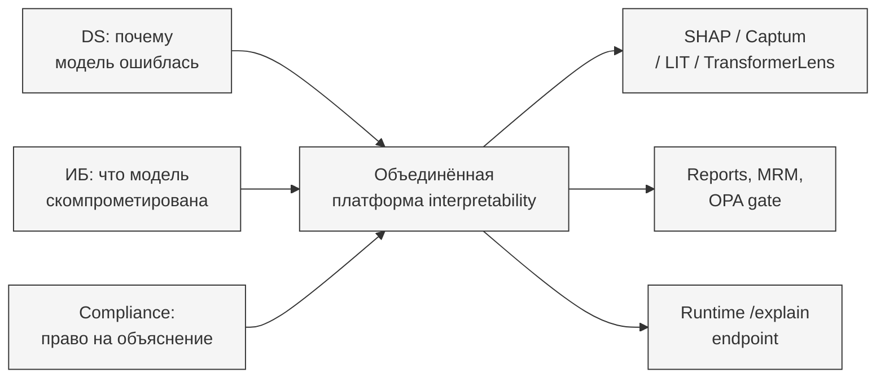
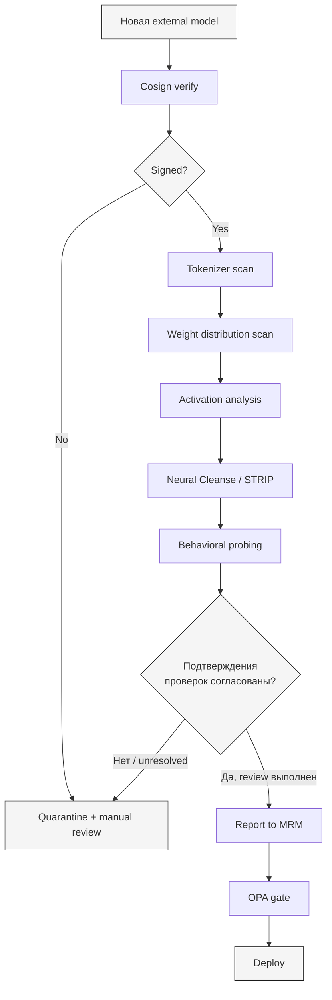
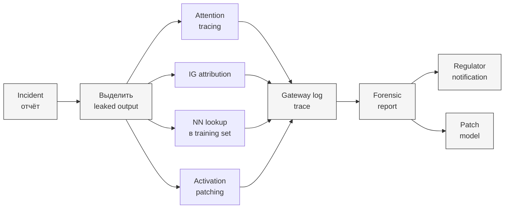
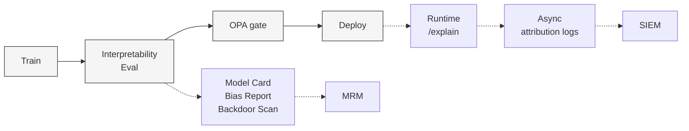

<a id="glava-30-interpretiruemost_-modelej-dla-zelej-ib"></a>

# Глава 30. Интерпретируемость моделей для целей ИБ

> **Версия**: 2.1
> **Дата актуализации**: 2026-05-29
> **Область**: SHAP, Captum, LIT, TransformerLens, Sparse Autoencoders, mechanistic interpretability для ML SecOps
> **Связи**: [Глава 04](04-stage2-model-operations.md), [Глава 07](07-red-teaming-testing-methods.md), [Глава 14](14-model-risk-governance.md), [Глава 15](15-ai-incident-response.md), [Глава 18](18-ru-compliance-deep.md), [Глава 23](23-mitre-atlas-ru.md)

**Тематическая актуализация 2026-11-13**: проверка faithfulness и robustness объяснений, forensic-гипотезы с контрольными прогонами, безопасная выдача explanation и границы исследований 2026. Исследовательский сигнал не приравнивается к доказанному backdoor, источнику training data или выполненной правовой обязанности.

<a id="annotazia"></a>

## Аннотация

Интерпретируемость часто воспринимается как инструмент DS-команд: «понять, почему модель ошиблась». Для ИБ это дополнительный источник свидетельств: поиск аномалий backdoor и poisoning, расследование утечек ПДн, анализ bias и поддержка понятных объяснений решений. Методы показывают свойства модели в выбранном эксперименте; вывод о причине инцидента или правомерности решения требует других подтверждений.

Эта глава систематизирует инструментарий по задачам ИБ, показывает реальные инструменты с версиями и параметрами, и формулирует интеграцию в ML SecOps pipeline.

Ключевой тезис: для security-контекста мало красивой heatmap. Нужны проверяемая гипотеза, baseline, допустимые интервенции и независимые логи. Интерпретация помогает решить, что проверять дальше; она не заменяет эту проверку.

---

<a id="soderjanie"></a>

## Содержание

1. [Почему интерпретируемость это security-инструмент](#1-pocemu-interpretiruemost_-eto-security-instrument)
2. [Регуляторная привязка](#2-regulatornaa-privazka)
3. [Методы: классические и современные](#3-metody-klassiceskie-i-sovremennye)
4. [Инструментарий с версиями](#4-instrumentarij-s-versiami)
5. [Mechanistic interpretability для LLM](#5-mechanistic-interpretability-dla-llm)
6. [Use case: обнаружение backdoor](#6-use-case-obnarujenie-backdoor)
7. [Use case: bias detection](#7-use-case-bias-detection)
8. [Use case: incident forensics](#8-use-case-incident-forensics)
9. [Use case: проверка RAG-hallucination](#9-use-case-proverka-rag-hallucination)
10. [Use case: explainability в compliance](#10-use-case-explainability-v-compliance)
11. [Интеграция в ML SecOps pipeline](#11-integrazia-v-ml-secops-pipeline)
12. [Limits и pitfalls](#12-limits-i-pitfalls)
13. [Чеклист](#13-ceklist)
14. [Связи](#14-svazi)

---

<a id="1-pocemu-interpretiruemost_-eto-security-instrument"></a>

## 1. Почему интерпретируемость это security-инструмент

Классический взгляд: интерпретируемость помогает DS понять модель. Современный (2025-2026) взгляд для ИБ: интерпретируемость это инструмент верификации, расследования и compliance:

- **Верификация**: поиск признаков trigger и проверка поведения на заданном наборе сценариев; не сертификат отсутствия backdoor.
- **Обнаружение**: анализ зависимости предсказания от protected attributes и proxy features; оценка дискриминации выполняется по контексту и ошибкам по группам.
- **Forensics**: «почему модель выдала секрет» в incident-investigation.
- **Compliance**: GDPR Art. 22, 152-ФЗ ст. 16, EU AI Act Art. 13.
- **Материалы для review**: понятные сведения о процедуре решения, её ограничениях и возможности оспаривания при применимых обязанностях.
- **Подтверждения выпуска**: versioned reports в Model Card, MRM и policy-gate; наличие отчёта не означает доказанную корректность его выводов.

<a id="tri-operazionnye-roli"></a>

### Три операционные роли



---

<a id="2-regulatornaa-privazka"></a>

## 2. Регуляторная привязка

| Норма / ориентир | Что проверять по применимости | Чего не доказывает SHAP-отчёт |
|---|---|---|
| GDPR Art. 22 и Art. 13–15 | Характер решения, legal/similarly significant effect, исключения и применимые обязанности информирования / защиты прав | Что любое ML-предсказание требует раскрытия всей внутренней цепочки |
| 152-ФЗ ст. 16 | Исключительно автоматизированное решение с юридическими последствиями либо иным влиянием на права; основание, порядок и возражение | Что raw attributions сами выполняют обязанность разъяснения |
| EU AI Act Art. 13–15 | Классификацию системы, применимые сроки, instructions, oversight, accuracy/robustness/cybersecurity | Что наличие `/explain` означает соблюдение всех этих требований |
| Банк России 716-П | Требования к системе управления операционным риском и внутренним процедурам организации | Универсальный стандарт MRM «из главы 5» либо обязательность конкретного explainer |
| ФСТЭК 239 / иные применимые акты | Категорию объекта и конкретные меры защиты в действующей нормативной базе | Самостоятельную универсальную обязанность SHAP для всех КИИ-решений |
| NIST AI RMF | Добровольный подход управления риском и пригодность объяснения для задачи | Сертификацию или заранее заданный проходной attribution score |
| ISO/IEC 42001 | Применимые требования management system и выбранные контроли организации | Что один шаблон explanation заменяет оценку воздействия и весь процесс управления |

Для GDPR важен [CJEU C-203/22, решение 27.02.2025](https://eur-lex.europa.eu/legal-content/EN/TXT/?uri=celex%3A62022CJ0203): в рассмотренном контексте требуется понятное описание фактически применённых процедуры и принципов, а не полный алгоритм или перечисление всех шагов. Для РФ см. [ст.16 152-ФЗ](https://mintrud.gov.ru/docs/laws/130). Разъяснения [Банка России по 716-П](https://cbr.ru/faq_ufr/dbrnfaq/doc?number=716-%D0%9F) не следует подменять формулой «глава 5 = MRM». Источники проверены 13.11.2026; конкретные обязанности подтверждаются юристом по сценарию.

<a id="standarty"></a>

### Стандарты

- **ISO/IEC TR 24028:2020** «Trustworthiness in AI»: секция про explainability.
- **ISO/IEC 23894:2023** «AI Risk Management»: включает взгляд на interpretability как risk control.
- **NIST IR 8312** «Four Principles of Explainable AI»: Explanation, Meaningful, Explanation Accuracy, Knowledge Limits (пределы знаний модели).

---


<a id="3-metody-klassiceskie-i-sovremennye"></a>

## 3. Методы: классические и современные

<a id="31-klassiceskie-post-hoc"></a>

### 3.1 Классические (post-hoc)

| Метод | Применимость | Вход | Выход | Compute |
|---|---|---|---|---|
| SHAP (KernelExplainer) | Любая | Sample + background | Вклад каждой feature | O(2^features) в худшем |
| SHAP (DeepExplainer) | NN | Sample + background | Attribution | Медленно для big nets |
| SHAP (TreeExplainer) | Поддерживаемые tree ensembles | Sample + явно выбранный background/режим | Вклады в заданном output space при предпосылках explainer | Зависит от дерева и background |
| LIME | Любая | Sample | Локальное linear approx | Быстро |
| Integrated Gradients | Differentiable | Sample + baseline | Attribution in features | ~50 steps |
| Smoothgrad | Differentiable | Sample | Noised gradient | ~50 noise samples |
| Occlusion | CV / NLP | Sample | Feature importance по маскировке | Medium |
| Saliency maps | CV | Image | Pixel heatmap | Быстро |
| Attention rollout | Transformer | Sample | Attention heatmap | Быстро |
| Grad-CAM / Grad-CAM++ | CV | Image | Class activation map | Быстро |
| DeepLIFT | Differentiable | Sample + reference | Contribution propagation | Medium |
| Layer-wise Relevance Propagation | Differentiable | Sample | Relevance per neuron | Medium |

<a id="32-global_nye-model_-level"></a>

### 3.2 Глобальные (модель-level)

- **Partial Dependence Plots (PDP)**: средняя зависимость output от feature.
- **Permutation Importance**: изменение accuracy при permute feature.
- **Concept Activation Vectors (TCAV)** (Kim et al. 2018): влияние абстрактных концептов на output.
- **Global Surrogate**: обучение интерпретируемой модели (decision tree) на предсказаниях black-box.

<a id="33-model-intrinsic"></a>

### 3.3 Model-intrinsic

- **GAMs, EBM** (Explainable Boosting Machines, Microsoft InterpretML): глобально интерпретируемые, accuracy ≈ GBM.
- **Monotone constraints** в XGBoost/LightGBM/CatBoost: гарантия направления влияния feature.
- **Linear models с L1** (Lasso): интерпретируемые коэффициенты.
- **Decision trees** с контролируемой глубиной (≤ 5).

<a id="34-mechanistic-2023-2026"></a>

### 3.4 Mechanistic (2023-2026)

Разбирает внутренности NN: какие нейроны, circuits, attention heads реализуют конкретную функцию.

- **Activation patching**: интервенция в активации и наблюдение изменения выбранного output. Результат зависит от clean/corrupted пары, слоя и метрики; это не идентификатор training-источника.
- **Sparse Autoencoders (SAE)** (Bricken et al. Anthropic 2023, OpenAI 2024): обучение SAE на residual stream, разложение плотных активаций на интерпретируемые features.
- **Attribution graphs**: исследовательская аппроксимация связей между представлениями с последующей проверкой интервенциями; непокрытые пути и ошибки reconstruction учитываются отдельно.
- **Circuits analysis** (Olah et al. 2020+): reverse-engineering специфических функций в attention heads.
- **Probing classifiers**: linear probes поверх hidden states, чтобы проверить, что encoded.

---


<a id="35-proverka-ob_asnenia-faithfulness-robustness-i-baseline-registry"></a>

### 3.5 Проверка объяснения: faithfulness, robustness и baseline registry

**Проблема**: SHAP-сумма сходится, heatmap понятна, но объясняется текущая модель вместо той, которая приняла решение. Или сменился background — и пользователю показали другую «главную причину», хотя предсказание осталось прежним.

**Объект проверки**: конкретная функция модели, preprocessing, output space, алгоритм explanation и его reference distribution. Значения для `raw margin`, probability и loss нельзя смешивать; знак вклада интерпретируется только вместе с выбранным output и baseline.

| Проверка | Метод | Что сохранять |
|----------|-------|---------------|
| Численная согласованность | Проверить reconstruction / completeness там, где свойство применимо | Ошибку, tolerance, output class/space, размеры tensors |
| Faithfulness | Предсказать эффект допустимого удаления/замены признака, затем выполнить контролируемый прогон | Perturbation protocol, изменение предсказания и attribution, контроли |
| Robustness | Повторить объяснение на допустимых близких inputs и альтернативных approved backgrounds | Разброс и смену top factors, seeds, стабильность prediction |
| Негативные контроли | Случайные labels/model parameters там, где тест применим; irrelevant features; benign/trigger fixtures | Что метод должен был перестать «объяснять», пределы теста |
| Пригодность для человека | Проверить, понимает ли reviewer процедуру и может ли оспорить ошибочный input | Версию текста, сценарии comprehension review и замечания |

В [Captum metrics](https://captum.ai/api/metrics.html) infidelity оценивает согласованность attribution с изменением predictor при заданных perturbations; sensitivity — изменение explanation при возмущении. Малое значение само по себе не означает безопасную модель: неадекватные perturbations могут сделать тест бессмысленным. Контроль realism / OOD выполняется до вывода о faithfulness. Проверено 13.11.2026.

**Baseline registry** — часть release evidence pack из [14. Governance](14-model-risk-governance.md):

```yaml
explanation_evidence:
  explanation_revision: credit-exp-r7
  model_artifact_ref: registry://credit/model-r12
  preprocessing_revision: features-r4
  feature_schema_revision: credit-input-r8
  output:
    name: risk_score
    space: raw_regression
  method:
    name: TreeExplainer
    dependency_lock_ref: evidence://credit/r12/python-lock
    perturbation_mode: interventional
  background:
    artifact_ref: restricted://credit/background-r6
    cohort_definition_ref: policy://credit/reference-population-r2
    selection_protocol_ref: evidence://credit/background-selection-r6
  validation:
    dataset_revision: credit-explanation-eval-r3
    perturbation_protocol_ref: evidence://credit/perturbations-r2
    report_ref: evidence://credit/r12/explanation-report
    status: pending
  owner_role: model-validation
```

Ссылки иллюстративны; в реестре нужны неизменяемые идентификаторы/контрольные суммы и решения доступа. Background может содержать ПДн и не публикуется вместе с customer explanation. Изменение background, preprocessing, output class или library version вызывает impact review; старые объяснения сохраняют связь со своим baseline. Обновить background «на самый свежий» без этой связи — потерять воспроизводимость.

<a id="minimal_nyj-proveraemyj-primer-shap"></a>

#### Минимальный проверяемый пример SHAP

Синтетическая regression-задача без ПДн. Пример проверяет additivity выбранного explainer, **не причинность признаков и не отсутствие backdoor**. Реальные covariance, preprocessing и protected groups здесь не моделируются.

```python
import numpy as np
import shap
from sklearn.datasets import make_regression
from sklearn.ensemble import RandomForestRegressor
from sklearn.model_selection import train_test_split

X, y = make_regression(
    n_samples=160, n_features=4, n_informative=3,
    noise=0.1, random_state=7,
)
X_train, X_holdout, y_train, _ = train_test_split(
    X, y, test_size=0.25, random_state=11,
)
model = RandomForestRegressor(
    n_estimators=24, max_depth=4, random_state=13,
).fit(X_train, y_train)

explainer = shap.TreeExplainer(
    model,
    data=X_train[:32],
    feature_perturbation="interventional",
    model_output="raw",
)
sample = X_holdout[:5]
explanation = explainer(sample, check_additivity=True)
reconstructed = explanation.base_values + explanation.values.sum(axis=1)
np.testing.assert_allclose(
    reconstructed, model.predict(sample), rtol=1e-5, atol=1e-5,
)
print("Additivity checked for the selected regression output and background")
```

`interventional` — режим расчёта, не автоматическое доказательство причинного эффекта действия человека. Почему predictive explanation нельзя превращать в causal advice, разобрано в [официальном SHAP tutorial](https://shap.readthedocs.io/en/latest/example_notebooks/overviews/Be%20careful%20when%20interpreting%20predictive%20models%20in%20search%20of%20causal%20insights.html). [TreeExplainer API](https://shap.readthedocs.io/en/latest/generated/shap.TreeExplainer.html) задаёт требования к background и output space; версии для конкретного проекта закрепляются отдельно. Источники проверены 13.11.2026.

<a id="4-instrumentarij-s-versiami"></a>

## 4. Инструментарий с версиями

Таблицы версий ниже сохранены как исторический ориентир первоначальной редакции, не как текущий lock-файл. При внедрении фиксируются конкретные версии, лицензии и поддерживаемые model/output shapes; совместимость проверяется на своём окружении. Один продукт LIT / Language Interpretability Tool не считается двумя независимыми методами.

<a id="41-obsie-biblioteki"></a>

### 4.1 Общие библиотеки

| Инструмент | Версия (PyPI, проверено 16.11.2026) | Лицензия | Ключевые возможности |
|---|---|---|---|
| SHAP | 0.54.1 | MIT | Kernel, Tree, Deep, Gradient explainers |
| Captum (PyTorch) | 0.9.0 | BSD-3 | IG, DeepLIFT, LRP, Occlusion, Lime, Attribution для NLP/CV |
| InterpretML | 0.7.8 | MIT | EBM, Global Explainers, Fairness |
| LIME | 0.2.0.1 (последний релиз 2020) | BSD | TextExplainer, TabularExplainer, ImageExplainer |
| AIX360 (IBM) | 0.3.0 (последний релиз 2023) | Apache 2.0 | ProtoDash, Disentangled Representations |
| Alibi (Seldon) | 0.9.6 (последний релиз 04.2024) | Business Source | Anchors, CF explanations, TrustScore |
| Fairlearn | 0.15.0 | MIT | Demographic parity, Equalized odds, Mitigation |
| AIF360 (IBM) | 0.6.1 (последний релиз 04.2024) | Apache 2.0 | Fairness metrics + bias mitigation |
| LIT / Learning Interpretability Tool (Google; ранее Language Interpretability Tool) | 1.3.1 | Apache 2.0 | UI для NLP/tabular, counterfactuals, attention viz; один продукт |

<a id="42-dla-llm-transformer"></a>

### 4.2 Для LLM / Transformer

| Инструмент | Версия (PyPI, 16.11.2026) | Применение |
|---|---|---|
| TransformerLens (Neel Nanda) | 4.4.0 | Hooks на attention heads, activation patching, ablation |
| BertViz | 1.4.1 | Attention visualization |
| Inseq | 0.7.1 | Sequence-level feature attribution для generation |
| Ecco | 0.1.2 (последний релиз 2022, не развивается) | Visualization для autoregressive LLM |
| SAE-Lens (Joseph Bloom) | 6.55.5 | Sparse autoencoder training + analysis |
| nnsight (NDIF project) | 0.8.2 | Remote activation inspection в frontier моделях |

<a id="43-backdoor-detection"></a>

### 4.3 Backdoor detection

| Инструмент | Метод | Применимость |
|---|---|---|
| Neural Cleanse reference impl | Reverse engineering trigger через mask-optim | CV (CIFAR, ImageNet) |
| STRIP (Gao et al. 2019) | Perturbation-based | CV, simple NLP |
| [Activation Clustering, Chen et al. 2018](https://arxiv.org/abs/1811.03728) | Кластеризация активаций | Поддерживаемые исследованием классификаторы |
| [ABS, Liu et al. 2019](https://doi.org/10.1145/3319535.3363216) | Artificial Brain Stimulation | Исследуемые NN; не синоним activation clustering |
| TABOR | Trigger approximation | CV |
| BackdoorBench | Benchmark + detection suite | CV classification |
| [BadEdit, Li et al. 2024](https://arxiv.org/abs/2403.13355) | **Атака** через model editing | Материал модели угроз; не detector или trigger-inversion tool |
| Проектный probing / activation harness | Согласованный набор проверок | Требует реализации, baseline и оценки blind spots; не готовый продукт «ScanLLM» |

<a id="44-formaty-i-artefakty"></a>

### 4.4 Форматы и артефакты

- **Model Card**: стандарт Google Research 2019, теперь HuggingFace Model Card.
- **Data Card**: стандарт Google Research 2022.
- **SHAPreport JSON**: схема с top-N features per sample + global.
- **MLflow artifacts**: привязка explanation к model version.

---

<a id="5-mechanistic-interpretability-dla-llm"></a>

## 5. Mechanistic interpretability для LLM

<a id="51-zacem-ib"></a>

### 5.1 Зачем ИБ

- **Backdoor neurons**: поиск нейронов, активируемых только на trigger. Если у модели есть нейрон с binary activation на редкий pattern / подозрение.
- **Refusal heads**: понимание, как модель реализует отказы. Если jailbreak успешен / возможно, он обходит конкретный attention head (можно добавить защиту).
- **Deception detection** (Anthropic 2024 research): модели могут быть «aware», что их тестируют, и менять поведение. Mechanistic interpretability потенциально обнаружит.
- **Knowledge localization / editing**: ROME/MEMIT исследуют участки модели, на которые можно воздействовать для изменения поведения. Из этого нельзя восстановить, какой training-документ был источником конкретного ответа.

<a id="52-activation-patching"></a>

### 5.2 Activation Patching

```python
# Концептуальный пример (TransformerLens)
from transformer_lens import HookedTransformer
import torch

model = HookedTransformer.from_pretrained("gpt2-small")

# Two prompts: clean и corrupted
clean_prompt = "The capital of France is"
corrupted_prompt = "The capital of Germany is"

# Получить кэши активаций для обоих
_, clean_cache = model.run_with_cache(clean_prompt)
_, corrupted_cache = model.run_with_cache(corrupted_prompt)

# Замена specific layer activation
def patch_hook(activation, hook, layer_idx):
    activation = corrupted_cache[f"blocks.{layer_idx}.hook_resid_post"]
    return activation

# Прогон clean_prompt с patched layer N
for layer in range(model.cfg.n_layers):
    with model.hooks([(f"blocks.{layer}.hook_resid_post",
                       lambda a, h: patch_hook(a, h, layer))]):
        logits = model(clean_prompt)
        # Сравнить с baseline logits
```

<a id="53-sparse-autoencoder"></a>

### 5.3 Sparse Autoencoder

SAE позволяет разложить плотные активации в «features», многие из которых интерпретируемы человеком («этот feature активен, когда речь идёт о JavaScript», «этот активен при выражениях гнева»).

Для ИБ:

- Feature для PII / secrets / ru-ПДн.
- Feature для jailbreak-триггеров.
- Feature для безопасного отказа.

Стоимость SAE зависит от модели, слоя, данных и требуемого покрытия. Перенос dictionary между fine-tunes или слоями не считается корректным по одному названию family: проверяются reconstruction, сохранение поведения и соответствие семантических меток.

<a id="54-praktika-dla-ne-ai-lab"></a>

### 5.4 Практика для не-AI-lab

Mechanistic interpretability / пока research-инструмент. Для не AI lab рекомендация:

1. Следить за первичными публикациями исследовательских групп, проверять метод, модель и границы эксперимента; историческое название команды не означает актуальную продуктовую возможность.
2. Применять published techniques к своим fine-tunes раз в квартал.
3. Использовать готовые SAE (например, gemma-scope 2B или sae-lens pretrained) для inspection своих моделей.
4. Документировать ограничения в Model Card («Mechanistic analysis not conducted; only post-hoc attribution»).

---


<a id="55-cto-izmenilos_-v-issledovaniah-2026"></a>

### 5.5 Что изменилось в исследованиях 2026

| Работа | Что проверяется | Граница практического вывода |
|--------|------------------|-----------------------------|
| [CHIVE: Would This Change Your Answer?](https://alignment.anthropic.com/2026/chive/) | Контрфактические правки prompt и прогноз их влияния на поведение | В оценке авторов activation-reading tools не дали uplift относительно чтения transcript. Это не универсальная бесполезность interpretability, но прямое основание измерять добавочную ценность метода |
| [Natural Language Autoencoders](https://www.anthropic.com/research/natural-language-autoencoders),07.05.2026 | Исследовательский подход к текстовому bottleneck для внутренних представлений | Текстовое описание не является полным чтением «мыслей» любой модели, гарантией полноты или готовым compliance artifact |

**Как внедрять исследование без ложной уверенности**:

1. Записать, какое решение SOC/валидатора должно улучшиться: например, предсказание эффекта удаления подозрительного контекста. Не оценивать инструмент только по понятности рассказа.
2. Сравнить одинаковые cases и бюджет работы: logs/transcript-only baseline против baseline+инструмент. Оценщик заранее не знает предполагаемую причину.
3. Проверить counterfactual prediction фактическим изолированным прогоном, включая отрицательные и benign controls. Выделить случаи, где инструмент уверенно ошибается.
4. При отсутствии измеренного uplift оставить метод исследовательским; не делать его единственным deployment gate. Для переноса на другую модель/слой/язык повторить проверку.

Источники проверены 13.11.2026. Это процедура оценки применимости research, а не утверждение о production readiness CHIVE/NLA. Четыре ориентира [NISTIR 8312](https://www.nist.gov/publications/four-principles-explainable-artificial-intelligence) — наличие объяснения, meaningfulness для аудитории, explanation accuracy и knowledge limits — помогают разделить качество объяснения и качество самой модели.

<a id="6-use-case-obnarujenie-backdoor"></a>

## 6. Use case: обнаружение backdoor

<a id="61-szenarij"></a>

### 6.1 Сценарий

ML-инженер скачивает pretrained модель с HuggingFace. Модель обучена злоумышленником и содержит trigger: специфическая подстрока → модель выдаёт attacker-controlled output. Классический BadNets (Gu et al. 2017) или BadPrompt (Cai et al. 2022) для LLM.

<a id="62-staticeskij-analiz-checkpoint"></a>

### 6.2 Статический анализ checkpoint

- **Tokenizer inspect**: сравнить ревизию и изменения с утверждённым baseline. Non-ASCII сам по себе нормален для многоязычных моделей; редкий token — гипотеза для проверки, не индикатор backdoor без контекста.
- **Weight distribution**: искать отклонения от сопоставимого checkpoint; различия architecture, quantization и fine-tuning учитываются отдельно.
- **Activation analysis**: использовать versioned benign и adversarial cases, сопоставлять distributions и поведение. Редкая либо bimodal activation не доказывает компрометацию.
- **Artifact handling**: безопасный формат сериализации и запрет непроверенного custom code снижают риск загрузки; safetensors не доказывает benign поведение весов.

<a id="63-trigger-reconstruction"></a>

### 6.3 Trigger reconstruction

- **Neural Cleanse** (Wang et al. 2019, Oakland): reverse-engineering trigger через mask optimization для каждого class. Если для class Y минимальная маска существенно меньше остальных / возможно, есть trigger.
- **STRIP** (Gao et al. 2019): перемешивание inputs (overlay random blends). Trigger-contaminated inputs остаются confident, а benign становятся uncertain. Entropy drop / red flag.
- **Activation Clustering** (Chen et al. 2018): кластеризация активаций на доступных данных. Кластеры — повод проверить состав и поведение, а не доказательство backdoor.
- **ABS** (Liu et al. 2019): Artificial Brain Stimulation; отдельный исследовательский метод интервенции в нейроны, не название clustering.
- **TABOR**: регуляризированный trigger search.
- **Для LLM**: BadEdit показывает возможность внедрения backdoor через model editing; его нельзя использовать как свидетельство исполненного detection. Защитный harness выбирается отдельно и оценивается на известных benign/compromised fixtures.

<a id="64-behavioral-probing"></a>

### 6.4 Behavioral probing

- Набор adversarial prompts, специально разработанных выявить triggers (специальные токены, Unicode edge cases, невидимые символы, reversed prompts).
- Integration в [ci/github-actions/red-team-weekly.yml](ci/github-actions/red-team-weekly.yml).
- Comparing model outputs с ensemble of benign inference providers.

<a id="65-provenance-proverka"></a>

### 6.5 Provenance проверка

- Не использовать неподписанные модели.
- Проверять signatures cosign + Sigstore Model Transparency log (см. [opa/supply-chain.rego](opa/supply-chain.rego)).
- Список known-bad checkpoints (например, после инцидентов в PyPI/HF).

<a id="66-rollout-pipeline"></a>

### 6.6 Rollout pipeline



<a id="67-primer-opa-deny-pravila"></a>

### 6.7 Пример OPA deny-правила

Rego v1, фрагмент для external-модели. `accepted` означает решение review по согласованному threat model и coverage; это не вероятность отсутствия backdoor. Метод выбирается по архитектуре: требовать Neural Cleanse от любого LLM некорректно. Проверка полноты/источника evidence показана в §11.4.

```rego
package mlsec.external_review

deny contains msg if {
    input.model.origin == "external"
    evidence := object.get(input, "interpretability", {})
    checks := object.get(evidence, "checks", {})
    object.get(checks, "backdoor", "missing") != "accepted"
    msg := "External model requires accepted backdoor review for its test plan"
}

deny contains msg if {
    input.model.origin == "external"
    evidence := object.get(input, "interpretability", {})
    object.get(evidence, "evidence_verified", false) != true
    msg := "External model evidence has not been verified by the trusted service"
}
```

---

<a id="7-use-case-bias-detection"></a>

## 7. Use case: bias detection

<a id="71-zadaca"></a>

### 7.1 Задача

Оценить ошибки и последствия решений по релевантным группам, проверить direct/proxy use чувствительных признаков и основания их применения. Исключение одного столбца из inputs не доказывает fairness: информация может восстанавливаться через proxy features.

<a id="72-fairness-metriki"></a>

### 7.2 Fairness-метрики

| Метрика | Формула | Порог (пример) |
|---|---|---|
| Demographic parity | P(Y=1 \| A=0) ≈ P(Y=1 \| A=1) | Δ < 0.05 |
| Equalized odds | TPR и FPR равны по группам | Δ < 0.05 |
| Equal opportunity | TPR равны по группам | Δ < 0.05 |
| Calibration | Score calibration per group | < 0.02 drift |
| Predictive parity | PPV равны по группам | Δ < 0.05 |
| Statistical parity (Fairlearn) | Общий disparity | Δ < 0.10 (tier-specific) |
| Max-disparity (summary) | max(metric diff) | Tier-based threshold |

Числа в таблице — примеры для обсуждения внутренней политики, не нормативные универсальные допуски. Выбор метрик зависит от задачи и base rates; одновременно минимизировать все disparities может быть невозможно. Для small/intersectional groups нужны размер выборки, доверительные интервалы и human review последствий. Нулевой SHAP у `gender` не доказывает отсутствие proxy discrimination.

<a id="73-instrumenty"></a>

### 7.3 Инструменты

- **Fairlearn** (Microsoft): метрики + mitigation algorithms (Grid Search, Exponentiated Gradient).
- **AIF360** (IBM): широкая library, включая reweighting, adversarial debiasing, meta-fair classifier.
- **InterpretML**: bias through global explanations (PDP по protected attributes).
- **SHAP + subgroup analysis**: проверка, что feature `gender` не доминирует в explanations.

<a id="74-integration-v-compliance"></a>

### 7.4 Integration в compliance

Bias-анализ поддерживает оценку воздействия и рисков, но не является готовым заключением о дискриминации или compliance. Юрист фиксирует, какие требования применимы к решению и аудитории, а валидатор — какие группы, ошибки и последствия нужно оценить. GDPR, российские нормы и EU AI Act не объединяются в универсальное правило «достаточно SHAP и Δ<0.05»; scope см. §2 и [18. Российская специфика](18-ru-compliance-deep.md).

<a id="75-workflow"></a>

### 7.5 Workflow

```python
# Fairlearn пример
from fairlearn.metrics import MetricFrame, selection_rate, demographic_parity_difference
from sklearn.metrics import accuracy_score

metrics = {
    "accuracy": accuracy_score,
    "selection_rate": selection_rate,
}

mf = MetricFrame(
    metrics=metrics,
    y_true=y_test,
    y_pred=y_pred,
    sensitive_features=X_test[["gender", "age_group", "region"]],
)

disparity = demographic_parity_difference(
    y_true=y_test,
    y_pred=y_pred,
    sensitive_features=X_test["gender"],
)

print({"observed_demographic_parity_difference": disparity})
# Compare to the task-specific acceptance policy and confidence intervals.
# This metric is not a Differential Privacy guarantee or a legal verdict.
```

<a id="76-interpretability-fairness"></a>

### 7.6 Interpretability + fairness

- SHAP values per subgroup: проверить, что feature importance не перевешивает в одной группе.
- Counterfactual fairness (Kusner et al. 2017): «изменил бы ли модель predict, если бы изменить protected attribute при том же background».
- Intersectional fairness: не только по одному атрибуту, но по пересечениям (female+old+rural и т.д.).

Результаты bias analysis сохраняются в Model Card + MRM, идут через OPA model-deployment gate.

---

<a id="8-use-case-incident-forensics"></a>

## 8. Use case: incident forensics

<a id="81-szenarij"></a>

### 8.1 Сценарий

Произошёл инцидент: модель выдала PII в public API. SOC должен:

1. Проверить serving/run identity, approved release / model digest и связь с наблюдаемым output / receipt. Watermark — дополнительный сигнал, а не самостоятельное доказательство происхождения.
2. Проверить гипотезы о chunk / prompt / training data как источнике leak; отсутствие различающего свидетельства оставить открытым, а не назначать источник по одной attribution heatmap.
3. Понять, было ли memorization или inference-time injection.
4. Предоставить установленные факты применимому адресату по матрице уведомлений (РКН, ГосСОПКА, ЦБ — в зависимости от события и обязанностей).

<a id="82-kak-pomogaet-interpretiruemost_"></a>

### 8.2 Как помогает интерпретируемость

**Attention tracing**. Показывает выбранные attention weights в конкретном прогоне. Максимальный вес на chunk не доказывает injection, а отсутствие такого веса не устанавливает memorization; attention не является измерением чтения «параметрической памяти».

**Attribution IG (Integrated Gradients)**. Вклад относительно выбранного baseline, target и пути интегрирования. В Captum LayerIntegratedGradients применяется к выбранному слою; полнота и смысл attribution требуют проверки, а не выбора любого attention layer.

**Activation patching**. Изменение выбранных активаций помогает проверить computational hypothesis. Оно не устанавливает исторический источник training data.

**Nearest-neighbor lookup**. Поиск близких фрагментов в доступном corpus помогает найти кандидатов для exact/provenance review. Distance threshold зависит от embedding и корпуса; близкий сосед не доказывает training membership или memorization.

**Model editing / localization**. ROME-интервенция не восстанавливает цепочку происхождения текста. Для source attribution нужны corpus lineage и runtime evidence.

<a id="83-prozedura-forensics"></a>

### 8.3 Процедура forensics



<a id="84-rezul_tat-forensics"></a>

### 8.4 Результат forensics

Записывается в incident report, используется для:

- Обновления [playbooks/](playbooks/) (новые indicators, новые контроли).
- Retraining / patch модели (forget request через unlearning).
- Legal / regulatory notification: detailed timeline + cause.
- Model Card update с incident addendum.
- MRM incident-log.

<a id="85-hook-v-rilio-ili-llm-gateway"></a>

### 8.5 Hook в Rilio или LLM Gateway

На каждый flagged output (DLP post-scan HIT на PII, например):

- Зафиксировать run/decision IDs, версии, DLP verdict и ссылки на разрешённые forensic-артефакты. Полный input/output и tensors не копировать в общий SIEM автоматически.
- Сохранить model version + seed (если deterministic) + temperature.
- Сохранить provenance RAG-chunks и их source doc IDs.
- Async attribution запускать для выбранных случаев в изолированном контуре с допустимыми данными и зафиксированным target/baseline.
- Retention и legal hold назначаются по категории артефакта, основанию и риску; универсального 180-дневного требования к полным traces здесь нет.

---

<a id="86-konkuriruusie-forensic-gipotezy-i-kontrol_nye-progony"></a>

### 8.6 Конкурирующие forensic-гипотезы и контрольные прогоны

При утечке совпавший фрагмент — наблюдение, но источник ещё не установлен. Рассматриваются несколько гипотез; они могут действовать одновременно.

| Гипотеза | Независимое свидетельство | Контроль в изолированной копии |
|----------|--------------------------|--------------------------------|
| Данные пришли из retrieval | Фактические chunk IDs/revisions и ACL verdict для исходного run | Исключить подозрительный источник при неизменной остальной конфигурации; проверить benign replacement |
| Данные пришли из prompt / memory / tool result | Input assembly manifest, memory revision, tool-call IDs и ответ источника | По одному исключать канал; не подменять все части контекста сразу |
| Модель воспроизводит training data | Подтверждённая принадлежность точного фрагмента к конкретному training snapshot, extraction evidence | Проверить доступный baseline/checkpoint и альтернативные источники; отметить, если training corpus недоступен |
| Injection изменила действие | Недоверенный instruction-bearing input и фактический tool/policy trace | Удалить инструкцию, сохранив полезные данные; добавить нейтральный и adversarial variants |
| Совпадение / публичный факт | Независимый публичный источник и происхождение фрагмента | Проверить, сохраняется ли ответ без приватного контекста; один такой ответ не доказывает training membership |

**Протокол**:

- Зафиксировать model/prompt/retrieval/tool/policy revisions исходного run, generation settings и временные границы. Недоступные inputs или веса явно пометить.
- До запуска определить наблюдаемое последствие: exact output fragment, отправка во внешний endpoint, конкретный policy bypass. Не выбирать метрику после получения желаемой heatmap.
- Сравнивать исходный case, целевую интервенцию и placebo/benign control; при вероятностном поведении повторять и показывать разброс. Единственная удачная попытка не устанавливает причинную цепочку.
- Никогда не повторять реальные destructive / financial tools для расследования: использовать simulator или dry-run с запрещённым egress, сохраняющим контракт и outcome audit.
- Сопоставить attribution с runtime и внешним audit. Если они расходятся, вывод — `unresolved`, а не «активации доказали причину».

**Формат результата**: `наблюдение → гипотеза → интервенция → результат/разброс → альтернативные объяснения → ограничения`. Причинный эффект внутри контролируемого computational experiment не доказывает происхождение данных из исторического training run или нарушение конкретного права.

Сохранение материалов и chain of custody: [15. AI Incident Response](15-ai-incident-response.md). Для membership/extraction границ: [17. PET](17-privacy-enhancing-tech.md) и [28. Синтетические данные](28-synthetic-data-security.md). Attribution и attention используются как вспомогательные сигналы с ограничениями из §3.5; восстановить training provenance по одному ROME edit нельзя.

<a id="9-use-case-proverka-rag-hallucination"></a>

## 9. Use case: проверка RAG-hallucination

<a id="91-szenarij"></a>

### 9.1 Сценарий

RAG-система выдаёт фактически неверный ответ. Нужно определить:

- Была ли информация в retrieved chunks.
- Модель дополнила своей «parametric» памятью.
- Или полностью сгенерировала (hallucination).

<a id="92-metod"></a>

### 9.2 Метод

- **Attention по chunks**. Дополнительный диагностический сигнал по input context; он не измеряет долю ответа «из собственных весов».
- **Attribution (Inseq)**. Какие input tokens внесли наибольший вклад.
- **Citation tracing**. Проверить, поддерживает ли доступный источник claim, его дату и контекст. Отсутствие поддержки в retrieval означает unsupported относительно этого корпуса, но не автоматически ложь во внешнем мире.
- **Entropy analysis**. Не является factuality detector: модель может уверенно ошибаться и неуверенно формулировать верный факт. Требует калибровки для конкретной задачи.

<a id="93-instrumenty"></a>

### 9.3 Инструменты

- **Inseq** для attribution на seq-to-seq.
- **LlamaIndex Reflect** для reflection-based hallucination detection.
- **TruEra TruLens**: фреймворк для evaluation RAG.
- **Ragas**: metrics (faithfulness, answer_relevancy, context_precision).

<a id="94-integration"></a>

### 9.4 Integration

В DLP Layer 6 (post-call hallucination scanner; см. [12. Методы обнаружения и защиты](12-detection-protection-cicd-llm.md)). Использует эвристики: fabricated citations, fake DOIs, contradictions. Согласие нескольких моделей может отражать общую ошибку. Для критичного claim требуется проверяемый источник, отдельная оценка и reviewer по риску.

---

<a id="10-use-case-explainability-v-compliance"></a>

## 10. Use case: explainability в compliance

<a id="101-gdpr-art-22-152-fz-st-16"></a>

### 10.1 GDPR Art. 22 / 152-ФЗ ст. 16

Сначала определяется применимость. GDPR Art.22 рассматривает исключительно автоматизированные решения с юридическими либо сходным образом существенными последствиями; предусмотрены исключения и safeguards. Это не обязанность выдавать полное объяснение любой рекомендации любой ML-модели.

В [CJEU C-203/22 от 27.02.2025](https://eur-lex.europa.eu/legal-content/EN/TXT/?uri=celex%3A62022CJ0203) значимая информация по Art.15(1)(h) связана с понятным описанием процедуры и принципов, фактически применённых к данным человека. Ни одна сложная формула, ни подробный перечень всех внутренних шагов сами по себе не выполняют требование понятности. Коммерческая тайна/данные третьих лиц не дают автоматического права отказать: предусмотрен баланс интересов через компетентный орган или суд.

Для РФ [ст.16 152-ФЗ](https://mintrud.gov.ru/docs/laws/130) регулирует решения исключительно на автоматизированной обработке ПДн, имеющие юридические последствия либо иным образом затрагивающие права/законные интересы. Проверяются основание, исключения, разъяснение порядка и возможных последствий, возможность возражения и его рассмотрение. Скрытый CoT или массив SHAP не являются требуемым законом универсальным форматом. Источники проверены 13.11.2026; процесс фиксируется отдельно для каждой категории решений.

<a id="102-prakticeskaa-realizazia"></a>

### 10.2 Практическая реализация

Для решений в согласованном scope подсистема связывает с decision ID следующие материалы; состав и доступ определяются политикой, а не автоматическим сохранением всего raw:

- Разрешённый к сохранению input snapshot либо ссылку на него с ACL и сроком.
- Top-N SHAP attributions (обычно N=5).
- Decision threshold.
- Проверенный human-readable текст о фактически применённой процедуре; LLM draft не считается подтверждённой причиной.
- Model version hash + code hash.

Субъект может через self-service UI посмотреть:

- «Какая процедура и какие факторы использованы»: одобренное объяснение конкретного решения; право доступа к собственным данным реализуется отдельным проверенным процессом.
- «Как меняется модельный результат в допустимом what-if»: с оговорёнными предпосылками, без обещания реального одобрения.

Для consequential decisions устанавливаются применимые ограничения, основания и human-review safeguards. Сам ярлык sensitive не заменяет анализ нормы и не доказывает достаточность формального HITL.

<a id="103-eu-ai-act-art-13"></a>

### 10.3 EU AI Act Art. 13

High-risk systems должны обеспечивать `transparency and provision of information to users`. Это включает:

- Instructions for use (документация).
- Функции и сведения, позволяющие использовать и интерпретировать output в предусмотренном контексте; конкретный HTTP endpoint не предписан этой формулировкой.
- Логирование и сроки проверяются по применимым отдельным обязанностям; ст.13 не задаёт универсальные 180 дней для полного explanation trace.
- Intended purpose + limitations.

<a id="104-realizazia-explain-endpoint"></a>

### 10.4 Реализация /explain endpoint

Учебный **интеграционный шаблон**, не готовая production-аутентификация. Authentication, scoped storage и аудит представлены обязательным project adapter. Без его подключения endpoint закрыт с 503. Identity извлекается adapter из проверенной сессии/token, не из body с features или заявленного client-side subject ID. Route выдаёт сохранённое одобренное explanation конкретного решения; произвольного prediction oracle здесь нет.

```python
from dataclasses import dataclass
from typing import Annotated, Protocol
from fastapi import APIRouter, Depends, HTTPException, Request, Response

@dataclass(frozen=True)
class Principal:
    tenant_id: str
    subject_id: str

@dataclass(frozen=True)
class DecisionRecord:
    decision_id: str
    tenant_id: str
    subject_id: str
    decision_revision: str
    model_revision: str
    explanation_decision_revision: str
    explanation_model_revision: str
    reason_codes: tuple[str, ...]
    review_available: bool

class ExplainAdapter(Protocol):
    async def authenticate(self, request: Request) -> Principal:
        """Verify the session/token and derive identity on the server."""
        ...

    async def load_decision(
        self, principal: Principal, decision_id: str,
    ) -> DecisionRecord | None:
        """Use tenant/subject-scoped storage access for this principal."""
        ...

    async def audit_access(
        self, principal: Principal, decision_id: str,
    ) -> None:
        """Record minimal access metadata, not raw features or tokens."""
        ...

def fail(status: int, detail: str) -> None:
    raise HTTPException(
        status_code=status, detail=detail,
        headers={"Cache-Control": "no-store"},
    )

def get_explain_adapter() -> ExplainAdapter:
    fail(503, "Explanation adapter is not configured")

APPROVED_REASONS = {
    "input_history": "Учтены сведения об истории, относящейся к этому решению",
    "input_completeness": "Учтена полнота сведений, предоставленных для решения",
}
router = APIRouter()

@router.get("/v1/decisions/{decision_id}/explanation")
async def explain(
    decision_id: str, request: Request, response: Response,
    adapter: Annotated[ExplainAdapter, Depends(get_explain_adapter)],
):
    principal = await adapter.authenticate(request)
    if (
        not isinstance(principal, Principal)
        or not principal.tenant_id or not principal.subject_id
    ):
        fail(401, "Authenticated identity is required")
    record = await adapter.load_decision(principal, decision_id)
    if (
        record is None or record.decision_id != decision_id
        or record.tenant_id != principal.tenant_id
        or record.subject_id != principal.subject_id
    ):
        fail(404, "Decision not found")
    if (
        record.decision_revision != record.explanation_decision_revision
        or record.model_revision != record.explanation_model_revision
        or not record.reason_codes
        or any(code not in APPROVED_REASONS for code in record.reason_codes)
    ):
        fail(409, "Explanation requires review")
    await adapter.audit_access(principal, decision_id)
    response.headers["Cache-Control"] = "private, no-store"
    return {
        "decision_id": record.decision_id,
        "decision_revision": record.decision_revision,
        "factors": [APPROVED_REASONS[code] for code in record.reason_codes[:5]],
        "review_available": record.review_available,
    }
```

Reason labels выше демонстрационные: они не являются достаточным правовым объяснением реального кредитного решения. Project adapter должен получать проверенный содержательный текст/коды для своей процедуры и фактическую доступность review. Дополнительно нужны rate limiting, единая no-store policy для ошибок, тесты authorization и установленный процесс обработки возражений. Endpoint не объявляется production-ready по факту компиляции шаблона.

<a id="105-tool-support"></a>

### 10.5 Tool support

- **AIF360 Explainer**: unified API.
- **MLflow model registry**: хранение explanations как artifact.
- **Langfuse / LangSmith**: для LLM explanations, attribution, citations.
- Корпоративный gateway (архитектурный пример — Rilio, см.[главу 12](12-detection-protection-cicd-llm.md)): интеграция через проверенный decision/explanation contract. Готовые product endpoints не предполагаются без проверки реализации.

---

<a id="106-bezopasnaa-dostavka-ob_asnenia"></a>

### 10.6 Безопасная доставка объяснения

**Разделять аудитории**: explanation субъекту, внутреннее объяснение analyst и forensic artifact — разные представления с разными ACL. Чужой nearest neighbor, private background, system prompt, внутренний CoT и полный raw feature vector не становятся допустимыми к выдаче по одному запросу `/explain`.

| Контроль | Реализация | Негативная проверка |
|----------|------------|---------------------|
| Subject / tenant / decision binding | Серверная identity из проверенной сессии; scoped lookup и проверка сохранённого решения | Подмена decision ID, tenant и subject не выдаёт ни причины, ни metadata чужого решения |
| Version binding | Explanation связан с историческими decision/model/preprocessing revisions | После обновления модели прежнее решение не объясняется новой версией незаметно |
| Минимизация | Approved reason codes и понятное описание процедуры; доступ к собственным данным — отдельный проверенный процесс | Ответ не содержит исходные background rows, чужие примеры, секреты или необработанный trace |
| Защита канала | No-store/private cache policy, аудит доступа, rate limit и защита от enumeration | Cache другого пользователя не возвращает предыдущий ответ; error path не раскрывает наличие чужого ID |
| Возможность оспорить | Канал обращения, исправления входных данных и human review по применимому процессу | «Посмотрел SHAP» не считается завершённым рассмотрением возражения |

LLM может переформулировать утверждённые сведения, но не добавлять новые причины, уверенность или обещание результата при изменении feature. Текст проверяется на соответствие фактически применённой процедуре; исходный draft и проверенная версия различаются. Counterfactual «при других данных модель дала бы иной score» не является гарантией, что изменение дохода/поведения человека приведёт к такому же эффекту в реальности.

**Release checklist**:

- [ ] Проверены unauthenticated, cross-tenant, cross-subject, stale revision и неизвестный reason code.
- [ ] Проектный authentication adapter проверяет session/token и получает identity на сервере; body/header с заявленным `subject_id` не принимается как identity.
- [ ] Client-response schema содержит только одобренные поля; forensic storage изолирован от self-service.
- [ ] Request/decision IDs в аудите достаточны для расследования; raw features и секреты не дублируются в обычные access logs.
- [ ] У partial/недоступного explanation есть честное состояние и путь к reviewer; выдуманное объяснение не генерируется ради HTTP200.

Доказательства качества объяснения: §3.5 и [NISTIR 8312](https://www.nist.gov/publications/four-principles-explainable-artificial-intelligence). Применимость прав субъектов: §10.1, [CJEU C-203/22](https://eur-lex.europa.eu/legal-content/EN/TXT/?uri=celex%3A62022CJ0203) и [ст.16 152-ФЗ](https://mintrud.gov.ru/docs/laws/130), проверено 13.11.2026. Минимизация не используется для автоматического отказа в законном доступе: спорные права третьих лиц/коммерческая тайна обрабатываются по установленному правовому процессу.

<a id="11-integrazia-v-ml-secops-pipeline"></a>

## 11. Интеграция в ML SecOps pipeline

<a id="111-gde-v-pipeline"></a>

### 11.1 Где в pipeline



<a id="112-ci-job-interpretability"></a>

### 11.2 CI job interpretability

Шаблон шага для [ci/github-actions/mlsec-pipeline.yml](ci/github-actions/mlsec-pipeline.yml). `scripts/interp/*` — интерфейсы проектных адаптеров, которые нужно реализовать и проверить; это не обещание наличия этих scripts в репозитории или стандартный CLI библиотек:

```yaml
- name: Interpretability suite
  run: |
    python scripts/interp/shap_global.py \
      --model artifacts/model/ \
      --dataset data/eval.parquet \
      --out reports/shap.json
    python scripts/interp/backdoor_scan.py \
      --model artifacts/model/ \
      --method neural_cleanse \
      --out reports/backdoor.json
    python scripts/interp/bias_subgroup.py \
      --model artifacts/model/ \
      --dataset data/eval.parquet \
      --sensitive gender age_group region \
      --out reports/bias.json
    python scripts/interp/build_model_card.py \
      --shap reports/shap.json \
      --backdoor reports/backdoor.json \
      --bias reports/bias.json \
      --out artifacts/MODEL-CARD.md
```

<a id="113-opa-input"></a>

### 11.3 OPA input

Пример данных для policy gate. Их формирует **доверенный verification service** после проверки подписи, manifest и scope отчёта; клиент не может сам выставить `evidence_verified=true`. Значения ниже — synthetic fixture. `accepted` относится к определённому test plan, не является вероятностью отсутствия backdoor и не означает, что каждый перечисленный в главе алгоритм применим.

```json
{
  "model": {
    "origin": "external",
    "artifact_digest": "sha256:aaaaaaaaaaaaaaaaaaaaaaaaaaaaaaaaaaaaaaaaaaaaaaaaaaaaaaaaaaaaaaaa"
  },
  "interpretability": {
    "evidence_verified": true,
    "tested_artifact_digest": "sha256:aaaaaaaaaaaaaaaaaaaaaaaaaaaaaaaaaaaaaaaaaaaaaaaaaaaaaaaaaaaaaaaa",
    "policy_revision": "interpretability-r3",
    "report_ref": "evidence://model-r12/review-r7",
    "valid_until_unix": 1796169600,
    "checks": {
      "backdoor": "accepted",
      "explanation_quality": "accepted",
      "bias": "accepted"
    },
    "explanation_required": true,
    "explanation_endpoint_verified": true
  }
}
```

<a id="114-opa-pravila-fragment"></a>

### 11.4 OPA-правила (фрагмент)

Rego v1. Фиксированная policy revision и срок в примере — внутренние условия допуска, не нормативная периодичность mechanistic audit. Пакет отклоняет missing/unresolved evidence, другой artifact, неверную policy и истёкшее решение. Подпись и содержательность report проверяются upstream; policy здесь не выдаёт себя за forensic detector.

```rego
package mlsec.model_deploy

default allow := false

allow if count(deny) == 0

deny contains "Input must be an object" if not is_object(input)

deny contains "Model must be an object" if {
    not is_object(object.get(input, "model", null))
}

deny contains "Evidence must be an object" if {
    not is_object(object.get(input, "interpretability", null))
}

deny contains "Checks must be an object" if {
    not is_object(object.get(input.interpretability, "checks", null))
}

deny contains "Trusted evidence verification is required" if {
    object.get(input.interpretability, "evidence_verified", false) != true
}

deny contains "A valid target artifact digest is required" if {
    model := object.get(input, "model", {})
    not regex.match("^sha256:[0-9a-f]{64}$", object.get(model, "artifact_digest", ""))
}

deny contains "Evidence belongs to another artifact" if {
    object.get(input.interpretability, "tested_artifact_digest", "") != input.model.artifact_digest
}

deny contains "Policy revision mismatch" if {
    object.get(input.interpretability, "policy_revision", "") != "interpretability-r3"
}

deny contains "Review report reference is required" if {
    object.get(input.interpretability, "report_ref", "") == ""
}

deny contains "Review report reference must be a string" if {
    not is_string(object.get(input.interpretability, "report_ref", null))
}

deny contains msg if {
    some check in {"backdoor", "explanation_quality", "bias"}
    object.get(input.interpretability.checks, check, "missing") != "accepted"
    msg := sprintf("Required review is not accepted: %s", [check])
}

deny contains "Review validity must be numeric" if {
    not is_number(object.get(input.interpretability, "valid_until_unix", null))
}

deny contains "Review has expired" if {
    expires := input.interpretability.valid_until_unix
    is_number(expires)
    expires <= time.now_ns() / 1000000000
}

deny contains "Explanation applicability must be a boolean" if {
    not is_boolean(object.get(input.interpretability, "explanation_required", null))
}

deny contains "The required explanation delivery was not verified" if {
    input.interpretability.explanation_required == true
    object.get(input.interpretability, "explanation_endpoint_verified", false) != true
}
```

<a id="115-runtime-explainability"></a>

### 11.5 Runtime explainability

Для production моделей:

- **Endpoint** выдаёт разрешённое представление сохранённого решения; bound identity и scope проверяются до получения артефактов.
- **Async logging**: сохраняются метаданные и ссылки на выбранные explanation evidence; tensors и raw inputs только по обоснованной политике.
- **Retention**: срок по категории данных и применимому основанию; полный trace не хранится универсально 180 дней. См. [15. IR](15-ai-incident-response.md) и [18. Применимость](18-ru-compliance-deep.md).
- **SIEM integration**: DLP-event с attribution данными для быстрого forensics.

---

<a id="12-limits-i-pitfalls"></a>

## 12. Limits и pitfalls

<a id="121-tehniceskie-ogranicenia"></a>

### 12.1 Технические ограничения

- **SHAP вычислительно дорог**: для DL моделей часами. Для production: batched async, cached, reduced sample.
- **Interpretations сами могут быть attackable**: работы 2019+ (Slack et al. «Fooling LIME and SHAP») показывают, что модель можно обмануть, чтобы explainer показывал «правильные» features вместо actual.
- **Attribution ≠ causality**: high SHAP value feature не значит «модель правильно использует feature». Может быть proxy для protected attribute (adversarial feature proxy).
- **LIME unstable**: разные runs дают разные explanations. Фиксировать seed, усреднять.
- **Attention ≠ explanation** (Jain & Wallace 2019, Bastings & Filippova 2020): attention weights могут не соответствовать causal importance.
- **Mechanistic interpretability** / пока research-инструмент, не готов к 100% автоматизации. Для production использовать как дополнение, не основу.
- **LLM-generated NL explanations / confabulation risk**. LLM может выдумать плаусибельное объяснение, которое не соответствует actual reasoning. Это опасно для compliance, так как даёт ложную уверенность.
- **Out-of-distribution explanations**: для OOD inputs SHAP даёт нестабильные attributions.
- **Adversarial examples meet interpretability**: объяснение adversarial примера часто выглядит плохо, но это тоже сигнал.

<a id="122-organizational-pitfalls"></a>

### 12.2 Organizational pitfalls

- **Explainability theatre**: формально есть `/explain`, но никто не проверяет качество.
- **Stale baselines**: SHAP background не обновляется при drift.
- **Untested scores**: anomaly score назван вероятностью backdoor без калибровки. Нужны coverage/controls и reviewed finding, а не косметическое переименование threshold.
- **Over-reliance на одну метрику**: fairness или attribution / используйте ensemble of methods.

<a id="123-recommendations"></a>

### 12.3 Recommendations

1. Для критичной гипотезы выбирать независимые подтверждения; два correlated explainers не считаются доказательством по большинству.
2. Документировать limits конкретного метода в Model Card (раздел «Interpretability» обязательный).
3. Не заявлять «полная прозрачность»: это illusion for DL.
4. Применимые human-review safeguards проверяются по сценарию; reviewer должен иметь данные и полномочия, а не только кнопку Approve.
5. Регулярный re-compute baseline SHAP при drift detection (см. [главу 06](06-stage4-operations-platform.md)).
6. Forensics readiness: drill раз в квартал (см. [guides/red-team-exercises.md](guides/red-team-exercises.md)).

---

<a id="13-ceklist"></a>

## 13. Чеклист

<a id="instrumentarij"></a>

### Инструментарий

- [ ] SHAP / Captum интегрирован в pipeline.
- [ ] Fairlearn или AIF360 для bias analysis.
- [ ] Neural Cleanse / STRIP для backdoor (CV).
- [ ] Defensive LLM harness выбран и проверен; BadEdit отмечен как атака, а не готовый detector.
- [ ] Mechanistic toolkit используется по выбранной гипотезе и доступным весам; периодичность обоснована, не назначена всем моделям одинаково.
- [ ] LIT / Ragas / Inseq для generative моделей.
- [ ] Interpretability SDK в Model Registry.

<a id="pipeline"></a>

### Pipeline

- [ ] Interpretability job в CI (SHAP + bias + backdoor).
- [ ] Policy gate проверяет trusted evidence, artifact/policy binding и статус решения; нет некалиброванной probability.
- [ ] Model Card включает interpretability reports.
- [ ] MRM хранит reports с cosign-подписью.
- [ ] Данные baseline SHAP обновляются при drift.

<a id="runtime"></a>

### Runtime

- [ ] Канал explanation реализован для согласованного scope и связан с историческимрешением.
- [ ] Logging минимизирован; forensic artifacts отделены от self-service и общихлогов.
- [ ] Retention, ACL и legal hold определены по категориям артефактов.
- [ ] Права субъектов и способы их реализации проверены по применимымнормам; есть contest/review process.
- [ ] Интеграция с SIEM для quick forensics.

<a id="governance"></a>

### Governance

- [ ] Interpretability results в DPIA.
- [ ] Regulatory submission материалы готовы.
- [ ] Bias metric reviewable independent auditor.
- [ ] Backdoor scan обязателен для external моделей.
- [ ] Mechanistic analysis используется по применимости, с проверкой uplift и ограничениями исследования.

<a id="incident-response"></a>

### Incident Response

- [ ] Forensics playbook использует interpretability.
- [ ] Attention tracing tool доступен SOC.
- [ ] Training data nearest-neighbor lookup.
- [ ] Взаимодействие с DS-командой определено (RACI).
- [ ] Drill раз в квартал: forensics на synthetic incident.

<a id="limits"></a>

### Limits

- [ ] Методы документированы с их pitfalls в Model Card.
- [ ] Критичные гипотезы проверяются независимыми control/evidence, а не числом heatmaps.
- [ ] Confabulation risk acknowledged для NL explanations.
- [ ] Предусмотрены применимые human-review safeguards и ответственный reviewer.
- [ ] Attention ≠ explanation / явно отмечено.

---

<a id="14-svazi"></a>

## 14. Связи

- [Глава 04](04-stage2-model-operations.md): Model Ops pipeline.
- [Глава 06](06-stage4-operations-platform.md): drift monitoring + baseline refresh.
- [Глава 07](07-red-teaming-testing-methods.md): backdoor testing как часть red team.
- [Глава 14](14-model-risk-governance.md): MRM, Model Card, sign-off.
- [Глава 15](15-ai-incident-response.md): forensics pipeline.
- [Глава 17](17-privacy-enhancing-tech.md): PET + interpretability tradeoffs (DP уменьшает interpretability).
- [Глава 18](18-ru-compliance-deep.md): 152-ФЗ, ЦБ РФ требования, ФСТЭК.
- [Глава 23](23-mitre-atlas-ru.md): ATLAS AML.T0018 (Manipulate AI Model), AML.T0020 (Training Data Poisoning).
- [opa/model-deployment.rego](opa/model-deployment.rego): политика с interpretability полями.
- [ci/github-actions/mlsec-pipeline.yml](ci/github-actions/mlsec-pipeline.yml): integration в CI.
- [playbooks/IR-05-shadow-ai-leak.md](playbooks/IR-05-shadow-ai-leak.md): forensics при утечке ПДн.
- [playbooks/IR-01-data-poisoning.md](playbooks/IR-01-data-poisoning.md): IR при отравлении/бэкдоре модели.
- [templates/MODEL-CARD-TEMPLATE.md](templates/MODEL-CARD-TEMPLATE.md): шаблон Model Card с разделом interpretability.
- [continuous/regulatory-timeline.md](continuous/regulatory-timeline.md): EU AI Act, 149-ФЗ проект.

---

<a id="s-cego-nacat_-po-vasej-roli"></a>

## С чего начать по вашей роли

<a id="ml-engineer"></a>

### ML Engineer

| Горизонт | Действия |
|----------|----------|
| День 1 | Integration SHAP/Captum в explanation pipeline. Model-level baseline interpretability. |
| Неделя 1 | TransformerLens для LLM interpretability. Attention analysis. |
| Месяц 1 | Исследовательский пилот SAE/NLA по выбранной гипотезе; сравнение с baseline до решения оприменении. |

<a id="forensics-engineer"></a>

### Forensics Engineer

| Горизонт | Действия |
|----------|----------|
| День 1 | Activation analysis toolkit для suspicious models. Baseline vs compromised comparison. |
| Неделя 1 | Backdoor detection: spectral signatures, activation clustering. |
| Месяц 1 | Standard forensics report template с interpretability findings. |

<a id="ai-risk-mrm"></a>

### AI Risk / MRM

| Горизонт | Действия |
|----------|----------|
| День 1 | Определить scope GDPR/152-ФЗ для конкретныхрешений и необходимые explanation/contest safeguards. |
| Неделя 1 | Explanation UI для high-risk decisions (credit, HR, health). User-friendly explanations. |
| Месяц 1 | Audit: can user get explanation on demand? Timing? Quality? |

<a id="urist"></a>

### Юрист

| Горизонт | Действия |
|----------|----------|
| День 1 | Document "right to explanation" process. Training team. |
| Неделя 1 | Templates для explanations. Approval workflow. |
| Месяц 1 | Audit compliance: sampling user explanation requests, validation SLA. |

<a id="secops"></a>

### SecOps

| Горизонт | Действия |
|----------|----------|
| День 1 | Use interpretability для incident triage: что именно модель видела, что активировало anomaly. |
| Неделя 1 | Detection: activations near known-backdoor patterns, embedding space anomalies. |
| Месяц 1 | Regular backdoor-scan критичных моделей. Trust score per model. |

```widget:quiz
{"id": "ch30-q1", "question": "Что позволяет заключить аномальная activation/attribution при нормальной общей accuracy?", "options": ["Backdoor доказан одним графиком", "Это гипотеза для behavioral и контрольных проверок; нормальная accuracy не исключает backdoor", "Модель точно безопасна", "Нужно выдать пользователю все activations"], "answer": 1, "explanation": "Методы могут выделить подозрительные случаи, но имеют blind spots и false positives. Нужны сопоставимый baseline, контролируемое воспроизведение и независимые свидетельства. BadEdit — пример атаки через model editing, не защитный detector."}
```

```widget:quiz
{"id": "ch30-q2", "question": "Как строить explanation для consequential automated decision при применимых правах субъекта?", "options": ["Всегда выдавать весь CoT и raw features", "Сначала определить scope и основание; дать понятные сведения о фактически применённой процедуре и действующий процесс оспаривания", "Достаточно top5 SHAP без проверки", "Права одинаковы для любого вывода любой ML-модели"], "answer": 1, "explanation": "CJEU C-203/22 от 27.02.2025 связывает meaningful information с понятной процедурой и принципами в рассмотренном scope GDPR, не полным перечнем внутренних шагов. Ст.16 152-ФЗ имеет собственные условия и исключения. SHAP — возможный материал для проверки; сам по себе он не выполняет все правовые обязанности."}
```
