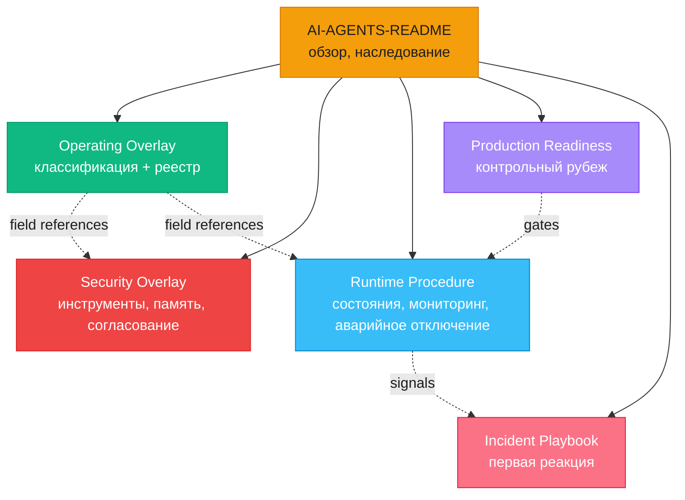

# AI-агенты: обзор ветки и принцип наследования

> Версия: 1.1 · Обновлено: 2026-11-13 · Теги: AI-агенты, governance, документация, RACI, реестр · Tier: 1-4
>
> **TL;DR**. Ветка про AI-агентов — это операционное **дополнение** к базовой документации, а не отдельный мир. Шесть документов закрывают: классификацию, безопасность, исполнение, инциденты, готовность к проду и обзор. Базовые требования (архитектура, оценка риска, реестр, RACI) остаются приоритетными.

## Источники и редакции для новых внедрений

Проверено 13 ноября 2026 года. [OWASP GenAI LLM Top 10 2026](https://genai.owasp.org/resource/owasp-genai-llm-top-10-2026/) описывает риски LLM-приложений; [OWASP Top 10 for Agentic Applications 2026](https://genai.owasp.org/resource/owasp-top-10-for-agentic-applications-for-2026/) дополняет их рисками автономных действий. В evidence pack сохраняйте название и редакцию каждого источника. Старые маппинги 2025 не переименовывайте без проверки содержания.

[NIST AI 600-1](https://www.nist.gov/publications/artificial-intelligence-risk-management-framework-generative-artificial-intelligence) дополняет добровольный AI RMF 1.0 профилем генеративного ИИ. Используйте его для обсуждения рисков жизненного цикла; сертификатом соответствия или обязательным нормативным актом этот профиль не является.

MCP — протокол интеграции, а не готовая граница доверия. Согласование пользователем, OAuth-доступ и разрешение бизнес-действия проверяются раздельно; меры приведены в [Security Overlay](33-ai-agents-security-overlay.md).

Для новых multi-agent внедрений учитывайте [OWASP Securing Agentic Applications V2](https://genai.owasp.org/resource/securing-agentic-applications-v2/): landing опубликован 10.11.2026, обложка PDF — Version 2.0 / October 2026. Разбор A2A и удалённого делегирования находится в [главе 10](10-llm-agent-protection.md); контракт конкретного проекта сохраняет версии протоколов и библиотек. Опубликованный 09.11.2026 [NIST SP 2400-102e2026](https://csrc.nist.gov/pubs/sp/2400-102/e2026/ipd) на дату проверки является Initial Public Draft. Он полезен для отслеживания развития таксономии, но не заменяет принятые нормы или допуск системы. Сценарии по §4 и точные печатные страницы приведены в [главе 10](10-llm-agent-protection.md); предлагаемые проверки Milksec не означают воспроизведённую эффективность описанных в draft защит.

## 1. Зачем отдельная ветка про агентов

Обычный AI-сценарий становится **агентным**, как только AI-система выходит за рамки одиночного запрос-ответа и начинает влиять на ход выполнения задачи или последующие действия. На практике достаточно одного из признаков:

- **многошаговое выполнение** (модель планирует следующий шаг сама);
- **использование инструментов / коннекторов** (поиск, файловые операции, API, базы данных);
- **память** за пределами текущего взаимодействия;
- **вызов действий** (запись, отправка, изменение состояния);
- **запуск по расписанию / событию** без немедленной проверки человеком;
- **передача управления** между моделями или между моделью и человеком.

> [!warn]
> Агентность — это не свойство модели, а свойство **сценария**. Один и тот же LLM в чате — это обычный AI-сценарий; в обвязке с tool-calling и расписанием — уже агент.

### Карта документов ветки

## 2. Принцип приоритета базовых документов

Ветка про агентов **только усиливает** базовые требования. Она не вводит:

- новую таксономию рисков;
- новый процесс подачи / оценки;
- альтернативный реестр AI-систем;
- параллельный стандарт безопасности;
- собственную RACI-модель.

| Базовый документ (источник истины) | Что добавляет ветка про агентов |
|---|---|
| Архитектурный мастер | Операционные уточнения для исполнения агента поверх существующей платформы |
| Положение об оценке AI-кейсов | Поля описания агентного сценария + триггеры повторной оценки |
| Стандарт безопасности AI | Меры для инструментов, границы действий, память, согласование, аудит |
| Реестр AI-систем | Дополнение к карточке реестра для агентных сценариев |
| GenAI Development Policy | Уточнения исполнения и промышленной эксплуатации только для агентов |
| RACI-матрица | Сопоставление обязанностей агентного сценария с существующими ролями |
| LLM Firewall / Proxy требования | Ожидания к согласованиям и подтверждениям при tool-вызовах |

> [!ru]
> В РФ-контексте базовыми считаются: внутренние политики ИБ, требования ФСТЭК по уровням защищённости ИСПДн, 152-ФЗ, 187-ФЗ для КИИ. Положения по AI-агентам не подменяют их — они их детализируют для случаев с tool-calling и автономностью.

## 3. Шесть документов ветки и когда читать каждый

| # | Документ | Зачем | Глава |
|---|---|---|---|
| 1 | README (этот раздел) | Понять границу ветки и порядок чтения | [/ch/31-ai-agents-overview](31-ai-agents-overview.md) |
| 2 | Operating Overlay | Классифицировать сценарий: агентный или нет, какой класс | [/ch/32-ai-agents-operating-overlay](32-ai-agents-operating-overlay.md) |
| 3 | Security Overlay | Понять уточнения безопасности для tool-calling и памяти | [/ch/33-ai-agents-security-overlay](33-ai-agents-security-overlay.md) |
| 4 | Runtime Procedure | Запускать, мониторить, останавливать, аварийно гасить | [/ch/34-ai-agents-runtime-procedure](34-ai-agents-runtime-procedure.md) |
| 5 | Incident Playbook | Первые шаги при инъекции, утечке, отравлении памяти | [/ch/35-ai-agents-incident-playbook](35-ai-agents-incident-playbook.md) |
| 6 | Production Readiness Checklist | Финальная проверка перед пилотом / промышленной эксплуатацией | [/ch/36-ai-agents-production-checklist](36-ai-agents-production-checklist.md) |

### Рекомендуемый порядок чтения

1. **README** — границы ветки.
2. **Operating Overlay** — `(агент / не агент) → класс → поля реестра`.
3. Действующее **Положение об оценке** — подача, риск, маршрут согласования.
4. **Security Overlay** — что добавить к базовому стандарту безопасности.
5. **Runtime Procedure** — пилот, прод, мониторинг.
6. **Production Readiness Checklist** — рубеж перед прод-релизом или повторным согласованием.
7. **Incident Playbook** — держать наготове.

## 4. Что НЕ относится к ветке про агентов

> [!info]
> Если вы хотите изменить:
>
> - **базовую архитектуру** (шлюз, DLP, сетевые зоны) — см. [главы 01](01-overview-architecture.md) и [02](02-stage0-ml-system-design.md);
> - **политики разработки** (что разрешено в GenAI) — см. [главы 14](14-model-risk-governance.md) и [20](20-code-assistants-security.md);
> - **общий процесс инцидент-реагирования** — см. [главу 15](15-ai-incident-response.md);
> - **базовые меры безопасности AI** — см. [главы 12](12-detection-protection-cicd-llm.md), [13](13-implementation-ru-playbook.md) и [18](18-ru-compliance-deep.md);
>
> то ветка про агентов вам не подходит. Она добавляет только агент-специфичные дополнения поверх уже существующих процессов.

## 5. Технические артефакты (`examples/`)

Шесть документов снабжены минимальным набором заполняемых артефактов:

| Артефакт | Назначение |
|---|---|
| [agent-action-policy.yaml](examples/agents/agent-action-policy.yaml) | Политика как код: делегированные полномочия, согласования, лимиты, аварийные меры |
| [agent-registry-card-example.md](examples/agents/agent-registry-card-example.md) | Дополнение к карточке реестра для агентного сценария |
| [agent-memory-governance-template.md](examples/agents/agent-memory-governance-template.md) | Назначение памяти, срок хранения, удаление, выявление отравления |
| [agent-delegated-authority-template.md](examples/agents/agent-delegated-authority-template.md) | Запись делегированных полномочий: что разрешено, что только с согласованием |
| [agent-connector-card-template.md](examples/agents/agent-connector-card-template.md) | Карточка коннектора: владелец, область, лимиты, изоляция |
| [agent-evidence-pack-template.md](examples/agents/agent-evidence-pack-template.md) | Пакет подтверждений для пилота / прода / изменения / отката |
| [agent-security-evals-minimal.md](examples/agents/agent-security-evals-minimal.md) | Минимальный набор защитных проверок |
| [prometheus-agent-alerts.yaml](examples/agents/prometheus-agent-alerts.yaml) | Иллюстративные правила Prometheus для агентных событий |
| [siem-agent-queries.txt](examples/agents/siem-agent-queries.txt) | Иллюстративные SIEM-запросы по схеме `agent-runtime-events` |
| [runbook-connector-quarantine.md](examples/agents/runbook-connector-quarantine.md) | Изоляция коннектора, сдерживание, ротация учётных данных |
| [agent-runtime-events.schema.json](examples/agents/agent-runtime-events.schema.json) | JSON Schema событий аудита исполнения |
| [agent-runtime-events-examples.md](examples/agents/agent-runtime-events-examples.md) | Валидные и невалидные примеры событий |
| [agent-approval-record.schema.json](examples/agents/agent-approval-record.schema.json) | JSON Schema подтверждения согласования |
| [agent-approval-record-examples.md](examples/agents/agent-approval-record-examples.md) | Валидные и невалидные примеры записей согласования |
| [validate-agent-examples.py](examples/agents/validate-agent-examples.py) | Offline-проверка формы и выбранных семантических условий |
| [agent-semantic-fixtures.json](examples/agents/agent-semantic-fixtures.json) | Положительные и отрицательные случаи для локальной проверки примеров |
| [prometheus-agent-alerts.test.yaml](examples/agents/prometheus-agent-alerts.test.yaml) | Временные сценарии Promtool: задержка, отсутствие ряда, labels и ожидаемое срабатывание |

Все артефакты — **вендор-нейтральные**. Они дают каркас, который надо адаптировать к конкретному стеку (Kubernetes / OpenShift / Yandex Cloud / on-prem).

[README комплекта](examples/agents/README.md) описывает запуск и ограничения проверок. Ссылки открывают документы или исходные файлы, а не запускают агентный runtime. YAML-политика и JSON Schema описывают проектный контракт. Проверка формы записи не доказывает действительность полномочий, исполнение policy или отсутствие внешнего эффекта: эти условия проверяются отдельно перед действием и по результату выполнения. Для Prometheus отдельно нужны реальный exporter и проверка доставки алертов.

## 6. Правила сопровождения

- README — единственная навигационная карта ветки.
- Любые расхождения между базовыми документами и веткой про агентов разрешаются **в пользу базовых**.
- Любые расширения ветки идут в `examples/` без создания отдельной контрольной модели.
- Внешние стандарты (OWASP LLM Top 10, NIST AI RMF, ISO 42001) используются как рекомендации по реализации, не как самостоятельный источник политики.

> [!ok]
> Главное правило ветки: **«меньше — лучше»**. Если требование уже есть в базе — не дублируйте, ссылайтесь. Если расхождение — правится только agents-ветка.
