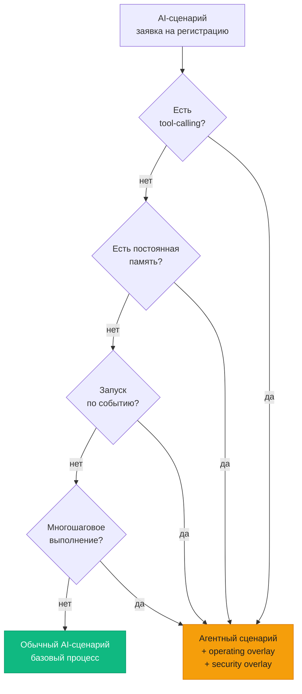
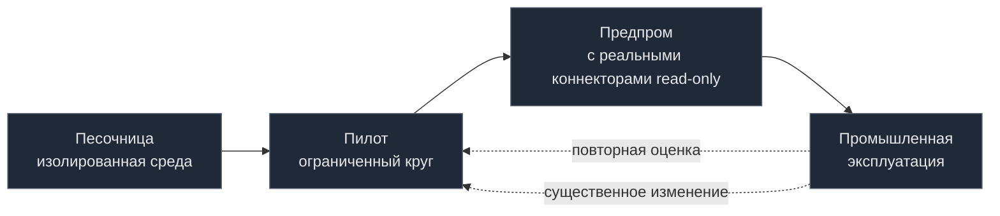

# AI-агенты: операционный overlay

> Версия: 1.1 · Обновлено: 2026-11-13 · Теги: AI-агенты, классификация, реестр, делегированные полномочия, согласование · Tier: 1-4
>
> **TL;DR**. Операционное дополнение для агентных сценариев: где граница «агент / не агент», какие классы агентов существуют, какие поля добавить в карточку реестра, как фиксировать делегированные полномочия и какие изменения считаются существенными.

## 1. Граница агентного сценария

Сценарий считается **агентным**, если хотя бы один признак из таблицы ниже выполняется. Если признаков несколько — сценарий усиливается до класса с большим контролем.

| Фактор | Что означает | Минимальное подтверждение |
|---|---|---|
| **Многошаговое выполнение** | Модель сама выбирает следующий шаг по результатам предыдущего | Описание границы рассуждения, лимит итераций, журнал переходов |
| **Использование инструментов** | Tool-calling, function-calling, MCP, RAG-агенты | Реестр разрешённых инструментов, область действия каждого |
| **Постоянная память** | Хранение состояния между сессиями | Назначение, срок хранения, политика удаления, аудит |
| **Действия с записью** | Запись, отправка, изменение состояния внешних систем | Модель согласования, делегированные полномочия |
| **Запуск по событию / расписанию** | Cron, webhook, message-bus | Резервный сценарий, путь аварийного отключения |
| **Передача управления** | Между моделями или между моделью и человеком | Семантика handoff, границы доверия |

### Дерево решений

> [!warn]
> Если сценарий близок к границе (например, RAG с read-only), всё равно проходите через классификацию. Лучше избыточный контроль на этапе подачи, чем переоценка после инцидента.

## 2. Классы агентов и матрица мер контроля

Классы A-D ниже - пример внутренней модели допуска, а не классификация из OWASP, закона или протокола. Они определяются сценарием и сочетанием возможностей. Read-only не означает отсутствие риска: параметры поиска, URL и результаты чтения могут раскрыть данные. Даже для класса A проверяются объекты, tenant и получатели информации.

| Класс | Описание | Базовые меры |
|---|---|---|
| **A — read-only** | Только утверждённые инструменты, доступ только для чтения, без изменения состояния | Реестр инструментов, владелец, журнал аудита |
| **B — write через согласование** | Запись / отправка / изменение, каждое чувствительное действие требует подтверждения человеком | + Модель согласования, делегированные полномочия, измеримое подтверждение по каждому действию |
| **C — автономный по расписанию** | Запуск по cron / событию без немедленной проверки человеком | + Сигналы мониторинга, резервный сценарий, путь аварийного отключения |
| **D — привилегированный** | Многоагентный, browser/computer-use, привилегированные коннекторы | + Усиленная проверка, изоляция, ограничение времени работы, обязательный пилот |

> [!danger]
> Класс D **по умолчанию запрещён** без явного обоснования и утверждённого исключения. Сюда относятся multi-agent workflows и computer-use.

## 3. Дополнение к карточке реестра

К существующей карточке реестра AI-системы для агентного сценария добавляются поля:

| Поле | Что писать |
|---|---|
| `agent_class` | A / B / C / D из §2 |
| `tools` | Список разрешённых инструментов с областью действия каждого |
| `connectors` | Список коннекторов с сервисной УЗ и областью доступа |
| `memory_scope` | Назначение памяти, срок хранения, политика удаления |
| `delegated_authority` | Ссылка на запись делегированных полномочий |
| `approval_model` | Запись / две подписи / без согласования (для класса A) |
| `runtime_identity` | Сервисная учётная запись среды исполнения |
| `kill_switch_path` | Путь аварийного отключения: команда, владелец, время выполнения |
| `monitoring_signals` | Какие метрики и логи отслеживаются |
| `evidence_pack_ref` | Ссылка на пакет подтверждений |

Для MCP-интеграций в карточке коннектора дополнительно фиксируйте согласованную редакцию протокола, транспорт, издателя и версию сервера, ожидаемый issuer/resource, модель пользовательского согласия и способ отзыва доступа. Изменение transport, scopes, описания или схемы инструмента требует проверки границ доступа, даже если имя инструмента осталось прежним. Техническая основа: [MCP Authorization 2026-07-28](https://modelcontextprotocol.io/specification/2026-07-28/basic/authorization); внутреннее согласование не заменяется OAuth-токеном.

### 3.1. Карточка сценария, допуск релиза и фактический запуск

Одна карточка реестра может охватывать несколько версий реализации. Статус «согласовано» относится к определённой конфигурации и ограничениям; он не разрешает автоматически запуск новой модели, tools или prompt под прежним `agent_id`.

| Связь | Что должно совпадать | Когда пересматривать |
|---|---|---|
| Карточка → пакет выпуска | Назначение, класс данных, область инструментов и ссылка на допущенный состав | Расширение сценария или конфигурации |
| Пакет выпуска → runtime | Фактические model/prompt/tool/policy revisions, identity, допустимые коннекторы | Startup, resume и обнаружение drift |
| Runtime → делегирование | Текущий субъект, tenant, объекты, срок и отзыв | Перед защищённой операцией, после очереди или ожидания человека |
| Runtime → внешний task | Связь локального run и удалённого job/task, владелец отмены и сверки | Retry, handoff, timeout и остановка |

Для A2A AgentCard описывает discovery; `taskId` и `contextId` помогают связать работу, но не выдают полномочия. Запись удалённой задачи должна быть связана с нашим допуском и назначением данных. Детали protocol/authorization boundaries разобраны в [главе 10](10-llm-agent-protection.md), состав выпуска и сверка с runtime - в [главе 14](14-model-risk-governance.md).

**Проверка владельца**: из карточки должно быть возможно восстановить, какая конфигурация допущена, какие ограничения действуют, какие runs ещё выполняются и кто закрывает их внешние последствия. Если доступен только общий статус агента, готовность отдельного запуска не подтверждена.

## 4. Модель делегированных полномочий

Делегированные полномочия фиксируются как **запись с ограниченным сроком действия**.

| Поле записи | Назначение |
|---|---|
| `agent_id` | Идентификатор агента в реестре |
| `workflow_id` | Идентификатор рабочего процесса |
| `valid_until` | Срок действия |
| `allowed_actions` | Разрешённые действия |
| `denied_actions` | Явно запрещённые действия |
| `approval_required` | Действия только после согласования (с указанием схемы) |
| `granted_by` / `granted_at` | Кто и когда выдал |
| `revocation_path` | Как отозвать (без перезапуска) |

Шаблон записи — в [`examples/agents/agent-delegated-authority-template.md`](31-ai-agents-overview.md#examples).

> [!info]
> Делегированные полномочия — это **не RBAC**. Они узкоспециализированы под конкретный рабочий процесс агента и имеют срок жизни. RBAC сервисной учётной записи определяет потолок, делегированные полномочия — фактический объём.

## 5. Этапы допуска

Каждый этап имеет собственный пакет подтверждений: журнал событий, отчёт по защитным проверкам, реестр инцидентов, статус метрик.

## 6. Существенные изменения и триггеры повторной оценки

Триггеры **обязательной повторной оценки**:

- расширение области действия инструмента или коннектора;
- расширение делегированных полномочий;
- изменение поведения памяти (новый срок хранения, новый класс данных);
- смена идентичности среды выполнения;
- переход в более высокий класс агента;
- переход к продолжительной автономности (без проверки человеком);
- введение нового внешнего коннектора;
- смена базовой модели / провайдера.

> [!warn]
> Обычный pull request сам по себе не является допуском существенного изменения. Код и оценка могут проходить через тот же PR-процесс, но новая область работы включается только после предусмотренного review риска, обновления пакета подтверждений и решения по базовому процессу.

## 7. Краткая операционная памятка

| Если сценарий | Минимальный вывод |
|---|---|
| Только read-only утверждённые инструменты | Класс A, обычный процесс подачи + журнал аудита |
| Запись / отправка / изменение через коннекторы | Класс B, делегированные полномочия, подтверждение по каждому действию |
| Запуск по cron / событию без проверки человеком | Класс C, оценка автономности, резервный сценарий, kill-switch |
| Постоянная память | Не по умолчанию: явное обоснование, граница, аудит, удаление |
| Привилегированный коннектор / browser-use / multi-agent | Класс D, усиленная проверка, обязательный пилот |
| Расширение области действия | Существенное изменение → повторная оценка |

## 8. Связь с другими документами

- Классификация → определяет, что писать в реестр.
- Класс → влияет на меры из [Security Overlay](33-ai-agents-security-overlay.md).
- Класс + автономность → определяют сигналы [Runtime Procedure](34-ai-agents-runtime-procedure.md).
- Класс D → требует расширенного пилота через [Production Readiness Checklist](36-ai-agents-production-checklist.md).
