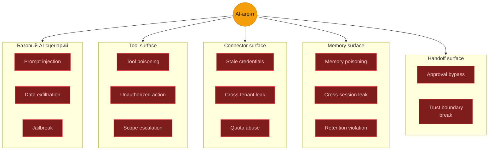
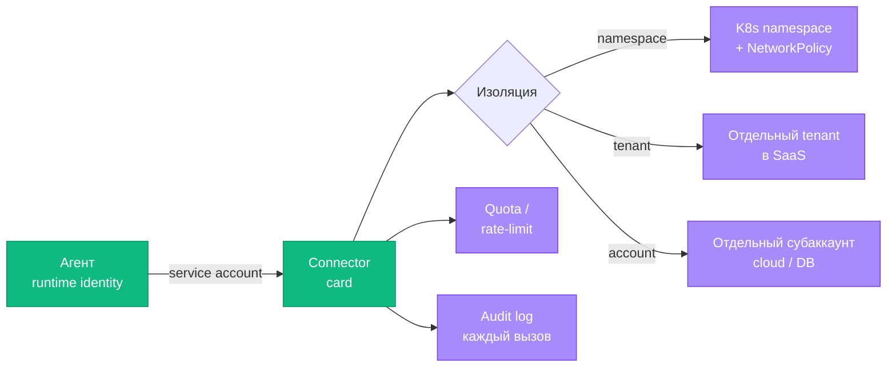

# AI-агенты: security overlay

> Версия: 1.2 · Обновлено: 2026-11-13 · Теги: AI-агенты, безопасность, инструменты, память, согласование, аудит, prompt injection · Tier: 1-4
>
> **TL;DR**. Дополнение по безопасности поверх базового AI-стандарта: модель угроз для агентов, граница действий инструментов, модель согласования, требования к памяти, изоляция коннекторов, защита от prompt injection через недоверенный контент и список блокирующих условий перед промом.

## 1. Модель угроз агентного сценария

Базовая модель угроз AI остаётся (OWASP LLM Top 10, MITRE ATLAS, STRIDE-AI); для агентов дополнительно применяется OWASP Agentic AI Top 10 (2026, коды ASI01-ASI10). Агентные сценарии добавляют поверхности атак: **инструменты**, **коннекторы**, **память**, **передача управления**.

> [!danger]
> Самая опасная связка: **prompt injection в недоверенном контенте → tool-call от имени агента → действие через коннектор с устаревшими полномочиями**. Каждое звено защищается отдельно; защита только на входе не работает.

## 2. Граница действий инструмента

Для каждого инструмента в реестре сценария фиксируется:

| Атрибут | Назначение |
|---|---|
| `name` / `version` | Инструмент и его версия |
| `purpose` | Для чего используется в этом сценарии |
| `scope` | Конкретный объект / namespace / repo / database |
| `read_or_write` | Только чтение или есть запись |
| `rate_limit` | Лимит вызовов в окне времени |
| `cost_limit` | Лимит токенов / API-расходов |
| `idempotency` | Идемпотентность вызова и обработка повторов |
| `approval_required` | Список действий, требующих явного согласования |

> [!warn]
> Для неидемпотентной write-операции нужны способ установить внешний исход и запрет слепого повтора после ошибки. Согласование подтверждает намерение, но не предотвращает дубликат. Если результат неизвестен, дальнейшие действия определяются процедурой сверки, а не новой попыткой по инициативе модели.

Пакет skill с guidance/scripts допускается отдельно от обычного tool call: он может изменить управляющие инструкции или выполнить setup ещё до вызова инструмента. Устанавливающий пакет principal и выполняющий задачу агент не получают одинаковое право менять controls. В manifest сохраняются digest guidance/scripts/dependencies и разрешённая область установки; negative install-test проверяет записи в policy/registry и egress дочерних процессов, positive — штатную установку и полезную задачу. Проверка и её evidence описаны в [главе 10, §5.5.2](10-llm-agent-protection.md); поле `AgentCard.skills` само по себе не означает такой исполняемый пакет.

## 3. Модель согласования

Действия делятся на три уровня:

| Уровень | Когда применяется | Подтверждение |
|---|---|---|
| **Auto** | Утверждённые read-only / низкорисковые write с идемпотентностью | Журнал аудита, без подтверждения |
| **Approve** | Запись, отправка, изменение в чувствительных системах | Подтверждение оператора с записью времени и идентичности |
| **Dual-approve** | Финансовые операции, рассылки клиентам, изменения compliance-данных | Подтверждение двумя независимыми операторами |

Записи согласования следуют схеме `agent-approval-record.schema.json` ([пример](31-ai-agents-overview.md#examples)).

> [!info]
> Подтверждение действия должно **связываться с конкретным runtime-событием** (по `action_id`), а не быть общим разрешением «запускать агент». Иначе устаревшие подтверждения переиспользуются.

Практическая политика: связывайте разрешение также с identity пользователя и агента, tenant, инструментом, нормализованными аргументами, целевым объектом и сроком действия. Изменился получатель, сумма, файл или область действия — требуется новое согласование. Повтор после сетевого тайм-аута сначала сверяется с журналом результата и ключом идемпотентности: отсутствие ответа не доказывает, что действие не выполнено.

### 3.1. Согласование, допуск к выполнению и подтверждение результата

У действия есть три разных подтверждения: **человек согласовал намерение**, **executor разрешил текущую попытку** и **внешний эффект установлен**. Одно не заменяет другое. Запись `approved` не означает `executed`, а timeout не означает `not_executed`.

| Этап | Что проверить | Что сохранить |
|---|---|---|
| Preview | Реальный объект, получатель, объём, ограничения и необратимые последствия | Связь представленного человеку содержания с намерением действия |
| Approval | Полномочия согласующего, точный scope, срок и версия намерения | Идентификатор согласования и decision/evidence reference |
| Перед эффектом | Текущие права, отзыв, policy revision, неизменность аргументов и уникальный допуск логической операции | Результат проверки executor и ключ идемпотентности, если поддерживается |
| После вызова | Ответ и readback внешнего ресурса; наличие отложенного job | Известный результат или `unknown`, внешний operation ID и владелец сверки |

Для fingerprint аргументов применяется определённая каноникализация: типы, числовой формат, кодировка, порядок полей и разрешённые значения. Неоднозначный ввод отклоняется. Права на объект устанавливаются сервером из аутентифицированного контекста, а не из подписи поля «мой tenant» в тексте модели. Сам fingerprint не делает содержимое анонимным; чувствительная запись хранится с подходящей защитой и минимальным доступом.

При двух параллельных worker один approval не должен породить две новые логические операции. Допуск и учёт использования согласования проверяются атомарно или эквивалентным способом в executor. После изменения policy или истечения срока стоявшее в очереди действие проходит повторную проверку. Для уже принятого внешнего вызова отдельно применяется сверка исхода, описанная в [главе 15](15-ai-incident-response.md).

**Негативная приёмка**:

- [ ] В preview показан один получатель, а перед исполнением подставлен другой - отказ.
- [ ] Scope отозван между approval и извлечением из очереди - действие не начинается.
- [ ] Два worker одновременно используют одно согласование - нет двух внешних эффектов.
- [ ] Два аккаунта одного человека не засчитываются автоматически как независимое согласование.
- [ ] После timeout повторная попытка не создаётся до проверки внешнего исхода.
- [ ] Запись проходит JSON Schema, но не совпадает с действием или сроком - семантическая проверка отклоняет её.

JSON Schema в комплекте проверяет структуру, а не право на действие или связь с рабочим состоянием. Семантические условия, полнота hooks и readback тестируются в адаптере проекта. Модель согласования Auto/Approve/Dual-approve выше - внутренняя политика по риску, а не универсальное правило из MCP или A2A.

## 4. Память и состояние

| Тип памяти | Когда допустима | Требования |
|---|---|---|
| **Краткосрочная** (в рамках одного запроса) | По умолчанию | Изоляция запроса и тенанта, минимизация данных, исключение секретов из трассировок |
| **Сессионная** (несколько шагов одного диалога) | Если нужно для UX | Срок жизни, явное очищение, без записи PII |
| **Долгосрочная** (между сессиями / пользователями) | Только по обоснованию | Назначение, срок хранения, политика удаления, выявление отравления, аудит |
| **Cross-user общая** | Запрещено по умолчанию | Требует исключения, изоляция по тенанту, журнал доступа |

Шаблон управления памятью — [`agent-memory-governance-template.md`](31-ai-agents-overview.md#examples).

> [!ru]
> Память агента, содержащая ПДн, попадает под действие 152-ФЗ: требуются основания обработки, срок хранения, политика удаления, журнал доступа. Назначьте оператора ПДн и зафиксируйте политику в реестре.

## 5. Изоляция коннекторов

Каждый коннектор оформляется карточкой ([`agent-connector-card-template.md`](31-ai-agents-overview.md#examples)) с разделами: владелец, тип доступа, сервисная учётная запись, область, лимиты, условия изоляции, план карантина.

### MCP: отдельные границы авторизации

По [MCP Authorization 2026-07-28](https://modelcontextprotocol.io/specification/2026-07-28/basic/authorization) и [Security Best Practices](https://modelcontextprotocol.io/docs/2026-07-28/tutorials/security/security_best_practices):

- Не принимайте токен, предназначенный другому ресурсу, и не передавайте входной токен напрямую в downstream API. Проверяйте audience; для downstream оформляйте отдельные полномочия.
- Для OAuth-прокси обеспечьте согласие конкретного пользователя на конкретный MCP-клиент; общее согласие на сторонний сервис не разрешает новый клиент.
- Проверяйте URL авторизации и discovery; блокируйте SSRF к loopback, private и link-local адресам, включая перенаправления.
- Локальный stdio-сервер запускается как процесс с правами ОС: проверяйте команду и поставщика, ограничивайте доступ к файлам, сети и окружению. OAuth не изолирует этот процесс.
- Elicitation имеет отдельный допуск формы / browser handoff и проверку того же пользователя; URL `accept` не означает завершённый OAuth. Сохранённый sampling отдельно ограничивает модель, раскрытие контекста и общий бюджет logical run. В Current 2026-07-28 sampling deprecated; в новых внедрениях feature не включают ради совместимости с примером. MRTR retry не выдаётся за однократность бизнес-действия; нормы и парные проверки — [10 §6.4.1 / §6.7](10-llm-agent-protection.md).

Проверка применимости: зафиксируйте transport и модель угроз. Для stdio без HTTP-авторизации нужны ограничения процесса и локальных credentials; копировать OAuth-чеклист вместо этих мер недостаточно.

## 6. Защита от недоверенного контента

Когда агент потребляет внешний контент (веб-страница, файл от пользователя, чужой документ через коннектор), этот контент **никогда не доверяется как инструкция**.

Меры:

- разделение каналов: `system / user / tool_output` имеют разные уровни доверия;
- санитизация опасной разметки для безопасного отображения; удаление строк `### system` или `<instructions>` не предотвращает семантическую prompt injection;
- ограничение действий: read-only режим на ответы из недоверенных источников;
- защита от exfiltration через URL: проверка outgoing URL по allow-list;
- detection: анализ попыток экспорта секретов и обхода согласования; решение о вызове инструмента принимает независимая политика с проверкой identity, объекта и аргументов.

Read-only не исключает утечку: чтение чувствительного документа и отправка его содержимого через URL или поисковый запрос тоже нарушают границу доступа. Для каждого шага проверяйте разрешённые источники данных и назначения передачи. Отсутствие обнаруженных маркеров инъекции не даёт права на действие.

> [!warn]
> «Игнорируй предыдущие инструкции» — это самая известная инъекция. Реальные атаки выглядят сложнее: спрятаны в комментариях HTML, в alt-тексте, в metadata PDF, в Unicode-zero-width-символах.

## 7. Аудит исполнения

События сопоставляются с проектной схемой `agent-runtime-events.schema.json` и доставляются в утверждённый audit-контур. Ниже используются значения её `event_type`, а не условные имена из диаграмм. Адаптер приложения должен явно отображать свои события в этот контракт.

| Событие | Что фиксируется |
|---|---|
| `agent_started` / `agent_stopped` | id, версия, identity, причина |
| `tool_call_requested` / `tool_call_executed` | id действия, инструмент, область, безопасные ссылки на вход/выход и установленный результат |
| `tool_call_denied` / `policy_denied` | причина отказа: политика, согласование, лимит |
| `human_approval_recorded` / `approval_revoked` | ссылка на действие и запись согласования; субъект, время, основание |
| `memory_read` / `memory_write` | назначение, область памяти, операция и reference; содержимое памяти по умолчанию не копируется в SIEM |
| `agent_handoff_requested` / `agent_handoff_completed` | from, to, причина, делегированный scope и связь с конкретным экземпляром workflow |
| `anomaly_detected` / `agent_quarantined` | обнаруженное условие, область ограничения и наблюдаемый результат |

Событие запроса, запись решения и результат внешнего действия хранятся раздельно и связываются идентификаторами. Для отсутствующего в схеме типа события нужно согласованное версионированное расширение и проверка потребителей. Простая замена имени в тексте не создаёт поддержку в runtime.

Пять минут доставки в SIEM ниже - пример внутреннего SLO, который утверждается по риску сценария. Этот срок не означает, что executor может выполнить защищённое действие без требуемой записи решения. Если audit-путь недоступен, заранее определяется допустимый защищённый буфер и поведение каждой операции; sampling traces не заменяет обязательный аудит.

Иллюстративные правила Prometheus — [`prometheus-agent-alerts.yaml`](31-ai-agents-overview.md#examples). SIEM-запросы — [`siem-agent-queries.txt`](31-ai-agents-overview.md#examples).

## 8. Блокирующие условия перед промом

Промышленная эксплуатация **запрещена**, если хотя бы одно условие выполнено:

- [ ] Нет реестра инструментов с областью действия;
- [ ] Нет записи делегированных полномочий со сроком действия;
- [ ] Нет модели согласования для write-действий;
- [ ] Нет журнала аудита, попадающего в SIEM в течение 5 минут;
- [ ] Нет пути аварийного отключения с замером времени;
- [ ] Нет защитных проверок на prompt injection / tool misuse / approval bypass;
- [ ] Нет владельца агента или владельца коннекторов;
- [ ] Нет плана карантина коннектора;
- [ ] Класс D без явно утверждённого исключения.

> [!ok]
> Эти девять пунктов — минимальный «hard gate». Если по любому из них статус **«нет»** — релиз останавливается, без обсуждений.

## 9. Связь с другими документами

- Поверх **базового стандарта безопасности** (DLP, IAM, OWASP LLM Top 10) — не подменяет его.
- Опирается на класс агента из [Operating Overlay](32-ai-agents-operating-overlay.md).
- Минимальный набор защитных проверок — `agent-security-evals-minimal.md`.
- При нарушении — путь действий описан в [Incident Playbook](35-ai-agents-incident-playbook.md).
- Финальный рубеж — [Production Readiness Checklist](36-ai-agents-production-checklist.md).
