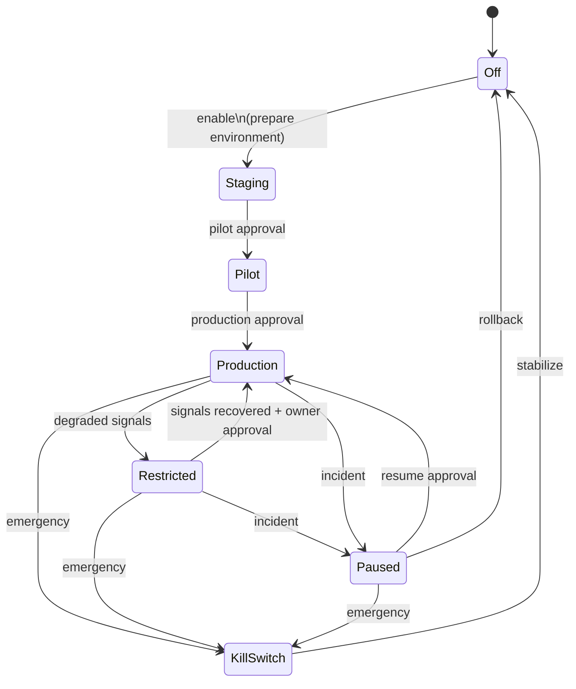

# AI-агенты: процедура исполнения (runtime)

> Версия: 1.1 · Обновлено: 2026-11-13 · Теги: AI-агенты, runtime, мониторинг, kill-switch, ограниченный режим, аварийное отключение · Tier: 1-4
>
> **TL;DR**. Состояния агентного сценария от запуска до аварийного отключения. Каждое состояние имеет владельца, сигналы перехода и обязательные подтверждения. Без определённого пути обратно в нормальный режим — релиз в прод не допускается.

## 1. Состояния runtime

| Состояние | Что значит | Кто переводит |
|---|---|---|
| **Off** | Новые запуски отключены; состояние внешних уже принятых операций сверяется отдельно | По умолчанию после регистрации |
| **Staging** | Изолированная среда, утверждённые тестовые данные | Владелец агента |
| **Pilot** | Ограниченный круг пользователей, реальные коннекторы с лимитом | AI Lead + MLSec |
| **Production** | Полный круг пользователей в рамках области | AI Lead + Risk |
| **Restricted** | Часть действий заблокирована, остальное продолжает работать | Автоматически по сигналам или владелец |
| **Paused** | Новые входы и действия заблокированы; внешние принятые операции могут требовать отдельной остановки | Владелец / SecOps |
| **Kill-switch** | Аварийное ограничение исполнения и полномочий в утверждённой области | SecOps / IR-on-call |

> [!warn]
> Для критичных сценариев спроектируйте автоматическое ограничение по доверенным сигналам и ручной аварийный путь. Какие операции блокируются, кто подтверждает возврат и как проверяется безопасное состояние, определяется до пилота. Срабатывание произвольного пользовательского события не должно давать возможность отключить чужую систему или расширить права.

## 2. Включение и предзапуск

Перед переходом в Pilot / Production проверяется:

| Проверка | Подтверждение |
|---|---|
| Реестр инструментов и коннекторов соответствует утверждённой карточке | Diff vs утверждённая версия = 0 |
| Делегированные полномочия активны, срок не истёк | `now < valid_until`; проверка перед каждым действием и после ожидания согласования |
| Фактические права не шире пересечения RBAC и делегированных полномочий | Негативные тесты: другой tenant, объект, истёкшее или отозванное разрешение → отказ |
| SIEM получает события с задержкой ≤ 5 минут | Контрольное событие → запрос в SIEM ≤ 5m |
| Kill-switch отрабатывает за заданное время | Замер 3 прогона: каждый ≤ SLA |
| Резервный сценарий описан | Документ + сценарий тестирования |

Пять минут доставки и три прогона kill-switch - параметры учебного внутреннего процесса, не требования протоколов. Три успешных опыта не устанавливают вероятность надёжности механизма: дополнительно выбираются сценарии нагрузки, очередей, недоступного провайдера и отказа самого control plane.

Срок credentials выбирается по риску и процедуре обновления; требование иметь ещё 14 дней доступа не является универсальной мерой безопасности. По истечении или отзыве полномочий действие блокируется до повторной авторизации. Для MCP-коннектора отдельно проверяйте отзыв OAuth-доступа и остановку локального процесса: это разные контуры ([меры MCP](33-ai-agents-security-overlay.md#mcp-otdel_nye-granizy-avtorizazii)).

## 3. Мониторинг

Минимум сигналов, собираемых в SIEM / Prometheus:

| Сигнал | Назначение |
|---|---|
| `agent_actions_total{tool,scope,result}` | Объём действий по инструментам и областям |
| `agent_action_latency_seconds{tool}` | Латентность инструмента |
| `agent_policy_denied_total{reason}` | Сколько раз политика отказала, по причинам |
| `agent_approval_pending_seconds` | Сколько висят запросы согласования |
| `agent_memory_writes_total{purpose}` | Активность записи в долгосрочную память |
| `agent_handoffs_total{from,to}` | Передачи управления |
| `agent_killswitch_state` | 0 / 1 |
| `agent_runtime_errors_total{type}` | Ошибки исполнения по типу |

Иллюстративные правила — [`prometheus-agent-alerts.yaml`](31-ai-agents-overview.md#examples). Label-значения ограничиваются реестром или конечным перечнем классов: tenant/user/workflow IDs, URL, аргументы и текст ошибки не должны бесконтрольно создавать серии метрик. Индивидуальная корреляция хранится в защищённых событиях, а не в Prometheus labels.

### Триггеры автоматического перехода в Restricted

- всплеск частоты отказов выше откалиброванного baseline при достаточном числе наблюдений; пример X3 за 10 минут требует обработки нулевого baseline;
- всплеск ошибок коннектора;
- появление новых `policy.violation` событий;
- устойчивое ухудшение агрегированной latency относительно baseline/SLO; отдельные запросы выше собственного p95 не являются достаточным условием;
- утечка PII в `tool.call` аргументах (детектор DLP).

> [!info]
> Restricted не значит «всё сломано». Это «работаем в read-only / без чувствительных коннекторов, разбираемся с сигналом». Часть пользы агент продолжает приносить.

## 4. Ограниченный режим (Restricted)

В Restricted допускаются только:

- инструменты с `read_or_write = read`;
- инструменты с уровнем согласования `Auto`;
- внутренние утверждённые коннекторы;
- ответы без действий с внешним эффектом.

Эти условия проверяются совместно. Признак `read` сам по себе не разрешает передачу секрета в поисковый запрос или чтение отозванного документа. Уже найденные в cache или памяти данные также проходят актуальную проверку доступа.

Запрещены:

- write-действия любого уровня;
- внешние коннекторы (включая email, мессенджеры);
- запись в долгосрочную память.

Переход обратно в Production — только после **зелёного статуса сигналов в течение окна стабилизации** (обычно 30 минут — 2 часа) и подтверждения владельцем.

## 5. Изменения в утверждённом сценарии

| Тип изменения | Процесс |
|---|---|
| Только отображение / текст без изменения audit schema, payload, identifiers, routing или security semantics | Обычный PR + ревью; остальные изменения оцениваются по влиянию |
| Уточнение существующего инструмента в пределах области | PR + согласование владельца + журнал в реестре |
| Расширение области инструмента / коннектора | **Существенное изменение** → повторная оценка |
| Добавление инструмента / коннектора | **Существенное изменение** → повторная оценка |
| Смена базовой модели / провайдера | **Существенное изменение** → повторная оценка |
| Смена identity среды исполнения | **Существенное изменение** → повторная оценка |

> [!warn]
> Существенное изменение обновляет `evidence_pack_ref` в реестре. Нельзя «дописать» сценарий, не пройдя через рубеж готовности.

## 6. Приостановка (Paused)

Применяется, когда:

- получен внешний сигнал от MLSec / IR;
- защитная проверка обнаружила прорыв (см. [Security Overlay §1](33-ai-agents-security-overlay.md));
- зафиксировано подозрение на компрометацию коннектора;
- запущен инцидент-плейбук.

В Paused агент не принимает новые входы, но **сохраняет состояние**, чтобы расследование могло восстановить контекст.

## 7. Аварийное отключение (Kill-switch)

Должно быть **одной командой**, владелец процедуры — SecOps / IR-on-call.

Что происходит:

1. Все коннекторы агента переводятся в режим Deny на уровне платформы.
2. Полномочия и credentials затронутого запуска отзываются согласно типу identity; влияние на общие аккаунты рассматривается отдельно.
3. Делегированные полномочия аннулируются.
4. Блокируются новые dispatch; для принятых вызовов запрашивается cancel / ограничение, исход подтверждается readback либо остаётся `unknown`. Допустимый откат / компенсация проверяются отдельно.
5. Создаётся snapshot состояния памяти и журнала.
6. Запускается incident playbook.

Остановка планировщика не доказывает остановку операции у внешнего провайдера. Для каждого незавершённого вызова сохраните `action_id`, ключ идемпотентности и статус `unknown`, если результат не установлен. Проверьте состояние через API провайдера; не повторяйте платёж, отправку или удаление до сверки. Уже завершённые необратимые действия требуют отдельной компенсирующей процедуры, а не обещания автоматического отката.

> [!danger]
> Kill-switch — это не «остановить контейнер». Контейнеры можно перезапустить. Kill-switch отзывает **полномочия** так, чтобы даже при возврате к работе агент не мог продолжить с того же места без явного re-approval.

Шаблоны команд и регламент — `runbook-connector-quarantine.md` ([ссылка](31-ai-agents-overview.md#examples)).

Если коннектор или credential разделяется несколькими системами, процедура задаёт область аварийного ограничения и владельца общей зависимости. Слепая ротация общего ключа может остановить чужие процессы, а ротация только одного ключа может оставить прежнюю сессию или альтернативный grant. Результат подтверждается проверкой каждого фактического пути доступа.

## 8. Возврат к работе после Paused / Kill-switch

| Из состояния | Что нужно для возврата |
|---|---|
| **Paused → Production** | Корневая причина устранена + ревью + ретест защитных проверок |
| **Restricted → Production** | Окно стабилизации зелёных сигналов + подтверждение владельца |
| **Kill-switch → Off → Pilot** | Полный re-approval как при первичном включении + новый evidence pack |

### 8.1. Resume после очереди, ожидания или восстановления checkpoint

Сохранённое состояние - данные прошлого исполнения, а не актуальное разрешение продолжить его. До следующего защищённого действия проверяются:

| Объект проверки | Что сравнить с действующим допуском |
|---|---|
| Конфигурация | Модель, prompt, tool contract и policy revision; изменение scope требует соответствующего review |
| Identity и делегирование | Текущий субъект, tenant, ресурсы, срок, отзыв и полномочия дочернего run |
| Контекст | Права на документы, memory partition, cache и источник сохранённой инструкции |
| Действие | Неизменность согласованного намерения, уникальность логической операции и внешний исход предыдущей попытки |
| Бюджет | Общий расход родителя, резервы дочерних задач и операции с неизвестной стоимостью |

При несовпадении система остаётся в ограниченном состоянии или создаёт новое согласование; старый checkpoint не переписывает текущую policy. После подтверждённой операции сохраняется новый результат, чтобы рестарт worker не отправил её повторно. Бюджетный ledger описан в [главе 22](22-finops-ai.md), связь release с runtime - в [главе 14](14-model-risk-governance.md).

**Приёмка**: отозвать scope у синтетического сценария, затем восстановить старый checkpoint и повторно доставить queued message. Защищённый внешний эффект отсутствует, разрешённая контрольная операция сохраняет работоспособность, отказ имеет коррелированное свидетельство. Возврат callback или запись `resumed` сами по себе такой проверки не заменяют.

## 9. Свидетельства (evidence pack)

Минимум для прохождения рубежа:

- журнал событий runtime за последний период;
- отчёт по защитным проверкам;
- реестр инцидентов с указанием статуса;
- статус метрик и алертов;
- сводка изменений по сценарию;
- статус делегированных полномочий и подтверждений согласования.

Шаблон — `agent-evidence-pack-template.md`.

## 10. Связь с другими документами

- Сигналы и переходы → [Operating Overlay §5](32-ai-agents-operating-overlay.md).
- Уровень контроля → [Security Overlay](33-ai-agents-security-overlay.md).
- Действия при kill-switch → [Incident Playbook](35-ai-agents-incident-playbook.md).
- Что должно быть готово до Production → [Production Readiness Checklist](36-ai-agents-production-checklist.md).
