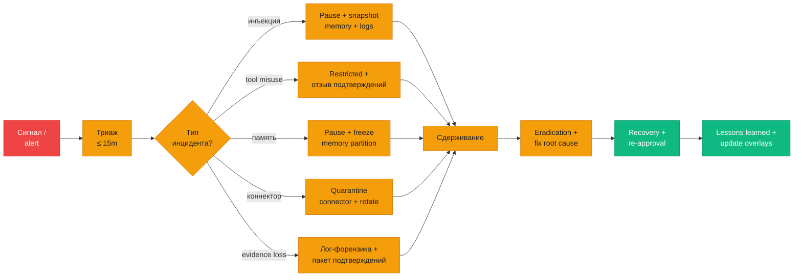

# AI-агенты: инцидент-плейбук

> Версия: 1.2 · Обновлено: 2026-11-13 · Теги: AI-агенты, incident response, prompt injection, отравление памяти, компрометация коннектора · Tier: 1-4
>
> **TL;DR**. Первичная реакция на пять характерных сценариев: инъекция инструкций, неправильное использование инструмента, проблема с памятью, компрометация коннектора, потеря свидетельств. Каждый сценарий — фиксированные первые 60 минут, ответственный, артефакты.

## 1. Общие принципы реагирования

Базовый процесс IR (триаж → сдерживание → eradication → recovery → lessons learned) остаётся. Дополнительно для агентов:

> [!warn]
> При продолжающейся утечке или опасном действии немедленно ограничьте исполнение и доступ, параллельно сохраняя доступные свидетельства. Snapshot памяти и журналов не должен задерживать сдерживание. Срок сохранности следов зависит от retention и конфигурации; универсальной гарантии «15 минут» нет. Фиксируйте время, источник, хеш и права доступа к копиям; не копируйте секреты в общедоступный тикет.

## 2. Инъекция инструкций (prompt injection)

**Признаки:**

- ответ модели содержит признаки обхода системного промпта;
- появилось действие `tool.call`, не предусмотренное сценарием;
- появилась попытка отправить данные на внешний URL;
- зафиксированы Unicode-zero-width / homoglyph-маркеры во входных данных.

**Первые 60 минут:**

| Шаг | Действие | Ответственный |
|---|---|---|
| 1 | Ограничить опасное исполнение и перевести затронутый сценарий в Paused; не ждать snapshot при продолжающемся эффекте | Владелец / SecOps |
| 2 | Изолировать подтверждённый входящий канал или источник, сохранив допустимый ручной процесс | Владелец агента |
| 3 | Параллельно сохранить относящиеся к инциденту события и references с контролем доступа | SecOps |
| 4 | Анализ цепочки: что прочитал агент, что попытался сделать | MLSec |
| 5 | Установить исход внешних действий; подготовить согласованный откат или компенсацию, если они допустимы | Владелец агента |
| 6 | Проверка не утекли ли данные через `tool.call` аргументы | MLSec + DLP |

**Eradication:**

- проверка границы доверия между данными документа и разрешением на действие; вырезание prompt-маркеров само по себе не устраняет инъекцию;
- ограничение outgoing URL по allow-list;
- усиление защитных проверок: добавить пример в `agent-security-evals-minimal.md`;
- ревью системного промпта.

Воспроизведите атаку в изолированной среде и добавьте негативный тест на фактически использованный путь: документ → инструмент → объект → внешний эффект. Для MCP отдельно проверьте подмену описания инструмента, новый scope, согласие другого клиента и использование токена не для того ресурса ([Security Overlay](33-ai-agents-security-overlay.md)). Возвращайте доступ после исправления и проверки запрета, а не только после изменения текста промпта.

## 3. Неправильное использование инструмента (tool misuse)

**Признаки:**

- агент использовал инструмент за пределами утверждённой области;
- множественные повторы одного действия (нет идемпотентности);
- действие выполнено без согласования, хотя требовалось;
- расходование квоты выше базового профиля.

**Первые 60 минут:**

| Шаг | Действие | Ответственный |
|---|---|---|
| 1 | Перевод в Restricted: блок write-инструментов | Автомат / Владелец |
| 2 | Отзыв подтверждений согласования по затронутому действию | SecOps |
| 3 | Snapshot журнала и состояния инструмента | Владелец агента |
| 4 | Откат write-действий, где возможно | Владелец агента |
| 5 | Уведомить операторов согласования | MLSec |

**Eradication:**

- сужение области действия в карточке инструмента;
- идемпотентность либо отдельная процедура readback / сверки исхода и запрета слепого повтора; необходимое согласование — отдельный контроль (см. [33 §3.1](33-ai-agents-security-overlay.md));
- защитная проверка на «вызов вне области».

> [!info]
> Tool misuse часто не вина инструмента, а нечётко описанная **область действия**. Если карточка инструмента позволяет «писать в любой namespace», ожидать «писать только в свой» — ошибка проектирования.

## 4. Проблема с памятью (memory poisoning / leak)

**Признаки:**

- ответы агента ссылаются на факты, которых не было в текущей сессии;
- появились записи в памяти, не соответствующие назначению (off-purpose);
- межпользовательская утечка: пользователь А видит данные пользователя B;
- срок хранения нарушен.

**Первые 60 минут:**

| Шаг | Действие | Ответственный |
|---|---|---|
| 1 | Приостановить использование затронутой партиции в ответах и действиях; ограничить исполнение | SecOps + Владелец агента |
| 2 | Сохранить необходимые свидетельства затронутой области в защищённую копию, а не массово копировать память всех пользователей | SecOps |
| 3 | Подтвердить Paused и отсутствие обхода через cache, summary, дочерний run или checkpoint | Владелец агента |
| 4 | Сравнение фактических записей с `agent-memory-governance-template` | MLSec |
| 5 | Идентификация скомпрометированных записей: источник, время, автор | MLSec |
| 6 | Определить основания, адресатов и сроки уведомлений по установленным фактам | Compliance + Legal |

**Eradication:**

- после сохранения необходимых свидетельств - согласованное исправление или удаление подтверждённо скомпрометированных записей с фиксацией области;
- усиление политики записи: проверка назначения, источника, классификации;
- добавление детектора отравления (аномалия в распределении записей);
- ревью прав сервисной УЗ на запись в память.

**Основа восстановления:** если запрещённое поведение сохраняется после сброса памяти, проверьте model/adapter, skill и tool configuration, а не объявляйте повторный сброс eradication. [NIST SP 2400-102e2026, Initial Public Draft от 09.11.2026](https://nvlpubs.nist.gov/nistpubs//SpecialPublications/NIST.SP.2400-102e2026.ipd.pdf#page=85), §4.7, печатные с.70–71 / PDF85–86, отмечает предел runtime-восстановления при заражении модели. Приёмка ниже предложена Milksec; здесь её эффективность не воспроизводилась.

| Парная проверка | Что должно наблюдаться |
|---|---|
| Negative: в изолированном воспроизведении с mock sink сохранить model/adapter и сменить только memory; затем повторить отложенный trigger после compaction/resume | Продолжение запрещённого action proposal или эффекта означает, что одной очистки памяти недостаточно; не «закрыто» по факту пустого хранилища |
| Positive и повтор negative на доверенной основе | Новый согласованный manifest model/adapter/skills/registry/policy/memory выполняет штатную задачу и отвергает trigger; независимое происхождение основы подтверждено отдельно |

В evidence храните digests двух manifest, lineage summary, наблюдаемый план/предложение, dispatch и внешний исход отдельно. Нет проверенной чистой основы или наблюдения поздней ветви — ограниченный режим и `inconclusive`, а не успешное восстановление. Протокол длинной траектории: [глава 10, §8.6](10-llm-agent-protection.md).

> [!ru]
> При событии, подпадающем под ч.3.1 ст.21 [152-ФЗ](https://mintrud.gov.ru/docs/laws/130), первичное уведомление РКН направляется в течение 24 часов, сведения о результатах внутреннего расследования - в течение 72 часов с момента выявления соответствующего инцидента. Это сроки для РКН, а не универсальный срок сообщения субъектам. Для КИИ и регулируемых информационных ресурсов отдельно определяются применимость и сроки по действующему порядку, включая приказ ФСБ №547; тип объекта и тип события имеют значение. Контакты, основания, начало отсчёта и квитанции фиксируются по [главе 18](18-ru-compliance-deep.md), а не выводятся из одной метки «AI-инцидент».

## 5. Компрометация коннектора

**Признаки:**

- активность коннектора вне обычного профиля (время, объём, регион);
- использование коннектора в обход агента (прямые вызовы извне);
- появление новых grants/permissions у сервисной УЗ;
- срабатывание DLP на исходящем трафике коннектора.

**Первые 60 минут:**

| Шаг | Действие | Ответственный |
|---|---|---|
| 1 | Карантин коннектора по `runbook-connector-quarantine.md` | SecOps |
| 2 | Ротация сервисной учётной записи | SecOps + IAM |
| 3 | Перевод агента в Paused или Kill-switch | Владелец агента |
| 4 | Snapshot журнала коннектора и связанных платформенных логов | SecOps |
| 5 | Поиск горизонтальных движений (что ещё мог использовать атакующий) | IR |
| 6 | Оценка scope утечки | MLSec + Compliance |

Для удалённого MCP отзовите скомпрометированные grants и связанные сессии, затем проверьте отказ контрольного вызова. Для локального сервера изолируйте процесс и проверьте доступные ему файлы, переменные окружения и дочерние процессы. Ротация одного токена не доказывает устранение всех путей доступа. Порядок проверки опирается на [MCP Security Best Practices](https://modelcontextprotocol.io/docs/2026-07-28/tutorials/security/security_best_practices).

**Eradication:**

- сужение области сервисной УЗ до минимально необходимой;
- введение secondary-проверки IP-allowlist / mTLS на стороне коннектора;
- усиление мониторинга профиля поведения;
- ревью всех делегированных полномочий с этим коннектором.

## 6. Потеря свидетельств (evidence loss)

**Признаки:**

- разрыв в журнале событий runtime;
- расхождение между SIEM и реестром инцидентов;
- отсутствие записи согласования для выполненного действия;
- не сохранён snapshot памяти на момент существенного изменения.

**Первые 60 минут:**

| Шаг | Действие | Ответственный |
|---|---|---|
| 1 | Определить окно потери и состояние audit path: задержка экспорта при сохранном защищённом буфере либо отсутствие обязательной записи до эффекта. Во втором случае ограничить затронутые protected dispatch по утверждённому режиму, сохраняя следы параллельно | SecOps + Владелец агента |
| 2 | Поиск альтернативных источников: метрики, traces, логи коннекторов | SecOps |
| 3 | Установить внешние исходы выполненных / незавершённых действий; `unknown` не повторять вслепую. Откат / компенсация — отдельная разрешённая процедура с проверкой результата | Владелец агента |
| 4 | Уведомление аудита | Compliance |
| 5 | Регистрация потери в IR-системе с тегом `evidence-loss` | IR |

**Eradication:**

- ревью пайплайна доставки событий (буферы, потери под нагрузкой);
- введение pre-commit-проверки наличия записи согласования перед action.execute;
- регулярная контрольная подача `agent_started` / `agent_stopped` по объявленной схеме для проверки канала.

## 7. Сводная таблица

| Тип инцидента | Сразу | Первый час | Eradication |
|---|---|---|---|
| Инъекция | Ограничение исполнения + Paused, сохранение следов параллельно | Анализ цепочки и внешних исходов | Граница данных и действий, ограничения executor и назначений |
| Tool misuse | Restricted + отзыв подтверждений | Snapshot, откат | Сужение области, идемпотентность |
| Память | Блок использования затронутой памяти + Paused | Сравнение с шаблоном, защищённая копия и идентификация | Согласованное исправление, политика записи, ретест |
| Коннектор | Quarantine + ротация | Поиск горизонтальных движений | Сужение УЗ, mTLS, мониторинг |
| Evidence loss | Проверка audit path + необходимое ограничение затронутых dispatch; IR | Поиск альтернативных источников и сверка внешних исходов | Pre-commit проверка, контрольные события |

## 8. Подтверждения после инцидента

Перед возвратом в Production требуется evidence pack:

- хронология событий;
- snapshot до/после;
- список выполненных и откатанных действий;
- список затронутых субъектов (если PII);
- root cause + меры по предотвращению;
- обновлённые защитные проверки;
- статус согласований;
- статус мониторинга и алертов.

### 8.1. Приёмка восстановления: наблюдаем запрет и полезную функцию

Проверка восстановления включает не только запуск нового worker. На изолированном стенде повторяются старое сообщение очереди, callback удалённого task и resume сохранённого checkpoint. Отозванный scope не возвращается, а текущий разрешённый сценарий выполняется с новой конфигурацией и актуальными правами.

| Что закрываем | Достаточное свидетельство | Недостаточное свидетельство |
|---|---|---|
| Новый запуск | Проверены конфигурация и полномочия, разрешённый контрольный кейс прошёл | Процесс запущен или UI показывает зелёный статус |
| Внешние последствия | Для каждого принятого job установлен исход либо назначен владелец контролируемого `unknown` | Локальная задача отмечена cancelled |
| Память и корпус | Исправленная область проверена с текущими ACL, cache и restore | Документ удалён из одного индекса |
| Повтор действия | Нет дублирующего эффекта после retry, replay и worker restart | В журнале виден только один ответ модели |
| Право на возврат | Результаты ретеста и ограничения отражены в новом решении допуска | Повторно использовано согласие на старую конфигурацию |

Критичный неизвестный внешний эффект блокирует возврат затронутой функции до решения IR и владельца риска. Общий процесс сверки результатов и хранения forensic-артефактов приведён в [главе 15](15-ai-incident-response.md); весь базовый IR-процесс здесь не дублируется.

## 9. Связь с другими документами

- Базовый процесс IR — внешний документ (не подменяется этим).
- Переходы Paused / Kill-switch — [Runtime Procedure §6-7](34-ai-agents-runtime-procedure.md).
- Защитные меры — [Security Overlay](33-ai-agents-security-overlay.md).
- Возврат в Production — [Production Readiness Checklist](36-ai-agents-production-checklist.md).

> [!ok]
> Самое ценное после инцидента — это **обновлённый набор защитных проверок**. Если по итогам не появилось новой проверки в `agent-security-evals-minimal.md` — eradication не завершён.
