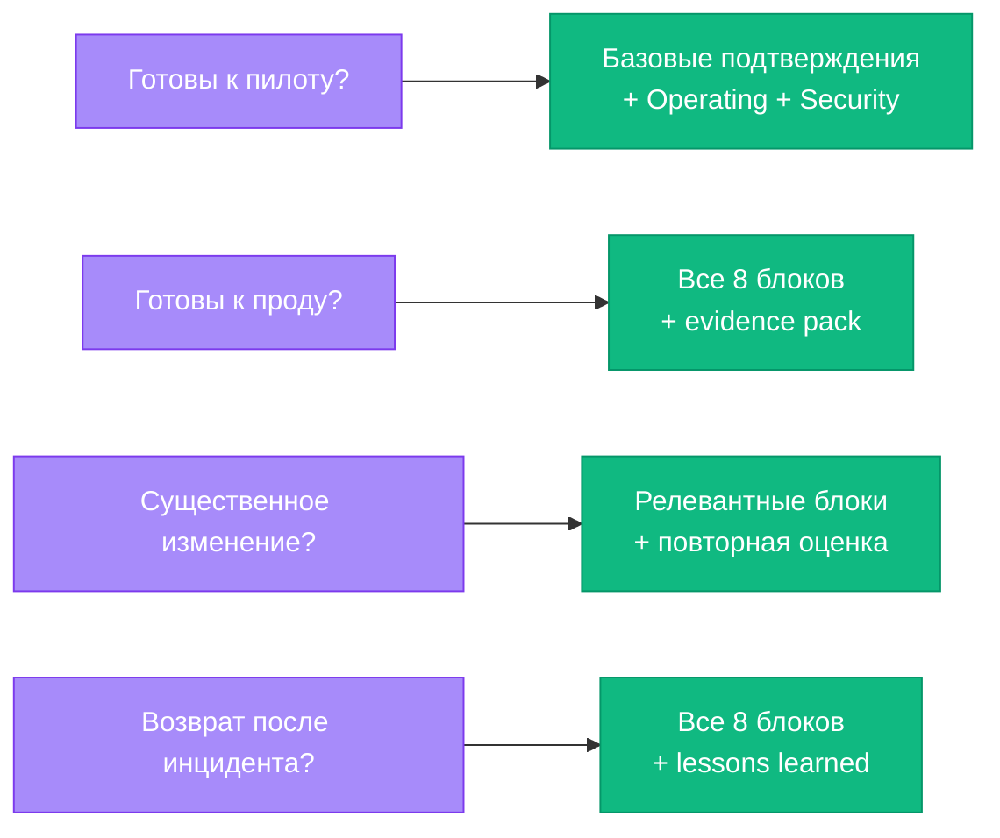

# AI-агенты: чек-лист готовности к проду

> Версия: 1.1 · Обновлено: 2026-11-13 · Теги: AI-агенты, production readiness, чек-лист, evidence pack, согласование · Tier: 1-4
>
> **TL;DR**. Финальный рубеж перед пилотом, промышленной эксплуатацией или повторным согласованием. Восемь блоков подтверждений, девять блокирующих условий. Для применимых требований нужны результаты проверок; неприменимость обосновывается, а неизвестный результат не засчитывается как успешный.

## 1. Когда применять

| Рубеж | Когда |
|---|---|
| **Pilot gate** | Перед запуском пилота с ограниченным кругом пользователей |
| **Production gate** | Перед промышленной эксплуатацией |
| **Material change gate** | Любое существенное изменение из [Operating Overlay §6](32-ai-agents-operating-overlay.md#6-susestvennye-izmenenia-i-triggery-povtornoj-ozenki) |
| **Post-incident gate** | Возврат в Production после Paused / Kill-switch |

## 2. Восемь блоков подтверждений

### 2.1. Реестр и описание сценария

- [ ] Карточка реестра обновлена, заполнены все агентные поля из [Operating Overlay §3](32-ai-agents-operating-overlay.md#3-dopolnenie-k-kartocke-reestra).
- [ ] Класс агента определён и обоснован.
- [ ] Указан владелец агента и владельцы коннекторов.
- [ ] Указаны контакт-точки IR и MLSec.

### 2.2. Инструменты и коннекторы

- [ ] Реестр инструментов с фиксированной областью каждого.
- [ ] Все коннекторы оформлены карточкой ([`agent-connector-card-template.md`](31-ai-agents-overview.md#examples)).
- [ ] Сервисные УЗ имеют минимальный RBAC-потолок.
- [ ] Для write-инструментов проверены идемпотентность или отдельная процедура установления исхода и запрета слепого повтора; согласование не выдаётся за идемпотентность.
- [ ] Quota и rate-limit заданы по каждому инструменту.

Для MCP (если применяется):

- [ ] Зафиксированы версия протокола, transport и проверенный источник сервера.
- [ ] Неверные issuer/audience, истёкший токен и доступ другого tenant отклоняются; token passthrough отсутствует.
- [ ] OAuth-прокси проверяет согласие для конкретного клиента; discovery и redirects не открывают SSRF.
- [ ] Локальный сервер ограничен правами ОС, сетью и доступом к файлам; проверен путь его остановки.
- [ ] Если включён elicitation: secret form и prefetch запрещены, browser handoff скрыт от клиента / LLM; same-user binding, отказ / отмена и replay проверены; для Tasks — также cross-task и закрытые inputs. URL `accept` и task update/cancel ack не выданы за завершённый внешний эффект ([10 §6.4.1](10-llm-agent-protection.md)).
- [ ] Sampling выключен либо сохранён по отдельному допуску: capabilities, model/context disclosure, request-scoped tools и общий budget проверены; MRTR retry не обнуляет лимиты, поздний response после отмены не создаёт новый вызов. Deprecated feature не включается автоматически ([10 §6.7](10-llm-agent-protection.md)).
- [ ] Если используется ACS wrapped MCP: late attach проверен отдельным `resources/read` / prompt-path тестом; inventory event и generic `tools/call` hook не выданы за negotiated wrapper coverage. Положительный контроль — разрешённое чтение в новой согласованной сессии ([09, §3.12](09-threat-modeling.md)).

Основа: [MCP Authorization](https://modelcontextprotocol.io/specification/2026-07-28/basic/authorization) и [Security Best Practices](https://modelcontextprotocol.io/docs/2026-07-28/tutorials/security/security_best_practices). Неприменимые проверки помечайте `N/A` с обоснованием transport, а не как успешно пройденные.

### 2.3. Делегированные полномочия и согласование

- [ ] Запись делегированных полномочий ([`agent-delegated-authority-template.md`](31-ai-agents-overview.md#examples)) активна; срок и отзыв проверяются перед каждым действием, включая выполнение после ожидания согласования.
- [ ] Модель согласования (Auto / Approve / Dual-approve) определена для каждого действия.
- [ ] Записи согласования следуют схеме `agent-approval-record.schema.json`.
- [ ] Подтверждение связывается с конкретным `action_id`.
- [ ] Подмена аргументов, объекта, tenant или identity после подтверждения приводит к отказу; повторное использование и просроченное согласие блокируются.
- [ ] Путь отзыва подтверждений документирован.
- [ ] Два параллельных worker не превращают одно согласованное намерение в две новые логические операции.
- [ ] После ожидания, очереди и resume проверяются актуальные права, policy и связанный внешний исход.

### 2.4. Память

- [ ] Управление памятью оформлено ([`agent-memory-governance-template.md`](31-ai-agents-overview.md#examples)).
- [ ] Назначение, срок хранения, политика удаления зафиксированы.
- [ ] Cross-user общая память отсутствует или утверждена как исключение.
- [ ] Аудит записей в долгосрочную память включён.

### 2.5. Безопасность и защитные проверки

- [ ] Базовый стандарт безопасности AI пройден.
- [ ] Минимальный набор защитных проверок ([`agent-security-evals-minimal.md`](31-ai-agents-overview.md#examples)) пройден:
  - [ ] prompt injection через недоверенный контент;
  - [ ] неправильное использование инструмента;
  - [ ] обход согласования;
  - [ ] отравление памяти;
  - [ ] изоляция коннектора;
  - [ ] регрессионная проверка после изменений.
  - [ ] утечка через разрешённый read-инструмент или URL;
  - [ ] тайм-аут после фактического выполнения write: повтор не дублирует внешний эффект;
  - [ ] смена описания или схемы инструмента не расширяет утверждённые полномочия.
  - [ ] metadata невызванного tool: выбор/action proposal и внешний эффект имеют отдельные oracle; нейтральный каталог сохраняет полезный маршрут ([10, §5.5.1](10-llm-agent-protection.md));
  - [ ] skill install-test: guidance/scripts не меняют controls и не получают egress вне install scope; reviewed пакет устанавливается и выполняет задачу, runtime revision сверена после reload ([10, §5.5.2](10-llm-agent-protection.md));
  - [ ] запрещённая исходная цель и её декомпозиция отклоняются; близкая допустимая цель с теми же tools выполняется ([09, §3.11](09-threat-modeling.md));
  - [ ] поздний trigger после длинной истории/compaction/resume проверен отдельно от раннего запуска; зафиксированы лимит наблюдения и полезный контроль памяти ([10, §8.6](10-llm-agent-protection.md)).

### 2.6. Runtime и мониторинг

- [ ] Состояния runtime реализованы по [Runtime Procedure §1](34-ai-agents-runtime-procedure.md).
- [ ] Сигналы мониторинга собираются в SIEM с задержкой ≤ 5 минут.
- [ ] Алерты Prometheus / SIEM настроены по `prometheus-agent-alerts.yaml` и `siem-agent-queries.txt`.
- [ ] Автоматический переход в Restricted работает по триггерам.
- [ ] Деградация policy/audit и подделанный внешний сигнал не расширяют полномочия; область ограничения и ручной аварийный путь проверены.
- [ ] Дашборд агента доступен on-call.
- [ ] При ACS effective startup/failure postures проверены отдельно для отсутствия решения, malformed response и expired DEFER; выбранный закрытый отказ подтверждён пустым mock sink, восстановление — одним допустимым результатом. `postCompact` проверяет следующий эффект, а не отмену уже созданной summary ([09, §3.12](09-threat-modeling.md)).

### 2.7. Аварийное отключение

- [ ] Kill-switch одной командой реализован.
- [ ] Время kill-switch замерено в согласованных сценариях, включая очереди и внешние jobs; три учебных прогона не выдаются за статистическую гарантию надёжности.
- [ ] Runbook карантина коннектора (`runbook-connector-quarantine.md`) опубликован.
- [ ] Проверены отзыв или ограничение credentials и производных сессий; для общих аккаунтов учтено влияние на другие системы.
- [ ] После отзыва проверен фактический отказ доступа; результаты незавершённых внешних операций сверены отдельно, автоматический откат не предполагается.
- [ ] Recovery manifest раздельно закрепляет model/adapter/skills/registry/policy/memory; сброс памяти не закрывает poisoning модели. На проверенной основе повторены trigger и штатная задача ([35, §4](35-ai-agents-incident-playbook.md)).

### 2.8. Свидетельства и аудит

- [ ] Все события исполнения соответствуют схеме `agent-runtime-events.schema.json`.
- [ ] События попадают в SIEM, retention соответствует политике.
- [ ] Evidence pack ([`agent-evidence-pack-template.md`](31-ai-agents-overview.md#examples)) собран и подписан.
- [ ] План регулярной проверки реестра и evidence pack описан.

Для каждой отметки сохраняйте проверенный release/configuration reference, результат, дату, исполнителя и evidence. Состояния `pass`, `fail`, `inconclusive`, `not_run` и обоснованное `N/A` различаются; это внутренний формат протокола приёмки, а не новые значения `status` в JSON Schema событий runtime. Формальная валидность JSON и заполненный checkbox сами не доказывают прохождение теста.

Повтор после изменения конфигурации использует новый пакет результатов или явно обоснованное переиспользование неизменившегося теста. Не переносите зелёный статус от другой модели, policy, tool schema или корпуса без проверки их влияния. Контракт полноты AI-eval описан в [главе 12](12-detection-protection-cicd-llm.md).

## 3. Блокирующие условия (hard gate)

Релиз **запрещён**, если хотя бы одно условие истинно:

> [!danger]
> Это — финальный фильтр. Если по любому пункту статус **«нет»** — продакшен не открывается, без обсуждений и обхода.

| # | Условие |
|---|---|
| 1 | Нет реестра инструментов с областью действия |
| 2 | Нет записи делегированных полномочий со сроком действия |
| 3 | Нет модели согласования для write-действий |
| 4 | Нет журнала аудита, попадающего в SIEM в течение 5 минут |
| 5 | Нет пути аварийного отключения с замером времени |
| 6 | Нет защитных проверок (минимальный набор) |
| 7 | Нет владельца агента или владельца коннекторов |
| 8 | Нет плана карантина коннектора |
| 9 | Класс D без явно утверждённого исключения |

## 4. Подтверждение

Финальный рубеж проходит подписями:

| Роль | Подпись означает |
|---|---|
| **Владелец агента** | Сценарий описан корректно, документы соответствуют реализации |
| **Владелец платформы** | Платформенные требования выполнены, RBAC потолок корректен |
| **MLSec** | Security overlay применён, защитные проверки пройдены, мониторинг работает |
| **AI Lead** | Класс агента и автономность утверждены, делегированные полномочия зафиксированы |
| **Compliance** | Применимые требования и основания определены, результаты их проверки и оставшиеся ограничения документированы |
| **IR-on-call** | Kill-switch и runbook карантина протестированы |

## 5. Краткая операционная памятка

| Шаг | Кто | Артефакт |
|---|---|---|
| 1. Заполнить чек-лист | Владелец агента | этот документ |
| 2. Собрать evidence pack | Владелец агента | `agent-evidence-pack-template.md` |
| 3. Прогнать защитные проверки | MLSec | `agent-security-evals-minimal.md` |
| 4. Замерить kill-switch | SecOps | `runbook-connector-quarantine.md` |
| 5. Подписи всех ролей | Все | реестр |
| 6. Регистрация в реестре | Владелец агента | реестр |
| 7. Включение в Pilot / Production | Согласно [Runtime Procedure](34-ai-agents-runtime-procedure.md) | runtime |

> [!ok]
> Если все 8 блоков и hard gate зелёные, evidence pack подписан, kill-switch замерен — у релиза высокая степень обоснованности. Это не страховка от инцидента, но это **зафиксированное состояние знания** в момент включения, без которого расследование инцидента становится гаданием.

## 6. Связь с другими документами

- Описание сценария → [Operating Overlay](32-ai-agents-operating-overlay.md).
- Безопасность → [Security Overlay](33-ai-agents-security-overlay.md).
- Запуск, мониторинг, ограниченный режим, kill-switch → [Runtime Procedure](34-ai-agents-runtime-procedure.md).
- Первая реакция на инцидент → [Incident Playbook](35-ai-agents-incident-playbook.md).
- Обзор ветки → [Overview](31-ai-agents-overview.md).
