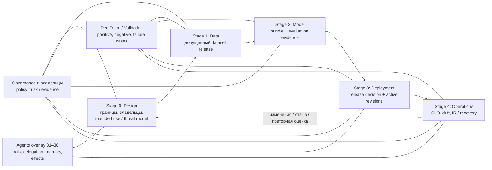
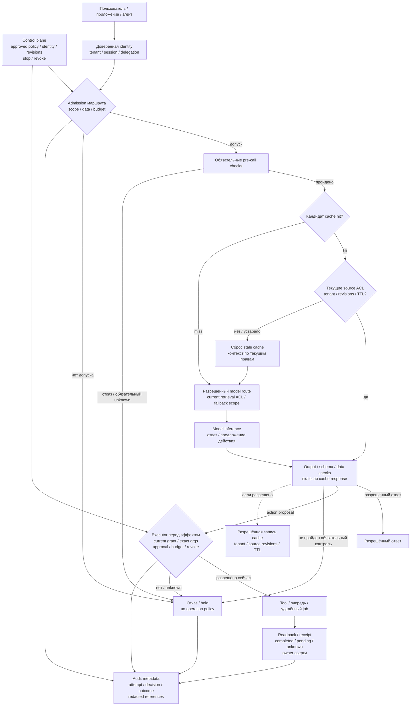
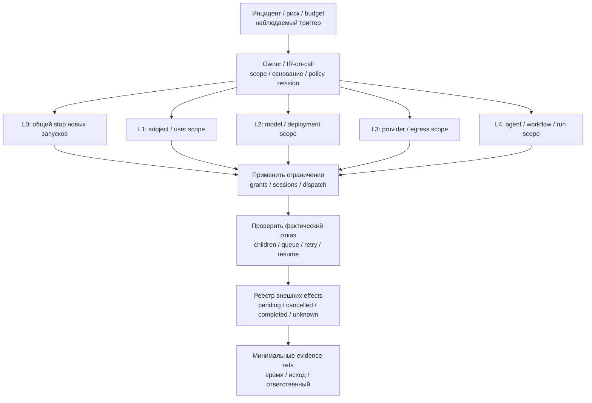
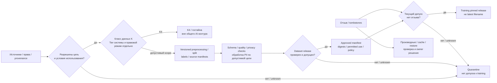
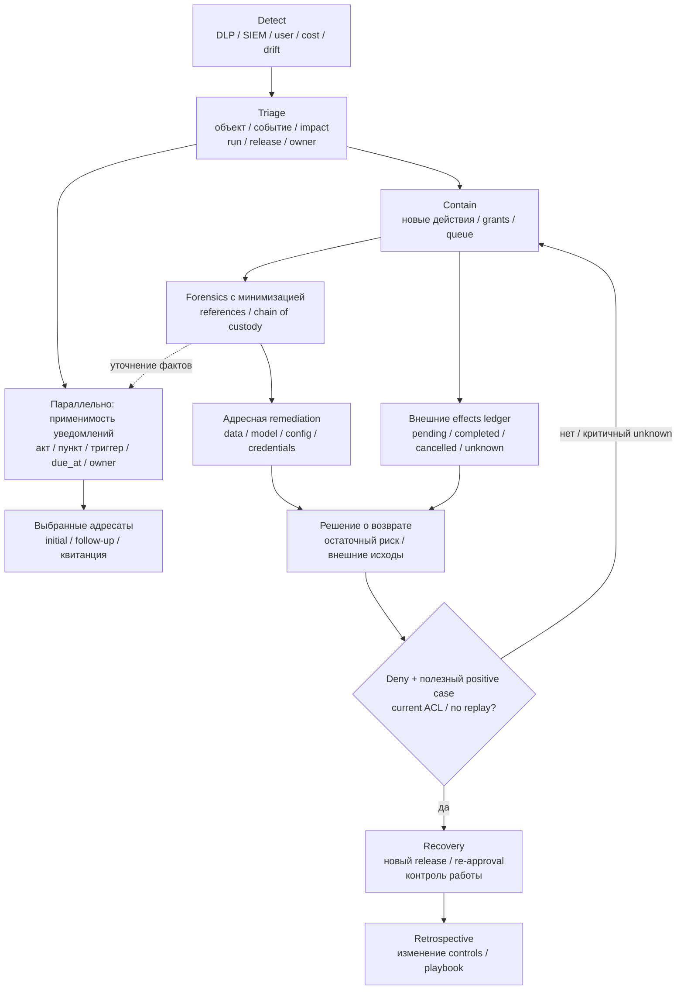
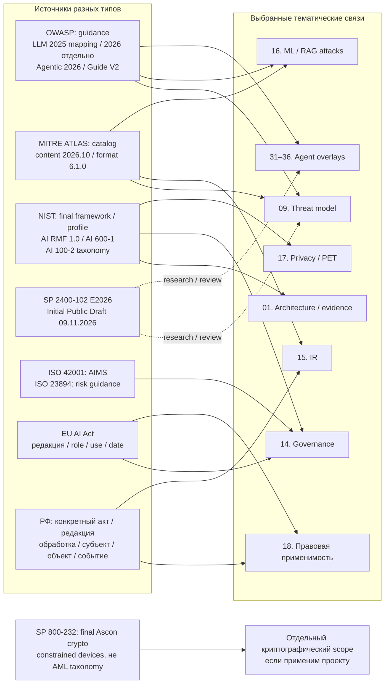
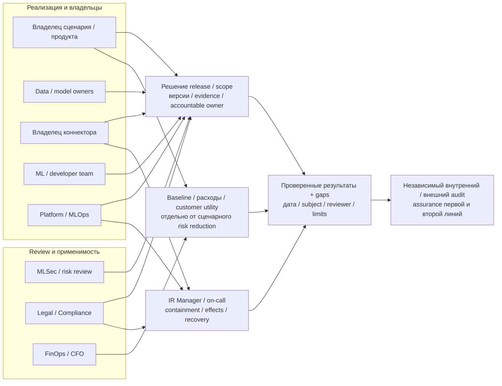

# Архитектурные диаграммы MLSec

Сводка архитектурных схем в Mermaid для review, онбординга и пояснений. Редакция 13.11.2026. Схемы описывают контракты и предлагаемые границы контроля; они не подтверждают, что конкретный deployment реализован или проверен.

## 1. MLSec Lifecycle (5 этапов)

Пять проектных Stage 0–4 соответствуют главам 02–06. Это другая ось, чем пять функциональных блоков главы 01: Data → Model → Red Team/Validation → Deployment → Operations. Design задаёт границы, а validation/red teaming проверяет несколько этапов. Номер Stage не подставляется вместо номера блока. Source/configured, verified, released, running и operated подтверждаются разным evidence.

Подробнее: [01. Обзор и архитектура](01-overview-architecture.md).

## 2. Целевая архитектура с LLM Gateway

Схема выбранного защищённого маршрута, а не утверждение о перехвате всех запросов. Отдельно проверяются direct API, batch, tools, fallback и очереди. Identity/route admission не заменяет action authorization: consequential action с неизвестным обязательным разрешением не исполняется. Для остальных операций допустимый режим при отказе задаёт конкретная operation policy, а не cloud/on-prem.

Подробнее: [01 §3.4–3.6](01-overview-architecture.md), [12. Контроли](12-detection-protection-cicd-llm.md), [33. Action boundary](33-ai-agents-security-overlay.md).

## 3. 6-слойный DLP

Шесть сигналов — пример, не обязательный продуктовый стек или процент защищённости. Зависимые extraction/normalization выполняются до fan-out; async не гарантирует CPU-параллелизм. Общий parser/model/timeout создаёт коррелированные gaps. Обязательный контроль данных и admission consequential action не считается пройденным при unknown; ограниченное чтение допускается только по заранее утверждённой policy. Повторная проверка masked payload имеет лимит попыток / бюджета; незавершённая проверка не становится ALLOW. Output и executor проверяются отдельно от pre-call DLP.

```mermaid
flowchart LR
    INPUT["Запрос / документы / attachments"]
    PREP["Обязательное извлечение<br/>и нормализация"]
    subgraph SCAN[Пример параллелизуемых сигналов]
        L0["L0: Injection patterns"]
        L1["L1: Secrets / formats"]
        L2["L2: PII / NER"]
        L3["L3: Text classifiers"]
        L4["L4: Corporate patterns"]
        L5["L5: Semantic signals"]
    end
    COLLECT["Сбор вердиктов<br/>полнота / deadline / policy"]
    COMPLETE{"Есть обязательное<br/>evidence операции?"}
    FAIL["Unknown / error / timeout<br/>consequential action: deny / hold<br/>чтение: утверждённая policy"]
    POLICY{"Policy decision"}
    DENY["BLOCK / отказ"]
    MASK["MASK<br/>пересборка + повторная проверка"]
    OUT["Разрешённый route<br/>не разрешение tool action"]
    INPUT --> PREP
    PREP --> L0 & L1 & L2 & L3 & L4 & L5
    L0 & L1 & L2 & L3 & L4 & L5 --> COLLECT --> COMPLETE
    COMPLETE -- "нет" --> FAIL
    COMPLETE -- "да" --> POLICY
    POLICY -- "BLOCK" --> DENY
    POLICY -- "MASK" --> MASK --> PREP
    POLICY -- "ALLOW" --> OUT
```

Подробнее: [12 §3.1](12-detection-protection-cicd-llm.md), [01. Gateway](01-overview-architecture.md).

## 4. Kill-switch 5 уровней

L0–L4 обозначают области воздействия, не вложенную иерархию: user/model/provider/agent scopes пересекаются. Владелец выбирает одну или несколько областей по ситуации; не каждый alert вызывает общий stop. Код HTTP, флаг в Redis или stopped не доказывает прекращение эффекта. Проверяется отказ на фактическом пути; уже принятый внешний job требует readback / поддерживаемой отмены и сверки, а не слепого retry.

Подробнее: [34. Runtime / revoke](34-ai-agents-runtime-procedure.md), [35. Инциденты](35-ai-agents-incident-playbook.md), [15. Реестр последствий](15-ai-incident-response.md).

## 5. Data pipeline security

Схема допуска конкретного выпуска данных. K0–K4 — внутренняя чувствительность, Tier — критичность; УЗ ИСПДн и категория КИИ определяются отдельно. K4/гостайна вне общего AI-контура. Clean PII scan, маскирование, checksum и подпись по отдельности не доказывают анонимность или разрешение обучения. Labels / preprocessing могут изменить свойства данных и требуют проверки.

Подробнее: [03. Data Operations](03-stage1-data-operations.md).

## 6. AI Incident Response flow

Сдерживание, сбор доказательств и квалификация уведомлений идут параллельно: активная утечка и часы уведомления не ждут полного RCA / recovery. Адресат и срок выбираются по событию, объекту и актуальному пункту акта; уведомление субъектов не является автоматической заменой сообщения РКН. Retraining — только обоснованная remediation; rollback не отменяет внешний платёж, отправку или экспорт.

Подробнее: [15. AI Incident Response](15-ai-incident-response.md), [18. Применимость и уведомления](18-ru-compliance-deep.md), [35. Re-approval](35-ai-agents-incident-playbook.md).

## 7. Карта стандартов и глав

Выбранные тематические связи, не crosswalk полного соответствия. Статус и версия источника сохраняются в evidence: OWASP 2025 IDs не переименовываются автоматически в 2026; ATLAS content и data-format различаются; IPD — draft, не замена final RMF. ISO 42001 относится к AIMS, а не к сертификации каждого model output. Законы применяются по конкретному scope.

Источники и версии: [31](31-ai-agents-overview.md), [матрицы](compliance-matrices/README.md). [NIST SP 800-232](https://csrc.nist.gov/pubs/sp/800/232/final) — final 13.08.2025, Ascon AEAD/hash/XOF для constrained devices; выделен отдельно. Проверено 13.11.2026.

## 8. Роли и доступ к процессам

Стрелки показывают участие и evidence handoff, не ACL и не готовую RACI для любой организации. Для каждого решения назначаются accountable owner и исполнители; независимый review отделяется от реализации. Release approval не заменяет актуальные права отдельного action. Одностраничники: [role-cheatsheets/](role-cheatsheets/); агентные подписи и полномочия — [36](36-ai-agents-production-checklist.md).

---

## Как использовать диаграммы

1. В презентациях для правления: диаграммы 1, 2, 4 и 6 - покрывают governance, архитектуру, kill-switch и IR.
2. В онбординге новых сотрудников службы ИБ: диаграммы 2, 3 и 5 - защитный контур и data pipeline.
3. В пояснительных записках: диаграммы 2, 3, 4 — выбранные границы контроля. Их дополняют применимым требованием, конкретным subject/policy revision, тестами и evidence; схема не является аттестацией или подтверждением соответствия.
4. В архитектурных review: диаграммы 1, 2 - lifecycle и целевая архитектура.

## Проверка и локальное использование

Версию Mermaid закрепляют в проекте. Grammar parse, визуальная компоновка и работающий enforcement проверяются отдельно: успешный parser не доказывает layout, полноту аудита или отсутствие внешнего эффекта. Для приёмки каждой схемы выбирают разрешённый positive case, запрещённый / unknown case и отказ обязательного контроля, затем сопоставляют observable outcome с policy.

Экспорт изображений или PDF выполняется отдельным локальным шагом после review содержания и renderer; эта редакция не содержит проверенного универсального export recipe.
