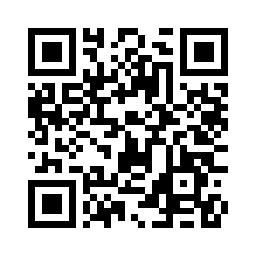

# Поддержать MLSec

MLSec — бесплатный справочник по безопасности ML и AI-систем. Главы, практические материалы и дальнейшие обновления доступны без оплаты. На [milksec.com](https://milksec.com) для полного чтения нужен бесплатный аккаунт; материалы этого репозитория открыты без регистрации.

Проект развивается на добровольные донаты. Поддержка помогает обновлять главы, проверять примеры, поддерживать сайт и граф содержимого. Донат не создаёт подписку, не открывает отдельные главы и не даёт приоритетного обслуживания.

## Криптодонаты

| Реквизит | Значение |
|---|---|
| Актив | **USDT (Tether USD₮)** |
| Сеть | **TRON (TRC20)** |
| Адрес получателя | `TP1uwWwfRq3xQZNVh9x8YYsEinN71qJWkd` |
| Сумма | На ваше усмотрение |

QR-код содержит только адрес получателя. При переводе выберите **USDT и сеть TRON (TRC20)**. ERC20, BEP20 и другие сети для этих реквизитов не указаны.

[Проверить адрес в TRONSCAN](https://tronscan.org/#/address/TP1uwWwfRq3xQZNVh9x8YYsEinN71qJWkd).

Размер комиссии не фиксирован и зависит от ресурсов перевода в TRON. Проверьте её в кошельке перед отправкой; сетевой сбор не является донатом проекту. Официальные справочные страницы: [USDT в поддерживаемых сетях](https://tether.to/en/supported-protocols/) и [ресурсы TRON](https://developers.tron.network/docs/bandwidth-and-energy).

## Можно помочь без перевода

- Исправить неточность или неработающую ссылку через [Issues](https://github.com/Lercas/MLSec-Docs/issues).
- Прислать Pull Request с обновлением материала или практического примера.
- Проверить пример в своей среде и описать версии, условия и результат.
- Поделиться справочником с коллегами.

Спасибо за поддержку. Возможность пользоваться материалами не зависит от донатов.
