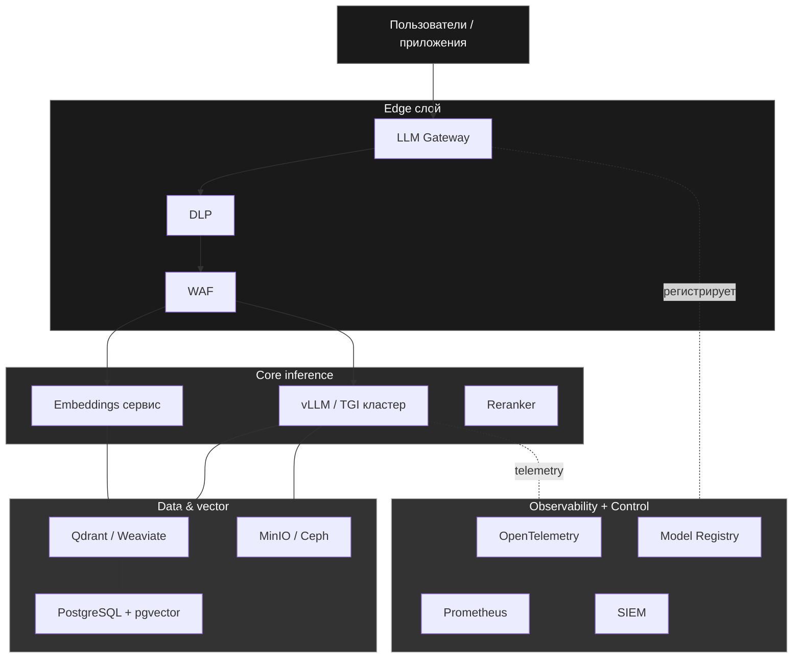

# Миграция AI/ML стека cloud → on-prem

> **Версия**: 1.1 · **Дата**: 2026-05-29 · **Audience**: CTO, ML Lead, SecOps, Compliance · **Срок реализации**: 4-6 месяцев · **Уровень зрелости**: требует MLSec 2.0+

Руководство для компаний, которые переезжают с managed cloud LLM (OpenAI, Anthropic, Azure OpenAI, Bedrock) или managed ML-платформ (SageMaker, Vertex AI, Databricks) на on-prem / private cloud инфраструктуру. Причины: регуляторика (152-ФЗ локализация, EU AI Act, банковские требования), data sovereignty, контроль затрат, IP-защита.

## 1. Когда мигрировать (decision matrix)

Условия для оценки миграции приведены ниже. Решение принимает владелец сценария по требованиям к данным, измерениям качества / capacity и полной стоимости; правило «любые два пункта» не заменяет эту оценку.

1. Для конкретной обработки данных определены требования к размещению и передаче. Внутренний класс К3+ сам по себе не устанавливает требования закона; локализация не тождественна on-prem (см. [главу 18](../18-ru-compliance-deep.md)).
2. Регулятор (ЦБ, ФСТЭК, отраслевой) явно указал на локальное хранение.
3. Замеры устойчивой нагрузки и TCO показывают преимущество собственной инфраструктуры с учётом резервирования, персонала, лицензий и обновлений.
4. Критично сохранение IP (корпоративные данные, проприетарные промпты, fine-tuning на чувствительных данных).
5. Требования к uptime / latency не устраивают SLA managed провайдеров.

Не мигрировать, если:
- Экономия не подтверждена расчётом для фактической нагрузки; число токенов само по себе не определяет break-even.
- Нет команды с MLOps + GPU-инфраструктурным опытом.
- Нет зрелости безопасности (maturity < 2.0) в текущих on-prem процессах.

## 2. Целевая архитектура (reference)

Ключевые элементы:

- **Inference layer**: vLLM (для Llama-совместимых), TGI (HF), Triton (для TensorRT). На топологии A100-80G или H100, 2-8 GPU на сервер, 2-8 серверов в pool.
- **Gateway**: Rilio / LiteLLM / Kong AI Gateway / собственный на FastAPI: single entry point, DLP, audit, rate-limit.
- **Vector DB**: Qdrant / Weaviate / Milvus self-hosted, шардирование по tenant.
- **Object storage**: MinIO / Ceph с bucket versioning, lifecycle policies.
- **Orchestration**: Kubernetes + KServe / Ray Serve, node taints для GPU.

## 3. Выбор моделей

Исторические кандидаты из редакции 2026-05, а не актуальный рейтинг или готовый production-допуск. До выбора проверьте точную revision, model card, лицензию весов / кода / adapters, поддерживаемые runtime и собственные safety / utility evals. GPU ниже — предварительные ориентиры, не гарантия размещения: нужны precision, context length, KV cache, concurrency и измерения конкретного runtime.

| Класс | Кандидаты | GPU | Use case |
|---|---|---|---|
| Общий LLM 7-8B | Llama 3.1 8B, Qwen 2.5 7B, Mistral 7B v0.3 | 1× A100 40G | Chat, summary |
| Общий LLM 70B+ | Llama 3.1 70B, Qwen 2.5 72B | Измерить для выбранной precision и нагрузки | Сложные задачи |
| Instruct / code | DeepSeek-Coder 33B, Qwen2.5-Coder 32B | 2× A100 80G | Код-ассистент |
| Embeddings | BGE-M3, e5-mistral | 1× A10 | RAG, поиск |
| Rerank | BGE-reranker-v2 | 1× A10 | RAG |
| Speech | Whisper Large v3, Salmonn | 1× A10 | ASR / voice |
| Vision | LLaVA-Next, InternVL 2 | 2× A100 | OCR, image QA |

Практические соображения:
- Название семейства не определяет единую лицензию всех размеров / revisions. Юрист фиксирует права на использование, модификацию, распространение и производные версии в карточке конкретного артефакта.
- Стоимость LoRA зависит от объёма данных, длины последовательности, optimizer, precision и топологии; её оценивают отдельным benchmark, без универсального обещания часов на 70B.

## 4. Поэтапный план (6 месяцев)

### Месяц 1: Подготовка

**Действия**:
- Inventory: все cloud AI endpoint-ы, volumes, latency, cost, data-sensitivity.
- Декомпозиция use cases: которые критичны (К3+) и должны уехать, которые остаются в cloud (публичные, low-risk).
- Закупка GPU: получить актуальные предложения и проверить совместимость accelerators, drivers, interconnect и runtime; сроки поставки подтверждает закупка.
- Найм: MLSec Lead (если ещё нет), MLOps Platform Engineer, Security DevOps.

**Deliverable**: Inventory-таблица + закупочный план + команда.

### Месяц 2: Инфраструктура

**Действия**:
- Развернуть Kubernetes cluster с GPU-node pools (NVIDIA GPU Operator или AMD GPU Operator).
- Установить KServe / Ray Serve.
- Развернуть MinIO и Qdrant.
- Настроить Vault, SOPS, CA.
- Network zones: management / ML / DMZ.

**Deliverable**: Работающий baseline: небольшой 7B model отдаёт inference по internal API.

### Месяц 3: Gateway и DLP

**Действия**:
- Развернуть LLM gateway (Rilio / LiteLLM / собственный).
- Подключить DLP (Presidio + custom rules для корпоративных данных) и injection-сканер.
- Внедрить audit log с IDs, версиями, решениями policy и результатами; хранение содержимого prompts / responses включать адресно по политике данных.
- Начать shadow mode на разрешённых данных: только один исполнитель внешних действий; mirror не может отправлять сообщения, проводить платежи или создавать jobs. Новое место обработки и telemetry должны быть допущены владельцем данных.

**Deliverable**: Gateway покрывает 100% запросов в shadow mode; metrics dashboard работает.

### Месяц 4: Миграция use case 1 (низкий риск)

**Действия**:
- Выбрать наименее критичный use case (internal RAG по wiki, non-customer-facing).
- Переключить production traffic с cloud на on-prem (canary 10% → 50% → 100% за 2 недели).
- Измерить: latency p50/p95/p99, quality (метрики задачи), error rate.
- Настроить алерты и rollback.

**Deliverable**: Первый use case в production on-prem с baseline metrics.

### Месяц 5: Миграция критичных use cases

**Действия**:
- Использовать опыт месяца 4.
- Переключить customer-facing, но с read-only режимом (chatbot, support, не автономные действия).
- Параллельно: fine-tuning под домен (LoRA на корпоративных документах).
- Red team первый раунд (см. [red-team-exercises.md](red-team-exercises.md)).

**Deliverable**: 60-80% трафика уже on-prem; cloud только для специфичных моделей.

### Месяц 6: Завершение и полный cutover

**Действия**:
- Миграция оставшихся use cases.
- Закрыть cloud endpoints для переносимых сценариев, отозвать credentials / grants и остановить schedules; подтвердить фактический отказ старого маршрута. Kill-switch не заменяет деактивацию внешнего ресурса.
- Документация: runbook-и, incident playbook-и, on-call ротация.
- Compliance: DPIA, AI-BOM, сертификация при необходимости.

**Deliverable**: согласованные критичные use cases on-prem; cloud DR допускается только отдельным решением для разрешённых данных / получателя, без молчаливого возврата после cutover.

## 5. Операционные аспекты

### Capacity planning

Формула: `GPU_count = peak_qps × avg_tokens_per_request / throughput_per_gpu × safety_factor`.

Учебный арифметический пример: **условно измерено** 320 output tokens/sec на сервер при целевом SLO и профиле запросов. Это не benchmark 70B / A100; decode throughput не равен prefill throughput, а throughput нельзя получать простым умножением скорости одиночного потока на concurrency.

Расчёт на 5 млн токенов в час peak:
- `5e6 / 3600 ≈ 1400 tokens/sec` peak
- `1400 / 320 ≈ 4.4 → 5 серверов` до резервирования.
- Для условной конфигурации по 4 GPU на сервер и safety 1.3× округление идёт до 6 серверов / 24 GPU, а не до произвольного числа GPU. Отдельно добавляются N+1 / zone failure и dev/staging по выбранному SLO.

### Cost comparison (учебные предположения)

Числа ниже не являются проверенными ценами рынка РФ 2026 года или коммерческим предложением. Замените их предложениями поставщиков и собственными замерами; peak tokens/hour недостаточно для расчёта месячного счёта без duty cycle и раздельных input / output / cached тарифов.

| Параметр | Cloud (OpenAI/Anthropic на equiv) | On-prem |
|---|---|---|
| CAPEX | 0 | 150-300 млн руб (GPU + сеть + ДЦ-слот) |
| OPEX / мес | 3-8 млн руб при 5M tokens / ч peak | 1-2 млн руб (электричество, лицензии, команда) |
| Break-even | | 18-36 мес при устойчивом объёме |
| Latency | 200-800мс | 80-300мс (не уходит в интернет) |
| Compliance | Зависит от обработки, договора и контролей | Требует собственной проверки; размещение не доказывает соответствие |

### Мониторинг

- GPU utilization, memory, temperature (nvidia-dcgm-exporter).
- Per-model tokens/sec, TTFT (time-to-first-token), p95 latency.
- DLP hit-rate, block-rate, false-positive rate.
- Error budget: деградация / очередь / отказ по утверждённой политике. Автоматический cloud fallback запрещён для сценария, где этот получатель или передача не допущены; авария не расширяет scope данных.

### Incident response

- Падение GPU → автоматический drain node, trigger capacity-extend alert.
- Deep quality drop → ограничение сценария и проверка ранее допущенного rollback bundle; старые ACL / tombstones и отозванные grants не восстанавливаются вместе с моделью.
- DLP-событие Critical → quarantine + уведомление + runbook.

Все runbook-и в [playbooks/](../playbooks/).

### Cutover manifest и приёмка границ

Platform owner составляет manifest: model / tokenizer / adapter / runtime digests, prompt / policy revisions, embedding model и параметры обработки, corpus revision, текущие ACL / tombstones, connector schema, credentials / issuer, schedules и внешние jobs. Подпись подтверждает конкретного producer и целостность; она не делает неизвестную модель безопасной для загрузки. Правила checkpoint и GPU isolation — в [главе 19](../19-training-infrastructure.md).

При смене embedding model старые vectors не объявляют совместимыми по совпадению dimension: создайте отдельный индекс, проверьте retrieval и разрешения, учтите изменения / удаления за окно миграции. Перед promotion владелец данных подписывает текущие ACL и tombstones; исходная backup revision не возвращает отозванный доступ.

| Проверка в migration staging | Ожидаемый результат | Owner / evidence |
|---|---|---|
| Mirror получает agent write-task | Только основной исполнитель создаёт тестовый объект, mirror не имеет такого доступа | Integration owner: audit обоих маршрутов + sink readback |
| В cloud завершён timeout job перед cutover | Результат установлен у получателя или записан `unknown`; повтор в on-prem не запускается автоматически | IR / integration owner: action ID → external job ID |
| Отзыв ACL / удаление документа во время reindex | Изменение дошло в новый индекс, cache и memory; старый пользователь получает отказ | Data / RAG owner: negative test и разрешённый control case |
| On-prem недоступен для запрещённых к передаче данных | Нет обращения в cloud, включая fallback / grading / telemetry | Network owner: egress evidence и проверка отказа |
| Старый cloud token / schedule после cutover | Прежний доступ не работает; schedules выключены, jobs сверены | IAM / platform owner: issuer readback и inventory |

Rollback допускается только в разрешённый контур; он не отменяет выполненные внешние действия. Вывод cloud из эксплуатации выполняется по [главе 21](../21-people-process.md): данные, provider backups / retention, checkpoints, secrets и замена получают отдельных owners. Запрос удаления не равен подтверждённой sanitization; автоматического destructive cleanup нет.

Тематическая сверка **13.11.2026**: [NIST SP 800-88 Rev. 2](https://csrc.nist.gov/pubs/sp/800/88/r2/final), [PyTorch security policy](https://github.com/pytorch/pytorch/security/policy), [Promptfoo Data Handling](https://www.promptfoo.dev/docs/red-team/troubleshooting/data-handling/). Внешние generation / grading пути проверяются даже при локальном CLI.

## 6. Риски миграции и митигация

| Риск | Митигация |
|---|---|
| GPU поставки задерживаются | Сделать заказ заранее (4-6 мес), иметь 2 вендоров |
| Качество ниже cloud flagship | Gold set + A/B с пользователями, fine-tune, RAG |
| Команда не справляется | Внешний консалтинг на первые 3 мес, training |
| Compliance гэпы на старте | Параллельно: DPO обновляет DPIA, compliance маппинг |
| Shadow IT уходит обратно в cloud | DLP + корпоративная политика + alternatives доступны |

## 7. Чеклист перед go-live

- [ ] Все модели подписаны cosign + проверяются в runtime
- [ ] SBOM / ML-BOM регулярно публикуются
- [ ] DLP на входе и выходе работает
- [ ] Audit log включён, состав / retention / legal hold утверждены по назначению и применимым требованиям
- [ ] Kill-switch L0/L3 оттестирован
- [ ] Бекап vector DB раз в сутки, restore drill пройден
- [ ] Red team первый раунд завершён без Critical
- [ ] Compliance: DPIA, AI-BOM готовы, DPO acknowledged
- [ ] On-call rotation установлена, pager настроен
- [ ] DR проверен в допущенном контуре; cloud fallback не обходит запрет передачи и не активируется одним общим флагом

## 8. Связи

- [05-stage3-model-deployment.md](../05-stage3-model-deployment.md) Deployment глава.
- [19-training-infrastructure.md](../19-training-infrastructure.md) training GPU-кластеры.
- [22-finops-ai.md](../22-finops-ai.md) FinOps для сравнения cloud vs on-prem.
- [13-implementation-ru-playbook.md](../13-implementation-ru-playbook.md) РФ specifics.
- [executive/roi-calculator.xlsx](../executive/roi-calculator.md) ROI-модель (можно расширить на migration).
