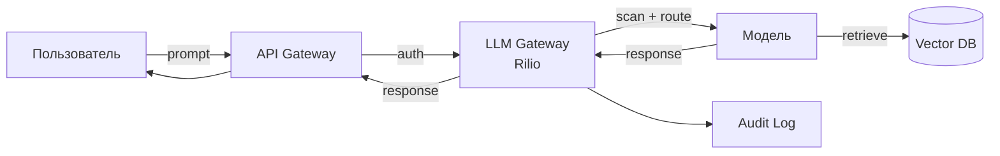

# Threat Model: {НАЗВАНИЕ ИИ-СИСТЕМЫ}

> Шаблон для проведения Threat Modeling по STRIDE-AI на этапе System Design. Заполняется ML-командой совместно со службой ИБ. См. главу [09. Threat Modeling](../09-threat-modeling.md).

## 0. Метаданные

| Поле | Значение |
|------|----------|
| Название системы | {например, Customer Support Chatbot} |
| Владелец (business owner) | {ФИО, роль} |
| Технический владелец (ML Lead) | {ФИО} |
| Security partner | {ФИО из ИБ} |
| Tier критичности | {1 / 2 / 3 / 4} |
| Класс данных | {K0 / K1 / K2 / K3 / K4} |
| Версия TM | 1.0 |
| Дата | YYYY-MM-DD |
| Пересмотр | через 6 месяцев или при изменении архитектуры |

## 1. Контекст и назначение

Опишите в 3-5 предложениях: кто пользователи, какую задачу решает система, какие данные обрабатывает, с какими системами интегрируется.

## 2. Data Flow Diagram (DFD)

Используйте нотацию DFD: внешние сущности (квадраты), процессы (круги), хранилища (параллелепипеды), потоки данных (стрелки с описанием), границы доверия (пунктирные линии).

Границы доверия: {перечислите, какие участки DFD пересекают границу доверия}.

## 3. STRIDE-AI анализ

Для каждого элемента DFD (процесс, хранилище, поток) проверьте применимые категории STRIDE-AI. Ниже синтетические примеры: статусы «Принято»/«Реализуется» не являются фактом принятия риска в вашей системе. До проверки и sign-off замените их на `pending`.

| # | Актив / поток | Категория | Угроза | Impact | Вероятность | Риск | Контрмера | Статус |
|---|---------------|-----------|--------|--------|-------------|------|-----------|--------|
| 1 | User → API | Spoofing | Подмена личности пользователя | High | Med | H | MFA, OIDC, mTLS | Принято |
| 2 | Prompt поток | Tampering | Prompt injection | High | High | H | Input validation, injection scanner, system prompt isolation | Реализуется |
| 3 | Model | Repudiation | Отрицание, что модель выдала ответ | Med | Low | M | Audit log с hash ответа, подпись | Принято |
| 4 | Response | Information Disclosure | Утечка ПДн через ответ | High | Med | H | DLP post-call, Anti-EchoLeak | Реализуется |
| 5 | API Gateway | Denial of Service | Token flood, огромные промпты | Med | High | H | Rate limit, max tokens, budget guard | Принято |
| 6 | Permissions | Elevation of Privilege | Получение доступа к admin-функциям через LLM | High | Low | M | Model ACL, function calling allowlist | Принято |
| 7 | Training data | **Data Poisoning (AI)** | Вредоносные данные в обучающем наборе | High | Med | H | Data validation, Presidio, source provenance, signing | Реализуется |
| 8 | Model | **Model Evasion (AI)** | Adversarial examples обходят классификатор | High | Med | H | Adversarial training, ART / TextAttack в CI | Реализуется |
| 9 | Model API | **Model Extraction (AI)** | Систематические запросы для кражи модели | Med | Med | M | Rate limit, query anomaly detection, watermarking | Принято |
| 10 | Training data | **Membership Inference (AI)** | Определение присутствия записи в train | Med | Low | M | Минимизация, access control, privacy tests; при DP — unit, ε/δ, accountant и композиция | Проектируется |
| 11 | RAG corpus | **Corpus Poisoning (AI)** | Внедрение вредоносных документов в коллекцию | High | Med | H | Source signing, review before ingest, periodic audit | Реализуется |
| 12 | LoRA adapter | **Supply Chain (AI)** | Заражённый адаптер из непроверенного источника | High | Low | M | Adapter allowlist, ModelScan / picklescan, cosign | Принято |

Добавьте строки для всех применимых пар (элемент × категория).

### 3.1. Проверяемая гипотеза вместо списка угроз

Для значимых путей достаточно одной строки `hypothesis_id → boundary → precondition → attempt → prohibited effect → oracle → evidence`. Свяжите её с `scenario_id` и точными bundle/corpus/policy revisions. Oracle — способ увидеть эффект в целевой системе, не оценка убедительности ответа модели.

| Синтетическая гипотеза | Предусловие / попытка | Запрещённый эффект и oracle | Отрицательная / легитимная проверка |
|------------------------|----------------------|-----------------------------|------------------------------------|
| H01: RAG меняет полномочия агента | Документ tenant A содержит инструкцию прочитать tenant B | Чужие chunks/поля попали в context/egress; проверяем retrieval audit и mock sink | Чтение разрешённого FAQ A работает; отказ не ломает весь поиск |
| H02: approval переносится на новое действие | Пользователь подтвердил адресата A; retry меняет его на B | Письмо B отправлено; oracle — outbox/mailbox и action digest | Исходное письмо A отправляется ровно один раз |
| H03: setup получает publish-identity | Недоверенный PR изменяет repository instructions/hook | Секрет или publish API вызван из setup; oracle — mock credentials/egress/CI audit | Обычная сборка без publish-прав проходит |
| H04: timeout скрывает исполнение | Callback задержан; клиент повторяет задачу | Двойная запись/платёж или новые расходы после cancel; oracle — readback, job registry, usage ledger | Повтор с тем же idempotency key не создаёт второй эффект |

`pass` допустим только при доступном oracle и ожидаемом отрицательном результате. Отсутствие логов, timeout или недоступный внешний readback — `inconclusive`, а не отсутствие эффекта. В evidence храните минимальные IDs/digests и редактированные traces; не копируйте ПДн/секреты в threat model. Укажите owner гипотезы и срок повторной проверки. Для неприменимой ветви — `N/A + причина`.

Актуальный ориентир lifecycle/identity/runtime/assurance — [OWASP Securing Agentic Applications V2](https://genai.owasp.org/resource/securing-agentic-applications-v2/), опубликован 10.11.2026, проверен 13.11.2026. Формат гипотез выше — инженерная форма этого шаблона, не обязательная схема OWASP и не сертификат покрытия всех угроз.

## 4. Маппинг на OWASP LLM Top 10 (2025)

Эта таблица закрепляет редакцию **2025**, а не автоматически «последнюю». Для новой оценки укажите название/редакцию источника и дату проверки в метаданных; агентские угрозы дополните по [33](../33-ai-agents-security-overlay.md). Перенос ID между редакциями без проверки меняет смысл mapping.

| OWASP LLM ID | Угроза | Применимо? | Где адресовано |
|--------------|--------|------------|----------------|
| LLM01 | Prompt Injection | Да / Нет | п. 3, строка {номер} |
| LLM02 | Sensitive Information Disclosure | | |
| LLM03 | Supply Chain | | |
| LLM04 | Data and Model Poisoning | | |
| LLM05 | Improper Output Handling | | |
| LLM06 | Excessive Agency | | |
| LLM07 | System Prompt Leakage | | |
| LLM08 | Vector and Embedding Weaknesses | | |
| LLM09 | Misinformation | | |
| LLM10 | Unbounded Consumption | | |

## 5. Маппинг на MITRE ATLAS

Источник для примеров: [MITRE ATLAS v2026.10](https://github.com/mitre-atlas/atlas-data/releases/tag/v2026.10), проверен 13.11.2026; версия контента `2026.10`, формат данных `6.1.0`. Это выборка для заполнения, не полное покрытие матрицы. В метаданных оценки закрепите фактически использованный snapshot; для каждой применимой строки укажите `hypothesis_id`, предусловие, шаг цепочки, oracle и `evidence_ref` из §3.1. Для неприменимой строки укажите причину.

| ATLAS Technique | Применимо? | Где адресовано |
|-----------------|------------|----------------|
| AML.T0043 Craft Adversarial Data | | |
| AML.T0051 LLM Prompt Injection | | |
| AML.T0085.002 Conversation Context and Memory | | |
| AML.T0085.003 System Instructions | | |
| AML.T0137.003 Extract Memorized Data | | |
| AML.T0070 RAG Poisoning | | |
| AML.T0080 AI Agent Context Poisoning | | |
| AML.T0081 Modify AI Agent Configuration | | |
| AML.T0024 Exfiltration via AI Inference API | | |
| AML.T0086 Exfiltration via AI Agent Tool Invocation | | |
| ... | | |

Разделяйте источник и канал утечки. Conversation Context and Memory относится к текущим / сохранённым взаимодействиям и памяти сервиса; System Instructions — к непубличным инструкциям; Extract Memorized Data — к сохранённому моделью содержимому train / fine-tuning. Старая категория LLM Data Leakage перенесена в Conversation Context and Memory и не заменяет все эти случаи. Вывод через inference API и отправка через инструмент агента — разные каналы: выбирайте их по фактическому потоку DFD и свидетельствам, а не по слову «утечка».

Prompt injection не доказывает poisoning памяти / конфигурации: проверьте, возникло ли устойчивое изменение, где оно хранится и при каких повторных вызовах действует. В mapping отделяйте гипотезу от наблюдавшейся техники; наличие контрмеры в §6 не означает подтверждённую эффективность. Подробности и правила миграции ID — в [главе 23](../23-mitre-atlas-ru.md).

## 6. Контрмеры и план внедрения

| ID | Контрмера | Ответственный | Срок | Статус | Проверка эффективности |
|----|-----------|---------------|------|--------|------------------------|
| C01 | Включить DLP в LLM Gateway | {ФИО, ИБ} | YYYY-MM-DD | Done | Red team тест с ИНН / СНИЛС, ожидаемый результат: блок |
| C02 | Настроить kill-switch L2 для данной модели | {ФИО, MLOps} | | | Drill: отключить модель за <60 сек |
| C03 | Интегрировать Garak в CI | {ФИО, ML} | | | Scan на каждый PR, fail при critical |

### 6.1. Условия сохранения эффективности

К каждой выбранной контрмере привяжите `hypothesis_id`, версию конфигурации, evidence_ref и `verified/pending/failed`; одно наличие DLP, сканера или подписи не закрывает угрозу. При смене tool schema/прав, provider, corpus/ACL, setup-hook, trust boundary или после инцидента повторяйте затронутые гипотезы. При retirement проверьте фоновые задачи, делегации, credentials и сохранённые копии; принятые риски должны иметь владельца и срок, а не переживать систему бессрочно.

## 7. Остаточные риски

Перечислите риски, которые приняты без полного устранения.

| Риск | Обоснование принятия | Компенсирующие меры | Владелец |
|------|----------------------|---------------------|----------|
| {например, Model Extraction через публичный API} | Бизнес-требование: публичный API нельзя закрыть | Rate limit + anomaly detection + watermarking | {роль} |

## 8. Связанные документы

- PIA (Privacy Impact Assessment): {ссылка}
- AI-BOM запись системы: {ссылка}
- AI Use Policy: классификация данных {уровень}
- Model Card: {ссылка}
- Runbook: {ссылка}

## 9. Подписи

| Роль | ФИО | Дата | Подпись |
|------|-----|------|---------|
| ML Lead | | | |
| Security partner | | | |
| Product owner | | | |
| Data Protection Officer | | | |

---

> **Шаблон v1.2** (обновлено 2026-11-13). Основан на STRIDE-AI (STRIDE + AI-специфичные категории), OWASP LLM Top 10 (2025), MITRE ATLAS. Пересмотр шаблона: вместе с версией MLSec Recommendations и границами сценария.
